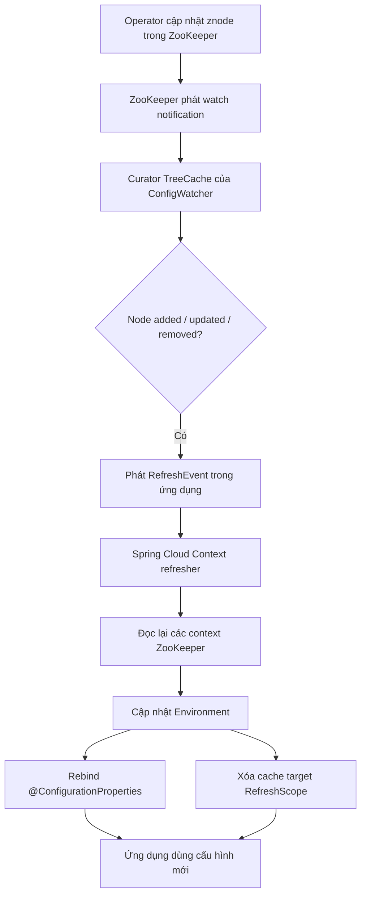

# Theo dõi namespace cấu hình và kích hoạt quá trình làm mới

Spring Cloud Zookeeper Config đọc cấu hình từ cây dữ liệu phân cấp của Apache ZooKeeper và đưa các giá trị vào Spring `Environment`. Khi một key trong namespace cấu hình thay đổi, ứng dụng cần nạp lại dữ liệu để các bean sử dụng giá trị mới. Có hai cách kích hoạt: gửi yêu cầu refresh thủ công qua Actuator hoặc dùng watcher của Spring Cloud Zookeeper để phát hiện thay đổi trong các context đã đăng ký.

Watcher giúp mỗi instance theo dõi namespace cấu hình mà nó sử dụng. Khi có node được tạo, cập nhật hoặc xóa, watcher phát một sự kiện refresh trong chính ứng dụng đó. Việc phát hiện thay đổi và việc áp dụng giá trị mới là hai bước liên quan nhưng khác nhau: watcher chỉ kích hoạt quy trình; `Environment`, `@ConfigurationProperties`, `@RefreshScope` và các bean phụ thuộc vẫn phải tuân theo cơ chế refresh của Spring Cloud.

## Mục tiêu học tập

Sau bài này, bạn có thể:

- Giải thích namespace và context mà Spring Cloud Zookeeper Config theo dõi.
- Phân biệt watcher cấu hình với Dependency Watcher của Spring Cloud Zookeeper Discovery.
- Cấu hình `spring.cloud.zookeeper.config.watcher.enabled` theo phiên bản.
- Mô tả cách Curator `TreeCache` phát hiện node được thêm, sửa hoặc xóa.
- Phân biệt refresh tự động qua watcher với refresh thủ công bằng `/actuator/refresh`.
- Xác minh thay đổi đã đến từng instance và đã được áp dụng vào bean.
- Xử lý các tình huống mất kết nối ZooKeeper, context chưa tồn tại và thay đổi nhiều key.
- Bảo vệ quyền đọc namespace và endpoint refresh trong môi trường production.

## Namespace cấu hình là gì?

ZooKeeper lưu dữ liệu dưới dạng cây znode. Mỗi znode có một đường dẫn, có thể chứa dữ liệu và các znode con. Spring Cloud Zookeeper Config dùng một nhánh của cây này làm namespace cấu hình. Mặc định, root là `/config`.

Với ứng dụng `order-service` đang chạy profile `prod`, các context tự động thường tương ứng với:

```text
/config/order-service,prod
/config/order-service
/config/application,prod
/config/application
```

Context cụ thể nhất nằm ở đầu danh sách. Context dùng chung `application` áp dụng cho nhiều ứng dụng; context `order-service` chỉ dành cho ứng dụng có tên tương ứng. Dấu phẩy là profile separator mặc định. Có thể thay đổi root, default context và profile separator bằng cấu hình `spring.cloud.zookeeper.config`.

Ví dụ cấu trúc ZooKeeper KV:

```text
/config
  /application
    /platform
      /request-timeout       = 3s
  /application,prod
    /logging
      /level
        /root                = WARN
  /order-service
    /payment
      /gateway
        /connect-timeout     = 2s
  /order-service,prod
    /payment
      /gateway
        /connect-timeout     = 4s
```

Các đường dẫn con được ánh xạ thành property key có dấu chấm. Ví dụ `/config/order-service/payment/gateway/connect-timeout` tương ứng với `payment.gateway.connect-timeout` trong ứng dụng.

## Kết nối Config Client với ZooKeeper

Ứng dụng cần dependency `spring-cloud-starter-zookeeper-config`:

```xml
<dependency>
    <groupId>org.springframework.cloud</groupId>
    <artifactId>spring-cloud-starter-zookeeper-config</artifactId>
</dependency>
```

Với Spring Boot 2.4 trở lên, Config Data import là cách mặc định để nạp cấu hình:

```yaml
spring:
  application:
    name: order-service
  profiles:
    active: prod
  config:
    import: "optional:zookeeper:zk-1.internal:2181"
  cloud:
    zookeeper:
      config:
        enabled: true
```

Nếu dùng ZooKeeper local mặc định, có thể viết `optional:zookeeper:` để kết nối `localhost:2181`. Bỏ `optional:` nếu ứng dụng phải dừng khởi động khi không đọc được cấu hình. Địa chỉ trong `spring.config.import` có độ ưu tiên cao hơn `spring.cloud.zookeeper.connect-string`.

Với Config Data import, không cần `bootstrap.yml`. Nếu dự án vẫn dùng bootstrap legacy, `spring-cloud-starter-bootstrap` hoặc `spring.config.use-legacy-processing=true`, các thuộc tính ZooKeeper Config cần được đặt trong `bootstrap.yml` theo tài liệu của release train đang sử dụng.

## Watcher cấu hình hoạt động như thế nào?

Spring Cloud Zookeeper dùng Apache Curator để làm việc với ZooKeeper. Trong implementation hiện hành, `ConfigWatcher` tạo một `TreeCache` cho mỗi context được cấu hình. `TreeCache` theo dõi cây node bên dưới context và nhận các sự kiện:

- `NODE_ADDED`: một znode được tạo.
- `NODE_UPDATED`: dữ liệu hoặc trạng thái node được cập nhật.
- `NODE_REMOVED`: một znode bị xóa.

Khi nhận một trong các sự kiện trên, watcher phát `RefreshEvent` vào Spring Application Context. Hạ tầng refresh của Spring Cloud nhận sự kiện và chạy quy trình làm mới cấu hình. Mục đích là để instance đọc lại các property source từ ZooKeeper mà không cần người vận hành gọi HTTP thủ công.



Watcher theo dõi context cấu hình của ứng dụng, không theo dõi toàn bộ cây ZooKeeper. Với Config Data import tự động, các context được tính từ application name và active profiles. Với import chỉ định đường dẫn, watcher sử dụng các context được resolve từ import đó.

## Bật hoặc tắt watcher

Thuộc tính điều khiển watcher là:

```yaml
spring:
  cloud:
    zookeeper:
      config:
        watcher:
          enabled: true
```

Trong implementation hiện hành, watcher được bật mặc định khi lớp `RefreshEndpoint` có trên classpath và `spring.cloud.zookeeper.config.enabled` đang bật. Có thể đặt `false` nếu muốn chỉ refresh theo lệnh vận hành:

```yaml
spring:
  cloud:
    zookeeper:
      config:
        watcher:
          enabled: false
```

Tài liệu Spring Cloud Zookeeper 4.1.3 và 5.0.2 mô tả việc theo dõi namespace cấu hình là có sẵn. Một số tài liệu cũ, chẳng hạn tài liệu 3.0.0-M3 và tài liệu Spring Cloud 2023.0.0-SNAPSHOT, ghi rõ tính năng watch chưa được triển khai. Vì vậy, không nên suy ra tính năng có mặt chỉ từ tên starter; hãy đối chiếu tài liệu và dependency version thực tế của ứng dụng.

Trong source hiện hành, auto-configuration còn yêu cầu `RefreshEndpoint` trên classpath. Nếu muốn dùng endpoint HTTP thủ công, thêm Spring Boot Actuator và expose endpoint `refresh` có chủ đích. Việc watcher tự phát sự kiện và việc endpoint HTTP được expose là hai vấn đề riêng.

## Theo dõi context tự động và context tùy chỉnh

### Context tự động

Giả sử:

```yaml
spring:
  application:
    name: order-service
  profiles:
    active: prod
  config:
    import: "zookeeper:zk-1.internal:2181"
```

Config Data resolver tạo các context theo application name, default context và profile. Watcher sử dụng danh sách context đã resolve để tạo `TreeCache`. Khi một key ở `/config/order-service,prod` thay đổi, instance đang theo dõi context đó nhận sự kiện và kích hoạt refresh.

### Context tùy chỉnh trong import

Có thể chỉ định rõ các context cần đọc:

```yaml
spring:
  config:
    import: "optional:zookeeper:zk-1.internal:2181/platform/shared;/teams/commerce"
```

Trong ví dụ này, ứng dụng yêu cầu đọc `/platform/shared` và `/teams/commerce`. Với Config Data implementation hiện hành, các context đã resolve cũng được cung cấp cho watcher; watcher theo dõi những đường dẫn này thay vì tự suy ra bốn context mặc định.

Không nên cấu hình import tùy chỉnh mà quên điều chỉnh quyền ACL cho các path tương ứng. Ứng dụng cần quyền đọc cả dữ liệu và quyền theo dõi các node mà Curator phải đăng ký watch.

## Refresh thủ công bằng Actuator

Nếu phiên bản đang dùng chưa hỗ trợ watcher, watcher bị tắt hoặc cần kích hoạt refresh theo một quy trình vận hành có kiểm soát, có thể gọi endpoint Actuator.

Thêm dependency Actuator nếu ứng dụng chưa có:

```xml
<dependency>
    <groupId>org.springframework.boot</groupId>
    <artifactId>spring-boot-starter-actuator</artifactId>
</dependency>
```

Expose endpoint `refresh`:

```yaml
management:
  endpoints:
    web:
      exposure:
        include: health,refresh
```

Gửi HTTP POST đến endpoint. Với base path mặc định `/actuator`:

```bash
curl -X POST http://localhost:8080/actuator/refresh
```

Nếu `management.endpoints.web.base-path` đã được đổi, URL sẽ thay đổi theo. Phản hồi trả về các key được nhận diện là đã thay đổi trong Environment. Gọi `/refresh` trên một instance chỉ làm mới instance đó; nó không tự gửi lệnh đến tất cả replica.

Trong môi trường nhiều instance, có thể dùng watcher để mỗi instance tự theo dõi ZooKeeper, hoặc dùng hệ thống điều phối gọi refresh trên từng instance. Không giả định một lệnh HTTP vào một pod sẽ refresh các pod còn lại.

## Watcher và refresh khác nhau ở đâu?

| Cơ chế | Điều gì kích hoạt? | Phạm vi tác động | Phù hợp khi |
|---|---|---|---|
| ZooKeeper Config Watcher | Znode được thêm, cập nhật hoặc xóa trong context đang theo dõi | Instance có watcher trên context đó | Muốn mỗi instance tự phát hiện thay đổi |
| `POST /actuator/refresh` | Người vận hành hoặc automation gửi HTTP POST | Instance nhận request | Cần refresh thủ công, kiểm thử hoặc dùng release không có watcher |
| Spring Cloud Bus | Một instance phát refresh event qua broker | Các instance nhận event theo Bus destination | Muốn phân phối refresh qua message broker giữa nhiều dịch vụ |
| Restart ứng dụng | Orchestrator hoặc người vận hành khởi động lại process | Instance được restart | Bean/tài nguyên không thể refresh an toàn hoặc cần nạp lại toàn bộ context |

Watcher không phải Spring Cloud Zookeeper Dependency Watcher. Dependency Watcher theo dõi trạng thái service dependency `CONNECTED`/`DISCONNECTED` và gọi listener nghiệp vụ; Config Watcher theo dõi znode trong namespace cấu hình và phát `RefreshEvent`.

## Cấu hình mới được áp dụng vào bean như thế nào?

Refresh làm mới `Environment`, nhưng không đảm bảo mọi object trong JVM đều tự thay đổi. Cần hiểu cách bean tiêu thụ cấu hình:

- Bean `@ConfigurationProperties` được Spring Cloud hỗ trợ rebind trong quy trình refresh.
- Bean `@RefreshScope` được quản lý bằng proxy; refresh xóa target đã cache, target mới được tạo khi proxy được gọi tiếp.
- Singleton tự lưu giá trị cấu hình trong constructor hoặc `@PostConstruct` có thể tiếp tục giữ snapshot cũ.
- HTTP client, connection pool hoặc SDK client được tạo từ URL/credential cũ không tự được xây dựng lại chỉ vì Environment đổi.

Ví dụ bean cấu hình:

```java
@ConfigurationProperties(prefix = "payment.gateway")
public class PaymentGatewayProperties {
    private URI baseUrl = URI.create("https://gateway.example.com");
    private Duration connectTimeout = Duration.ofSeconds(2);

    public URI getBaseUrl() {
        return baseUrl;
    }

    public void setBaseUrl(URI baseUrl) {
        this.baseUrl = baseUrl;
    }

    public Duration getConnectTimeout() {
        return connectTimeout;
    }

    public void setConnectTimeout(Duration connectTimeout) {
        this.connectTimeout = connectTimeout;
    }
}
```

Ví dụ bean phụ thuộc cần tạo lại client khi endpoint thay đổi:

```java
@Configuration(proxyBeanMethods = false)
public class PaymentClientConfiguration {

    @Bean
    @RefreshScope
    WebClient paymentWebClient(PaymentGatewayProperties properties) {
        return WebClient.builder()
                .baseUrl(properties.getBaseUrl().toString())
                .build();
    }
}
```

Trong ứng dụng thực tế, `baseUrl` nên đến từ một thuộc tính đã bind. Ví dụ rút gọn này minh họa rằng bean tạo client cần có vòng đời refresh nếu client phụ thuộc vào cấu hình thay đổi. Hãy tránh lưu snapshot trong singleton khác và kiểm thử việc đóng tài nguyên cũ, request đang chạy cùng trạng thái sau refresh.

## Quy trình kiểm chứng end-to-end

Giả sử `order-service` đang đọc timeout từ ZooKeeper:

```text
/config/order-service/payment/gateway/connect-timeout = 2s
```

Thực hiện kiểm thử trong môi trường development:

1. Khởi động ZooKeeper và xác nhận ứng dụng kết nối được đến `zk-1.internal:2181`.
2. Khởi động hai instance `order-service` và xác nhận cả hai đọc giá trị `2s`.
3. Dùng `zkCli.sh` hoặc công cụ quản trị được phê duyệt để đọc znode hiện tại:

```text
get /config/order-service/payment/gateway/connect-timeout
```

4. Cập nhật znode:

```text
set /config/order-service/payment/gateway/connect-timeout 4s
```

5. Nếu watcher được hỗ trợ và bật, quan sát log/event của cả hai instance để xác nhận mỗi instance nhận refresh event.
6. Kiểm tra giá trị trong `Environment` hoặc bean `@ConfigurationProperties` trên từng instance.
7. Gọi chức năng sử dụng timeout và xác nhận client/tài nguyên liên quan đã dùng giá trị mới.
8. Nếu watcher bị tắt, gửi `POST /actuator/refresh` riêng đến từng instance rồi lặp lại bước kiểm tra.
9. Khởi động lại một instance và xác nhận nó nạp giá trị hiện tại từ ZooKeeper.

Với `zkCli.sh`, znode cha phải tồn tại trước khi tạo node con. Có thể tạo từng cấp bằng `create`, rồi dùng `set`, `get`, `ls` và `stat` để kiểm tra. Không dùng lệnh `deleteall` hoặc thao tác xóa rộng trên root cấu hình trong môi trường dùng chung.

## Lưu ý về nhiều instance và sự kiện thay đổi hàng loạt

Mỗi instance chạy Config Client có Curator client và watcher riêng. Khi cùng theo dõi một context, các instance có thể nhận thông báo thay đổi và tự refresh. Đây là cách khác với Spring Cloud Bus: không cần một broker trung tâm để phát refresh event giữa các ứng dụng.

Một lần phát hành cấu hình có thể tạo nhiều sự kiện nếu quy trình ghi cập nhật từng znode riêng lẻ. Implementation watcher phát `RefreshEvent` khi nhận node added, updated hoặc removed; không nên giả định mọi bản cập nhật hàng loạt được gộp thành đúng một refresh. Hãy kiểm thử tải và hành vi refresh khi cập nhật nhiều key liên tiếp. Nếu muốn thay đổi có tính nhất quán, thiết kế quy trình ghi theo transaction/multi operation của ZooKeeper hoặc lưu một tài liệu cấu hình trong một znode thay vì cập nhật rời rạc nhiều key.

ZooKeeper watch là cơ chế thông báo thay đổi, không phải message log bền vững để replay mọi event. Khi client mất kết nối hoặc session được thiết lập lại, cần xác minh watcher đã hoạt động trở lại và Environment đã được nạp theo trạng thái hiện tại của ZooKeeper. Đừng dựa vào số lượng event để chứng minh mọi instance đã đồng bộ; hãy đọc giá trị hiệu lực sau refresh.

Một lưu ý từ implementation hiện hành: khi watcher khởi tạo `TreeCache` cho một context không tồn tại và nhận `NoNodeException`, context đó được bỏ qua trong lần khởi tạo. Vì vậy, hãy tạo root/context cần theo dõi trước khi ứng dụng khởi động, hoặc kiểm thử riêng việc tạo context mới sau startup trên đúng release train. Không giả định mọi path được tạo muộn đều tự động được watcher phát hiện.

## Bảo vệ namespace và endpoint refresh

Watcher cần quyền đọc các context được theo dõi. Quyền ghi nên giới hạn theo team hoặc service, tránh để một ứng dụng sửa cấu hình dùng chung ngoài phạm vi trách nhiệm. Với ZooKeeper ACL, cấp quyền đọc cho Config Client trên các path cần thiết và quyền ghi chỉ cho pipeline hoặc operator được ủy quyền.

Nếu dùng digest ACL, Spring Cloud Zookeeper cho phép cấp thông tin xác thực cho `CuratorFramework` thông qua `addAuthInfo`. Ví dụ trong tài liệu Spring Cloud Zookeeper sử dụng bootstrap configuration để đăng ký Curator bean. Với Config Data import, cần kiểm tra cách cung cấp Curator customizer/credential theo đúng phiên bản, không sao chép nguyên cấu hình bootstrap legacy vào application config.

Endpoint `/actuator/refresh` có thể thay đổi hành vi ứng dụng, do đó:

- Chỉ expose endpoint `refresh` khi có nhu cầu vận hành.
- Bảo vệ bằng Spring Security, mTLS hoặc gateway quản trị.
- Giới hạn truy cập theo mạng và danh tính automation.
- Ghi audit người gọi, thời điểm, instance và kết quả.
- Không expose endpoint management trực tiếp ra Internet.
- Không ghi secret hoặc toàn bộ Environment vào log khi chẩn đoán.

Nếu watcher tự động đáp ứng nhu cầu, có thể không expose endpoint HTTP refresh cho người dùng cuối. Dù vậy, phải có một quy trình dự phòng cho tình huống watcher bị tắt hoặc không thể kết nối ZooKeeper.

## Xử lý lỗi thường gặp

| Hiện tượng | Nguyên nhân có thể gặp | Cách xử lý |
|---|---|---|
| Thay đổi znode nhưng ứng dụng không refresh | Watcher không có trong release train, bị tắt hoặc thiếu `RefreshEndpoint` class | Kiểm tra version, `spring.cloud.zookeeper.config.watcher.enabled` và dependency graph |
| Chỉ một instance nhận thay đổi | Instance khác mất kết nối, không theo dõi context đó hoặc ACL không đủ | Kiểm tra Curator connection, context list và quyền đọc trên từng instance |
| `/actuator/refresh` trả 404 | Chưa có Actuator, endpoint chưa expose hoặc base path khác | Thêm Actuator, expose `refresh` và kiểm tra management base path |
| POST refresh thành công nhưng bean vẫn dùng giá trị cũ | Bean giữ snapshot hoặc tài nguyên không thuộc refresh scope | Kiểm tra `@ConfigurationProperties`, `@RefreshScope` và cách tạo client |
| Context tùy chỉnh không được theo dõi | Import path khác với path thực tế hoặc resolver không cung cấp context như mong đợi | Kiểm tra URI import, property source và version Config Data |
| Context được tạo sau startup không kích hoạt watcher | Watcher không đăng ký được TreeCache khi path chưa tồn tại lúc khởi tạo | Tạo context trước startup hoặc xác minh hành vi phiên bản đang dùng |
| Nhiều lần refresh khi ghi nhiều key | Mỗi node change tạo một RefreshEvent | Kiểm soát quy trình phát hành và kiểm thử batch update |
| Refresh không hoạt động sau khi ZooKeeper reconnect | Session/cache chưa phục hồi hoặc watcher không theo dõi lại context | Kiểm tra log Curator, trạng thái kết nối và giá trị Environment; restart instance nếu cần |
| Key bị xóa nhưng logic vẫn dùng giá trị cũ | Property source khác hoặc bean đã cache giá trị | Kiểm tra fallback, property source precedence và trạng thái bean sau refresh |

## Checklist vận hành

- [ ] Phiên bản Spring Cloud Zookeeper đang dùng có hỗ trợ Config Watcher.
- [ ] `spring-cloud-starter-zookeeper-config` và Curator client tương thích.
- [ ] `spring.cloud.zookeeper.config.watcher.enabled` được đặt theo chính sách.
- [ ] Root và các context cần theo dõi tồn tại trước khi ứng dụng khởi động.
- [ ] `spring.application.name`, active profiles, root và profile separator đúng.
- [ ] Mỗi instance có thể kết nối ZooKeeper và đọc đúng namespace bằng ACL của nó.
- [ ] Thay đổi node added/updated/removed kích hoạt refresh trên từng instance.
- [ ] `@ConfigurationProperties` và bean `@RefreshScope` nhận giá trị mới.
- [ ] Singleton giữ snapshot và tài nguyên dẫn xuất đã có chiến lược cập nhật.
- [ ] Endpoint `/actuator/refresh` chỉ expose khi cần và được bảo vệ.
- [ ] Đã kiểm thử nhiều key thay đổi liên tiếp, mất kết nối, reconnect và context bị xóa.
- [ ] Có log/audit và cách xác minh giá trị cuối cùng trên từng instance.

## Kết luận

Spring Cloud Zookeeper Config có thể theo dõi các context cấu hình trong ZooKeeper và kích hoạt refresh khi znode được thêm, cập nhật hoặc xóa. Trong implementation hiện hành, `ConfigWatcher` dùng Curator `TreeCache` cho từng context và phát `RefreshEvent`; watcher được điều khiển bằng `spring.cloud.zookeeper.config.watcher.enabled`. Các tài liệu 4.1.3 và 5.0.2 mô tả tính năng watch có sẵn, trong khi một số dòng cũ chưa hỗ trợ, vì vậy phải xác nhận release train trước khi dựa vào cơ chế tự động.

Khi không dùng watcher, có thể gửi `POST /actuator/refresh` đến từng instance. Dù refresh được kích hoạt tự động hay thủ công, vẫn cần kiểm tra `Environment`, `@ConfigurationProperties`, `@RefreshScope` và các tài nguyên do bean singleton tạo ra. Mỗi instance phải được xác minh độc lập; sự kiện refresh không phải bằng chứng rằng mọi node đã áp dụng cấu hình mới.

## Tài liệu tham khảo

- [Spring Cloud Zookeeper 5.0.2 – Distributed Configuration with Zookeeper](https://docs.spring.io/spring-cloud-zookeeper/reference/config.html)
- [Spring Cloud Zookeeper 4.1.3 – Distributed Configuration with Zookeeper](https://docs.spring.io/spring-cloud-zookeeper/reference/4.1/config.html)
- [Spring Cloud Zookeeper – ConfigWatcher source](https://github.com/spring-cloud/spring-cloud-zookeeper/blob/main/spring-cloud-zookeeper-config/src/main/java/org/springframework/cloud/zookeeper/config/ConfigWatcher.java)
- [Spring Cloud Zookeeper – ZookeeperConfigAutoConfiguration source](https://github.com/spring-cloud/spring-cloud-zookeeper/blob/main/spring-cloud-zookeeper-config/src/main/java/org/springframework/cloud/zookeeper/config/ZookeeperConfigAutoConfiguration.java)
- [Spring Cloud Commons – Refresh Scope](https://docs.spring.io/spring-cloud-commons/reference/spring-cloud-commons/application-context-services.html)
