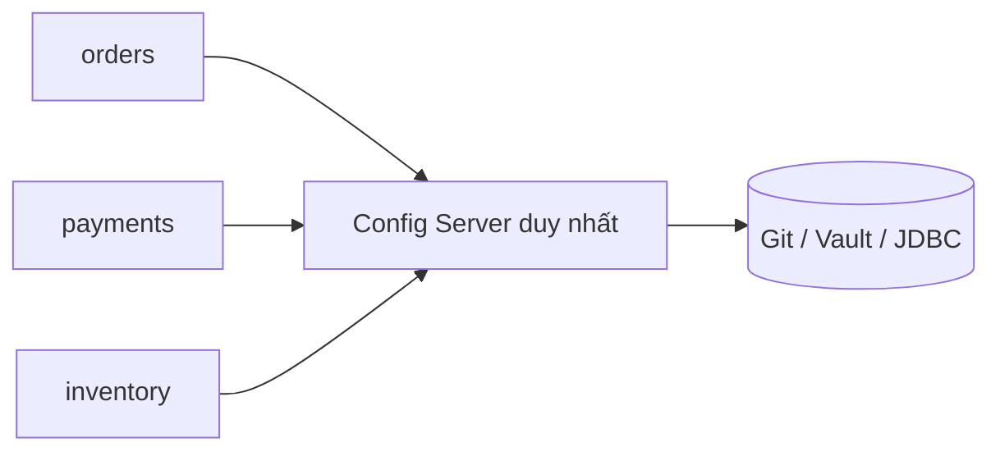
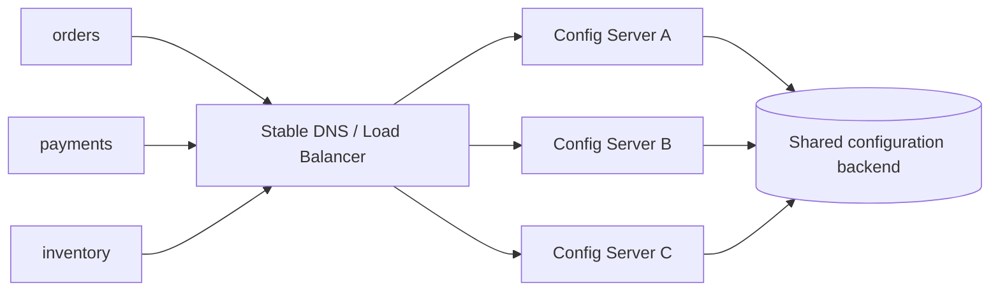
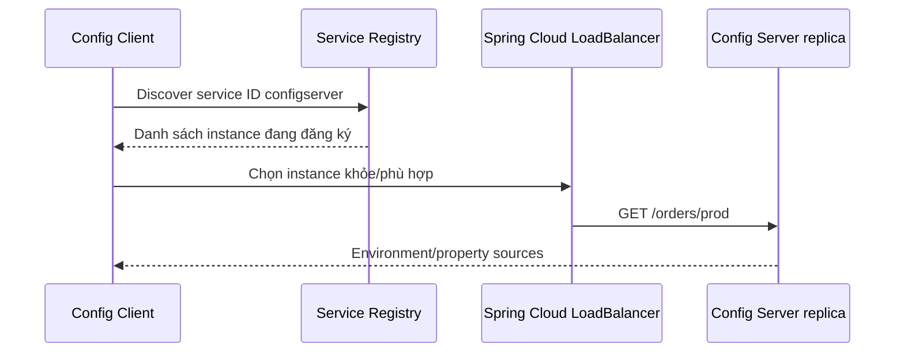

# Cân bằng tải, địa chỉ ổn định và discovery-first

Spring Cloud Config tập trung cấu hình cho nhiều ứng dụng Spring Boot. Nếu Config Server chỉ chạy trên một máy hoặc client phải gọi trực tiếp một địa chỉ IP của instance, sự cố máy chủ, bảo trì hoặc thay đổi hạ tầng có thể làm nhiều ứng dụng không khởi động được hoặc không refresh được cấu hình. Để tăng tính sẵn sàng, cần chạy nhiều Config Server instance, cung cấp một địa chỉ truy cập ổn định và cho client tìm server thông qua service discovery khi kiến trúc phù hợp.

Hai cách phổ biến để client tìm Config Server là **địa chỉ ổn định qua load balancer/DNS** và **discovery-first lookup** qua service registry. Cả hai đều cần health check, kiểm soát phiên bản cấu hình và cơ chế retry/failover. Thêm replica chỉ có ích khi các replica có thể phục vụ cùng một cấu hình và client có thể chuyển sang replica khỏe mạnh khi một instance gặp lỗi.

## 1. Mục tiêu học tập

Sau bài học, bạn có thể:

- Giải thích vì sao Config Server cần nhiều instance và một endpoint ổn định.
- Thiết kế load balancer hoặc DNS/service endpoint để client không phụ thuộc IP của từng instance.
- Cấu hình health check, readiness, graceful shutdown và connection draining.
- Mô tả cách Config Client dùng `DiscoveryClient` để tìm Config Server theo service ID.
- Cấu hình discovery-first bằng `spring.cloud.config.discovery.enabled` và `service-id`.
- So sánh stable endpoint với discovery-first và chọn cách phù hợp với hạ tầng.
- Bảo đảm các Config Server replica đọc cùng phiên bản cấu hình từ Git, Vault, JDBC hoặc Native backend.
- Cấu hình retry, timeout và chính sách fail-fast/optional cho Config Client.
- Kiểm thử failover, đo RTO/RPO và phát hiện trạng thái cấu hình không nhất quán.

## 2. Tính sẵn sàng của Config Server ảnh hưởng đến ứng dụng như thế nào?

Config Client thường lấy cấu hình từ xa trong quá trình khởi động. Nếu Config Server không sẵn sàng, ứng dụng có thể không khởi động được khi cấu hình từ xa là bắt buộc. Trong lúc chạy, Config Client cũng cần kết nối lại Config Server khi refresh hoặc khi có sự kiện từ Spring Cloud Bus.

Một Config Server đơn lẻ tạo ra điểm lỗi tập trung:



Nếu server dừng, nhiều ứng dụng có thể đồng thời mất khả năng lấy cấu hình. Khi có nhiều replica và một endpoint ổn định:



Load balancer loại instance không khỏe khỏi pool và chuyển request đến replica còn hoạt động. Client vẫn gọi một địa chỉ ổn định, không cần biết IP của từng Config Server.

Tuy nhiên, tính sẵn sàng của toàn luồng còn phụ thuộc vào backend, service registry nếu dùng discovery, DNS, network, TLS, message broker và chính client. Ba Config Server replica cùng phụ thuộc một Git server đang ngừng hoạt động vẫn có thể cùng không phục vụ được cấu hình mới.

## 3. Hai cách để client tìm Config Server

| Cách tiếp cận | Client kết nối đến | Thành phần chọn instance | Phù hợp khi |
| --- | --- | --- | --- |
| Stable endpoint | DNS name hoặc virtual IP cố định của load balancer/service | Load balancer, ingress hoặc Kubernetes Service | Hạ tầng đã có endpoint ổn định và muốn client cấu hình đơn giản |
| Discovery-first | Service ID của Config Server trong registry | `DiscoveryClient` và Spring Cloud LoadBalancer | Hệ thống đã vận hành service registry và muốn định tuyến theo instance đang đăng ký |

Không cần áp dụng cả hai cách trong mọi hệ thống. Một Kubernetes Service hoặc internal load balancer thường đã cung cấp stable endpoint. Discovery-first hữu ích khi các ứng dụng đã dùng Eureka, Consul hoặc một implementation `DiscoveryClient` tương thích và cần tìm dịch vụ động.

## 4. Cách 1: Stable endpoint qua DNS hoặc load balancer

Đây là mô hình dễ triển khai và dễ quan sát. Config Server replicas chạy ở các instance khác nhau, còn client chỉ biết một hostname như `config.internal.example`.

Ví dụ client dùng Config Data API:

```yaml
spring:
  application:
    name: orders
  config:
    import: "configserver:https://config.internal.example"
```

Hostname có thể trỏ đến:

- Internal load balancer của cloud provider.
- Ingress hoặc reverse proxy nội bộ.
- Kubernetes Service dạng ClusterIP.
- Virtual IP do hạ tầng mạng quản lý.
- DNS record được cập nhật bởi hệ thống failover.

Config Server replica không cần expose IP riêng cho mọi client. Khi một instance lỗi, load balancer chuyển request đến instance còn khỏe.

### Ví dụ cấu hình Config Server

Các replica cần cùng cấu hình ứng dụng và backend:

```yaml
server:
  port: 8888

spring:
  application:
    name: configserver
  cloud:
    config:
      server:
        git:
          uri: https://git.example.internal/platform/config-repo.git
          default-label: main
          clone-on-start: true
```

Đây là cấu hình minh họa. Mỗi replica dùng cùng repository URI, label mặc định và search paths. `clone-on-start` giúp phát hiện sớm một số lỗi clone repository khi server khởi động; nó không thay thế health check và giám sát fetch trong thời gian chạy.

### Ví dụ client trỏ đến địa chỉ ổn định

```yaml
spring:
  application:
    name: orders
  config:
    import: "configserver:https://config.internal.example"
```

Nếu endpoint yêu cầu authentication, client cần cung cấp credential theo cơ chế được tổ chức chọn. Không đưa username/password hoặc token thật vào file cấu hình được commit.

## 5. Load balancer cần health check đúng

Load balancer phải phân biệt instance đang chạy với instance thực sự sẵn sàng phục vụ request cấu hình.

Spring Boot Actuator cung cấp health endpoint. Với ứng dụng hỗ trợ health groups, có thể dùng readiness endpoint làm cơ sở cho readiness probe:

```yaml
management:
  endpoint:
    health:
      probes:
        enabled: true
  endpoints:
    web:
      exposure:
        include: health,info
```

Các URL thường dùng:

```text
/actuator/health/liveness
/actuator/health/readiness
```

Ý nghĩa:

- **Liveness:** tiến trình có còn sống và có thể tiếp tục chạy không. Liveness không nên thất bại chỉ vì một backend tạm thời không truy cập được, nếu việc restart liên tục sẽ làm tình hình xấu hơn.
- **Readiness:** instance có sẵn sàng nhận request mới không. Có thể gắn readiness với điều kiện cần thiết để phục vụ cấu hình, tùy mức độ phụ thuộc của hệ thống.
- **Backend health:** cần xác định riêng việc Config Server có thể đọc Git/Vault/JDBC hay không. Health indicator mặc định và cách kiểm tra repository phụ thuộc phiên bản, backend và cấu hình health contributor.

Không mặc định rằng HTTP 200 từ `/actuator/health` chứng minh mọi application/profile/label đều có thể được trả về. Health check tổng quát có thể không kiểm tra hết từng repository hoặc từng path. Với hệ thống quan trọng, cần thêm synthetic check gọi một endpoint cấu hình mẫu bằng danh tính kiểm tra có quyền tối thiểu.

### Ví dụ health check của load balancer

Một health check hợp lý nên:

1. Gọi readiness endpoint qua đúng network path mà client sẽ dùng.
2. Xác minh TLS certificate và hostname nếu health checker hỗ trợ HTTPS.
3. Dùng timeout ngắn và ngưỡng fail/success hợp lý.
4. Đưa instance ra khỏi pool sau một số lần kiểm tra thất bại liên tiếp.
5. Chỉ đưa instance trở lại pool khi đã ổn định qua một số lần kiểm tra thành công.

Tránh cấu hình health check quá nhạy khiến một spike ngắn làm loại hàng loạt replica. Cũng tránh kiểm tra chỉ TCP port vì port mở chưa chứng minh ứng dụng có thể xử lý request.

## 6. Readiness và graceful shutdown

Khi triển khai phiên bản mới hoặc bảo trì một Config Server replica, cần ngừng nhận request mới trước khi tiến trình dừng.

Quy trình connection draining:

1. Đưa readiness của instance về trạng thái không sẵn sàng.
2. Load balancer ngừng gửi request mới đến instance.
3. Chờ các request đang xử lý hoàn tất trong giới hạn timeout.
4. Đóng connection đến backend và message broker theo lifecycle của ứng dụng.
5. Dừng tiến trình.

Trong Kubernetes, readiness probe giúp Service loại Pod khỏi endpoints khi Pod không còn sẵn sàng. `preStop` hook và `terminationGracePeriodSeconds` có thể phối hợp để drain request trước khi container kết thúc.

Ví dụ cấu hình triển khai minh họa:

```yaml
spec:
  terminationGracePeriodSeconds: 45
  containers:
    - name: config-server
      ports:
        - name: http
          containerPort: 8888
      readinessProbe:
        httpGet:
          path: /actuator/health/readiness
          port: http
        periodSeconds: 5
        failureThreshold: 3
      livenessProbe:
        httpGet:
          path: /actuator/health/liveness
          port: http
        periodSeconds: 10
        failureThreshold: 3
```

Đây là ví dụ cấu trúc Pod spec, cần điều chỉnh theo phiên bản Kubernetes, Actuator exposure và chính sách readiness thực tế. Không copy cấu hình probe nếu endpoint chưa được bật hoặc bị security chặn.

## 7. Cấu hình nhiều Config Server replica nhất quán

Mọi replica phải phục vụ cùng một logical configuration cho cùng application, profile và label. Nếu mỗi replica trả nội dung khác nhau, load balancing có thể khiến cùng một client nhận kết quả khác nhau giữa các lần gọi.

Các điểm cần đồng nhất:

- Git repository URI, branch/tag/commit và search paths.
- `default-label` và chính sách xử lý label không tồn tại.
- Thuộc tính override chung, placeholder và encryption key nếu dùng mã hóa giá trị.
- Kết nối Vault, namespace, mount path, KV version và policy.
- JDBC schema, dữ liệu, transaction visibility và migration.
- Native filesystem path và nội dung mount nếu dùng Native backend.
- Phiên bản ứng dụng Config Server và Spring Cloud release train.

### Git backend và local clone

Với Git backend, mỗi Config Server replica có thể duy trì local clone/cache riêng. Vì vậy:

- Mọi replica cần trỏ cùng remote repository.
- Khi branch thay đổi, thời điểm fetch có thể khác nhau giữa các replica.
- Nếu `refresh-rate` hoặc cache policy cho phép giữ clone cũ, một replica có thể trả commit cũ trong khi replica khác đã fetch commit mới.
- Dùng immutable commit SHA hoặc tag bất biến khi cần tái lập chính xác một lần triển khai.
- Kiểm tra behavior của webhook/refresh notification và fetch trên từng replica.

Sticky session không giải quyết được vấn đề dữ liệu không đồng nhất. Nó chỉ có thể khiến một client tiếp tục gọi cùng replica trong một thời gian; replica đó vẫn có thể giữ commit cũ.

### Vault và JDBC backend

Với Vault, các replica nên dùng cùng namespace, mount, KV version và chính sách đọc. Vault itself cần HA/replication và token renewal được vận hành đúng.

Với JDBC, các replica cần đọc cùng database hoặc một topology có consistency phù hợp. Nếu đọc từ các read replica có replication lag, hai Config Server có thể tạm thời trả các phiên bản cấu hình khác nhau.

### Native backend

Nếu dùng Native backend, không để mỗi container có một thư mục cấu hình riêng không đồng bộ. Hãy dùng artifact bất biến được phát hành cùng phiên bản, hoặc một volume dùng chung có quy trình cập nhật nguyên tử và quyền mount phù hợp. Không chỉnh sửa trực tiếp file trên một replica rồi kỳ vọng các replica khác tự nhận được.

## 8. Cách 2: Discovery-first lookup

Discovery-first cho phép Config Client tìm Config Server thông qua service registry thay vì biết trước URL của từng instance. Config Server đăng ký service ID trong registry; client dùng `DiscoveryClient` để tra cứu các instance và Spring Cloud LoadBalancer chọn một instance để gọi.

Luồng:



Discovery-first đặc biệt hữu ích trong môi trường có nhiều service động và registry đã là thành phần nền tảng đáng tin cậy. Nó thêm một dependency trong giai đoạn khởi động: client phải truy cập được registry trước khi có thể tìm Config Server.

## 9. Đăng ký Config Server vào service registry

Config Server cần có tên service ổn định, ví dụ `configserver`:

```yaml
spring:
  application:
    name: configserver
```

Khi dùng Eureka, Consul hoặc implementation DiscoveryClient khác, thêm starter tương ứng và cấu hình registration. Các thuộc tính cụ thể của registry khác nhau theo implementation.

Ví dụ minh họa phía Config Server dùng Eureka:

```yaml
spring:
  application:
    name: configserver
  cloud:
    config:
      server:
        git:
          uri: https://git.example.internal/platform/config-repo.git
eureka:
  client:
    service-url:
      defaultZone: https://eureka.internal/eureka/
```

Mọi replica Config Server đăng ký cùng service ID `configserver`, nhưng mỗi instance phải có metadata và instance identity riêng theo registry. Registry cần health check hoặc lease/heartbeat để loại instance đã chết.

Không đăng ký instance trước khi nó sẵn sàng phục vụ nếu registry không có health integration phù hợp. Nếu instance được đăng ký nhưng chưa clone được repository hoặc chưa mở endpoint, client có thể nhận một địa chỉ chưa thể phục vụ.

## 10. Cấu hình discovery-first ở Config Client

Config Client cần có implementation `DiscoveryClient` và cơ chế load balancing phù hợp. Với Eureka, thường dùng Eureka client starter; với Consul, dùng Consul discovery starter. Spring Cloud LoadBalancer cần có trong dependency graph nếu implementation không tự mang theo.

Ví dụ client:

```yaml
spring:
  application:
    name: orders
  config:
    import: "configserver:"
  cloud:
    config:
      discovery:
        enabled: true
        service-id: configserver
```

Trong ví dụ, `service-id` là tên mà Config Server đăng ký trong registry. Giá trị mặc định thường là `configserver`, nhưng nên khai báo rõ nếu tổ chức dùng tên khác.

Các thuộc tính discovery phải sẵn sàng đủ sớm để Config Data import tìm được server. Đặt chúng trong cấu hình cục bộ, biến môi trường hoặc nguồn bootstrap phù hợp; không phụ thuộc vào chính Config Server để cấp thông tin cần thiết nhằm tìm Config Server.

Ví dụ dependency Eureka phía client:

```xml
<dependency>
    <groupId>org.springframework.cloud</groupId>
    <artifactId>spring-cloud-starter-netflix-eureka-client</artifactId>
</dependency>
```

Dependency registry và Config Client phải dùng phiên bản tương thích được quản lý bằng Spring Cloud BOM. Nếu dự án dùng Consul hoặc registry khác, thay bằng starter tương ứng.

## 11. Vấn đề bootstrap dependency và discovery-first

Discovery-first thêm service registry vào chuỗi phụ thuộc khởi động:

```text
Config Client
    -> Service Registry
        -> tìm Config Server
            -> Config Server đọc backend
                -> trả cấu hình cho client
```

Vì vậy, client phải có đủ cấu hình để kết nối registry trước khi lấy cấu hình từ Config Server. Các thông tin bootstrap tối thiểu có thể gồm:

- Registry endpoint hoặc DNS.
- Credential/TLS để xác thực với registry.
- Config Server service ID.
- Timeout và retry ban đầu.

Không đặt duy nhất địa chỉ registry trong cấu hình chỉ có thể lấy từ Config Server. Điều đó tạo vòng phụ thuộc: client cần registry để tìm Config Server, nhưng cần Config Server để biết cách kết nối registry.

Nếu registry không sẵn sàng, client có thể không tìm được Config Server dù các Config Server replica vẫn đang hoạt động. Do đó, service registry cũng cần HA, health check, backup và giám sát riêng.

## 12. Stable endpoint hay discovery-first?

| Tiêu chí | Stable endpoint | Discovery-first |
| --- | --- | --- |
| Cấu hình client | Một URL ổn định | Registry endpoint + service ID + discovery settings |
| Dependency lúc khởi động | DNS/LB/network | Registry, discovery client và load balancer |
| Cập nhật instance | Load balancer hoặc platform quản lý | Registry cập nhật đăng ký instance |
| Quan sát lỗi | LB health, access log, server log | Registry health, discovery result, LB selection, server log |
| Tính linh hoạt | Phụ thuộc khả năng của LB/DNS | Có thể tìm instance động theo metadata/registry |
| Rủi ro chính | LB/DNS trở thành dependency quan trọng | Registry trở thành dependency quan trọng |
| Phù hợp | Hạ tầng có load balancer/service endpoint ổn định | Hệ thống đã chuẩn hóa service discovery |

Chọn stable endpoint khi mục tiêu chính là đơn giản hóa client và hạ tầng đã cung cấp virtual service đáng tin cậy. Chọn discovery-first khi registry là thành phần nền tảng đã được vận hành tốt và ứng dụng cần định tuyến theo service instance.

Không nên dùng discovery-first chỉ để tránh cấu hình một hostname nếu hệ thống chưa có registry HA. Thêm một dịch vụ phụ thuộc có thể làm giảm tính sẵn sàng nếu registry chưa được thiết kế tốt.

## 13. Client retry, timeout và fail-fast

Ngay cả khi có nhiều Config Server, một request vẫn có thể thất bại tạm thời do network timeout, instance bị drain, registry chưa cập nhật hoặc backend chậm. Client cần timeout và retry có giới hạn.

Nguyên tắc:

- Dùng timeout kết nối và timeout đọc phù hợp với thời gian Config Server xử lý.
- Retry có giới hạn, có backoff và jitter để tránh nhiều client cùng retry đồng thời.
- Retry lỗi tạm thời như connection reset, timeout hoặc một số lỗi 5xx.
- Không retry vô hạn với lỗi cấu hình cố định như 401/403, hostname mismatch, certificate không tin cậy hoặc application/profile/label sai.
- Nếu cấu hình từ xa là bắt buộc, fail-fast giúp ứng dụng dừng sớm thay vì chạy với giá trị thiếu.
- Nếu dùng optional import, chỉ tiếp tục khi có fallback an toàn và đã kiểm thử.

Với Config Data API, import không có `optional:` là bắt buộc theo mặc định. Có thể thêm retry parameters theo hỗ trợ của phiên bản Spring Cloud Config. Với bootstrap legacy, một số dự án dùng `spring.cloud.config.fail-fast` và cấu hình retry tương ứng. Không trộn thuộc tính giữa hai cơ chế mà chưa kiểm tra tài liệu phiên bản.

Ví dụ optional khi có fallback an toàn:

```yaml
spring:
  config:
    import: "optional:configserver:https://config.internal.example"
```

Ví dụ required:

```yaml
spring:
  config:
    import: "configserver:https://config.internal.example"
```

Optional không làm Config Server HA hơn. Nó chỉ thay đổi cách client xử lý khi không lấy được nguồn cấu hình. Nếu thiếu cấu hình có thể khiến ứng dụng chạy sai môi trường hoặc lộ dữ liệu, hãy dùng import bắt buộc.

## 14. Không để load balancer che giấu lỗi backend

Load balancer có thể thấy HTTP 200 từ Config Server nhưng nội dung cấu hình vẫn sai hoặc cũ. Ví dụ một replica còn local clone cũ, trong khi replica khác đã fetch commit mới.

Vì vậy, ngoài health check HTTP, nên có synthetic test:

1. Chọn một application/profile/label đại diện.
2. Gọi stable endpoint nhiều lần để request đi qua các replica khác nhau.
3. Kiểm tra commit/version marker hoặc giá trị cấu hình không nhạy cảm.
4. So sánh response giữa các replica.
5. Kiểm tra lỗi khi backend tạm thời không sẵn sàng.

Có thể thêm một property không nhạy cảm như `config.release-id` hoặc `config.revision` vào repository để xác định phiên bản cấu hình được trả về. Không dùng secret làm marker và không ghi toàn bộ Environment ra log.

Nếu mỗi replica có endpoint nội bộ riêng, kiểm tra trực tiếp từng replica trong môi trường vận hành có kiểm soát. Sau đó kiểm tra lại qua stable endpoint để xác nhận load balancer chỉ đưa traffic đến instance đã đạt readiness.

## 15. Triển khai Config Server HA trên Kubernetes

Kubernetes Service cung cấp DNS và virtual IP ổn định cho các Pod Config Server. Client trong cùng cluster có thể gọi Service thay vì IP Pod.

Ví dụ Service:

```yaml
apiVersion: v1
kind: Service
metadata:
  name: config-server
spec:
  selector:
    app: config-server
  ports:
    - name: http
      port: 8888
      targetPort: 8888
```

Client có thể dùng địa chỉ nội bộ tương ứng:

```yaml
spring:
  config:
    import: "configserver:http://config-server:8888"
```

Deployment nên có nhiều replica và readiness probe. Với dịch vụ cấu hình quan trọng, cân nhắc:

- `PodDisruptionBudget` để hạn chế số Pod bị gián đoạn đồng thời.
- `topologySpreadConstraints` hoặc anti-affinity để phân tán replica qua node/zone.
- Rolling update với `maxUnavailable` phù hợp.
- Resource requests/limits đủ cho clone/fetch và request đồng thời.
- Graceful shutdown và termination grace period đủ để drain.
- NetworkPolicy giới hạn ai được gọi Config Server.
- Secret volume hoặc workload identity cho credential backend.

Service chỉ route đến Pod được chọn bởi selector và endpoint readiness. Nó không tự bảo đảm Git repository, Vault hoặc database có tính sẵn sàng tương đương.

## 16. Failure domain và tránh lỗi đồng loạt

Ba replica trên cùng một node hoặc cùng một availability zone vẫn có thể cùng bị ảnh hưởng bởi một sự cố hạ tầng. Hãy phân tán failure domain:

- Chạy replica trên các worker node khác nhau.
- Phân tán qua zone hoặc rack nếu nền tảng hỗ trợ.
- Tránh để tất cả Config Server dùng cùng một volume đơn lẻ.
- Dùng backend có HA riêng và tránh một NAT gateway/network path duy nhất nếu đó là điểm lỗi.
- Đặt registry và broker trên topology phù hợp nếu discovery-first hoặc Bus là thành phần bắt buộc.

Nếu Config Server replicas cùng dùng một backend, backend đó phải chịu được tải và lỗi độc lập. Nếu backend có replication lag, cần xác định mức nhất quán có thể chấp nhận và cách phát hiện replica đọc dữ liệu cũ.

## 17. Refresh và failover khi có nhiều Config Server

Trong hệ thống dùng Spring Cloud Bus, các Config Server/client instance có thể cùng tham gia broker. Khi webhook hoặc pipeline yêu cầu refresh:

1. Config Server nhận thông báo thay đổi.
2. Server phát refresh event qua Bus.
3. Các Config Client nhận event và gọi Config Server thông qua stable endpoint hoặc discovery-first.
4. Load balancer/discovery chọn một Config Server khỏe.
5. Config Server đọc backend và trả Environment mới.
6. Client cập nhật Environment và rebind/refresh bean theo cơ chế ứng dụng.

Nếu một Config Server chết sau khi event được phát, client có thể thử lại qua endpoint hoặc discovery. Nếu tất cả replica cùng không đọc được backend, tăng số Config Server không giải quyết được lỗi đó.

Đảm bảo mọi Config Server replica có cùng encryption key nếu server giải mã giá trị được mã hóa trong repository. Nếu mỗi replica dùng key khác nhau, cùng một property source có thể giải mã thành công ở một instance nhưng thất bại ở instance khác.

## 18. Chẩn đoán lỗi HA và discovery

| Biểu hiện | Nguyên nhân có thể | Cách kiểm tra |
| --- | --- | --- |
| Client không kết nối được stable endpoint | DNS, LB, TLS hoặc network lỗi | Kiểm tra DNS resolution, certificate, LB listener và access log |
| LB gửi request đến replica đang khởi động | Readiness check thiếu hoặc sai | Kiểm tra readiness endpoint và health policy của LB |
| Client chỉ hoạt động khi gọi một IP cụ thể | Stable endpoint hoặc load balancer cấu hình sai | Kiểm tra target pool, routing và health check |
| Discovery không tìm thấy Config Server | Service chưa đăng ký, service ID sai hoặc registry không sẵn sàng | Kiểm tra registry, `spring.application.name` và `service-id` |
| Discovery trả instance đã chết | Heartbeat/lease hoặc health status chưa được cập nhật | Kiểm tra eviction, registry health và cache discovery |
| Config Server replica trả giá trị khác nhau | Git clone/cache, label, backend hoặc key giải mã không đồng nhất | So sánh commit, repository config, marker và backend state |
| Một replica liên tục bị loại khỏi LB | Backend hoặc health check không ổn định | Kiểm tra readiness, log, resource và backend connectivity |
| Client khởi động thất bại khi registry down | Discovery là dependency bắt buộc trong bootstrap | Kiểm tra registry HA, local bootstrap config và retry |
| Retry gây request tăng đột biến | Không có backoff/jitter hoặc retry vô hạn | Giới hạn retry và thêm exponential backoff/jitter |
| Webhook refresh nhưng client lấy config cũ | Replica fetch/cache khác nhau hoặc label sai | Kiểm tra repository revision trên từng Config Server |

## 19. Quy trình kiểm thử failover

Không kết luận hệ thống HA chỉ từ việc có ba replica trong Deployment. Hãy thử các tình huống lỗi có kiểm soát ở môi trường staging.

1. **Baseline:** gọi Config Server qua stable endpoint hoặc discovery-first, ghi lại response và config revision.
2. **Một replica dừng:** dừng một Config Server instance và xác nhận client tiếp tục lấy cấu hình.
3. **Drain:** đưa một replica về not-ready, xác nhận LB không gửi request mới đến instance đó.
4. **Registry lỗi:** với discovery-first, mô phỏng registry không sẵn sàng và quan sát hành vi client mới khởi động và client đang chạy.
5. **Backend lỗi:** mô phỏng Git/Vault/JDBC tạm thời không truy cập và xác nhận readiness/alert/fail-fast theo thiết kế.
6. **Replica không đồng nhất:** kiểm tra phát hiện commit hoặc property marker khác nhau giữa các server.
7. **Network timeout:** xác minh retry có giới hạn và không gây retry storm.
8. **Refresh:** thay một cấu hình không nhạy cảm, phát refresh và xác nhận mọi client instance nhận giá trị mới.
9. **Recovery:** đưa replica trở lại pool sau khi health check thành công và xác nhận nó đồng bộ với backend.
10. **Đo RTO/RPO:** ghi thời gian phục hồi và mức thay đổi cấu hình có thể bị mất hoặc chưa được áp dụng.

### RTO và RPO

- **RTO (Recovery Time Objective):** thời gian tối đa cho phép để hệ thống khôi phục khả năng phục vụ cấu hình.
- **RPO (Recovery Point Objective):** mức mất hoặc độ trễ dữ liệu cấu hình có thể chấp nhận khi xảy ra sự cố.

Với Config Server, RPO thường liên quan đến commit/secret version mà replica đang phục vụ; RTO liên quan đến thời gian chuyển traffic sang replica khác, khôi phục backend hoặc registry. Cần xác định mục tiêu theo yêu cầu thực tế thay vì mặc định rằng load balancer failover là tức thời.

## 20. Checklist production

- [ ] Có ít nhất hai Config Server replica ở failure domain phù hợp.
- [ ] Client dùng stable DNS/LB endpoint hoặc discovery-first đã được lựa chọn rõ ràng.
- [ ] Endpoint ổn định có TLS, hostname verification và authentication phù hợp.
- [ ] Load balancer health check dùng readiness, timeout và threshold hợp lý.
- [ ] Liveness không phụ thuộc trực tiếp vào backend tạm thời theo cách gây restart storm.
- [ ] Có graceful shutdown và connection draining.
- [ ] Replica có cùng repository, label, search paths, encryption key và backend configuration.
- [ ] Git clone/cache hoặc backend consistency được kiểm tra giữa các replica.
- [ ] Nếu dùng discovery-first, registry endpoint có sẵn trước khi Config Client import cấu hình.
- [ ] `spring.cloud.config.discovery.enabled` và `service-id` được cấu hình đúng.
- [ ] DiscoveryClient và Spring Cloud LoadBalancer dependencies tương thích.
- [ ] Registry có health check, heartbeat/lease và HA riêng.
- [ ] Retry có giới hạn, timeout rõ ràng và backoff/jitter.
- [ ] Chính sách fail-fast/optional phù hợp với mức độ bắt buộc của cấu hình.
- [ ] Có synthetic check xác nhận cùng application/profile/label trả cùng revision.
- [ ] Đã thử dừng replica, drain, backend failure và registry failure.
- [ ] Đã đo RTO/RPO và có cảnh báo khi các replica không nhất quán.

## 21. Tài liệu tham khảo

- [Spring Cloud Config — Config Client Discovery First Lookup](https://docs.spring.io/spring-cloud-config/reference/client.html)
- [Spring Cloud Config — Config Server](https://docs.spring.io/spring-cloud-config/reference/server.html)
- [Spring Cloud Commons — Service Discovery](https://docs.spring.io/spring-cloud-commons/reference/spring-cloud-commons/common-abstractions.html)
- [Spring Cloud LoadBalancer](https://docs.spring.io/spring-cloud-commons/reference/spring-cloud-loadbalancer.html)
- [Spring Boot — Actuator Endpoints and Health](https://docs.spring.io/spring-boot/reference/actuator/endpoints.html)
- [Kubernetes — Probes](https://kubernetes.io/docs/concepts/configuration/liveness-readiness-startup-probes/)
