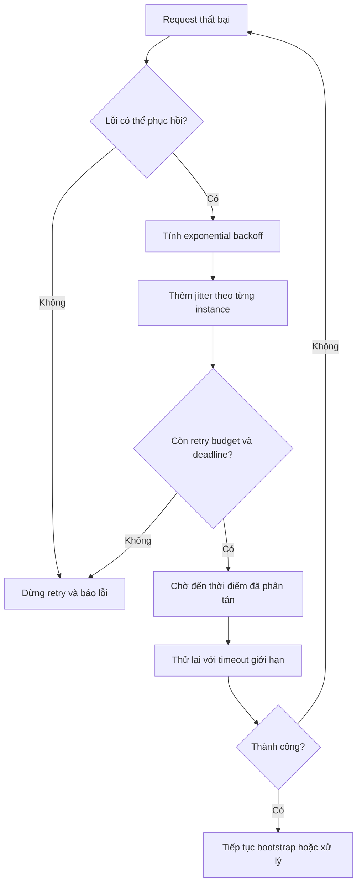

# Tránh đồng loạt retry và refresh sau khi hạ tầng phục hồi

## 1. Vì sao hệ thống có thể quá tải ngay sau khi đã phục hồi?

Khi Config Server, Consul, message broker hoặc mạng nội bộ gặp sự cố, nhiều ứng dụng Spring Boot cùng nhận lỗi. Nếu tất cả instance dùng cùng chính sách retry cố định, chúng có thể thử lại vào cùng thời điểm. Khi hạ tầng bắt đầu hoạt động trở lại, lượng request dồn đến có thể vượt quá khả năng xử lý vừa được khôi phục.

Hiện tượng này thường được gọi là *thundering herd* hoặc retry storm. Nó có thể khiến một sự cố ngắn kéo dài thành sự cố lớn hơn:

- Config Server vừa khởi động lại phải nhận hàng trăm request bootstrap cùng lúc.
- Consul agent phục hồi khiến nhiều Config Watch cùng phát hiện thay đổi và phát refresh event.
- Một lệnh Spring Cloud Bus broadcast làm tất cả client gọi lại Config Server trong cùng khoảng thời gian.
- Kubernetes khởi động lại đồng loạt các Pod đã crash trong lúc dependency unavailable.
- Các lớp retry ở ứng dụng, HTTP client, gateway và service mesh chồng lên nhau, nhân số request.

Mục tiêu của thiết kế high availability không chỉ là thử lại cho đến khi thành công. Hệ thống phải phân tán thời điểm retry, giới hạn lượng công việc phát sinh, phục hồi theo từng nhóm và chỉ đưa instance trở lại nhận traffic khi nó thực sự sẵn sàng.

## 2. Retry storm và refresh storm khác nhau thế nào?

Hai hiện tượng có liên quan nhưng xảy ra ở các giai đoạn khác nhau:

| Hiện tượng | Tác nhân | Request/công việc tăng đột biến ở đâu? |
|---|---|---|
| Retry storm | Các request thất bại được thử lại đồng bộ. | Config Server, Consul, broker, database hoặc dịch vụ phụ thuộc. |
| Startup storm | Nhiều instance cùng khởi động lại sau outage. | Bootstrap Config Client, service registration, cache warm-up và dependency initialization. |
| Refresh storm | Nhiều instance cùng nhận sự kiện refresh hoặc watch notification. | Config Server, Consul KV, bean recreation, connection pool và downstream service. |
| Recovery traffic surge | Lượng traffic người dùng quay lại cùng lúc với retry/refresh. | Toàn bộ chuỗi dịch vụ, đặc biệt các dependency vừa phục hồi. |

Ví dụ có 400 instance `order-service`. Config Server ngừng hoạt động trong 30 giây. Khi server trở lại, cả 400 instance cùng gửi request bootstrap hoặc retry. Nếu một lần retry thất bại lại kích hoạt thêm nhiều lần retry ở các lớp khác, tải thực tế có thể lớn hơn nhiều so với số instance.

Không nên xem việc server đã trả HTTP 200 là dấu hiệu toàn hệ thống đã phục hồi. Server có thể đang hoạt động nhưng CPU, connection pool, Git backend hoặc broker vẫn chưa đủ khả năng nhận tải bình thường.

## 3. Backoff giảm tần suất, jitter phân tán thời điểm

### Exponential backoff

Exponential backoff tăng thời gian chờ sau mỗi lần thất bại. Một công thức phổ biến:

\[
  d_n = \min(d_{max}, d_0 \times m^{n-1})
\]

Trong đó:

- `d0` là thời gian chờ ban đầu.
- `m` là hệ số nhân, thường lớn hơn 1.
- `dmax` là thời gian chờ tối đa.
- `n` là số thứ tự lần thử tiếp theo.

Ví dụ với `d0 = 1 giây`, `m = 2` và `dmax = 16 giây`, lịch chờ xác định là 1, 2, 4, 8, 16, 16 giây. Cách này giảm số request so với retry liên tục.

### Vì sao chỉ backoff vẫn chưa đủ?

Nếu tất cả 400 instance nhận lỗi gần như cùng lúc và đều dùng lịch 1, 2, 4, 8 giây, chúng vẫn có thể gửi request theo từng đợt đồng bộ. Backoff giảm tần suất nhưng không phá được sự đồng bộ.

### Jitter

Jitter thêm độ ngẫu nhiên vào thời gian chờ để các instance không cùng retry tại một thời điểm. Một lựa chọn là *full jitter*:

\[
  d_n = U(0, \min(d_{max}, d_0 \times m^{n-1}))
\]

`U(0, x)` là một giá trị ngẫu nhiên phân bố đều từ 0 đến `x`. Ví dụ, nếu cửa sổ chờ của lần thử là 8 giây, các instance có thể retry tại những thời điểm khác nhau trong khoảng 0–8 giây.

Một lựa chọn khác là *equal jitter*, giới hạn thời gian chờ trong khoảng một nửa đến toàn bộ cửa sổ backoff. Dù chọn biến thể nào, cần có trần thời gian và giới hạn tổng số lần thử.



Backoff và jitter nên đi cùng timeout, giới hạn số lần thử và phân loại lỗi. Retry không giới hạn có thể giữ tài nguyên của client quá lâu và tiếp tục làm quá tải dependency.

## 4. Chỉ retry lỗi tạm thời

Không phải mọi lỗi đều có thể giải quyết bằng thử lại.

| Lỗi | Có nên retry? | Lý do/hành động |
|---|---|---|
| Connection reset, connect timeout | Có giới hạn | Có thể do mạng hoặc server đang phục hồi. Dùng timeout và backoff có jitter. |
| HTTP 502, 503, 504 | Thường có giới hạn | Gateway hoặc server có thể đang quá tải/tạm thời unavailable. Tôn trọng `Retry-After` nếu có. |
| HTTP 429 | Có giới hạn | Tuân theo rate limit và `Retry-After`; không tăng tốc retry. |
| HTTP 401, 403 | Không retry lặp lại | Credential sai hoặc thiếu quyền; sửa token/authorization. |
| Certificate/hostname validation failure | Không retry liên tục | Sửa trust chain, certificate hoặc hostname. |
| YAML sai cú pháp, property không hợp lệ | Không retry | Đây là lỗi dữ liệu cấu hình, cần sửa revision. |
| Application/profile/label không tồn tại | Thường không retry | Xác minh tên và revision; phân biệt 404 do Git backend lỗi với 404 do không có cấu hình. |
| Dependency quá tải | Tạm dừng hoặc giảm retry | Retry có thể làm quá tải nặng hơn; dùng circuit breaker, rate limit và backpressure. |

Với Config Server, cần phân biệt HTTP 404 do cấu hình không tồn tại với 404 phát sinh khi backend Git không truy cập được. Đọc log và nguyên nhân từ server trước khi đưa status code vào retry policy.

## 5. Đặt retry budget và tổng thời gian chờ

Một retry policy cần ít nhất bốn giới hạn:

1. **Số lần thử tối đa**: giới hạn số request cho một lần bootstrap hoặc thao tác.
2. **Timeout mỗi request**: tránh giữ thread/connection vô thời hạn.
3. **Backoff tối đa**: giới hạn khoảng chờ giữa hai lần thử.
4. **Deadline tổng**: giới hạn tổng thời gian ứng dụng chờ dependency.

Tổng thời gian có thể ước tính:

\[
  T_{total} \approx \sum_{i=1}^{N}(T_{request,i} + T_{delay,i})
\]

Trong đó `N` gồm lần gọi đầu và các lần retry. Deadline cần tương thích với startup timeout, deployment rollout và SLA của ứng dụng. Đừng chỉ tăng `max-attempts` mà không tính tổng thời gian chờ.

Nếu một ứng dụng có ba lớp retry lồng nhau — HTTP client, service layer và gateway — mỗi lớp cho phép ba lần thử, một thao tác logic có thể tạo tối đa `3 × 3 × 3 = 27` lần gọi ở tầng dưới. Hãy chọn một lớp chịu trách nhiệm retry chính và hạn chế retry ở các lớp còn lại.

## 6. Cấu hình retry cho Spring Cloud Config Client

Spring Cloud Config Client hỗ trợ retry khi Config Server tạm thời không sẵn sàng lúc khởi động. Với cấu hình hiện hành, cần bật fail-fast và retry:

```yaml
spring:
  cloud:
    config:
      fail-fast: true
      retry:
        enabled: true
        max-attempts: 6
        initial-interval: 1000
        max-interval: 10000
        multiplier: 2.0
```

`max-attempts` của Config Client tính cả lần gọi đầu tiên. Ví dụ `6` nghĩa là một lần gọi đầu và tối đa năm lần retry. Các giá trị trên chỉ là ví dụ; hãy chọn timeout, deadline và backoff dựa trên số instance, năng lực Config Server và ngân sách startup.

Với Spring Boot Config Data import, có thể khai báo nguồn bắt buộc:

```yaml
spring:
  config:
    import: "configserver:https://config.internal"
```

Nếu import nằm trong file profile-specific, ví dụ `application-prod.yml`, các thuộc tính retry có thể cần đặt thành query parameters ngay trong import URL để có sẵn ở thời điểm Config Data xử lý:

```yaml
spring:
  config:
    import: "configserver:https://config.internal?fail-fast=true&max-attempts=6&initial-interval=1000&max-interval=10000&multiplier=2.0"
```

Tài liệu Spring Cloud Config 5.1 hiện hành ghi nhận `spring.cloud.config.retry.useRandomPolicy` đã deprecated và sẽ bị loại trong tương lai. Các phiên bản trước có thể hỗ trợ random exponential policy theo thuộc tính này. Không nên dựa vào thuộc tính deprecated cho thiết kế mới; cần bổ sung jitter ở lớp điều phối hoặc cơ chế retry tùy chỉnh phù hợp với phiên bản đang dùng.

Với release train trước 5.1, cách bật retry và dependency có thể khác. Hãy đối chiếu tài liệu đúng phiên bản BOM thay vì sao chép cấu hình mới vào ứng dụng cũ.

## 7. Retry cho Spring Cloud Consul Config

Spring Cloud Consul có nhóm cấu hình retry dùng cho Config và Discovery registration:

```yaml
spring:
  cloud:
    consul:
      retry:
        enabled: true
        initial-interval: 1000
        max-attempts: 6
        max-interval: 10000
        multiplier: 2.0
```

Theo tài liệu Spring Cloud Consul 5.1, retry startup dùng `spring-retry` và `spring-boot-starter-aspectj`; mặc định là sáu lần thử, thời gian chờ ban đầu 1000 ms và multiplier 1.1. Có thể cung cấp `RetryOperationsInterceptor` với bean ID `consulRetryInterceptor` để kiểm soát retry chi tiết hơn.

Các thuộc tính chuẩn trên mô tả exponential backoff xác định. Không nên giả định chúng tự thêm jitter. Nếu nhiều instance khởi động cùng lúc, cần thêm một trong các cơ chế:

- Tùy chỉnh retry interceptor để dùng backoff ngẫu nhiên theo phiên bản Spring Retry.
- Thêm độ trễ khởi động ngẫu nhiên ở nền tảng triển khai.
- Giới hạn số instance được khởi động đồng thời.
- Chia đợt rollout và chờ readiness trước khi mở rộng.

Retry không sửa được ACL token sai, policy thiếu quyền, TLS certificate không hợp lệ hoặc hostname mismatch. Những lỗi này cần dừng retry sớm và sửa cấu hình.

## 8. Dùng Resilience4j cho các lời gọi do ứng dụng kiểm soát

Khi ứng dụng tự gọi một endpoint cấu hình hoặc dependency khác trong runtime, Resilience4j cho phép định nghĩa retry theo số lần thử, loại exception và hàm tính khoảng chờ.

Ví dụ Java dùng exponential backoff có randomization:

```java
import io.github.resilience4j.core.IntervalFunction;
import io.github.resilience4j.retry.RetryConfig;

import java.io.IOException;
import java.net.SocketTimeoutException;
import java.time.Duration;
import java.util.concurrent.TimeoutException;

IntervalFunction backoffWithJitter =
    IntervalFunction.ofExponentialRandomBackoff(
        Duration.ofMillis(500),
        2.0,
        0.5,
        Duration.ofSeconds(20));

RetryConfig config = RetryConfig.custom()
    .maxAttempts(5)
    .intervalFunction(backoffWithJitter)
    .retryExceptions(IOException.class, TimeoutException.class)
    .ignoreExceptions(IllegalArgumentException.class)
    .build();
```

Ví dụ minh họa cách cấu hình một Retry của Resilience4j; `maxAttempts` bao gồm lần gọi đầu tiên. Hãy bổ sung predicate phù hợp với loại response và exception thực tế của ứng dụng.

Đoạn code này không tự thay thế retry bootstrap bên trong Spring Cloud Config Client hoặc Spring Cloud Consul. Muốn tùy chỉnh retry của bootstrap cần dùng extension point mà đúng phiên bản Spring Cloud cung cấp, hoặc điều phối từ nền tảng khởi động.

## 9. Circuit breaker và giới hạn retry khi dependency đang quá tải

Backoff và jitter vẫn có thể tạo ra lượng request đáng kể nếu số client lớn. Circuit breaker giúp dừng gọi dependency trong một khoảng thời gian khi tỷ lệ lỗi vượt ngưỡng.

Vòng đời thường gồm:

- **Closed**: request được phép đi qua; lỗi được ghi nhận.
- **Open**: tạm chặn request để dependency có thời gian phục hồi.
- **Half-open**: chỉ cho một số ít probe đi qua để kiểm tra dependency đã phục hồi chưa.
- **Closed trở lại**: khi probe thành công đủ điều kiện.

Không nên để mọi instance cùng chuyển sang half-open tại cùng một thời điểm. Cần phân tán thời điểm probe, giới hạn số probe đồng thời và có jitter cho thời gian mở lại circuit nếu thư viện hỗ trợ.

Các biện pháp bổ sung:

- **Retry budget**: giới hạn tỷ lệ request retry so với request gốc trong một cửa sổ thời gian.
- **Rate limiting**: giới hạn tốc độ request đến Config Server hoặc Consul.
- **Bulkhead/concurrency limit**: giới hạn số request đang chờ dependency.
- **Queue/backpressure**: điều tiết công việc thay vì để mọi instance gửi ngay.
- **Load shedding**: từ chối công việc không thiết yếu khi hệ thống đang quá tải.

Circuit breaker không thay thế timeout và retry budget. Nó là một lớp bảo vệ để dependency không bị tiếp tục dồn tải khi đang ở trạng thái lỗi.

## 10. Tránh refresh storm từ Spring Cloud Bus

Spring Cloud Bus có thể phát sự kiện refresh đến nhiều client. Nếu broadcast một sự kiện sau khi Config Server vừa phục hồi, tất cả client có thể đồng thời:

1. Nhận event.
2. Gọi lại Config Server để lấy property sources.
3. Rebind `@ConfigurationProperties`.
4. Invalidate `RefreshScope` cache.
5. Tạo lại bean và kết nối tới downstream service ở lần truy cập tiếp theo.

Một event duy nhất vì thế có thể tạo ra nhiều request và công việc khởi tạo. Bus phân phối sự kiện; nó không tự đảm bảo các client refresh theo lịch ngẫu nhiên hoặc theo từng đợt.

Chiến lược giảm tải:

- Dùng destination để nhắm một service hoặc nhóm instance thay vì broadcast toàn Bus.
- Chia refresh theo nhóm dịch vụ và chờ nhóm trước ổn định.
- Coalesce nhiều thay đổi cấu hình gần nhau thành một refresh cho cùng revision.
- Thêm delay/jitter phía client trước khi thực hiện refresh nếu kiến trúc có custom event handler phù hợp.
- Tránh phát nhiều event cho cùng một commit/revision.
- Theo dõi số client đã xử lý event thay vì chỉ dựa vào HTTP response từ endpoint phát event.

Ví dụ lệnh nhắm đến service:

```bash
curl -X POST http://config-admin:8080/actuator/busrefresh/order-service:**
```

Sau khi xác nhận nhóm `order-service` ổn định, mới phát event đến nhóm tiếp theo. Nếu cần refresh toàn bộ hệ thống, dùng các đợt có giới hạn concurrency thay vì broadcast không kiểm soát.

## 11. Phân tán Config Watch và refresh theo chu kỳ

Với Consul Config Watch, nhiều client có thể cùng theo dõi KV index. Khi Consul phục hồi hoặc một thay đổi KV được áp dụng, nhiều blocking query có thể hoàn tất gần nhau và phát `RefreshEvent`.

Để giảm burst:

- Chọn `watch.delay` và `watch.wait-time` phù hợp với tải Consul, không cấu hình polling quá ngắn.
- Nếu có custom scheduler/watch wrapper, thêm độ lệch khởi động ổn định theo instance và jitter khi reconnect.
- Gộp nhiều thay đổi KV liên tiếp thành một lần refresh nếu nghiệp vụ cho phép.
- Chỉ watch những context ứng dụng thực sự cần.
- Theo dõi số lần refresh và số lần bean recreation sau mỗi index change.

Không nên thêm random sleep vào mọi request nghiệp vụ. Jitter chỉ nên áp dụng ở thời điểm retry, reconnect, scheduled refresh hoặc event handling cần phân tán; không làm tăng latency không cần thiết cho đường đi bình thường.

## 12. Phục hồi theo từng lớp hạ tầng

Sau một outage lớn, khôi phục toàn bộ thành phần cùng lúc có thể tạo thêm tải chéo. Hãy xác định thứ tự dependency:

1. **Network/DNS/TLS**: xác nhận routing, name resolution, certificate và kết nối giữa các vùng.
2. **Consul/Config Server**: khôi phục quorum/agent, Git backend, cache và endpoint health.
3. **Message broker**: khôi phục broker, consumer group và queue lag nếu refresh dùng Bus.
4. **Ứng dụng canary**: khởi động hoặc refresh một số ít instance để xác nhận cấu hình mới.
5. **Mở rộng theo đợt**: tăng số instance và traffic khi metrics cho thấy dependency còn capacity.
6. **Hoàn tất rollout**: chỉ mở toàn bộ traffic sau khi lỗi, latency và backlog đã ổn định.

Config Server có thể đã trả health UP nhưng Git backend vẫn chậm. Broker có thể đã nhận kết nối nhưng consumer lag còn lớn. Consul agent có thể trả health endpoint nhưng KV request vẫn bị ACL từ chối. Vì vậy, readiness cần phản ánh khả năng thực hiện tác vụ cần thiết, không chỉ kiểm tra process đang sống.

## 13. Dùng readiness, startup và liveness đúng mục đích

Trong Kubernetes, ba probe có vai trò khác nhau:

| Probe | Câu hỏi | Cách dùng trong sự cố Config/Consul |
|---|---|---|
| Startup | Ứng dụng đã hoàn thành giai đoạn khởi tạo chưa? | Cho phép bootstrap/retry trong khoảng thời gian được giới hạn. |
| Readiness | Instance có đủ điều kiện nhận traffic không? | Có thể giữ Pod khỏi Service khi cấu hình bắt buộc hoặc dependency thiết yếu chưa sẵn sàng. |
| Liveness | Process có bị deadlock hoặc không thể tự phục hồi không? | Không nên thất bại chỉ vì Config Server/Consul tạm thời unavailable nếu process vẫn khỏe. |

Nếu liveness probe phụ thuộc trực tiếp vào Config Server và Config Server gặp outage, Kubernetes có thể restart hàng loạt Pod đang chạy. Những lần restart này tạo thêm bootstrap request đúng lúc dependency đang yếu. Dùng readiness để điều khiển traffic và startup probe để cho phép khởi động có giới hạn; chỉ dùng liveness cho lỗi thực sự cần restart process.

Ví dụ Deployment giới hạn tốc độ rollout:

```yaml
apiVersion: apps/v1
kind: Deployment
metadata:
  name: order-service
spec:
  replicas: 20
  strategy:
    type: RollingUpdate
    rollingUpdate:
      maxUnavailable: 1
      maxSurge: 2
```

`maxUnavailable` và `maxSurge` giới hạn số Pod bị thay thế hoặc được tạo thêm trong rollout. Chúng giúp rollout phân đợt, nhưng không tự tạo jitter cho retry của ứng dụng. Cần phối hợp với retry policy và readiness probe.

## 14. Dùng last-known-good config và fallback có kiểm soát

Một instance đang chạy thường giữ các property source đã nạp trong Spring `Environment`. Khi Config Server tạm thời mất kết nối, instance có thể tiếp tục dùng cấu hình trong bộ nhớ nếu các dependency nghiệp vụ vẫn hoạt động. Một instance mới khởi động lại có thể không có cấu hình đó và thất bại nếu Config Data import là bắt buộc.

Các phương án:

- Duy trì số instance đang chạy đủ để phục vụ trong khi sửa dependency.
- Dùng cấu hình local/default đã được kiểm tra cho các giá trị thực sự có thể fallback.
- Nếu lưu snapshot last-known-good, gắn revision/label, thời điểm, checksum và chính sách hết hạn rõ ràng.
- Không dùng stale secret hoặc credential đã bị revoke chỉ để duy trì availability.
- Validate property bắt buộc trước khi instance nhận traffic.

`optional:configserver:` hoặc `optional:consul:` cho phép một nguồn cấu hình không có sẵn trong một số trường hợp Config Data. Nó không tự cung cấp bản cấu hình gần nhất và không chứng minh các giá trị local đủ an toàn. Fallback phải được thiết kế riêng.

## 15. Kiểm soát tải Config Server và Consul trong thời gian phục hồi

Ngay cả khi client đã phân tán retry, server vẫn cần giới hạn lượng công việc nhận vào.

- Chạy nhiều Config Server instance sau load balancer nếu kiến trúc cho phép.
- Đảm bảo Git backend/cache không fetch remote quá thường xuyên do từng client.
- Dùng connection pool có giới hạn và timeout hợp lý.
- Giới hạn concurrency của endpoint cấu hình và endpoint refresh.
- Bảo vệ Consul bằng capacity planning cho KV reads, blocking queries và ACL checks.
- Theo dõi broker queue depth/consumer lag trước khi phát thêm refresh event.
- Tránh cache stampede bằng cách coalesce cache miss và phân tán refresh cache.
- Dành capacity cho health check, traffic quản trị và các request quan trọng.

Không tăng số replica của Config Server vô hạn khi backend Git/Consul là nút thắt. Tăng tầng trước mà không kiểm tra capacity tầng sau có thể chỉ chuyển điểm quá tải.

## 16. Ví dụ tính tải retry khi nhiều client phục hồi

Giả sử có 600 client cùng bootstrap sau outage. Mỗi client được phép tối đa 6 lần gọi trong 30 giây.

- Tổng số request tối đa trong cửa sổ đó là `600 × 6 = 3.600` request.
- Nếu phân bố đều, tải trung bình là khoảng `3.600 / 30 = 120` request/giây.
- Nếu mọi client dùng lịch retry giống nhau, tải có thể dồn thành các burst lớn quanh từng mốc backoff; tải đỉnh có thể cao hơn nhiều so với trung bình.
- Nếu thêm full jitter và rollout theo từng nhóm, request được phân tán theo thời gian và giảm concurrency đỉnh.

Đây là ví dụ tính toán minh họa, không phải benchmark cho Config Server. Khi thiết kế thực tế, hãy đo thời gian xử lý, connection pool, Git/Consul latency, tỷ lệ lỗi và capacity của từng dependency.

## 17. Quan sát quá trình phục hồi

Đừng chỉ đo tỷ lệ request thành công. Cần biết retry và refresh đang tạo ra bao nhiêu tải.

| Chỉ số | Điều cần quan sát |
|---|---|
| Config fetch request rate | Số request đến Config Server theo giây và theo application/profile. |
| Retry attempt count | Số lần thử lại, phân bố theo attempt number và client instance. |
| Retry delay histogram | Thời gian chờ thực tế; xác nhận jitter đã phân tán lịch retry. |
| HTTP 429/5xx/timeout | Dấu hiệu server đang bị quá tải hoặc backend chưa ổn định. |
| Config Server latency | p50/p95/p99 và số request đang xử lý. |
| Consul KV latency/watch errors | Khả năng phục hồi của config store và watch loop. |
| Bus queue depth/consumer lag | Sự kiện refresh đang bị dồn hay được xử lý đều. |
| Refresh count per instance | Phát hiện client refresh lặp hoặc nhận event trùng. |
| Ready replica count | Số instance thực sự nhận traffic được. |
| Config revision/label | Xác nhận tất cả client đã dùng đúng revision mong muốn. |
| Bean recreation errors | Phát hiện target `@RefreshScope` không tạo lại được sau refresh. |

Log nên chứa application name, instance ID, revision/label, attempt number, delay và correlation/event ID. Không log secret hoặc toàn bộ cấu hình nhạy cảm.

## 18. Quy trình phục hồi sau outage

Một playbook có thể áp dụng cho Config Server, Consul hoặc broker:

1. **Ngăn khuếch đại**: tạm dừng rollout/restart tự động không cần thiết; giảm hoặc chặn retry không giới hạn.
2. **Ổn định dependency**: xác nhận network, DNS, TLS, Consul, Git backend, Config Server và broker đã sẵn sàng.
3. **Kiểm tra cấu hình**: gọi endpoint bằng một client canary; xác nhận application/profile/label và property source đúng.
4. **Cho một nhóm nhỏ thử lại**: bật một vài instance hoặc một service trước; quan sát latency, error rate và tài nguyên.
5. **Mở rộng theo đợt**: tăng số client sau khi nhóm trước ổn định; giữ giới hạn concurrency và khoảng chờ có jitter.
6. **Refresh có phạm vi**: dùng destination của Bus hoặc cơ chế refresh theo service thay vì broadcast toàn hệ thống ngay lập tức.
7. **Xác nhận hành vi**: kiểm tra bean rebind, `@RefreshScope`, kết nối database/API và health nghiệp vụ.
8. **Mở traffic dần**: tăng tỷ lệ traffic khi readiness và dependency capacity ổn định.
9. **Đóng sự cố**: lưu timeline, peak request rate, retry count, revision và các thay đổi đã thực hiện.
10. **Cải thiện**: điều chỉnh backoff, jitter, retry budget, rollout policy, alert và bài diễn tập.

Nếu tải tăng trở lại, quay về bước giảm tải và mở rộng theo đợt. Đừng phát thêm một broadcast refresh chỉ để thử xem hệ thống đã khỏe hay chưa.

## 19. Lỗi thường gặp

| Triệu chứng | Nguyên nhân | Hướng xử lý |
|---|---|---|
| Config Server vừa lên đã quá tải | Tất cả client retry cùng thời điểm. | Thêm jitter, giới hạn retry, rollout theo đợt và rate limit. |
| Exponential backoff nhưng vẫn có spike | Các client dùng cùng lịch deterministic. | Dùng full/equal jitter hoặc phân tán thời điểm khởi động. |
| Refresh broadcast làm tăng 5xx | Tất cả client cùng fetch Config Server và recreate bean. | Nhắm destination theo service, chia cohort và coalesce event. |
| Pod restart liên tục khi Config Server down | Liveness probe phụ thuộc Config Server. | Tách readiness/liveness và dùng startup probe có deadline. |
| Client retry mãi với 401/403 | Retry mọi lỗi mà không phân loại. | Dừng retry lỗi xác thực/authorization và sửa credential/policy. |
| Nhiều tầng retry tạo lượng request lớn | Retry lồng ở app, HTTP client, gateway và mesh. | Chọn một lớp retry chính, giới hạn tổng attempt và deadline. |
| Consul phục hồi nhưng Config Watch vẫn gây burst | Nhiều watch request cùng nhận index update. | Phân tán watch scheduling/reconnect và giới hạn refresh concurrency. |
| Instance cũ chạy được nhưng instance mới không lên | Process cũ giữ config trong memory; startup mới cần nguồn bắt buộc. | Giữ capacity hiện có, phục hồi Config Server và dùng fallback đã kiểm tra nếu phù hợp. |
| Retry tăng nhưng tỷ lệ thành công không tăng | Dependency vẫn quá tải hoặc lỗi không tạm thời. | Mở circuit, giảm tải và điều tra nguyên nhân gốc. |

## 20. Bài thực hành

### Bước 1: Tạo mô phỏng nhiều client cùng lỗi

Chạy nhiều instance client trong môi trường lab, trỏ về Config Server thử nghiệm. Tạm dừng server trong thời gian ngắn và ghi lại thời điểm các request thất bại.

**Kết quả cần đạt:** quan sát các client bắt đầu retry gần nhau khi dùng lịch cố định.

### Bước 2: Thêm exponential backoff

Cấu hình số lần thử, initial interval, multiplier và max interval cho Config Client hoặc Consul Config theo phiên bản đang dùng.

**Kết quả cần đạt:** giảm tần suất request so với retry liên tục.

### Bước 3: Thêm jitter

Dùng Resilience4j hoặc custom retry interceptor cho thao tác phù hợp, hoặc thêm jitter vào lịch khởi động ở nền tảng. So sánh histogram thời điểm retry của từng instance.

**Kết quả cần đạt:** request được phân tán thay vì tập trung vào một số mốc cố định.

### Bước 4: Thử giới hạn retry và circuit breaker

Đặt max attempts/deadline, phân loại lỗi retryable và non-retryable, sau đó mô phỏng 503, 403 và timeout.

**Kết quả cần đạt:** 503/timeout được retry có giới hạn; 403 dừng sớm và được xử lý như lỗi quyền.

### Bước 5: Thử refresh theo cohort

Chạy nhiều client tham gia Bus. Gửi `busrefresh` đến một service hoặc nhóm instance trước, theo dõi Config Server request rate và refresh count. Sau đó thử broadcast để so sánh.

**Kết quả cần đạt:** hiểu tác động tải của refresh toàn Bus và refresh có phạm vi.

### Bước 6: Diễn tập phục hồi theo đợt

Khôi phục Config Server, chỉ cho một nhóm nhỏ client bootstrap/refresh, xác nhận readiness và mở rộng sang nhóm tiếp theo. Thử cấu hình liveness không phụ thuộc Config Server.

**Kết quả cần đạt:** có playbook phục hồi có kiểm soát và tránh restart storm.

## 21. Tự kiểm tra

1. Retry storm và refresh storm khác nhau ở điểm nào?
2. Vì sao exponential backoff đơn thuần vẫn có thể tạo burst đồng bộ?
3. Jitter làm thay đổi lịch retry như thế nào?
4. Full jitter khác equal jitter ra sao?
5. Vì sao cần retry budget, request timeout và tổng deadline?
6. `max-attempts` của Spring Cloud Config Client tính lần gọi đầu như thế nào?
7. Cần lưu ý gì về `useRandomPolicy` ở Spring Cloud Config 5.1?
8. Spring Cloud Consul retry có tự đảm bảo jitter không?
9. Vì sao không retry vô hạn lỗi 401/403 hoặc certificate invalid?
10. Retry lồng ở nhiều lớp có thể nhân số request như thế nào?
11. Vì sao `busrefresh` broadcast có thể tạo tải lớn ngay sau outage?
12. Làm thế nào phân tán Config Watch và refresh event?
13. Readiness, startup và liveness probe có vai trò gì trong recovery?
14. Vì sao process cũ có thể tiếp tục chạy trong khi instance mới không bootstrap được?
15. Những metrics nào cho biết hệ thống đang phục hồi ổn định?

Khi hoàn thành bài thực hành, người học có thể thiết kế retry có giới hạn và jitter, kiểm soát refresh theo từng nhóm, dùng readiness và rollout để phục hồi dần, đồng thời quan sát tải để tránh biến một outage ngắn thành retry storm kéo dài.

## Tài liệu tham khảo

- [Spring Cloud Config Client – Retry](https://docs.spring.io/spring-cloud-config/reference/client.html): fail-fast, retry properties, max attempts và random policy theo phiên bản.
- [Spring Cloud Consul – Retry](https://docs.spring.io/spring-cloud-consul/reference/retry.html): retry khi Consul unavailable, default backoff và custom `consulRetryInterceptor`.
- [Resilience4j – Retry](https://resilience4j.readme.io/docs/retry): retry predicates, giới hạn attempt và `IntervalFunction`.
- [AWS Builders' Library – Timeouts, retries, and backoff with jitter](https://aws.amazon.com/builders-library/timeouts-retries-and-backoff-with-jitter/): timeout, backoff, jitter và tránh retry đồng bộ.
- [Kubernetes – Liveness, Readiness, and Startup Probes](https://kubernetes.io/docs/concepts/workloads/pods/probes/): phân biệt probe và nguy cơ cascading restart.
- [Kubernetes – Deployments](https://kubernetes.io/docs/concepts/workloads/controllers/deployment/): `maxUnavailable`, `maxSurge` và rolling update.
