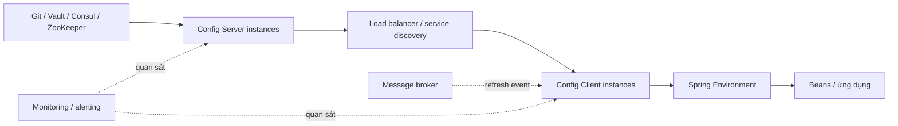
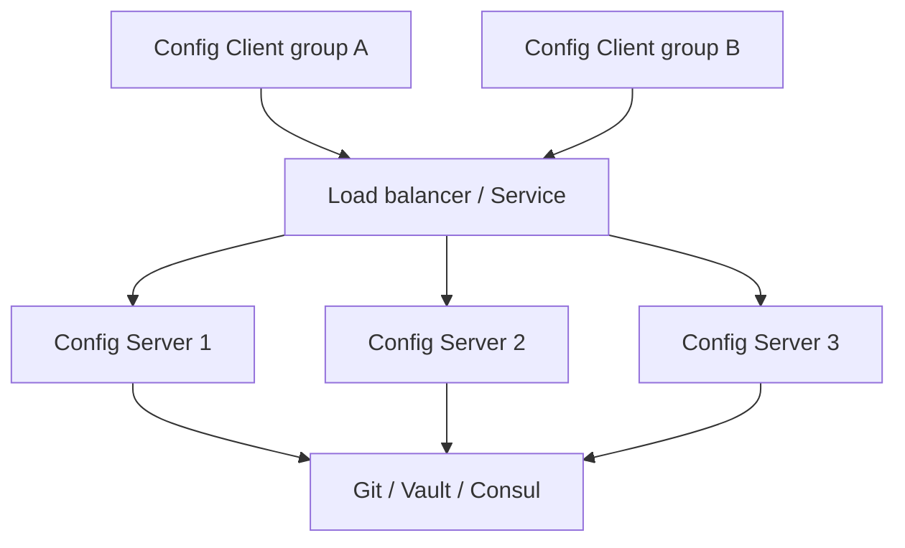

# Đặt tiêu chí phục hồi và kiểm chứng bằng thí nghiệm gây lỗi

Spring Cloud Config là một dịch vụ hạ tầng mà nhiều ứng dụng Spring Boot có thể cần trong lúc khởi động hoặc khi làm mới cấu hình. Nếu Config Server, Git backend, Vault, Consul, ZooKeeper hay message broker gặp sự cố, tác động có thể lan tới nhiều dịch vụ cùng lúc. Vì vậy, thiết kế high availability (HA) không chỉ là chạy nhiều instance Config Server. Nhóm cần xác định **mức gián đoạn có thể chấp nhận, lượng thay đổi cấu hình có thể mất hoặc bị cũ, và bằng chứng cho thấy hệ thống phục hồi đúng cam kết**.

Bài này trình bày cách đặt RTO/RPO và SLO cho hệ thống cấu hình, lập ma trận lỗi, thực hiện fault injection trong môi trường cô lập, đo kết quả và chuyển phát hiện thành runbook. Mục tiêu là kiểm chứng hành vi thực tế của toàn bộ đường đi từ nguồn cấu hình tới Config Client, thay vì chỉ kiểm tra một tiến trình còn chạy.

## 1. Xác định phạm vi phục hồi

Một yêu cầu cấu hình đi qua nhiều thành phần:



Một hệ thống có thể có nhiều Config Server nhưng vẫn không sẵn sàng nếu Git remote là điểm lỗi đơn, load balancer không hoạt động hoặc mọi client cùng phụ thuộc vào một DNS resolver. Ngược lại, Config Server có thể tạm thời không liên lạc được với Git nhưng vẫn phục vụ được một phần request từ working copy cục bộ, tùy trạng thái repository và hành vi của phiên bản Spring Cloud Config đang dùng.

Trước khi đặt mục tiêu, hãy liệt kê các thành phần trong phạm vi:

- **Config Server:** HTTP endpoint, số instance, health/readiness và cấu hình bảo mật.
- **Nguồn cấu hình:** Git, Vault, Consul, ZooKeeper, JDBC hoặc composite repository.
- **Đường truy cập:** DNS, load balancer, service discovery, network policy và TLS.
- **Config Client:** startup import, retry, refresh và cách xử lý khi server không khả dụng.
- **Phân phối refresh:** Spring Cloud Bus và broker nếu hệ thống sử dụng.
- **Lưu trữ phụ trợ:** working copy Git, volume, backup, keystore và secret store.
- **Quan sát:** log, metric, trace, alert và synthetic configuration request.

## 2. Đặt RTO và RPO cho dịch vụ cấu hình

Hai mục tiêu phục hồi cần được định nghĩa bằng phép đo có thể kiểm chứng.

### RTO — Recovery Time Objective

RTO là khoảng thời gian tối đa từ lúc xảy ra sự cố (hoặc được phát hiện theo quy ước đã thống nhất) đến khi dịch vụ phục hồi đạt tiêu chí hoạt động đã định.

Với Config Server, không nên định nghĩa “phục hồi” chỉ là pod đã chạy hoặc cổng HTTP đã mở. Có thể xác định thời điểm kết thúc RTO khi:

1. Endpoint cấu hình đại diện trả response thành công.
2. Response có đúng application, profile, label và revision mục tiêu.
3. Các property bắt buộc có mặt và có giá trị hợp lệ.
4. Config Client thử nghiệm có thể nạp cấu hình hoặc refresh theo mục tiêu.
5. Readiness và cảnh báo trở về trạng thái cho phép nhận tải.

Ví dụ mục tiêu nội bộ (chỉ minh họa, cần điều chỉnh theo nghiệp vụ):

| Sự cố | RTO mục tiêu minh họa | Điều kiện kết thúc |
| --- | ---: | --- |
| Mất một Config Server instance | 2 phút | Load balancer chuyển sang instance khỏe; synthetic GET thành công |
| Mất một node broker | 5 phút | Broker phục hồi; client nhận và xử lý được refresh event mới |
| Git remote tạm thời không truy cập được | 10 phút | Fetch thành công trở lại và Config Server phục vụ revision đã duyệt |
| Mất toàn bộ Config Server trong một vùng | 15 phút | Vùng dự phòng phục vụ đúng cấu hình và client kết nối được |

Không dùng các con số trên như cam kết mặc định của Spring Cloud. RTO phải dựa trên mức độ ảnh hưởng, kiến trúc và kết quả diễn tập.

### RPO — Recovery Point Objective

RPO là mức dữ liệu có thể mất tính theo thời gian hoặc điểm phục hồi. Với hệ thống cấu hình dựa trên Git, nên biểu diễn RPO bằng **revision đã được chấp nhận và có thể khôi phục**, không chỉ bằng timestamp.

Ví dụ, pipeline đã báo phát hành thành công commit `abc123`, nhưng sau sự cố chỉ còn phục hồi được `9f8e7d`. Nếu `abc123` chứa thay đổi cấu hình đã được duyệt, hệ thống chưa đáp ứng mục tiêu RPO dù Config Server đã hoạt động trở lại.

Với nguồn cấu hình khác, xác định điểm phục hồi tương ứng:

- Git: commit/tag đã được push và backup/replica có thể truy xuất.
- Vault: phiên bản secret hoặc snapshot có thể phục hồi, theo engine và policy đang dùng.
- Consul/ZooKeeper: snapshot, backup và quy trình khôi phục KV/znode đã được kiểm thử.
- Database: điểm phục hồi theo transaction log/backup của database.

Với Config Server, còn cần theo dõi **độ cũ của cấu hình (configuration staleness)**: instance đang phục vụ revision cũ hơn revision mục tiêu bao lâu. RPO và staleness có liên quan nhưng không giống nhau: repository có thể không mất commit nào, trong khi một client vẫn chưa nạp commit mới.

## 3. Định nghĩa SLI/SLO cho toàn bộ đường cấu hình

Một SLO hữu ích cần đo được từ góc nhìn của client. Chỉ theo dõi CPU, memory hoặc số pod không đủ để biết ứng dụng có lấy được cấu hình đúng hay không.

| SLI | Cách đo | Câu hỏi trả lời |
| --- | --- | --- |
| Tỷ lệ request cấu hình thành công | Synthetic GET theo application/profile/label | Client có đọc được cấu hình không? |
| Độ trễ request | p50/p95/p99 của Config API | Cấu hình có được trả đủ nhanh không? |
| Revision đang phục vụ | `version` hoặc metadata nguồn nếu backend cung cấp | Instance có đọc đúng revision mục tiêu không? |
| Configuration staleness | Thời gian từ revision được duyệt tới revision client đang dùng | Cấu hình cũ kéo dài bao lâu? |
| Client startup success | Tỷ lệ client khởi động với cấu hình hợp lệ | Sự cố Config Server có chặn rollout không? |
| Refresh completion | Số client nhận event, refresh thành công/thất bại | Thay đổi đã tới những instance nào? |
| Recovery time | Thời gian từ fault injection tới khi đạt điều kiện phục hồi | RTO thực tế là bao nhiêu? |

Ví dụ SLO có thể yêu cầu 99,9% synthetic configuration request thành công trong một cửa sổ 30 ngày và 95% client đạt revision mục tiêu trong vòng 5 phút sau khi phát hành. Đây là ví dụ để bắt đầu thảo luận; không chọn chỉ tiêu trước khi đo baseline và hiểu khả năng phục hồi của từng dependency.

Với hệ thống dùng nhiều label, phải kiểm tra đúng label. Một request trả HTTP 200 cho `main` không chứng minh tag `release-2026` hoặc profile `prod` cũng đọc được.

## 4. Xác định chế độ hoạt động khi một dependency bị lỗi

Trước khi gây lỗi, cần quyết định hệ thống phải làm gì trong từng trường hợp. Không phải mọi lỗi đều nên dẫn tới cùng hành vi.

| Thành phần lỗi | Hành vi có thể chọn | Điều phải đánh đổi |
| --- | --- | --- |
| Một Config Server instance | Load balancer loại instance lỗi và chuyển request sang instance khác | Cần health/readiness chính xác và instance còn lại đủ capacity |
| Tất cả Config Server | Client đang chạy tiếp tục dùng cấu hình đã nạp; client mới có thể không startup được nếu import bắt buộc | Tính liên tục của workload đang chạy khác với khả năng khởi động workload mới |
| Git remote | Có thể đọc working copy hiện có trong một số tình huống; fetch mới hoặc clone mới có thể thất bại | Không được mặc định mọi phiên bản đều fallback về cache cũ |
| Vault/secret store | Từ chối hoặc dùng lease/cache theo chính sách đã thiết kế | Secret hết hạn hoặc bị thu hồi có thể làm client không thể hoạt động an toàn |
| Broker | Config API vẫn có thể đọc được, nhưng refresh event không lan truyền | Các client có thể tiếp tục dùng revision cũ |
| DNS/load balancer | Client không tìm được endpoint dù Config Server còn sống | Cần kiểm thử cả service discovery và đường kết nối trực tiếp |

Hãy viết rõ trạng thái nào là `degraded` và trạng thái nào là `unavailable`. Ví dụ, Config Server trả được cấu hình từ local clone nhưng không thể xác nhận revision mới nhất có thể được xem là degraded, không phải healthy hoàn toàn.

## 5. Thiết kế HA cho Config Server

Một triển khai thường dùng nhiều Config Server instance sau load balancer hoặc service discovery:



Các nguyên tắc thiết kế:

- Triển khai nhiều instance trên failure domain khác nhau, tránh đặt tất cả trên cùng một node hoặc zone.
- Health/readiness phải kiểm tra khả năng phục vụ theo định nghĩa vận hành; cổng HTTP mở không đủ.
- Mỗi instance cần capacity dự phòng để chịu tải khi một instance bị loại.
- Credential, TLS trust và cấu hình backend phải nhất quán giữa các instance.
- Với Git backend, mỗi instance nên có working copy riêng và được kiểm tra theo revision. Không chia sẻ một `basedir` giữa nhiều tiến trình nếu chưa có cơ chế đồng bộ/khóa được hỗ trợ rõ ràng.
- Kiểm tra load balancer, DNS và service discovery như những thành phần có thể lỗi độc lập.
- Có quy trình triển khai rolling để nâng cấp Config Server mà không làm toàn bộ client mất endpoint.

Nhiều Config Server instance không tự động làm nguồn Git/Vault/Consul có HA. Nếu tất cả server vẫn gọi một Git host hoặc một secret store duy nhất, dependency đó có thể trở thành điểm lỗi đơn.

## 6. Thiết kế client chịu được gián đoạn

Config Client thường lấy cấu hình khi startup qua Config Data import. Nếu import bắt buộc, client có thể không khởi động khi Config Server không khả dụng. Nếu import là `optional:`, client có thể tiếp tục với các nguồn local còn lại; chỉ nên dùng khi fallback đã được xác định là an toàn.

Ví dụ import bắt buộc:

```yaml
spring:
  config:
    import: "configserver:https://config-server.internal:8888"
```

Ví dụ optional:

```yaml
spring:
  config:
    import: "optional:configserver:https://config-server.internal:8888"
```

Chọn chính sách theo loại thuộc tính:

- Nếu thiếu endpoint hoặc credential thiết yếu có thể làm ứng dụng gửi dữ liệu sai nơi, ưu tiên fail-fast.
- Nếu cấu hình remote chỉ bổ sung một banner hoặc giá trị không thiết yếu và local fallback an toàn, optional có thể phù hợp.
- Retry cần có timeout, backoff và giới hạn; retry vô hạn có thể kéo dài rollout hoặc gây tải đột biến khi server phục hồi.
- Ứng dụng đang chạy có thể tiếp tục giữ cấu hình đã nạp, nhưng điều đó không bảo đảm bean nào cũng có thể refresh hoặc client mới có thể startup.

## 7. Ma trận fault injection cho Spring Cloud Config

Fault injection là chủ động tạo một lỗi có giới hạn để xác minh giả thuyết phục hồi. Bắt đầu bằng các lỗi nhỏ, có thể đảo ngược và có phạm vi ảnh hưởng hẹp.

| Thí nghiệm | Cách gây lỗi trong staging | Điều cần xác minh |
| --- | --- | --- |
| Mất một Config Server pod | Xóa một pod hoặc dừng một instance thử nghiệm | Load balancer chuyển request; request tiếp tục thành công; RTO nằm trong mục tiêu |
| Mất toàn bộ Config Server | Scale deployment thử nghiệm về 0 trong namespace riêng | Client đang chạy và client mới có hành vi đúng với optional/mandatory policy |
| Git remote không truy cập được | Chặn egress từ Config Server thử nghiệm tới Git | Working copy đã có và working copy rỗng cho kết quả nào; response có revision đúng không |
| Git trả revision mới sau phục hồi | Khôi phục kết nối, thêm commit marker và gọi lại endpoint | Server fetch được commit mới; `version`/marker chuyển sang revision mong muốn |
| Broker bị ngắt | Dừng broker hoặc chặn kết nối của nhóm client thử nghiệm | Config API có còn đọc được; refresh event được xử lý sau khi broker phục hồi không |
| Một client offline khi Bus event phát | Dừng một client consumer trong lúc phát event | Client có bỏ lỡ event không; cách phát refresh/rollout bù khi client quay lại |
| DNS hoặc TLS lỗi | Dùng hostname/certificate thử nghiệm không hợp lệ | Alert, lỗi client và recovery sau khi khôi phục DNS/trust chain |
| Credential backend hết hạn/thu hồi | Dùng credential thử nghiệm đã chuẩn bị cho test | Lỗi được phát hiện, cảnh báo đúng và credential mới được áp dụng |
| Cấu hình không hợp lệ | Đưa một giá trị sai kiểu hoặc thiếu thuộc tính bắt buộc vào branch thử nghiệm | Validation ngăn rollout; rollback về revision tốt hoạt động |
| Mất working copy | Dùng `basedir` tạm riêng rồi tạo instance mới khi Git offline | Server có thể clone lại hay không; startup/readiness thể hiện đúng trạng thái |

Không thực hiện các thao tác trên production nếu chưa có kế hoạch change management và phê duyệt phù hợp. Dùng namespace, Git repository, broker, credential và dữ liệu thử nghiệm riêng.

## 8. Chuẩn bị thí nghiệm và ghi baseline

Trước khi gây lỗi:

1. Chọn một môi trường staging cô lập có cấu hình gần production.
2. Ghi phiên bản Spring Boot, Spring Cloud, Config Server, broker và backend.
3. Chọn một application/profile/label đại diện, ví dụ `billing-api/prod/ha-test`.
4. Đặt một marker không nhạy cảm trong cấu hình, chẳng hạn `ha.test.revision: rev-a`.
5. Ghi Git commit SHA hoặc metadata revision của nguồn cấu hình.
6. Đo baseline: tỷ lệ request thành công, p95 latency, startup time và số client đang hoạt động.
7. Xác nhận dashboard, log, alert và lệnh phục hồi đều hoạt động trước khi bắt đầu.

Ví dụ kiểm tra baseline Config Server:

```bash
curl -sS -o response.json \
  -w 'HTTP %{http_code} | Total %{time_total}s\n' \
  'https://config-server.staging.example/billing-api/prod/ha-test'
```

Kiểm tra response đã loại bỏ secret, ghi lại `name`, `profiles`, `label`, `version` và giá trị marker. Không lưu toàn bộ response chứa password/token vào artifact hoặc log thí nghiệm.

## 9. Quy trình thực hiện một fault injection experiment

Mỗi thí nghiệm nên có giả thuyết, phạm vi, tín hiệu thành công và điều kiện dừng rõ ràng.

### Bước 1: Viết giả thuyết

Ví dụ: “Nếu một Config Server instance bị dừng, load balancer sẽ chuyển request sang instance khỏe trong vòng 2 phút, không làm mất revision cấu hình đang phục vụ.”

Giả thuyết phải có số đo. Tránh mục tiêu mơ hồ như “hệ thống vẫn chạy bình thường”.

### Bước 2: Giới hạn blast radius

- Chỉ chọn một instance hoặc một dependency của staging.
- Dùng credential và dữ liệu không nhạy cảm.
- Không dùng chung broker, Git repo hoặc namespace với production.
- Thông báo cho người phụ trách môi trường và xác định người có quyền dừng thí nghiệm.

### Bước 3: Bắt đầu đo và tạo lỗi

Ghi timestamp bắt đầu, request ID, pod/instance bị tác động và cách fault được tạo. Không tạo nhiều lỗi đồng thời trong thí nghiệm đầu tiên vì sẽ khó xác định nguyên nhân.

### Bước 4: Quan sát trong cửa sổ thử nghiệm

Đo HTTP status, latency, revision, readiness, client startup, refresh result, broker consumer state và alert. Đối chiếu với RTO/RPO/SLO đã đặt.

### Bước 5: Khôi phục và xác minh

Gỡ NetworkPolicy thử nghiệm, khôi phục credential, khởi động backend hoặc scale instance trở lại. Sau đó kiểm tra lại synthetic GET và client startup/refresh. Đảm bảo revision đang phục vụ đúng mục tiêu, không chỉ endpoint trả 200.

### Bước 6: Ghi kết quả

Lưu giả thuyết, fault, timeline, số đo, revision, kết quả, sai lệch và action item. Một thí nghiệm chỉ có giá trị khi có thể tái hiện và giải thích kết quả.

## 10. Ví dụ thí nghiệm: mất một Config Server instance

**Giả thuyết:** khi một instance bị dừng, load balancer loại instance khỏi pool và các request cấu hình tiếp tục thành công qua instance còn lại.

**Chuẩn bị:** staging có hai Config Server instance, health/readiness probe, load balancer và một client thử nghiệm. Cả hai server đọc cùng Git repository và cùng label cố định.

**Thực hiện:**

1. Gửi synthetic GET liên tục tới endpoint cấu hình và ghi p95 latency/status.
2. Dừng một pod thử nghiệm, ví dụ:

   ```bash
   kubectl delete pod <config-server-pod> -n <staging-namespace>
   ```

3. Tiếp tục gửi request qua load balancer trong thời gian phục hồi.
4. Ghi thời điểm pod bị dừng, thời điểm probe phát hiện lỗi và thời điểm request ổn định trở lại.
5. Kiểm tra response `version`/label từ instance còn lại và giá trị marker.
6. Chờ pod được thay thế, xác nhận instance mới sẵn sàng và có thể đọc đúng repository.

**Tiêu chí pass:**

- Request thành công trở lại trong RTO đã đặt.
- Không trả cấu hình từ label hoặc revision ngoài dự kiến.
- Instance còn lại đủ capacity, không vượt error/latency SLO.
- Alert phát hiện instance lỗi và tự hết sau khi phục hồi.

Lệnh trên chỉ dành cho namespace staging đã xác định. Không chạy trên production hoặc namespace dùng chung nếu chưa có change plan và người chịu trách nhiệm.

## 11. Ví dụ thí nghiệm: Git remote mất kết nối

Git outage cần ít nhất hai biến thể vì trạng thái working copy làm thay đổi kết quả:

| Biến thể | Trạng thái trước khi ngắt Git | Câu hỏi |
| --- | --- | --- |
| A | Config Server đã clone repository và có revision hợp lệ | Request có thể được phục vụ từ working copy trong lúc remote offline không? |
| B | Config Server mới, `basedir` trống hoặc chưa clone | Server có thể clone và khởi động khi remote offline không? |

**Thực hiện trong staging:**

1. Tạo Git repo thử nghiệm có marker `rev-a`; khởi động server và xác nhận đã clone.
2. Gọi endpoint và lưu `version`/marker.
3. Chặn egress từ Config Server thử nghiệm tới Git host bằng network policy có phạm vi hẹp.
4. Gọi lại cùng endpoint ngay trong cửa sổ `refresh-rate` và sau khi refresh đến hạn.
5. Tạo instance thứ hai với `basedir` mới trong lúc Git vẫn offline, rồi quan sát startup/request.
6. Khôi phục kết nối Git, push marker `rev-b` và xác nhận server nhìn thấy revision mới.

Không kết luận chung rằng Config Server luôn fallback về local clone khi fetch lỗi. Hành vi phụ thuộc phiên bản, loại lỗi và trạng thái repository; kết quả thí nghiệm chính là bằng chứng cho phiên bản triển khai.

## 12. Ví dụ thí nghiệm: broker ngừng hoạt động

Broker outage không nhất thiết làm Config API ngừng phục vụ. Nó có thể chỉ làm mất khả năng phân phối refresh event trong thời gian broker không khả dụng.

**Giả thuyết:** client tiếp tục đọc cấu hình trực tiếp từ Config Server, nhưng refresh event phát trong lúc broker offline có thể không tới tất cả client. Sau khi broker phục hồi, hệ thống có quy trình đối chiếu revision và phát refresh bù.

Các bước:

1. Ghi revision đang chạy trên ba client thử nghiệm.
2. Dừng broker hoặc chặn kết nối của nhóm thử nghiệm.
3. Thay đổi marker ở Git và xác nhận Config Server trả revision mới.
4. Phát event Bus trong lúc broker offline và ghi nhận phản hồi producer.
5. Khôi phục broker; kiểm tra consumer log và revision từng client.
6. Phát refresh bù hoặc restart client theo runbook; xác minh tất cả instance đạt revision mục tiêu.

Kết quả cần phân biệt: broker đã nhận message, consumer đã nhận event, Config Client đã tải cấu hình và bean đã áp dụng cấu hình là bốn trạng thái khác nhau. Không dùng HTTP 200 từ endpoint phát event làm bằng chứng tất cả client đã cập nhật.

## 13. Điều kiện dừng và rollback thí nghiệm

Một experiment phải có stop condition. Dừng thí nghiệm và khôi phục ngay nếu:

- Fault vượt khỏi namespace hoặc nhóm instance được chọn.
- Synthetic request thất bại vượt ngưỡng abort đã thống nhất.
- Client production hoặc hệ thống dùng chung bị ảnh hưởng ngoài dự kiến.
- Secret, dữ liệu cá nhân hoặc credential thật xuất hiện trong log/artifact.
- Không thể khôi phục dependency trong cửa sổ thí nghiệm.
- Người chịu trách nhiệm yêu cầu dừng.

Trước khi chạy, chuẩn bị hành động khôi phục cụ thể: mở lại network policy, khôi phục replica count, bật broker, cấp credential hợp lệ, phục hồi snapshot hoặc deploy revision cấu hình đã biết. Không bắt đầu thí nghiệm nếu không có quyền và khả năng thực hiện bước phục hồi.

## 14. Đọc kết quả và xác định RTO/RPO thực tế

Sau thí nghiệm, tính các số đo từ timeline:

- **Detection time:** từ lúc tạo lỗi tới lúc alert/probe phát hiện.
- **Failover time:** từ lúc phát hiện tới lúc request đi qua instance còn khỏe.
- **Recovery time:** từ lúc tạo lỗi tới khi toàn bộ điều kiện phục hồi được đáp ứng.
- **Configuration lag:** chênh lệch thời gian hoặc revision giữa cấu hình mục tiêu và cấu hình client đang dùng.
- **Data loss:** commit/secret version đã được xác nhận nhưng không thể phục hồi sau sự cố.

Ví dụ kết quả:

| Chỉ số | Mục tiêu | Đo được | Kết luận |
| --- | ---: | ---: | --- |
| RTO mất một instance | 120 giây | 38 giây | Đạt |
| p95 Config API trong failover | 500 ms | 720 ms | Không đạt |
| Client đạt revision mục tiêu | 300 giây | 410 giây | Không đạt |
| RPO Git | Không mất commit đã xác nhận | Không mất commit | Đạt |

Một experiment có thể đạt RTO nhưng vẫn vi phạm latency SLO hoặc configuration staleness. Không gộp mọi kết quả thành một nhãn “pass” duy nhất; ghi từng tiêu chí và mức độ ảnh hưởng.

## 15. Chuyển phát hiện thành cải tiến kiến trúc

Sau mỗi experiment, nhóm nên phân loại phát hiện:

1. **Thiếu redundancy:** thêm instance hoặc phân tán sang failure domain khác.
2. **Health/readiness không chính xác:** thay probe cổng HTTP bằng synthetic request hoặc kiểm tra dependency theo chính sách.
3. **Dependency đơn điểm:** bổ sung HA cho Git, Vault, Consul, ZooKeeper, broker, DNS hoặc load balancer.
4. **Cache không rõ hành vi:** định nghĩa staleness limit, persistence và quy trình phục hồi working copy.
5. **Client startup mong manh:** điều chỉnh retry, timeout, optional/fail-fast và local fallback.
6. **Refresh không lan truyền đủ:** thêm đối chiếu revision từng instance, retry có giới hạn hoặc rollout bù.
7. **Không quan sát được:** thêm metric, alert, correlation ID và synthetic check.
8. **Runbook thiếu bước:** ghi lệnh, người chịu trách nhiệm, điều kiện rollback và bằng chứng xác nhận phục hồi.

Mỗi action item cần owner, mức ưu tiên, hạn hoàn thành và một experiment lặp lại để xác nhận sửa chữa có hiệu quả.

## 16. Runbook phục hồi mẫu

Khi Config Server không sẵn sàng:

1. Xác định phạm vi: một instance, toàn bộ service, một zone hay backend nguồn cấu hình.
2. Kiểm tra load balancer/service discovery và readiness của từng instance.
3. Kiểm tra Git/Vault/Consul/ZooKeeper, broker, DNS, TLS và credential liên quan.
4. So sánh `version`, label và marker của response với revision mục tiêu.
5. Nếu một instance lỗi, loại instance đó khỏi pool và phục hồi/replace theo deployment policy.
6. Nếu backend lỗi, khôi phục kết nối hoặc chuyển sang backend dự phòng theo runbook; không tự ý dùng cấu hình cũ vô thời hạn.
7. Nếu client đã bỏ lỡ refresh, đối chiếu từng instance và phát refresh bù hoặc rollout lại.
8. Xác minh synthetic GET, client startup/refresh, readiness, latency và revision.
9. Ghi lại timeline, nguyên nhân, dữ liệu bị mất/cũ và action item.

Runbook phải ghi rõ endpoint, dashboard, namespace, tên service, quyền cần thiết và người có quyền thực hiện từng hành động. Không để credential hoặc secret trực tiếp trong tài liệu runbook.

## 17. Lịch diễn tập và quản trị thay đổi

HA không được chứng minh bằng một lần test thành công. Nên có lịch diễn tập phù hợp với mức độ quan trọng của hệ thống:

- Sau khi thay đổi topology Config Server, load balancer hoặc service discovery.
- Sau khi đổi Git backend, Vault, Consul, ZooKeeper hoặc broker.
- Sau khi nâng cấp Spring Boot/Spring Cloud hoặc thay đổi retry/health configuration.
- Định kỳ theo quý hoặc theo yêu cầu kiểm soát nội bộ.
- Sau incident nghiêm trọng để xác nhận biện pháp khắc phục.

Mỗi lần diễn tập cần có change record, người phụ trách, phạm vi, cửa sổ thời gian, stop condition, kế hoạch rollback và kết quả. Tăng dần độ phức tạp: bắt đầu từ mất một instance, sau đó mới thử backend outage, network partition hoặc đồng thời nhiều lỗi trong môi trường chuyên biệt.

## 18. Checklist đặt tiêu chí phục hồi

- [ ] Liệt kê đầy đủ Config Server, backend, broker, network, client và storage dependencies.
- [ ] Định nghĩa RTO cho từng loại sự cố, cùng điều kiện bắt đầu/kết thúc phép đo.
- [ ] Định nghĩa RPO theo revision/secret version có thể phục hồi.
- [ ] Đặt SLO cho request success, latency, client startup, refresh completion và staleness.
- [ ] Quy định hành vi degraded mode khi Git/Vault/broker/Config Server không khả dụng.
- [ ] Xác định local fallback, cache age và điều kiện từ chối cấu hình cũ.
- [ ] Có ít nhất một Config Server redundancy/failover experiment.
- [ ] Thử Git outage với working copy có sẵn và working copy trống.
- [ ] Thử broker outage và xác minh client nào bỏ lỡ refresh event.
- [ ] Có dashboard, alert, synthetic request và revision tracking.
- [ ] Đặt blast radius, stop condition và rollback trước mỗi experiment.
- [ ] Ghi timeline, số đo, kết luận, owner và action item.
- [ ] Lặp lại experiment sau khi cải tiến để xác nhận RTO/RPO đạt mục tiêu.

## 19. Tài liệu tham khảo

- [Spring Cloud Config Reference](https://docs.spring.io/spring-cloud-config/reference/): Config Server, Config Client, Git backend, health indicator và các tùy chọn vận hành.
- [Spring Boot Actuator](https://docs.spring.io/spring-boot/reference/actuator/index.html): health, readiness, liveness và endpoint quan sát.
- [Kubernetes — Liveness, Readiness and Startup Probes](https://kubernetes.io/docs/concepts/configuration/liveness-readiness-startup-probes/): cách phân biệt trạng thái sống, sẵn sàng và khởi động.
- [Google SRE Book — Service Level Objectives](https://sre.google/sre-book/service-level-objectives/): cách đặt SLI/SLO và quản trị độ tin cậy.
- [Principles of Chaos Engineering](https://principlesofchaos.org/): nguyên tắc kiểm thử giả thuyết trong hệ thống phân tán.

Đặt RTO/RPO và SLO biến mục tiêu HA thành tiêu chí có thể đo. Fault injection cho biết hệ thống thực sự phản ứng thế nào khi một thành phần hỏng, còn readback revision và kiểm tra từng client chứng minh cấu hình đã được phục hồi đúng. Kết hợp thí nghiệm có phạm vi, telemetry, stop condition và runbook giúp nhóm biến các giả định về độ sẵn sàng của Spring Cloud Config thành bằng chứng vận hành có thể lặp lại.
