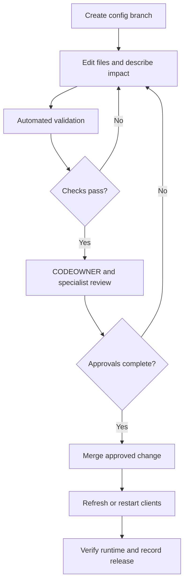

# Quyền sở hữu khóa cấu hình và quy trình review bằng pull request

Trong hệ thống dùng Spring Cloud Config, một thay đổi nhỏ trong file cấu hình có thể ảnh hưởng đến nhiều ứng dụng, nhiều replica hoặc cả một môi trường production. Ví dụ, sửa `application.yml` có thể tác động đến mọi client kế thừa cấu hình dùng chung; sửa `orders-service-prod.yml` chỉ tác động đến một phạm vi hẹp hơn. Vì vậy, cấu hình cần có **chủ sở hữu rõ ràng** và được review qua một quy trình có thể truy vết.

Quyền sở hữu khóa cấu hình xác định nhóm chịu trách nhiệm về ý nghĩa, phạm vi ảnh hưởng và vòng đời của một thuộc tính. Pull request (PR) cung cấp nơi đề xuất, thảo luận, kiểm tra và phê duyệt thay đổi trước khi merge vào branch mà Config Server sử dụng. Kết hợp ownership với PR review giúp tránh thay đổi không rõ trách nhiệm, ghi đè ngoài dự kiến và phát hành cấu hình thiếu kiểm chứng.

## 1. Vì sao cần quyền sở hữu cấu hình?

Trong một repository cấu hình tập trung thường có nhiều loại thuộc tính:

- Thuộc tính nền tảng dùng chung như timeout mặc định, logging, tracing và endpoint nội bộ.
- Thuộc tính riêng cho từng ứng dụng như payment endpoint, retry policy hoặc giới hạn nghiệp vụ.
- Thuộc tính theo môi trường như database host, broker cluster, feature flag và mức tài nguyên.
- Thuộc tính bảo mật như tên secret reference, truststore path hoặc authentication mode.

Nếu không xác định owner, một nhóm có thể thay đổi khóa mà không hiểu consumer khác đang dùng nó. Một thay đổi tưởng như chỉ dành cho một service có thể ghi đè cấu hình chung, phá vỡ thứ tự ưu tiên hoặc khiến một môi trường không thể khởi động.

Ownership tạo ra ba trách nhiệm cụ thể:

1. **Giải thích ý nghĩa:** owner biết property điều khiển hành vi nào, đơn vị và giá trị hợp lệ ra sao.
2. **Đánh giá tác động:** owner biết application, profile, môi trường và tài nguyên nào phụ thuộc vào property.
3. **Chịu trách nhiệm thay đổi:** owner review đề xuất, xác nhận kế hoạch rollout và hỗ trợ rollback khi cần.

Owner không nhất thiết là người duy nhất được sửa file. Đây là nhóm chịu trách nhiệm chuyên môn và phê duyệt trong phạm vi được giao.

## 2. Xác định phạm vi ownership

Nên phân quyền theo phạm vi có ý nghĩa vận hành thay vì chỉ giao toàn bộ repository cho một nhóm. Một ma trận tham khảo:

| Phạm vi cấu hình | Owner chính | Reviewer phối hợp |
|---|---|---|
| Cấu hình nền tảng trong `application.yml` | Platform team | Security và các nhóm ứng dụng bị ảnh hưởng |
| `orders-service*.yml` | Orders team | Platform khi thay đổi hạ tầng hoặc chuẩn chung |
| `payments-service*.yml` | Payments team | Security và Finance/Compliance nếu liên quan thanh toán |
| Database, broker, service discovery | Infrastructure/SRE | Owner của ứng dụng sử dụng tài nguyên |
| TLS, truststore, secret reference và authentication | Security team | Platform và application owner |
| Profile production | Application owner và production operator | Security/SRE theo mức rủi ro |

Có thể phân biệt các vai trò:

- **Property owner:** chịu trách nhiệm về một khóa hoặc nhóm khóa, bao gồm mô tả, giá trị hợp lệ và consumer.
- **File/context owner:** chịu trách nhiệm với tài liệu cấu hình cho một application/profile.
- **Platform owner:** quản lý quy ước chung, thứ tự ưu tiên, backend và khả năng tương thích.
- **Security owner:** review thay đổi liên quan secret, identity, TLS và quyền truy cập.
- **Release operator:** thực hiện phát hành, refresh/restart và xác nhận kết quả ở môi trường đích.

Một người có thể giữ nhiều vai trò ở nhóm nhỏ, nhưng quyết định production có rủi ro cao nên có reviewer độc lập để giảm lỗi do tự kiểm tra thay đổi của chính mình.

## 3. Thiết kế repository để ownership dễ áp dụng

Git thường gán ownership theo đường dẫn file, không theo từng YAML key. Vì vậy, cách tổ chức repository ảnh hưởng trực tiếp đến khả năng yêu cầu đúng nhóm review.

Ví dụ cấu trúc:

```text
config-repo/
├── application.yml
├── application-prod.yml
├── orders-service.yml
├── orders-service-prod.yml
├── payments-service.yml
├── payments-service-prod.yml
├── infrastructure/
│   ├── database.yml
│   └── messaging.yml
└── security/
    ├── tls.yml
    └── identity.yml
```

Với layout này, platform team có thể sở hữu file dùng chung, từng application team sở hữu file riêng, infrastructure team sở hữu nhóm hạ tầng và security team sở hữu các tài liệu bảo mật.

Nếu nhiều nhóm cùng chỉnh các khóa khác nhau trong một file lớn, CODEOWNERS chỉ có thể gán reviewer theo file/path; nó không tự hiểu một YAML key thuộc nhóm nào. Khi cần ownership độc lập, hãy cân nhắc tách file hoặc tách context để ranh giới trách nhiệm trùng với ranh giới review.

Không tách file quá nhỏ nếu làm cấu hình khó tìm, khó hiểu precedence hoặc tạo nhiều context không cần thiết. Cần cân bằng giữa ownership rõ ràng, khả năng đọc và quy tắc nạp cấu hình của Config Server.

## 4. Dùng CODEOWNERS để yêu cầu đúng reviewer

Nhiều nền tảng Git hỗ trợ file `CODEOWNERS` để gán người hoặc team review theo đường dẫn. Ví dụ trên GitHub, file có thể đặt ở `.github/CODEOWNERS`:

```text
# Cấu hình dùng chung do Platform quản lý
/application.yml                 @my-org/platform-config
/application-prod.yml            @my-org/platform-config

# Cấu hình riêng của từng ứng dụng
/orders-service*.yml             @my-org/orders-team
/payments-service*.yml            @my-org/payments-team

# Hạ tầng và bảo mật
/infrastructure/                  @my-org/platform-sre
/security/                        @my-org/security-team
```

Tên tổ chức và team ở ví dụ cần thay bằng team thực tế trong Git hosting. Cú pháp và vị trí CODEOWNERS có thể khác giữa GitHub, GitLab, Bitbucket và các nền tảng tự quản lý.

CODEOWNERS giúp tự động đề xuất hoặc yêu cầu review từ owner theo path, nhưng cần kết hợp với branch protection/ruleset để bắt buộc code owner approval trước khi merge. Chỉ tạo file CODEOWNERS mà không bật chính sách bảo vệ branch thì có thể chưa đủ để ngăn merge thiếu phê duyệt.

Với cấu hình dùng chung, platform owner cần review cả tác động đến application team. Với file riêng của service, application owner chịu trách nhiệm chính; thay đổi liên quan TLS, secret hoặc endpoint hạ tầng vẫn cần reviewer chuyên môn bổ sung.

## 5. Ownership ở cấp key khi một file có nhiều trách nhiệm

CODEOWNERS không gán reviewer theo từng key bên trong YAML. Nếu file chứa nhiều nhóm thuộc tính:

```yaml
app:
  payment:
    timeout: 3s
    endpoint: https://payments.internal

logging:
  level:
    root: INFO

security:
  token-audience: orders-api
```

thì owner của file thường nhận review toàn bộ thay đổi, dù PR chỉ sửa `app.payment.timeout`. Để ownership cấp key rõ hơn, có thể:

- Tách nhóm thuộc tính theo file nếu Config Server vẫn có thể nạp và kết hợp đúng.
- Tách application-specific và shared configuration vào các context khác nhau.
- Duy trì catalog tài liệu về key owner, consumer, kiểu dữ liệu, giá trị hợp lệ và mức độ nhạy cảm.
- Dùng CI kiểm tra thay đổi ở các đường dẫn/keys nhạy cảm và yêu cầu reviewer bổ sung theo policy.

Ví dụ catalog ownership dạng bảng trong tài liệu vận hành:

| Key | Owner | Consumer | Phân loại | Quy tắc thay đổi |
|---|---|---|---|---|
| `app.payment.timeout` | Payments team | Payment client | Runtime tuning | Kiểm tra đơn vị và latency |
| `spring.datasource.url` | Orders + DBA | DataSource lúc startup | Hạ tầng | Cần rollout/restart |
| `server.port` | Platform/SRE | Embedded server | Startup-only | Kiểm tra port và readiness |
| `security.oauth2.resourceserver.jwt.issuer-uri` | Security | JWT decoder | Bảo mật | Security review bắt buộc |

Catalog giúp reviewer biết ai cần tham gia và những kiểm tra nào phải chạy. Nếu catalog được lưu cùng repository, hãy gán owner và review nó như một phần của thay đổi cấu hình.

## 6. Quy trình pull request chuẩn

Một PR cấu hình có thể đi qua các bước:

1. **Tạo branch:** người thay đổi tạo branch từ baseline được phê duyệt.
2. **Chỉnh sửa:** chỉ thay các file/keys cần thiết, giữ diff nhỏ và có mục đích rõ.
3. **Mô tả tác động:** ghi application, profile, label, môi trường, consumer và lý do thay đổi.
4. **Kiểm tra tự động:** chạy YAML/properties validation, schema hoặc policy checks, secret scanning và kiểm tra quy ước tên.
5. **Review chuyên môn:** CODEOWNERS hoặc reviewer được chỉ định kiểm tra semantics, precedence, bảo mật và rollback.
6. **Phê duyệt:** đủ số lượng approval và các required checks theo branch protection.
7. **Merge:** merge vào branch/tag mà Config Server sử dụng theo chiến lược release.
8. **Phát hành:** refresh hoặc restart client phù hợp với loại property.
9. **Xác minh:** kiểm tra Config Server trả đúng version/property source và client thực sự áp dụng giá trị mới.
10. **Ghi nhận:** lưu PR, commit, người phê duyệt, thời điểm phát hành và kết quả.



## 7. Nội dung cần có trong PR

PR cấu hình cần giúp reviewer trả lời được: thay đổi gì, vì sao cần, ai bị ảnh hưởng, làm sao kiểm tra và làm sao quay lại.

Thông tin nên có:

- **Mục tiêu:** vấn đề vận hành hoặc yêu cầu sản phẩm dẫn đến thay đổi.
- **Phạm vi:** application, profile, label/branch và môi trường bị ảnh hưởng.
- **Khóa thay đổi:** danh sách property được thêm, sửa hoặc xóa.
- **Owner:** nhóm chịu trách nhiệm cho property/file và reviewer bắt buộc.
- **Tác động:** consumer, dependency, precedence và thay đổi cần refresh hay restart.
- **Kiểm tra:** validation đã chạy, kết quả test và bằng chứng phù hợp.
- **Bảo mật:** có thay đổi secret reference, identity, TLS hoặc quyền truy cập không; xác nhận không đưa plaintext vào diff.
- **Rollout:** cách phát hành, thời điểm và tiêu chí xác nhận thành công.
- **Rollback:** commit/revision có thể quay lại và điều kiện kích hoạt rollback.

Ví dụ mô tả PR:

```markdown
## Mục tiêu
Giảm timeout gọi payment API từ 5s xuống 3s sau khi đo latency.

## Phạm vi
- Application: payments-service
- Profile: staging, prod
- Files: payments-service-staging.yml, payments-service-prod.yml

## Tác động
- Chỉ thay đổi app.payment.timeout.
- Không đổi endpoint hoặc credential.
- Có thể refresh nếu consumer đọc property động; xác minh bean thực tế.

## Kiểm tra
- YAML validation: PASS
- Config contract check: PASS
- Staging smoke test: pending after merge

## Rollback
Revert commit này nếu timeout error rate hoặc payment failure tăng.
```

Không đưa secret thật, token, password hoặc plaintext đã giải mã vào phần mô tả PR, screenshot, comment hay CI artifact.

## 8. Các lớp kiểm tra tự động trước review

CI giúp phát hiện lỗi cú pháp và quy ước trước khi reviewer phải kiểm tra thủ công. Một pipeline cấu hình có thể gồm:

| Kiểm tra | Mục đích |
|---|---|
| YAML/properties syntax | Phát hiện lỗi indentation, quote, duplicate key hoặc cú pháp sai. |
| Schema/contract validation | Kiểm tra kiểu dữ liệu, required key, enum và giới hạn giá trị. |
| Naming/context validation | Kiểm tra application/profile/file naming và đường dẫn được Config Server sử dụng. |
| Secret scanning | Phát hiện token, password, private key hoặc credential bị commit nhầm. |
| Policy checks | Chặn thay đổi nguy hiểm như wildcard rộng, debug bật ở production hoặc endpoint không được phép. |
| Diff/impact report | Liệt kê application/profile có thể bị ảnh hưởng bởi file chung và khóa thay đổi. |
| Config integration test | Khởi chạy hoặc gọi Config Server test để xác nhận Environment response. |

Ví dụ pipeline có thể chạy YAML lint, secret scanner và custom validation script. CI không nên tự in giá trị secret hoặc dump toàn bộ Environment ra log. Khi cần kiểm tra cấu hình mã hóa, xác minh marker/format và quyền truy cập mà không xuất plaintext.

Kiểm tra tự động không thay thế review chuyên môn. Schema có thể xác nhận `server.port` là số nguyên, nhưng reviewer vẫn cần nhận ra đổi cổng production đòi hỏi rollout và cập nhật routing/probe.

## 9. Review thứ tự ưu tiên và phạm vi ảnh hưởng

Config Server có thể kết hợp cấu hình chung, application-specific và profile-specific. Một PR cần kiểm tra nơi khóa được khai báo và property source nào thắng.

Ví dụ:

```text
application.yml
application-prod.yml
orders-service.yml
orders-service-prod.yml
```

Nếu PR thay `app.payment.timeout` trong `application-prod.yml`, mọi ứng dụng có sử dụng khóa đó ở profile `prod` có thể bị ảnh hưởng. Nếu thay trong `orders-service-prod.yml`, phạm vi hẹp hơn. Tuy nhiên, file riêng có thể bị ghi đè bởi nguồn khác hoặc property source ưu tiên cao hơn; cần xác minh Environment response.

Reviewer nên hỏi:

1. Khóa này nằm ở context chung hay context riêng?
2. Những application/profile nào kế thừa giá trị?
3. Có key cùng tên trong context khác hoặc local environment không?
4. Thay đổi có làm đảo precedence hoặc tạo duplicate key không?
5. Label/branch đang triển khai có chứa commit này không?
6. Client nào cần refresh, client nào phải restart?

Với thay đổi `application.yml`, cần liệt kê nhóm ứng dụng bị ảnh hưởng và có thể phát hành theo đợt. Không chỉ dựa vào tên file để kết luận phạm vi nếu repository có search path hoặc composite backend.

## 10. Review thay đổi nhạy cảm và secret

PR cấu hình cần có review bổ sung khi thay đổi liên quan:

- Database URL, username, credential reference hoặc quyền truy cập.
- OAuth issuer, audience, client identity và authorization scope.
- TLS certificate, truststore, hostname hoặc cipher policy.
- Secret path, Vault role, Consul ACL hoặc ZooKeeper ACL.
- Endpoint nội bộ, network route, broker và service discovery.
- CORS, authentication, authorization hoặc feature flag có tác động bảo mật.

Không commit plaintext secret. Nếu dùng `{cipher}` trong Spring Cloud Config, review cần xác minh ciphertext được tạo bằng key/keystore đúng và Config Server có thể giải mã; không yêu cầu người review paste plaintext vào PR. Nếu dùng Vault/secret manager, chỉ thay reference/path và policy cần thiết, không đưa token hoặc secret value vào Git.

Secret scanning nên chạy trên diff và toàn bộ repository theo chính sách. Nếu secret đã bị commit, xóa khỏi file ở commit sau không làm credential cũ an toàn trở lại; cần revoke/rotate secret và xử lý lịch sử Git theo quy trình incident.

## 11. Branch protection và điều kiện merge

Branch chứa cấu hình production nên được bảo vệ. Các điều kiện thường dùng:

- Chặn direct push và force push trên branch được Config Server theo dõi.
- Yêu cầu PR/MR để mọi thay đổi có diff và lịch sử review.
- Bắt buộc CODEOWNER approval cho các path được bảo vệ.
- Yêu cầu ít nhất một reviewer độc lập; tăng số lượng với thay đổi có rủi ro cao.
- Bắt buộc CI checks thành công trước merge.
- Dismiss approval cũ khi commit mới được push nếu nền tảng hỗ trợ.
- Giới hạn ai có quyền bypass rule và audit mọi lần bypass.
- Dùng signed commit/tag hoặc release approval nếu chính sách tổ chức yêu cầu.

Với GitHub, các quy tắc này thường được cấu hình qua branch protection rules hoặc repository rulesets. GitLab và các nền tảng khác có cơ chế tương đương nhưng tên tùy chọn có thể khác. Cần kiểm tra rằng branch thực sự được Config Server đọc cũng là branch được bảo vệ.

## 12. Phân biệt merge với phát hành cấu hình

Merge PR làm thay đổi nội dung trên branch, nhưng client có thể chưa nhận cấu hình mới. Cần xác định riêng:

- Config Server đang đọc branch, tag hay commit nào.
- Git backend đã fetch commit mới chưa.
- Client cần refresh, nhận Bus event hay restart.
- Có rollout theo nhóm để tránh tất cả instance thay đổi cùng lúc không.
- Làm sao xác nhận mọi client cần thiết đã dùng revision mới.

Với production, có thể dùng tag/release label bất biến hoặc một branch phát hành được kiểm soát. Ghi lại commit SHA cùng label giúp truy vết chính xác hơn chỉ ghi “đã merge PR”. Nếu Config Server dùng branch di động như `main`, cần ghi lại commit thực tế mà server trả về tại thời điểm phát hành.

Thay đổi runtime có thể dùng refresh hoặc Spring Cloud Bus nếu bean hỗ trợ. Thay đổi startup-only như `server.port`, điều kiện tạo bean hoặc lựa chọn connection pool thường cần restart/rolling deployment. PR phải chỉ rõ hành động sau merge.

## 13. Rollback và xử lý thay đổi khẩn cấp

Rollback cấu hình cần được chuẩn bị trước khi merge. Một số cách:

- Revert PR để tạo commit đảo ngược, giữ lịch sử review.
- Khôi phục revision/tag cấu hình đã biết là tốt.
- Chuyển Config Server về label/commit trước nếu quy trình cho phép.
- Phát refresh hoặc restart để client thực sự nạp lại cấu hình rollback.

Không chỉ revert Git rồi giả định client tự quay lại giá trị cũ. Cần xác minh Config Server đã đọc revision rollback và client đã fetch/áp dụng.

Với emergency change, có thể rút ngắn thời gian review nhưng vẫn cần ghi nhận người phê duyệt, lý do, phạm vi, kiểm tra tối thiểu và post-incident review. Nếu phải bypass branch protection, cần có audit và kế hoạch bổ sung PR/review sau khi khôi phục dịch vụ.

## 14. Audit và vòng đời ownership

Ownership cần được cập nhật khi nhóm, dịch vụ hoặc kiến trúc thay đổi. Một quy trình định kỳ nên:

1. Kiểm tra file/property owner còn hoạt động và có người thay thế.
2. Xác nhận CODEOWNERS khớp với team hiện tại.
3. Rà soát service account và quyền merge/bypass.
4. Kiểm tra các PR bị merge mà thiếu approval hoặc CI checks.
5. Xem lại catalog property, consumer và mức độ nhạy cảm.
6. Xóa quyền của người/workload không còn trách nhiệm.
7. Ghi lại release commit, label, người phê duyệt và kết quả rollout.

Audit nên ghi metadata cần thiết nhưng không lưu plaintext secret. Với thay đổi có tác động lớn, lưu liên kết PR, commit SHA, thời gian refresh/restart, application/profile bị ảnh hưởng và kết quả health check.

## 15. Checklist cho reviewer

Trước khi approve một PR cấu hình, reviewer có thể kiểm tra:

- [ ] Mục tiêu và phạm vi application/profile/label được nêu rõ.
- [ ] Owner của file/property đã review.
- [ ] Reviewer bảo mật/hạ tầng đã tham gia nếu thay đổi thuộc phạm vi của họ.
- [ ] Diff chỉ chứa các khóa cần thiết; không có thay đổi ngoài ý muốn.
- [ ] YAML/properties hợp lệ và schema/contract checks đã pass.
- [ ] Không có plaintext secret, token, password hoặc private key.
- [ ] Giá trị mới có kiểu, đơn vị và giới hạn hợp lệ.
- [ ] Precedence và các consumer dùng cấu hình chung đã được đánh giá.
- [ ] Tác động refresh/restart được ghi rõ.
- [ ] CI, secret scanning và policy checks đã pass.
- [ ] Rollout, tiêu chí xác nhận và rollback đã được chuẩn bị.
- [ ] Branch protection và approval policy đã được đáp ứng.

## 16. Tổng kết

- Ownership xác định nhóm chịu trách nhiệm về ý nghĩa, tác động và vòng đời của property/file cấu hình.
- Git ownership thường gắn với path; muốn ownership theo key cần tách file/context hoặc duy trì catalog và policy kiểm tra riêng.
- CODEOWNERS giúp gán reviewer theo đường dẫn; cần branch protection để bắt buộc approval trước merge.
- PR cần mô tả mục tiêu, application/profile/label, consumer, precedence, bảo mật, kiểm tra, rollout và rollback.
- CI nên kiểm tra cú pháp, schema, naming, secret scanning, policy và Config Server response mà không làm lộ secret.
- Review phải đánh giá cả file dùng chung, profile production, label và các nguồn có thể ghi đè giá trị.
- Merge không đồng nghĩa client đã áp dụng cấu hình; cần refresh/Bus hoặc restart tùy loại property.
- Branch protection, audit và rà soát ownership định kỳ giúp thay đổi cấu hình có trách nhiệm và truy vết được.
