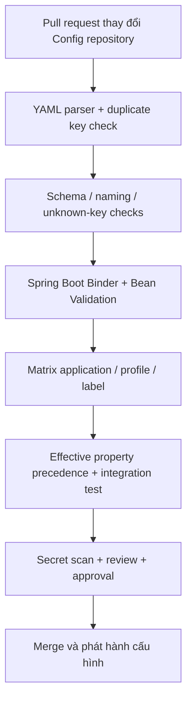

# Kiểm tra cú pháp, kiểu dữ liệu và ràng buộc trước khi hợp nhất

Trong hệ thống dùng Spring Cloud Config, một thay đổi YAML có thể được phân phối đến nhiều ứng dụng, profile và replica. Một file YAML parse thành công chưa có nghĩa ứng dụng có thể bind giá trị, cũng chưa chứng minh cấu hình hợp lệ về mặt nghiệp vụ. Ví dụ `retry-count: "three"` là YAML hợp lệ nhưng không thể bind vào `int`; `timeout: 0s` có thể bind được nhưng không đáp ứng yêu cầu vận hành.

Trước khi hợp nhất thay đổi vào Config repository, cần kiểm tra theo nhiều lớp: cú pháp YAML, cấu trúc và tên khóa, khả năng chuyển kiểu của Spring Boot Binder, ràng buộc validation, giá trị hiệu lực sau khi hợp nhất profile/property source và hành vi của ứng dụng. Config Server có thể đọc và phân phối property source, nhưng không tự động biết mọi quy tắc nghiệp vụ trong `@ConfigurationProperties` của từng Config Client. Vì vậy, pipeline cần kiểm tra cả repository lẫn consumer.

## 1. Mục tiêu học tập

Sau bài học, bạn có thể:

- Phân biệt YAML parse, schema validation, Spring property binding và business validation.
- Phát hiện indentation sai, duplicate key, kiểu dữ liệu mơ hồ và giá trị chưa được quote.
- Thiết kế hợp đồng cấu hình với kiểu, đơn vị, default, phạm vi và giới hạn rõ ràng.
- Dùng `@ConfigurationProperties`, Jakarta Bean Validation và nested validation.
- Kiểm tra `Duration`, `DataSize`, enum, URI, list và map theo đúng kiểu ứng dụng.
- Kiểm tra ràng buộc liên trường và điều kiện phụ thuộc giữa các thuộc tính.
- Kiểm tra application/profile/label và property source precedence trước khi merge.
- Tổ chức CI gate để lỗi cấu hình bị phát hiện trong pull request.
- Kiểm tra placeholder, ciphertext và secret mà không in giá trị nhạy cảm.
- Phân biệt lỗi cấu hình do repository với lỗi do phiên bản code hoặc môi trường triển khai.

## 2. Năm lớp kiểm tra cấu hình

Một quy trình kiểm tra hoàn chỉnh nên tách các lớp sau:

| Lớp | Câu hỏi | Ví dụ lỗi được phát hiện |
| --- | --- | --- |
| 1. YAML syntax | File có parse được không? | Indentation sai, tab, dấu quote chưa đóng |
| 2. Structure/schema | Cấu trúc và tên khóa có đúng hợp đồng không? | Sai prefix, khóa lạ, thiếu trường bắt buộc, duplicate key |
| 3. Type binding | Spring có chuyển giá trị sang kiểu Java không? | Chuỗi không bind được vào `int`, `Duration`, `URI` |
| 4. Constraint validation | Giá trị có nằm trong giới hạn hợp lệ không? | Retry âm, timeout bằng 0, URL rỗng |
| 5. Effective/runtime behavior | Sau profile và override, ứng dụng có hoạt động đúng không? | Profile production thiếu khóa, local override ngoài dự kiến, hai timeout mâu thuẫn |

Các lớp bổ sung cho môi trường production gồm secret scanning, policy kiểm soát nguồn cấu hình và phê duyệt của owner ứng dụng. Không lớp nào thay thế hoàn toàn lớp còn lại.



## 3. Kiểm tra cú pháp YAML trước tiên

YAML dùng indentation để biểu diễn cấu trúc. Một thay đổi thụt lề sai có thể làm khóa chuyển sang cấp khác hoặc khiến parser từ chối file.

Ví dụ hợp lệ:

```yaml
orders:
  client:
    connect-timeout: 500ms
    read-timeout: 3s
    retry:
      max-attempts: 3
```

Ví dụ sai cấu trúc do indentation:

```yaml
orders:
  client:
    connect-timeout: 500ms
   read-timeout: 3s
```

Các công cụ như `yamllint` hoặc YAML parser trong CI có thể phát hiện lỗi cú pháp và style. Cần cấu hình parser ở chế độ từ chối duplicate mapping key nếu công cụ mặc định cho phép key trùng ghi đè key trước đó.

Ví dụ chạy kiểm tra tĩnh:

```bash
yamllint -s config-repo/
```

Lệnh chỉ minh họa khi CI đã cài `yamllint` và có cấu hình phù hợp. Không phải mọi cảnh báo style đều là lỗi runtime, nhưng lỗi parse và duplicate key phải làm pipeline thất bại.

### Các lỗi YAML thường gặp

| Trường hợp | Ví dụ rủi ro | Cách viết an toàn |
| --- | --- | --- |
| Indentation | Một key bị lệch cấp | Dùng spaces nhất quán, thường là 2 spaces |
| Tab | Tab dùng để thụt lề | Chỉ dùng spaces |
| Dấu `:` trong chuỗi | `url: https://host:8443/path` có thể gây khó đọc hoặc parse tùy ngữ cảnh | Quote chuỗi URL: `url: "https://host:8443/path"` |
| Dấu `#` | `password: abc#123` giữ nguyên `#123` trong scalar; `password: abc # comment` bắt đầu inline comment | Quote nếu muốn biểu diễn rõ chuỗi có ký tự đặc biệt |
| Boolean-like value | `enabled: on` có thể được parser cũ diễn giải như boolean | Dùng `true`/`false` cho boolean; quote nếu muốn chuỗi literal |
| Null và chuỗi rỗng | `value:`, `value: null`, `value: ""` có semantics khác nhau | Chọn rõ null, empty hay absent |
| ID có số 0 đầu | `postal-code: 00123` có thể bị chuyển kiểu | Quote ID: `"00123"` |
| Số dạng exponent | `limit: 1e3` có thể bị parser/tool hiểu khác | Dùng số nguyên rõ ràng `1000` nếu trường là integer |
| Chuỗi có khoảng trắng đầu/cuối | Giá trị bị trim hoặc giữ nguyên ngoài dự kiến | Quote và kiểm tra semantics |

Không nên quote tất cả giá trị một cách máy móc. Kiểu YAML sau khi parse cần khớp kiểu hợp đồng: boolean nên là boolean, số nên là số; những giá trị định danh, URL, mã có số 0 đầu hoặc chuỗi có ký tự đặc biệt nên được quote rõ ràng.

### Kiểm tra file `.properties`

Config repository có thể chứa file `.properties` bên cạnh YAML. File này không có cấu trúc indentation; mỗi dòng biểu diễn một key/value, dấu `=` hoặc `:` phân tách key và value, còn dấu `#` hoặc `!` ở đầu dòng (sau khoảng trắng) mở đầu comment.

Ví dụ:

~~~properties
orders.client.connect-timeout=500ms
orders.client.read-timeout=3s
orders.client.region=ap-southeast-1
~~~

Pipeline cần kiểm tra:

- Key/value có dấu phân tách hợp lệ; ký tự `=`, `:`, dấu cách và backslash trong value được escape đúng khi cần.
- Escape Unicode và ký tự xuống dòng không làm thay đổi giá trị ngoài ý muốn.
- Không có duplicate key. Java `Properties` thường giữ giá trị cuối khi key lặp, nên parse thành công chưa đủ để phát hiện lỗi này.
- Dấu `#` hoặc `!` nằm ở đầu dòng mới được xem là comment; chúng nằm trong value không tự động biến phần còn lại thành comment.

Nên dùng parser/linter có chế độ duplicate-key rejection cho `.properties`, hoặc một bước kiểm tra riêng trên artifact cuối cùng. Đừng chỉ dựa vào việc ứng dụng có thể load file.

## 4. Phát hiện duplicate key

YAML mapping không nên chứa cùng một key nhiều lần ở cùng cấp. Một số parser hoặc chế độ tương thích có thể âm thầm giữ giá trị cuối cùng, khiến người review đọc một giá trị nhưng ứng dụng nhận giá trị khác.

Ví dụ không hợp lệ về mặt hợp đồng:

```yaml
orders:
  retry-count: 2
  retry-count: 5
```

Không dựa vào hành vi “last value wins”. Hãy bật duplicate-key rejection trong YAML parser/linter hoặc dùng validation tool có hỗ trợ. Kiểm tra này đặc biệt quan trọng khi merge hai nhánh cùng sửa một phần file.

Duplicate key cũng có thể xuất hiện sau khi merge YAML fragments hoặc generate file. Vì vậy, nên chạy kiểm tra trên artifact cuối cùng mà Config Server sẽ đọc, không chỉ trên đoạn diff.

## 5. Thiết kế hợp đồng cấu hình

Trước khi viết schema hoặc validation, xác định hợp đồng của từng khóa:

- Tên và prefix thuộc application/domain nào.
- Kiểu Java dự kiến sau binding.
- Đơn vị và định dạng được chấp nhận.
- Có bắt buộc hay có default.
- Giới hạn min/max và tập giá trị cho phép.
- Phụ thuộc vào khóa khác hay profile nào.
- Có chứa thông tin nhạy cảm không.
- Owner chịu trách nhiệm phê duyệt thay đổi.

Ví dụ hợp đồng:

| Khóa | Kiểu | Quy tắc |
| --- | --- | --- |
| `orders.client.base-url` | `URI` | Bắt buộc, scheme `https` trong production |
| `orders.client.connect-timeout` | `Duration` | Bắt buộc, lớn hơn 0 |
| `orders.client.read-timeout` | `Duration` | Bắt buộc, không nhỏ hơn connect timeout |
| `orders.client.retry.max-attempts` | `int` | Từ 0 đến 5 |
| `orders.client.retry.backoff` | `Duration` | Bắt buộc và lớn hơn 0 |
| `orders.client.mode` | enum | Chỉ nhận các giá trị được code hỗ trợ |

Tên khóa nên mô tả semantics. `timeout` quá chung; `connect-timeout` và `read-timeout` rõ ràng hơn. Nếu thay đổi đơn vị hoặc ý nghĩa, đó là thay đổi hợp đồng cần migration riêng, không chỉ là sửa giá trị YAML.

## 6. Schema validation và giới hạn của nó

Có thể chuyển YAML sang cấu trúc dữ liệu và kiểm tra bằng JSON Schema hoặc schema tương đương. Schema hữu ích để kiểm tra:

- Các trường bắt buộc.
- Kiểu string/number/boolean/array/object.
- Enum, pattern, minimum/maximum.
- Cấu trúc object và nested properties.
- Trường không được phép xuất hiện nếu bật chế độ từ chối additional properties.

Ví dụ JSON Schema rút gọn cho một nhóm cấu hình:

```json
{
  "$schema": "https://json-schema.org/draft/2020-12/schema",
  "type": "object",
  "required": ["orders"],
  "properties": {
    "orders": {
      "type": "object",
      "required": ["client"],
      "properties": {
        "client": {
          "type": "object",
          "required": ["base-url", "connect-timeout", "read-timeout", "mode", "retry"],
          "properties": {
            "base-url": {"type": "string", "format": "uri"},
            "connect-timeout": {"type": "string", "pattern": "^[1-9][0-9]*(ms|s|m)$"},
            "read-timeout": {"type": "string", "pattern": "^[1-9][0-9]*(ms|s|m)$"},
            "mode": {"type": "string", "enum": ["STANDARD", "STRICT"]},
            "retry": {
              "type": "object",
              "required": ["max-attempts", "backoff"],
              "properties": {
                "max-attempts": {"type": "integer", "minimum": 0, "maximum": 5},
                "backoff": {"type": "string", "pattern": "^[1-9][0-9]*(ms|s|m)$"}
              },
              "additionalProperties": false
            }
          },
          "additionalProperties": false
        }
      }
    }
  }
}
```

Schema trên chỉ là ví dụ cấu trúc. JSON Schema không tự hiểu mọi quy tắc chuyển đổi của Spring Boot Binder; ví dụ `Duration` có thể chấp nhận nhiều dạng chuỗi theo converter và annotation. `format: uri` cũng cần validator bật format assertion nếu muốn coi format là lỗi bắt buộc.

Có thể kiểm tra YAML bằng schema với `check-jsonschema`:

~~~bash
check-jsonschema --schemafile schemas/orders-client.schema.json config-repo/orders-prod.yml
~~~

Pin phiên bản `check-jsonschema` trong CI để kết quả ổn định. Với `format: uri`, xác nhận validator đang thực thi format assertion; không phải mọi JSON Schema validator đều coi `format` là ràng buộc bắt buộc theo mặc định. Format assertion chỉ kiểm tra hình dạng URI, không chứng minh host phân giải được hoặc endpoint có thể kết nối.

Regex `connect-timeout` trong schema là contract hẹp chỉ nhận hậu tố `ms`, `s` hoặc `m`. Spring Boot Binder còn hỗ trợ ISO-8601 như `PT30S`; nếu contract của repository muốn chấp nhận dạng này, hãy mở rộng pattern thay vì để schema và Binder có hai tập giá trị hợp lệ khác nhau.

Một schema chung có thể không phù hợp cho mọi service nếu mỗi ứng dụng có contract riêng. Có thể quản lý schema theo application hoặc module, sau đó kiểm tra đúng file/profile tương ứng.

Không coi schema validation là thay thế cho việc khởi tạo Config Client thật. Schema không kiểm tra bean validation custom, placeholder resolution, property precedence hoặc hành vi nghiệp vụ.

## 7. Kiểm tra kiểu dữ liệu Spring Boot Binder

Spring Boot Binder chuyển giá trị từ `Environment` thành kiểu Java của `@ConfigurationProperties`. YAML parse thành công nhưng Binder vẫn có thể thất bại khi chuyển kiểu.

Ví dụ cấu hình:

```yaml
orders:
  client:
    base-url: "https://orders.internal.example"
    connect-timeout: 500ms
    read-timeout: 3s
    mode: STRICT
    retry:
      max-attempts: 3
      backoff: 250ms
```

Ví dụ Java:

```java
import java.net.URI;
import java.time.Duration;

import jakarta.validation.Valid;
import jakarta.validation.constraints.AssertTrue;
import jakarta.validation.constraints.Max;
import jakarta.validation.constraints.Min;
import jakarta.validation.constraints.NotNull;
import org.springframework.boot.context.properties.ConfigurationProperties;
import org.springframework.validation.annotation.Validated;

@Validated
@ConfigurationProperties(prefix = "orders.client")
public class OrdersClientProperties {

    @NotNull
    private URI baseUrl;

    @NotNull
    private Duration connectTimeout;

    @NotNull
    private Duration readTimeout;

    @NotNull
    private ClientMode mode;

    @Valid
    @NotNull
    private Retry retry = new Retry();

    public enum ClientMode {
        STANDARD, STRICT
    }

    public static class Retry {
        @Min(0)
        @Max(5)
        private int maxAttempts;

        @NotNull
        private Duration backoff;

        @AssertTrue(message = "backoff must be greater than zero")
        public boolean isBackoffPositive() {
            return backoff == null || (!backoff.isNegative() && !backoff.isZero());
        }

        // Getter và setter được lược bớt để tập trung vào contract.
    }

    // Getter và setter cho các property được lược bớt.
}
```

Đăng ký properties bằng `@ConfigurationPropertiesScan` hoặc `@EnableConfigurationProperties(OrdersClientProperties.class)`. Cần dependency validation tương ứng, thường là `spring-boot-starter-validation` trong các ứng dụng dùng Jakarta Bean Validation.

Với prefix do ứng dụng sở hữu, có thể bật strict binding để phát hiện key gõ sai:

~~~java
@ConfigurationProperties(
        prefix = "orders.client",
        ignoreUnknownFields = false)
public class OrdersClientProperties {
    // Các field, getter và setter của nhóm orders.client.
}
~~~

`ignoreUnknownFields = false` chỉ áp dụng cho các property thuộc prefix được bind vào class này. Nó không phải cơ chế từ chối mọi key lạ trên toàn bộ Spring `Environment`; các prefix do thư viện khác quản lý cần schema, metadata hoặc contract test riêng. `ignoreInvalidFields` mặc định là `false`, vì vậy lỗi chuyển đổi kiểu thường đã làm binding thất bại.

Các lỗi kiểu thường gặp:

| Kiểu Java | Giá trị YAML không phù hợp | Kết quả cần phát hiện |
| --- | --- | --- |
| `int` | `max-attempts: many` | Không chuyển được sang số nguyên |
| `boolean` | `enabled: sometimes` | Không chuyển được sang boolean |
| `Duration` | `read-timeout: soon` | Không parse được duration |
| `URI` | `base-url: ://bad` | URI không hợp lệ hoặc không dùng được |
| enum | `mode: ULTRA` khi code không có giá trị này | Không chuyển được sang enum |
| `List<String>` | object thay vì sequence | Cấu trúc không khớp kiểu đích |

## 8. Kiểm tra `Duration` và `DataSize`

Với timeout, backoff hoặc lease duration, dùng `java.time.Duration` thay cho số nguyên không có đơn vị.

Ví dụ:

```yaml
http:
  connect-timeout: 500ms
  read-timeout: 3s
  idle-timeout: PT30S
```

Spring Boot hỗ trợ định dạng duration như `10s`, `500ms` hoặc ISO-8601 như `PT30S`. Nếu dùng số không có đơn vị, default unit có thể phụ thuộc annotation `@DurationUnit` hoặc quy tắc binding; vì vậy nên ghi đơn vị rõ ràng.

Với kích thước bộ đệm, payload hoặc file upload, dùng `org.springframework.util.unit.DataSize`:

```yaml
upload:
  max-file-size: 20MB
  memory-threshold: 512KB
```

Các hậu tố thường dùng gồm `B`, `KB`, `MB`, `GB` và `TB` theo quy tắc của Spring Boot. Tránh dùng số trần nếu người đọc có thể nhầm byte với kilobyte hoặc megabyte.

Kiểm tra cả giới hạn vận hành. `read-timeout: 0s` có thể mang ý nghĩa đặc biệt trong một số thư viện (ví dụ vô hạn hoặc tắt timeout), nên không chỉ dựa vào việc Binder chấp nhận giá trị. Hợp đồng cần quy định rõ có cho phép zero hay không.

## 9. Kiểm tra enum, URI, list và map

### Enum

Khi cấu hình enum, giá trị phải nằm trong tập được code hỗ trợ:

```yaml
orders:
  client:
    mode: STRICT
```

Không tự thêm enum value vào Config repository trước khi code consumer đã hỗ trợ. Nếu Config Server phát `mode: STRICT` đến một replica chạy code cũ không có enum này, binding có thể thất bại và ứng dụng không khởi động được.

### URI

```yaml
orders:
  client:
    base-url: "https://orders.internal.example/api"
```

Kiểm tra không chỉ cú pháp URI mà cả scheme, host và policy môi trường. Ví dụ production có thể yêu cầu `https`, trong khi test cho phép HTTP loopback.

### List và map

```yaml
feature-flags:
  enabled:
    - order-search
    - bulk-export

tenant-limits:
  tenant-a: 100
  tenant-b: 250
```

Xác định rõ semantics khi list/map bị override bởi profile hoặc property source khác:

- Scalar như timeout dùng giá trị từ property source có độ ưu tiên cao hơn.
- Map có thể hợp nhất các entry từ nhiều nguồn; nếu cùng key xuất hiện nhiều lần, giá trị từ nguồn ưu tiên cao hơn thắng.
- List thường được thay thế như một khối bởi list ở nguồn ưu tiên cao hơn, không tự nối phần tử của list thấp hơn. Với indexed list, hãy kiểm tra kết quả Binder thực tế.

Ví dụ file dùng chung:

~~~yaml
service:
  allowed-origins:
    - https://portal.example.com
    - https://admin.example.com
tenant-limits:
  tenant-a: 100
  tenant-b: 250
~~~

File production có thể thay toàn bộ list nhưng vẫn kế thừa entry Map không bị ghi đè:

~~~yaml
service:
  allowed-origins:
    - https://portal.example.com
tenant-limits:
  tenant-a: 150
~~~

Profile đang active có độ ưu tiên cao hơn cấu hình mặc định; khi nhiều profile cùng active, profile được xét sau có thể ghi đè profile đứng trước. File theo application cụ thể hơn file dùng chung, và file profile-specific cụ thể hơn file không gắn profile. Vì vậy phải kiểm tra thứ tự profile thực tế mà client gửi đến Config Server.

Các thuộc tính `spring.profiles.active`, `spring.profiles.default` và `spring.profiles.include` chỉ được khai báo trong tài liệu không đặc thù profile. Không đặt chúng trong file profile-specific hoặc document được kích hoạt bởi `spring.config.activate.on-profile`.

## 10. Validation giới hạn bằng Jakarta Bean Validation

Binding chỉ chứng minh giá trị có thể chuyển thành kiểu Java. Bean Validation kiểm tra ràng buộc trên giá trị đã bind.

Các annotation thường dùng:

| Annotation | Mục đích | Ví dụ |
| --- | --- | --- |
| `@NotNull` | Giá trị không được null | `Duration connectTimeout` |
| `@NotBlank` | Chuỗi phải có ký tự không phải whitespace | `String region` |
| `@Min` / `@Max` | Giới hạn số nguyên/số | Số lần retry |
| `@Positive` / `@PositiveOrZero` | Giá trị phải dương hoặc không âm | Pool size, attempt count |
| `@Pattern` | Chuỗi khớp regex | Mã môi trường hoặc format ID |
| `@Email` | Định dạng email | Địa chỉ thông báo |
| `@Valid` | Validate object lồng nhau | Retry settings |

Ví dụ:

```java
@Validated
@ConfigurationProperties(prefix = "orders.client.retry")
public class RetryProperties {

    @Min(0)
    @Max(5)
    private int maxAttempts = 2;

    @NotNull
    private Duration backoff = Duration.ofMillis(250);

    // Getter/setter lược bớt.
}
```

Nếu giá trị không hợp lệ, Spring Boot sẽ báo lỗi khi bind/validate properties trong quá trình khởi tạo context. Hãy để ứng dụng fail-fast với cấu hình bắt buộc thay vì âm thầm thay bằng giá trị mặc định không được phê duyệt.

## 11. Validate nested properties

`@Valid` yêu cầu validation đi sâu vào object con. Nếu thiếu annotation này, các constraint bên trong nested object có thể không được chạy như mong đợi.

Ví dụ:

```java
@Validated
@ConfigurationProperties(prefix = "orders.client")
public class OrdersClientProperties {

    @Valid
    @NotNull
    private Retry retry = new Retry();

    public static class Retry {
        @Min(0)
        @Max(5)
        private int maxAttempts;

        @NotNull
        private Duration backoff;

        // Getter/setter lược bớt.
    }
}
```

Kiểm tra cả trường hợp object cha bị thiếu, object con null và một trường con có giá trị sai. Nếu default object được khởi tạo sẵn, xác nhận default đó thực sự phù hợp với mọi profile.

## 12. Validation ràng buộc liên trường

Nhiều quy tắc không thể biểu diễn bằng annotation đơn giản trên từng trường. Ví dụ:

- `read-timeout` phải lớn hơn hoặc bằng `connect-timeout`.
- Nếu retry được bật thì `max-attempts` phải lớn hơn 0.
- Nếu TLS mode là `MUTUAL`, client certificate alias phải được khai báo.
- Nếu cache được bật thì TTL phải lớn hơn 0.
- Nếu endpoint production được cấu hình thì scheme phải là HTTPS.

Có thể dùng class-level constraint với custom `ConstraintValidator`, hoặc một phương thức kiểm tra tổng hợp khi phù hợp.

Ví dụ dùng `@AssertTrue`:

```java
@AssertTrue(message = "read-timeout must be >= connect-timeout")
public boolean isTimeoutConfigurationValid() {
    if (connectTimeout == null || readTimeout == null) {
        return true; // @NotNull sẽ báo lỗi riêng.
    }
    return !connectTimeout.isNegative()
            && !connectTimeout.isZero()
            && !readTimeout.isNegative()
            && !readTimeout.isZero()
            && readTimeout.compareTo(connectTimeout) >= 0;
}
```

Phương thức trên cần nằm trong properties class đã bật validation. Với quy tắc phức tạp, dùng annotation class-level và validator riêng để thông báo lỗi rõ ràng, có thể tái sử dụng và dễ unit test.

Thông báo validation nên nêu tên thuộc tính và điều kiện, không in giá trị nhạy cảm. Ví dụ `payments.api-key must be configured` an toàn hơn thông báo chứa giá trị key thực tế.

## 13. Validation theo profile và môi trường

Một cấu hình có thể hợp lệ ở `dev` nhưng sai ở `prod`. Ví dụ dev dùng endpoint local HTTP, còn production bắt buộc HTTPS.

Repository có thể có:

```text
config-repo/
├── application.yml
├── application-dev.yml
├── application-prod.yml
├── orders.yml
└── orders-prod.yml
```

Ví dụ:

```yaml
# orders.yml
orders:
  client:
    base-url: "http://localhost:9080"
    connect-timeout: 500ms
    read-timeout: 3s
    mode: STANDARD
    retry:
      max-attempts: 3
      backoff: 250ms
```

```yaml
# orders-prod.yml
orders:
  client:
    base-url: "https://orders.internal.example"
    connect-timeout: 500ms
    read-timeout: 3s
    mode: STRICT
    retry:
      max-attempts: 3
      backoff: 250ms
```

Hai fixture trên được viết đầy đủ để có thể kiểm tra độc lập bằng schema; trong repository thực tế, các key dùng chung có thể được kế thừa từ `application.yml`, nhưng pipeline cần kiểm tra Environment hiệu lực sau khi Config Server hợp nhất. CI cần kiểm tra cả hai profile. Không chỉ validate `application.yml` rồi cho rằng `orders-prod.yml` cũng hợp lệ.

Một số ràng buộc phụ thuộc profile có thể nằm trong code validator hoặc test riêng theo profile. Ví dụ test profile `prod` phải xác nhận URI dùng HTTPS, TLS truststore được khai báo và không có default development.

## 14. Kiểm tra property source precedence

Config Server trả các property source theo application, profile và label. Config Client còn có local configuration, environment variables, system properties và command-line arguments. Một giá trị hợp lệ trong Git có thể bị override bởi nguồn khác.

Ví dụ Git:

```yaml
orders:
  client:
    max-connections: 100
```

Environment variable:

```text
ORDERS_CLIENT_MAX_CONNECTIONS=500
```

Ứng dụng có thể nhận `500` thay vì `100` tùy thứ tự ưu tiên nguồn cấu hình. Vì vậy, validation phải kiểm tra giá trị hiệu lực trong context của client, không chỉ parse file Git.

Quy trình kiểm tra:

1. Ghi rõ application name, profile và label.
2. Nạp cấu hình từ Config Server hoặc fixture tương ứng.
3. Áp dụng các override được phép trong deployment.
4. Bind vào `@ConfigurationProperties`.
5. Chạy validation trên giá trị cuối cùng.
6. Assert giá trị hiệu lực của các khóa quan trọng.

Không expose `/actuator/env` công khai để xem precedence. Dùng test context hoặc endpoint nội bộ đã được bảo vệ và giới hạn output.

## 15. Config Server không tự validate contract của mọi client

Config Server chịu trách nhiệm tổng hợp và trả `Environment` từ repository/backend. Nó có thể parse YAML hoặc định dạng cấu hình mà backend hỗ trợ, nhưng không tự khởi tạo toàn bộ bean `@ConfigurationProperties` của mọi ứng dụng client để chạy validation nghiệp vụ.

Do đó cần hai phía:

- **Repository pipeline:** kiểm tra YAML, duplicate key, schema, naming convention, secret scanning và cấu trúc application/profile/label.
- **Consumer pipeline:** chạy Binder/Bean Validation với đúng code version, profile và property source mà ứng dụng sẽ dùng.

Nếu một thay đổi Config repository ảnh hưởng nhiều service, cần biết những consumer nào bị ảnh hưởng và chạy contract test tương ứng. Một khóa mới có thể hợp lệ với service A nhưng gây lỗi enum/binding ở service B nếu cả hai cùng kế thừa `application.yml`.

## 16. Kiểm tra bằng `ApplicationContextRunner`

`ApplicationContextRunner` hữu ích để kiểm tra `@ConfigurationProperties` trong một Spring context nhỏ mà không cần khởi động toàn bộ web server.

Ví dụ cấu hình test:

```java
import java.time.Duration;

import org.junit.jupiter.api.Test;
import org.springframework.boot.autoconfigure.AutoConfigurations;
import org.springframework.boot.autoconfigure.context.ConfigurationPropertiesAutoConfiguration;
import org.springframework.boot.autoconfigure.validation.ValidationAutoConfiguration;
import org.springframework.boot.context.properties.EnableConfigurationProperties;
import org.springframework.boot.test.context.runner.ApplicationContextRunner;
import org.springframework.context.annotation.Configuration;

import static org.assertj.core.api.Assertions.assertThat;

class OrdersClientPropertiesTest {

    private final ApplicationContextRunner contextRunner =
            new ApplicationContextRunner()
                    .withConfiguration(AutoConfigurations.of(
                            ConfigurationPropertiesAutoConfiguration.class,
                            ValidationAutoConfiguration.class))
                    .withUserConfiguration(TestConfiguration.class);

    @Test
    void bindsValidProperties() {
        contextRunner
                .withPropertyValues(
                        "orders.client.base-url=https://orders.test",
                        "orders.client.connect-timeout=500ms",
                        "orders.client.read-timeout=3s",
                        "orders.client.mode=STRICT",
                        "orders.client.retry.max-attempts=3",
                        "orders.client.retry.backoff=250ms")
                .run(context -> {
                    assertThat(context).hasNotFailed();
                    OrdersClientProperties properties = context.getBean(
                            OrdersClientProperties.class);
                    assertThat(properties.getReadTimeout())
                            .isEqualTo(Duration.ofSeconds(3));
                });
    }

    @Test
    void rejectsRetryCountOutsideAllowedRange() {
        contextRunner
                .withPropertyValues(
                        "orders.client.base-url=https://orders.test",
                        "orders.client.connect-timeout=500ms",
                        "orders.client.read-timeout=3s",
                        "orders.client.mode=STRICT",
                        "orders.client.retry.max-attempts=99",
                        "orders.client.retry.backoff=250ms")
                .run(context -> assertThat(context).hasFailed());
    }

    @Test
    void rejectsZeroRetryBackoff() {
        contextRunner
                .withPropertyValues(
                        "orders.client.base-url=https://orders.test",
                        "orders.client.connect-timeout=500ms",
                        "orders.client.read-timeout=3s",
                        "orders.client.mode=STRICT",
                        "orders.client.retry.max-attempts=3",
                        "orders.client.retry.backoff=0ms")
                .run(context -> assertThat(context).hasFailed());
    }

    @Test
    void rejectsNegativeRetryBackoff() {
        contextRunner
                .withPropertyValues(
                        "orders.client.base-url=https://orders.test",
                        "orders.client.connect-timeout=500ms",
                        "orders.client.read-timeout=3s",
                        "orders.client.mode=STRICT",
                        "orders.client.retry.max-attempts=3",
                        "orders.client.retry.backoff=-1ms")
                .run(context -> assertThat(context).hasFailed());
    }

    @Configuration(proxyBeanMethods = false)
    @EnableConfigurationProperties(OrdersClientProperties.class)
    static class TestConfiguration {
    }
}
```

`ValidationAutoConfiguration` đăng ký Validator khi `spring-boot-starter-validation` và provider Jakarta Validation có mặt trên classpath. `TestConfiguration` bật `@EnableConfigurationProperties(OrdersClientProperties.class)`, nhờ đó test thực sự chạy Binder cùng Bean Validation thay vì chỉ kiểm tra một context không có validator.

`Duration` không được hỗ trợ trực tiếp bởi `@Positive` như các kiểu số. Vì vậy, nested `Retry` dùng `@AssertTrue` trên getter `isBackoffPositive()` để từ chối cả duration âm và zero; `@NotNull` vẫn chịu trách nhiệm báo lỗi khi backoff bị thiếu. Hai test riêng xác nhận `0ms` và `-1ms` đều làm context thất bại.

Đây là ví dụ minh họa; bổ sung import và assertion theo test framework đang dùng. Cần thêm `spring-boot-starter-validation` nếu Bean Validation chưa có trong dependency graph. Có thể assert loại exception hoặc nội dung lỗi đã được redaction, nhưng tránh assert nguyên văn một thông báo chứa giá trị cấu hình nhạy cảm.

## 17. Kiểm tra tích hợp với Config Server

Binder test chứng minh contract của code, nhưng chưa chứng minh Config Server trả đúng property source. Nên có integration test dùng Git repository tạm hoặc backend test riêng.

Các bước kiểm tra:

1. Tạo repository fixture với `application.yml`, application-specific file và profile-specific file.
2. Tạo commit/tag/branch xác định cho test.
3. Khởi động Config Server với Git backend trỏ đến repository tạm.
4. Yêu cầu Environment theo application/profile/label.
5. Kiểm tra property source và giá trị không nhạy cảm.
6. Khởi động Config Client test với cùng application/profile/label.
7. Chạy Binder và Bean Validation trên cấu hình đã nạp.
8. Thay fixture hoặc label để kiểm tra profile/precedence và refresh nếu phạm vi test cần.

Không dùng repository production hoặc branch đang được nhiều người cập nhật. Dùng random port và temp directory; dọn fixture sau test.

Với Config Server dùng Git backend, nên kiểm tra endpoint bằng đúng application/profile/label mà client sẽ dùng:

~~~bash
curl --fail --silent --show-error \
  "https://config-staging.internal.example/orders/prod/release-2026.11" \
  -o environment.json
~~~

Kiểm tra HTTP status, `name`, `profiles`, `label`, `version`, các `propertySources` cần thiết và những key bắt buộc. HTTP 200 chưa chứng minh Environment có đủ property. Nếu muốn application không tồn tại trả HTTP 404 thay vì Environment rỗng, cấu hình trên Config Server:

~~~yaml
spring:
  cloud:
    config:
      server:
        accept-empty: false
~~~

`accept-empty=false` giúp phát hiện application không được tìm thấy; nó không thay thế kiểm tra key bắt buộc trong một application đã tồn tại. Với release production, ưu tiên label bất biến như Git tag hoặc commit SHA. Branch như `main` có thể trỏ tới commit khác sau khi CI chạy, khiến cùng một label không còn tái lập được.

## 18. Kiểm tra placeholder và secret an toàn

Cấu hình có thể chứa placeholder:

```yaml
spring:
  datasource:
    username: ${DB_USERNAME}
    password: ${DB_PASSWORD}
```

Validation cần phân biệt placeholder được resolve ở đâu và khi nào. Nếu biến môi trường chưa được cấp trong test, Binder có thể nhận placeholder literal hoặc báo lỗi unresolved placeholder tùy cơ chế và thời điểm resolve.

Nguyên tắc:

- Dùng secret giả trong test, ví dụ `TEST_ONLY_NOT_A_REAL_SECRET`.
- Không copy credential từ production vào fixture.
- Kiểm tra placeholder bắt buộc có được cung cấp mà không in giá trị.
- Kiểm tra `{cipher}` theo cơ chế encryption riêng; YAML parser không xác minh ciphertext có decrypt được.
- Dùng test key/keystore riêng để kiểm tra decrypt integration.
- Redact giá trị trong log, exception, CI report và test failure output.
- Không đưa password/token vào metric tag hoặc label.

Ví dụ thông báo lỗi an toàn:

```text
Missing required configuration: DB_PASSWORD
```

Tránh thông báo dạng:

```text
Invalid DB_PASSWORD value: <actual secret>
```

Với cấu hình mã hóa, test cần xác nhận server giải mã thành công bằng fixture test-only, nhưng không in plaintext. Có thể kiểm tra client binding thành công hoặc một thuộc tính không nhạy cảm khác trong cùng context.

## 19. Unknown key và cấu hình lỗi thời

Một key không còn được code sử dụng có thể vẫn nằm trong Config repository. Nếu không phát hiện, nhóm vận hành có thể tưởng rằng thay đổi key đó ảnh hưởng đến ứng dụng trong khi thực tế không có consumer nào đọc.

Có thể dùng:

- Schema với `additionalProperties: false` cho các subtree có contract chặt.
- Danh sách property được phép theo application.
- Configuration metadata do Spring Boot tạo để hỗ trợ tài liệu và IDE.
- Static scan đối chiếu key trong repository với code/config contract.
- Review cảnh báo key deprecated hoặc không còn được consumer tham chiếu.

Không nên cấm mọi unknown key ở root dùng chung nếu nhiều service cùng kế thừa `application.yml`. Áp dụng strict schema theo namespace/application để tránh một service vô tình chặn cấu hình hợp lệ của service khác.

Spring configuration metadata giúp mô tả property và hỗ trợ tooling, nhưng không thay thế runtime binding/validation. Metadata có thể chưa phản ánh custom validator hoặc điều kiện liên trường.

## 20. Tổ chức CI gate trước khi merge

Một pipeline hợp lý có thể gồm:

| Gate | Phạm vi | Điều kiện pass |
| --- | --- | --- |
| Diff hygiene | Git diff | Không có whitespace error, file ngoài phạm vi hoặc secret rõ ràng |
| YAML lint/parse | Tất cả file YAML thay đổi | Parse thành công, không duplicate key |
| Schema validation | Application/profile files | Khớp schema và không có key lạ trong subtree được quản lý |
| Contract test | Mỗi consumer bị ảnh hưởng | Binder và Bean Validation thành công |
| Profile matrix | Các profile được hỗ trợ | Mỗi profile có cấu hình hiệu lực hợp lệ |
| Config Server integration | Application/profile/label | Response đúng property source và revision |
| Secret scan | Diff và repository | Không có credential thật hoặc secret không được phép |
| Owner review | Pull request | Owner của service và config platform phê duyệt |

Ví dụ workflow GitHub Actions dưới đây giả định repository có thư mục `config-repo/`, `schemas/` và Maven project với test contract. Các tool CLI được pin phiên bản; action nên được pin theo full commit SHA nếu policy của tổ chức yêu cầu:

~~~yaml
name: config-validation

on:
  pull_request:

permissions:
  contents: read

jobs:
  syntax:
    runs-on: ubuntu-latest
    steps:
      - uses: actions/checkout@v4
      - uses: actions/setup-python@v5
        with:
          python-version: "3.12"
      - name: Install pinned validators
        run: python -m pip install yamllint==1.35.1 check-jsonschema==0.28.0
      - name: Lint configuration files
        run: yamllint --strict config-repo/

  schema:
    runs-on: ubuntu-latest
    steps:
      - uses: actions/checkout@v4
      - uses: actions/setup-python@v5
        with:
          python-version: "3.12"
      - name: Install pinned schema validator
        run: python -m pip install check-jsonschema==0.28.0
      - name: Validate production configuration
        run: check-jsonschema --schemafile schemas/orders-client.schema.json config-repo/orders-prod.yml

  secrets:
    runs-on: ubuntu-latest
    steps:
      - uses: actions/checkout@v4
        with:
          fetch-depth: 0
      - name: Scan Git history with Gitleaks v8.24.2
        run: docker run --rm -v "$PWD:/path" ghcr.io/gitleaks/gitleaks:v8.24.2 git --redact /path

  contract:
    runs-on: ubuntu-latest
    steps:
      - uses: actions/checkout@v4
      - name: Run consumer configuration contract tests
        run: ./mvnw -B -Dtest=OrdersClientPropertiesTest test
~~~

Gitleaks từ phiên bản 8.19.0 đã chuyển lệnh scan repository sang `gitleaks git`; lệnh `detect` cũ bị deprecated. Ví dụ workflow pin image ở `v8.24.2` và dùng cú pháp `git --redact`. `fetch-depth: 0` yêu cầu checkout toàn bộ lịch sử Git thay vì shallow clone mặc định, để scanner có thể kiểm tra các commit trước đó. Thay đường dẫn schema, config và test class theo repository thực tế.

Đặt các job cần thiết thành required status checks trong branch protection/ruleset. Workflow trên không dùng `paths` filter nên check vẫn được tạo cho mọi pull request. Nếu thêm path filter ở cấp workflow, một PR không khớp filter có thể khiến required check không được tạo và bị treo ở trạng thái pending; nếu chỉ skip một job trong workflow, nền tảng có thể coi job đó là successful. Hãy thiết kế dependency/condition để thay đổi cấu hình không thể vô tình bỏ qua gate bắt buộc.

Ví dụ các lệnh tổng quát trong CI:

```bash
git diff --check
yamllint -s config-repo/
mvn -B test
```

Đây chỉ là ví dụ. Thay bằng công cụ và module test của dự án. Pipeline nên chạy trên đúng artifact/commit sẽ được merge; không chỉ kiểm tra file đã thay đổi nếu schema hoặc contract phụ thuộc các file dùng chung.

### Ví dụ một pull request bị chặn trước khi merge

Pull request thay đổi timeout và retry nhưng đưa vào giá trị không hợp lệ:

~~~yaml
orders:
  client:
    connect-timeout: 0s
    read-timeout: 5s
    retry:
      max-attempts: 99
      backoff: 0ms
~~~

Kết quả mong đợi khi schema và consumer contract dùng cùng giới hạn:

| Kiểm tra | Kết quả | Lý do |
| --- | --- | --- |
| YAML parse | PASS | Cấu trúc YAML hợp lệ |
| Schema | FAIL | `connect-timeout` và `backoff` không khớp pattern dương; `max-attempts` vượt maximum 5 |
| Spring Binder | PASS | `0s`, `5s`, `99` và `0ms` đều chuyển được sang kiểu đích |
| Bean Validation | FAIL | Validator từ chối `connect-timeout`/`backoff` bằng 0 và `max-attempts` ngoài giới hạn |
| Secret scan | PASS | Ví dụ không chứa credential |
| Contract test | FAIL | Cấu hình hiệu lực vi phạm contract |
| Merge gate | BLOCKED | Required checks thất bại |

Giá trị sửa phù hợp:

~~~yaml
orders:
  client:
    connect-timeout: 500ms
    read-timeout: 5s
    retry:
      max-attempts: 3
      backoff: 250ms
~~~

Ví dụ này cho thấy YAML parse thành công và Binder chuyển kiểu thành công vẫn chưa đủ; schema cùng Bean Validation phải từ chối giá trị không an toàn.

## 21. Ma trận kiểm tra application/profile/label

Một thay đổi có thể chỉ ảnh hưởng một tổ hợp application/profile/label. Hãy xác định ma trận thực tế thay vì chạy mọi tổ hợp không cần thiết hoặc chỉ kiểm tra một profile mặc định.

Ví dụ:

| Application | Profile | Label | Kiểm tra |
| --- | --- | --- | --- |
| `orders` | `dev` | `main` | Binding, endpoint local, timeout |
| `orders` | `prod` | `release-2026.11` | HTTPS, TLS, giới hạn retry, required secrets |
| `payments` | `prod` | `release-2026.11` | Payment endpoint, credential placeholder, timeout |
| `inventory` | `staging` | `candidate` | Feature flags, schema compatibility |

Nếu một file chung `application.yml` thay đổi, cần xác định tất cả service kế thừa file đó. Nếu chỉ một file `orders-prod.yml` thay đổi, tối thiểu phải test `orders/prod` cùng mọi override có liên quan.

Label cần trỏ đến commit/tag/branch có thật. Không dùng branch mutable trong kiểm thử tái lập nếu nội dung có thể thay đổi trong lúc CI chạy; ưu tiên fixture commit hoặc tag test bất biến.

## 22. Những lỗi thường gặp khi kiểm tra trước merge

| Biểu hiện | Nguyên nhân có thể | Cách xử lý |
| --- | --- | --- |
| YAML lint pass nhưng app không khởi động | Binder hoặc validation thất bại | Chạy Config Client context test với đúng profile |
| Duplicate key không bị phát hiện | Parser không bật strict duplicate-key mode | Dùng linter/parser có duplicate key rejection |
| Giá trị `on`/`off` đổi kiểu | YAML parser/schema version diễn giải khác | Dùng `true`/`false` cho boolean hoặc quote chuỗi |
| Duration sai đơn vị | Dùng số trần hoặc thiếu suffix | Ghi rõ `ms`, `s`, `m` hoặc ISO-8601 |
| Enum mới làm replica cũ lỗi | Config được phát hành trước code hỗ trợ enum | Triển khai code tương thích trước khi phát key mới |
| Profile production thiếu key | Chỉ kiểm tra default/dev profile | Thêm profile matrix và validation production context |
| Giá trị hiệu lực khác Git | Environment variable hoặc local property override | Kiểm tra Binder trên effective Environment |
| Nested validation không chạy | Thiếu `@Valid` trên object cha | Thêm `@Valid` và test giá trị con sai |
| Config Server trả cấu hình nhưng client fail | Server không chạy client-side Bean Validation | Thêm contract test của từng consumer |
| CI log lộ secret | Assertion/log in toàn bộ properties hoặc exception | Dùng test secret, redact và assert metadata |
| Key cũ vẫn được phát hành | Không có unknown/deprecated key check | Thêm schema/allowlist và owner review |

## 23. Quy trình review một pull request cấu hình

1. **Xác định phạm vi:** file nào đổi, application nào tiêu thụ và profile/label nào bị ảnh hưởng.
2. **Kiểm tra cú pháp:** chạy parser/linter, bật duplicate key rejection.
3. **Kiểm tra schema:** xác minh tên, cấu trúc và kiểu dữ liệu theo contract.
4. **Kiểm tra binding:** khởi tạo consumer với đúng code version và cấu hình đã hợp nhất.
5. **Kiểm tra validation:** chạy field-level, nested và cross-field constraints.
6. **Kiểm tra precedence:** áp dụng local/environment/remote sources và xác nhận giá trị hiệu lực.
7. **Kiểm tra profile matrix:** chạy các tổ hợp cần thiết, đặc biệt profile production.
8. **Kiểm tra secret:** scan diff, xác minh placeholder/ciphertext và không in giá trị.
9. **Review tác động:** xác định compatibility với phiên bản code đang chạy và rollback.
10. **Phê duyệt:** owner ứng dụng và owner nền tảng duyệt thay đổi theo policy.
11. **Phát hành:** merge, ghi revision và theo dõi Config Server/client sau refresh.

### Rollback và tác động runtime

Với Git backend, có thể chuyển client về tag/commit đã biết tốt hoặc revert commit cấu hình rồi phát hành revision mới. Ưu tiên label bất biến để có thể xác định chính xác cấu hình cần khôi phục. Với backend không có version control tích hợp, cần snapshot/backup và audit record trước khi sửa.

Sau rollback, gọi refresh hoặc restart theo cơ chế của ứng dụng, rồi kiểm tra giá trị hiệu lực trên từng instance. Không kết luận hoàn tất chỉ vì file đã được revert: bean có thể giữ snapshot cũ, connection pool có thể còn connection dùng credential cũ, và một số thay đổi có side effect như migration schema, gửi message hoặc rotate credential không thể được đảo ngược chỉ bằng cách khôi phục YAML. Kế hoạch rollback phải chỉ rõ bước bù trừ hoặc phục hồi riêng cho các side effect đó.

## 24. Checklist production

- [ ] Mọi file YAML và `.properties` thay đổi parse thành công.
- [ ] Duplicate mapping keys và duplicate properties keys bị từ chối.
- [ ] Chuỗi mơ hồ, ID và URL được quote phù hợp.
- [ ] Tên khóa và cấu trúc khớp contract của application.
- [ ] Kiểu Java bind thành công cho mọi property.
- [ ] `Duration` và `DataSize` có đơn vị rõ ràng.
- [ ] Enum chỉ dùng giá trị mà code hiện hành hỗ trợ.
- [ ] Required, default, min/max và pattern được kiểm tra.
- [ ] Nested properties có `@Valid` khi cần.
- [ ] Cross-field constraints được kiểm tra.
- [ ] Mọi profile/application/label bị ảnh hưởng đã được test.
- [ ] Giá trị hiệu lực sau property source precedence đã được xác minh.
- [ ] Config Server response và Config Client binding đều được kiểm tra.
- [ ] Placeholder và `{cipher}` được kiểm tra bằng fixture test-only.
- [ ] Secret scan pass; log/report không chứa plaintext hoặc credential.
- [ ] Unknown/deprecated key được phát hiện theo policy của application.
- [ ] CI gate chạy trên đúng commit và có kết quả tái lập.
- [ ] Owner ứng dụng/platform đã review và phê duyệt.
- [ ] Có revision, kế hoạch rollout và rollback tương thích.

## 25. Kết luận

Kiểm tra cấu hình trước khi merge cần kết hợp parser cho YAML và `.properties`, schema cho cấu trúc và kiểu dữ liệu, Spring Boot Binder cho chuyển đổi sang kiểu Java, cùng Bean Validation cho giới hạn và quan hệ nghiệp vụ. Những bước này phải chạy trên cấu hình hiệu lực theo đúng application, profile và label, vì property source precedence có thể làm giá trị client nhận khác với nội dung của một file riêng lẻ.

Config Server chỉ tổng hợp và phân phối Environment; từng consumer vẫn phải kiểm tra contract của `@ConfigurationProperties` và hành vi runtime. Required CI checks, secret scanning, review theo owner, label bất biến và kế hoạch rollback giúp phát hiện lỗi trước phát hành. Khi rollback, cần xác minh refresh trên từng instance và xử lý riêng các side effect như migration, credential rotation hoặc message đã gửi.

## 26. Tài liệu tham khảo

- [Spring Boot — Externalized Configuration](https://docs.spring.io/spring-boot/reference/features/external-config.html)
- [Spring Boot — Type-safe Configuration Properties](https://docs.spring.io/spring-boot/reference/features/external-config.html#features.external-config.typesafe-configuration-properties)
- [Spring Boot — Validation](https://docs.spring.io/spring-boot/reference/io/validation.html)
- [Spring Cloud Config — Config Client](https://docs.spring.io/spring-cloud-config/reference/client.html)
- [Spring Cloud Config — Environment Repository](https://docs.spring.io/spring-cloud-config/reference/server/environment-repository.html)
- [YAML 1.2.2 Specification](https://yaml.org/spec/1.2.2/)
- [JSON Schema Specification](https://json-schema.org/specification)
- [GitHub Docs — Required status checks](https://docs.github.com/en/pull-requests/reference/status-checks)
- [Gitleaks — CLI usage and commands](https://github.com/gitleaks/gitleaks#usage)
