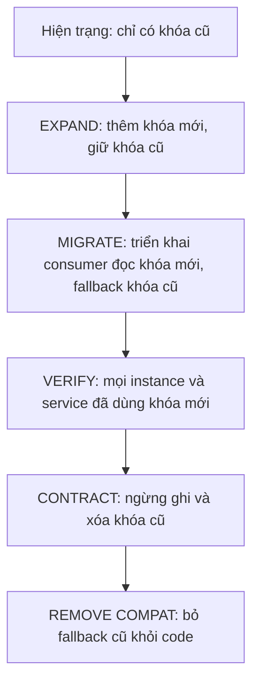

# Thêm khóa, đổi tên khóa và loại bỏ khóa theo giai đoạn

Trong hệ thống dùng Spring Cloud Config, cấu hình là một hợp đồng giữa repository, Config Server và các phiên bản ứng dụng đang chạy. Một khóa YAML có thể được nhiều service, nhiều profile và nhiều phiên bản ứng dụng sử dụng. Vì vậy, thêm một khóa thường khá đơn giản, nhưng đổi tên hoặc loại bỏ khóa có thể làm hỏng ứng dụng trong lúc triển khai rolling update nếu phiên bản cũ và mới cùng tồn tại.

Quản trị thay đổi cấu hình nên dùng chiến lược **expand – migrate – contract**: mở rộng hợp đồng để phiên bản cũ và mới cùng hoạt động; chuyển dần consumer sang khóa mới; sau khi xác minh không còn consumer dùng khóa cũ mới loại bỏ nó. Cách này giảm rủi ro triển khai đồng thời nhiều service và cho phép rollback trong thời gian chuyển tiếp.

## 1. Mục tiêu học tập

Sau bài học, bạn có thể:

- Xem tên khóa, kiểu dữ liệu, ý nghĩa và default như một phần hợp đồng cấu hình.
- Thêm khóa mới mà không làm hỏng phiên bản ứng dụng cũ.
- Đổi tên khóa theo từng giai đoạn và hỗ trợ cả tên cũ lẫn tên mới trong thời gian migration.
- Phân biệt đổi tên thuần túy với thay đổi ý nghĩa hoặc đơn vị của cấu hình.
- Loại bỏ khóa sau khi xác nhận mọi consumer đã ngừng sử dụng.
- Kiểm soát thay đổi trên Git repository, profile, label và các nguồn override.
- Dùng `@ConfigurationProperties`, validation, metric và log để theo dõi migration.
- Chuẩn bị rollback và kiểm thử tương thích giữa các phiên bản ứng dụng.

## 2. Khóa cấu hình là một hợp đồng

Một cấu hình không chỉ là chuỗi nằm trong YAML. Nó có các thuộc tính mà producer và consumer cần thống nhất:

- **Tên:** ví dụ `payments.client-timeout`.
- **Kiểu:** `Duration`, `boolean`, `int`, URI hoặc danh sách.
- **Đơn vị:** milliseconds, seconds, bytes, phần trăm hoặc một đơn vị rõ ràng khác.
- **Ý nghĩa:** timeout kết nối, timeout đọc hay tổng thời gian request.
- **Phạm vi:** dùng chung, theo application, profile, region hay tenant.
- **Giá trị mặc định:** điều gì xảy ra khi khóa không được khai báo.
- **Ràng buộc:** min/max, nullable hay bắt buộc, tập giá trị hợp lệ.
- **Chủ sở hữu:** nhóm chịu trách nhiệm thay đổi và hỗ trợ.

Ví dụ:

```yaml
payments:
  client-timeout: 3s
```

Tên `client-timeout` cần thể hiện đúng ý nghĩa và kiểu dữ liệu được bind. Nếu giá trị thực tế là timeout đọc response, nên đặt tên cụ thể như `read-timeout` thay vì dùng một tên chung chung có thể bị hiểu theo nhiều cách.

Trước khi thay đổi một khóa, hãy tìm hiểu các consumer và nguồn cung cấp giá trị. Một khóa có thể được khai báo ở `application.yml`, `application-prod.yml`, file riêng service trong Config repository, biến môi trường, tham số dòng lệnh hoặc giá trị mặc định trong code. Chỉ sửa một file có thể chưa hoàn tất migration.

## 3. Chiến lược expand – migrate – contract

Chiến lược này chia thay đổi không tương thích thành các bước nhỏ có thể triển khai độc lập.



Ba giai đoạn chính:

1. **Expand:** thêm khóa hoặc cấu trúc mới nhưng vẫn giữ khả năng tương thích với consumer hiện tại.
2. **Migrate:** triển khai code và dữ liệu cấu hình theo từng service/profile; theo dõi consumer nào còn dùng khóa cũ.
3. **Contract:** chỉ sau khi không còn consumer cũ, loại bỏ khóa cũ và mã tương thích.

Không nên gộp cả ba giai đoạn vào một commit hoặc một lần rollout nếu ứng dụng có nhiều replica hoặc nhiều service phát hành độc lập. Khi đó, phiên bản cũ có thể đọc cấu hình sau khi khóa nó cần đã bị xóa.

## 4. Thêm một khóa mới

Thêm khóa là thay đổi tương đối an toàn nếu consumer cũ không bắt buộc phải biết khóa đó và giá trị mặc định hợp lý.

Ví dụ muốn bổ sung giới hạn số lần thử lại:

```yaml
payments:
  client-timeout: 3s
  max-retries: 2
```

### Bước 1: Xác định default và hành vi khi thiếu

Trước khi thêm, cần quyết định:

- Khóa có bắt buộc không?
- Nếu không có thì dùng default nào?
- Default có an toàn cho mọi môi trường không?
- Có cần khai báo ở tất cả profile hay chỉ profile có hành vi khác biệt?
- Kiểu dữ liệu và giới hạn hợp lệ là gì?

Không thêm một default tùy tiện chỉ để ứng dụng khởi động. Ví dụ `max-retries=1000` có thể khiến hệ thống tạo tải lớn khi backend lỗi. Default cần dựa trên yêu cầu vận hành và được kiểm thử.

### Bước 2: Cập nhật cấu hình và code tương thích

Ví dụ `@ConfigurationProperties`:

```java
import jakarta.validation.constraints.Max;
import jakarta.validation.constraints.Min;
import org.springframework.boot.context.properties.ConfigurationProperties;
import org.springframework.validation.annotation.Validated;

@Validated
@ConfigurationProperties(prefix = "payments")
public record PaymentsProperties(
        @Min(0) @Max(10) int maxRetries) {
}
```

Trong ứng dụng thực tế, nếu khóa chưa được khai báo ở mọi môi trường, hãy cung cấp default rõ ràng hoặc dùng kiểu nullable phù hợp trước khi validation. Ví dụ có thể dùng constructor binding với default có chủ đích, hoặc field initializer trong class mutable.

### Bước 3: Kiểm tra toàn bộ profile

Ví dụ repository:

```text
config-repo/
├── application.yml
├── application-prod.yml
├── orders-service.yml
├── orders-service-prod.yml
└── payments-service.yml
```

Nếu `max-retries` được dùng chung, có thể đặt trong `application.yml`. Nếu mỗi môi trường cần giá trị riêng, hãy khai báo override ở profile tương ứng. Kiểm tra các giá trị hiệu lực sau khi hợp nhất property source, không chỉ nội dung của một tệp.

### Bước 4: Rollout và xác minh

Triển khai code có hiểu khóa mới, sau đó xác nhận giá trị đã bind và hành vi retry đúng như dự kiến. Nếu consumer cũ không đọc khóa mới, việc thêm khóa không làm nó hỏng; tuy nhiên, đừng xóa khóa cũ hoặc thay đổi hành vi cũ trong cùng lần thay đổi nếu các phiên bản cũ còn chạy.

## 5. Đổi tên khóa: ví dụ thực tế

Giả sử khóa hiện tại là:

```yaml
payments:
  timeout: 3s
```

Tên `timeout` quá chung. Nhóm muốn đổi thành `payments.client-timeout` để làm rõ đây là timeout của client.

Đổi tên thuần túy nghĩa là hai khóa có cùng ý nghĩa, cùng kiểu và cùng đơn vị. Nếu khóa mới đổi từ milliseconds sang seconds hoặc đổi từ read timeout sang total request timeout, đó là thay đổi semantics; không được xử lý như một alias đơn giản.

### Giai đoạn A — Expand: thêm khóa mới, giữ khóa cũ

Trong Config repository, khai báo cả hai khóa với cùng giá trị:

```yaml
payments:
  timeout: 3s          # legacy key, giữ cho consumer cũ
  client-timeout: 3s   # key mới cho consumer đã migrate
```

Thực hiện ở các context cần thiết: cấu hình chung, từng application và từng profile. Nếu chỉ thêm khóa mới vào `application.yml` nhưng `payments-service-prod.yml` đang override khóa cũ bằng giá trị khác, hai consumer có thể nhận giá trị không giống nhau.

Trong giai đoạn này, mọi phiên bản cũ vẫn đọc `payments.timeout`; phiên bản mới có thể đọc `payments.client-timeout` và fallback về khóa cũ.

### Giai đoạn B — Migrate: code hỗ trợ khóa mới và fallback cũ

Ví dụ một properties class giữ cả hai trường trong thời gian chuyển tiếp:

```java
import java.time.Duration;

import org.springframework.boot.context.properties.ConfigurationProperties;

@ConfigurationProperties(prefix = "payments")
public class PaymentsProperties {

    private Duration timeout;
    private Duration clientTimeout;

    public Duration getTimeout() {
        return timeout;
    }

    public void setTimeout(Duration timeout) {
        this.timeout = timeout;
    }

    public Duration getClientTimeout() {
        return clientTimeout;
    }

    public void setClientTimeout(Duration clientTimeout) {
        this.clientTimeout = clientTimeout;
    }

    public Duration effectiveClientTimeout() {
        if (clientTimeout != null) {
            return clientTimeout;
        }
        if (timeout != null) {
            return timeout;
        }
        return Duration.ofSeconds(3);
    }
}
```

Consumer dùng `effectiveClientTimeout()` thay vì đọc trực tiếp `getTimeout()`. Quy tắc ưu tiên trong ví dụ là khóa mới thắng khóa cũ. Default cuối cùng phải phù hợp với hợp đồng của ứng dụng.

Trong code production, nên ghi nhận việc fallback cũ được sử dụng bằng metric hoặc log có giới hạn tần suất. Không log giá trị cấu hình nhạy cảm. Có thể phát cảnh báo khi fallback vẫn còn xuất hiện sau thời điểm migration dự kiến.

Nếu cả hai khóa cùng được khai báo nhưng có giá trị khác nhau, cần quyết định rõ:

- Khóa mới thắng và ghi cảnh báo; hoặc
- Từ chối khởi động vì cấu hình mâu thuẫn.

Với cấu hình ảnh hưởng an toàn, thanh toán hoặc dữ liệu, fail startup khi hai khóa mâu thuẫn thường dễ phát hiện hơn việc âm thầm chọn một giá trị.

### Giai đoạn C — Migrate mọi consumer

Triển khai phiên bản hỗ trợ khóa mới đến tất cả replica và service liên quan. Trong rolling deployment, cả code cũ và mới có thể cùng chạy:

| Consumer | Khóa được đọc | Khóa cần tiếp tục tồn tại |
| --- | --- | --- |
| Phiên bản cũ | `payments.timeout` | Bắt buộc |
| Phiên bản chuyển tiếp | `payments.client-timeout`, fallback `payments.timeout` | Cả hai |
| Phiên bản mới sau migration | `payments.client-timeout` | Chỉ khóa mới |

Không xóa khóa cũ khi vẫn còn một replica hoặc job cũ có thể khởi động lại. Cần kiểm tra cả worker nền, batch job, scheduled job, tool vận hành và service ít được triển khai.

### Giai đoạn D — Contract: ngừng dùng và xóa khóa cũ

Sau khi tất cả consumer đã dùng khóa mới:

1. Kiểm tra metric fallback cũ về 0 trong khoảng thời gian đủ dài.
2. Kiểm tra version đang chạy ở mọi môi trường và replica.
3. Kiểm tra không còn deployment cũ có thể rollback về code chỉ hiểu khóa cũ.
4. Xóa `payments.timeout` khỏi mọi context và profile.
5. Triển khai code loại bỏ fallback và trường cũ.
6. Kiểm tra lại giá trị hiệu lực và hành vi ứng dụng.

Không nên xóa khóa cũ chỉ vì metric về 0 trong vài phút. Cần tính đến service chạy theo lịch, môi trường DR, batch job theo tháng và quy trình rollback.

## 6. Thứ tự ưu tiên khi cả khóa cũ và mới xuất hiện

Khi hai khóa được khai báo ở nhiều property source, có hai lớp ưu tiên cần hiểu:

1. **Ưu tiên giữa property source:** Config Data, file cục bộ, biến môi trường, system property và command line có thứ tự ưu tiên của Spring Boot/Spring Cloud.
2. **Ưu tiên giữa hai tên khóa trong code:** logic tương thích quyết định khóa mới hay cũ được dùng khi cả hai cùng có giá trị.

Ví dụ remote Config Server có:

```yaml
payments:
  timeout: 3s
  client-timeout: 4s
```

Nhưng biến môi trường lại override khóa mới:

```text
PAYMENTS_CLIENT_TIMEOUT=5s
```

Khi đó `effectiveClientTimeout()` nhận giá trị `5s` nếu `Environment` bind theo quy tắc tương ứng. Đừng chỉ nhìn YAML trong Git rồi kết luận ứng dụng đang dùng `4s`.

Trong giai đoạn migration, nên giữ hai khóa đồng nhất trong cùng một môi trường và kiểm tra giá trị hiệu lực trên từng instance. Nếu khóa mới và cũ được override từ các nguồn khác nhau, consumer có thể hành xử khác nhau giữa môi trường hoặc replica.

## 7. Thay đổi semantics không phải là đổi tên

Một thay đổi chỉ được xem là rename an toàn khi ý nghĩa, đơn vị, kiểu dữ liệu, default và phạm vi không đổi.

Ví dụ sau không phải rename thuần túy:

```yaml
payments:
  timeout: 3000 # milliseconds
```

đổi thành:

```yaml
payments:
  client-timeout: 3s
```

Nếu code cũ bind số nguyên milliseconds nhưng code mới bind `Duration`, cần xác định cách biểu diễn và chuyển đổi. Cũng cần xác nhận `timeout` cũ có ý nghĩa là connect timeout, read timeout hay tổng thời gian request. Nếu ý nghĩa thay đổi, hãy tạo một cấu hình mới có semantics rõ ràng và migration riêng; không copy giá trị cũ sang khóa mới một cách máy móc.

Với thay đổi semantics:

- Tài liệu hóa đơn vị và hành vi mới.
- Xác định giá trị chuyển đổi từ giá trị cũ.
- Có thể cần chạy song song hai cấu hình trong một khoảng thời gian.
- Kiểm thử boundary, timeout, retry và tương tác với downstream.
- Có kế hoạch rollback giá trị và code, không chỉ rollback tên khóa.

## 8. Loại bỏ khóa cấu hình an toàn

Loại bỏ khóa có thể gây lỗi bind hoặc làm ứng dụng dùng default ngoài ý muốn. Trước khi xóa, cần chứng minh khóa không còn consumer.

### Kiểm kê consumer

Kiểm tra các nơi có thể tham chiếu khóa:

- `@Value("${...}")` và `@ConfigurationProperties`.
- `application.yml`, profile-specific files và file ngoài ứng dụng.
- Config repository: `application*.yml`, `<application>*.yml` và context theo profile.
- Biến môi trường và system properties.
- Helm values, Kubernetes ConfigMap/Secret, manifest hoặc deployment template.
- CI/CD variable, script, job, batch worker và scheduled task.
- Test fixture, integration test, tài liệu vận hành và dashboard.
- Các service ít phát hành hoặc chỉ chạy trong DR/region dự phòng.

### Deprecate trước khi xóa

Đánh dấu khóa cũ là deprecated trong tài liệu cấu hình và release notes. Nếu có thể, ứng dụng nên ghi warning khi khóa cũ được bind hoặc fallback được dùng. Cảnh báo cần nêu tên khóa và phiên bản dự kiến loại bỏ, nhưng không in giá trị secret.

Ví dụ thông báo:

```text
Configuration key 'payments.timeout' is deprecated.
Use 'payments.client-timeout'; legacy fallback will be removed after release 2027.02.
```

### Xóa khỏi repository trước, xóa support trong code sau

Trình tự phù hợp thường là:

1. Ngừng ghi khóa cũ trong pipeline cập nhật cấu hình.
2. Xóa khóa cũ khỏi tất cả file/context/profile sau khi code mới đã được triển khai.
3. Theo dõi ứng dụng trong một khoảng thời gian đủ dài.
4. Loại bỏ trường cũ, fallback và warning khỏi code trong một release tiếp theo.

Trong một số tình huống, có thể xóa code fallback trước khi xóa dữ liệu cũ nếu mọi consumer đã chắc chắn dùng khóa mới. Hãy giữ trình tự nhất quán với khả năng rollback của tổ chức.

## 9. Quản lý thay đổi trong Git repository

Git cung cấp lịch sử commit và review cho cấu hình. Mỗi thay đổi nên có phạm vi rõ ràng và có thể truy ngược.

Quy trình đề xuất:

1. Tạo branch cho thay đổi cấu hình.
2. Cập nhật các context/profile liên quan trong cùng một thay đổi logic.
3. Chạy lint/validation YAML và kiểm tra tên khóa, kiểu, default.
4. Review bởi owner của ứng dụng bị ảnh hưởng.
5. Kiểm thử với Config Server bằng đúng application/profile/label.
6. Merge vào branch phát hành sau khi có phê duyệt.
7. Theo dõi webhook/refresh và xác minh client nhận giá trị mới.
8. Ghi lại commit SHA, thời gian, người phê duyệt và release ứng dụng liên quan.

Không sửa trực tiếp nhiều profile trên production mà không có lịch sử và review. Nếu có emergency change, vẫn cần ghi nhận người thực hiện, lý do, giá trị trước/sau theo chính sách, thời điểm và kế hoạch đưa thay đổi trở lại quy trình chuẩn.

### Thay đổi nhiều khóa có cần atomic không?

Nếu ứng dụng chỉ hoạt động đúng khi hai khóa được thay đổi cùng nhau, hãy commit chúng trong cùng một thay đổi cấu hình và đảm bảo Config Server trả một snapshot nhất quán. Ví dụ đổi `payments.endpoint` và `payments.auth-mode` cùng lúc có thể cần atomic để tránh client nhận endpoint mới nhưng auth mode cũ.

Với thay đổi phân tán qua nhiều repository hoặc nhiều backend, không mặc định có transaction toàn cục. Hãy thiết kế các bước tương thích để trạng thái trung gian vẫn hoạt động, hoặc dùng version/label bất biến để phát hành một bộ cấu hình đồng bộ.

## 10. Versioning và phát hành cấu hình

Với Git backend, có thể dùng branch, tag hoặc commit để xác định phiên bản cấu hình. Trong production, một release nên có khả năng truy ngược đến:

- Commit SHA hoặc tag của Config repository.
- Application name, profile và label mà client yêu cầu.
- Phiên bản ứng dụng đang đọc cấu hình.
- Thời điểm refresh và trạng thái xác minh.

Tag bất biến hoặc commit SHA giúp tái lập cấu hình khi cần điều tra. Branch như `main` dễ cập nhật nhưng nội dung thay đổi theo thời gian; nhiều replica có thể fetch ở các thời điểm khác nhau.

Nếu dùng label riêng cho từng đợt phát hành, hãy quản lý vòng đời label và tránh xóa label khi còn ứng dụng đang tham chiếu. Với Vault hoặc backend không dựa trên Git, cần có version marker, audit và quy trình snapshot/rollback tương đương.

## 11. Rollout và rollback trong lúc đổi khóa

Rollback không chỉ là revert commit cấu hình. Nó phải tương thích với phiên bản code đang chạy.

Ví dụ:

| Trạng thái | Code | Config | Có thể rollback? |
| --- | --- | --- | --- |
| Ban đầu | Chỉ đọc `payments.timeout` | Chỉ có khóa cũ | Có |
| Expand | Code cũ | Có cả khóa cũ và mới | Có; code cũ vẫn đọc khóa cũ |
| Migrate | Code mới đọc khóa mới, fallback cũ | Có cả hai khóa | Có; rollback code cũ vẫn đọc khóa cũ |
| Contract dữ liệu | Code mới chỉ đọc khóa mới | Chỉ có khóa mới | Không thể rollback code cũ nếu không khôi phục khóa cũ |
| Contract code | Code không còn hỗ trợ khóa cũ | Chỉ có khóa mới | Cần rollback theo release có cả dữ liệu và code tương thích |

Do đó, giữ khóa cũ trong suốt rollback window. Chỉ xóa nó sau khi release cũ không còn là phương án rollback được hỗ trợ.

Nếu cần rollback khẩn cấp, phục hồi cả code và config về một cặp phiên bản tương thích. Không revert riêng YAML trong khi code hiện tại đã yêu cầu khóa mới mà không có fallback.

## 12. Kiểm thử tương thích trước khi merge

Một thay đổi cấu hình nên được kiểm thử ít nhất ở các cấp:

### Kiểm tra cấu trúc

- YAML hợp lệ.
- Tên khóa đúng convention.
- Kiểu dữ liệu có thể bind.
- Không có khóa trùng hoặc typo.
- Profile và application context được cập nhật đầy đủ.

### Kiểm tra binding và validation

- Khởi động application với cấu hình của từng profile.
- Xác nhận `@ConfigurationProperties` nhận đúng giá trị.
- Kiểm tra default khi khóa không tồn tại.
- Kiểm tra trường hợp giá trị ngoài min/max hoặc sai định dạng.
- Kiểm tra xung đột giữa khóa cũ và khóa mới.

### Kiểm tra tương thích phiên bản

- Code cũ chạy được khi cả hai khóa tồn tại.
- Code chuyển tiếp ưu tiên khóa mới và fallback khóa cũ đúng cách.
- Code mới chạy được khi chỉ có khóa mới.
- Rollback code cũ vẫn chạy được khi khóa cũ còn trong repository.
- Không xóa khóa cũ trước khi mọi consumer cũ đã kết thúc.

### Kiểm tra refresh

- Cập nhật repository và xác nhận Config Server trả đúng property source.
- Gửi refresh hoặc Bus event theo cơ chế triển khai.
- Kiểm tra `Environment`, bean và hành vi thực tế sau refresh.
- Xác nhận mọi replica nhận cùng giá trị.

## 13. Theo dõi migration bằng metric và log

Không nên dựa vào việc “đã deploy hết” để quyết định xóa khóa cũ. Hãy tạo bằng chứng quan sát được.

Ví dụ metric khái niệm:

```text
config_legacy_key_fallback_total{application="payments"} 0
config_binding_failure_total{application="payments"} 0
config_revision_info{application="payments",revision="a1b2c3d"} 1
```

Các metric trên chỉ minh họa tên và ý nghĩa, không phải metric mặc định của Spring Cloud Config. Ứng dụng cần instrument riêng nếu muốn theo dõi fallback, lỗi binding và revision.

Nên theo dõi:

- Số lần code phải fallback sang khóa cũ.
- Số lần khóa mới bị thiếu hoặc sai kiểu.
- Số lần hai khóa cùng xuất hiện nhưng khác giá trị.
- Số instance đang chạy phiên bản code cũ.
- Revision/label cấu hình mà từng instance đã nạp.
- Sự kiện refresh thành công/thất bại.
- Lỗi nghiệp vụ liên quan sau khi đổi cấu hình.

Không đưa secret, token, password hoặc giá trị nhạy cảm vào label, log hoặc metric. Dùng tên khóa, application, profile và revision không nhạy cảm để quan sát.

## 14. Những lỗi thường gặp khi thêm, đổi tên hoặc xóa khóa

| Biểu hiện | Nguyên nhân có thể | Cách xử lý |
| --- | --- | --- |
| Phiên bản cũ không khởi động sau khi thêm khóa mới | Thay đổi khác đi kèm đã xóa/đổi khóa cũ hoặc làm thay đổi cấu trúc | Giữ hợp đồng cũ trong giai đoạn expand |
| Phiên bản mới dùng default thay vì giá trị trong Config Server | Tên khóa mới sai, profile thiếu hoặc binding prefix không khớp | Kiểm tra Environment, property source và tên prefix |
| Một số service dùng giá trị mới, số khác dùng giá trị cũ | Code hoặc profile chưa được migrate đồng bộ | Kiểm kê consumer, profile và revision từng service |
| Khóa mới và cũ có giá trị khác nhau | Một profile hoặc biến môi trường chỉ override một trong hai | Đồng bộ giá trị trong giai đoạn migration và kiểm tra precedence |
| Rename làm thay đổi đơn vị | Code cũ và mới bind kiểu khác nhau | Xác định semantics và chuyển đổi đơn vị tường minh |
| Xóa khóa làm ứng dụng dùng default ngoài ý muốn | Consumer vẫn phụ thuộc khóa nhưng thiếu validation | Thêm validation hoặc fail-fast khi thiếu cấu hình bắt buộc |
| Rollback code thất bại | Khóa cũ đã bị xóa trước khi hết rollback window | Khôi phục cấu hình tương thích cùng release code |
| Chỉ một profile lỗi | Migration chưa cập nhật mọi profile/context | Kiểm tra application, profile, region và label |
| Không biết còn consumer cũ hay không | Không có metric/log hoặc inventory deployment | Thêm telemetry và chờ hết vòng đời batch/DR trước khi xóa |

## 15. Ví dụ quy trình đổi tên hoàn chỉnh

Yêu cầu: đổi `orders.api.timeout` thành `orders.api.read-timeout` mà không làm gián đoạn các replica đang chạy phiên bản cũ.

### Release 1: Expand

Config repository:

```yaml
orders:
  api:
    timeout: 4s
    read-timeout: 4s
```

Chưa thay đổi consumer cũ. Kiểm tra tất cả profile có hai khóa bằng nhau.

### Release 2: Migrate code

Code mới bind cả hai khóa và ưu tiên `read-timeout`. Nếu khóa mới chưa có, fallback `timeout`. Phát metric khi fallback được dùng. Triển khai rolling update để phiên bản cũ và mới cùng hoạt động.

### Release 3: Verify

- Không còn instance chạy code cũ.
- Metric fallback bằng 0 trong thời gian quan sát.
- Không có batch job hoặc môi trường DR còn dùng khóa cũ.
- Mọi profile có `read-timeout` và giá trị hiệu lực đúng.
- Rollback window cho code cũ đã kết thúc hoặc đã có kế hoạch khôi phục khóa cũ.

### Release 4: Contract

Config repository chỉ còn:

```yaml
orders:
  api:
    read-timeout: 4s
```

Triển khai code loại bỏ fallback và trường `timeout`. Kiểm tra lại startup, refresh và hành vi request. Ghi nhận commit cấu hình và release ứng dụng đã hoàn tất migration.

## 16. Checklist quản trị thay đổi cấu hình

- [ ] Xác định owner, consumer và ý nghĩa của khóa.
- [ ] Ghi rõ kiểu dữ liệu, đơn vị, default và validation.
- [ ] Kiểm kê mọi application, profile, label và nguồn override.
- [ ] Phân biệt rename thuần túy với thay đổi semantics.
- [ ] Thêm khóa mới trước khi yêu cầu consumer chuyển sang khóa mới.
- [ ] Giữ khóa cũ trong giai đoạn rolling deployment và rollback.
- [ ] Code chuyển tiếp ưu tiên khóa mới, fallback khóa cũ theo quy tắc rõ ràng.
- [ ] Có metric/log không nhạy cảm để theo dõi fallback và lỗi binding.
- [ ] Kiểm tra hai khóa không mâu thuẫn ở mọi profile.
- [ ] Review và kiểm thử thay đổi trong Git trước khi merge.
- [ ] Xác minh Config Server trả đúng application/profile/label.
- [ ] Xác minh mọi client instance đã nhận cấu hình mới.
- [ ] Chỉ xóa khóa cũ sau khi không còn consumer và rollback window đã kết thúc.
- [ ] Loại bỏ fallback trong release riêng sau khi contract dữ liệu.
- [ ] Lưu commit/revision, phê duyệt, thời điểm và kết quả xác minh.

## 17. Tài liệu tham khảo

- [Spring Boot — Externalized Configuration](https://docs.spring.io/spring-boot/reference/features/external-config.html)
- [Spring Boot — Type-safe Configuration Properties](https://docs.spring.io/spring-boot/reference/features/external-config.html#features.external-config.typesafe-configuration-properties)
- [Spring Cloud Config — Git Backend and Labels](https://docs.spring.io/spring-cloud-config/reference/server/environment-repository/git-backend.html)
- [Spring Cloud Config — Config Client](https://docs.spring.io/spring-cloud-config/reference/client.html)
