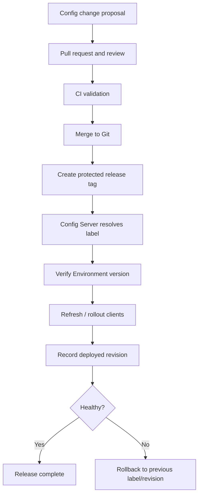

# Phát hành cấu hình bằng commit hoặc tag có thể truy vết

Với Spring Cloud Config, một thay đổi cấu hình được phân phối qua Git có thể ảnh hưởng đến nhiều ứng dụng và nhiều instance cùng lúc. Để biết chính xác ứng dụng đã nhận cấu hình nào, mỗi lần phát hành cần gắn với một revision Git xác định: commit SHA đầy đủ hoặc tag phát hành được bảo vệ khỏi việc sửa/xóa. Branch như `main` hữu ích cho phát triển nhưng là một tham chiếu có thể di chuyển, vì vậy không đủ để tái hiện một lần triển khai trong tương lai.

Config Server nhận label trong request để chọn branch, tag hoặc commit tương ứng từ Git backend. Config Client cũng có thể chỉ định label qua `spring.cloud.config.label`. Khi phát hành, nhóm cần ghi lại application, profile, label và revision thực tế mà Config Server trả về; sau đó dùng cùng thông tin này để xác minh rollout, điều tra sự cố và rollback.

## Mục tiêu học tập

Sau bài học, bạn có thể:

- Phân biệt commit SHA, branch và tag trong quản trị phiên bản cấu hình.
- Chọn label bất biến cho một lần phát hành Spring Cloud Config.
- Cấu hình Config Client yêu cầu một label cụ thể.
- Kiểm tra revision Config Server thực sự phục vụ qua Environment API.
- Xây dựng quy trình review, kiểm tra và tạo tag cấu hình.
- Phát hành cùng một revision qua nhiều môi trường và nhiều Config Server replica.
- Ghi release manifest để truy vết cấu hình theo ứng dụng/profile.
- Rollback bằng revision đã biết mà không viết lại lịch sử Git.

## 1. Vì sao cấu hình cần revision có thể truy vết?

Giả sử `catalog-service` gặp lỗi sau khi refresh. Nhóm vận hành cần trả lời nhanh:

- Instance đang dùng cấu hình từ repository nào?
- Cấu hình thuộc application và profile nào?
- Config Server đã phục vụ branch, tag hay commit nào?
- Thay đổi nào đã được review và ai phê duyệt?
- Có thể quay lại chính xác cấu hình trước đó không?

Nếu client chỉ yêu cầu label `main`, giá trị của `main` có thể đã thay đổi kể từ lần triển khai. Một request mới tới cùng URL không nhất thiết trả cùng nội dung. Nếu client yêu cầu tag bất biến hoặc commit SHA cụ thể, nhóm có thể tái hiện revision đã phát hành.



Revision có thể truy vết là cơ sở cho kiểm toán, rollback và phân tích sai lệch giữa các instance.

## 2. Commit SHA, branch và tag khác nhau thế nào?

Git có nhiều loại reference, nhưng chúng không có cùng đặc tính:

| Loại | Trỏ đến | Có thể di chuyển? | Dùng trong phát hành |
|---|---|---|---|
| Commit SHA | Một commit cụ thể trong lịch sử Git | Nội dung commit được định danh bằng hash; reference tới commit không tự di chuyển | Rất phù hợp để tái hiện chính xác revision. |
| Branch | Commit đầu của một nhánh phát triển | Có; mỗi lần merge/push có thể cập nhật branch head | Phù hợp cho phát triển và môi trường tích hợp liên tục. |
| Tag | Một commit được đặt tên | Có thể bị xóa hoặc di chuyển nếu quyền Git cho phép | Phù hợp cho release khi tag được bảo vệ và không tái sử dụng. |

Ví dụ:

```text
main                       -> commit 9ab...
config-release-2026.11.27  -> commit 4f2...
4f2c...                    -> commit cụ thể
```

`main` có thể trỏ sang commit mới sau lần triển khai. Tag release được tổ chức bảo vệ sẽ tiếp tục trỏ đến commit đã phát hành. Commit SHA đầy đủ là cách tham chiếu trực tiếp nhất khi cần xác định chính xác nội dung.

Tag không tự bất biến chỉ vì nó có tên release. Git cho phép người có quyền xóa hoặc force-update tag. Muốn tag có tính bất biến trong quy trình, cần dùng protected tags, giới hạn quyền tạo/xóa, audit và quy ước không tái sử dụng tên tag.

## 3. Tạo commit có nội dung rõ ràng

Mỗi commit cấu hình nên thay đổi một nhóm mục đích có thể review. Message cần cho biết thay đổi áp dụng cho ứng dụng/profile nào và lý do thay đổi.

Ví dụ:

```bash
git status --short
git diff --check
git diff -- application/catalog-service-prod.yml
git add application/catalog-service-prod.yml
git commit -m "config(catalog): reduce search timeout in prod"
```

Trước khi commit, kiểm tra diff để chắc chắn không đưa nhầm secret dạng rõ, file tạm hoặc cấu hình của môi trường khác. `git diff --check` phát hiện whitespace error nhưng không thay thế kiểm tra schema, policy hoặc secret scanning.

Sau khi commit, lấy SHA đầy đủ:

```bash
git rev-parse HEAD
```

Ghi SHA này vào thông tin phát hành. Không chỉ ghi bảy ký tự đầu nếu hệ thống audit cần nhận diện duy nhất và có thể đối chiếu sau nhiều năm.

## 4. Tạo tag release có thể kiểm toán

Tag phát hành nên được tạo sau khi commit đã merge và các kiểm tra bắt buộc đã đạt. Có thể dùng annotated tag để lưu thông điệp phát hành, hoặc signed tag nếu tổ chức yêu cầu xác minh người tạo tag.

```bash
git tag -a config-release-2026.11.27 \
  -m "Catalog production config release 2026-11-27"

git show --no-patch --decorate config-release-2026.11.27
git rev-parse config-release-2026.11.27^{commit}
```

Nếu quy trình yêu cầu chữ ký GPG/SSH:

```bash
git tag -s config-release-2026.11.27 \
  -m "Catalog production config release 2026-11-27"

git verify-tag config-release-2026.11.27
```

Đẩy branch và tag đã được phê duyệt:

```bash
git push origin main
git push origin refs/tags/config-release-2026.11.27
```

Không force-update tag đã phát hành. Nếu phát hiện lỗi, tạo tag mới trỏ đến commit sửa lỗi hoặc chuyển client về tag/commit trước đó. Giữ lại tag cũ để audit và rollback.

Chữ ký tag chỉ có ý nghĩa khi pipeline hoặc hệ thống quản trị xác minh chữ ký với trust policy rõ ràng. Config Server không mặc định xác minh chữ ký tag thay cho Git hosting/CI; việc kiểm tra chữ ký cần nằm trong quy trình phát hành hoặc cơ chế bảo vệ repository.

## 5. Dùng label để chọn revision trong Config Server

Environment endpoint của Config Server có dạng:

```text
/{application}/{profile}[/{label}]
```

Ví dụ yêu cầu cấu hình production của Catalog tại tag release:

```bash
curl -H "Accept: application/json" \
  https://config.internal.example/catalog-service/prod/config-release-2026.11.27
```

Git backend có thể phân giải label thành branch, tag hoặc commit ID. Khi không truyền label, Config Server sử dụng default label đã cấu hình; giá trị mặc định phụ thuộc phiên bản và cấu hình Git backend. Đối với release cần tái hiện, không nên phụ thuộc vào default label có thể trỏ đến branch đang phát triển.

Trong response, chú ý các trường:

| Trường | Ý nghĩa khi xác minh release |
|---|---|
| `name` | Application được yêu cầu. |
| `profiles` | Profile mà Config Server đã xử lý. |
| `label` | Label request/label được phân giải theo API. |
| `version` | Revision backend, thường là commit ID với Git. |
| `propertySources` | Các nguồn cấu hình và khóa mà server tổng hợp. |

`label` cho biết reference được yêu cầu; `version` giúp xác minh commit thực tế. Hai trường này bổ sung cho nhau. Nếu tag bị di chuyển, cùng một label có thể dẫn đến `version` khác ở hai thời điểm; đây là lý do cần bảo vệ tag và ghi revision.

## 6. Ghim label ở Config Client

Config Client có thể yêu cầu label cụ thể bằng `spring.cloud.config.label`. Ví dụ với Config Data import:

```yaml
spring:
  application:
    name: catalog-service
  config:
    import: "configserver:https://config.internal.example"
  cloud:
    config:
      label: config-release-2026.11.27
```

Client sẽ yêu cầu cấu hình cho application `catalog-service`, profile đang hoạt động và label release đã chọn. Trong môi trường production, label nên được cấp từ deployment manifest hoặc release pipeline để mỗi lần triển khai có thể ghi nhận chính xác.

Có thể dùng commit SHA đầy đủ làm label khi Git backend và phiên bản Config Server hỗ trợ phân giải commit ID. Điều này tránh phụ thuộc vào tên tag; tuy nhiên tag có ý nghĩa vận hành dễ đọc hơn và có thể mang metadata phát hành. Một lựa chọn thường dùng là client yêu cầu tag, còn release manifest ghi cả tag lẫn commit SHA đã xác minh.

Nếu dùng legacy bootstrap, thuộc tính label vẫn thuộc cấu hình Config Client nhưng vị trí nạp thuộc tính có thể khác với Config Data. Không trộn `bootstrap.yml` và `spring.config.import` nếu chưa xác định rõ cơ chế bootstrap của dự án.

## 7. Branch cho phát triển, tag cho release

Một quy ước dễ vận hành là:

- `main` nhận thay đổi đã review và dùng cho tích hợp liên tục.
- Nhánh feature chỉ phục vụ pull request, không dùng làm label production.
- Tag release được tạo từ commit đã merge và qua kiểm tra.
- Production client dùng tag hoặc commit SHA đã được phê duyệt.
- Tag cũ được giữ lại trong thời gian lưu trữ để điều tra và rollback.

Ví dụ vòng đời:

```text
feature/catalog-timeout
          |
          v
      Pull request
          |
          v
    main @ commit A
          |
          v
config-release-2026.11.27 -> commit A
          |
          v
  production rollout
```

Không nên để production luôn theo dõi `main` nếu cần biết chính xác revision đang chạy. Nếu tổ chức chủ ý dùng continuous delivery theo branch, cần ghi lại commit SHA đã được resolve tại thời điểm triển khai và giữ cơ chế rollback độc lập.

## 8. Quy trình review và kiểm tra trước khi tag

Pull request cấu hình nên được kiểm tra như thay đổi mã nguồn vì một property có thể ảnh hưởng nhiều instance hoặc service.

| Kiểm tra | Mục tiêu |
|---|---|
| Review diff | Xác nhận đúng application, profile, key và giá trị thay đổi. |
| YAML/Properties parse | Phát hiện lỗi cú pháp, duplicate key và định dạng không hợp lệ. |
| Schema/type validation | Kiểm tra duration, URI, số lượng, enum và ràng buộc giá trị. |
| Secret scanning | Phát hiện password/token dạng rõ hoặc private key bị commit. |
| Policy validation | Kiểm tra key nhạy cảm, cấu hình bắt buộc và giới hạn môi trường. |
| Precedence review | Xác định nguồn nào ghi đè key và client nào bị ảnh hưởng. |
| Integration test | Kiểm tra Config Server trả đúng application/profile/label. |
| Approval | Ghi nhận chủ sở hữu ứng dụng và người phê duyệt thay đổi có rủi ro. |

CI nên chạy trên commit của pull request và trên commit cuối cùng được tag. Nếu nội dung thay đổi sau khi CI thành công, tag phải được tạo từ commit đã kiểm tra, không phải từ một commit khác.

## 9. Release manifest để ghi nhận cấu hình đã triển khai

Khi một lần phát hành liên quan đến nhiều ứng dụng, nhiều profile hoặc nhiều Git repository, chỉ lưu một tag chung có thể chưa đủ. Release manifest ghi lại chính xác tập revision đã dùng.

Ví dụ manifest minh họa:

```yaml
release:
  id: config-release-2026.11.27
  environment: production
  created-at: "2026-11-27T10:00:00Z"
  approved-by:
    - platform-operations
    - catalog-owner

applications:
  - name: catalog-service
    profiles: [prod]
    config-repository: platform-config
    label: config-release-2026.11.27
    commit: 4f2c9a7d8e6b1c0a1234567890abcdef12345678

  - name: inventory-service
    profiles: [prod]
    config-repository: platform-config
    label: config-release-2026.11.27
    commit: 4f2c9a7d8e6b1c0a1234567890abcdef12345678
```

Đây là tài liệu kiểm toán do pipeline phát hành tạo, không phải thuộc tính Spring Cloud Config bắt buộc. Manifest cần được lưu ở nơi có quyền ghi hạn chế và có thể truy vấn theo release ID. Không đưa secret hoặc plaintext cấu hình vào manifest.

Nếu composite repository dùng nhiều Git repo, ghi riêng URI/label/commit của từng repo. Một tag cùng tên ở hai repository không đảm bảo chúng trỏ đến cùng một thời điểm phát hành hoặc có quan hệ tương thích.

## 10. Phát hành cùng một revision qua nhiều môi trường

Để giảm khác biệt giữa staging và production, hãy promote cùng commit/tag đã được kiểm thử thay vì copy file thủ công hoặc tạo lại commit cho mỗi môi trường.

Một mô hình phổ biến:

1. Merge thay đổi cấu hình vào Git.
2. Tạo tag release bất biến.
3. Deploy tag vào staging và xác minh Environment response.
4. Chạy kiểm thử tích hợp và kiểm tra hành vi ứng dụng.
5. Phê duyệt promote cùng tag/commit sang production.
6. Ghi revision được phục vụ và các instance đã nhận cấu hình.

Nếu môi trường cần giá trị khác nhau, tổ chức các khác biệt bằng profile hoặc context riêng nhưng vẫn giữ cùng commit chứa toàn bộ bộ cấu hình. Ví dụ, `application-staging.yml` và `application-prod.yml` nằm trong cùng revision. Điều này cho phép biết chính xác cả hai profile đã được phát hành từ một commit nào.

Không tạo tag `prod` rồi di chuyển nó theo từng lần triển khai. Tên tag có ý nghĩa release nên duy nhất và bất biến. Nếu cần một alias như `production-current`, coi đó là pointer có thể di chuyển và vẫn phải ghi revision SHA thực tế mỗi lần cập nhật.

## 11. Xác minh revision từ từng Config Server replica

Trong môi trường HA, các Config Server có thể giữ local clone Git riêng hoặc fetch ở các thời điểm khác nhau. Một replica có thể đã thấy tag mới trong khi replica khác vẫn đang phục vụ revision cũ nếu backend chưa đồng bộ hoặc cấu hình refresh khác nhau.

Với mỗi replica, gọi Environment API bằng cùng application, profile và label:

```bash
curl -H "Accept: application/json" \
  https://config-a.internal:8888/catalog-service/prod/config-release-2026.11.27

curl -H "Accept: application/json" \
  https://config-b.internal:8888/catalog-service/prod/config-release-2026.11.27
```

So sánh `version`, `label`, `profiles` và thứ tự `propertySources`. Với Git backend, `version` thường chứa commit ID đã được checkout. Hai server phục vụ cùng release cần trả cùng revision cho cùng label.

Load balancer health check chỉ chứng minh server có thể trả lời theo tiêu chí health; nó không chứng minh server đã fetch đúng revision. Pipeline nên có bước kiểm tra parity giữa replica trước khi broadcast refresh đến toàn bộ client.

## 12. Refresh client sau khi xác minh release

Sau khi Config Server đã phục vụ đúng revision, mới yêu cầu Config Client tải lại cấu hình. Có thể refresh từng instance bằng Actuator hoặc dùng Spring Cloud Bus để phát sự kiện đến nhóm client.

Quy trình:

1. Xác minh label và commit SHA từ Config Server.
2. Refresh một instance canary.
3. Kiểm tra giá trị cấu hình hiệu lực, health và metrics của ứng dụng.
4. Nếu canary đạt, phát refresh đến các instance còn lại.
5. Ghi nhận thời điểm và revision đã áp dụng.

Spring Cloud Bus phân phối sự kiện refresh; nó không tự chọn commit hoặc đảm bảo các Config Server replica đã đồng bộ. Nếu client theo branch mutable, hai lần refresh có thể nhận hai commit khác nhau. Ghim label release bất biến giúp mọi instance yêu cầu cùng một revision.

## 13. Rollback bằng revision đã biết

Rollback cấu hình nên là một thao tác phát hành mới trỏ về revision đã được xác minh, không phải viết lại lịch sử Git.

Giả sử:

```text
config-release-2026.11.20 -> commit A (đã ổn định)
config-release-2026.11.27 -> commit B (có lỗi)
```

Có thể chuyển Config Client về label trước:

```yaml
spring:
  cloud:
    config:
      label: config-release-2026.11.20
```

Hoặc phát hành tag rollback mới trỏ đến commit A để ghi rõ thời điểm rollback:

```bash
git tag -a config-rollback-2026.11.27 \
  4f2c9a7d8e6b1c0a1234567890abcdef12345678 \
  -m "Rollback configuration to verified commit A"
```

Sau đó xác minh Config Server trả đúng SHA của commit A và refresh client theo rollout đã kiểm thử. Không xóa tag lỗi; tag đó là bằng chứng của release đã xảy ra và hỗ trợ phân tích nguyên nhân.

Rollback chỉ khôi phục cấu hình Git. Nếu thay đổi đã làm rotate password, revoke token hoặc thay đổi schema bên ngoài, phải xác minh secret và hệ thống đích còn tương thích với revision cũ trước khi quay lại.

## 14. Xử lý nhiều repository hoặc composite repository

Một Environment có thể được tổng hợp từ nhiều repository. Khi đó, một commit hoặc tag ở repository chính chưa mô tả đầy đủ cấu hình hiệu lực.

Ví dụ release gồm:

| Repository | Nội dung | Revision cần ghi |
|---|---|---|
| `platform-config` | Logging, tracing, timeout mặc định | Tag và commit SHA riêng. |
| `catalog-config` | Cấu hình nghiệp vụ Catalog | Tag và commit SHA riêng. |
| `security-config` | Policy hoặc cấu hình tích hợp bảo mật | Tag và commit SHA riêng. |

Một release manifest nên ghi tất cả revision, thứ tự repository composite và label được Config Server yêu cầu. Nếu một repository chưa được cập nhật hoặc label không tồn tại ở một backend, request có thể thất bại hoặc trả bộ cấu hình không như dự kiến.

Với composite repository, thứ tự nguồn cũng ảnh hưởng giá trị trùng khóa. Thay đổi thứ tự repository là một thay đổi hành vi và cần được review, kiểm thử, gắn với release manifest như thay đổi nội dung file.

## 15. Bảo vệ tính toàn vẹn và bí mật của release

Khả năng truy vết không có ý nghĩa nếu người không được phép có thể sửa branch, tag hoặc commit cấu hình production.

- Bật branch protection và yêu cầu pull request review.
- Giới hạn quyền tạo, xóa và cập nhật tag release.
- Dùng signed commit/tag nếu quy trình yêu cầu xác thực nguồn gốc.
- Ghi lại actor, thời điểm, pull request, commit SHA và tag trong audit log.
- Dùng secret scanning và policy check trước khi merge.
- Không commit secret dạng rõ; dùng `{cipher}` hoặc secret backend như Vault theo thiết kế bảo mật.
- Bảo vệ key giải mã tách biệt khỏi repository và pipeline không cần quyền decrypt.
- Giới hạn quyền ghi Git của Config Server; runtime server thường chỉ cần đọc repository.

Tag bất biến giúp xác định revision nhưng không mã hóa dữ liệu. Nếu repository chứa ciphertext, vẫn phải bảo vệ khóa giải mã và endpoint truy cập cấu hình. Nếu repository chứa secret dạng rõ, commit/tag có thể làm secret tồn tại vĩnh viễn trong lịch sử kể cả khi xóa file ở commit mới.

## 16. Các lỗi thường gặp khi phát hành bằng label

| Hiện tượng | Nguyên nhân có thể | Cách xử lý |
|---|---|---|
| Cùng label nhưng hai server trả `version` khác nhau | Tag bị di chuyển, local clone lệch hoặc backend chưa fetch | Bảo vệ tag, kiểm tra SHA từng replica và đồng bộ backend. |
| Client nhận cấu hình mới ngoài dự kiến | Client dùng branch mutable như `main` hoặc default label | Ghim tag/commit cụ thể và ghi revision triển khai. |
| Label không tồn tại | Tag/branch chưa push hoặc sai tên | Kiểm tra `git ls-remote --tags` và label request. |
| Config Server trả đúng label nhưng sai profile | Client gửi active profiles khác | Kiểm tra `spring.profiles.active` và Environment response. |
| Rollback không khôi phục ứng dụng | Secret/database/schema đã thay đổi độc lập | Kiểm tra tương thích hệ thống đích và lập rollback plan đầy đủ. |
| Một repository composite không có label | Tag chưa được tạo ở backend đó | Đồng bộ release manifest và kiểm tra từng repository. |
| Không xác định được ai phát hành | Thiếu audit log hoặc tag message/manifest | Bổ sung pull request, signed tag và release manifest. |

Khi điều tra, bắt đầu từ `label` và `version` trong Environment response, sau đó so sánh commit trong Git hosting và release manifest. Không chỉ dựa vào tên tag hiển thị trên dashboard.

## 17. Ví dụ quy trình phát hành hoàn chỉnh

Một pipeline cho `catalog-service` có thể thực hiện các bước sau:

```text
1. Pull request
   - review file và owner
   - parse YAML / validate schema
   - secret scan / policy check

2. Merge
   - merge commit đã được CI kiểm tra
   - ghi full commit SHA

3. Tag
   - tạo annotated hoặc signed tag duy nhất
   - protected tag, cấm force-update

4. Verify Config Server
   - gọi /catalog-service/prod/{label}
   - kiểm tra label và version SHA trên từng replica

5. Promote
   - deploy cùng label ở staging rồi production
   - ghi release manifest

6. Refresh
   - canary trước
   - kiểm tra health/config behavior
   - broadcast phần còn lại

7. Close release
   - ghi revision thực tế và actor
   - lưu kết quả kiểm tra
```

Pipeline nên dừng trước bước refresh nếu các Config Server replica trả revision khác nhau hoặc không đúng SHA dự kiến. Việc phát sự kiện refresh khi backend chưa nhất quán có thể khiến các client cùng label nhưng nhận nội dung khác nhau.

## 18. Những điểm cần ghi nhớ

- Commit SHA xác định nội dung; branch là pointer có thể di chuyển; tag chỉ bất biến khi repository bảo vệ quyền sửa/xóa.
- Config Server nhận label để chọn branch, tag hoặc commit trong Git backend.
- Config Client có thể ghim label bằng `spring.cloud.config.label`.
- Environment response có `label` và `version`; kiểm tra cả hai để biết revision thực tế.
- Tạo tag sau khi commit đã review và CI đạt; không force-update tag release.
- Promote cùng tag/commit qua staging và production để giảm khác biệt giữa môi trường.
- Với nhiều repository, release manifest cần ghi revision và thứ tự từng nguồn.
- Xác minh từng Config Server replica trước khi refresh client.
- Rollback bằng label/revision đã biết; giữ lại lịch sử tag và commit để audit.
- Bảo vệ Git, tag, key giải mã và secret độc lập; revision có thể truy vết không thay thế bảo mật.

Phát hành cấu hình bằng commit hoặc tag có thể truy vết giúp mỗi lần refresh gắn với một bộ dữ liệu xác định. Khi kết hợp review, CI, tag protection, kiểm tra Environment version, release manifest và rollback có kiểm soát, nhóm có thể giải thích chính xác cấu hình nào đã chạy trên từng ứng dụng và khôi phục về một revision đã được xác minh.

## Tài liệu tham khảo

- [Spring Cloud Config – Git Backend](https://docs.spring.io/spring-cloud-config/reference/server/environment-repository/git-backend.html)
- [Spring Cloud Config – Client](https://docs.spring.io/spring-cloud-config/reference/client.html)
- [Git – git-tag](https://git-scm.com/docs/git-tag)
- [Git – git-rev-parse](https://git-scm.com/docs/git-rev-parse)
