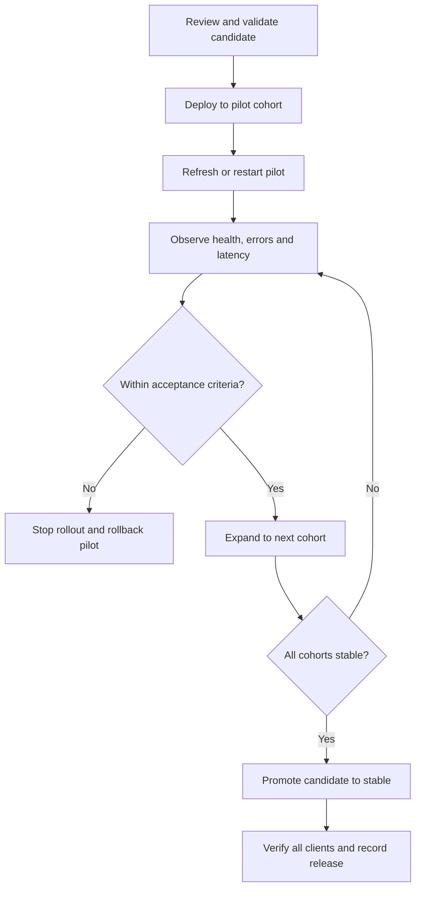

# Triển khai thử trên một nhóm client trước khi mở rộng

Một thay đổi cấu hình tập trung có thể ảnh hưởng đồng thời đến nhiều ứng dụng Spring Boot và nhiều replica. Nếu phát hành ngay cho toàn bộ client, lỗi ở một giá trị như database endpoint, timeout, pool size hoặc feature flag có thể lan rộng trước khi đội vận hành kịp phát hiện. Cách an toàn hơn là **triển khai theo từng đợt**, bắt đầu với một nhóm client nhỏ, quan sát kết quả rồi mới mở rộng.

Trong quy trình này, nhóm thử nghiệm ban đầu được gọi là *pilot* hoặc *canary*. Config Server vẫn cung cấp cấu hình theo application, profile và label; đội vận hành kiểm soát client nào dùng phiên bản cấu hình ứng viên, client nào tiếp tục dùng phiên bản ổn định. Spring Cloud Bus có thể gửi refresh event đến đúng nhóm instance, còn những thay đổi cần khởi động lại được triển khai bằng rollout có kiểm soát.

## 1. Vì sao cần triển khai theo nhóm client?

Giả sử `orders-service` chạy 20 replica ở production. Một thay đổi tăng connection pool hoặc chuyển endpoint database có thể ảnh hưởng đến tất cả replica. Nếu cấu hình mới sai, cả dịch vụ có thể mất kết nối cùng lúc.

Triển khai theo nhóm giúp:

- Giới hạn phạm vi ảnh hưởng ban đầu khi cấu hình có lỗi.
- Quan sát hành vi thực tế trên traffic production nhỏ trước khi mở rộng.
- So sánh metric giữa nhóm dùng cấu hình mới và nhóm giữ cấu hình cũ.
- Xác minh các thay đổi runtime, refresh và restart trong điều kiện thật.
- Dừng rollout trước khi lỗi lan đến toàn bộ dịch vụ.
- Có điểm quay lại rõ ràng bằng label, commit hoặc deployment revision.

Canary không thay thế review và kiểm thử trước phát hành. Đây là lớp xác nhận bổ sung sau khi thay đổi đã qua review, validation và các kiểm tra bắt buộc.

## 2. Xác định nhóm pilot và phạm vi thay đổi

Trước khi tạo nhóm pilot, xác định chính xác:

1. Application nào bị ảnh hưởng?
2. Profile nào nhận thay đổi, ví dụ `staging` hay `prod`?
3. Label/branch/commit nào chứa cấu hình ứng viên?
4. Client nào sẽ dùng cấu hình mới và client nào tiếp tục dùng cấu hình ổn định?
5. Property nào thay đổi và bean/tài nguyên nào tiêu thụ chúng?
6. Thay đổi cần refresh hay restart?
7. Metric, log và health check nào quyết định tiếp tục hay dừng rollout?

Nhóm pilot nên đủ nhỏ để giới hạn rủi ro nhưng đủ đại diện cho traffic, topology và dependency thực tế. Với dịch vụ nhiều replica, có thể bắt đầu bằng một replica hoặc một workload riêng. Với hệ thống nhiều vùng, nên chọn một vùng hoặc một nhóm instance có thể quan sát độc lập.

Không chọn pilot chỉ dựa trên thứ tự instance ngẫu nhiên. Cần có cách nhận diện ổn định, ví dụ Kubernetes label, deployment riêng, instance group, service tag hoặc danh sách Bus ID được quản lý.

## 3. Tách cấu hình ổn định và cấu hình ứng viên bằng Git label

Spring Cloud Config cho phép client yêu cầu cấu hình theo application, profile và label. Khi dùng Git backend, label thường là branch, tag hoặc commit. Có thể dùng hai label để tách nhóm:

- `release-stable`: phiên bản đã được chấp nhận cho phần lớn client.
- `release-canary`: phiên bản ứng viên dành cho nhóm pilot.

Ví dụ repository:

```text
config-repo
├── application.yml
├── orders-service.yml
└── orders-service-prod.yml

release-stable  -> commit đã được xác nhận
release-canary  -> commit chứa thay đổi đang thử nghiệm
```

Client pilot có thể được cấu hình dùng label ứng viên:

```yaml
spring:
  application:
    name: orders-service
  config:
    import: "configserver:https://config.internal"
  cloud:
    config:
      label: release-canary
```

Nhóm còn lại tiếp tục dùng label ổn định:

```yaml
spring:
  application:
    name: orders-service
  config:
    import: "configserver:https://config.internal"
  cloud:
    config:
      label: release-stable
```

Các thuộc tính và cách nạp label cần được xác nhận theo phiên bản Spring Cloud Config đang sử dụng. Trong môi trường triển khai, có thể truyền label qua biến môi trường:

```bash
SPRING_CLOUD_CONFIG_LABEL=release-canary
```

Label là selector của request cấu hình, không phải cơ chế phân quyền. Config Server vẫn cần xác thực client và giới hạn label mà từng workload được phép đọc.

### Dùng tag hoặc commit bất biến cho phát hành

Branch như `release-canary` có thể di chuyển khi có commit mới. Điều đó thuận tiện trong quá trình thử nghiệm nhưng làm kết quả khó tái lập nếu branch thay đổi giữa các lần client fetch.

Khi cần cố định một candidate đã được review, nên dùng tag hoặc commit SHA:

```yaml
spring:
  cloud:
    config:
      label: config-candidate-2026-11-27
```

Tag phát hành nên được quản lý như một artifact bất biến theo chính sách repository. Ghi lại commit SHA mà Config Server trả về giúp xác định chính xác nhóm pilot đang dùng phiên bản nào.

## 4. Chọn cách cô lập nhóm pilot

Có một số cách để tách pilot khỏi phần còn lại:

| Cách làm | Cách hoạt động | Khi phù hợp |
|---|---|---|
| Deployment riêng | Tạo deployment/canary replica với cấu hình label riêng. | Kubernetes hoặc nền tảng hỗ trợ nhiều deployment cùng service. |
| Instance group | Gán một nhóm VM/container vào cohort pilot. | Hệ thống có nhóm instance và rollout theo pool. |
| Config label riêng | Pilot dùng label ứng viên; nhóm còn lại dùng label ổn định. | Cần kiểm soát chính xác revision cấu hình. |
| Bus destination | Gửi refresh event đến các Bus ID thuộc nhóm pilot. | Các client đã tham gia cùng Bus và có ID định tuyến rõ ràng. |
| Endpoint refresh riêng | Gọi refresh đến từng instance pilot. | Nhóm pilot rất nhỏ hoặc cần thao tác có kiểm soát từng node. |

Có thể kết hợp nhiều cách. Ví dụ, một deployment riêng xác định cohort pilot, label riêng xác định revision cấu hình và Bus destination giới hạn refresh đến các instance trong deployment đó.

Không nên đổi `spring.application.name` chỉ để phân nhóm nếu điều đó làm Config Server tìm sang application context khác. Giữ application name đúng với dịch vụ; dùng deployment metadata, label hoặc Bus ID để xác định cohort.

## 5. Dùng Spring Cloud Bus để refresh đúng nhóm

Khi client tham gia Spring Cloud Bus, sự kiện refresh có thể được phát qua broker để nhiều node nhận. Endpoint tổng quát:

```bash
curl -X POST https://config.internal/actuator/busrefresh
```

Lệnh trên phát refresh event đến các node phù hợp trên Bus. Khi chỉ muốn refresh một nhóm, có thể dùng destination của Bus:

```bash
curl -X POST \
  https://config.internal/actuator/busrefresh/orders-service:canary-**
```

Destination được so khớp với `spring.cloud.bus.id` của các node. Mẫu trên chỉ là ví dụ minh họa; cần kiểm tra ID thực tế và cú pháp pattern của phiên bản Spring Cloud Bus đang dùng. Không giả định `spring.application.name` đơn lẻ luôn đủ để phân biệt một replica pilot với các replica khác.

Một cấu hình Bus ID có thể bao gồm thông tin cohort:

```yaml
spring:
  application:
    name: orders-service
  cloud:
    bus:
      id: orders-service:${DEPLOYMENT_GROUP:stable}:${INSTANCE_ID:local}
      destination: springCloudBus
```

Mỗi instance cần Bus ID duy nhất. Nếu pattern không khớp ID, client sẽ không nhận sự kiện; nếu pattern quá rộng, các client ngoài pilot cũng có thể refresh.

Trước khi dùng targeted refresh trong production, hãy kiểm tra log nhận event ở pilot và ít nhất một instance stable để xác nhận đúng nhóm nhận sự kiện. Bảo vệ endpoint Bus bằng authentication, authorization và giới hạn mạng quản trị.

## 6. Phân biệt refresh cấu hình với rollout/restart

Không phải mọi thay đổi đều áp dụng được bằng refresh event:

| Loại thay đổi | Cách áp dụng thường dùng | Lưu ý |
|---|---|---|
| Giá trị runtime được bean đọc động | Refresh hoặc Bus refresh | Xác minh bean thực sự đọc giá trị mới. |
| Bean trong `@RefreshScope` | Refresh để invalidate target, tạo target mới khi truy cập | Kiểm tra lifecycle và tài nguyên của target cũ. |
| `server.port` hoặc listener đã bind | Restart/rollout | Refresh không tự bind lại socket. |
| `@ConditionalOnProperty` và auto-configuration | Restart application context | Điều kiện không được đánh giá lại chỉ bằng refresh. |
| JDBC URL, connection pool, broker client | Thường restart hoặc tái tạo tài nguyên chuyên biệt | Cần xử lý connection đang hoạt động và rollback. |

Với thay đổi startup-only, pilot phải là một rollout nhỏ: tạo instance mới dùng label/cấu hình ứng viên, chờ readiness, chuyển một phần traffic, rồi quan sát. Không dùng `busrefresh` như bằng chứng rằng server port, bean graph hoặc pool đã được tạo lại.

## 7. Quy trình rollout theo từng đợt

Một kế hoạch điển hình có thể gồm các giai đoạn sau:

| Giai đoạn | Phạm vi minh họa | Điều kiện chuyển tiếp |
|---|---|---|
| Chuẩn bị | CI, staging và kiểm thử tích hợp | Cú pháp, contract, security và smoke test đạt yêu cầu. |
| Canary | 1 instance hoặc khoảng 1–5% traffic | Không có lỗi nghiêm trọng; metric nằm trong ngưỡng. |
| Mở rộng nhỏ | 5–10% hoặc một nhóm instance tiếp theo | Kết quả ổn định trong thời gian quan sát đã định. |
| Mở rộng trung bình | 25–50% | Không có xu hướng tăng lỗi/latency hoặc suy giảm dependency. |
| Hoàn tất | 100% client mục tiêu | Tất cả cohort xác nhận revision và health đạt yêu cầu. |

Các tỷ lệ trên chỉ là ví dụ. Quy mô pilot và thời gian quan sát phải dựa trên traffic, số replica, mức độ quan trọng của dịch vụ và khả năng rollback.



Không chuyển sang đợt tiếp theo chỉ vì đã hết một khoảng thời gian. Cần có metric và người chịu trách nhiệm xác nhận kết quả.

## 8. Theo dõi trong thời gian pilot

Chọn metric theo loại cấu hình thay đổi. Ví dụ:

- **Ứng dụng:** request rate, error rate, p95/p99 latency, exception count và restart count.
- **Database:** connection count, pool utilization, connection timeout, query latency và transaction failure.
- **Messaging:** consumer lag, publish/consume error, reconnect và message processing latency.
- **Hạ tầng:** CPU, memory, thread pool, file descriptor và network connection.
- **Cấu hình:** application/profile/label, Git commit SHA, thời điểm fetch, số client refresh thành công và số client còn dùng revision cũ.

So sánh pilot với nhóm stable trong cùng khoảng thời gian. Nếu cả hai nhóm cùng chịu tải hoặc dependency biến động, cần xét đến yếu tố nền trước khi kết luận thay đổi cấu hình là nguyên nhân.

### Ví dụ tiêu chí chấp nhận

Một nhóm vận hành có thể đặt tiêu chí minh họa:

- Error rate không tăng quá ngưỡng đã thống nhất so với baseline.
- p95 latency không vượt SLO hoặc ngưỡng regression cho phép.
- Không phát sinh lỗi kết nối database/broker mới.
- Readiness và health check ổn định.
- Không có crash loop, restart bất thường hoặc memory growth rõ rệt.
- Config Server trả đúng label/commit và client pilot đã áp dụng giá trị mới.

Ngưỡng cụ thể phải lấy từ SLO và baseline của dịch vụ, không dùng một con số chung cho mọi ứng dụng.

## 9. Điều kiện dừng và rollback

Định nghĩa trước các tín hiệu buộc dừng rollout:

- Error rate tăng vượt ngưỡng hoặc có lỗi nghiệp vụ nghiêm trọng.
- Latency vượt SLO trong thời gian quan sát.
- Database pool cạn, connection timeout tăng hoặc transaction failure xuất hiện.
- Broker lag tăng nhanh hoặc consumer không xử lý được message.
- Instance mới không đạt readiness hoặc liên tục restart.
- Client nhận sai application/profile/label hoặc một số client dùng revision không nhất quán.
- Secret, quyền truy cập hoặc endpoint bảo mật bị cấu hình sai.

Khi có tín hiệu dừng:

1. Ngừng mở rộng sang cohort tiếp theo.
2. Ghi lại thời điểm, commit, label và nhóm client bị ảnh hưởng.
3. Chuyển pilot về label/revision ổn định hoặc revert thay đổi.
4. Phát refresh hoặc restart để pilot thực sự nhận cấu hình rollback.
5. Xác minh health, traffic và metric trở lại baseline.
6. Giữ lại bằng chứng để phân tích nguyên nhân trước khi thử lại.

Rollback cấu hình không chỉ là di chuyển branch. Client đang chạy có thể giữ giá trị cũ trong Environment hoặc tài nguyên đã tạo. Cần xác nhận Config Server trả revision rollback và client đã áp dụng nó.

## 10. Promote candidate thành phiên bản ổn định

Khi pilot và các đợt mở rộng đạt tiêu chí, candidate có thể được promote. Cách promote phụ thuộc chiến lược Git:

- Merge commit đã thử nghiệm vào branch stable.
- Tạo tag phát hành trỏ đúng commit candidate.
- Cập nhật manifest triển khai để các client tiếp theo dùng label mới.
- Ghi nhận commit SHA, application, profile và nhóm client đã xác minh.

Nếu dùng branch stable di động, hãy bảo đảm commit được promote chính là commit đã chạy ở pilot. Không tạo lại thay đổi bằng cách copy thủ công các dòng YAML vì có thể phát sinh khác biệt không được thử nghiệm.

Sau khi promote, cập nhật nhóm stable theo từng đợt. Nếu client dùng label được pin lúc startup, thay label có thể yêu cầu rollout/restart để client yêu cầu cấu hình theo label mới. Không giả định một refresh thông thường tự thay đổi selector label đã được dùng trong quá trình nạp Config Data.

## 11. Ví dụ kế hoạch pilot cho orders-service

Giả sử cần thay `app.payment.timeout` từ `5s` xuống `3s`:

```yaml
app:
  payment:
    timeout: 3s
```

Kế hoạch có thể là:

1. Tạo commit candidate trong branch/label `release-canary`.
2. Deploy một replica `orders-service` với `SPRING_CLOUD_CONFIG_LABEL=release-canary` và Bus ID có cohort `canary`.
3. Giữ các replica còn lại dùng `release-stable`.
4. Xác minh Config Server trả đúng `label` và `version` cho pilot.
5. Nếu bean đọc timeout runtime, gửi targeted refresh đến pilot; nếu giá trị được capture lúc startup, restart pilot.
6. Theo dõi payment timeout, error rate, latency và downstream health.
7. Nếu ổn định, promote đúng commit candidate sang stable và mở rộng rollout.
8. Nếu lỗi, chuyển pilot về stable label/revision, refresh hoặc restart rồi xác minh.

Ví dụ này giả định ứng dụng có thể chạy đồng thời các replica dùng label khác nhau. Cần xác nhận các replica tương thích khi xử lý cùng dữ liệu và traffic; nếu thay đổi schema hoặc protocol không tương thích, phải có kế hoạch migration theo thứ tự an toàn.

## 12. Rủi ro khi nhiều cohort dùng cấu hình khác nhau

Canary tạo ra giai đoạn hệ thống chạy nhiều phiên bản cấu hình song song. Điều này có thể an toàn với thay đổi timeout hoặc feature flag tương thích, nhưng nguy hiểm với thay đổi schema, protocol hoặc dữ liệu dùng chung.

Các rủi ro cần đánh giá:

- **Tương thích ngược:** phiên bản mới và cũ có thể cùng đọc/ghi dữ liệu trong thời gian rollout.
- **Shared resources:** hai cohort cùng kết nối một database/broker nhưng dùng cấu hình pool hoặc protocol khác nhau.
- **Cross-service contract:** service A đã dùng endpoint mới trong khi service B chưa được cập nhật.
- **Secret rotation:** credential cũ có thể bị thu hồi trước khi tất cả cohort chuyển sang credential mới.
- **Configuration drift:** một cohort không nhận event hoặc vẫn giữ label/commit cũ.
- **Rollback compatibility:** phiên bản cấu hình cũ có còn hoạt động với dữ liệu hoặc tài nguyên đã được thay đổi không?

Với thay đổi không tương thích, cần tách thành nhiều bước: chuẩn bị hạ tầng tương thích cả hai phiên bản, rollout client, xác minh, rồi mới loại bỏ cấu hình cũ. Không dùng canary refresh để thay thế quy trình migration có phụ thuộc thứ tự.

## 13. Ghi nhận và audit từng đợt phát hành

Mỗi đợt rollout nên lưu:

- PR và commit SHA đã được phê duyệt.
- Config Server label và `version` trả về.
- Application/profile và danh sách cohort.
- Instance/Bus ID nhận refresh event.
- Thời gian bắt đầu, kết thúc và người xác nhận.
- Metric trước/sau và kết quả health check.
- Lý do tiếp tục, dừng hoặc rollback.
- Revision ổn định cuối cùng sau promote.

Thông tin này giúp trả lời câu hỏi “client nào đang chạy cấu hình nào?” khi có sự cố. Không ghi plaintext secret, token hoặc toàn bộ Environment chứa dữ liệu nhạy cảm vào audit log.

## 14. Tổng kết

- Triển khai theo nhóm client giúp giới hạn phạm vi ảnh hưởng và kiểm chứng cấu hình trên traffic thực tế trước khi mở rộng.
- Xác định pilot cohort ổn định bằng deployment metadata, instance group hoặc Bus ID; không chọn ngẫu nhiên.
- Dùng Git label/branch/tag để tách cấu hình stable và canary; ưu tiên ghi nhận commit SHA hoặc tag bất biến cho candidate đã thử nghiệm.
- Spring Cloud Bus có thể targeted refresh theo destination, nhưng pattern phải khớp Bus ID thực tế và được kiểm tra trước.
- Phân biệt refresh runtime với restart/rollout cho thay đổi startup-only.
- Mở rộng theo từng đợt dựa trên metric, health và tiêu chí chấp nhận đã định trước.
- Dừng rollout khi vượt ngưỡng; rollback phải khiến client thực sự fetch và áp dụng revision ổn định.
- Khi nhiều cohort chạy song song, đánh giá tương thích dữ liệu, protocol, secret và khả năng rollback.
- Ghi lại commit, label, cohort, kết quả và người phê duyệt để truy vết cấu hình đang chạy.
