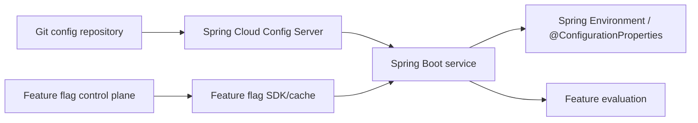

# Ranh giới giữa cấu hình động và hệ thống quản lý feature flag

Spring Cloud Config giúp nhiều ứng dụng Spring Boot nhận cấu hình tập trung theo application, profile và label. Khi cần thay đổi một giá trị như timeout, endpoint hoặc giới hạn kết nối, nhóm có thể cập nhật repository rồi yêu cầu client refresh. Tuy nhiên, không phải mọi quyết định thay đổi hành vi ứng dụng đều nên được mô hình hóa thành một property trong Config Server.

**Cấu hình động** mô tả ứng dụng cần vận hành với tham số nào. **Feature flag** quyết định một khả năng sản phẩm có được bật cho một đối tượng, nhóm người dùng hoặc tỷ lệ traffic cụ thể hay không. Hai cơ chế có thể cùng sử dụng dữ liệu cấu hình, nhưng có mục đích, tốc độ thay đổi, ngữ nghĩa đánh giá và vòng đời khác nhau.

## 1. Phân biệt cấu hình vận hành và feature flag

Cấu hình vận hành thường điều khiển cách một instance hoặc một dịch vụ hoạt động:

```yaml
acme:
  billing:
    connect-timeout: 3s
    max-connections: 40
    retry:
      max-attempts: 3
```

Các giá trị này thường được quản trị theo môi trường, application và release. Chúng thay đổi tương đối ít, được review như thay đổi hạ tầng và thường có thể nạp lúc startup hoặc refresh theo một quy trình đã kiểm soát.

Feature flag điều khiển một quyết định sản phẩm hoặc hành vi có thể bật/tắt độc lập với việc triển khai code:

```text
new-invoice-layout = enabled for internal users
express-checkout = enabled for 10% of eligible traffic
new-pricing-engine = disabled
```

Một hệ thống feature flag thường có khả năng đánh giá theo context của request hoặc người dùng, nhắm mục tiêu theo thuộc tính, rollout theo phần trăm, kill switch, lịch sử thay đổi và audit. Những khả năng này không tự xuất hiện chỉ vì một boolean được lưu trong Config Server.

| Tiêu chí | Cấu hình động | Feature flag |
| --- | --- | --- |
| Câu hỏi | Dịch vụ cần chạy với tham số nào? | Tính năng nào được bật cho đối tượng nào? |
| Phạm vi | Thường theo application, profile, môi trường hoặc instance | Có thể theo user, tenant, nhóm, request, segment hoặc tỷ lệ traffic |
| Thay đổi | Thường theo quy trình phát hành cấu hình | Có thể thay đổi độc lập với release code và thường xuyên hơn |
| Đánh giá | Bind vào `Environment`/bean hoặc đọc theo cấu hình | Đánh giá một flag với evaluation context tại điểm sử dụng |
| Rollout | Thường cập nhật theo môi trường/dịch vụ | Có thể gradual rollout, targeting, experiment và kill switch |
| Quản trị | Git review, label, profile, refresh | Owner, trạng thái, targeting, lịch sử, expiry và cleanup |

## 2. Khi nào dùng Spring Cloud Config?

Spring Cloud Config phù hợp cho cấu hình có tính chất vận hành và cần được quản lý tập trung:

- URL của dịch vụ phụ thuộc môi trường.
- Timeout, retry limit, pool size và các ngưỡng vận hành.
- Logging level hoặc một số chế độ chẩn đoán có kiểm soát.
- Cấu hình tích hợp với hệ thống bên ngoài.
- Giá trị mặc định dùng chung và giá trị chuyên biệt theo application/profile.
- Cấu hình startup cần được version hóa, review và truy vết theo Git label.

Ví dụ, thay timeout kết nối database từ `2s` lên `3s` là thay đổi tham số vận hành. Nhóm có thể cập nhật file cấu hình trong Git, review, merge, kiểm tra Config Server response và refresh hoặc rollout client theo chính sách.

Config Server cũng có thể lưu một boolean như `features.new-invoice-layout=true`. Cách này phù hợp khi flag đơn giản, phạm vi bật/tắt là toàn bộ một application hoặc môi trường, không cần targeting theo user, phần trăm rollout, experiment hay audit chuyên biệt. Nhưng khi nhu cầu phát triển thành quản lý vòng đời feature, nên dùng một hệ thống feature flag chuyên dụng hoặc một nền tảng evaluation có hợp đồng rõ ràng.

## 3. Khi nào cần hệ thống feature flag?

Feature flag phù hợp khi nhóm cần tách thời điểm deploy code khỏi thời điểm bật hành vi. Ví dụ:

- Deploy code mới nhưng giữ tính năng ở trạng thái off cho tới khi hoàn tất kiểm thử.
- Chỉ bật tính năng cho nhân viên nội bộ hoặc tenant thử nghiệm.
- Bật cho 5%, 10%, rồi 50% traffic để theo dõi lỗi và chỉ số nghiệp vụ.
- Tắt nhanh một chức năng gây sự cố mà không cần build lại ứng dụng.
- Chạy experiment với các biến thể và phân tích kết quả.
- Bật/tắt một tính năng theo khu vực hoặc phân khúc khách hàng.

Hệ thống feature flag thường gồm control plane để quản trị flag, SDK hoặc client để đánh giá flag, evaluation context, cache/local state, audit log và đôi khi có analytics/experiment assignment. SDK có thể nhận dữ liệu qua polling hoặc streaming, sau đó đánh giá flag tại chỗ để tránh gọi mạng trên mỗi request.

Không phải sản phẩm feature flag nào cũng hỗ trợ toàn bộ khả năng này. Khi chọn công cụ, cần đánh giá rõ targeting, consistency, SDK cho Java, hỗ trợ Spring Boot, offline behavior, audit, quyền quản trị và khả năng export/backup flag definitions.

## 4. Các loại feature toggle và vòng đời của chúng

Không phải mọi flag đều có cùng mục đích. Phân loại giúp chọn thời hạn và quy trình xóa phù hợp.

| Loại flag | Mục đích | Vòng đời thường gặp |
| --- | --- | --- |
| Release toggle | Deploy code trước, bật feature sau | Tạm thời; xóa sau khi rollout hoàn tất |
| Experiment toggle | Phân phối biến thể để đo kết quả | Tạm thời; xóa sau khi experiment kết thúc và chốt kết quả |
| Operational toggle | Tắt chức năng để giảm tải hoặc giảm tác động sự cố | Có thể tồn tại lâu hơn nhưng cần owner và review định kỳ |
| Permission/entitlement toggle | Điều khiển quyền lợi theo user/tenant | Thường là dữ liệu entitlement có quản trị riêng, không nên dùng flag như hệ thống authorization chính |

Release toggle thường tạo nợ kỹ thuật nếu không có ngày hết hạn. Operational kill switch có thể cần tồn tại lâu dài, nhưng phải có owner, runbook và kiểm thử. Experiment toggle cần ghi rõ giả thuyết, nhóm đối chứng, thời gian chạy và tiêu chí kết thúc.

## 5. Ranh giới kiến trúc đề xuất

Một kiến trúc có thể dùng Spring Cloud Config cho tham số vận hành và một feature flag provider cho quyết định theo context:



Trong mô hình này:

- Config Server cung cấp URI, timeout, connection pool và cấu hình tích hợp theo môi trường.
- Feature flag control plane quản lý trạng thái, targeting, rollout và audit.
- SDK/cache cung cấp dữ liệu flag để ứng dụng đánh giá tại điểm sử dụng.
- Code nghiệp vụ gọi một abstraction nội bộ thay vì phụ thuộc trực tiếp vào vendor SDK ở mọi nơi.

Nếu tổ chức chỉ có nhu cầu bật/tắt toàn bộ feature theo môi trường, Config Server có thể đủ. Khi xuất hiện targeting theo user/tenant, phần trăm rollout, experiment hoặc kill switch cần phản hồi nhanh, hãy tách ngữ nghĩa feature evaluation ra khỏi cấu hình vận hành.

## 6. Ví dụ cấu hình vận hành và flag riêng biệt

Config Server có thể cung cấp endpoint của feature provider và timeout kết nối:

```yaml
acme:
  feature-service:
    endpoint: https://flags.internal.example
    connect-timeout: 500ms
    refresh-interval: 30s
```

Credential truy cập feature provider nên được cấp qua secret manager hoặc cơ chế identity của nền tảng, không đặt plaintext trong Git.

Feature flag service có thể quản lý:

```text
new-invoice-layout:
  enabled: true
  targeting:
    segment: internal-users

express-checkout:
  enabled: true
  rollout: 10%
```

Đoạn cấu trúc trên chỉ minh họa ý nghĩa nghiệp vụ; schema thực tế phụ thuộc feature flag platform. Không nên tự giả định Config Server hiểu `targeting` hoặc `rollout` và tự thực hiện phần trăm traffic. Nếu tự xây dựng tính năng này, nhóm phải chịu trách nhiệm về deterministic assignment, context validation, cache, audit, concurrency và analytics.

## 7. Đánh giá flag tại điểm sử dụng trong Spring Boot

Code nghiệp vụ nên phụ thuộc vào một abstraction nhỏ để có thể thay provider hoặc viết test mà không cần khởi tạo toàn bộ SDK trong mọi test.

```java
public interface FeatureDecisions {
    boolean enabled(String flagKey, EvaluationContext context,
                    boolean defaultValue);
}
```

Evaluation context có thể chứa các thuộc tính không nhạy cảm cần cho targeting:

```java
public record EvaluationContext(
        String userId,
        String tenantId,
        String region,
        Set<String> groups) {
}
```

Ví dụ sử dụng trong service:

```java
@Service
public class InvoiceService {
    private final FeatureDecisions features;
    private final InvoiceRenderer legacyRenderer;
    private final InvoiceRenderer newRenderer;

    public InvoiceService(FeatureDecisions features,
                          InvoiceRenderer legacyRenderer,
                          InvoiceRenderer newRenderer) {
        this.features = features;
        this.legacyRenderer = legacyRenderer;
        this.newRenderer = newRenderer;
    }

    public InvoiceView render(Invoice invoice, UserContext user) {
        var context = new EvaluationContext(
                user.id(), user.tenantId(), user.region(), user.groups());

        boolean useNewLayout = features.enabled(
                "new-invoice-layout", context, false);

        return useNewLayout
                ? newRenderer.render(invoice)
                : legacyRenderer.render(invoice);
    }
}
```

`FeatureDecisions` là adapter do ứng dụng định nghĩa; implementation có thể gọi SDK của feature provider hoặc một dịch vụ nội bộ. Ví dụ đặt default là `false` để giữ renderer cũ nếu provider không có quyết định. Giá trị mặc định phải được chọn theo rủi ro của từng feature, không dùng cùng một mặc định cho mọi flag.

Nếu flag chỉ áp dụng theo tenant hoặc user, context phải được lấy từ danh tính đã xác thực ở server. Không tin giá trị userId/tenantId do client tùy ý gửi lên nếu chúng chưa được xác minh.

## 8. Gradual rollout và targeting

Gradual rollout cho phép tăng tỷ lệ người dùng nhận tính năng theo từng giai đoạn. Một quy trình điển hình:

1. Bật cho developer và người dùng nội bộ.
2. Bật cho một nhóm tenant thử nghiệm.
3. Bật cho 1–5% nhóm người dùng đủ điều kiện.
4. Theo dõi error rate, latency, conversion và support tickets.
5. Tăng lên 10%, 25%, 50% rồi 100% khi đạt tiêu chí.
6. Dừng hoặc tắt flag nếu metric vượt ngưỡng.
7. Sau khi rollout ổn định, xóa nhánh code cũ và flag tạm thời.

Để người dùng không bị đổi biến thể giữa các request, provider thường cần assignment ổn định, ví dụ hash một identity ổn định cùng flag key. Không tự viết random percentage check ở từng request vì cùng người dùng có thể lúc thấy phiên bản mới, lúc thấy phiên bản cũ.

Targeting cần được kiểm soát quyền riêng tư. Chỉ đưa vào evaluation context những thuộc tính thực sự cần thiết; tránh gửi email, số điện thoại, token hoặc dữ liệu cá nhân nhạy cảm nếu không có cơ sở và kiểm soát phù hợp. Có thể dùng identifier đã được pseudonymize khi provider chỉ cần phân nhóm ổn định.

## 9. Kill switch và hành vi an toàn khi provider lỗi

Kill switch là flag cho phép tắt nhanh một khả năng khi có sự cố. Ví dụ, nếu hệ thống thanh toán mới làm tăng tỷ lệ lỗi, operator có thể tắt `new-payment-flow` để quay về đường xử lý cũ.

Một kill switch tốt cần:

- Có owner và người được quyền thay đổi.
- Có default an toàn nếu không lấy được flag.
- Có đường code fallback đã được kiểm thử.
- Có audit log và alert khi flag bị đổi.
- Có thể đánh giá nhanh mà không gọi mạng đồng bộ trên mỗi request.
- Có runbook nêu rõ tác động, dependency và cách khôi phục.

Khi provider không khả dụng, SDK có thể dùng last-known-good state trong cache hoặc fallback mặc định. Quyết định này cần được chọn theo từng flag:

| Loại quyết định | Hành vi khi provider lỗi có thể phù hợp |
| --- | --- |
| Feature mới chưa ổn định | Tắt, dùng implementation cũ |
| Kill switch bảo vệ tải | Dùng trạng thái cache hợp lệ hoặc fallback giảm tải đã xác định |
| UI thử nghiệm không thiết yếu | Dùng biến thể mặc định ổn định |
| Quyết định liên quan quyền truy cập | Từ chối theo authorization service; không dựa vào flag cache để cấp quyền |

Không có một chính sách fail-open/fail-closed chung cho mọi flag. Với quyết định an toàn hoặc bảo mật, phải dựa vào hệ thống authorization và policy chuyên biệt. Feature flag không phải nguồn cấp quyền.

## 10. Consistency, cache và độ trễ cập nhật

Feature flag thường cần cập nhật nhanh hơn cấu hình vận hành, nhưng “ngay lập tức” không phải cam kết tự nhiên của mọi SDK. Polling interval, streaming connection, cache, network partition và số instance ảnh hưởng thời gian lan truyền.

Hãy xác định:

- Độ trễ tối đa từ lúc operator đổi flag tới khi instance nhận trạng thái mới.
- Hành vi của SDK khi mất kết nối hoặc nhận dữ liệu lỗi.
- Thời gian giữ last-known-good state và cách nhận biết state đã stale.
- Cách đồng bộ assignment khi nhiều instance phục vụ cùng user.
- Cách quan sát revision/version của flag definitions.
- Cách rollback khi provider phát hành cấu hình sai.

Nếu cần một thay đổi đồng thời cho mọi request đang chạy, feature flag cũng không tự cung cấp transaction phân tán. Trong thời gian cập nhật, các instance có thể tạm thời đánh giá khác nhau. Hệ thống nghiệp vụ nên chịu được giai đoạn chuyển tiếp hoặc dùng một cơ chế activation có kiểm soát riêng.

## 11. Không dùng feature flag thay authorization

Một lỗi thiết kế phổ biến là ẩn nút hoặc endpoint trên giao diện khi flag tắt rồi coi đó là bảo vệ quyền truy cập. UI flag chỉ điều khiển trải nghiệm. Người dùng vẫn có thể gọi API trực tiếp nếu backend không kiểm tra quyền.

Ví dụ không an toàn:

```java
if (features.enabled("admin-screen", context, false)) {
    return adminData;
}
```

Nếu đây là dữ liệu quản trị, service vẫn phải kiểm tra role/scope/tenant permission ở backend. Feature flag có thể bổ sung điều kiện bật chức năng, nhưng authorization phải độc lập:

```java
authorization.requirePermission(user, "billing.admin.read");
if (!features.enabled("admin-screen", context, false)) {
    throw new FeatureUnavailableException();
}
return adminService.readData();
```

Thứ tự kiểm tra có thể phụ thuộc yêu cầu bảo mật và cách tránh tiết lộ sự tồn tại của feature. Điểm cốt lõi là flag không được thay thế kiểm tra quyền ở server.

## 12. Quản trị vòng đời và tránh toggle debt

Mỗi flag cần metadata tối thiểu:

| Metadata | Mục đích |
| --- | --- |
| Key và mô tả | Biết flag điều khiển hành vi nào |
| Owner/team | Người chịu trách nhiệm |
| Loại flag | Release, experiment, operational hoặc entitlement |
| Ngày tạo và ngày review/expiry | Nhắc dọn flag tạm thời |
| Default/fallback | Hành vi khi provider không khả dụng |
| Targeting và môi trường | Phạm vi người dùng được áp dụng |
| Audit/history | Ai đổi, lúc nào và vì sao |
| Runbook/metric | Cách quan sát và xử lý khi có sự cố |

Release flag nên có ngày hết hạn. Khi feature đã rollout 100% và không còn cần rollback nhanh bằng flag, xóa flag cùng nhánh code cũ. Experiment flag nên được đóng sau khi phân tích xong. Operational flag có thể tồn tại lâu hơn nhưng cần review định kỳ và kiểm tra kill path.

Quá nhiều flag làm tăng số nhánh logic, số tổ hợp cần test và khả năng các trạng thái cũ không còn được sử dụng. Đặt quota hoặc review gate cho flag mới giúp tránh toggle debt.

## 13. Kiểm thử feature flag

Không chỉ test trạng thái enabled. Cần test các tình huống:

| Trường hợp | Điều cần xác minh |
| --- | --- |
| Flag off | Code path cũ hoạt động và không có side effect mới |
| Flag on | Code path mới hoạt động đúng |
| Target match | Đúng user/tenant/segment nhận flag |
| Target không match | Không bị bật nhầm |
| Provider timeout/offline | Fallback đúng theo loại flag |
| Cache stale | Có cảnh báo và hành vi đã định nghĩa |
| Flag thay đổi giữa rollout | Instance cũ/mới vẫn tương thích trong thời gian chuyển tiếp |
| Kill switch | Tắt được feature và khôi phục dịch vụ theo runbook |
| Authorization | User không có quyền vẫn bị từ chối dù flag đang bật |

Nên có unit test dùng fake `FeatureDecisions`, contract test cho adapter SDK và integration test xác nhận targeting/caching ở staging. Không gọi feature provider thật trong mọi unit test vì sẽ làm test chậm và phụ thuộc mạng.

## 14. Quan sát và audit

Để vận hành được, cần biết flag nào được đánh giá, ở phiên bản nào và có ảnh hưởng gì. Tùy privacy policy, có thể ghi metric theo flag key, variant, môi trường và service instance. Tránh ghi raw user identifier hoặc evaluation context nhạy cảm vào log.

Các chỉ số hữu ích:

- Thời gian cập nhật flag từ control plane tới instance.
- Tỷ lệ evaluation dùng cache và tỷ lệ cache stale.
- Lỗi kết nối/đồng bộ với provider.
- Số evaluation theo variant, không nhất thiết theo từng user.
- Error rate/latency của code path mới so với baseline.
- Số flag quá hạn hoặc không có owner.

Audit nên lưu actor, thời điểm, flag key, thay đổi trước/sau, môi trường, targeting và lý do. Quyền tạo flag, thay đổi targeting và bật production cần được phân quyền riêng.

## 15. Lộ trình chuyển từ boolean trong Config Server sang feature flag platform

Nếu hiện tại đang lưu `features.new-checkout=true` trong Config Server nhưng cần targeting theo tenant và rollout phần trăm, có thể chuyển theo từng bước:

1. Xác định ngữ nghĩa flag hiện tại, owner, default và các nơi đang đọc property.
2. Tạo flag tương ứng trên provider mới ở trạng thái off hoặc chỉ dành cho internal users.
3. Tạo adapter `FeatureDecisions` và unit test code path on/off.
4. Chạy song song chế độ quan sát trong staging để so sánh kết quả quyết định, không để hai nguồn cùng điều khiển production một cách mơ hồ.
5. Chuyển một nhóm canary sang provider mới và theo dõi lỗi/latency.
6. Chuyển toàn bộ traffic, ghi nhận revision/flag history và có phương án rollback.
7. Xóa property cũ khỏi Config Server và dọn code/metadata không còn sử dụng.

Không giữ hai nguồn authoritative cho cùng một flag trong thời gian dài. Nếu cần dual-read tạm thời, phải xác định nguồn quyết định, cách phát hiện mismatch và ngày kết thúc.

## 16. Bảng quyết định lựa chọn cơ chế

| Nhu cầu | Cơ chế phù hợp |
| --- | --- |
| Timeout, retry, endpoint theo môi trường | Spring Cloud Config |
| Cấu hình startup, version hóa theo Git label | Spring Cloud Config |
| Bật/tắt một feature cho toàn bộ application/prod | Config Server có thể đủ nếu không cần feature semantics chuyên biệt |
| Target theo user, tenant hoặc segment | Feature flag system |
| Gradual rollout theo phần trăm traffic | Feature flag system có deterministic assignment |
| Experiment với variants và analytics | Feature experimentation platform |
| Kill switch cần audit và thao tác nhanh | Feature flag/operational control plane có SLA phù hợp |
| Cấp quyền đọc dữ liệu hoặc thao tác API | Authorization service/policy; không dùng feature flag |
| Secret và credential | Secret manager/Vault; không dùng flag hay property thông thường làm kho bí mật |

## 17. Checklist trước khi tạo một flag

- [ ] Xác định đây là tham số vận hành hay quyết định bật/tắt tính năng.
- [ ] Xác định flag có cần targeting, percentage rollout, experiment hoặc kill switch không.
- [ ] Chọn owner, loại flag, default và ngày review/expiry.
- [ ] Xác định evaluation context và chỉ dùng thuộc tính cần thiết.
- [ ] Chọn cache, polling/streaming và giới hạn staleness phù hợp.
- [ ] Định nghĩa fallback khi provider offline hoặc trả dữ liệu không hợp lệ.
- [ ] Kiểm tra mọi code path on/off và trạng thái chuyển tiếp.
- [ ] Không dùng flag thay cho authorization hoặc secret management.
- [ ] Bật audit, metric, alert và quyền thay đổi theo môi trường.
- [ ] Có kế hoạch cleanup sau rollout hoặc experiment.

## 18. Tài liệu tham khảo

- [Spring Cloud Config Reference](https://docs.spring.io/spring-cloud-config/reference/): quản lý cấu hình tập trung, application/profile/label và refresh.
- [OpenFeature Specification](https://openfeature.dev/specification/): mô hình API trung lập cho việc đánh giá feature flag.
- [Martin Fowler — Feature Toggles](https://martinfowler.com/articles/feature-toggles.html): phân loại toggle, trade-off và quản lý vòng đời.

Spring Cloud Config là lựa chọn phù hợp để quản lý tham số vận hành và cấu hình theo môi trường. Hệ thống feature flag giải quyết bài toán khác: quyết định tính năng nào được bật cho ai, vào thời điểm nào, theo tỷ lệ nào và với cơ chế audit/fallback ra sao. Giữ ranh giới này rõ ràng giúp tránh biến Config Server thành một feature management platform tự xây dựng thiếu targeting, consistency, quan sát và quản trị vòng đời.
