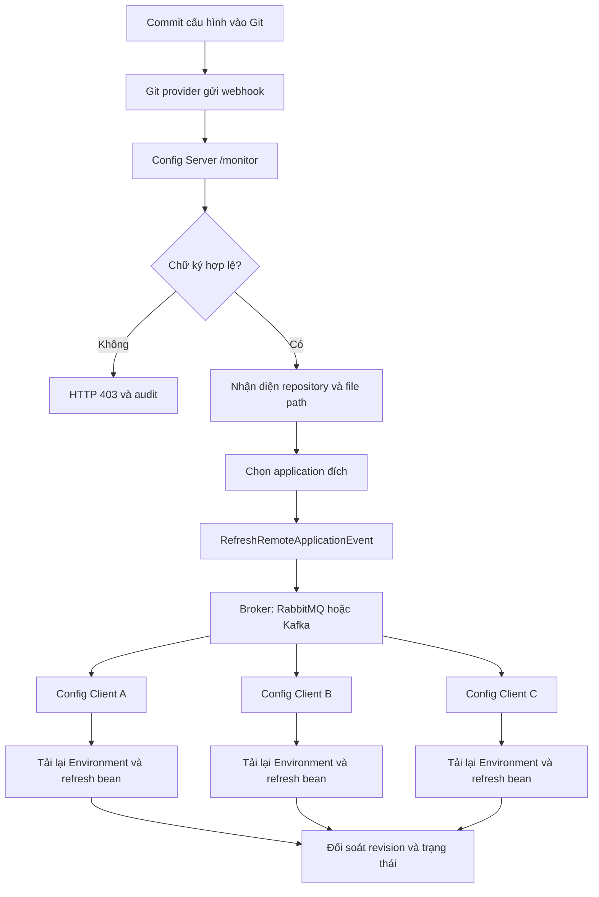

# Theo dõi Bus, webhook và client bỏ lỡ thay đổi

Trong hệ thống dùng Spring Cloud Config, một commit cấu hình có thể cần được phân phối đến hàng chục Config Client. Webhook từ Git provider báo cho Config Server biết repository đã thay đổi; Config Server phát `RefreshRemoteApplicationEvent` qua Spring Cloud Bus; các client nhận event rồi tải lại cấu hình. Mỗi mắt xích có thể gặp lỗi riêng. Webhook được gửi thành công chưa chứng minh broker đã chuyển event, và event được client xác nhận chưa chứng minh mọi bean đã sử dụng giá trị mới.

Muốn phát hiện client bỏ lỡ thay đổi, cần theo dõi toàn bộ luồng từ Git đến ứng dụng: webhook delivery, xác thực chữ ký, repository revision, event được publish, broker delivery, ACK của từng instance và trạng thái cấu hình hiệu lực sau refresh. Git vẫn là nguồn dữ liệu chuẩn; Bus chỉ là cơ chế thông báo để client biết lúc nào cần đọc lại nguồn đó.

## Mục tiêu học tập

Sau bài học, bạn có thể:

- Mô tả luồng webhook từ Git provider đến Config Server và Spring Cloud Bus.
- Cấu hình `spring-cloud-config-monitor` và webhook secret.
- Hiểu cách Config Server ánh xạ file thay đổi sang application cần refresh.
- Theo dõi event gửi đi và ACK từ từng Bus instance.
- Phân biệt webhook accepted, event delivered, refresh completed và cấu hình đã có hiệu lực.
- Chẩn đoán client bỏ lỡ event do broker, destination, Bus ID hoặc lỗi tải cấu hình.
- Xây dựng cơ chế đối soát định kỳ và refresh bù cho instance bị lệch.

## 1. Luồng từ commit đến cấu hình hiệu lực

Giả sử nhóm vận hành thay đổi `catalog-service-prod.yml` trong Git. Git provider gửi webhook đến `/monitor` của Config Server. Config Server xác thực webhook, xác định ứng dụng bị ảnh hưởng và phát một `RefreshRemoteApplicationEvent`. Broker chuyển event đến các client phù hợp. Mỗi client tải lại cấu hình từ Config Server rồi cập nhật Environment và các bean có hỗ trợ refresh.



Mỗi bước có một bằng chứng riêng:

| Bước | Bằng chứng cần theo dõi |
|---|---|
| Git push | Commit SHA, repository và danh sách file thay đổi. |
| Webhook | Delivery ID, thời gian gửi, URL đích và HTTP status. |
| Config Server monitor | Chữ ký hợp lệ, path được trích xuất và application đích. |
| Bus publish | Event ID, event type, origin và destination. |
| Bus consumer | ACK từ từng instance hoặc lỗi consume. |
| Client refresh | Log refresh, EnvironmentChangeEvent và lỗi tải cấu hình. |
| Ứng dụng áp dụng | Revision marker an toàn, health và hành vi của bean phụ thuộc cấu hình. |

Không gộp tất cả thành một trạng thái “webhook thành công”. Đó chỉ là một phần của luồng.

## 2. Bật webhook monitor trong Config Server

Để nhận webhook từ Git provider, Config Server cần dependency `spring-cloud-config-monitor`. Khi Spring Cloud Bus được bật trong Config Server, dependency này cung cấp endpoint `/monitor` để nhận thông báo thay đổi repository.

Ví dụ Maven:

```xml
<dependency>
    <groupId>org.springframework.cloud</groupId>
    <artifactId>spring-cloud-config-monitor</artifactId>
</dependency>

<dependency>
    <groupId>org.springframework.cloud</groupId>
    <artifactId>spring-cloud-starter-bus-amqp</artifactId>
</dependency>
```

Ví dụ dùng RabbitMQ làm broker; nếu hệ thống dùng Kafka, thay bằng `spring-cloud-starter-bus-kafka` và cấu hình binder tương ứng. Config Client cũng phải tham gia Spring Cloud Bus để nhận `RefreshRemoteApplicationEvent`; chỉ bật Bus ở Config Server là chưa đủ.

Webhook URL được cấu hình ở Git provider, ví dụ:

```text
https://config.example.internal/monitor
```

Chọn sự kiện push phù hợp với repository cấu hình. Với GitHub, webhook push thường gửi POST JSON và header `X-GitHub-Event: push`. GitLab, Gitea, Gogs, Gitee và Bitbucket có payload/header riêng; Config Monitor hỗ trợ các provider phổ biến này theo phiên bản Spring Cloud Config.

## 3. Bảo vệ webhook bằng secret và chữ ký

Endpoint `/monitor` có thể kích hoạt refresh cho nhiều ứng dụng, vì vậy không được xem nó như một URL nhận POST công khai. Config Server hỗ trợ kiểm tra chữ ký hoặc token của webhook theo từng provider.

Ví dụ cấu hình secret từ secret manager hoặc biến môi trường:

```yaml
spring:
  cloud:
    config:
      server:
        monitor:
          github:
            webhook-secret: ${CONFIG_GITHUB_WEBHOOK_SECRET}
          gitlab:
            webhook-secret: ${CONFIG_GITLAB_WEBHOOK_SECRET}
```

Các provider dùng cơ chế khác nhau:

| Provider | Cách xác thực | Header thường dùng |
|---|---|---|
| GitHub | HMAC-SHA256 trên raw request body | `X-Hub-Signature-256` |
| GitLab | Secret token gửi nguyên giá trị | `X-Gitlab-Token` |
| Bitbucket | HMAC-SHA256 | `X-Hub-Signature` |
| Gitea | HMAC-SHA256 | `X-Gitea-Signature` |
| Gogs | HMAC-SHA256 | `X-Gogs-Signature` |

Config Server yêu cầu secret được cấu hình cho từng provider muốn chấp nhận. Nếu không cấu hình webhook secret nào, `/monitor` từ chối các webhook; chữ ký hoặc token không hợp lệ bị trả HTTP 403. Không tắt validation filter chỉ để webhook bắt đầu hoạt động.

Secret webhook phải được lưu ngoài Git, có quyền đọc giới hạn và được xoay vòng theo chính sách. Kết hợp HTTPS, network allowlist của Git provider nếu có, giới hạn rate và audit log. Không ghi raw request body hoặc chữ ký đầy đủ vào log.

## 4. Config Server ánh xạ file thay đổi sang ứng dụng

Theo mặc định, Config Monitor dùng đường dẫn file thay đổi để suy ra application cần refresh. Ví dụ:

| File được thay đổi | Ứng dụng được nhắm tới |
|---|---|
| `foo.properties` | Application `foo`. |
| `catalog-service.properties` | Application `catalog-service`. |
| `application.yml` | Tất cả ứng dụng vì đây là cấu hình chung. |

Quy tắc mặc định hữu ích với repository có tên file theo application. Nếu repository có cấu trúc phức tạp, chẳng hạn `services/catalog/prod/application.yml`, hãy kiểm tra path extractor thực tế thay vì giả định tên thư mục tự động ánh xạ đúng application.

Có thể thay đổi logic bằng `PropertyPathNotificationExtractor`. Strategy này nhận HTTP headers và request body, sau đó trả về danh sách đường dẫn file thay đổi. Dựa vào danh sách đó, Config Server xác định application cần thông báo. Khi tùy biến, cần kiểm thử cả file chung, file theo application, file bị xóa/đổi tên và nhiều commit trong cùng webhook.

### Bỏ qua path không cần refresh

Có thể cấu hình regex để bỏ qua các file không ảnh hưởng đến runtime:

```yaml
spring:
  cloud:
    config:
      server:
        monitor:
          ignored-paths:
            - "docs/.*"
            - "docker/.*"
            - "\.github/.*"
```

Regex được so với toàn bộ webhook path. Các path bị bỏ qua sẽ không được dùng để xác định application cần refresh. Chỉ thêm pattern khi chắc chắn các file đó không tác động đến cấu hình runtime.

Theo tài liệu hiện hành, Config Server xử lý tối đa 20 path trong một notification theo mặc định. Có thể thay đổi bằng `spring.cloud.config.server.monitor.max-paths`. Nếu payload có nhiều path hơn giới hạn, phần còn lại không được xử lý và warning được ghi log. Khi repository có nhiều file thay đổi trong một commit, theo dõi cảnh báo này để tránh một số ứng dụng không nhận notification.

## 5. Repository URL và refresh-rate

Khi webhook payload nhận diện được Git repository, Config Server có thể làm hết hạn `refresh-rate` của repository đó trước khi gửi notification. Request cấu hình tiếp theo có thể fetch commit mới ngay, thay vì chờ hết khoảng refresh thông thường.

Repository được nhận diện bằng URL trong payload, ví dụ GitHub `repository.clone_url` hoặc `repository.ssh_url`, GitLab `project.git_http_url` hoặc `project.git_ssh_url`. Config Server so sánh host và repository path với URL đã cấu hình; cách so sánh cho phép khác protocol, credentials, SSH username và port, đồng thời bỏ slash đầu/cuối và suffix `.git` cuối.

Nếu payload không có URL khớp, Config Server vẫn có thể phát notification đến application được nhận diện từ path, nhưng không làm hết hạn refresh interval của repository. Khi đó, client được refresh có thể đọc lại clone cũ cho đến khi refresh interval hết hạn.

Điều tra tình huống này bằng cách kiểm tra:

- Repository URL trong cấu hình Config Server.
- URL repository trong webhook payload.
- Log nhận diện repository và fetch Git.
- `refresh-rate` của Git backend.
- Commit SHA mà Environment API trả về sau webhook.

Đừng chỉ thấy event được publish mà kết luận Config Server đã fetch commit mới. Nếu repository không được nhận diện, client có thể được thông báo nhưng vẫn đọc cấu hình cũ.

## 6. Config Server phát RefreshRemoteApplicationEvent

Sau khi xác thực webhook và xác định application đích, Config Server phát `RefreshRemoteApplicationEvent`. Event mang thông tin định tuyến để các Config Client phù hợp nhận được thông báo. Client sau đó tự tải lại Environment từ Config Server.

Event chỉ được truyền qua Bus khi Spring Cloud Bus đã được kích hoạt ở cả Config Server và ứng dụng client. Nếu Config Server thiếu Bus starter hoặc client không tham gia Bus, webhook có thể được nhận nhưng client đó sẽ không nhận Bus event.

Kiểm tra tối thiểu:

- Config Server có `spring-cloud-config-monitor` và Bus binder.
- Config Server kết nối broker thành công.
- Config Client có Bus starter tương ứng và kết nối cùng broker/destination.
- `spring.cloud.bus.id` duy nhất cho từng instance.
- Destination của event khớp ID của các client cần nhận.

Nếu Bus không khả dụng, Config Monitor có thể dùng HTTP notifier khi có `DiscoveryClient` trên classpath. HTTP notifier tìm các service instance và POST đến refresh endpoint của từng instance; mặc định là `/actuator/refresh`, có thể tùy chỉnh theo service. Đây là cơ chế khác Bus và target client phải expose refresh endpoint. Hãy xác định rõ hệ thống đang dùng notifier nào khi điều tra.

## 7. Theo dõi event sent và ACK

Spring Cloud Bus hỗ trợ trace các event thuộc `RemoteApplicationEvent`. Bật trace:

```yaml
spring:
  cloud:
    bus:
      trace:
        enabled: true

management:
  endpoints:
    web:
      exposure:
        include: health,info,bustrace
```

Trong các phiên bản hiện hành, trace được đọc qua `/actuator/bustrace`. Một số phiên bản cũ dùng endpoint hoặc tích hợp trace khác; kiểm tra tài liệu đúng release train. Endpoint trace chứa thông tin vận hành nội bộ nên chỉ expose trên management network và yêu cầu xác thực.

Một bản ghi trace có thể thể hiện:

```json
{
  "timestamp": "2026-11-27T10:15:30Z",
  "origin": "config-server:8888",
  "signal": "spring.cloud.bus.sent",
  "type": "RefreshRemoteApplicationEvent",
  "id": "9a0f2b1c-4a11-4c22-9d22-5c8c2a1d1e10",
  "destination": "catalog-service:**"
}
```

Các tín hiệu thường quan sát:

| Signal | Ý nghĩa |
|---|---|
| `spring.cloud.bus.sent` | Instance phát event lên Bus. |
| `spring.cloud.bus.ack` | Instance nhận event và phát ACK. |

Trace có thể được thu thập từ `TraceRepository`; mặc định hiện hành là `InMemoryTraceRepository` nếu có, hoặc ứng dụng có thể cung cấp implementation riêng. Bộ nhớ trong không phải kho audit bền vững: dữ liệu có thể mất khi restart và có giới hạn lưu trữ. Với hệ thống production, chuyển metadata cần thiết đến log/trace platform tập trung hoặc triển khai repository phù hợp.

ACK cho biết instance đã nhận event theo cơ chế Bus. Nó không tự chứng minh Config Server đã trả revision mới, rebind thành công mọi bean hoặc hành vi nghiệp vụ đã sử dụng giá trị mới. Cần thêm bước kiểm tra ở Config Client và ứng dụng.

## 8. So sánh ACK mong đợi với instance thực tế

Để phát hiện client bỏ lỡ event, cần biết tập instance nào đáng lẽ phải nhận event. Tập này có thể lấy từ orchestrator, service registry hoặc inventory triển khai. Sau đó so sánh với ACK theo event ID và destination.

Ví dụ bảng đối soát:

| Instance | Có trong inventory? | Có ACK? | Kết quả |
|---|---:|---:|---|
| `catalog-service:8081:pod-a` | Có | Có | Đã nhận event; cần kiểm tra refresh result. |
| `catalog-service:8081:pod-b` | Có | Không | Cần điều tra broker, ID, destination hoặc trạng thái instance. |
| `catalog-service:8081:pod-c` | Có | Có | Đã nhận event; kiểm tra revision marker. |
| `catalog-service:8081:pod-d` | Không còn chạy | Không | Loại khỏi tập instance cần ACK nếu đã scale down hợp lệ. |

Không đếm ACK một cách tổng quát rồi so với số replica cấu hình tĩnh. Autoscaling có thể thêm hoặc xóa instance giữa lúc phát event. Nên chụp inventory tại thời điểm phát event, gắn với event ID, rồi đối chiếu các instance còn sống trong cửa sổ thời gian đã định.

`spring.cloud.bus.id` phải duy nhất. Nếu nhiều instance dùng trùng ID, định tuyến và đối soát có thể mơ hồ. Destination cũng có thể chỉ nhắm một service hoặc một pattern; ACK cần được so với đúng tập đích, không phải toàn bộ hệ thống.

## 9. Vì sao client có thể bỏ lỡ thay đổi?

Một số nguyên nhân thường gặp:

| Giai đoạn | Nguyên nhân | Dấu hiệu |
|---|---|---|
| Git provider | Webhook không được gửi, URL sai hoặc delivery bị retry/fail | Provider báo delivery failed hoặc không có delivery record. |
| `/monitor` | Secret sai, signature invalid hoặc endpoint bị chặn | HTTP 403, 404 hoặc timeout ở webhook delivery. |
| Path mapping | File không ánh xạ đúng application hoặc bị ignored | Config Server nhận webhook nhưng không tạo destination mong đợi. |
| Repository fetch | URL không khớp nên refresh-rate chưa hết hạn; Git fetch lỗi | Event được gửi nhưng Environment API vẫn trả version cũ. |
| Bus publisher | Bus chưa bật ở Config Server hoặc broker publish lỗi | Không có `spring.cloud.bus.sent`. |
| Broker | Credential, ACL, topic/queue, network hoặc consumer lag | Event được publish nhưng client không ACK. |
| Bus routing | Destination sai hoặc Bus ID trùng | Một số instance không nhận event. |
| Config Client | Bus starter thiếu, client offline hoặc không subscribe | Instance có trong inventory nhưng không có ACK. |
| Refresh | Client nhận event nhưng Config Server không truy cập được | Có ACK nhưng log refresh báo lỗi hoặc revision không đổi. |
| Bean lifecycle | Bean không hỗ trợ rebind/refresh hoặc giữ giá trị copy cũ | Environment đổi nhưng hành vi ứng dụng vẫn dùng giá trị cũ. |

Phân biệt “không nhận event” với “đã nhận nhưng không áp dụng được” là bước quan trọng nhất khi chẩn đoán.

## 10. Kiểm tra Config Client đã nạp revision mới

Sau khi client ACK event, xác minh nó có thể tải đúng cấu hình. Gọi Environment API trực tiếp trên từng Config Server replica bằng application, profile và label tương ứng:

```bash
curl -H "Accept: application/json" \
  https://config-a.internal:8888/catalog-service/prod/release-2026-11-27
```

Kiểm tra `label`, `version` và `propertySources`. Nếu Config Server trả commit mới nhưng client vẫn dùng giá trị cũ, tập trung điều tra phía client: request refresh, quyền truy cập Config Server, lỗi bind, `@RefreshScope`, `@ConfigurationProperties` hoặc bean singleton giữ state cũ.

Nên đặt một marker phát hành không nhạy cảm trong cấu hình, ví dụ:

```yaml
config:
  release:
    id: catalog-prod-2026-11-27.2
```

Ứng dụng có thể ghi marker này sau khi refresh vào log/metric hoặc endpoint nội bộ đã được bảo vệ. Marker giúp đối soát phiên bản cấu hình hiệu lực mà không phải log toàn bộ Environment. Không dùng secret, token hoặc giá trị nhạy cảm làm marker.

Nếu cần theo dõi giá trị bean sau refresh, ghi nhận trạng thái an toàn như revision marker, số lần refresh thành công và thời điểm refresh cuối. Không log password hoặc toàn bộ `PropertySource`.

## 11. Phân biệt Config Server fetch và Bus refresh

Webhook không nhất thiết tự fetch toàn bộ repository ngay tại thời điểm nhận. Với Git backend, notification có thể làm hết hạn refresh interval của repository; lần request cấu hình tiếp theo mới fetch revision mới. Do đó, theo dõi riêng:

1. Webhook đã đến Config Server chưa?
2. Repository URL có được nhận diện và refresh interval được expire không?
3. Config Server đã fetch commit mới chưa?
4. Bus event đã được publish chưa?
5. Client đã nhận và tải lại cấu hình chưa?

Nếu bước 3 chưa xảy ra, client refresh thành công vẫn có thể nhận cấu hình cũ. Nếu bước 3 thành công nhưng bước 4 không có, kiểm tra Bus publisher. Nếu bước 4 thành công nhưng một instance không ACK, kiểm tra broker và client đó.

Trong môi trường có nhiều Config Server replica, kiểm tra `version` trên từng replica. Nếu cùng label nhưng các server trả revision khác nhau, đồng bộ Git fetch/repository cache trước khi tiếp tục refresh hàng loạt.

## 12. Retry, duplicate webhook và event lặp

Git provider hoặc proxy có thể gửi lại webhook khi response bị mất hoặc timeout. Một push cũng có thể chứa nhiều commit và nhiều file thay đổi. Vì vậy, hệ thống nên chấp nhận khả năng nhận notification trùng hoặc gần nhau.

Một số nguyên tắc:

- Lưu delivery ID và commit SHA để đối chiếu các lần gửi lại.
- Không giả định webhook được giao đúng một lần.
- Gộp các thay đổi gần nhau nếu quy trình phát hành cho phép, tránh refresh liên tục.
- Refresh nên lấy trạng thái mới nhất từ Config Server/Git, không dùng payload webhook làm nguồn cấu hình trực tiếp.
- Giữ event handler và listener có thể xử lý lặp lại an toàn.
- Theo dõi số lần refresh theo application và thời gian hoàn tất.

Nếu một webhook được xử lý hai lần, nhiều client có thể refresh hai lần. Điều này thường tạo tải thêm nhưng không nên gây sai trạng thái. Nếu refresh có side effect tùy chỉnh, cần thiết kế idempotent và tránh thực hiện tác vụ không thể lặp lại trong listener.

## 13. Refresh bù cho client bỏ lỡ event

Bus event là tín hiệu để client đồng bộ sớm; không nên coi nó là cơ chế duy nhất bảo đảm mọi instance luôn đồng bộ. Cần có quy trình reconciliation khi thiếu ACK hoặc phát hiện revision marker lệch.

Quy trình refresh bù:

1. Chụp inventory instance đang chạy và revision mục tiêu của release.
2. So sánh event ID/destination với ACK của từng instance.
3. Kiểm tra Config Server replica trả đúng revision mục tiêu.
4. Với instance thiếu ACK, xác nhận nó còn sống và kết nối được broker.
5. Gửi refresh có mục tiêu đến instance/service đó hoặc gọi endpoint refresh cục bộ theo runbook.
6. Xác minh revision marker và health sau refresh.
7. Nếu instance vẫn lệch, restart có kiểm soát hoặc loại khỏi traffic cho đến khi đồng bộ.
8. Ghi kết quả reconciliation vào release record.

Không broadcast lặp lại toàn bộ Bus chỉ vì một instance thiếu ACK. Refresh theo destination giúp giảm tải và tránh tác động không cần thiết lên các client đã cập nhật.

Nếu instance offline trong lúc event được phát, hành vi nhận message sau khi quay lại phụ thuộc broker, binder và topology subscription. Không giả định mọi cấu hình Bus đều giữ event cho instance offline. Khi instance khởi động lại, nên xác minh nó đọc label/revision hiện tại và có thể chạy refresh bù.

## 14. Cảnh báo và SLO cho luồng thay đổi

Có thể xây dựng cảnh báo theo từng giai đoạn:

| Chỉ số | Cảnh báo gợi ý | Ý nghĩa |
|---|---|---|
| Webhook delivery failure | Có delivery lỗi liên tiếp hoặc không có delivery sau release | Git provider không gọi được Config Server. |
| `/monitor` 401/403/5xx | Tăng đột biến hoặc vượt ngưỡng | Secret/signature, security hoặc lỗi server. |
| Repository revision lag | Config Server chưa phục vụ SHA mục tiêu sau thời hạn | Git fetch/cache chưa cập nhật. |
| Bus publish failure | Có lỗi publish hoặc không thấy sent trace | Config Server không phát được event. |
| ACK coverage | Tỷ lệ ACK thấp hơn inventory đích sau thời hạn | Có client không nhận event. |
| Client refresh failure | Có lỗi refresh hoặc Environment fetch | Client nhận event nhưng không nạp được cấu hình. |
| Revision marker mismatch | Instance còn marker cũ sau rollout | Client chưa áp dụng release mục tiêu. |
| Broker backlog/consumer lag | Queue depth hoặc lag vượt ngưỡng | Broker hoặc consumer không theo kịp. |

Một SLO có thể đo thời gian từ commit được merge đến khi 99% instance mục tiêu báo revision marker mới. Định nghĩa rõ tập instance mục tiêu, cửa sổ thời gian, ngoại lệ scale down và tiêu chí refresh thành công. Đừng dùng số webhook 2xx làm SLO duy nhất.

## 15. Runbook điều tra một client bị bỏ lỡ

Giả sử release `catalog-prod-2026-11-27.2` đã được phát hành nhưng `catalog-service:pod-b` vẫn báo marker cũ.

| Bước | Kiểm tra | Nếu thất bại |
|---|---|---|
| 1 | Git commit và file thay đổi có đúng không? | Sửa commit/path hoặc tạo release mới. |
| 2 | Webhook delivery đến `/monitor` và trả 2xx? | Kiểm tra URL, network, provider delivery log và webhook secret. |
| 3 | Config Server nhận đúng path và application? | Kiểm tra extractor, ignored paths và max-paths. |
| 4 | Config Server trả version mới? | Kiểm tra repository URL matching, refresh-rate và Git fetch. |
| 5 | Có `spring.cloud.bus.sent` cho event ID? | Kiểm tra Bus activation ở Config Server và broker publish. |
| 6 | Pod B có ACK cùng event ID? | Kiểm tra Bus ID, destination, broker ACL/lag và consumer connection. |
| 7 | Pod B log refresh thành công? | Kiểm tra Config Server access, profile/label và bind errors. |
| 8 | Marker đã đổi? | Kiểm tra bean lifecycle; chạy refresh bù hoặc restart có kiểm soát. |

Sau khi xử lý, ghi event ID, commit SHA, Config Server version, instance ID và kết quả cuối. Nếu có thể, tự động hóa đối soát nhưng vẫn giữ khả năng con người xem được bằng chứng từng bước.

## 16. Những điểm cần ghi nhớ

- `spring-cloud-config-monitor` cung cấp `/monitor`; Spring Cloud Bus cần được bật ở cả Config Server và Config Client.
- Webhook secret được cấu hình theo provider; request sai chữ ký/token bị từ chối.
- Mặc định, Config Monitor ánh xạ path file sang application; file `application.*` có thể ảnh hưởng mọi ứng dụng.
- `ignored-paths` bỏ qua file không cần refresh; `max-paths` mặc định xử lý tối đa 20 path mỗi notification.
- Repository URL trong payload có thể làm hết hạn `refresh-rate`; payload không khớp vẫn có thể phát event nhưng repository có thể chưa fetch commit mới.
- `spring.cloud.bus.trace.enabled=true` cùng exposure `bustrace` giúp quan sát event sent và ACK theo instance.
- ACK chứng minh instance nhận event theo cơ chế Bus, không chứng minh bean đã áp dụng cấu hình mới.
- Đối chiếu ACK với inventory instance, event ID và destination; Bus ID phải duy nhất.
- Git là nguồn dữ liệu chuẩn; webhook và Bus là tín hiệu thông báo, nên cần reconciliation cho client bỏ lỡ event.
- Theo dõi revision marker an toàn, broker lag, refresh failures và thời gian hội tụ; không log secret hoặc toàn bộ Environment.

Quan sát end-to-end giúp phân biệt webhook bị từ chối, repository chưa fetch, event không đến broker, client không nhận và bean không áp dụng cấu hình. Khi kết hợp trace, ACK, revision marker và reconciliation định kỳ, nhóm vận hành có thể phát hiện instance bị lệch và đưa nó về đúng revision mà không phải refresh lại toàn bộ hệ thống.

## Tài liệu tham khảo

- [Spring Cloud Config – Push Notifications and Spring Cloud Bus](https://docs.spring.io/spring-cloud-config/reference/server/push-notifications-and-bus.html)
- [Spring Cloud Bus – Configuration and Tracing](https://docs.spring.io/spring-cloud-bus/reference/spring-cloud-bus/configuration.html)
- [Spring Cloud Bus – Bus Endpoints](https://docs.spring.io/spring-cloud-bus/reference/spring-cloud-bus/bus-endpoints.html)
