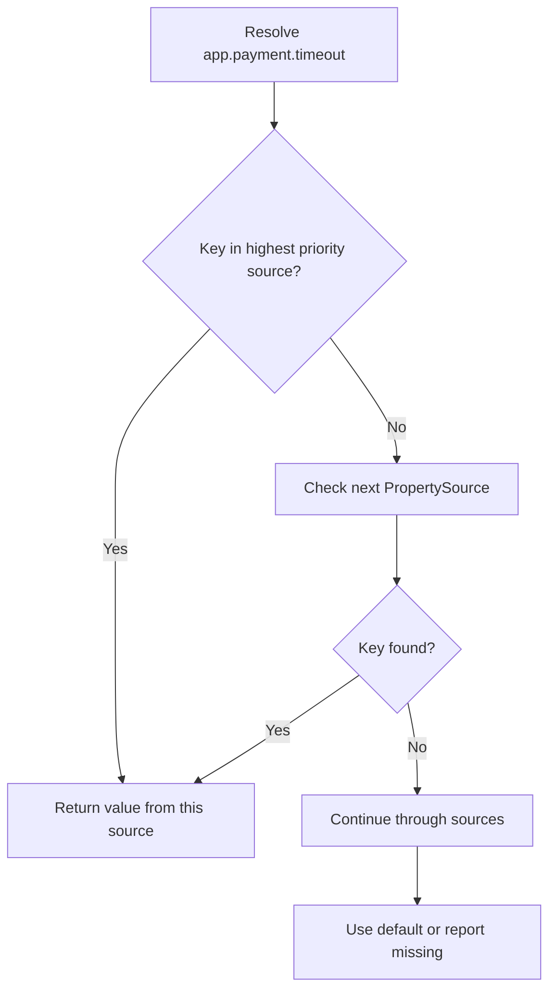

# Kiểm thử thứ tự ưu tiên với nhiều PropertySource

Spring Boot có thể nhận cùng một thuộc tính từ nhiều nguồn: file `application.yml`, file theo profile, cấu hình từ Spring Cloud Config Server, biến môi trường, Java system properties, tham số dòng lệnh và các nguồn được tạo trong test. Khi cùng một key xuất hiện ở nhiều nơi, ứng dụng chỉ dùng giá trị từ nguồn có độ ưu tiên cao nhất theo thứ tự `PropertySource` trong `Environment`.

Kiểm thử thứ tự ưu tiên giúp xác nhận ứng dụng đang chọn đúng giá trị, phát hiện nguồn cấu hình vô tình ghi đè cấu hình tập trung và bảo đảm profile hoặc môi trường test không làm sai kết quả. Bài học này trình bày cách kiểm tra cả **giá trị cuối cùng** lẫn **nguồn cung cấp giá trị**, từ unit test nhỏ đến integration test với Config Server.

## 1. PropertySource và quy tắc first match

Spring `Environment` giữ một danh sách các `PropertySource`. Mỗi nguồn có thể chứa một hoặc nhiều key. Khi gọi `environment.getProperty("app.payment.timeout")`, Spring tìm từ nguồn có độ ưu tiên cao xuống thấp và lấy giá trị đầu tiên tìm thấy.

Ví dụ cùng key xuất hiện ở ba nguồn:

```text
commandLineArgs: app.payment.timeout = 2s
application-prod.yml: app.payment.timeout = 3s
application.yml: app.payment.timeout = 5s
```

Nếu thứ tự trong Environment đặt `commandLineArgs` trước các file cấu hình, giá trị hiệu lực là `2s`. Các giá trị thấp hơn vẫn tồn tại trong các nguồn, nhưng không được chọn khi phân giải key đó.



Quy tắc quan trọng: **nguồn đầu tiên chứa key thắng**. Không cộng dồn hoặc tự động hợp nhất giá trị scalar từ mọi nguồn. Một số kiểu dữ liệu như list/map có quy tắc binding riêng, nên khi test cấu trúc lồng nhau cần kiểm tra kết quả binding thực tế chứ không chỉ nhìn một key đơn.

## 2. Các nguồn cấu hình thường gặp

Trong ứng dụng Spring Boot, những nguồn thường tham gia gồm:

| Nguồn | Ví dụ | Vai trò trong kiểm thử |
|---|---|---|
| Default properties | `SpringApplication.setDefaultProperties(...)` | Giá trị fallback có độ ưu tiên thấp. |
| Config Data | `application.yml`, `application-prod.yml` | Cấu hình file theo ứng dụng và profile. |
| Spring Cloud Config | Remote property sources từ Config Server | Cấu hình tập trung theo application/profile/label. |
| OS environment | `APP_PAYMENT_TIMEOUT=2s` | Override từ môi trường triển khai theo quy tắc binding. |
| Java system properties | `-Dapp.payment.timeout=1500ms` | Override từ JVM. |
| Command-line arguments | `--app.payment.timeout=1s` | Thường có ưu tiên cao trong ứng dụng Boot. |
| Test properties | `@SpringBootTest(properties=...)`, `@TestPropertySource` | Ép giá trị để cô lập test. |
| Dynamic test properties | `@DynamicPropertySource` | Cấp endpoint/port động từ Testcontainers hoặc tài nguyên test. |

Thứ tự đầy đủ có thể có thêm nguồn servlet, JNDI, JSON application, `@PropertySource` và nguồn do framework tự thêm. Thứ tự chi tiết thay đổi theo phiên bản Spring Boot và môi trường ứng dụng. Khi viết test cho một phiên bản cụ thể, hãy kiểm tra trực tiếp `Environment.getPropertySources()` thay vì dựa vào một danh sách nhớ sẵn.

## 3. Phân biệt thứ tự nguồn với thứ tự file

Trong Config Server, cấu hình có thể được ghép từ nhiều file/context:

```text
application.yml
application-prod.yml
orders-service.yml
orders-service-prod.yml
```

Các file này được Config Server phân giải theo application, profile và label, rồi trả về trong response Environment dưới dạng nhiều `PropertySource`. Client sau đó thêm remote sources vào Environment của mình.

Có hai lớp cần kiểm tra riêng:

1. **Bên trong response Config Server:** property source nào đứng trước trong danh sách `propertySources` và thắng khi cùng key xuất hiện trong các file remote?
2. **Trong Environment của client:** remote property source đứng ở đâu so với local config data, environment variables, system properties và command-line arguments?

Không suy luận precedence chỉ từ thứ tự tên file trong Git. Hãy kiểm tra response Config Server và Environment thực tế của client. Điều này đặc biệt quan trọng khi có profile group, nhiều active profiles, label khác nhau hoặc composite repository.

## 4. Khác biệt giữa Config Data API và bootstrap cũ

Spring Cloud Config có hai mô hình nạp cấu hình phổ biến.

### Config Data API

Ứng dụng hiện đại thường khai báo:

```yaml
spring:
  application:
    name: orders-service
  config:
    import: "configserver:http://config-server:8888"
```

Config Data API nạp remote configuration trong giai đoạn Config Data. Giá trị từ import thường có ưu tiên cao hơn tài liệu khai báo import; khi có nhiều import, thứ tự import cũng ảnh hưởng precedence. Các nguồn bên ngoài như command-line arguments, system properties và environment variables vẫn có quy tắc ưu tiên riêng theo Spring Boot.

### Bootstrap context cũ

Ứng dụng legacy có thể dùng `bootstrap.yml` và bootstrap context. Trong mô hình này, các cờ `spring.cloud.config.allowOverride`, `overrideNone` và `overrideSystemProperties` ảnh hưởng vị trí remote property source. Các cờ này phải được cấp từ remote property source theo quy tắc bootstrap; đặt chúng chỉ trong file local không tự cấp quyền override.

Không dùng một test precedence của bootstrap để kết luận hành vi Config Data API, hoặc ngược lại. Test phải khởi động đúng cơ chế mà ứng dụng production đang sử dụng và đúng phiên bản Spring Cloud release train.

## 5. Viết unit test cho thứ tự PropertySource

Có thể kiểm tra quy tắc first-match độc lập với Config Server bằng `StandardEnvironment` và `MapPropertySource`. Cách này phù hợp để kiểm tra logic phân giải cơ bản và thứ tự nguồn do ứng dụng tự thêm.

```java
import static org.junit.jupiter.api.Assertions.assertEquals;

import java.util.Map;

import org.junit.jupiter.api.Test;
import org.springframework.core.env.MapPropertySource;
import org.springframework.core.env.StandardEnvironment;

class PropertySourcePrecedenceTest {

    @Test
    void firstPropertySourceContainingKeyWins() {
        StandardEnvironment environment = new StandardEnvironment();

        environment.getPropertySources().addLast(
            new MapPropertySource("remote-config", Map.of(
                "app.payment.timeout", "3s"
            ))
        );

        environment.getPropertySources().addFirst(
            new MapPropertySource("deployment-override", Map.of(
                "app.payment.timeout", "2s"
            ))
        );

        assertEquals("2s", environment.getProperty("app.payment.timeout"));
    }
}
```

`addFirst` đặt nguồn lên đầu danh sách, còn `addLast` đặt nguồn xuống cuối. Test này chứng minh cách Spring phân giải danh sách đã được tạo; nó **không** chứng minh Config Server trong ứng dụng thật được đặt ở vị trí tương tự. Muốn xác nhận hành vi framework, cần integration test khởi động đúng Spring Boot và Spring Cloud Config Client.

## 6. Kiểm tra cả giá trị và nguồn thắng

Chỉ assert giá trị cuối cùng có thể chưa đủ. Hai cấu hình khác nhau đôi khi tình cờ cho cùng giá trị, hoặc test có thể pass nhờ một test override che khuất lỗi ở remote config. Nên kiểm tra cả nguồn đầu tiên chứa key.

Ví dụ helper tìm PropertySource thắng:

```java
import java.util.Optional;

import org.springframework.core.env.PropertySource;
import org.springframework.core.env.ConfigurableEnvironment;

static Optional<String> winningSourceName(
        ConfigurableEnvironment environment, String key) {

    return environment.getPropertySources().stream()
        .filter(source -> source.containsProperty(key))
        .map(PropertySource::getName)
        .findFirst();
}
```

Test có thể xác nhận:

```java
assertEquals("2s", environment.getProperty("app.payment.timeout"));
assertEquals(
    "deployment-override",
    winningSourceName(environment, "app.payment.timeout").orElseThrow()
);
```

Khi test với Config Server, tên remote source có thể chứa tên application/profile hoặc tên repository tùy phiên bản. Tránh hard-code chuỗi nội bộ dễ thay đổi nếu không cần thiết; có thể kiểm tra source name theo pattern hoặc dùng metadata/origin nếu framework cung cấp.

## 7. Kiểm tra precedence trong Spring Boot test

Spring Boot test cho phép thêm thuộc tính để cô lập test. Ví dụ:

```java
@SpringBootTest(properties = {
    "app.payment.timeout=1s"
})
class PaymentPropertiesTest {

    @Autowired
    Environment environment;

    @Test
    void testPropertyOverridesApplicationConfig() {
        assertEquals("1s", environment.getProperty("app.payment.timeout"));
    }
}
```

`@SpringBootTest(properties=...)` và `@TestPropertySource` tạo test property sources có ưu tiên cao để test không phụ thuộc giá trị file mặc định. Điều này hữu ích cho unit/integration test, nhưng có một rủi ro: test override có thể che khuất lỗi precedence của Config Server.

Nếu mục tiêu là kiểm tra remote config, không đặt cùng key trong `@SpringBootTest(properties=...)` hoặc `@TestPropertySource` trừ khi đang cố ý kiểm tra khả năng override. Hãy assert remote value và source name trước, sau đó viết test riêng cho local override.

## 8. Dùng DynamicPropertySource cho endpoint test động

`@DynamicPropertySource` thường được dùng để đăng ký port hoặc URI do Testcontainers cung cấp:

```java
@Testcontainers
@SpringBootTest
class ConfigServerIntegrationTest {

    @Container
    static GenericContainer<?> configServer =
        new GenericContainer<>("example/config-server:test")
            .withExposedPorts(8888);

    @DynamicPropertySource
    static void registerConfigServer(DynamicPropertyRegistry registry) {
        registry.add("spring.config.import", () ->
            "configserver:http://" + configServer.getHost() + ":" +
                configServer.getMappedPort(8888));
    }
}
```

Đây là ví dụ cấu trúc; image Config Server cần được thay bằng image test thực tế có repository cấu hình fixture. Dynamic properties có precedence cao trong môi trường test, vì vậy chỉ dùng chúng để cung cấp endpoint động hoặc giá trị test được chủ đích. Không đăng ký lại key nghiệp vụ đang cần kiểm tra precedence.

Với Testcontainers, container phải sẵn sàng trước khi Spring context cần đọc property. Cần cấu hình wait strategy/health check phù hợp để tránh test flaky do Config Server chưa khởi động xong.

## 9. Kiểm tra binding của @ConfigurationProperties

`Environment.getProperty()` kiểm tra giá trị scalar được phân giải. Ứng dụng thực tế thường bind nhiều key vào một object bằng `@ConfigurationProperties`; do đó nên test cả kết quả binding.

Ví dụ:

```java
@ConfigurationProperties(prefix = "app.payment")
public class PaymentProperties {
    private Duration timeout = Duration.ofSeconds(5);

    public Duration getTimeout() {
        return timeout;
    }

    public void setTimeout(Duration timeout) {
        this.timeout = timeout;
    }
}
```

Test:

```java
@SpringBootTest(properties = "app.payment.timeout=2s")
class PaymentBindingTest {

    @Autowired
    PaymentProperties properties;

    @Test
    void bindsEffectivePropertyValue() {
        assertEquals(Duration.ofSeconds(2), properties.getTimeout());
    }
}
```

Khi có nhiều nguồn cùng khai báo `app.payment.timeout`, hãy kiểm tra giá trị đã bind. Binding có thể áp dụng relaxed binding, chuyển đổi kiểu, validation và quy tắc riêng cho collection. Không chỉ assert raw string nếu ứng dụng thực tế tiêu thụ `Duration`, `DataSize`, enum hoặc nested object.

## 10. Kiểm thử application/profile/label với Config Server

Integration test nên có fixture rõ ràng cho từng selector. Ví dụ repository test:

```text
test-config-repo/
├── application.yml
├── application-test.yml
├── orders-service.yml
└── orders-service-test.yml
```

Đặt cùng key với giá trị khác nhau để kiểm tra kết quả:

```yaml
# application.yml
app:
  payment:
    timeout: 9s
```

```yaml
# application-test.yml
app:
  payment:
    timeout: 7s
```

```yaml
# orders-service.yml
app:
  payment:
    timeout: 5s
```

```yaml
# orders-service-test.yml
app:
  payment:
    timeout: 3s
```

Khởi động Config Server test với repository fixture, sau đó gọi Environment API cho đúng application/profile/label. Kiểm tra:

1. Response chứa các property source dự kiến.
2. Thứ tự `propertySources` phù hợp với quy tắc của phiên bản đang dùng.
3. `app.payment.timeout` có giá trị theo source ưu tiên cao nhất.
4. Label/commit trong response đúng fixture được yêu cầu.
5. Client nạp cùng application/profile/label và có giá trị hiệu lực như dự kiến.

Không nên viết test giả định file `orders-service-test.yml` luôn thắng chỉ vì tên file cụ thể hơn. Hãy xác nhận thứ tự property source mà Config Server thực sự trả về trong release train đang sử dụng.

## 11. Test remote config so với local override

Một test tích hợp hữu ích có thể chạy theo hai trường hợp:

**Trường hợp A — không có local override:** client nhận giá trị remote. Test xác nhận remote property source cung cấp giá trị và là nguồn thắng.

**Trường hợp B — có local override có chủ đích:** thêm biến môi trường, system property hoặc command-line argument trùng key. Test xác nhận nguồn local được phép override theo mô hình Config Data API hoặc chính sách bootstrap legacy đã cấu hình.

Ví dụ khi khởi chạy ứng dụng:

```bash
java -jar orders-service.jar \
  --spring.config.import=configserver:http://localhost:8888 \
  --app.payment.timeout=1s
```

Nếu command-line property được hỗ trợ và có ưu tiên cao hơn các nguồn Config Data trong phiên bản Boot đang dùng, giá trị hiệu lực sẽ là `1s`. Test nên assert cả giá trị lẫn source name để chứng minh command-line source là nguồn thắng.

Với bootstrap cũ, viết test riêng cho các tổ hợp `allowOverride`, `overrideNone` và `overrideSystemProperties`. Các cờ phải đến từ remote property source; kiểm tra response/Environment để bảo đảm test đang thực sự chạy với giá trị cờ dự kiến.

## 12. Kiểm tra origin và chẩn đoán khi có actuator

Spring Boot Actuator có thể cung cấp endpoint `env` để xem property source và origin của thuộc tính khi endpoint được bật. Ví dụ cấu hình nội bộ:

```yaml
management:
  endpoints:
    web:
      exposure:
        include: health,env
```

Endpoint này có thể tiết lộ tên nguồn, đường dẫn file, giá trị cấu hình hoặc thông tin nhạy cảm nếu sanitization không phù hợp. Chỉ bật trong môi trường và phạm vi truy cập được bảo vệ; không công khai `env` cho Internet hoặc ghi toàn bộ response vào CI log.

Trong test, có thể kiểm tra nguồn thắng trực tiếp qua `ConfigurableEnvironment`. Khi cần origin chi tiết, Spring Boot có API `OriginLookup` cho một số `PropertySource` như nguồn được tạo từ Config Data. Việc có origin hay không phụ thuộc loại source và phiên bản.

## 13. Các lỗi test precedence thường gặp

| Hiện tượng | Nguyên nhân | Cách xử lý |
|---|---|---|
| Test pass nhưng production lấy sai giá trị | `@SpringBootTest(properties=...)` che khuất remote config. | Tách test precedence khỏi test business; không override key đang kiểm tra. |
| Assert giá trị đúng nhưng nguồn sai | Hai nguồn tình cờ chứa cùng giá trị. | Assert cả `getProperty()` và tên nguồn đầu tiên chứa key. |
| Test Config Server trả giá trị khác fixture | Sai application/profile/label hoặc server dùng branch/cache khác. | Kiểm tra request selector, response `version` và repository fixture. |
| Local file luôn thắng remote ngoài dự kiến | Cấu hình import/precedence sai hoặc đang dùng bootstrap policy khác với giả định. | Xác định Config Data hay bootstrap, kiểm tra property source order thực tế. |
| Biến môi trường không override remote | Tên biến ánh xạ sai hoặc chính sách bootstrap không cho override. | Kiểm tra relaxed binding và cờ remote trong legacy mode. |
| Giá trị raw đúng nhưng bean bind sai | Conversion, validation, collection merge hoặc bean capture giá trị cũ. | Assert object đã bind và kiểm tra lifecycle consumer. |
| Integration test chập chờn | Config Server/container chưa ready hoặc repository fetch chưa hoàn tất. | Dùng wait strategy, fixture cố định và timeout phù hợp. |
| Test phụ thuộc máy developer | Đọc environment variable/system property thật từ máy chạy test. | Dùng môi trường test cô lập, xóa hoặc kiểm soát nguồn ngoài. |

## 14. Bộ test tối thiểu nên có

Với mỗi thuộc tính quan trọng, nên có các kiểm thử phù hợp:

1. **Default test:** không có override, giá trị mặc định hoặc remote baseline được chọn.
2. **Profile test:** profile cụ thể cung cấp giá trị dự kiến.
3. **Application test:** cấu hình riêng của ứng dụng được phân giải đúng.
4. **Remote/local test:** remote config và local source có precedence đúng theo mô hình đang dùng.
5. **Override test:** environment/system/command-line override chỉ hoạt động khi được phép.
6. **Binding test:** `@ConfigurationProperties` nhận đúng kiểu và giá trị.
7. **Missing-key test:** hành vi khi thiếu property đúng với required/default policy.
8. **Label/version test:** client lấy đúng revision cấu hình được chỉ định.

Không cần mọi key đều có tám test riêng. Nhóm các key theo contract và mức độ rủi ro; ưu tiên test kỹ các thuộc tính ảnh hưởng đến kết nối, bảo mật, tài nguyên và hành vi production.

## 15. Tổng kết

- Spring phân giải key bằng cách tìm `PropertySource` theo thứ tự ưu tiên; nguồn đầu tiên chứa key quyết định giá trị hiệu lực.
- Kiểm tra riêng thứ tự property source bên trong Config Server response và thứ tự remote source so với local source trong client Environment.
- Config Data API và bootstrap cũ có cơ chế precedence khác nhau; không dùng kết quả test của mô hình này để suy ra mô hình kia.
- Unit test với `StandardEnvironment`/`MapPropertySource` kiểm tra quy tắc first-match; integration test mới xác nhận hành vi Config Client thực tế.
- Assert cả giá trị hiệu lực và nguồn thắng; khi cần, kiểm tra origin.
- Test properties và `@DynamicPropertySource` có ưu tiên cao, nên tránh vô tình che khuất key đang kiểm tra.
- Kiểm tra cả `Environment.getProperty()` lẫn binding vào `@ConfigurationProperties`.
- Dùng fixture cố định cho application/profile/label và xác minh response version từ Config Server.
- Bảo vệ Actuator `env` và không đưa giá trị nhạy cảm vào log hoặc CI artifact.
