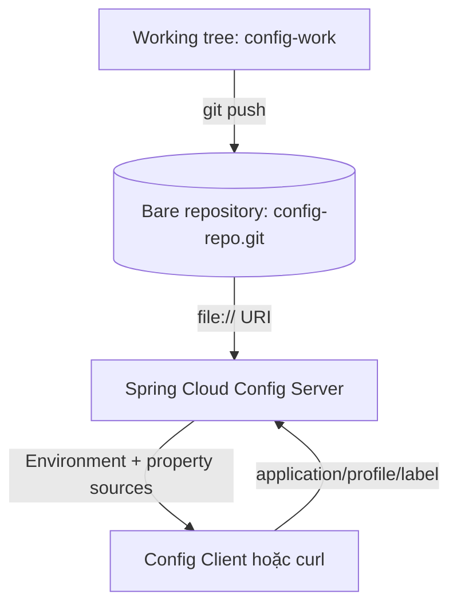

# Dựng kho Git tạm có branch, tag, commit và profile

Để kiểm thử Spring Cloud Config Git backend một cách có thể lặp lại, nên tạo một Git repository riêng cho bài lab thay vì dùng repository cấu hình production. Kho tạm này cần có branch, tag và nhiều commit để kiểm tra cách Config Server chọn label; đồng thời cần các file theo application và profile để xác minh property source được ghép đúng.

Bài thực hành này dựng một **bare Git repository** làm remote cục bộ và một working tree để tạo commit. Config Server trỏ tới bare repository bằng `file://` URI. Ta sẽ truy vấn cùng một application/profile với các label khác nhau, sau đó thay đổi branch và quan sát Config Server trả về phiên bản nào.

## 1. Mục tiêu và sơ đồ bài lab

Sau bài này, người học có thể:

- Tạo một Git repository tạm có bare remote và working copy.
- Tạo branch, tag và nhiều commit có nội dung cấu hình khác nhau.
- Tổ chức file dùng chung, file theo application và file theo profile.
- Cấu hình Config Server đọc repository qua `file://` URI.
- Gọi endpoint Environment theo application, profile và label.
- Xác minh khác biệt giữa branch hiện tại, branch thử nghiệm, tag và commit SHA.
- Chẩn đoán lỗi clone, sai label, sai profile, fetch chậm và property source không như mong đợi.



Các lệnh bên dưới dùng Bash hoặc Git Bash. Có thể chạy trên Linux/macOS hoặc Git Bash trên Windows. Nếu chạy Config Server trên Windows, phần sau có ví dụ chuyển đường dẫn filesystem thành `file://` URI.

## 2. Chuẩn bị công cụ và thư mục riêng

Cần có:

- Git CLI.
- JDK và build tool phù hợp với dự án Spring Boot.
- Một ứng dụng Spring Cloud Config Server tương thích với Spring Boot/Spring Cloud release train.
- Cổng local chưa được ứng dụng khác sử dụng, ví dụ `8888`.

Tạo thư mục lab riêng:

```bash
mkdir -p /tmp/spring-config-lab/config-work
cd /tmp/spring-config-lab/config-work
```

Trên Windows, có thể dùng thư mục như `C:/spring-config-lab/config-work` trong Git Bash hoặc `C:\spring-config-lab\config-work` trong PowerShell. Không đặt lab trong repository cấu hình thật để tránh commit nhầm dữ liệu kiểm thử.

Khởi tạo working repository và đặt branch chính là `main`:

```bash
git init
git branch -M main
git config user.name "Config Lab"
git config user.email "config-lab@example.invalid"
```

Tên và email ở đây chỉ là metadata commit cho bài lab, không cần là địa chỉ thật.

## 3. Tạo các file cấu hình dùng chung và theo profile

Spring Cloud Config Git backend nhận diện file theo application và profile. Ví dụ:

| File | Phạm vi |
|---|---|
| `application.yml` | Cấu hình dùng chung cho các ứng dụng |
| `application-production.yml` | Cấu hình dùng chung cho profile `production` |
| `order-service.yml` | Cấu hình mặc định của `order-service` |
| `order-service-production.yml` | Cấu hình riêng của `order-service` ở profile `production` |
| `order-service-staging.yml` | Cấu hình riêng của `order-service` ở profile `staging` |

Tạo `application.yml`:

```yaml
platform:
  region: global
feature:
  checkout-enabled: false
```

Tạo `application-production.yml`:

```yaml
platform:
  region: ap-southeast-1
feature:
  checkout-enabled: true
```

Tạo `order-service.yml`:

```yaml
checkout:
  timeout: 2s
  max-retries: 2
service:
  banner: order-default
```

Tạo `order-service-production.yml`:

```yaml
checkout:
  timeout: 5s
  max-retries: 3
service:
  banner: order-production
```

Tạo `order-service-staging.yml`:

```yaml
checkout:
  timeout: 3s
  max-retries: 1
service:
  banner: order-staging
```

Trong bài lab, các giá trị `checkout.timeout` được chọn khác nhau để có thể nhìn thấy ngay label/profile nào đang được phục vụ. Không đặt password, token hoặc secret thật trong repository kiểm thử.

Nếu dùng Bash, có thể tạo file bằng here-document:

```bash
cat > application.yml <<'EOF'
platform:
  region: global
feature:
  checkout-enabled: false
EOF

cat > application-production.yml <<'EOF'
platform:
  region: ap-southeast-1
feature:
  checkout-enabled: true
EOF

cat > order-service.yml <<'EOF'
checkout:
  timeout: 2s
  max-retries: 2
service:
  banner: order-default
EOF

cat > order-service-production.yml <<'EOF'
checkout:
  timeout: 5s
  max-retries: 3
service:
  banner: order-production
EOF

cat > order-service-staging.yml <<'EOF'
checkout:
  timeout: 3s
  max-retries: 1
service:
  banner: order-staging
EOF
```

Nếu tạo file bằng editor, hãy giữ đúng tên file và phần mở rộng `.yml`; không đặt nhầm thành `order-service-production.yaml.txt` do ẩn phần mở rộng của hệ điều hành.

## 4. Tạo commit đầu tiên và tag release

Kiểm tra file trước khi commit:

```bash
git status --short
git add application.yml application-production.yml \
  order-service.yml order-service-production.yml \
  order-service-staging.yml
git commit -m "Add initial order service configuration"
```

Ghi lại commit SHA đầu tiên và tạo tag:

```bash
BASE_SHA=$(git rev-parse HEAD)
git tag release-v1 "$BASE_SHA"
```

`release-v1` là một tag trỏ tới snapshot đầu tiên. Ta sẽ dùng tag và commit SHA này để truy vấn lại cấu hình cũ sau khi branch `main` thay đổi.

## 5. Tạo bare repository làm remote cục bộ

Bare repository lưu Git objects và refs, không có working tree. Đây là cách mô phỏng một Git server nhỏ trên máy local:

```bash
cd /tmp/spring-config-lab
git init --bare config-repo.git
```

Quay lại working tree, thêm remote và push branch cùng tag:

```bash
cd /tmp/spring-config-lab/config-work
git remote add origin /tmp/spring-config-lab/config-repo.git
git push -u origin main
git push origin --tags
```

Kiểm tra remote và refs:

```bash
git remote -v
git branch --all
git tag --list
git log --oneline --decorate --all
```

Kết quả mong đợi có remote `origin`, branch `main`, tag `release-v1` và commit khởi tạo. Có thể xác minh bare repository bằng:

```bash
git --git-dir=/tmp/spring-config-lab/config-repo.git show-ref
```

## 6. Tạo branch thử nghiệm với cấu hình khác

Tạo branch `feature-test` từ commit đầu tiên:

```bash
git switch -c feature-test
```

Trong branch này, đổi timeout production thành `6s`:

```yaml
checkout:
  timeout: 6s
  max-retries: 3
service:
  banner: order-feature-test
```

Ghi thay đổi vào `order-service-production.yml`, sau đó commit và push branch:

```bash
git add order-service-production.yml
git commit -m "Tune production timeout on feature branch"
git push -u origin feature-test
```

Branch `feature-test` hiện có một commit khác `main`, nhưng vẫn dựa trên cùng snapshot ban đầu. Tag `release-v1` tiếp tục trỏ tới commit khởi tạo.

## 7. Tạo commit mới trên `main`

Chuyển lại `main`:

```bash
git switch main
```

Đổi timeout production thành `7s`:

```yaml
checkout:
  timeout: 7s
  max-retries: 2
service:
  banner: order-main-latest
```

Commit và push:

```bash
git add order-service-production.yml
git commit -m "Update production timeout on main"
git push origin main
```

Lúc này ba nhãn có nội dung khác nhau:

| Label | `checkout.timeout` ở profile `production` | `service.banner` |
|---|---:|---|
| `release-v1` | `5s` | `order-production` |
| `feature-test` | `6s` | `order-feature-test` |
| `main` | `7s` | `order-main-latest` |

Kiểm tra trạng thái:

```bash
git log --oneline --decorate --all
git show release-v1:order-service-production.yml
git show feature-test:order-service-production.yml
git show main:order-service-production.yml
```

Các lệnh `git show` giúp xác nhận nội dung từng ref trước khi đưa Config Server vào bài kiểm thử.

## 8. Cấu hình Spring Cloud Config Server trỏ tới bare repository

Ứng dụng Config Server cần dependency `spring-cloud-config-server` và bật `@EnableConfigServer` trên class ứng dụng.

Ví dụ `application.yml` của Config Server:

```yaml
server:
  port: 8888

spring:
  application:
    name: config-server
  cloud:
    config:
      server:
        git:
          uri: file:///tmp/spring-config-lab/config-repo.git
          default-label: main
          clone-on-start: true
          refresh-rate: 0
```

Các thuộc tính đáng chú ý:

| Thuộc tính | Mục đích |
|---|---|
| `git.uri` | Đường dẫn tới bare Git repository |
| `git.default-label` | Label mặc định khi request không chỉ rõ label; bài lab đặt `main` tường minh |
| `git.clone-on-start` | Yêu cầu clone repository khi Config Server khởi động để phát hiện lỗi sớm |
| `git.refresh-rate` | Khoảng thời gian tối thiểu giữa các lần fetch; `0` yêu cầu fetch theo mỗi request trong bài lab |

`refresh-rate: 0` thuận tiện cho bài thực hành vì push commit mới xong có thể truy vấn lại ngay. Trong môi trường thật, cần chọn tần suất fetch phù hợp với tải Git server và độ trễ cập nhật mong muốn.

### Đường dẫn `file://` trên các hệ điều hành

| Hệ điều hành | Ví dụ URI |
|---|---|
| Linux | `file:///srv/config-lab/config-repo.git` |
| macOS | `file:///Users/dev/config-lab/config-repo.git` |
| Windows | `file:///C:/spring-config-lab/config-repo.git` |

URI dùng dấu `/`, kể cả trên Windows. Nếu đường dẫn có khoảng trắng, mã hóa thành `%20`; tốt nhất dùng thư mục không có dấu cách để giảm lỗi. Process chạy Config Server phải có quyền đọc repository và quyền tạo working clone/cache ở vị trí mà Git backend sử dụng.

`file://` chỉ phù hợp cho local lab hoặc filesystem được chia sẻ có kiểm soát. Trong production, dùng Git server qua HTTPS/SSH hoặc backend được tổ chức hỗ trợ; không trỏ Config Server vào một thư mục người dùng có thể thay đổi tùy ý.

## 9. Khởi động và xác minh Config Server

Khởi động ứng dụng Config Server theo build tool của dự án. Khi `clone-on-start` bật, log khởi động cần cho thấy repository được clone thành công.

Nếu server chạy tại `localhost:8888`, thử endpoint:

```bash
curl --fail --silent --show-error \
  http://localhost:8888/order-service/production/main
```

Endpoint dạng:

```text
/{application}/{profile}/{label}
```

Trong đó:

- `application`: `order-service`.
- `profile`: `production`.
- `label`: `main`, `feature-test`, `release-v1` hoặc commit SHA.

Response là Environment JSON với metadata version và danh sách `propertySources`. Không chỉ kiểm tra HTTP 200; hãy xem `version`, `label` và các giá trị trong property source để xác nhận Config Server đã đọc đúng ref.

## 10. So sánh profile `production` và `staging`

Gọi cùng application và label `main` với hai profile:

```bash
curl --fail --silent --show-error \
  http://localhost:8888/order-service/production/main

curl --fail --silent --show-error \
  http://localhost:8888/order-service/staging/main
```

Kết quả cần quan sát:

| Key | Profile `production` | Profile `staging` |
|---|---|---|
| `platform.region` | `ap-southeast-1` | `global` nếu không có nguồn staging ghi đè |
| `feature.checkout-enabled` | `true` | `false` nếu không có nguồn staging ghi đè |
| `checkout.timeout` | `7s` | `3s` |
| `checkout.max-retries` | `2` | `1` |
| `service.banner` | `order-main-latest` | `order-staging` |

Các file profile-specific chỉ được áp dụng khi request có profile tương ứng. Nếu một key không được khai báo trong file profile-specific, Config Server có thể lấy giá trị từ file application-specific hoặc shared context theo thứ tự property source.

## 11. So sánh branch, tag và commit SHA qua API

Gọi cùng application/profile với từng label:

```bash
curl --fail --silent --show-error \
  http://localhost:8888/order-service/production/main

curl --fail --silent --show-error \
  http://localhost:8888/order-service/production/feature-test

curl --fail --silent --show-error \
  http://localhost:8888/order-service/production/release-v1
```

Kết quả mong đợi:

- `main` trả timeout `7s`.
- `feature-test` trả timeout `6s`.
- `release-v1` trả timeout `5s`.

Thử label bằng commit SHA của snapshot ban đầu:

```bash
BASE_SHA=$(git rev-parse release-v1)
curl --fail --silent --show-error \
  "http://localhost:8888/order-service/production/${BASE_SHA}"
```

Commit SHA và tag `release-v1` cùng trỏ tới snapshot ban đầu, vì vậy kết quả mong đợi là timeout `5s`. Đây là cách kiểm tra tính tái lập của một phiên bản cấu hình đã phát hành.

Trong môi trường có reverse proxy hoặc shell khác, cần đảm bảo label được URL-encode đúng. Bài lab dùng branch `feature-test` không có dấu `/` để tránh nhầm lẫn giữa dấu phân cách path và ký tự trong label.

## 12. Kiểm tra default label

Nếu không truyền label trong request:

```bash
curl --fail --silent --show-error \
  http://localhost:8888/order-service/production
```

Config Server sử dụng `default-label` đã cấu hình, trong bài lab là `main`. Kết quả vì thế cần tương đương request `/order-service/production/main`.

Nếu muốn kiểm tra nhãn mặc định của server, hãy khai báo `default-label` tường minh thay vì dựa vào giá trị mặc định khác nhau giữa các phiên bản hoặc cấu hình. Khi request chỉ có application/profile, lỗi default label có thể bị hiểu nhầm thành lỗi Git branch.

## 13. Kiểm tra property source và precedence

Environment response có danh sách `propertySources`. Đây là bằng chứng quan trọng để xác định giá trị đến từ file nào.

Với profile `production`, hãy kiểm tra các nguồn liên quan:

- `application.yml` cung cấp cấu hình dùng chung.
- `application-production.yml` cung cấp cấu hình dùng chung cho production.
- `order-service.yml` cung cấp cấu hình riêng của ứng dụng.
- `order-service-production.yml` cung cấp cấu hình riêng của ứng dụng và profile.

Config Server ghép các nguồn theo quy tắc precedence của application/profile. Nguồn chuyên biệt hơn có thể ghi đè giá trị từ nguồn chung. Hãy xem thứ tự `propertySources` trong response thay vì chỉ nhìn một giá trị đã được phân giải.

Ví dụ `checkout.timeout` xuất hiện ở cả `order-service.yml` và `order-service-production.yml`; request profile `production` cần dùng giá trị profile-specific. Nếu response không như mong đợi, kiểm tra tên file, profile trong URL, label và property source order.

Không nên chỉ dựa vào `curl` trả HTTP 200 để kết luận profile hoạt động đúng. Một request thành công có thể vẫn dùng default profile nếu client/request không gửi profile như dự kiến.

## 14. Thử thay đổi branch sau khi Config Server đã chạy

Vì `refresh-rate` trong bài lab đặt bằng `0`, sau khi push commit mới lên `main`, gọi lại endpoint label `main` để quan sát giá trị mới.

Thử cập nhật `order-service-production.yml` trên `main`:

```yaml
checkout:
  timeout: 8s
  max-retries: 2
service:
  banner: order-main-second-update
```

Commit và push:

```bash
git add order-service-production.yml
git commit -m "Raise production timeout for config watch test"
git push origin main
```

Gọi lại:

```bash
curl --fail --silent --show-error \
  http://localhost:8888/order-service/production/main
```

Giá trị mong đợi là `8s`. Các label `feature-test` và `release-v1` vẫn phải trả `6s` và `5s` tương ứng. Nếu kết quả không đổi, kiểm tra log fetch, URI repository, label, `refresh-rate` và việc push đã thành công hay chưa.

Nếu `refresh-rate` là số dương, Config Server có thể chưa fetch lại ngay sau push. Hãy đợi hết khoảng fetch được cấu hình hoặc dùng một cấu hình test phù hợp; không kết luận Git backend bị lỗi chỉ vì response chưa đổi ngay.

## 15. Dùng Config Client để kiểm tra end-to-end

Sau khi API Config Server hoạt động, có thể chạy một ứng dụng Config Client nhỏ để kiểm tra Config Data import.

Dependency:

```xml
<dependency>
    <groupId>org.springframework.cloud</groupId>
    <artifactId>spring-cloud-starter-config</artifactId>
</dependency>
```

Ví dụ `application.yml` của client:

```yaml
spring:
  application:
    name: order-service
  config:
    import: "configserver:http://localhost:8888"
```

Kích hoạt profile và label qua environment variables:

```bash
export SPRING_PROFILES_ACTIVE=production
export SPRING_CLOUD_CONFIG_LABEL=feature-test
```

Khởi động client. Nó cần nhận cấu hình `order-service` với profile `production` và label `feature-test`; `checkout.timeout` kỳ vọng là `6s` ở trạng thái branch lab đã tạo.

Có thể thay label thành `release-v1` hoặc `main` để xác minh client chọn đúng phiên bản. Nếu cần quan sát giá trị, dùng một endpoint/runner nội bộ chỉ trả các key không nhạy cảm, không expose toàn bộ Environment ra mạng.

## 16. Ma trận kiểm thử gợi ý

| Bài kiểm tra | Request hoặc thao tác | Kết quả mong đợi |
|---|---|---|
| Default profile | `/order-service/default/main` | Có cấu hình dùng chung và application mặc định; không có profile-specific production/staging |
| Production profile | `/order-service/production/main` | Có giá trị production; timeout `7s` trước commit cập nhật thứ hai |
| Staging profile | `/order-service/staging/main` | Timeout `3s`, retry `1` |
| Branch thử nghiệm | `/order-service/production/feature-test` | Timeout `6s` |
| Tag release | `/order-service/production/release-v1` | Timeout `5s` |
| Commit SHA | `/order-service/production/{BASE_SHA}` | Timeout `5s` |
| Default label | `/order-service/production` | Dùng `default-label: main` |
| Main branch sau commit mới | `/order-service/production/main` | Timeout cập nhật thành `8s` khi server đã fetch |
| Branch không tồn tại | `/order-service/production/no-such-label` | Lỗi không tìm thấy label/ref; kiểm tra response và log server |
| Application không tồn tại | `/unknown-service/production/main` | Có thể trả Environment chỉ có nguồn dùng chung hoặc lỗi theo backend; kiểm tra property sources |

Nên lưu kết quả test dưới dạng bảng hoặc test report của môi trường lab. Không đưa response chứa secret vào log hoặc artifact.

## 17. Lỗi thường gặp và cách xử lý

| Hiện tượng | Nguyên nhân có thể | Cách xử lý |
|---|---|---|
| Config Server không clone được repository | Sai `file://` URI, đường dẫn không tồn tại hoặc process không có quyền đọc | Kiểm tra URI tuyệt đối, quyền filesystem và log clone-on-start |
| Bare repository không có branch `main` | Chưa push branch hoặc branch có tên khác | Chạy `git branch -a` ở working tree và `show-ref` ở bare repo |
| Tag không truy vấn được | Tag chưa push hoặc không trỏ tới commit đã có trong remote | Chạy `git push origin --tags`, kiểm tra `git show-ref --tags` |
| Commit SHA không truy vấn được | SHA sai hoặc commit không có trong repository mà server clone | Dùng `git rev-parse`, xác minh commit đã được push/được reachable từ remote |
| `main` vẫn trả giá trị cũ | Server chưa fetch, `refresh-rate` dương hoặc request nhầm label | Kiểm tra fetch log, refresh-rate, version và endpoint đầy đủ |
| Profile `production` không áp dụng | Tên file sai hoặc request không chứa profile production | Kiểm tra `order-service-production.yml` và URL `/production/` |
| Key có giá trị không như dự kiến | Property source precedence hoặc file application/profile bị đặt sai tên | Đọc toàn bộ `propertySources` và so sánh từng nguồn |
| Local Windows URI lỗi | Dùng backslash hoặc URI không có dấu `/` sau scheme | Dùng dạng `file:///C:/...` và mã hóa khoảng trắng |
| Clone bị khóa hoặc lỗi quyền | Config Server không tạo/đọc được thư mục clone/cache | Kiểm tra user chạy process và quyền thư mục làm việc |
| Client nhận cấu hình khác curl | Client dùng application/profile/label khác hoặc property source local ghi đè | Kiểm tra environment variables, Config Data import và log client |

## 18. Dọn dẹp bài lab

Khi hoàn tất, dừng Config Server và client. Bare repository và working tree chỉ là dữ liệu thử nghiệm; có thể xóa thư mục lab riêng:

```bash
rm -rf /tmp/spring-config-lab
```

Trên Windows, xóa đúng thư mục `C:\spring-config-lab` sau khi xác nhận không chứa dữ liệu khác. Không chạy lệnh xóa với biến đường dẫn chưa kiểm tra hoặc trên thư mục repository thật.

## 19. Checklist hoàn thành

- [ ] Đã tạo working repository và bare remote riêng.
- [ ] Đã cấu hình Git identity cho commit lab.
- [ ] Đã tạo `application.yml` và `application-production.yml`.
- [ ] Đã tạo `order-service.yml`, `order-service-production.yml` và `order-service-staging.yml`.
- [ ] Đã tạo commit khởi tạo và tag `release-v1`.
- [ ] Đã tạo branch `feature-test` với giá trị khác.
- [ ] Đã tạo commit mới trên `main` với giá trị khác branch/tag.
- [ ] Đã push branch và tag tới bare remote.
- [ ] Config Server trỏ đúng `file://` URI và clone thành công.
- [ ] Đã gọi API với application, profile và từng label.
- [ ] Đã kiểm tra property source order và giá trị profile-specific.
- [ ] Đã kiểm tra default-label và commit SHA.
- [ ] Đã thử push commit mới sau khi server khởi động.
- [ ] Đã xác minh `refresh-rate` ảnh hưởng thời điểm server nhìn thấy commit mới.
- [ ] Đã thử Config Client import end-to-end nếu có ứng dụng mẫu.
- [ ] Đã dừng ứng dụng và dọn dẹp thư mục lab riêng.

## 20. Mục tiêu cần đạt sau bài học

Sau bài này, người học cần có khả năng:

- Dựng một Git repository tạm có working tree và bare remote.
- Tạo và phân biệt branch, tag, commit SHA.
- Tổ chức file cấu hình theo application và profile của Spring Cloud Config.
- Cấu hình Config Server dùng Git backend qua `file://` URI.
- Truy vấn Environment theo application/profile/label và đọc property sources.
- Giải thích vì sao cùng một application/profile có thể trả giá trị khác theo branch, tag hoặc commit.
- Chẩn đoán lỗi clone, quyền filesystem, fetch interval, sai profile và sai label.
- Dùng bài lab để kiểm thử thay đổi cấu hình mà không tác động repository production.

**Tự kiểm tra:** Sau khi dựng lab, endpoint `/order-service/production/main` trả `7s`, `/feature-test` trả `6s` và `/release-v1` trả `5s`. Hãy giải thích các giá trị này đến từ commit/ref nào, cách xác minh bằng `git log` và `git show`, rồi mô tả điều gì cần kiểm tra nếu vừa push commit mới lên `main` nhưng Config Server vẫn trả `7s`.

## Tài liệu tham khảo

- [Spring Cloud Config — Git Backend](https://docs.spring.io/spring-cloud-config/reference/server/environment-repository/git-backend.html)
- [Spring Cloud Config — Serving Configuration](https://docs.spring.io/spring-cloud-config/reference/server/serving-configuration.html)
- [Spring Cloud Config Client — Config Data Import](https://docs.spring.io/spring-cloud-config/reference/client.html)
- [Git — git init](https://git-scm.com/docs/git-init)
- [Git — git branch](https://git-scm.com/docs/git-branch)
- [Git — git tag](https://git-scm.com/docs/git-tag)
