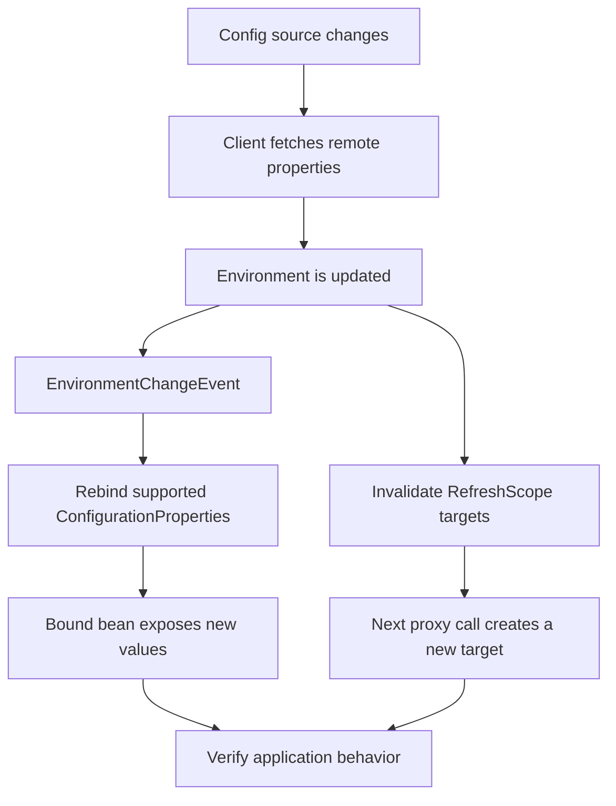

# Kiểm thử refresh, rebind và vòng đời bean RefreshScope

Spring Cloud Config cho phép ứng dụng nhận cấu hình mới khi repository thay đổi. Tuy nhiên, một lần refresh có nhiều bước: client lấy lại property source, cập nhật `Environment`, rebind một số bean cấu hình và làm mới target của bean thuộc `@RefreshScope`. Mỗi bước có vòng đời riêng, vì vậy chỉ kiểm tra endpoint trả HTTP thành công là chưa đủ để chứng minh ứng dụng đã dùng giá trị mới.

Kiểm thử refresh cần xác nhận ba điều: **giá trị trong Environment đã đổi**, **bean được hỗ trợ đã nhận giá trị mới**, và **bean refresh-scoped được tạo lại đúng lúc**. Đồng thời, test phải xác nhận các thành phần không hỗ trợ refresh — chẳng hạn embedded server, điều kiện `@ConditionalOnProperty` hoặc tài nguyên khởi tạo một lần — vẫn cần restart theo thiết kế.

## 1. Phân biệt các bước trong một lần refresh

Một refresh từ Spring Cloud Config thường có chuỗi xử lý:

1. Client yêu cầu lại cấu hình từ Config Server hoặc nguồn remote tương ứng.
2. Các remote `PropertySource` được cập nhật trong Spring `Environment`.
3. Spring Cloud phát `EnvironmentChangeEvent` chứa các key được nhận diện là thay đổi.
4. Các bean `@ConfigurationProperties` được hỗ trợ có thể được rebind.
5. Các target đang cache trong `@RefreshScope` bị invalidate; target mới được tạo khi proxy được gọi lần tiếp theo.



Các bước có thể được kích hoạt qua `/actuator/refresh`, `ContextRefresher` hoặc Spring Cloud Bus. Test từng bước riêng giúp xác định lỗi nằm ở fetch remote config, cập nhật Environment, rebind hay vòng đời target.

## 2. Phân biệt Environment update, rebind và RefreshScope

| Cơ chế | Đối tượng được tác động | Điều cần kiểm tra |
|---|---|---|
| Environment update | `PropertySource` và giá trị tra cứu qua `Environment` | `Environment.getProperty()` trả giá trị mới và source đúng. |
| Configuration properties rebind | Bean được quản lý bằng `@ConfigurationProperties` và cơ chế rebind của Spring Cloud | Getter của bean trả giá trị mới sau event. |
| `@RefreshScope` | Target của bean nằm trong refresh scope | Target cũ bị hủy/invalidate; lần gọi tiếp theo nhận target mới. |
| Restart application context | Toàn bộ bean graph và tài nguyên startup | Dùng cho thay đổi mà refresh không thể áp dụng. |

Một giá trị trong `Environment` có thể đã đổi trong khi singleton thông thường vẫn giữ giá trị cũ vì nó đã được inject vào field hoặc constructor lúc khởi tạo. Tương tự, một bean được rebind không tự cập nhật bản sao mà bean khác đã lưu trong field riêng.

`@RefreshScope` không phải cơ chế rebind mọi bean. Nó tạo proxy quản lý target theo scope; khi refresh, target bị loại khỏi cache và được tạo lại khi có lời gọi tiếp theo qua proxy.

## 3. Chuẩn bị dependency và test context

Các test cần Spring Boot Test và Spring Cloud Context. Ứng dụng dùng Spring Cloud Config thường đã có các thành phần context qua dependency Config Client; nếu tạo test context độc lập, khai báo dependency tương ứng trong test scope.

Ví dụ Gradle:

```gradle
dependencies {
    implementation 'org.springframework.cloud:spring-cloud-starter-config'
    implementation 'org.springframework.boot:spring-boot-starter-actuator'

    testImplementation 'org.springframework.boot:spring-boot-starter-test'
}
```

Quản lý version qua Spring Cloud release train tương thích với Spring Boot. Không thêm version riêng lẻ cho từng module Spring Cloud nếu dự án đang dùng BOM.

Trong test, cần đăng ký các bean refreshable và cấu hình properties giống cách ứng dụng production vận hành. Với test tập trung vào vòng đời scope, có thể bật `@EnableRefreshScope` rõ ràng. Với integration test đầy đủ, để auto-configuration của Config Client tạo các thành phần tương ứng với cấu hình ứng dụng.

## 4. Tạo bean mẫu để kiểm tra RefreshScope

Ví dụ một service giữ thông điệp được inject từ cấu hình:

```java
@Component
@RefreshScope
public class BannerService {

    private final String message;

    public BannerService(
            @Value("${app.banner.message:Hello}") String message) {
        this.message = message;
    }

    public String message() {
        return message;
    }
}
```

Constructor chỉ chạy khi target được tạo. Khi refresh scope invalidate target hiện tại, lần gọi `message()` tiếp theo qua proxy sẽ tạo target mới và inject giá trị đang có trong Environment.

Có thể thêm một mã nhận diện target để test chứng minh target được tạo lại:

```java
@Component
@RefreshScope
public class RefreshableWorker {

    private final UUID instanceId = UUID.randomUUID();
    private final String mode;

    public RefreshableWorker(
            @Value("${app.worker.mode:default}") String mode) {
        this.mode = mode;
    }

    public UUID instanceId() {
        return instanceId;
    }

    public String mode() {
        return mode;
    }
}
```

`instanceId` khác nhau sau refresh là bằng chứng target mới đã được tạo. Trong production, không cần thêm mã nhận diện này nếu không phục vụ quan sát; đây là kỹ thuật kiểm thử vòng đời.

## 5. Kiểm thử target được tạo lại sau refresh

Test dưới đây cập nhật một `MapPropertySource` có thể thay đổi, sau đó yêu cầu `RefreshScope` làm mới target:

```java
@SpringBootTest(properties = "app.banner.message=Hello")
@EnableRefreshScope
class RefreshScopeLifecycleTest {

    @Autowired
    BannerService bannerService;

    @Autowired
    RefreshScope refreshScope;

    @Autowired
    ConfigurableEnvironment environment;

    @Test
    void createsNewTargetWithUpdatedEnvironmentValue() {
        assertEquals("Hello", bannerService.message());

        Map<String, Object> updated = new HashMap<>();
        updated.put("app.banner.message", "Welcome");
        environment.getPropertySources().addFirst(
            new MapPropertySource("test-refresh", updated)
        );

        refreshScope.refreshAll();

        assertEquals("Welcome", bannerService.message());
    }
}
```

Test làm hai việc có chủ đích: thêm nguồn có giá trị mới vào Environment và invalidate target của refresh scope. `refreshScope.refreshAll()` chỉ làm mới target trong scope; nó không tự fetch Config Server hoặc thay đổi property source. Trong test tích hợp, việc fetch và cập nhật Environment phải được kiểm tra bằng `ContextRefresher` hoặc refresh endpoint thực tế.

Nếu muốn chứng minh target mới được tạo, hãy đọc `instanceId()` trước và sau `refreshAll()` rồi assert hai UUID khác nhau. Đồng thời assert giá trị `mode()` hoặc `message()` đã đổi để chứng minh target mới dùng cấu hình hiện tại.

## 6. Kiểm thử rebind của ConfigurationProperties

Spring Cloud có cơ chế rebind các bean `@ConfigurationProperties` được quản lý khi nhận `EnvironmentChangeEvent`. Ví dụ bean mutable:

```java
@ConfigurationProperties(prefix = "app.limits")
public class LimitProperties {

    private int maxOrders = 100;

    public int getMaxOrders() {
        return maxOrders;
    }

    public void setMaxOrders(int maxOrders) {
        this.maxOrders = maxOrders;
    }
}
```

Đăng ký bean bằng `@ConfigurationPropertiesScan` hoặc `@EnableConfigurationProperties`. Test có thể cập nhật Environment rồi phát event chứa key thay đổi:

```java
@SpringBootTest
@EnableConfigurationProperties(LimitProperties.class)
class ConfigurationPropertiesRebindTest {

    @Autowired
    ConfigurableEnvironment environment;

    @Autowired
    ApplicationEventPublisher events;

    @Autowired
    LimitProperties limits;

    @Test
    void rebindsPropertiesAfterEnvironmentChangeEvent() {
        assertEquals(100, limits.getMaxOrders());

        Map<String, Object> values = new HashMap<>();
        values.put("app.limits.max-orders", 250);
        environment.getPropertySources().addFirst(
            new MapPropertySource("test-update", values)
        );

        events.publishEvent(new EnvironmentChangeEvent(
            this, Set.of("app.limits.max-orders")
        ));

        assertEquals(250, limits.getMaxOrders());
    }
}
```

Test này kiểm tra listener rebind trong Spring Cloud Context, không kiểm tra việc Config Server fetch dữ liệu. Bean phải được đăng ký trong ApplicationContext và thuộc loại mà cơ chế rebind hỗ trợ. Với constructor-bound/immutable properties hoặc bean có lifecycle đặc biệt, cần kiểm tra khả năng refresh của phiên bản đang dùng; có thể cần đặt bean trong `@RefreshScope` hoặc tạo lại context.

## 7. So sánh bean rebind với bean RefreshScope

Hai cách có hành vi khác nhau:

| Tiêu chí | `@ConfigurationProperties` rebind | `@RefreshScope` |
|---|---|---|
| Cách cập nhật | Binder ghi giá trị mới vào bean được quản lý. | Target hiện tại bị invalidate; target mới tạo khi proxy được gọi. |
| Identity của bean | Thường giữ cùng instance bean. | Proxy được giữ; target bên trong được thay thế. |
| Phù hợp | Nhóm thuộc tính mutable, được bind lại an toàn. | Bean cần tạo lại từ cấu hình mới, có lifecycle target rõ ràng. |
| Test chính | Assert getter trả giá trị mới sau `EnvironmentChangeEvent`. | Assert target mới được tạo và hành vi dùng giá trị mới. |
| Giới hạn | Không cập nhật bản sao giá trị đã được consumer khác giữ. | Không tự dựng lại toàn bộ ApplicationContext hoặc tài nguyên ngoài scope. |

Không cần gắn cả hai cơ chế lên mọi bean. Chọn dựa trên cách bean sử dụng cấu hình và khả năng thay đổi an toàn trong runtime.

## 8. Kiểm tra singleton thông thường không tự refresh

Một singleton không thuộc refresh scope có thể giữ giá trị đã inject khi khởi tạo:

```java
@Component
public class StartupBanner {

    private final String message;

    public StartupBanner(
            @Value("${app.banner.message:Hello}") String message) {
        this.message = message;
    }

    public String message() {
        return message;
    }
}
```

Sau khi thêm property source mới, `Environment.getProperty("app.banner.message")` có thể trả `Welcome`, trong khi `StartupBanner.message()` vẫn trả `Hello`. Đây là hành vi dự kiến: constructor không chạy lại chỉ vì Environment đổi.

Test nên ghi nhận giới hạn này để ngăn code dựa vào giả định mọi `@Value` đều tự cập nhật:

```java
assertEquals("Welcome", environment.getProperty("app.banner.message"));
assertEquals("Hello", startupBanner.message());
```

Nếu singleton cần dùng giá trị động, hãy cân nhắc đọc từ một bean cấu hình có thể rebind, dùng `@RefreshScope` cho bean phù hợp hoặc thiết kế API cập nhật trạng thái rõ ràng. Không tạo static cache hoặc copy giá trị vào field khác mà không có cơ chế đồng bộ.

## 9. Kiểm thử ContextRefresher và RefreshEndpoint

Các test scope/rebind ở trên không chứng minh client lấy được cấu hình mới từ remote server. Để kiểm tra đường đi đầy đủ, cần test refresh orchestration:

- Config Client truy cập Config Server fixture.
- Repository fixture thay đổi từ giá trị cũ sang giá trị mới.
- Client gọi `ContextRefresher.refresh()` hoặc endpoint refresh được expose.
- Test kiểm tra danh sách key thay đổi, Environment và bean sau refresh.

Trong Spring Cloud Context, `RefreshEndpoint` cung cấp thao tác refresh cho Actuator khi các dependency và auto-configuration cần thiết có mặt. Có thể kiểm tra qua HTTP POST `/actuator/refresh` trong integration test hoặc gọi endpoint bean trực tiếp. Với test HTTP, chỉ expose `refresh` trong profile test và dùng MockMvc/WebTestClient theo stack của ứng dụng.

Ví dụ request:

```bash
curl -X POST http://localhost:8080/actuator/refresh
```

Endpoint trả về các key được nhận diện là thay đổi trong lần refresh. Danh sách rỗng không nhất thiết là lỗi: có thể remote source không đổi hoặc refresh không phát hiện key khác biệt. Vì vậy, test cần assert cả response lẫn giá trị Environment/bean.

Không mock `ContextRefresher` trong test end-to-end nếu mục tiêu là kiểm tra remote fetch. Mock phù hợp cho unit test controller/orchestration, nhưng integration test phải để cơ chế refresh thật chạy qua property source locator của phiên bản đang dùng.

## 10. Integration test với Config Server fixture

Một integration test hoàn chỉnh có thể dùng Config Server riêng trong test, WireMock cho Environment endpoint hoặc Testcontainers với image Config Server và repository fixture. Cấu trúc fixture nên cố định application/profile/label:

```text
test-config-repo/
├── application.yml
└── orders-service-test.yml
```

Ban đầu, fixture chứa:

```yaml
app:
  banner:
    message: Hello
```

Sau khi test cập nhật backend fixture, giá trị trở thành:

```yaml
app:
  banner:
    message: Welcome
```

Các bước test:

1. Khởi động Config Server fixture và đợi health/readiness.
2. Khởi động Config Client với application `orders-service`, profile `test` và label cố định.
3. Assert remote property source và giá trị ban đầu là `Hello`.
4. Thay đổi fixture/backend để Config Server trả `Welcome`.
5. Gọi refresh endpoint hoặc `ContextRefresher.refresh()`.
6. Assert Environment trả `Welcome`.
7. Assert bean `@ConfigurationProperties` đã rebind.
8. Assert bean `@RefreshScope` tạo target mới và trả `Welcome`.
9. Assert singleton thường vẫn giữ giá trị cũ nếu thiết kế không refresh.

Nếu dùng Git backend thật, cần bảo đảm Config Server đã fetch commit mới trước bước refresh. Nếu dùng WireMock, stub phải mô phỏng đúng response schema và request path của phiên bản Config Client; đừng chỉ trả một JSON tùy ý mà không khớp Environment API.

## 11. Kiểm thử Spring Cloud Bus refresh

Bus test kiểm tra việc một sự kiện được truyền đến đúng client và kích hoạt refresh ở client đó. Với RabbitMQ hoặc Kafka, có thể dùng Testcontainers để chạy broker thật trong integration test.

Một kịch bản kiểm thử:

1. Khởi động Config Server, broker và hai Config Client có cùng Bus destination.
2. Client A và B nạp cùng cấu hình ban đầu.
3. Thay đổi remote configuration.
4. Gọi `/actuator/busrefresh` hoặc endpoint targeted refresh.
5. Chờ cả client mục tiêu nhận event và fetch cấu hình mới.
6. Assert Environment, rebind bean và RefreshScope target ở từng client.
7. Với targeted destination, xác nhận client ngoài phạm vi không refresh.

Bus là cơ chế bất đồng bộ. Không dùng `Thread.sleep()` cố định làm điều kiện duy nhất vì thời gian broker/network thay đổi. Dùng Awaitility hoặc polling có timeout để chờ giá trị mong đợi:

```java
await().atMost(Duration.ofSeconds(15)).untilAsserted(() ->
    assertEquals("Welcome", clientA.bannerService().message())
);
```

Trong test thực tế, cần chờ từng client theo application/Bus ID và xác nhận client không thuộc destination vẫn giữ trạng thái như thiết kế. Không chỉ assert HTTP response của endpoint phát event vì response thành công không chứng minh mọi consumer đã xử lý xong.

## 12. Kiểm thử giới hạn: thuộc tính cần restart

Một test refresh tốt cũng phải chứng minh những gì refresh không làm. Ví dụ:

| Thay đổi | Kỳ vọng kiểm thử |
|---|---|
| Giá trị trong `Environment` | Có thể đổi sau remote fetch/refresh. |
| Mutable `@ConfigurationProperties` được hỗ trợ | Getter có thể nhận giá trị mới sau rebind. |
| Bean `@RefreshScope` | Target mới được tạo khi proxy được gọi. |
| Singleton `@Value` thông thường | Giữ giá trị đã inject nếu không có cơ chế cập nhật riêng. |
| `@ConditionalOnProperty` | Điều kiện tạo bean không tự được đánh giá lại khi refresh. |
| `server.port` | Embedded server không tự bind lại cổng chỉ vì Environment đổi. |
| DataSource/pool hoặc messaging client | Tài nguyên hiện tại có thể tiếp tục dùng endpoint/cấu hình cũ. |

Đối với startup-only property, integration test nên khởi động context/instance mới với cấu hình mới và xác minh tài nguyên được tạo đúng. Không cố ép `RefreshScope.refreshAll()` để chứng minh server port hoặc bean graph đã thay đổi.

## 13. Kiểm thử lỗi và điều kiện biên

Nên có test cho các trường hợp sau:

- Config Server không truy cập được: refresh báo lỗi hoặc giữ trạng thái cũ theo chính sách; không âm thầm coi là thành công.
- Remote property source trả cùng giá trị: danh sách changed keys có thể rỗng và bean không cần tạo lại ngoài yêu cầu của refresh scope.
- Property bị xóa: xác minh Environment và binding xử lý việc thiếu key/default đúng mong đợi.
- Giá trị mới không hợp lệ: validation hoặc target creation phải báo lỗi có thể quan sát; không để secret/giá trị nhạy cảm xuất hiện trong exception log.
- Refresh target tạo tài nguyên mới thất bại: xác minh hành vi khi target cũ đã bị invalidate và cách ứng dụng phục hồi.
- Hai lần refresh liên tiếp: không tạo leak hoặc giữ nhiều resource cũ.
- Refresh đồng thời với request đang chạy: kiểm tra bean và tài nguyên cũ được đóng an toàn theo lifecycle.
- Nhiều client nhận Bus event: lỗi ở một client không được xem là bằng chứng mọi client đã refresh thành công.

Với bean giữ resource như HTTP client, connection pool hoặc file watcher, test cần xác nhận resource cũ được đóng và resource mới hoạt động. Một target mới được tạo nhưng target cũ không giải phóng resource vẫn có thể gây leak.

## 14. Cô lập test và tránh kết quả không ổn định

Refresh test thường thay đổi Environment trong lúc ApplicationContext đang chạy. Cần tránh để state rò rỉ giữa các test:

- Dùng property source có tên riêng cho test và xóa khỏi `MutablePropertySources` trong cleanup nếu context được tái sử dụng.
- Không dùng chung mutable static map giữa các class test.
- Làm mới scope hoặc đóng context sau test để không giữ target cũ.
- Dùng `@DirtiesContext` khi test thực sự làm thay đổi context theo cách không thể khôi phục; tránh áp dụng cho mọi test vì tốn thời gian.
- Đặt timeout rõ ràng cho Config Server, broker và polling bất đồng bộ.
- Dùng fixture/label cố định thay vì branch thay đổi liên tục.
- Không để environment variable hoặc system property trên máy developer tác động ngầm vào kết quả.
- Không log toàn bộ Environment hoặc giá trị secret trong assertion failure.

Nếu test dùng `@SpringBootTest(properties=...)`, nhớ rằng test property source có ưu tiên cao. Đừng dùng nó để khai báo lại key đang cần chứng minh được fetch từ Config Server, trừ khi test đang kiểm tra override có chủ đích.

## 15. Bảo vệ endpoint refresh trong test và production

`/actuator/refresh` và `/actuator/busrefresh` có thể thay đổi hành vi runtime của ứng dụng hoặc nhiều client. Trong test, có thể expose endpoint ở profile test để kiểm tra HTTP contract. Trong production, chỉ expose endpoint cần thiết và yêu cầu authentication/authorization phù hợp.

Ví dụ cấu hình expose tối thiểu trong profile kiểm thử:

```yaml
management:
  endpoints:
    web:
      exposure:
        include: health,refresh
```

Không mở `refresh`, `busrefresh` hoặc các endpoint Actuator nhạy cảm ra Internet mà không có bảo vệ. Test bảo mật cần xác nhận caller không có quyền nhận `401` hoặc `403` theo chính sách và không thể kích hoạt refresh.

## 16. Ma trận kiểm thử đề xuất

| Thành phần | Test đầu vào | Assertion chính |
|---|---|---|
| Environment | Thay đổi property source | `getProperty()` trả giá trị mới và source đúng. |
| `@ConfigurationProperties` | Phát `EnvironmentChangeEvent` | Getter nhận giá trị mới sau rebind. |
| `@RefreshScope` | Cập nhật Environment rồi refresh scope | Target ID đổi và method trả giá trị mới. |
| Singleton thông thường | Cập nhật Environment | Giá trị đã inject giữ nguyên nếu không có cơ chế riêng. |
| ContextRefresher/RefreshEndpoint | Remote fixture đổi rồi gọi refresh | Changed keys, Environment và bean đúng. |
| Spring Cloud Bus | Phát event qua broker | Client mục tiêu nhận refresh; client ngoài phạm vi không nhận targeted event. |
| Startup-only property | Khởi động instance mới | Server/bean/resource được tạo theo cấu hình mới. |
| Failure path | Remote server/broker lỗi hoặc value invalid | Lỗi quan sát được, trạng thái không bị báo thành công giả. |

## 17. Các lỗi thường gặp khi kiểm thử refresh

| Hiện tượng | Nguyên nhân có thể | Hướng xử lý |
|---|---|---|
| Environment đổi nhưng bean không đổi | Bean thường đã giữ giá trị inject; không thuộc rebind hoặc RefreshScope. | Kiểm tra cách bean tiêu thụ property; dùng rebind/scope hoặc restart phù hợp. |
| `@RefreshScope` bean không được tạo lại | Bean không đi qua proxy, scope chưa được đăng ký hoặc test chỉ thay Environment. | Kiểm tra proxy/scope và gọi refresh scope sau khi cập nhật property source. |
| Bean mới vẫn nhận giá trị cũ | Nguồn ưu tiên cao hơn vẫn giữ giá trị cũ hoặc property source chưa được cập nhật. | Kiểm tra Environment và thứ tự PropertySource trước khi refresh target. |
| ConfigurationProperties không rebind | Bean chưa được đăng ký đúng, loại binding không hỗ trợ hoặc event thiếu key. | Kiểm tra registration, event key set và phiên bản Spring Cloud. |
| Refresh endpoint trả danh sách rỗng | Không có key được nhận diện là thay đổi hoặc remote fetch chưa thấy revision mới. | Kiểm tra version/response Config Server và property source. |
| Bus endpoint thành công nhưng một client chưa đổi | Event bất đồng bộ, client mất kết nối broker hoặc fetch lỗi. | Theo dõi từng client và dùng polling có timeout. |
| Resource cũ vẫn tồn tại | Target cũ không đóng resource hoặc consumer giữ tham chiếu trực tiếp. | Kiểm tra destroy lifecycle và ownership resource. |
| Test chạy riêng pass nhưng chạy cả suite fail | Mutable Environment/state bị chia sẻ giữa test. | Cô lập property source, cleanup và context lifecycle. |

## 18. Tổng kết

- Refresh gồm fetch remote config, cập nhật Environment, phát `EnvironmentChangeEvent`, rebind bean được hỗ trợ và invalidate target `@RefreshScope`.
- Kiểm tra riêng Environment, `@ConfigurationProperties` và RefreshScope vì mỗi cơ chế có vòng đời khác nhau.
- `RefreshScope.refreshAll()` chỉ invalidate target scope; nó không tự fetch Config Server hoặc thay đổi Environment.
- Dùng `EnvironmentChangeEvent` để kiểm tra rebind trong test; dùng `ContextRefresher`/`RefreshEndpoint` để kiểm tra orchestration thực tế.
- Test `@RefreshScope` bằng cách xác nhận target được tạo lại và dùng giá trị mới qua proxy.
- Singleton thông thường, điều kiện `@ConditionalOnProperty`, `server.port` và tài nguyên startup-only không tự được cập nhật bởi refresh.
- Integration test cần kiểm tra remote fetch, changed keys, giá trị Environment và hành vi bean; Bus test phải chờ từng client xử lý event bất đồng bộ.
- Cô lập mutable property source, cleanup context/resource và bảo vệ endpoint refresh để test đáng tin cậy và an toàn.
