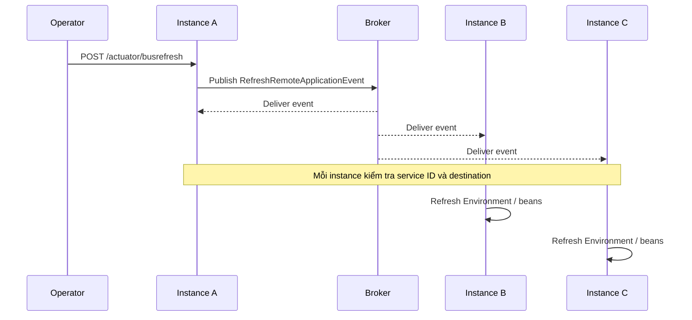

# Bus không lan truyền vì trùng ID, sai đích hoặc mất kết nối broker

Spring Cloud Bus dùng message broker để phát tán sự kiện như refresh cấu hình tới các instance Spring Boot. Khi gọi `/actuator/busrefresh` mà một số ứng dụng không cập nhật, nguyên nhân thường nằm ở một trong ba lớp: **service ID của Bus bị trùng, destination định tuyến không khớp hoặc producer/consumer không kết nối được broker**.

Để chẩn đoán chính xác, cần tách ba khái niệm dễ nhầm:

- **Bus service ID** (`spring.cloud.bus.id`): định danh một instance để Bus nhận biết nguồn gửi và đích nhận.
- **Event destination**: mẫu định tuyến trong endpoint như `/actuator/busrefresh/{destination}`, xác định instance hoặc nhóm instance nào xử lý event.
- **Broker destination** (`spring.cloud.bus.destination`): tên topic/destination bên ngoài mà Spring Cloud Bus và binder dùng để trao đổi message.

Một endpoint trả HTTP thành công chưa chứng minh event đã tới mọi consumer. Cần kiểm tra ID, route, kết nối broker, event trace/ack và kết quả refresh ở từng instance.

## 1. Luồng phát tán sự kiện của Spring Cloud Bus

Spring Cloud Bus dựa trên Spring Cloud Stream và binder của broker như RabbitMQ hoặc Kafka. Instance gọi endpoint Bus tạo một remote application event; binder gửi event qua broker; các instance khác nhận message rồi kiểm tra origin/destination trước khi xử lý.



Các bước có thể lỗi độc lập:

1. Endpoint không được expose hoặc request bị Spring Security từ chối.
2. Instance gửi không tạo được event hoặc không publish được message.
3. Broker nhận message nhưng consumer không subscribe đúng destination.
4. Consumer nhận message nhưng bỏ qua do origin ID trùng với ID cục bộ hoặc destination không khớp.
5. Event được xử lý nhưng Config Client không lấy được cấu hình mới.
6. Environment thay đổi nhưng bean không được rebind/tạo lại theo lifecycle.

Vì vậy, cần xác định event dừng ở bước nào thay vì chỉ kiểm tra endpoint HTTP.

## 2. Nguyên nhân 1: Bus service ID bị trùng

Mỗi instance tham gia Bus cần một service ID duy nhất. Có thể cấu hình trực tiếp bằng `spring.cloud.bus.id`. Nếu không đặt, Spring Cloud Bus tạo ID từ các thông tin môi trường, thường theo dạng:

```text
app:index:id
```

Trong đó:

- `app`: tên ứng dụng, thường lấy từ `spring.application.name`.
- `index`: chỉ số instance, có thể lấy từ platform instance index, `spring.application.index`, local/server port hoặc giá trị mặc định.
- `id`: instance ID do platform cung cấp hoặc một giá trị ngẫu nhiên.

Chi tiết thứ tự lấy giá trị có thể khác theo môi trường chạy và phiên bản. Khi override `spring.cloud.bus.id`, phải bảo đảm giá trị vẫn duy nhất giữa mọi instance cùng tham gia Bus.

### Vì sao ID trùng làm event bị bỏ qua?

Bus cần tránh xử lý lại event do chính instance phát ra. Nó so sánh service ID của nguồn gửi với service ID của instance đang nhận. Nếu nhiều instance có cùng ID, một instance có thể xem event do instance khác phát ra là event của chính nó và bỏ qua. Kết quả là event không được xử lý ở các instance trùng ID.

Ví dụ hai replica cùng có:

```yaml
spring:
  application:
    name: billing-api
  cloud:
    bus:
      id: billing-api:0
```

Khi A phát event, B cũng tự nhận diện mình là `billing-api:0`. Cơ chế chống vòng lặp có thể khiến B bỏ qua event. Tình trạng này thường gặp khi đặt `spring.cloud.bus.id` cố định trong file cấu hình dùng chung cho mọi replica.

### Cách sửa ID trùng

Không đặt một ID đầy đủ giống nhau cho mọi replica. Hãy để mỗi instance có thành phần định danh riêng, ví dụ dùng `spring.application.index` theo pod ordinal hoặc instance index của nền tảng:

```yaml
spring:
  application:
    name: billing-api
    index: ${INSTANCE_INDEX}
```

Nếu cần override trực tiếp Bus ID, tạo giá trị riêng cho mỗi instance:

```yaml
spring:
  cloud:
    bus:
      id: ${spring.application.name}:${INSTANCE_INDEX}:${INSTANCE_ID}
```

`INSTANCE_INDEX` và `INSTANCE_ID` phải được cấp riêng theo pod/VM, không phải biến giống nhau cho toàn deployment. Trong Kubernetes có thể dùng pod name hoặc StatefulSet ordinal làm thành phần phân biệt; trong môi trường khác dùng instance ID từ platform. Không dùng một giá trị cố định trong Config Server cho toàn bộ replica.

### Cách xác minh

- Ghi log `spring.application.name`, `spring.application.index`, `server.port` và Bus ID sau khi context khởi động.
- So sánh ID của tất cả replica đang chạy.
- Kiểm tra ID có bị override từ environment variable, command line hoặc Config Server hay không.
- Tạo một event test và xác nhận instance đích không tự xem origin là chính nó.

Nếu dùng Kubernetes, kiểm tra từng pod thay vì chỉ xem Deployment manifest; cùng một cấu hình không có nghĩa mọi pod phải có cùng instance ID.

## 3. Nguyên nhân 2: Event destination không khớp

Destination trên endpoint Bus là mẫu định tuyến dùng để xác định instance nào xử lý event. Nó không phải tên topic của broker.

Ví dụ endpoint nhắm tới một service ID:

```bash
curl -X POST \
  http://localhost:8080/actuator/busrefresh/customers:9000
```

Destination được so khớp bằng Spring `PathMatcher`, với dấu `:` là path separator. Có thể dùng wildcard để nhắm tất cả instance của một service:

```bash
curl -X POST \
  http://localhost:8080/actuator/busrefresh/billing-api:**
```

Mẫu `billing-api:**` nhắm các instance có service ID bắt đầu bằng `billing-api`, bất kể phần index/instance ID phía sau.

### Các lỗi destination thường gặp

| Sai sót | Hệ quả |
| --- | --- |
| Dùng tên service không trùng `spring.application.name`/ID | Không instance nào khớp mẫu đích |
| Dùng port cũ sau khi chuyển deployment | Route tới service ID không còn tồn tại |
| Gõ sai dấu `:` hoặc wildcard | PathMatcher không chọn đúng instance |
| Gửi destination chỉ tới một replica trong khi muốn toàn service | Các replica khác không xử lý event |
| Dùng ID đầy đủ nhưng ID thực tế có thêm thành phần | Exact match không khớp |

### Quy trình xác minh destination

1. Lấy service ID thực tế của một replica từ log/Actuator/trace an toàn.
2. So sánh với destination trong request.
3. Nếu cần tất cả replica, dùng pattern theo service như `billing-api:**`.
4. Thử một destination cụ thể trước, sau đó thử wildcard cho toàn service.
5. Xem trace/ack để biết instance nào đã nhận event.

Không đoán destination từ tên Deployment. Destination phải khớp service ID mà Spring Cloud Bus thực sự đăng ký.

## 4. Phân biệt event destination với broker destination

`spring.cloud.bus.destination` cấu hình tên destination/topic mà Spring Cloud Bus dùng trên external middleware. Nó không chọn service hoặc instance đích của event HTTP.

Ví dụ:

```yaml
spring:
  cloud:
    bus:
      destination: springCloudBus
```

Nếu một nhóm instance publish vào topic `springCloudBus` nhưng nhóm khác subscribe vào topic `config-events`, chúng không trao đổi được event dù broker vẫn hoạt động bình thường.

Ba giá trị cần phân biệt:

| Thành phần | Ví dụ | Mục đích |
| --- | --- | --- |
| `spring.cloud.bus.id` | `billing-api:3:pod-abc` | Định danh instance |
| Event destination | `billing-api:**` | Định tuyến event tới service/instance |
| `spring.cloud.bus.destination` | `springCloudBus` | Tên topic/destination trên broker |

Khi dùng Config First Bootstrap, tài liệu Spring Cloud Bus lưu ý `spring.cloud.bus.destination` nên được đặt trong `bootstrap.yml`/`bootstrap.properties`; nếu đặt ở nguồn bị refresh và giá trị bị reset, Bus có thể quay về destination mặc định. Với Config Data API hiện đại, hãy xác minh property source và lifecycle của thuộc tính sau refresh theo phiên bản đang dùng.

## 5. Nguyên nhân 3: Producer hoặc consumer mất kết nối broker

Spring Cloud Bus dùng binder của Spring Cloud Stream. Các starter phổ biến là `spring-cloud-starter-bus-amqp` cho RabbitMQ và `spring-cloud-starter-bus-kafka` cho Kafka. Cần có đúng binder trên classpath và cấu hình kết nối tới broker.

RabbitMQ thường dùng các thuộc tính:

```yaml
spring:
  rabbitmq:
    host: rabbitmq.internal
    port: 5672
    username: ${RABBITMQ_USERNAME}
    password: ${RABBITMQ_PASSWORD}
    virtual-host: /platform
```

Kafka thường dùng:

```yaml
spring:
  kafka:
    bootstrap-servers: kafka-1.internal:9092,kafka-2.internal:9092
```

Các cấu hình TLS, SASL, certificate, truststore và credential phụ thuộc broker/binder. Không chỉ kiểm tra hostname và port; hãy xác minh DNS, network policy, TLS handshake, authentication, authorization, vhost/cluster và topology.

### Dấu hiệu broker connection lỗi

- Log có `Connection refused`, timeout, DNS resolution failure hoặc TLS handshake error.
- RabbitMQ báo authentication failure, access refused hoặc không truy cập được vhost/exchange.
- Kafka báo broker unavailable, metadata timeout, authentication/authorization error hoặc consumer không join group.
- Producer không publish được message hoặc binder liên tục reconnect.
- Consumer không nhận event dù endpoint phát event đã được gọi.

Kiểm tra log ở cả instance gửi và instance nhận. Một producer kết nối được broker không chứng minh tất cả consumer đều kết nối được; credential, network policy hoặc DNS có thể khác giữa các nhóm pod.

## 6. Kiểm tra binder và topology

Sau khi xác nhận broker reachable, kiểm tra cấu hình Spring Cloud Stream:

- Đúng binder implementation có trong dependency/classpath.
- Producer và consumer dùng cùng broker cluster và logical destination.
- RabbitMQ: exchange, queue, binding, vhost và quyền configure/read/write.
- Kafka: topic, partition, consumer group, ACL và bootstrap metadata.
- TLS/SASL/credential của producer và consumer tương thích.
- Không có profile hoặc environment variable ghi đè broker destination.

Với Bus, Spring Cloud Stream chịu trách nhiệm middleware binding. Không tự tạo một queue/topic tùy ý rồi cho rằng Bus sẽ tự dùng nó nếu cấu hình binder/destination không trỏ tới đó.

## 7. Dùng trace và acknowledgement để tìm instance nhận event

Spring Cloud Bus có thể trace các `RemoteApplicationEvent` bằng:

```yaml
spring:
  cloud:
    bus:
      trace:
        enabled: true
```

Khi có `TraceRepository`, trace có thể hiển thị event đã gửi và các acknowledgement từ service instance. Trace giúp phân biệt:

- Event chưa được gửi.
- Event đã gửi nhưng chưa thấy ack từ consumer.
- Consumer đã ack nhưng ứng dụng vẫn chưa có giá trị cấu hình mong muốn.

Có thể xử lý ack bằng `@EventListener` cho `AckRemoteApplicationEvent` và `SentApplicationEvent` nếu ứng dụng cần telemetry riêng. Cần xác nhận ack feature được bật theo cấu hình và phiên bản.

Ví dụ thông tin trace có thể chứa:

```json
{
  "signal": "spring.cloud.bus.ack",
  "type": "RefreshRemoteApplicationEvent",
  "id": "event-id",
  "origin": "billing-api:8080",
  "destination": "billing-api:**"
}
```

Không coi ack là bằng chứng bean nghiệp vụ đã sử dụng giá trị mới. Ack cho biết event được nhận/xử lý theo cơ chế Bus; vẫn cần kiểm tra Config Client Environment, refresh result và bean lifecycle.

Trace có thể chứa tên ứng dụng, ID instance và destination. Chỉ expose endpoint trace/Actuator trong mạng quản trị được bảo vệ; không ghi secret hoặc toàn bộ cấu hình vào trace.

## 8. Chẩn đoán theo thứ tự từ ngoài vào trong

Thực hiện lần lượt để khoanh vùng nhanh:

### Bước 1: Kiểm tra endpoint và quyền truy cập

```bash
curl -i -X POST \
  http://config-client:8080/actuator/busrefresh
```

Nếu nhận 404, kiểm tra Actuator dependency và exposure:

```yaml
management:
  endpoints:
    web:
      exposure:
        include: health,info,busrefresh
```

Nếu nhận 401/403, kiểm tra Spring Security, authentication và authority cho endpoint. Không mở endpoint Bus công khai để debug.

### Bước 2: Xác nhận Bus được bật

Kiểm tra dependency starter và các thuộc tính:

```yaml
spring:
  cloud:
    bus:
      enabled: true
      refresh:
        enabled: true
      env:
        enabled: true
```

Nếu ứng dụng đã tắt Bus hoặc refresh event listener, endpoint có thể không tạo ra hiệu ứng mong muốn.

### Bước 3: So sánh ID từng instance

Thu thập Bus ID của tất cả replica và tìm giá trị trùng. Đặc biệt kiểm tra cấu hình override `spring.cloud.bus.id` hoặc `spring.application.index` bị đặt chung cho mọi replica.

### Bước 4: Kiểm tra event destination

So sánh destination request với service ID thực tế. Dùng pattern `service-name:**` khi cần nhắm mọi instance của service.

### Bước 5: Kiểm tra broker destination và kết nối

So sánh `spring.cloud.bus.destination`, binder, broker endpoint, credential và topology giữa producer/consumer. Đọc log reconnect ở từng instance.

### Bước 6: Kiểm tra event trace/ack

Bật tracing trong môi trường được bảo vệ và xác định event ID, origin, destination, instance đã ack. Nếu không có ack, quay lại kiểm tra ID, route và broker.

### Bước 7: Kiểm tra Config Server và Config Client

Nếu consumer đã nhận event nhưng giá trị không đổi, gọi Config Server trực tiếp với đúng application/profile/label. Sau đó kiểm tra client có tải revision mới không, `Environment` đã thay đổi chưa và bean có được rebind/refresh không.

## 9. Ma trận triệu chứng và nguyên nhân

| Triệu chứng | Nguyên nhân ưu tiên kiểm tra | Bằng chứng cần tìm |
| --- | --- | --- |
| Chỉ instance phát event thấy thay đổi | Consumer không nhận event hoặc ID trùng | Không có ack từ replica khác; ID bị lặp |
| Không replica nào nhận event | Producer publish thất bại hoặc broker destination sai | Broker connection error; topic/exchange khác nhau |
| Một service nhận, service khác không nhận | Destination chỉ nhắm một service hoặc ACL/broker topology khác | Trace destination; consumer subscription |
| Chỉ một số replica bỏ qua event | ID trùng ở một nhóm replica hoặc consumer mất kết nối | Danh sách ID và log từng pod |
| Event tới nhưng refresh thất bại | Config Server lỗi, sai label hoặc Config Client không tải được source | Config fetch error, HTTP status và revision |
| Event ack nhưng bean giữ giá trị cũ | Bean không thuộc refresh scope hoặc không rebind | Environment mới nhưng bean/cache cũ |
| Sau refresh event quay về broker destination mặc định | Property `spring.cloud.bus.destination` bị reset | Giá trị property source trước/sau refresh |

## 10. Ví dụ triển khai nhiều replica với ID riêng

Với Kubernetes, có thể cấp pod name qua Downward API làm instance index:

```yaml
env:
  - name: INSTANCE_INDEX
    valueFrom:
      fieldRef:
        fieldPath: metadata.name
```

Sau đó cấu hình Spring:

```yaml
spring:
  application:
    name: billing-api
    index: ${INSTANCE_INDEX}
```

Spring Cloud Bus có thể tạo service ID từ application name, index và instance ID. Cách này giúp mỗi pod có phần index riêng. Nếu tự đặt `spring.cloud.bus.id`, hãy kiểm tra format colon-separated và đảm bảo ID là duy nhất.

Trong local development, mỗi instance có thể dùng port khác nhau để phân biệt. Nếu chạy nhiều instance cùng port hoặc trong container với port nội bộ giống nhau, không giả định server port sẽ tạo ID khác nhau; hãy cấp index/instance ID tường minh.

## 11. Xử lý khi broker bị mất kết nối

Khi broker outage:

1. Xác định producer, consumer hay cả hai phía mất kết nối.
2. Kiểm tra broker health, DNS, route, firewall/network policy, TLS và credential.
3. Khôi phục broker hoặc kết nối trước khi phát lại refresh event.
4. Xác minh binder đã reconnect và topology/consumer subscription đã sẵn sàng.
5. Gửi một event thử nghiệm tới một destination hẹp.
6. Kiểm tra trace/ack và revision ở từng instance.
7. Nếu một instance offline trong lúc phát event, chủ động refresh bù hoặc restart/rollout theo runbook khi nó trở lại.

Không giả định event phát trong lúc broker offline chắc chắn được phát lại sau khi broker phục hồi. Khả năng lưu giữ và redelivery phụ thuộc broker, binder, topology, queue/topic, acknowledgement và cấu hình durability. Với thay đổi quan trọng, đối chiếu revision thực tế ở từng client và phát refresh bù sau khi hệ thống ổn định.

## 12. Kiểm tra sự khác biệt giữa broker destination và event route

Một cấu hình minh họa:

```yaml
spring:
  application:
    name: billing-api
    index: ${INSTANCE_INDEX}
  cloud:
    bus:
      id: ${spring.application.name}:${INSTANCE_INDEX}:${INSTANCE_ID}
      destination: config-events
```

Trong đó:

- `id` là định danh riêng của instance.
- `destination: config-events` là tên middleware destination dùng chung giữa các node của Bus.
- Khi gọi `/actuator/busrefresh/billing-api:**`, phần path là event route nhắm mọi instance của service `billing-api`.

Các node cần cùng dùng broker destination `config-events` và có ID riêng. Không thay `destination` thành `billing-api:**`; đó là mẫu định tuyến event, không phải tên topic/exchange.

Nếu dùng Config First Bootstrap, đặt broker destination ở bootstrap configuration theo khuyến nghị của tài liệu Spring Cloud Bus để giá trị không bị reset khi refresh. Với Config Data API, kiểm tra cấu hình và nguồn property sau refresh ở phiên bản đang dùng.

## 13. Bảo mật endpoint và broker trong quá trình xử lý

Bus endpoint có thể phát lệnh làm thay đổi cấu hình của nhiều instance. Cần:

- Chỉ expose `busrefresh`/`busenv` khi thật sự cần.
- Yêu cầu authentication và role phù hợp cho operator/pipeline.
- Giới hạn management endpoint trong mạng nội bộ hoặc management interface.
- Bảo vệ broker bằng TLS, credential và ACL cho exchange/topic/queue.
- Không log password, token hoặc payload có secret.
- Audit ai phát event, thời gian, destination và kết quả xử lý.
- Không dùng `busenv` để thay đổi bí mật hoặc dữ liệu nhạy cảm không có kiểm soát.

## 14. Checklist xử lý lỗi Bus không lan truyền

- [ ] Endpoint `/actuator/busrefresh` được expose và caller có quyền.
- [ ] `spring-cloud-starter-bus-amqp` hoặc `spring-cloud-starter-bus-kafka` đúng với broker đang dùng.
- [ ] `spring.cloud.bus.enabled` và `spring.cloud.bus.refresh.enabled` không bị tắt.
- [ ] Mỗi replica có `spring.cloud.bus.id` duy nhất.
- [ ] `spring.application.index`/instance ID không bị dùng chung ngoài ý muốn.
- [ ] Event destination khớp service ID hoặc wildcard mong muốn.
- [ ] `spring.cloud.bus.destination` giống nhau giữa các node tham gia cùng Bus.
- [ ] Producer và consumer kết nối được broker, xác thực và có quyền cần thiết.
- [ ] Broker topology và binder được cấu hình đúng.
- [ ] Trace/ack xác nhận instance nào đã nhận event.
- [ ] Config Server trả đúng application/profile/label/revision.
- [ ] Config Client Environment và bean thực sự phản ánh giá trị mới.
- [ ] Có quy trình refresh bù cho instance offline hoặc bỏ lỡ event.

## 15. Tài liệu tham khảo

- [Spring Cloud Bus — Addressing Instances](https://docs.spring.io/spring-cloud-bus/reference/spring-cloud-bus/addressing.html): cấu trúc service ID, destination path và yêu cầu ID duy nhất.
- [Spring Cloud Bus — Configuration](https://docs.spring.io/spring-cloud-bus/reference/spring-cloud-bus/configuration.html): broker destination, tracing và acknowledgement.
- [Spring Cloud Bus — Bus Endpoints](https://docs.spring.io/spring-cloud-bus/reference/spring-cloud-bus/bus-endpoints.html): `/actuator/busrefresh`, `/actuator/busenv` và cách expose endpoint.
- [Spring Cloud Stream Reference](https://docs.spring.io/spring-cloud-stream/reference/): binder và cấu hình middleware.

Khi Bus không lan truyền, hãy kiểm tra theo thứ tự: service ID của từng instance, event destination, broker destination và kết nối binder. ID trùng có thể khiến instance bỏ qua event như thể chính nó phát; destination sai khiến event không khớp; broker outage khiến message không tới consumer. Sau khi sửa, xác minh bằng trace/ack và revision của từng Config Client thay vì chỉ dựa vào HTTP response của endpoint gửi event.
