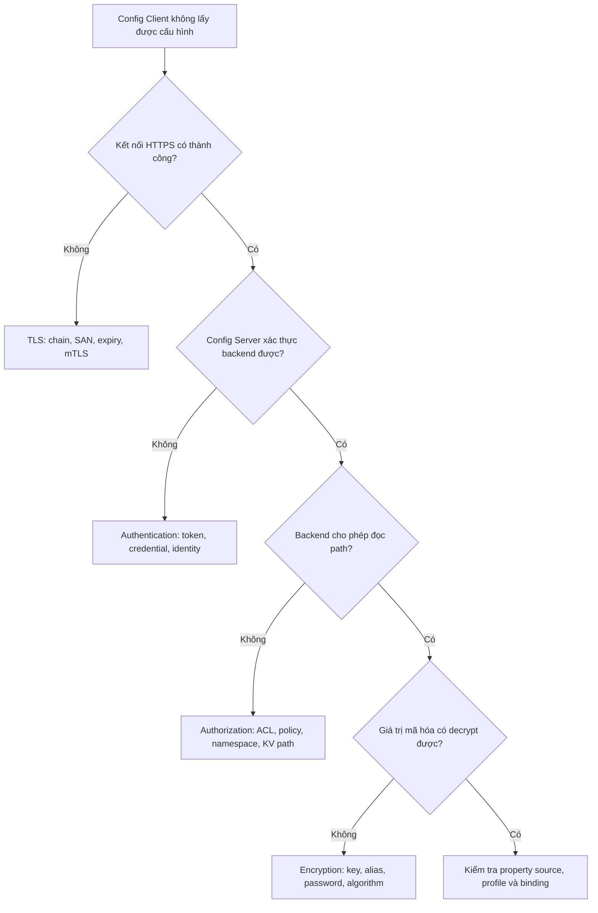

# Lỗi giải mã, keystore, chứng thư hoặc quyền truy cập bí mật

Spring Cloud Config có thể lấy cấu hình từ Git, Vault, JDBC hoặc filesystem và phân phối cho nhiều ứng dụng Spring Boot. Một số giá trị được mã hóa bằng cơ chế encryption của Spring Cloud Config; một số khác được bảo vệ bởi secret manager như Vault. Kết nối đến Config Server cũng có thể dùng TLS hoặc mTLS. Vì vậy, một lỗi có vẻ giống “không đọc được secret” có thể bắt nguồn từ khóa mã hóa sai, keystore không đọc được, certificate không được tin cậy, token hết hạn hoặc ACL không cho phép đọc path.

Chẩn đoán đúng bắt đầu bằng việc phân loại lỗi theo ranh giới: **giải mã giá trị**, **xác thực certificate của kết nối**, **xác thực danh tính**, hay **phân quyền đọc secret**. Các lớp này có credential, store và cách kiểm tra khác nhau. Không giải quyết lỗi bằng cách tắt xác minh TLS, cấp quyền wildcard hoặc in secret ra log; hãy thu thập metadata không nhạy cảm, kiểm tra đúng danh tính và sửa đúng lớp gây lỗi.

## 1. Mục tiêu học tập

Sau bài học, bạn có thể:

- Phân biệt lỗi decrypt `{cipher}` với lỗi TLS handshake và lỗi Vault authorization.
- Kiểm tra symmetric key, RSA key pair, alias, password và keystore format.
- Phân biệt encryption keystore với TLS keystore và truststore.
- Chẩn đoán lỗi `PKIX path building failed`, hostname mismatch, certificate expiry và mTLS rejection.
- Phân biệt authentication failure với ACL `permission denied` khi đọc Vault.
- Kiểm tra KV v1/v2 path, namespace và quyền `read`/`list` đúng phạm vi.
- Xử lý lỗi Git credential, SSH key và filesystem permission của secret file.
- Xoay vòng encryption key, certificate và secret mà không làm mất khả năng giải mã dữ liệu hiện có.
- Thu thập bằng chứng và xử lý sự cố mà không để lộ password, token hoặc plaintext secret.

## 2. Phân loại sự cố trước khi sửa

Không nên bắt đầu bằng cách đổi password hoặc tạo lại keystore. Trước hết, xác định request thất bại ở bước nào.



| Nhóm lỗi | Dấu hiệu thường gặp | Thành phần cần kiểm tra |
| --- | --- | --- |
| Encryption/decryption | `{cipher}` không được giải mã, `BadPaddingException`, `InvalidKeyException`, alias không tồn tại | `encrypt.key`, encryption keystore, key alias và key password |
| TLS server identity | `PKIX path building failed`, certificate expired, SAN mismatch | Truststore của client, server certificate chain và hostname |
| mTLS client identity | `certificate_required`, `bad_certificate`, handshake bị từ chối | Client keystore và truststore của server |
| Backend authentication | HTTP 401, Vault login failure, Git authentication failed | Token, AppRole, SSH key, workload identity |
| Backend authorization | HTTP 403, Vault `permission denied`, Git repository access denied | ACL/policy, path, namespace, repository permission |
| File access | `AccessDeniedException`, keystore load failure, file not found | Volume mount, file path và OS/container user |

Một request có thể đi qua nhiều lớp. Ví dụ TLS đến Vault thành công nhưng token không có quyền đọc secret; hoặc Config Server đọc được ciphertext trong Git nhưng không có private key để decrypt. Hãy ghi nhận request ID, service identity, backend, path đã được làm sạch và loại exception trước khi thay đổi cấu hình.

## 3. Quy trình thu thập bằng chứng an toàn

Khi xảy ra lỗi, thu thập các thông tin sau:

- Thời điểm và timezone của sự cố.
- Application, profile, label và Config Server instance xử lý request.
- Backend type và tên mount/repository ở dạng không chứa credential.
- Error class, HTTP status và correlation/request ID.
- Tên alias, loại keystore/truststore và thời hạn certificate; không xuất private key.
- Vault namespace và path đã chuẩn hóa nếu chính sách cho phép ghi log.
- Release/commit ID và thời điểm deploy gần nhất.
- Sự khác biệt giữa instance thành công và instance thất bại.

Không thu thập hoặc gửi trong ticket/chat:

- Plaintext secret, token, password hoặc private key.
- Toàn bộ output `vault kv get` có chứa giá trị bí mật.
- URL có username/password nhúng trong đó.
- `Authorization` header, cookie hoặc AppRole Secret ID.
- File keystore/truststore thật hoặc bản dump bộ nhớ.

Nếu cần chứng minh hai giá trị giống nhau, dùng test fixture không nhạy cảm hoặc so sánh fingerprint được tạo theo quy trình an toàn. Không in secret ra terminal rồi chụp màn hình để gửi cho người khác.

## 4. Lỗi giải mã giá trị `{cipher}`

Spring Cloud Config hỗ trợ mã hóa và giải mã giá trị cấu hình. Giá trị ciphertext trong repository thường được đánh dấu bằng tiền tố `{cipher}`. Config Server sử dụng encryption material được cấu hình tại server để giải mã trước khi trả cấu hình cho client theo cơ chế server-side decryption.

Ví dụ một file cấu hình có ciphertext:

```yaml
spring:
  datasource:
    username: app_user
    password: "{cipher}AQB...ciphertext..."
```

Chuỗi minh họa không phải ciphertext có thể dùng. Không thay `{cipher}` bằng plaintext trong repository chỉ để né lỗi giải mã.

Các nguyên nhân phổ biến:

- Config Server không có encryption key hoặc keystore.
- Server đang dùng key khác với key đã mã hóa giá trị.
- Private key không khớp certificate/public key đã dùng để encrypt.
- Keystore password hoặc private-key password sai.
- Alias được cấu hình không tồn tại hoặc trỏ đến entry không có private key.
- Keystore format/type không tương thích.
- File keystore không được mount hoặc process không có quyền đọc.
- Ciphertext bị cắt, đổi encoding hoặc bị sửa khi commit/copy.
- Các Config Server replica không dùng cùng encryption material.

### Dấu hiệu cần chú ý

Một số lỗi Java thường xuất hiện trong quá trình decrypt:

| Exception/dấu hiệu | Khả năng cần kiểm tra |
| --- | --- |
| `BadPaddingException` | Sai key, ciphertext bị hỏng hoặc thuật toán/padding không khớp |
| `IllegalBlockSizeException` | Dữ liệu mã hóa không đúng block/format mong đợi hoặc bị cắt |
| `InvalidKeyException` | Key không hợp lệ, độ dài/algorithm không được hỗ trợ hoặc key entry sai |
| `UnrecoverableKeyException` | Không mở được private key do key password hoặc entry không phù hợp |
| `NoSuchAlgorithmException` | Provider/JDK không hỗ trợ thuật toán được cấu hình |
| `FileNotFoundException` hoặc `AccessDeniedException` | Keystore path sai, volume chưa mount hoặc quyền đọc file không đủ |

Các exception có thể được bọc trong lỗi Spring hoặc lỗi HTTP. Hãy tìm root cause trong log server có quyền truy cập hạn chế, đồng thời redaction message nếu có đường dẫn hoặc thông tin nhạy cảm.

## 5. Kiểm tra symmetric encryption key

Với symmetric encryption, cùng một secret key được dùng để encrypt và decrypt. Config Server có thể nhận key qua thuộc tính `encrypt.key` hoặc biến môi trường tương ứng.

Ví dụ cấu hình:

```yaml
encrypt:
  key: ${CONFIG_ENCRYPTION_KEY}
```

Biến `CONFIG_ENCRYPTION_KEY` phải được cấp từ secret manager hoặc secret injection của nền tảng. Không commit key vào Git và không in biến môi trường ra log để kiểm tra.

Checklist:

1. Xác nhận biến được inject vào đúng Config Server process/container.
2. Xác nhận giá trị không rỗng và đúng key đã dùng để encrypt ciphertext hiện tại.
3. Xác nhận mọi Config Server replica dùng cùng key trong cùng giai đoạn phát hành.
4. Kiểm tra không có whitespace/newline ngoài ý muốn do secret file hoặc environment injection.
5. Kiểm tra key không bị thay trong một replica khi các replica khác vẫn dùng key cũ.
6. Xác nhận thuật toán và định dạng ciphertext tương thích với phiên bản đang chạy.

Không in giá trị key để so sánh giữa replica. Có thể so sánh secret version/identifier do secret manager cấp hoặc kiểm tra qua một health check nội bộ không tiết lộ key.

## 6. Kiểm tra RSA encryption keystore

Với RSA/asymmetric encryption, public key được dùng để mã hóa và private key tương ứng được dùng để giải mã. Config Server cần truy cập đúng private-key entry.

Ví dụ cấu hình keystore cho encryption:

```yaml
encrypt:
  key-store:
    location: file:/run/secrets/config-encryption.p12
    password: ${CONFIG_ENCRYPTION_STORE_PASSWORD}
    alias: config-encryption
    secret: ${CONFIG_ENCRYPTION_KEY_PASSWORD}
```

Các thuộc tính có ý nghĩa riêng:

- `location`: vị trí keystore.
- `password`: password mở keystore.
- `alias`: entry chứa key pair cần sử dụng.
- `secret`: password bảo vệ private key entry nếu khác store password.

Tên và cách binding thuộc tính phải khớp với phiên bản Spring Cloud Config đang dùng. Nếu sử dụng JKS thay cho PKCS12, cần bảo đảm loại store và file thực tế tương ứng.

### Liệt kê alias mà không xuất private key

```bash
keytool -list -v \
  -keystore /run/secrets/config-encryption.p12 \
  -storetype PKCS12
```

Lệnh yêu cầu nhập store password tương tác. Không thêm password thật vào tham số command line. Kiểm tra:

- Alias `config-encryption` có tồn tại không.
- Entry là `PrivateKeyEntry` nếu Config Server cần private key để decrypt.
- Certificate chain có đúng cặp key đã dùng để encrypt không.
- Thời hạn certificate và thuật toán/key size có phù hợp không.

`keytool -list` chỉ kiểm tra được cấu trúc và entry metadata; không chứng minh private key có thể giải mã ciphertext cụ thể. Cần một test decrypt bằng ciphertext test-only trong môi trường cô lập.

### Không nhầm encryption keystore với TLS keystore

Java KeyStore là định dạng chứa key/certificate, nhưng mục đích sử dụng khác nhau:

| Store | Thuộc tính ví dụ | Mục đích |
| --- | --- | --- |
| Encryption keystore của Config Server | `encrypt.key-store.*` | Giữ private key để giải mã cấu hình `{cipher}` |
| TLS server keystore | `server.ssl.key-store` | Cung cấp danh tính HTTPS của Config Server |
| TLS client keystore | `spring.cloud.config.tls.key-store` | Cung cấp client certificate khi Config Client dùng mTLS |
| TLS truststore | `server.ssl.trust-store`, `spring.cloud.config.tls.trust-store` | Tin cậy CA/certificate của peer trong TLS handshake |

Không đổi `encrypt.key-store.location` để sửa lỗi HTTPS certificate. Cũng không nhập private key giải mã cấu hình vào truststore. Dùng store riêng theo mục đích giúp giảm rủi ro lẫn quyền và đơn giản hóa xoay vòng.

## 7. Lỗi sai alias, password hoặc định dạng keystore

| Biểu hiện | Nguyên nhân | Cách xử lý |
| --- | --- | --- |
| `Keystore was tampered with, or password was incorrect` | Store password sai hoặc file không phải keystore mong đợi | Kiểm tra secret version, file mount, store type và password injection |
| `Alias ... does not identify a key entry` | Alias sai hoặc alias trỏ đến trusted certificate thay vì private key | Liệt kê alias; chọn đúng `PrivateKeyEntry` |
| `UnrecoverableKeyException` | Private-key password sai | Kiểm tra `encrypt.key-store.secret` và password của entry |
| `Invalid keystore format` | File JKS/PKCS12 không khớp type hoặc file hỏng | Xác nhận định dạng bằng keytool và cấu hình đúng store type |
| Không tìm thấy file | Đường dẫn classpath/file URI sai hoặc secret volume chưa mount | Kiểm tra path trong container và mount configuration |
| Chỉ một replica decrypt thành công | Replica dùng key version, file hoặc alias khác | So sánh secret version/metadata và rollout đồng bộ |

Khi keystore được mount từ Kubernetes Secret hoặc secret manager, kiểm tra user/group và file mode của container. File tồn tại không có nghĩa tiến trình Java có quyền đọc.

## 8. Lỗi thuật toán hoặc môi trường Java

Encryption algorithm phụ thuộc JDK, provider và policy bảo mật. Các hệ thống Java cũ có thể gặp `Illegal key size` khi dùng thuật toán hoặc key length không được policy cho phép.

Hướng xử lý:

- Ghi nhận JDK vendor và version của Config Server.
- Xác định thuật toán thực tế được sử dụng, không chỉ dựa vào tên key.
- Kiểm tra crypto provider và security policy của runtime.
- Ưu tiên JDK còn được hỗ trợ và cấu hình thuật toán theo khuyến nghị bảo mật hiện hành.
- Không hạ độ dài key hoặc chuyển sang thuật toán yếu chỉ để làm test pass.
- Kiểm thử encrypt/decrypt bằng dữ liệu giả sau khi nâng cấp JDK hoặc provider.

Nếu ciphertext được tạo bởi một phiên bản cũ, kiểm tra khả năng tương thích trước khi đổi thuật toán. Không thay key/algorithm trên production mà chưa có bản sao an toàn và kế hoạch re-encrypt dữ liệu.

## 9. Endpoint `/encrypt` và `/decrypt` không hoạt động

Spring Cloud Config Server cung cấp endpoint mã hóa/giải mã khi tính năng và security configuration cho phép. Các endpoint này có thể nhận plaintext ở request body; vì vậy chúng phải được bảo vệ như một bề mặt nhạy cảm.

Các câu hỏi cần kiểm tra:

- Config Server có bật và cấu hình encryption support không?
- Request có đi đến đúng Config Server instance không?
- HTTP method và content type có đúng không?
- Request body có bị proxy, gateway hoặc shell biến đổi không?
- Server có quyền truy cập encryption key/keystore không?
- Authentication/authorization có cho phép caller sử dụng endpoint không?
- Endpoint có bị expose ra network không tin cậy không?

Không thử bằng password thật trên terminal dùng chung hoặc trong CI log. Dùng một chuỗi test-only và gửi body theo cách không lưu command history. Không ghi response plaintext vào log hoặc artifact.

Nếu endpoint trả 401/403, xử lý authentication/authorization của HTTP endpoint. Nếu request được chấp nhận nhưng decrypt thất bại, kiểm tra key/keystore/ciphertext. Đây là hai lớp khác nhau.

Không mở endpoint decrypt công khai chỉ để hỗ trợ vận hành. Chỉ cho phép nhóm hoặc pipeline được ủy quyền, qua TLS và network policy, đồng thời audit request mà không lưu plaintext.

## 10. Certificate trust và lỗi `PKIX path building failed`

Lỗi PKIX thường có nghĩa JVM không xây dựng được certificate chain từ chứng thư peer đến một trust anchor mà truststore tin cậy.

Các nguyên nhân phổ biến:

- Client truststore thiếu CA root hoặc intermediate.
- Server không gửi đủ intermediate certificate.
- Client dùng truststore khác với file dự kiến.
- Certificate đã hết hạn hoặc chưa đến thời điểm hiệu lực.
- TLS proxy trình certificate khác với Config Server backend.
- Container không mount truststore hoặc dùng file cũ.

### Kiểm tra server certificate chain

```bash
openssl s_client \
  -connect config.example.internal:8888 \
  -servername config.example.internal \
  -CAfile company-root-ca.pem \
  -showcerts \
  -verify_return_error
```

Kiểm tra chain mà server gửi và kết quả verify. `-servername` gửi SNI theo hostname. `-CAfile` chỉ định CA dùng để xác minh. Không dùng `-verify 0` hoặc `-noverify` để coi kết nối là hợp lệ.

### Kiểm tra certificate SAN và thời hạn

```bash
openssl x509 -in config-server.crt \
  -noout -subject -issuer -dates -ext subjectAltName
```

Hostname trong Config Client URI phải khớp SAN của certificate. Nếu client gọi `config.internal.example`, certificate cần có DNS SAN tương ứng. Certificate được ký bởi CA tin cậy nhưng SAN không khớp vẫn phải bị từ chối.

### Kiểm tra truststore

```bash
keytool -list -v \
  -keystore /run/secrets/config-server-truststore.p12 \
  -storetype PKCS12
```

Xác nhận alias CA dự kiến tồn tại. Không cần đưa private key vào truststore. Nếu thêm CA, hãy xác minh nguồn certificate qua kênh tin cậy trước khi import.

## 11. Lỗi hostname, expiry và mTLS

| Dấu hiệu | Nguyên nhân thường gặp | Cách xử lý |
| --- | --- | --- |
| `No subject alternative DNS name matching ...` | URL hostname không có trong SAN | Dùng hostname đúng hoặc cấp certificate có SAN phù hợp |
| `certificate has expired` | Certificate hết hạn | Cấp và triển khai certificate mới; kiểm tra cảnh báo expiry |
| `NotBefore` ở tương lai | Certificate chưa hiệu lực hoặc clock lệch | Kiểm tra đồng hồ hệ thống và thời điểm cấp |
| `certificate_required` | Server yêu cầu client certificate nhưng client không gửi | Cấu hình client keystore và mTLS đúng |
| `bad_certificate` | Client certificate sai chain, EKU hoặc bị từ chối | Kiểm tra client certificate và server truststore |
| TLS handshake failure | Protocol/cipher/certificate không tương thích | So sánh log TLS hai phía và policy protocol |

Với mTLS, phân biệt rõ hai chiều:

- Config Client dùng truststore để xác minh Config Server.
- Config Client dùng keystore để trình client certificate/private key.
- Config Server dùng keystore để trình server certificate/private key.
- Config Server dùng truststore để xác minh client certificate.

Nếu `server.ssl.client-auth=need`, client không có certificate hợp lệ sẽ không hoàn tất TLS handshake. Nếu client certificate được proxy xác minh, phải bảo đảm backend chỉ tin identity header từ proxy đã xác thực và không thể bị truy cập trực tiếp để giả mạo header.

Không sửa lỗi bằng cách tắt hostname verification hoặc dùng trust-all certificate manager. Cách đó loại bỏ một phần bảo vệ quan trọng của TLS.

## 12. Phân biệt authentication và authorization khi truy cập Vault

Vault kiểm tra hai điều riêng:

1. **Authentication:** request đến từ danh tính nào? Ví dụ token, AppRole, Kubernetes auth hoặc cloud IAM.
2. **Authorization:** danh tính đó được phép thực hiện thao tác nào trên path nào? ACL policy quyết định capability.

| Biểu hiện | Khả năng | Cần kiểm tra |
| --- | --- | --- |
| Login thất bại hoặc 400/401 | Credential sai, token hết hạn, role binding không khớp | Auth method, token TTL, AppRole Secret ID, service account/audience |
| `permission denied` hoặc 403 | Danh tính đã xác thực nhưng thiếu capability | Policy gắn vào token và API path thực tế |
| Secret not found hoặc 404 | Sai mount, path, namespace hoặc KV version | Mount path, `/data/` KV v2 và namespace header |
| Chỉ một Pod lỗi | Secret injection, identity binding hoặc token renewal khác nhau | Service account, token sink, secret mount và clock của Pod |

Không cấp root token để “thử xem có đọc được không”. Root token bỏ qua các ranh giới mà runtime cần tuân thủ và không giúp xác định policy tối thiểu cần bổ sung.

## 13. Kiểm tra KV v1/v2 path và ACL

Giả sử mount tên `kv` và secret logic là `orders/prod`.

| Thành phần | KV v1 | KV v2 |
| --- | --- | --- |
| ACL/API path để đọc data | `kv/orders/prod` | `kv/data/orders/prod` |
| Metadata path | Không có lớp KV v2 | `kv/metadata/orders/prod` |
| Capability đọc | `read` trên secret path | `read` trên `/data/` path |
| Capability list nếu cần | `list` trên path phù hợp | `list` trên `/metadata/` path |

Ví dụ kiểm tra capability của token hiện tại:

```bash
vault token capabilities kv/data/orders/prod
```

Chạy trong đúng Vault namespace và bằng danh tính runtime của Config Server hoặc một token kiểm thử có policy tương đương. Kết quả mong đợi là `read` được phép đối với path cần thiết. Với policy orders-only, đọc `kv/data/payments/prod` phải bị từ chối.

Nếu backend cần liệt kê key, chỉ cấp `list` trên metadata path hẹp. Không cấp `list` hoặc `read` wildcard trên toàn mount chỉ để làm biến mất lỗi.

## 14. Kiểm tra Vault namespace và identity

Vault Enterprise namespace là context quản trị riêng. Mount `kv` trong namespace `platform/orders` có thể hoàn toàn khác mount `kv` trong `platform/payments`.

Khi Config Server báo không tìm thấy secret hoặc `permission denied`, xác minh:

- Token được cấp trong namespace nào.
- Config Server gửi `X-Vault-Namespace` đúng chưa.
- Mount path và KV version của namespace đó.
- Policy có gắn vào token/role đang dùng không.
- Config Server đang chạy bằng token cũ hay token mới.
- Token có hết hạn hoặc renewal thất bại không.

Với Kubernetes auth, kiểm tra role binding với namespace và service account, audience và thời hạn service account token. Với AppRole, kiểm tra Role ID/Secret ID qua secret manager và TTL/wrapping policy; không in Secret ID để debug.

Nếu Vault Agent cấp token qua file sink, kiểm tra quyền đọc file của process Config Server và trạng thái auto-auth/renewal. File có tồn tại nhưng process không đọc được vẫn dẫn đến authentication failure.

## 15. Lỗi quyền truy cập Git hoặc filesystem

Không phải mọi lỗi lấy bí mật đều đến từ Vault. Config Server có thể đọc ciphertext hoặc file chứa secret từ một repository riêng.

### Git qua HTTPS

- HTTP 401 thường gợi ý credential không hợp lệ hoặc không được gửi.
- HTTP 403 thường gợi ý identity đã nhận diện nhưng không có quyền repository/branch cần thiết.
- Kiểm tra token scope, expiry, repository permission và secret injection.
- Không nhúng token vào URL hoặc ghi remote URL có credential ra log.

### Git qua SSH

- `Permission denied (publickey)` thường liên quan đến SSH private key hoặc quyền repository.
- `Host key verification failed` liên quan đến `known_hosts`/server host key, không phải TLS truststore.
- Kiểm tra SSH key được mount, file mode, user chạy Config Server và host key fingerprint đã xác minh.
- Không tắt host key checking trong production để bỏ qua lỗi.

### File keystore hoặc secret volume

- Kiểm tra đường dẫn bên trong container, không chỉ đường dẫn trên host.
- Kiểm tra owner, group và file permission của user chạy Java.
- Kiểm tra secret volume đã được mount trước khi process khởi động.
- Kiểm tra symlink hoặc file rotation có khiến path trỏ đến file cũ không.
- Không in nội dung file keystore hoặc secret để xác minh.

## 16. So sánh trạng thái giữa các Config Server replica

Trong môi trường HA, các replica cần dùng encryption material và backend identity tương thích. Nếu một replica dùng key mới còn replica khác dùng key cũ, cùng một request có thể thành công hoặc thất bại tùy load balancer chọn instance nào.

Kiểm tra không nhạy cảm giữa các replica:

| Thuộc tính | Cần nhất quán? | Cách đối chiếu an toàn |
| --- | --- | --- |
| Encryption key version/secret version | Có, với ciphertext cần decrypt | Secret manager version ID hoặc release metadata |
| Keystore alias | Có | Alias và loại entry, không xuất private key |
| Keystore file version | Có | Artifact/version ID hoặc checksum được quản lý an toàn |
| TLS server certificate | Theo endpoint và hostname | Serial, issuer, SAN và expiry |
| Truststore CA set | Theo policy kết nối | Alias/fingerprint CA đã xác minh |
| Vault namespace/mount/KV version | Có | Config metadata không chứa token |
| Vault runtime identity/policy | Theo ranh giới service | Role/policy name và audit identity |
| Git revision/label | Cần đồng nhất trong cùng release | Commit SHA/label không nhạy cảm |

Không lấy private key hoặc token hash làm thông tin chẩn đoán phổ biến. Dùng version ID, certificate fingerprint và metadata do hệ thống quản lý cấp.

## 17. Xoay vòng encryption key an toàn

Thay encryption key trước khi re-encrypt toàn bộ ciphertext có thể khiến Config Server không còn giải mã được giá trị cũ. Hãy lập kế hoạch theo vòng đời dữ liệu.

Quy trình khái quát:

1. Kiểm kê các ciphertext `{cipher}` đang được lưu trong repository hoặc backend.
2. Xác định key/version hiện tại và nơi lưu giữ an toàn.
3. Tạo key mới theo quy trình quản lý khóa của tổ chức.
4. Dùng quy trình được kiểm soát để decrypt dữ liệu cũ bằng key cũ và encrypt lại bằng key mới.
5. Review thay đổi, xác minh số lượng ciphertext và kiểm thử decrypt bằng dữ liệu test-only.
6. Triển khai Config Server có thể decrypt ciphertext mới trên tất cả replica.
7. Xác minh các client nhận đúng giá trị và không còn lỗi decrypt.
8. Giữ key cũ trong thời gian rollback được phê duyệt, ở nơi bảo mật riêng.
9. Sau khi không còn ciphertext phụ thuộc key cũ, thu hồi key cũ theo chính sách.

Không giả định Spring Cloud Config tự động quản lý một key ring hoặc tự re-encrypt toàn bộ repository khi đổi `encrypt.key`. Thiết kế cơ chế chuyển đổi dựa trên tính năng thực tế của phiên bản và công cụ quản lý khóa đang dùng.

Nếu nghi ngờ key bị lộ, ưu tiên thu hồi/rotate theo incident procedure và đánh giá mọi ciphertext có thể đã bị truy cập. Xóa commit khỏi branch hiện tại không xóa bản sao trong Git history, clone, cache hoặc backup.

## 18. Xoay vòng TLS certificate và Vault secret

### TLS certificate

- Cấp certificate mới với SAN, EKU và chain phù hợp.
- Nếu CA thay đổi, đưa CA mới vào truststore của peer trước khi chuyển certificate.
- Trong thời gian chuyển tiếp, có thể trust đồng thời CA cũ và mới theo chính sách.
- Triển khai certificate mới và kiểm tra từng Config Server/Client replica.
- Sau khi mọi kết nối dùng chain mới, loại CA cũ khỏi truststore.
- Theo dõi expiry và có rollback plan.

### Vault token/secret

- Cấp identity/token mới với policy tối thiểu.
- Kiểm tra token mới đọc đúng path cần thiết và không đọc được path ngoài phạm vi.
- Cập nhật workload/secret injection theo rollout có kiểm soát.
- Xác minh renewal và audit log bằng identity mới.
- Thu hồi token cũ sau khi mọi replica đã chuyển.
- Nếu secret nghiệp vụ bị lộ, rotate secret tại hệ thống đích; chỉ đổi giá trị trong Vault không tự vô hiệu credential cũ ở database/API.

Không xoay encryption key, TLS certificate và Vault token cùng một thời điểm nếu không cần thiết. Thay từng lớp giúp xác định nguyên nhân khi một bước thất bại.

## 19. Xử lý sự cố nghi ngờ secret bị lộ

Nếu phát hiện secret xuất hiện trong Git, log, CI artifact hoặc ticket:

1. Xác định loại credential, hệ thống đích và phạm vi thời gian có thể bị lộ.
2. Thu hồi hoặc rotate credential ở hệ thống đích càng sớm càng tốt theo incident process.
3. Kiểm tra audit log và truy cập bất thường bằng metadata, không copy plaintext secret.
4. Xóa/giới hạn quyền truy cập artifact hoặc log có chứa giá trị theo quy trình lưu trữ.
5. Nếu secret nằm trong Git history, coi như đã lộ dù đã xóa file ở commit mới; đánh giá clone, fork, cache và backup.
6. Re-encrypt dữ liệu nếu encryption key bị ảnh hưởng.
7. Kiểm tra mọi Config Server replica, CI runner và client instance.
8. Ghi nhận nguyên nhân gốc và biện pháp ngăn tái diễn.

Việc rewrite Git history có thể giảm khả năng truy cập thông thường nhưng không thay thế rotate credential. Không gửi secret thật vào cuộc hội thoại, issue hoặc log trong lúc điều tra.

## 20. Ma trận chẩn đoán nhanh

| Triệu chứng | Kiểm tra đầu tiên | Hướng xử lý |
| --- | --- | --- |
| Ciphertext vẫn xuất hiện ở client | Config Server có decrypt hay không; key có được nạp không | Kiểm tra server encryption configuration và response theo đúng version |
| `BadPaddingException` | Key/alias và ciphertext có khớp không | Dùng key đúng, xác minh ciphertext không bị sửa; test decrypt bằng fixture |
| `UnrecoverableKeyException` | Store password và key-entry password | Kiểm tra secret injection và alias private key |
| `Invalid keystore format` | Store type và file thực tế | Chọn đúng JKS/PKCS12 và kiểm tra file mount |
| `PKIX path building failed` | Client truststore và server chain | Bổ sung đúng CA/intermediate đã xác minh |
| SAN/hostname mismatch | Hostname URL so với certificate SAN | Sửa DNS/URI hoặc cấp certificate đúng hostname |
| Certificate expired | Thời hạn và rollout | Gia hạn, triển khai certificate mới và kiểm tra replicas |
| `certificate_required` | Client có gửi certificate không | Cấu hình client keystore và mTLS |
| Vault 401/login failure | Token/auth method | Cấp lại credential/workload identity và kiểm tra TTL/renewal |
| Vault `permission denied` | KV path, namespace và policy | Sửa policy tối thiểu trên đúng API path |
| Vault secret not found | Mount, KV version và namespace | Kiểm tra path v1/v2 và namespace context |
| Git `Permission denied (publickey)` | SSH key và repository permission | Cấp đúng key, kiểm tra file mode và repository access |
| File access denied | Container user và mount permission | Sửa owner/group/mode hoặc secret volume |
| Chỉ một replica lỗi | Key/certificate/identity version khác nhau | So sánh version metadata và rollout đồng bộ |

## 21. Checklist vận hành an toàn

- [ ] Đã phân loại lỗi thành decrypt, TLS, authentication, authorization hoặc filesystem.
- [ ] Log và ticket không chứa plaintext secret, token, password hoặc private key.
- [ ] `{cipher}` được decrypt bằng đúng key/version đã dùng để encrypt.
- [ ] Encryption keystore được phân biệt với TLS keystore và truststore.
- [ ] Alias trỏ đến đúng private-key entry; store/key password được kiểm tra riêng.
- [ ] Keystore format, path, mount và OS permission đã được xác minh.
- [ ] JDK/provider/algorithm tương thích với ciphertext hiện tại.
- [ ] TLS chain, SAN, expiry và hostname verification đều hợp lệ.
- [ ] mTLS có client keystore và server truststore đúng chiều.
- [ ] Vault authentication identity và ACL authorization được kiểm tra riêng.
- [ ] KV v1/v2 API path và namespace chính xác.
- [ ] Không cấp root token hoặc wildcard ACL để né lỗi.
- [ ] Git credential/SSH key và known_hosts được kiểm tra đúng lớp.
- [ ] Các Config Server replica có encryption material và backend identity nhất quán.
- [ ] Có quy trình rotate encryption key, certificate và secret riêng biệt.
- [ ] Nếu secret bị lộ, đã rotate ở hệ thống đích và đánh giá Git history/log/artifact.
- [ ] Endpoint `/encrypt` và `/decrypt` được bảo vệ, không expose công khai.
- [ ] Có audit, alert expiry và kiểm thử khôi phục sau rotation.

## 22. Tài liệu tham khảo

- [Spring Cloud Config — Encryption and Decryption](https://docs.spring.io/spring-cloud-config/reference/server/encryption-and-decryption.html)
- [Spring Cloud Config — Security](https://docs.spring.io/spring-cloud-config/reference/server/security.html)
- [Spring Boot — SSL](https://docs.spring.io/spring-boot/reference/features/ssl.html)
- [HashiCorp Vault — Policies](https://developer.hashicorp.com/vault/docs/concepts/policies)
- [HashiCorp Vault — KV Secrets Engine Version 2](https://developer.hashicorp.com/vault/docs/secrets/kv/kv-v2)
- [HashiCorp Vault — Authentication](https://developer.hashicorp.com/vault/docs/auth)
