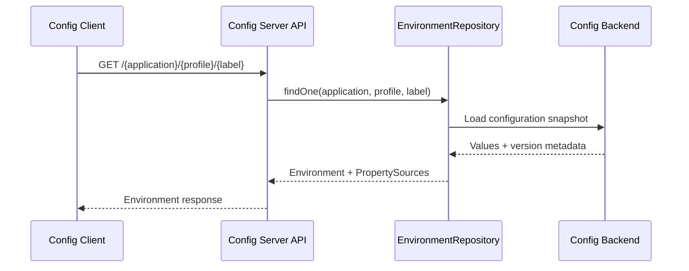

# Khi nào cần EnvironmentRepository tùy chỉnh

Spring Cloud Config Server lấy cấu hình thông qua abstraction `EnvironmentRepository`. Backend Git, Native hoặc các backend được Spring Cloud Config hỗ trợ đã đáp ứng phần lớn nhu cầu lưu trữ cấu hình tập trung. Khi cần kết hợp các nguồn chuẩn, composite repository cũng có thể giải quyết mà không cần viết backend mới.

Chỉ nên triển khai **`EnvironmentRepository` tùy chỉnh** khi cách truy cập, phân giải hoặc hợp nhất cấu hình có yêu cầu mà backend hiện có không đáp ứng được: ví dụ đọc từ một hệ thống nội bộ, gọi configuration API riêng, ánh xạ tenant theo identity đã xác thực, áp dụng quy tắc truy cập đặc thù hoặc lấy một snapshot cấu hình theo phiên bản nghiệp vụ. Custom repository trở thành một phần của đường phục vụ cấu hình cho mọi client, nên phải thiết kế cẩn thận về bảo mật, precedence, versioning, độ trễ và khả năng phục hồi.

## 1. EnvironmentRepository nằm ở đâu trong Config Server?

Config Client gửi yêu cầu chứa application, profile và label đến Config Server. Server dùng các selector này để yêu cầu repository tìm cấu hình tương ứng, rồi trả một `Environment` gồm metadata và danh sách `PropertySource`.

Luồng tổng quát:



`EnvironmentRepository` là ranh giới giữa API của Config Server và cách cấu hình được lấy từ backend. Repository không phải HTTP controller của client và cũng không phải bean cấu hình trong ứng dụng tiêu thụ. Nó nhận selector từ Config Server, truy xuất dữ liệu và trả cấu trúc mà Config Server hiểu.

## 2. Khi backend có sẵn đã đủ

Trước khi viết code, hãy kiểm tra khả năng của backend chuẩn:

| Nhu cầu | Hướng giải quyết thường đủ |
|---|---|
| Lưu cấu hình có version, branch, tag và review bằng PR | Git backend. |
| Đọc file từ filesystem hoặc classpath trong môi trường đơn giản | Native backend. |
| Kết hợp cấu hình từ nhiều backend chuẩn | Composite repository. |
| Tổ chức file theo application/profile và search path | Cấu hình repository/search locations phù hợp. |
| Lưu secret trong hệ thống quản lý bí mật | Vault backend hoặc tích hợp secret manager phù hợp. |
| Thay đổi branch, label hoặc default label | Cấu hình Git backend và selector của client. |
| Thay đổi cách refresh hoặc broadcast event | Spring Cloud Bus, webhook/monitor hoặc cơ chế refresh hiện có. |

Tên backend và tính năng có thể khác theo phiên bản Spring Cloud Config và dependency được đưa vào. Kiểm tra backend chính thức của release train dự án trước khi kết luận phải tự viết.

Composite repository đặc biệt hữu ích khi yêu cầu chỉ là ghép các nguồn chuẩn. Có thể cấu hình thứ tự backend và hành vi khi một nguồn lỗi theo khả năng phiên bản hỗ trợ. Viết `EnvironmentRepository` riêng để làm lại việc đọc Git hoặc ghép Vault với Git sẽ tăng chi phí bảo trì mà không tạo thêm giá trị.

## 3. Dấu hiệu cho thấy cần repository tùy chỉnh

Custom repository có thể phù hợp khi xuất hiện một hoặc nhiều yêu cầu sau:

1. **Backend nội bộ không có integration chuẩn:** cấu hình nằm trong hệ thống chuyên dụng chỉ có API hoặc SDK riêng.
2. **Ánh xạ selector đặc thù:** application/profile/label cần được ánh xạ sang namespace, tenant, release hoặc vùng dữ liệu theo quy tắc nghiệp vụ.
3. **Policy truy cập theo tenant hoặc identity:** cùng một application name có thể trả tập cấu hình khác nhau theo caller đã xác thực.
4. **Hợp nhất có quy tắc riêng:** cần kiểm tra, chuẩn hóa hoặc kết hợp nhiều nguồn theo thuật toán không thể biểu diễn bằng composite repository.
5. **Snapshot/version nghiệp vụ:** cần trả cấu hình theo revision đã được phê duyệt từ hệ thống release/configuration catalog.
6. **Chuyển đổi dữ liệu bắt buộc:** backend lưu schema riêng và cần chuyển thành property map theo contract của Config Server.
7. **Tích hợp legacy:** hệ thống cũ có API hoặc format riêng nhưng vẫn cần cung cấp cấu hình cho Spring Cloud Config Client.

Ví dụ, một tổ chức có configuration catalog lưu theo `tenantId`, `service`, `environment` và `releaseId`. Config Server cần chuyển request application/profile/label thành truy vấn catalog, kiểm tra quyền truy cập rồi chuyển kết quả thành `Environment`. Nếu không có cách ánh xạ và policy này trong backend chuẩn, custom repository có thể là lựa chọn hợp lý.

## 4. Khi không nên viết EnvironmentRepository

Không nên tạo repository tùy chỉnh chỉ vì muốn:

- Đổi tên file hoặc thư mục trong Git; hãy dùng layout/search path và naming convention.
- Kết hợp hai backend phổ biến; kiểm tra composite repository.
- Đọc một vài giá trị bí mật; dùng Vault hoặc secret manager.
- Refresh client khi Git thay đổi; dùng webhook, monitor, Actuator hoặc Bus theo kiến trúc.
- Đổi precedence giữa các nguồn; cấu hình thứ tự repository/property source đúng cơ chế có sẵn.
- Thêm cache đơn giản; cân nhắc cache ở backend/client hoặc caching phù hợp trước khi viết adapter riêng.
- Thực hiện validation YAML; thêm validation trong pipeline hoặc lớp kiểm tra cấu hình trước khi phát hành.

Nếu yêu cầu có thể giải quyết bằng cấu hình backend chuẩn, custom code tạo thêm một abstraction phải kiểm thử, bảo mật, quan sát và nâng cấp theo Spring Cloud Config. Chỉ triển khai khi lợi ích của logic riêng lớn hơn chi phí đó.

## 5. Contract cơ bản của EnvironmentRepository

Interface `org.springframework.cloud.config.server.environment.EnvironmentRepository` định nghĩa thao tác tìm cấu hình theo ba selector:

```java
Environment findOne(String application, String profile, String label);
```

Trong đó:

- `application`: tên ứng dụng mà client yêu cầu, thường tương ứng `spring.application.name`.
- `profile`: một hoặc nhiều profile được biểu diễn theo quy ước của Config Server.
- `label`: revision/label của backend, ví dụ Git branch, tag hoặc commit; ý nghĩa cụ thể phụ thuộc backend.

Kết quả là `org.springframework.cloud.config.environment.Environment`. Đối tượng này mô tả tên application, profile, label, metadata version/state nếu có và danh sách `PropertySource` theo thứ tự được Config Server sử dụng.

Một repository tùy chỉnh cần tuân thủ contract này: selector phải được xử lý nhất quán, dữ liệu phải được trả về theo đúng cấu trúc, và lỗi truy xuất phải được chuyển thành lỗi có thể chẩn đoán. Không trả một `Map` tùy ý hoặc một object riêng mà Config Server không hiểu.

## 6. Ví dụ adapter cho configuration store nội bộ

Giả sử hệ thống nội bộ có client `ConfigurationCatalog` trả về một snapshot theo application, profile và label. Ví dụ dưới đây minh họa adapter ở mức cơ bản:

```java
@Component
public class CatalogEnvironmentRepository implements EnvironmentRepository {

    private final ConfigurationCatalog catalog;

    public CatalogEnvironmentRepository(ConfigurationCatalog catalog) {
        this.catalog = catalog;
    }

    @Override
    public Environment findOne(String application, String profile, String label) {
        String[] profiles =
            StringUtils.commaDelimitedListToStringArray(profile);

        ConfigSnapshot snapshot = catalog.load(application, profiles, label);

        Environment environment = new Environment(
            application,
            profiles,
            label,
            snapshot.version(),
            snapshot.state()
        );

        environment.add(new PropertySource(
            "configuration-catalog",
            snapshot.properties()
        ));

        return environment;
    }
}
```

Các kiểu `ConfigurationCatalog` và `ConfigSnapshot` là API nội bộ giả định trong ví dụ. Trong triển khai thật, adapter cần xử lý trường hợp không tìm thấy application/profile/label, dữ liệu rỗng, lỗi kết nối, timeout và lỗi phân quyền. Nếu repository cần nhiều property source, thêm từng `PropertySource` theo đúng thứ tự ưu tiên mà Config Server/client mong đợi.

Không dùng `label` như một chuỗi tùy ý để nối trực tiếp vào URL/path backend mà không validate. Chuẩn hóa selector và dùng API/parameter binding an toàn để tránh path traversal hoặc truy vấn ngoài namespace được phép.

## 7. Chọn và công bố version/state

Với Git backend, Config Server có thể trả revision tương ứng với commit. Với backend tùy chỉnh, cần xác định version có ý nghĩa gì:

- Revision bất biến của snapshot.
- Release ID được phê duyệt.
- Version/ETag từ configuration API.
- Sequence number hoặc timestamp từ hệ thống nguồn, nếu có bảo đảm nhất quán.

Không nên gán `version` bằng thời điểm server nhận request nếu dữ liệu thực tế không được snapshot theo thời điểm đó. Hai client gọi cùng label nhưng nhận hai tập giá trị khác nhau mà cùng metadata sẽ gây khó truy vết.

Nếu backend có revision bất biến, hãy trả revision đó trong `Environment.version`. Nếu có state như branch/release state và contract hỗ trợ, ghi nhận rõ ràng. Khi không có version đáng tin cậy, đừng tạo metadata giả khiến vận hành hiểu nhầm response có thể tái lập.

Một snapshot nên được đọc nhất quán: tất cả property trong response cần thuộc cùng revision logic. Tránh đọc từng key từ nhiều thời điểm rồi ghép thành một `Environment` nửa cũ nửa mới.

## 8. Thứ tự PropertySource và precedence

Repository có thể trả nhiều `PropertySource`, ví dụ:

1. Cấu hình riêng application/profile.
2. Cấu hình dùng chung.
3. Cấu hình mặc định của nền tảng.

Thứ tự phải phản ánh precedence đã thiết kế. Nếu hai nguồn cùng chứa `app.payment.timeout`, nguồn nào đứng trước sẽ ảnh hưởng giá trị client chọn theo cơ chế phân giải của Spring.

Ví dụ cấu trúc response:

```json
{
  "name": "orders-service",
  "profiles": ["prod"],
  "label": "release-2026.11",
  "version": "cfg-rev-1842",
  "propertySources": [
    {
      "name": "orders-service-prod",
      "source": {
        "app.payment.timeout": "3s"
      }
    },
    {
      "name": "application-prod",
      "source": {
        "app.payment.timeout": "5s"
      }
    }
  ]
}
```

Đây là response minh họa để giải thích cấu trúc và thứ tự, không phải fixture cố định cho mọi phiên bản. Hãy kiểm tra contract response của release train đang dùng và xác nhận kết quả trong Config Client Environment.

Không chỉ test map cuối cùng. Test nên xác nhận cả thứ tự property source, giá trị hiệu lực và nguồn thắng khi có key trùng nhau.

## 9. Bảo mật application, profile và tenant

Custom repository có thể truy cập nguồn dữ liệu chứa cấu hình của nhiều ứng dụng hoặc tenant. Do đó, không được xem các selector trong URL là bằng chứng caller có quyền đọc dữ liệu đó.

Các nguyên tắc:

- Xác thực client ở Config Server bằng cơ chế phù hợp như OAuth2, mTLS hoặc credential riêng.
- Phân quyền application/profile/label ở lớp API/security trước khi repository trả dữ liệu.
- Nếu cần tenant context, lấy tenant từ identity/claim đã xác thực hoặc mapping đáng tin cậy, không tin một query parameter tự khai báo.
- Giới hạn repository credential chỉ đọc namespace cần thiết trong backend.
- Không đưa token, password hoặc plaintext secret vào log, exception hay metadata `Environment`.
- Không dùng cache key chỉ gồm application nếu kết quả còn phụ thuộc tenant hoặc identity.
- Kiểm thử truy cập chéo application/tenant và truy cập profile production.

Interface `EnvironmentRepository.findOne` không nhận trực tiếp principal trong chữ ký cơ bản. Nếu kết quả phụ thuộc caller, hãy thiết kế ranh giới authorization/context propagation rõ ràng ở tầng request và repository; tránh dựa vào thread-local không được kiểm soát hoặc tạo cache có thể trả dữ liệu của caller trước cho caller sau.

## 10. Timeout, retry và lỗi backend

Custom repository nằm trên đường request của Config Client. Nếu nó gọi API hoặc database khác, cần đặt timeout cho từng lần truy cập và giới hạn retry.

| Tình huống | Cách xử lý đề xuất |
|---|---|
| Backend tạm thời mất kết nối | Retry có giới hạn với backoff; trả lỗi rõ nếu vượt ngân sách. |
| Backend phản hồi chậm | Đặt connect/read timeout và theo dõi latency. |
| Application/profile không tồn tại | Trả kết quả theo contract đã chọn, thường là environment rỗng/không tìm thấy phù hợp; không retry vô hạn. |
| Caller không có quyền | Từ chối request; không thử lại bằng credential rộng hơn. |
| Dữ liệu sai schema | Báo lỗi có context an toàn; không trả một phần cấu hình không hợp lệ. |
| Version không tồn tại | Trả lỗi/empty theo chính sách version rõ ràng; không tự chuyển sang latest nếu client yêu cầu revision cố định. |

Không để một request Config Client chờ vô hạn vì backend catalog bị treo. Timeout của repository cần phù hợp với timeout HTTP của Config Server, reverse proxy và Config Client. Nếu repository tự retry quá lâu, Config Client có thể timeout trước khi nhận được lỗi có ích.

## 11. Cache và hiệu lực cấu hình

Cache có thể giảm tải backend khi nhiều client cùng yêu cầu một application/profile/label. Tuy nhiên, cache cấu hình có rủi ro trả dữ liệu cũ hoặc nhầm tenant nếu key/invalidation không chính xác.

Cache key thường cần bao gồm mọi selector ảnh hưởng kết quả, chẳng hạn:

```text
tenant + application + normalized profiles + label/revision
```

Nếu kết quả phụ thuộc authorization policy, cần bảo đảm caller có cùng phạm vi quyền trước khi chia sẻ cache entry. Không cache plaintext secret lâu hơn chính sách cho phép; cân nhắc cache ciphertext hoặc để secret backend xử lý lease/rotation nếu phù hợp.

Các quyết định cache cần được ghi rõ:

- TTL và thời điểm hết hạn.
- Cách invalidate khi nguồn thay đổi.
- Có cho phép stale-if-error không và trong bao lâu.
- Cách xử lý khi label trỏ tới branch di động.
- Cách đồng bộ cache giữa nhiều Config Server replica.
- Cách quan sát cache hit/miss và tuổi của snapshot.

Không dùng stale-if-error mặc định cho cấu hình bảo mật, credential, endpoint hoặc feature flag có thể gây rủi ro. Nếu cho phép stale config, phải có giới hạn thời gian và metric/cảnh báo cho biết client đang dùng revision cũ.

## 12. Đồng thời và mở rộng ngang Config Server

Trong production, nhiều Config Server replica có thể gọi cùng một `EnvironmentRepository`. Vì vậy, repository nên stateless hoặc giữ state cục bộ có thể tái tạo, thread-safe và không giả định một request luôn đến cùng instance.

Các điểm cần kiểm tra:

- Dùng connection pool/HTTP client tái sử dụng thay vì tạo client mới cho mỗi request.
- Không giữ mutable `Map` dùng chung rồi sửa tại chỗ cho từng request.
- Trả snapshot bất biến hoặc bản sao an toàn để request khác không làm thay đổi response.
- Giới hạn concurrency và connection pool đến backend.
- Có bulkhead/circuit breaker nếu backend chậm có thể làm cạn thread của Config Server.
- Không giữ lock toàn cục trong lúc gọi mạng.
- Đo throughput, p95/p99 latency, lỗi backend và saturation khi tải tăng.

Nếu repository giữ cache trong bộ nhớ, mỗi replica có thể có dữ liệu khác nhau. Cần chấp nhận điều đó theo TTL/version policy hoặc dùng cache chia sẻ có invalidation rõ ràng. Đừng giả định một lần invalidate ở node A tự xóa cache node B.

## 13. Kết hợp custom repository với composite repository

Nếu custom backend chỉ cung cấp một phần cấu hình, có thể cần kết hợp nó với Git hoặc Vault. Trước khi tự viết lớp hợp nhất, kiểm tra composite repository của Spring Cloud Config có thể khai báo backend chuẩn và thứ tự mong muốn hay không.

Custom repository có thể được dùng như một nguồn trong kiến trúc composite nếu phiên bản và cách cấu hình cho phép. Khi đó phải xác định:

- Nguồn nào được ưu tiên khi trùng key.
- Hành vi khi một backend lỗi hoặc trả rỗng.
- Cách hợp nhất `PropertySource` và metadata version.
- Cách phân biệt lỗi backend bắt buộc với backend optional.
- Quy tắc bảo mật nếu một nguồn chứa secret và nguồn khác chứa giá trị mặc định.

Không giả định mọi composite mode đều merge map theo cùng một cách hoặc mọi lỗi backend đều được bỏ qua. Viết test cho đúng chế độ fail/merge được cấu hình trong release train đang dùng.

## 14. Kiểm thử custom EnvironmentRepository

Một repository mới cần test contract và các thuộc tính vận hành trước khi gắn vào Config Server.

### Unit test

- Application/profile/label được ánh xạ đúng sang backend selector.
- Profile list được chuẩn hóa đúng và không đảo thứ tự ngoài ý muốn.
- `Environment` trả đúng tên, profiles, label, version/state.
- Property sources được sắp xếp theo precedence đã công bố.
- Missing application, profile hoặc label có hành vi nhất quán.
- Lỗi backend được chuyển thành lỗi có thể chẩn đoán mà không lộ secret.
- Dữ liệu response không bị mutate giữa các request.

### Security test

- Caller chỉ đọc được application/profile được cấp.
- Tenant A không nhận cấu hình của tenant B.
- Caller không thể thay label/path để vượt namespace.
- Cache không trả dữ liệu của principal/tenant khác.
- Secret không xuất hiện trong log hoặc error message.

### Integration/load test

- Config Server gọi repository và trả Environment response hợp lệ.
- Client bind đúng giá trị từ response.
- Hai request đồng thời không trộn dữ liệu.
- Backend timeout/restart không làm Config Server treo vô hạn.
- Cache invalidation làm client nhận đúng revision mới.
- Nhiều Config Server replica trả kết quả nhất quán theo version policy.

## 15. Triển khai và nâng cấp custom repository

Custom repository phụ thuộc API của Spring Cloud Config Server. Khi nâng Spring Boot hoặc Spring Cloud release train, cần kiểm tra compile compatibility, method contract, auto-configuration và cách đăng ký repository bean.

Quy trình nâng cấp nên gồm:

1. Xác định phiên bản Spring Boot/Spring Cloud đang chạy và phiên bản mục tiêu.
2. Đọc breaking changes của Config Server và API EnvironmentRepository trong release train mục tiêu.
3. Biên dịch custom module với BOM mục tiêu.
4. Chạy contract tests cho `findOne`, property source order và metadata.
5. Chạy security, concurrency và integration tests.
6. Triển khai một Config Server replica/canary với repository mới.
7. So sánh response version, property source và latency với phiên bản cũ.
8. Mở rộng rollout và giữ khả năng rollback artifact/server config.

Không nâng Config Server và thay đổi schema backend tùy chỉnh trong cùng một bước nếu chưa có kiểm thử tương thích. Tách thay đổi giúp xác định nguyên nhân khi response hoặc precedence thay đổi.

## 16. Quan sát và vận hành

Custom repository cần được quan sát như một dependency quan trọng của Config Server. Metric/log hữu ích gồm:

- Số request `findOne` theo application/profile (tránh label metric chứa dữ liệu nhạy cảm hoặc cardinality quá cao).
- Backend latency và tỷ lệ lỗi theo loại.
- Cache hit/miss, entry age và invalidation count.
- Số response theo version/revision.
- Số lần fallback/stale response nếu chính sách cho phép.
- Connection pool usage, active request và queue/saturation.
- Số lỗi authorization và selector không hợp lệ.

Log nên chứa correlation ID, application, profile, label đã chuẩn hóa, backend và version, nhưng không ghi toàn bộ property map hoặc secret. Khi lỗi xảy ra, cần biết repository nào thất bại và selector nào được yêu cầu mà không làm lộ nội dung cấu hình.

## 17. Checklist quyết định

Trước khi bắt đầu triển khai custom repository, trả lời:

- [ ] Đã kiểm tra Git, Native, Vault và các backend chuẩn phù hợp chưa?
- [ ] Composite repository có giải quyết được yêu cầu không?
- [ ] Yêu cầu riêng có được mô tả bằng selector và contract rõ ràng không?
- [ ] Có nguồn backend ổn định, version/snapshot đáng tin cậy không?
- [ ] Đã xác định precedence giữa các PropertySource chưa?
- [ ] Authorization theo application/profile/tenant được thực hiện ở đâu?
- [ ] Timeout, retry, cache và invalidation có giới hạn rõ không?
- [ ] Repository có thread-safe và phù hợp với nhiều Config Server replica không?
- [ ] Đã có unit, security, integration và load test chưa?
- [ ] Có metric/log không lộ secret để vận hành không?
- [ ] Có kế hoạch nâng cấp API và rollback không?

Nếu chưa trả lời được các câu hỏi về version, quyền truy cập, precedence hoặc lỗi backend, chưa nên đưa repository tùy chỉnh vào production.

## 18. Tổng kết

- `EnvironmentRepository` là abstraction Config Server dùng để lấy `Environment` theo application, profile và label.
- Dùng backend chuẩn hoặc composite repository khi chúng đã đáp ứng nhu cầu; tránh custom code chỉ để thay layout hoặc ghép nguồn thông thường.
- Viết repository riêng khi cần backend nội bộ, selector mapping, tenant policy, transform hoặc snapshot/version nghiệp vụ đặc thù.
- Repository phải trả `Environment` và `PropertySource` đúng contract, có metadata version đáng tin cậy và thứ tự precedence được kiểm thử.
- Bảo vệ application/profile/tenant bằng identity đã xác thực; không tin selector tự khai báo và không để cache trộn dữ liệu giữa caller.
- Thiết kế timeout, retry, cache, snapshot consistency và thread safety để Config Server có thể mở rộng ngang.
- Kiểm thử contract, security, concurrency, cache invalidation và tích hợp Config Client trước production.
- Theo dõi latency, lỗi backend, version và cache; nâng cấp custom repository cùng release train có kiểm thử và rollback.
