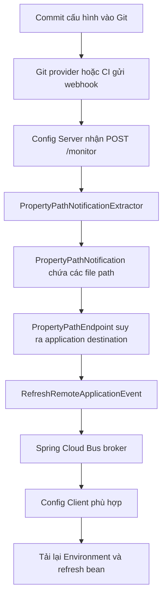

# Mở rộng nhận diện tệp thay đổi qua PropertyPathNotificationExtractor

Khi Config Server nhận webhook từ Git provider, payload thường chứa nhiều thông tin: repository, commit, branch, người đẩy và danh sách file được thêm, sửa hoặc xóa. Các provider không dùng chung một định dạng. Spring Cloud Config cung cấp **PropertyPathNotificationExtractor** như một extension point để chuyển headers và payload của webhook thành danh sách đường dẫn file đã thay đổi.

Extractor tùy chỉnh hữu ích khi webhook đến từ CI/CD nội bộ, một Git provider chưa có extractor tích hợp hoặc một hệ thống quản lý cấu hình có payload riêng. Nó chuẩn hóa đầu vào trước khi Config Server xác định ứng dụng cần refresh. Extractor trả về **file paths**, không trực tiếp trả về danh sách application; bước suy ra destination vẫn do endpoint monitor thực hiện theo quy tắc của Spring Cloud Config.

## Mục tiêu học tập

Sau bài học, bạn có thể:

- Mô tả vai trò của PropertyPathNotificationExtractor trong luồng webhook.
- Hiểu hợp đồng giữa headers, payload và PropertyPathNotification.
- Viết extractor cho payload CI/CD hoặc Git provider tùy chỉnh.
- Đăng ký extractor như một Spring bean và điều khiển thứ tự ưu tiên.
- Phân biệt trả về null với trả về một notification rỗng.
- Chuẩn hóa, lọc, khử trùng lặp và giới hạn danh sách file path.
- Xử lý file được thêm, sửa, xóa và đổi tên.
- Kiểm thử extractor độc lập và kiểm thử tích hợp qua /monitor.
- Nhận biết giới hạn của việc suy ra application từ tên file.

## 1. Vị trí của extractor trong luồng refresh

Với Git webhook và Spring Cloud Bus, luồng tổng quát như sau:



Mỗi thành phần có một trách nhiệm:

| Thành phần | Trách nhiệm |
|---|---|
| Git provider/CI | Gửi thông báo về repository và các file thay đổi. |
| /monitor | Nhận HTTP request, headers và body. |
| PropertyPathNotificationExtractor | Đọc định dạng webhook cụ thể và trích xuất file paths. |
| PropertyPathNotification | Đóng gói danh sách path đã trích xuất. |
| PropertyPathEndpoint | Chuyển file paths thành destination service/application và phát refresh event. |
| Spring Cloud Bus | Phân phối event đến các Config Client tham gia Bus. |
| Config Client | Tải lại cấu hình từ Config Server và áp dụng theo lifecycle của ứng dụng. |

Extractor không tải Git repository, không đọc nội dung file và không trực tiếp refresh bean. Nó chỉ chuẩn hóa thông tin thay đổi thành danh sách path để bước tiếp theo xử lý.

## 2. Hợp đồng của PropertyPathNotificationExtractor

Trong API hiện hành, interface nằm trong package:

```java
org.springframework.cloud.config.monitor
```

Phần cốt lõi của interface có dạng:

```java
public interface PropertyPathNotificationExtractor {

    default PropertyPathNotification extract(
            MultiValueMap<String, String> headers,
            Map<String, Object> payload) {
        return extract(new HttpHeaders(headers), payload);
    }

    PropertyPathNotification extract(
            HttpHeaders headers,
            Map<String, Object> payload);
}
```

Hai đầu vào có ý nghĩa:

- `headers`: các HTTP headers của webhook, chẳng hạn event type, delivery ID hoặc chữ ký.
- `payload`: request body đã được deserialize thành map, thường từ JSON.

Kết quả là `PropertyPathNotification`, một đối tượng chứa mảng đường dẫn:

```java
public class PropertyPathNotification {

    public PropertyPathNotification(String... paths) {
        this.paths = paths;
    }

    private String[] paths;

    public String[] getPaths() {
        return paths;
    }
}
```

Một extractor có thể trả về nhiều path trong cùng một request. Ví dụ một push thay đổi ba file có thể tạo notification gồm ba đường dẫn. Config Server sau đó suy ra các application destination từ từng path và loại bỏ destination trùng lặp trong quá trình xử lý.

Chữ ký phương thức có thể khác giữa các release train cũ và mới. Khi triển khai, hãy dùng interface từ đúng phiên bản dependency `spring-cloud-config-monitor` mà Config Server đang chạy; không sao chép chữ ký từ một ví dụ thuộc release train khác.

## 3. Extractor mặc định và CompositePropertyPathNotificationExtractor

Spring Cloud Config đã có extractor cho các webhook provider phổ biến như GitHub, GitLab, Gitea, Gitee, Gogs và Bitbucket. Khi nhận webhook, hệ thống dùng một composite extractor để thử các strategy theo thứ tự.

Cơ chế hoạt động:

1. Composite giữ danh sách các bean `PropertyPathNotificationExtractor`.
2. Các extractor được sắp xếp theo thứ tự Spring `@Order`.
3. Composite gọi từng extractor với cùng headers và payload.
4. Extractor trả về `null` nếu không nhận diện hoặc không xử lý request.
5. Kết quả khác `null` đầu tiên được chọn và quá trình thử dừng lại.
6. Nếu không extractor nào xử lý, notification không được tạo.

Composite còn có extractor đơn giản cho payload chứa field `path`. Field này có thể là một chuỗi hoặc collection chuỗi, phù hợp với webhook nội bộ tối giản.

Ví dụ payload đơn giản:

```json
{
  "path": [
    "catalog-service-prod.yml",
    "inventory-service.yml"
  ]
}
```

Một extractor tùy chỉnh nên tuân theo hợp đồng `null` nói trên. Nếu request không thuộc định dạng của mình, trả `null` để extractor khác có cơ hội xử lý. Không trả một notification rỗng cho mọi request không nhận diện được, vì kết quả khác `null` có thể khiến composite dừng trước khi đến extractor mặc định.

## 4. Khi nào nên viết extractor riêng?

Nên mở rộng khi payload hiện tại không thể được xử lý đúng bởi extractor tích hợp hoặc extractor đơn giản. Các tình huống điển hình:

| Tình huống | Ví dụ payload | Lý do cần extractor riêng |
|---|---|---|
| CI/CD nội bộ | `changes[].path` | Pipeline tự phát webhook sau khi publish cấu hình. |
| Git provider tùy chỉnh | `commits[].files[].filename` | Tên trường khác với schema provider đã hỗ trợ. |
| Hệ thống quản lý cấu hình | `artifacts[].relativePath` | File được lưu trong một kho cấu hình riêng. |
| Nhiều repository trong một payload | `repositories[].changes[]` | Cần hợp nhất path từ nhiều repository hoặc project. |
| Thay đổi theo batch | `changedFiles` là mảng | Cần khử trùng lặp và giới hạn số lượng path. |
| Payload chứa cả metadata và file | `release.files[]` | Cần chỉ chọn file cấu hình, bỏ log, tài liệu và artifact khác. |

Không nên viết extractor riêng chỉ để đổi tên một header nếu extractor mặc định đã xử lý được payload. Mỗi strategy bổ sung làm tăng số nhánh cần kiểm thử và bảo trì.

## 5. Ví dụ payload của CI/CD nội bộ

Giả sử pipeline gửi webhook đến Config Server với header `X-Config-Event: config.push` và body:

```json
{
  "repository": "platform-config",
  "revision": "4f2c9a7d8e6b1c0a",
  "changes": [
    {
      "path": "catalog-service-prod.yml",
      "status": "modified"
    },
    {
      "path": "inventory-service.yml",
      "status": "deleted"
    },
    {
      "path": "docs/configuration-guide.md",
      "status": "modified"
    }
  ]
}
```

Extractor cần:

- Chỉ nhận event có header `X-Config-Event` đúng định dạng.
- Đọc mảng `changes`.
- Lấy trường `path` của mỗi phần tử hợp lệ.
- Chuẩn hóa dấu phân cách đường dẫn.
- Chỉ giữ các file cấu hình nằm trong phạm vi cho phép.
- Khử trùng lặp.
- Trả về một `PropertyPathNotification`.

Kết quả mong đợi là hai path cấu hình; file Markdown trong `docs/` bị bỏ qua.

## 6. Viết extractor tùy chỉnh

Ví dụ sau dùng Java và API hiện hành nhận `HttpHeaders` cùng `Map<String, Object>`. Class được đăng ký như một Spring bean bằng `@Component`.

```java
package com.example.configserver.monitor;

import java.util.Collection;
import java.util.LinkedHashSet;
import java.util.Map;
import java.util.Set;

import org.springframework.cloud.config.monitor.PropertyPathNotification;
import org.springframework.cloud.config.monitor.PropertyPathNotificationExtractor;
import org.springframework.core.Ordered;
import org.springframework.core.annotation.Order;
import org.springframework.http.HttpHeaders;
import org.springframework.stereotype.Component;

@Component
@Order(Ordered.HIGHEST_PRECEDENCE)
public class InternalCiNotificationExtractor
        implements PropertyPathNotificationExtractor {

    private static final String EVENT_HEADER = "X-Config-Event";
    private static final String EVENT_NAME = "config.push";
    private static final int MAX_PATHS = 100;

    @Override
    public PropertyPathNotification extract(
            HttpHeaders headers,
            Map<String, Object> payload) {

        if (!EVENT_NAME.equals(headers.getFirst(EVENT_HEADER))) {
            return null;
        }

        Object rawChanges = payload.get("changes");
        if (!(rawChanges instanceof Collection<?> changes)) {
            throw new IllegalArgumentException(
                "config.push payload must contain a changes collection");
        }

        Set<String> paths = new LinkedHashSet<>();

        for (Object item : changes) {
            if (!(item instanceof Map<?, ?> change)) {
                continue;
            }

            Object rawPath = change.get("path");
            if (!(rawPath instanceof String path)) {
                continue;
            }

            String normalized = normalize(path);
            if (normalized != null && isConfigFile(normalized)) {
                paths.add(normalized);
            }

            if (paths.size() > MAX_PATHS) {
                throw new IllegalArgumentException(
                    "Webhook contains too many configuration paths");
            }
        }

        if (paths.isEmpty()) {
            return new PropertyPathNotification();
        }

        return new PropertyPathNotification(
            paths.toArray(String[]::new));
    }

    private String normalize(String path) {
        String normalized = path.trim().replace('\\', '/');

        if (normalized.isEmpty()
                || normalized.startsWith("/")
                || normalized.matches("^[A-Za-z]:.*")) {
            return null;
        }

        for (String segment : normalized.split("/")) {
            if ("..".equals(segment) || ".".equals(segment)) {
                return null;
            }
        }

        return normalized;
    }

    private boolean isConfigFile(String path) {
        return path.endsWith(".yml")
                || path.endsWith(".yaml")
                || path.endsWith(".properties");
    }
}
```

Ví dụ minh họa các quyết định quan trọng:

- Header khác `config.push`: trả `null`, cho extractor khác xử lý.
- Header đúng nhưng body không có collection `changes`: payload sai schema và bị từ chối bằng exception để lớp HTTP có thể chuyển thành phản hồi lỗi.
- Path tuyệt đối hoặc có segment `.`/`..`: loại bỏ.
- File không phải YAML, YML hoặc Properties: loại bỏ.
- `LinkedHashSet` giữ thứ tự xuất hiện và loại path trùng.
- Giới hạn số path giúp tránh một webhook tạo lượng refresh không kiểm soát.
- Khi có path hợp lệ, tạo `PropertyPathNotification` bằng mảng chuỗi; event hợp lệ nhưng không có file cấu hình phù hợp trả notification rỗng để composite không chuyển sang extractor khác.

Trong production, chính sách xử lý payload sai định dạng cần được thống nhất. Có thể từ chối request ở lớp controller/security hoặc chuyển exception thành HTTP 400 qua exception handler phù hợp. Không nên âm thầm coi một webhook đã xác thực nhưng sai schema là một lần cập nhật thành công.

## 7. Đăng ký bean và điều khiển thứ tự ưu tiên

Auto-configuration của Config Monitor thu thập các bean có kiểu `PropertyPathNotificationExtractor` và đưa vào composite. Vì vậy, có thể đăng ký class bằng `@Component` hoặc khai báo bean trong `@Configuration`.

Chọn một cách đăng ký cho mỗi extractor. Nếu vừa giữ `@Component` trên class vừa khai báo thêm một `@Bean` tạo instance của class đó, composite có thể nhận cùng logic hai lần và gây khó hiểu khi kiểm tra thứ tự.

Ví dụ khai báo bean:

```java
@Configuration
public class MonitorExtractorConfiguration {

    @Bean
    @Order(Ordered.HIGHEST_PRECEDENCE)
    PropertyPathNotificationExtractor internalCiNotificationExtractor() {
        return new InternalCiNotificationExtractor();
    }
}
```

Thứ tự `@Order` quan trọng khi nhiều extractor có thể nhận cùng một payload. Composite gọi extractor có độ ưu tiên cao hơn trước và dừng khi nhận được kết quả khác `null`.

Quy tắc thực hành:

- Dùng order cao cho extractor chuyên biệt của tổ chức nếu nó cần được thử trước extractor mặc định.
- Chỉ nhận event type mà extractor thực sự hỗ trợ.
- Trả `null` cho các event không thuộc phạm vi.
- Không khai báo nhiều bean cùng xử lý một payload theo cách không xác định.
- Kiểm tra component scan để chắc chắn Config Server thực sự phát hiện bean.
- Kiểm thử thứ tự bằng một test composite thay vì chỉ test class extractor riêng.

Không cần thay thế `PropertyPathEndpoint` chỉ để đọc một schema webhook mới. Extension point này được thiết kế để bổ sung parser mà vẫn giữ luồng monitor và event routing mặc định.

## 8. Phân biệt null, notification rỗng và danh sách path

Ba kết quả sau có ý nghĩa khác nhau:

| Kết quả extractor | Ý nghĩa | Composite xử lý |
|---|---|---|
| `null` | Extractor không nhận diện hoặc không xử lý request | Tiếp tục thử extractor kế tiếp. |
| `new PropertyPathNotification()` | Extractor nhận request nhưng không có path để xử lý | Đây là kết quả khác `null`; composite dừng. |
| Notification có path | Extractor nhận request và tìm được file đã thay đổi | Composite dừng và endpoint xử lý các path đó. |

Nếu request không thuộc provider của bạn, luôn trả `null`. Nếu request thuộc provider của bạn nhưng không có file cấu hình cần refresh, có thể trả notification rỗng để đánh dấu đã xử lý; tuy nhiên, chỉ làm vậy khi đã xác định rõ semantics của phiên bản đang dùng.

Không trả `null` cho một payload hợp lệ chỉ vì file không thuộc phạm vi cấu hình nếu một extractor khác có thể diễn giải cùng payload theo cách không mong muốn. Trong trường hợp đó, cân nhắc trả notification rỗng sau khi xác nhận request thuộc provider của mình.

## 9. Chuẩn hóa và bảo vệ file path

Webhook là đầu vào bên ngoài. Không nên đưa mọi chuỗi trong payload trực tiếp vào `PropertyPathNotification`.

Một path an toàn cần có các đặc điểm:

- Là đường dẫn tương đối với repository.
- Không bắt đầu bằng `/` hoặc ký tự ổ đĩa Windows.
- Không chứa segment `.` hoặc `..`.
- Dùng một quy ước dấu phân cách `/`.
- Không chứa query string, URL scheme hoặc thông tin credential.
- Nằm trong các thư mục cấu hình được cho phép.
- Có phần mở rộng mà Config Server thực sự sử dụng.
- Có độ dài và số lượng path trong giới hạn.

Ví dụ allowlist theo thư mục:

```java
private boolean isAllowedConfigPath(String path) {
    boolean inConfigRoot = path.startsWith("config/")
            || path.startsWith("services/");

    boolean supportedExtension = path.endsWith(".yml")
            || path.endsWith(".yaml")
            || path.endsWith(".properties");

    return inConfigRoot && supportedExtension;
}
```

Allowlist này chỉ là ví dụ. Thay bằng cấu trúc repository thực tế của tổ chức. Không dùng regex quá rộng như `.*` nếu repository chứa tài liệu, script hoặc artifact không liên quan đến cấu hình runtime.

Việc lọc path trong extractor giúp hạn chế refresh không cần thiết. Nó không thay thế kiểm tra chữ ký webhook, xác thực caller hoặc giới hạn mạng cho `/monitor`.

## 10. Xử lý added, modified, removed và renamed

Một commit có thể chứa nhiều loại thay đổi. Extractor nên hợp nhất các path theo semantics của provider.

| Loại thay đổi | Path cần đưa vào notification | Lý do |
|---|---|---|
| Added | Path mới | Ứng dụng có thể bắt đầu nhận cấu hình từ file mới. |
| Modified | Path hiện tại | Ứng dụng cần tải lại giá trị đã thay đổi. |
| Removed | Path đã bị xóa | Ứng dụng cần tải lại Environment để loại bỏ nguồn cũ hoặc dùng nguồn ưu tiên thấp hơn. |
| Renamed | Cả path cũ và path mới nếu payload cung cấp | Ứng dụng gắn với file cũ có thể cần refresh, ứng dụng gắn với file mới cũng có thể bị ảnh hưởng. |

Ví dụ payload có trường `oldPath` và `newPath`:

```json
{
  "changes": [
    {
      "status": "renamed",
      "oldPath": "catalog-service-prod.yml",
      "newPath": "catalog-service-production.yml"
    }
  ]
}
```

Extractor nên đưa cả hai path vào tập kết quả nếu quy ước tên file của hệ thống dùng chúng để xác định application/profile. Nếu chỉ giữ path mới, ứng dụng từng nhận cấu hình từ file cũ có thể không được thông báo.

Nếu provider chỉ gửi danh sách path mới mà không gửi path đã xóa/đổi tên, cần lấy thêm dữ liệu diff từ API của provider hoặc điều chỉnh pipeline để gửi đủ thông tin. Không thể suy ra chính xác path cũ chỉ từ path mới.

## 11. Từ file path đến application destination

Đây là ranh giới quan trọng khi thiết kế extractor:

**Extractor trả về path; PropertyPathEndpoint suy ra application destination từ path đó.** Extractor không trả trực tiếp `catalog-service` hay `inventory-service`.

Theo quy ước mặc định, file có tên khớp application thường nhắm đến application đó. Ví dụ:

| File path | Ý nghĩa định tuyến thường gặp |
|---|---|
| `catalog-service.yml` | Cấu hình của `catalog-service`. |
| `inventory-service.properties` | Cấu hình của `inventory-service`. |
| `application.yml` | Cấu hình dùng chung, có thể tác động đến mọi ứng dụng. |
| `catalog-service-prod.yml` | Cấu hình profile-specific của Catalog; endpoint suy ra destination theo quy tắc tên file/profile. |

Với file profile-specific, endpoint có thể tạo các candidate destination từ các phần tên file được phân tách bằng dấu gạch ngang. Ví dụ `foo-local-dev.yml` có thể tạo nhiều candidate như `foo:local-dev`, `foo-local:dev` và `foo-local-dev`. Cách suy luận này phụ thuộc phiên bản và naming convention.

Vì vậy:

- Thống nhất cách đặt tên application và profile.
- Tránh tên có dấu gạch ngang gây mơ hồ nếu không có quy ước rõ.
- Kiểm tra response của `/monitor` để biết destination thực tế được tạo.
- Kiểm thử file chung vì `application.yml` có thể kích hoạt refresh diện rộng.
- Không giả định path nằm trong thư mục `services/catalog/` tự động có nghĩa destination là `catalog-service`.

Nếu repository dùng tên file chung như `services/catalog/application.yml`, extractor vẫn chỉ trả path đó. Logic mặc định có thể xem basename `application.yml` là cấu hình dùng chung. Nếu cần ánh xạ thư mục `services/catalog/` thành riêng application `catalog-service`, chỉ extractor có thể không đủ; cần một cơ chế định tuyến bổ sung hoặc quy ước file mà `PropertyPathEndpoint` hiểu được. Không nên tạo path giả mà không kiểm tra tác động đến cách định tuyến.

## 12. Hợp nhất nhiều commit và khử trùng lặp

Một webhook push có thể chứa nhiều commit. Cùng một file có thể xuất hiện nhiều lần trong các commit liên tiếp. Extractor nên hợp nhất path thành một tập hợp duy nhất trước khi trả notification.

Ví dụ:

```json
{
  "commits": [
    {
      "added": ["catalog-service.yml"],
      "modified": ["application.yml"],
      "removed": []
    },
    {
      "added": [],
      "modified": ["catalog-service.yml"],
      "removed": ["inventory-service.yml"]
    }
  ]
}
```

Tập path sau khi hợp nhất:

```text
catalog-service.yml
application.yml
inventory-service.yml
```

Dùng `LinkedHashSet` để giữ thứ tự lần xuất hiện đầu tiên và loại trùng. Với payload lớn, đặt giới hạn path và có chiến lược xử lý khi vượt giới hạn:

- Từ chối webhook hoặc yêu cầu pipeline chia batch.
- Ghi nhận delivery ID và commit SHA để điều tra.
- Không âm thầm cắt danh sách mà không cảnh báo, vì một số application có thể không được refresh.
- Nếu thay đổi cấu hình chung, cân nhắc gộp thành một notification có chủ đích thay vì tạo nhiều event trùng lặp.

Nếu provider chỉ gửi một phần commit trong payload do giới hạn kích thước, hãy lấy danh sách thay đổi đầy đủ qua API provider hoặc để CI tạo manifest path riêng.

## 13. Tương tác với ignored-paths và max-paths

Config Server còn có các thuộc tính monitor để kiểm soát path:

```yaml
spring:
  cloud:
    config:
      server:
        monitor:
          ignored-paths:
            - "docs/.*"
            - "scripts/.*"
          max-paths: 50
```

- `ignored-paths` là danh sách regex dùng để bỏ qua các path không cần refresh.
- `max-paths` giới hạn số path được xử lý trong một notification; tài liệu hiện hành đặt mặc định là 20.
- Extractor tùy chỉnh có thể lọc sớm các file không liên quan; monitor vẫn có thể áp dụng bộ lọc và giới hạn chung sau đó.

Nên chia trách nhiệm:

| Lớp | Trách nhiệm |
|---|---|
| Extractor | Hiểu schema webhook, chuẩn hóa path và chỉ trả file path hợp lệ. |
| Monitor properties | Áp dụng chính sách chung như ignored paths và giới hạn số path. |
| Endpoint routing | Suy ra application destination từ các path được chấp nhận. |

Không dùng `ignored-paths` để thay thế parser. Regex bỏ qua không thể khôi phục path bị mất hoặc đọc được một payload tùy chỉnh.

## 14. Kiểm thử extractor độc lập

Extractor là một strategy nhỏ, nên có thể kiểm thử trực tiếp mà không cần khởi động Config Server hoặc broker.

Ví dụ JUnit 5:

```java
import static org.junit.jupiter.api.Assertions.assertArrayEquals;
import static org.junit.jupiter.api.Assertions.assertNull;

import java.util.List;
import java.util.Map;

import org.junit.jupiter.api.Test;
import org.springframework.http.HttpHeaders;
import org.springframework.cloud.config.monitor.PropertyPathNotification;

class InternalCiNotificationExtractorTests {

    private final InternalCiNotificationExtractor extractor =
            new InternalCiNotificationExtractor();

    @Test
    void extractsOnlyConfigurationFiles() {
        HttpHeaders headers = new HttpHeaders();
        headers.add("X-Config-Event", "config.push");

        Map<String, Object> payload = Map.of(
            "changes", List.of(
                Map.of("path", "catalog-service-prod.yml"),
                Map.of("path", "docs/guide.md"),
                Map.of("path", "inventory-service.yml")
            )
        );

        PropertyPathNotification result =
                extractor.extract(headers, payload);

        assertArrayEquals(
            new String[] {
                "catalog-service-prod.yml",
                "inventory-service.yml"
            },
            result.getPaths()
        );
    }

    @Test
    void returnsNullForOtherEventTypes() {
        HttpHeaders headers = new HttpHeaders();
        headers.add("X-Config-Event", "build.completed");

        PropertyPathNotification result =
                extractor.extract(headers, Map.of("changes", List.of()));

        assertNull(result);
    }
}
```

Các test quan trọng khác:

- Payload không có `changes`.
- `changes` không phải collection.
- Event type đúng nhưng schema sai phải bị từ chối và được ánh xạ thành HTTP 400 theo exception handler của ứng dụng.
- Phần tử trong collection không phải map.
- Path null, rỗng hoặc sai kiểu.
- Path tuyệt đối, path có `..` hoặc dấu phân cách Windows.
- Path không thuộc allowlist.
- Path bị lặp.
- Payload chứa cả added, modified và removed.
- Một request có số path vượt giới hạn.
- Extractor tùy chỉnh không nhận event và phải trả `null`.

Không chỉ kiểm tra số lượng path; hãy kiểm tra chính xác nội dung và thứ tự path để tránh refresh nhầm ứng dụng.

## 15. Kiểm thử composite và endpoint monitor

Unit test chứng minh parser hoạt động, nhưng chưa chứng minh Config Server chọn đúng extractor hoặc tạo đúng destination. Cần thêm kiểm thử tích hợp.

Các trường hợp nên có:

| Bài kiểm thử | Kết quả mong đợi |
|---|---|
| Custom header và payload hợp lệ | Custom extractor được chọn. |
| Header không thuộc custom provider | Custom extractor trả `null`, extractor khác có thể xử lý. |
| Payload có `path` theo định dạng đơn giản | Simple extractor mặc định vẫn hoạt động. |
| Payload provider tích hợp | Extractor mặc định tương ứng vẫn được sử dụng. |
| Nhiều extractor cùng có thể nhận request | Extractor có `@Order` cao hơn được thử trước. |
| File application-specific | Response `/monitor` chứa destination của application đó. |
| File `application.yml` | Destination có thể là wildcard cho tất cả client. |
| File profile-specific | Destination phản ánh quy tắc application/profile của phiên bản đang dùng. |
| Path không hợp lệ hoặc không liên quan | Không phát refresh event ngoài dự kiến. |

Có thể gửi request thử đến endpoint monitor trong môi trường test:

```bash
curl --fail-with-body -X POST \
  -H "Content-Type: application/json" \
  -H "X-Config-Event: config.push" \
  --data-binary '{
    "changes": [
      {"path": "catalog-service-prod.yml", "status": "modified"}
    ]
  }' \
  https://config-server-test.internal/monitor
```

Kiểm tra response để xem danh sách destination mà endpoint suy ra. Sau đó quan sát event Bus hoặc ACK của client. Không dùng payload giả để gọi endpoint production nếu chưa có quy trình kiểm soát và phê duyệt.

## 16. Bảo mật webhook và giới hạn của extractor

Headers và payload đều là dữ liệu do caller gửi. Việc extractor kiểm tra `X-Config-Event` chỉ giúp phân loại schema; header này không chứng minh request thực sự đến từ Git provider.

Cần bảo vệ riêng:

- Xác minh chữ ký HMAC hoặc secret token theo cơ chế của provider.
- Thực hiện xác thực request ở security filter, gateway hoặc lớp webhook validation phù hợp.
- Giới hạn mạng có thể truy cập `/monitor`.
- Dùng HTTPS.
- Áp dụng rate limit và giới hạn kích thước request body.
- Kiểm tra repository/branch được phép phát thông báo.
- Allowlist path và giới hạn số lượng file.
- Không log raw payload, webhook secret hoặc dữ liệu cấu hình.
- Theo dõi phiên bản Spring Cloud Config và áp dụng bản vá bảo mật được hỗ trợ.

Với provider tích hợp sẵn, Config Monitor có webhook secret validation riêng. Ví dụ GitHub:

```yaml
spring:
  cloud:
    config:
      server:
        monitor:
          github:
            webhook-secret: ${CONFIG_GITHUB_WEBHOOK_SECRET}
```

Các provider khác có thuộc tính secret và header xác thực riêng. Tài liệu hiện hành bật validation filter mặc định; nếu chưa cấu hình secret cho provider, request webhook có thể bị từ chối. Với CI nội bộ không thuộc provider được hỗ trợ, extractor tùy chỉnh chỉ giải mã payload chứ không tự được công nhận là validator. Hãy đặt một lớp xác thực tương thích ở gateway/filter và chỉ tắt validation filter tích hợp khi đã có lớp bảo vệ thay thế, được kiểm thử và giới hạn network rõ ràng.

Không đặt logic xác thực chỉ trong extractor rồi cho rằng mọi đường gọi endpoint đều được bảo vệ. Parser và authenticator là hai trách nhiệm riêng; một extractor có thể được gọi sau khi request đã vào endpoint.

## 17. Quan sát và chẩn đoán

Khi một file thay đổi nhưng client không refresh, theo dõi theo thứ tự:

1. Git provider/CI có gửi webhook không?
2. `/monitor` có nhận request và xác thực thành công không?
3. Extractor nào đã được chọn?
4. Extractor trả những path nào?
5. Monitor suy ra những application destination nào?
6. Config Server có phát `RefreshRemoteApplicationEvent` không?
7. Broker có chuyển event đến client không?
8. Client có nhận event và tải lại Environment không?

Thông tin nên ghi ở mức metadata:

| Trường | Mục đích |
|---|---|
| Delivery ID | Đối chiếu webhook retry hoặc duplicate. |
| Repository và commit SHA | Xác định revision tạo ra thay đổi. |
| Extractor class | Biết parser nào đã xử lý payload. |
| Số lượng path | Phát hiện payload rỗng hoặc vượt giới hạn. |
| Path đã chuẩn hóa | Xác định file nào được nhận diện; có thể che tên nhạy cảm nếu cần. |
| Destination | Xác định application nào sẽ nhận refresh. |
| Event ID | Đối chiếu publish và ACK trên Bus. |

Không ghi toàn bộ payload nếu chứa thông tin nhạy cảm. Có thể ghi danh sách path đã lọc hoặc hash/path category theo chính sách log.

## 18. Các lỗi thường gặp

| Triệu chứng | Nguyên nhân có thể | Cách xử lý |
|---|---|---|
| Custom extractor không được gọi | Bean không được component scan hoặc chưa đăng ký | Kiểm tra package scan và application context. |
| Extractor trả `null` với webhook hợp lệ | Header hoặc payload key không khớp schema | Kiểm tra event header và cấu trúc body thực tế. |
| Extractor tùy chỉnh không được chọn | Một extractor khác trả kết quả trước | Điều chỉnh `@Order` và kiểm tra composite. |
| Mọi ứng dụng đều refresh | Path được suy ra là `application.yml` hoặc destination wildcard | Kiểm tra path trả về và quy tắc `guessServiceName`. |
| Ứng dụng mục tiêu không refresh | Tên file không khớp application naming convention | Kiểm tra basename, profile suffix và destination response. |
| File đổi tên nhưng client cũ không refresh | Payload chỉ chứa path mới | Bao gồm cả old path và new path. |
| Một số file trong batch không refresh | Payload bị cắt hoặc vượt max-paths | Kiểm tra giới hạn, chia batch và cảnh báo. |
| Webhook trùng tạo nhiều refresh | Provider retry hoặc pipeline gửi lặp | Deduplicate path và theo dõi delivery ID/commit SHA. |
| Extractor nhận payload không tin cậy | Endpoint thiếu xác thực hoặc network restriction | Bảo vệ `/monitor` ở lớp security riêng. |

## 19. Checklist triển khai

- [ ] Đã xác định payload thực tế và event header của provider.
- [ ] Extractor implement đúng interface của release train.
- [ ] Bean được đăng ký và có thứ tự `@Order` phù hợp.
- [ ] Request không thuộc provider được hỗ trợ trả `null`.
- [ ] Path được chuẩn hóa và kiểm tra traversal.
- [ ] Chỉ file cấu hình trong allowlist được giữ lại.
- [ ] Path trùng được loại bỏ.
- [ ] Added, modified, removed và renamed được xử lý đúng.
- [ ] Có giới hạn số path và kích thước payload.
- [ ] Đã kiểm thử composite extractor và fallback mặc định.
- [ ] Đã xác minh destination thực tế qua `/monitor`.
- [ ] Đã bảo vệ webhook bằng xác thực/chữ ký ở lớp riêng.
- [ ] Đã theo dõi Bus event và client ACK sau khi phát hành.

## 20. Những điểm cần ghi nhớ

- `PropertyPathNotificationExtractor` chuyển headers và payload thành danh sách file path đã thay đổi.
- `PropertyPathNotification` đóng gói các path dưới dạng mảng chuỗi.
- Composite extractor gọi các strategy theo `@Order` và chọn kết quả khác `null` đầu tiên.
- Trả `null` nghĩa là không xử lý request để extractor tiếp theo có thể thử.
- Extractor trả path; `PropertyPathEndpoint` mới suy ra application destination và phát `RefreshRemoteApplicationEvent`.
- `application.yml` có thể dẫn đến refresh diện rộng; cần kiểm soát file chung.
- Tên file profile-specific và dấu gạch ngang ảnh hưởng cách suy ra destination.
- Path cần được chuẩn hóa, allowlist, deduplicate và giới hạn số lượng.
- Đổi tên file cần xét cả path cũ và path mới.
- Extractor không thay thế webhook authentication, network restriction hoặc rate limit.
- Unit test parser cần đi cùng integration test composite, `/monitor` và Bus routing.

Khi payload webhook được chuẩn hóa thành danh sách file path có kiểm soát, Config Server có thể nhận nhiều định dạng thông báo mà vẫn dùng chung cơ chế định tuyến và Spring Cloud Bus. Thiết kế tốt cần giữ rõ ranh giới giữa parse payload, xác thực webhook, suy ra application destination và refresh client; nhờ vậy một thay đổi cấu hình chỉ tác động đến các ứng dụng thực sự liên quan.

## Tài liệu tham khảo

- [Spring Cloud Config – Push Notifications and Spring Cloud Bus](https://docs.spring.io/spring-cloud-config/reference/server/push-notifications-and-bus.html)
- [PropertyPathNotificationExtractor – Spring Cloud Config source](https://github.com/spring-cloud/spring-cloud-config/blob/main/spring-cloud-config-monitor/src/main/java/org/springframework/cloud/config/monitor/PropertyPathNotificationExtractor.java)
- [PropertyPathNotification – Spring Cloud Config API](https://www.javadoc.io/doc/org.springframework.cloud/spring-cloud-config-monitor/latest/org/springframework/cloud/config/monitor/PropertyPathNotification.html)

