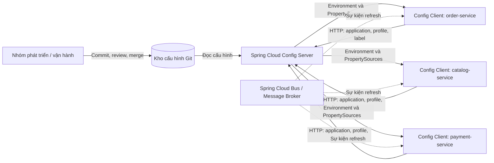

# Vai trò của Config Server, Config Client và kho cấu hình

Trong một hệ thống gồm nhiều ứng dụng Spring Boot, mỗi ứng dụng thường cần cấu hình riêng theo môi trường như `dev`, `test`, `staging` hoặc `prod`. Nếu cấu hình được chép thủ công vào từng ứng dụng, việc cập nhật dễ thiếu nhất quán, khó truy vết và khó khôi phục khi có sự cố. Spring Cloud Config giải quyết vấn đề này bằng cách tách cấu hình khỏi từng ứng dụng, tập trung việc lưu trữ và phân phối qua Config Server.

Kiến trúc có ba thành phần chính: **kho cấu hình** lưu các phiên bản cấu hình, **Config Server** đọc và cung cấp cấu hình qua HTTP, còn **Config Client** yêu cầu và đưa cấu hình vào Spring `Environment` của ứng dụng. Client thường lấy cấu hình khi khởi động; khi cần cập nhật trong lúc chạy, hệ thống có thể yêu cầu refresh hoặc phát sự kiện qua Spring Cloud Bus. Vì vậy, hiểu đúng trách nhiệm và ranh giới của từng thành phần là nền tảng để quản trị cấu hình tập trung an toàn và nhất quán.

## 1. Bức tranh kiến trúc tổng thể



Mỗi thành phần có một trách nhiệm rõ ràng:

| Thành phần | Trách nhiệm | Điều cần quản lý |
|---|---|---|
| Kho cấu hình | Lưu tệp cấu hình và lịch sử thay đổi | Quyền truy cập, nhánh/tag, review, kiểm soát bí mật và rollback |
| Config Server | Tìm, kết hợp và cung cấp cấu hình theo ứng dụng, profile, label | Kết nối kho, xác thực client, tính sẵn sàng, cache/refresh và bảo vệ endpoint |
| Config Client | Yêu cầu cấu hình và nạp các property vào Spring `Environment` | Tên ứng dụng, profile, label, thời điểm lấy cấu hình và cách áp dụng thay đổi |
| Spring Cloud Bus (tùy chọn) | Phân phối sự kiện như refresh đến các instance tham gia bus | Message broker, quyền phát/nhận sự kiện và theo dõi kết quả ở client |

Config Server không tự đẩy mọi thay đổi trong Git đến tất cả ứng dụng. Mặc định, client đọc cấu hình khi khởi động; việc cập nhật trong lúc chạy cần một lần đọc lại hoặc cơ chế refresh. Bus giúp phân phối sự kiện refresh, nhưng mỗi client vẫn phải truy xuất được cấu hình và có bean hỗ trợ nhận giá trị mới.

## 2. Kho cấu hình: nơi lưu phiên bản và tổ chức dữ liệu

Spring Cloud Config hỗ trợ nhiều kiểu backend thông qua các `EnvironmentRepository`. Các lựa chọn thường gặp gồm:

- **Git:** phù hợp khi cần quản lý phiên bản, review thay đổi, lịch sử commit, nhánh và tag. Đây là lựa chọn phổ biến cho cấu hình không bí mật.
- **Vault:** phù hợp khi cần quản lý bí mật, chính sách truy cập và vòng đời credential tập trung.
- **JDBC:** lưu cấu hình trong cơ sở dữ liệu khi tổ chức có nhu cầu quản lý dữ liệu theo mô hình này.
- **Native:** đọc tệp từ filesystem hoặc classpath, thường hữu ích cho môi trường phát triển hoặc triển khai đơn giản.

Trong ví dụ dưới đây, Git là nguồn chính. Một repository có thể tổ chức theo cấu hình dùng chung và cấu hình riêng của từng ứng dụng:

```text
config-repo/
├── application.yml
├── application-dev.yml
├── application-prod.yml
├── order-service.yml
├── order-service-prod.yml
├── catalog-service.yml
└── payment-service-prod.yml
```

Ý nghĩa các tên tệp:

- `application.yml` chứa giá trị dùng chung cho các ứng dụng.
- `application-prod.yml` chứa giá trị dùng chung cho profile `prod`.
- `order-service.yml` chứa giá trị riêng của `order-service`, áp dụng cho các profile nếu không bị cấu hình cụ thể hơn thay thế.
- `order-service-prod.yml` chứa giá trị dành riêng cho `order-service` trong profile `prod`.

Có thể dùng `search-paths` để tổ chức tệp trong các thư mục con, chẳng hạn tách theo nhóm dịch vụ hoặc môi trường. Dù tổ chức theo cách nào, tên tệp và quy ước profile phải nhất quán để người vận hành xác định được ứng dụng nào nhận cấu hình nào.

### 2.1. Cấu hình dùng chung và cấu hình riêng

Giả sử nhiều ứng dụng cùng cần thời gian timeout mặc định, nhưng `payment-service` cần một timeout riêng. Có thể đặt giá trị mặc định trong `application.yml` và giá trị riêng trong `payment-service.yml`:

```yaml
# application.yml
http-client:
  connect-timeout-ms: 1000
  read-timeout-ms: 3000
```

```yaml
# payment-service.yml
http-client:
  read-timeout-ms: 5000
```

Ứng dụng có thể kế thừa giá trị dùng chung và nhận giá trị riêng theo cơ chế kết hợp property source của Config Server. Khi có nhiều tệp cùng định nghĩa một key, thứ tự property source quyết định giá trị hiệu lực. Không nên phỏng đoán thứ tự trong một repository phức tạp; hãy xem response của Config Server để biết các nguồn được trả về và kiểm tra giá trị thực tế tại client.

### 2.2. Git label xác định phiên bản cấu hình

Label cho biết Config Server cần đọc cấu hình từ Git ref nào. Tùy cách tổ chức, ref đó có thể là branch, tag hoặc commit. Ví dụ:

- `main`: nhánh cấu hình đang được tích hợp.
- `release-2026.11`: tag hoặc nhánh gắn với một đợt phát hành.
- Một commit ID: ghim ứng dụng vào một phiên bản cấu hình cụ thể nếu quy trình triển khai yêu cầu tính bất biến.

Label giúp các môi trường hoặc nhóm ứng dụng chọn đúng phiên bản cấu hình. Ví dụ, môi trường thử nghiệm có thể theo dõi nhánh tích hợp, còn môi trường production chỉ sử dụng tag đã được review. Cần thống nhất cách tạo và di chuyển label để tránh việc một ứng dụng vô tình lấy cấu hình từ nhánh không phù hợp.

## 3. Config Server: đọc kho và cung cấp cấu hình

Config Server là một ứng dụng Spring Boot được bật chức năng server bằng `@EnableConfigServer`. Nó nhận yêu cầu HTTP từ client, sử dụng backend tương ứng để lấy dữ liệu và trả về một `Environment` gồm các `PropertySource`.

Ví dụ lớp khởi động:

```java
@SpringBootApplication
@EnableConfigServer
public class ConfigServerApplication {

    public static void main(String[] args) {
        SpringApplication.run(ConfigServerApplication.class, args);
    }
}
```

Khai báo backend Git trong `application.yml` của Config Server:

```yaml
server:
  port: 8888

spring:
  cloud:
    config:
      server:
        git:
          uri: https://git.example.com/platform/config-repo.git
          default-label: main
          clone-on-start: true
```

Đây là cấu hình minh họa; repository thực tế phải tồn tại và Config Server cần có quyền đọc. Nếu repository riêng tư, cung cấp credential thông qua secret manager hoặc cơ chế bảo mật của môi trường triển khai. Không ghi token truy cập trực tiếp vào tệp cấu hình được commit.

Một số thuộc tính quan trọng:

- `uri`: địa chỉ repository Git.
- `default-label`: label mặc định khi client không chỉ định label.
- `clone-on-start`: yêu cầu server clone repository khi khởi động để phát hiện sớm lỗi truy cập hoặc cấu hình repository.
- `search-paths`: các thư mục Config Server tìm kiếm tệp cấu hình.

### 3.1. Giao diện HTTP của Config Server

Một endpoint phổ biến có dạng:

```text
/{application}/{profile}/{label}
```

Trong đó:

- `application` thường lấy từ `spring.application.name` của client.
- `profile` là một hoặc nhiều profile mà client đang sử dụng, ví dụ `prod`.
- `label` là Git ref cần đọc, ví dụ `main` hoặc `release-2026.11`.

Ví dụ truy vấn cấu hình cho `order-service`, profile `prod`, label `main`:

```bash
curl http://localhost:8888/order-service/prod/main
```

Config Server trả về dữ liệu dạng Environment, bao gồm tên ứng dụng, profile, label và danh sách property source. Có thể dùng endpoint này để kiểm tra server đang trả về những nguồn nào trước khi điều tra phía client.

Config Server cũng cung cấp biểu diễn theo định dạng tệp, ví dụ:

```text
http://localhost:8888/order-service-prod.yml
```

Các endpoint này là công cụ chẩn đoán hữu ích, nhưng cần bảo vệ vì response có thể chứa cấu hình nội bộ hoặc dữ liệu nhạy cảm. Không nên mở chúng cho người dùng hoặc mạng công cộng.

### 3.2. Config Server trong môi trường nhiều instance

Trong production, Config Server nên được triển khai có tính sẵn sàng cao nếu nhiều ứng dụng phụ thuộc vào nó khi khởi động. Có thể chạy nhiều instance phía sau load balancer. Mỗi instance cần có quyền đọc cùng nguồn cấu hình, trust chain TLS phù hợp và chính sách xác thực nhất quán.

Với backend Git, mỗi Config Server có thể duy trì bản clone làm việc của repository. Cần kiểm tra cách đồng bộ bản clone, thời gian cập nhật và hành vi khi Git tạm thời không truy cập được. Một instance trả cấu hình cũ trong khi instance khác đã cập nhật có thể tạo ra trạng thái không đồng nhất; vì vậy cần có quy trình quan sát và xác minh phiên bản cấu hình được phục vụ.

Nếu ứng dụng không thể khởi động khi Config Server không sẵn sàng, hãy thiết kế dự phòng và triển khai server phù hợp với mức độ quan trọng của dịch vụ. Cấu hình `optional:configserver:` ở client cho phép tiếp tục khởi động khi không lấy được cấu hình từ xa, nhưng chỉ an toàn khi ứng dụng có giá trị mặc định hoặc nguồn dự phòng đầy đủ. Với cấu hình bắt buộc, nên để lỗi được phát hiện sớm thay vì chạy với cấu hình thiếu.

## 4. Config Client: nhận và nạp cấu hình vào Spring

Config Client là phần tích hợp trong từng ứng dụng Spring Boot. Client gửi tên ứng dụng, profile và label đến Config Server, sau đó đưa các property nhận được vào `Environment`. Các bean có thể đọc giá trị thông qua `@Value`, `@ConfigurationProperties` hoặc các cơ chế cấu hình của Spring.

Với Spring Boot 2.4 trở lên, Config Data API là cách khai báo phổ biến. Ví dụ `application.yml` của `order-service`:

```yaml
spring:
  application:
    name: order-service
  profiles:
    active: prod
  config:
    import: "configserver:http://config-server:8888"
  cloud:
    config:
      label: release-2026.11
```

Nếu Config Server không bắt buộc trong môi trường đang chạy, có thể dùng:

```yaml
spring:
  config:
    import: "optional:configserver:http://config-server:8888"
```

`optional:` cho phép ứng dụng tiếp tục nạp cấu hình khi Config Server không sẵn sàng. Hãy bảo đảm các giá trị dự phòng đủ để ứng dụng hoạt động an toàn. Nếu không có cấu hình dự phòng, bỏ `optional:` để ứng dụng dừng khởi động khi không lấy được cấu hình bắt buộc.

Các dự án Spring Cloud Config cũ có thể sử dụng bootstrap context với `bootstrap.yml` và bootstrap starter. Không nên trộn lẫn hai cách cấu hình theo ví dụ rời rạc; hãy chọn cơ chế phù hợp với phiên bản Spring Boot và Spring Cloud mà dự án đang quản lý.

### 4.1. Ba thông tin định tuyến cấu hình

Client cần xác định chính xác ba thông tin:

| Thuộc tính | Ví dụ | Ý nghĩa |
|---|---|---|
| Application | `order-service` | Chọn cấu hình chung và cấu hình riêng của ứng dụng |
| Profile | `prod` | Chọn các giá trị theo môi trường hoặc nhóm hành vi |
| Label | `release-2026.11` | Chọn phiên bản trong kho cấu hình |

Nếu `spring.application.name` bị sai, client có thể nhận cấu hình của một ứng dụng khác hoặc chỉ nhận cấu hình dùng chung. Nếu profile không đúng, các giá trị môi trường có thể bị thiếu. Nếu label không đúng, client có thể đọc một phiên bản cấu hình cũ hoặc chưa được phê duyệt.

Khi một ứng dụng sử dụng nhiều profile, Config Client gửi danh sách profile đang hoạt động. Config Server có thể kết hợp cấu hình cho các profile đó; thứ tự và giá trị hiệu lực cần được kiểm tra trên response Environment và tại ứng dụng.

## 5. Thứ tự ưu tiên và giá trị hiệu lực

Config Server có thể trả về nhiều `PropertySource`: cấu hình chung, cấu hình theo profile, cấu hình theo ứng dụng và cấu hình theo profile riêng của ứng dụng. Phía client đưa các nguồn này vào Spring `Environment`, nơi thứ tự property source quyết định giá trị cuối cùng khi nhiều nguồn cùng khai báo một key.

Ví dụ một key `feature.checkout-enabled` có thể xuất hiện ở nhiều nơi:

```yaml
# application.yml trong Config Repository
feature:
  checkout-enabled: false
```

```yaml
# order-service-prod.yml trong Config Repository
feature:
  checkout-enabled: true
```

```yaml
# application.yml cục bộ của client
feature:
  checkout-enabled: false
```

Không nên chỉ nhìn một tệp rồi kết luận giá trị ứng dụng đang sử dụng. Cần kiểm tra các `PropertySource` mà Config Server trả về, thứ tự ưu tiên trong `Environment` của client và các nguồn cấu hình khác như biến môi trường, JVM system property, tham số dòng lệnh hoặc giá trị mặc định trong mã.

Theo mặc định, property từ Config Server có mức ưu tiên cao và không phải mọi giá trị cục bộ đều có thể ghi đè chúng. Nếu tổ chức muốn cho phép cấu hình cục bộ ghi đè remote property, cần cấu hình chính sách override phù hợp từ phía nguồn cấu hình từ xa. Các thuộc tính thường gặp gồm:

- `spring.cloud.config.allowOverride=true`: cho phép áp dụng chính sách override đối với property từ xa.
- `spring.cloud.config.overrideNone=true`: cho phép các property source cục bộ ghi đè cấu hình từ xa.
- `spring.cloud.config.overrideSystemProperties=false`: giới hạn việc ghi đè từ xa để system property, biến môi trường và tham số dòng lệnh có thể ghi đè, trong khi các tệp cấu hình cục bộ không tự động được ưu tiên.

Các thuộc tính kiểm soát override phải được đặt trong cấu hình từ xa theo hướng dẫn của phiên bản Spring Cloud Config đang dùng; đặt chúng ở client có thể không tạo ra hiệu lực mong muốn. Không bật override tùy tiện: một biến môi trường vô tình có giá trị cũ có thể khiến các instance chạy khác nhau dù cùng đọc một Git label.

## 6. Vòng đời cấu hình: khởi động, refresh và Bus

Kiến trúc Config Client/Server phân phối dữ liệu cấu hình, còn thời điểm áp dụng phụ thuộc vào vòng đời của ứng dụng.

**Khi khởi động:** client đọc cấu hình từ Config Server, xây dựng `Environment`, rồi Spring tạo và bind các bean. Đây là cơ chế cơ bản và thường phù hợp với cấu hình hạ tầng được đọc một lần.

**Khi refresh một client:** client đọc lại cấu hình và cập nhật `Environment`. Bean được quản lý bằng `@RefreshScope` có thể được tạo lại khi sử dụng; các bean cấu hình phù hợp có thể được rebind. Một singleton thông thường giữ giá trị đã inject không tự đổi chỉ vì `Environment` thay đổi. Các tài nguyên như server socket, connection pool hoặc client thư viện có thể cần khởi động lại hoặc tái cấu hình riêng.

**Khi dùng Spring Cloud Bus:** một sự kiện refresh được phát qua message broker để nhiều instance cùng nhận. Bus giúp đồng bộ tín hiệu refresh ở quy mô nhiều ứng dụng, nhưng không bảo đảm mọi bean đều hỗ trợ cập nhật nóng. Cần theo dõi client nào đã nhận sự kiện và kiểm tra hành vi sau refresh.

Ví dụ endpoint refresh thường được cung cấp qua Spring Boot Actuator và Spring Cloud Context. Endpoint `refresh` phục vụ một client; endpoint `busrefresh` phát sự kiện cho các client tham gia Bus. Chỉ expose các endpoint cần thiết và bảo vệ bằng xác thực, phân quyền, giới hạn mạng. Với thay đổi chỉ đọc lúc khởi động hoặc thay đổi mã nguồn, cần restart hoặc redeploy theo đúng vòng đời thành phần.

## 7. Bảo vệ Config Server và bí mật cấu hình

Config Server trở thành điểm truy cập tập trung đến nhiều cấu hình nội bộ. Nếu bảo vệ không tốt, một người có quyền truy cập server có thể đọc endpoint của nhiều ứng dụng và môi trường. Cần áp dụng các lớp bảo vệ sau:

1. **Bảo vệ đường truyền:** dùng HTTPS/TLS giữa client và Config Server; xác minh chứng chỉ và cấu hình trust phù hợp.
2. **Xác thực và phân quyền:** giới hạn ai được đọc cấu hình, ai được quản trị server và ai được gọi endpoint Actuator. Không để endpoint quản trị công khai.
3. **Bảo vệ kho Git:** cấp quyền đọc tối thiểu cho Config Server, quản lý credential ngoài repository và bật review cho thay đổi cấu hình production.
4. **Quản lý secret:** không commit mật khẩu, token, private key hoặc credential dạng rõ. Dùng Vault hoặc secret manager phù hợp; nếu sử dụng mã hóa của Spring Cloud Config, phải bảo vệ khóa mã hóa và quy trình giải mã.
5. **Kiểm soát log và chẩn đoán:** tránh ghi giá trị bí mật vào log, response hoặc dashboard; chỉ cung cấp thông tin cần thiết cho người vận hành.

Tách cấu hình thông thường khỏi bí mật giúp repository Git có thể được review và version control mà không làm lộ thông tin xác thực. Config Server cũng cần được xem là một thành phần bảo mật quan trọng, vì nó có thể truy cập dữ liệu cấu hình của toàn hệ thống.

## 8. Quy trình thay đổi cấu hình có kiểm soát

Một thay đổi cấu hình nên đi qua quy trình có thể truy vết:

1. **Xác định phạm vi:** chọn ứng dụng, profile và label cần thay đổi; xác định instance nào sẽ nhận cấu hình.
2. **Sửa đúng nguồn:** cập nhật tệp dùng chung hoặc tệp ứng dụng trong repository; tránh sao chép cùng một giá trị vào nhiều nơi khi có thể kế thừa cấu hình chung.
3. **Review và kiểm tra:** kiểm tra cú pháp YAML/properties, key trùng, giá trị nhạy cảm, tác động tới các ứng dụng dùng chung và chính sách override.
4. **Phát hành phiên bản:** merge vào nhánh hoặc tạo tag đã được phê duyệt; ghi nhận commit/label dùng cho từng môi trường.
5. **Phân phối và áp dụng:** Config Server đọc phiên bản mới; client lấy lại cấu hình khi khởi động hoặc nhận refresh event. Nếu thay đổi yêu cầu restart/redeploy, thực hiện theo chiến lược triển khai phù hợp.
6. **Xác minh:** kiểm tra endpoint Environment, trạng thái client, log refresh và hành vi nghiệp vụ. Không chỉ dựa vào việc commit đã thành công.
7. **Rollback:** quay lại commit hoặc label đã biết là tốt, sau đó yêu cầu client đọc lại cấu hình hoặc khởi động lại theo loại thay đổi.

Đối với cấu hình production, nên dùng nhánh hoặc tag có quy trình phê duyệt rõ ràng, giới hạn quyền ghi và lưu dấu người thay đổi. Việc ghim một lần triển khai vào label cụ thể giúp truy vết chính xác phiên bản cấu hình đã được sử dụng khi xảy ra sự cố.

## 9. Ví dụ luồng hoạt động từ đầu đến cuối

Giả sử có hai ứng dụng `order-service` và `catalog-service`. Cả hai dùng cấu hình chung cho log và tracing, nhưng mỗi ứng dụng có endpoint dịch vụ bên ngoài riêng. Môi trường production dùng profile `prod` và label `release-2026.11`.

Trong Git, nhóm vận hành lưu cấu hình chung ở `application.yml`, cấu hình theo môi trường ở `application-prod.yml`, và cấu hình riêng ở `order-service-prod.yml` hoặc `catalog-service-prod.yml`. Config Server được cấu hình đọc repository và phục vụ tại cổng `8888`.

Khi `order-service` khởi động, client gửi yêu cầu tương đương:

```text
application = order-service
profile     = prod
label       = release-2026.11
```

Config Server tìm các property source tương ứng, kết hợp cấu hình dùng chung và riêng, rồi trả về Environment. Client nạp các property vào Spring `Environment`; bean cấu hình đọc các giá trị phù hợp với ứng dụng.

Sau đó, nhóm vận hành cần đổi endpoint của một dịch vụ bên ngoài. Họ cập nhật đúng tệp, review thay đổi và tạo label mới. Nếu bean sử dụng endpoint hỗ trợ refresh an toàn, client có thể đọc lại cấu hình sau refresh. Nếu endpoint được dùng để khởi tạo một HTTP client không hỗ trợ thay đổi, cần tái tạo client hoặc restart ứng dụng. Các instance khác không tự nhận giá trị mới chỉ vì Git đã có commit; chúng cần đọc lại cấu hình theo cơ chế đã triển khai.

Nếu thay đổi gây lỗi, nhóm vận hành chuyển về label trước đó và yêu cầu client nạp lại cấu hình. Vì Git lưu lịch sử thay đổi và label xác định phiên bản, việc tìm lại cấu hình đã hoạt động tốt sẽ dễ kiểm soát hơn so với sửa trực tiếp từng instance.

## 10. Những vấn đề thường gặp khi thiết kế kiến trúc

- **Client nhận sai cấu hình:** kiểm tra `spring.application.name`, profile đang hoạt động, label và cấu trúc tệp trong repository.
- **Config Server không đọc được Git:** kiểm tra URI, credential, quyền repository, TLS, DNS và khả năng truy cập từ mạng của server.
- **Các Config Server trả dữ liệu khác nhau:** kiểm tra thời điểm cập nhật bản clone, cache, label và kết nối Git của từng instance.
- **Giá trị hiệu lực không giống tệp Git:** kiểm tra thứ tự property source, chính sách override, biến môi trường, JVM property và tham số dòng lệnh.
- **Commit cấu hình nhưng ứng dụng không đổi:** xác nhận client đã khởi động lại hoặc nhận refresh; kiểm tra bean có hỗ trợ rebind/tạo lại không.
- **Một client ảnh hưởng nhiều ứng dụng:** xem lại việc đặt key trong `application.yml`; chỉ đưa vào cấu hình dùng chung những giá trị thực sự có cùng ý nghĩa và vòng đời.
- **Lộ bí mật qua endpoint hoặc repository:** rà soát quyền truy cập, log, response, credential Git và quy trình sử dụng secret manager.

Một kiến trúc Config tốt cần bảo đảm ba điều: nguồn cấu hình có lịch sử và quy trình thay đổi rõ ràng, Config Server phân phối đúng bộ cấu hình theo ứng dụng/profile/label, và Config Client áp dụng giá trị theo vòng đời phù hợp. Khi kết hợp với refresh có kiểm soát, Spring Cloud Bus khi cần đồng bộ nhiều instance, cùng cơ chế bảo vệ bí mật, hệ thống có thể quản trị cấu hình tập trung mà vẫn truy vết và khôi phục được khi có sự cố.
