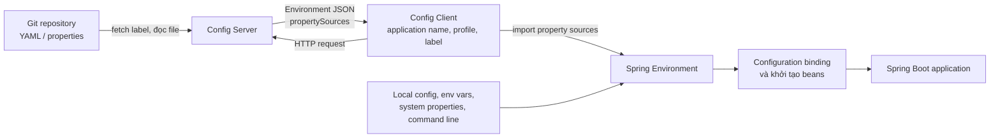

# Luồng nạp cấu hình từ kho lưu trữ đến Spring Environment

Trong kiến trúc Spring Cloud Config, cấu hình của nhiều ứng dụng Spring Boot được quản lý tập trung trong một kho lưu trữ, thường là Git. Config Server đọc phiên bản cấu hình được yêu cầu và cung cấp chúng qua HTTP. Config Client nhận các property source từ server rồi đưa vào Spring Environment để Spring Boot sử dụng khi tạo bean và khởi chạy ứng dụng.

Hiểu luồng này giúp xác định chính xác một giá trị đến từ đâu, vì sao profile hoặc label làm thay đổi kết quả, và tại sao sửa file trong Git chưa chắc làm ứng dụng đang chạy nhận cấu hình mới. Bài viết trình bày đường đi từ Git đến Environment, cách Config Server chọn nguồn, cách Config Client nạp dữ liệu và các điểm cần kiểm tra khi vận hành.

## 1. Các thành phần trong đường đi của cấu hình

Một kiến trúc điển hình có bốn thành phần:

1. **Git repository** lưu các file cấu hình dùng chung và cấu hình riêng cho từng ứng dụng, profile.
2. **Spring Cloud Config Server** đọc repository, xác định application, profile và label được yêu cầu, sau đó trả về một Environment qua HTTP.
3. **Spring Cloud Config Client** gọi Config Server trong giai đoạn nạp cấu hình của Spring Boot và nhận các property source.
4. **Spring Environment** chứa các nguồn thuộc tính đã được hợp nhất theo thứ tự ưu tiên. Spring Boot dùng Environment để binding vào `@ConfigurationProperties`, phân giải placeholder và cấu hình các bean.

Luồng tổng quát:



Git không gửi cấu hình trực tiếp đến từng bean. Config Server là điểm trung gian cung cấp một tập property source; Config Client nạp tập đó vào Environment; các thành phần của ứng dụng đọc giá trị từ Environment hoặc từ bean cấu hình đã binding.

## 2. Tổ chức kho cấu hình Git

Config Server có thể đọc một repository chứa cấu hình dùng chung và cấu hình theo tên ứng dụng. Ví dụ:

```text
config-repo/
├── application.yml
├── application-prod.yml
├── orders-service.yml
├── orders-service-dev.yml
├── orders-service-prod.yml
├── payment-service.yml
└── payment-service-prod.yml
```

Ý nghĩa của các tên file:

| File | Phạm vi |
| --- | --- |
| `application.yml` | Giá trị mặc định có thể dùng chung cho nhiều ứng dụng |
| `application-prod.yml` | Giá trị chung khi chạy profile `prod` |
| `orders-service.yml` | Cấu hình riêng của ứng dụng `orders-service` |
| `orders-service-dev.yml` | Cấu hình riêng của `orders-service` khi dùng profile `dev` |
| `orders-service-prod.yml` | Cấu hình riêng của `orders-service` khi dùng profile `prod` |

Có thể hình dung cấu hình được ghép từ lớp dùng chung đến lớp cụ thể hơn. Ví dụ, `application.yml` đặt timeout mặc định cho các dịch vụ; `orders-service.yml` đặt timeout riêng cho đơn hàng; `orders-service-prod.yml` điều chỉnh timeout cho production.

Đây là cách tổ chức theo phạm vi, không phải cam kết rằng mọi giá trị luôn được ghi đè theo đúng thứ tự liệt kê trong bảng. Config Server trả về danh sách property source có thứ tự; Spring Environment áp dụng quy tắc ưu tiên của các nguồn đó. Thứ tự cụ thể còn phụ thuộc application, các profile đang hoạt động, backend, cấu hình server và phiên bản Spring Boot/Spring Cloud.

Nên đặt tên ứng dụng ổn định bằng `spring.application.name`, tránh để tên ứng dụng thay đổi giữa các môi trường nếu điều đó không có chủ đích. Tên này được dùng để Config Server chọn file ứng dụng tương ứng.

## 3. Config Server đọc repository như thế nào?

Config Server cần biết vị trí Git repository và cách lấy nội dung. Cấu hình đơn giản cho backend Git có thể như sau:

```yaml
server:
  port: 8888

spring:
  application:
    name: config-server
  cloud:
    config:
      server:
        git:
          uri: https://git.example.com/platform/config-repo.git
          default-label: main
          clone-on-start: true
```

Ứng dụng Config Server cũng cần bật `@EnableConfigServer`:

```java
@SpringBootApplication
@EnableConfigServer
public class ConfigServerApplication {
    public static void main(String[] args) {
        SpringApplication.run(ConfigServerApplication.class, args);
    }
}
```

Khi khởi động hoặc khi xử lý yêu cầu, backend Git của Config Server lấy repository về bản clone cục bộ và đọc nội dung tại label được chọn. Label thường là tên branch hoặc tag; backend Git cũng có thể nhận một commit cụ thể. Thuộc tính `default-label` xác định label mặc định nếu client không gửi label riêng.

`clone-on-start: true` yêu cầu server clone repository ngay khi khởi động. Điều này giúp phát hiện sớm lỗi URI hoặc quyền truy cập Git, thay vì chờ request đầu tiên. Trong môi trường thực tế, thông tin xác thực Git phải được cấp qua secret hoặc cơ chế quản lý thông tin xác thực của môi trường triển khai. Không commit token hay private key vào chính repository cấu hình.

Config Server cũng hỗ trợ các backend khác và cấu hình repository tổng hợp. Khi dùng nhiều repository hoặc nhiều backend, thứ tự kết hợp nguồn phải được xác định và kiểm thử rõ ràng; không nên giả định các file trùng khóa sẽ tự hợp nhất theo ý muốn.

## 4. Application, profile và label xác định tập cấu hình

Một request đến Config Server được xác định bởi ba thông tin:

- **Application**: tên ứng dụng, thường lấy từ `spring.application.name`.
- **Profile**: môi trường hoặc nhóm cấu hình đang hoạt động, chẳng hạn `dev`, `staging`, `prod`.
- **Label**: phiên bản trong repository, thường là branch, tag hoặc commit.

Config Server cung cấp endpoint theo dạng:

```text
/{application}/{profile}/{label}
```

Ví dụ:

```text
http://localhost:8888/orders-service/prod/main
```

Yêu cầu này có nghĩa là lấy cấu hình của ứng dụng `orders-service`, profile `prod`, từ label `main`. Có thể gọi endpoint bằng trình duyệt hoặc curl để kiểm tra kết quả mà Config Server trả về:

```bash
curl http://localhost:8888/orders-service/prod/main
```

Kết quả là một đối tượng Environment dạng JSON. Phần dữ liệu thường có các trường:

```json
{
  "name": "orders-service",
  "profiles": ["prod"],
  "label": "main",
  "version": "a1b2c3d4",
  "propertySources": [
    {
      "name": "https://git.example.com/platform/config-repo.git/orders-service-prod.yml",
      "source": {
        "orders.http.read-timeout": "10s"
      }
    }
  ]
}
```

Đây là ví dụ rút gọn để minh họa cấu trúc, không phải response cố định của mọi repository. Trường `version` có thể cho biết revision Git đã được dùng. `propertySources` chứa các nguồn thuộc tính và dữ liệu trong từng nguồn. Khi chẩn đoán, hãy kiểm tra cả `name`, `source` và thứ tự các phần tử, thay vì chỉ nhìn vào một giá trị cuối cùng.

Profile được chọn từ phía client, ví dụ `spring.profiles.active=prod`. Label có thể được chỉ định bằng `spring.cloud.config.label`. Với triển khai cần tái lập chính xác, nên ghim label vào tag hoặc commit đã được phê duyệt. Branch như `main` có thể thay đổi theo thời gian; hai lần khởi động ở hai thời điểm khác nhau có thể nhận nội dung khác dù application và profile không đổi.

## 5. Config Client yêu cầu và nạp cấu hình

Với Spring Boot hiện đại, cách tích hợp phổ biến là Config Data import. Một ứng dụng client có thể khai báo:

```yaml
spring:
  application:
    name: orders-service
  profiles:
    active: prod
  cloud:
    config:
      label: main
  config:
    import: "configserver:http://localhost:8888"
```

Các giá trị quan trọng cần có trước khi gọi server là tên ứng dụng, profile cần dùng, label nếu muốn ghim phiên bản và địa chỉ Config Server. Chúng cho phép Config Client tạo request đúng ngay trong giai đoạn nạp cấu hình.

Khi ứng dụng khởi động, quá trình diễn ra theo trình tự khái quát:

1. Spring Boot đọc các thiết lập ban đầu cần thiết từ cấu hình cục bộ, biến môi trường hoặc tham số khởi động.
2. Config Data nhận diện import có scheme `configserver:` và gọi Config Server.
3. Config Client gửi application, profile và label đến endpoint tương ứng.
4. Config Server truy cập repository, chọn các file và tạo response Environment.
5. Config Client chuyển các property source trong response thành nguồn thuộc tính của Spring Environment.
6. Spring Boot tiếp tục xử lý cấu hình, binding các nhóm thuộc tính và khởi tạo bean.

Có thể dùng tiền tố `optional:` nếu ứng dụng được phép khởi động khi Config Server không truy cập được:

```yaml
spring:
  config:
    import: "optional:configserver:http://localhost:8888"
```

Chỉ dùng chế độ optional khi ứng dụng có giá trị mặc định an toàn hoặc có cách vận hành rõ ràng khi thiếu cấu hình từ xa. Nếu một endpoint, thông tin xác thực hay giới hạn tài nguyên là bắt buộc, việc bỏ qua lỗi kết nối có thể khiến ứng dụng khởi động với cấu hình không phù hợp. Khi Config Server là phụ thuộc bắt buộc, hãy cấu hình ứng dụng thất bại rõ ràng khi không lấy được cấu hình, đồng thời cân nhắc retry và timeout phù hợp.

Trong các dự án cũ sử dụng bootstrap context, cách cấu hình Config Client có thể khác. Không nên trộn lẫn hướng dẫn bootstrap cũ với Config Data import mà chưa kiểm tra phiên bản Spring Boot và Spring Cloud tương thích.

## 6. Property source đi vào Spring Environment

Spring Environment là nơi cung cấp khả năng đọc thuộc tính cho ứng dụng. Nó chứa nhiều PropertySource, ví dụ:

- Cấu hình được import từ Config Server.
- `application.yml` và file profile-specific tại ứng dụng.
- Biến môi trường của tiến trình.
- Java system properties.
- Tham số dòng lệnh.

Khi nhiều nguồn cùng khai báo một key, nguồn có độ ưu tiên cao hơn sẽ quyết định giá trị mà phép tra cứu nhận được. Do đó, phải phân biệt hai bước:

1. **Config Server hợp thành response**: chọn file và sắp xếp các property source dựa trên application, profile, label và cấu hình backend.
2. **Spring Boot hợp thành Environment phía client**: đưa remote property source cùng các nguồn cấu hình khác vào Environment theo quy tắc ưu tiên của Config Data và Spring Boot.

Ví dụ, Git có thể chứa:

```yaml
# application.yml trong repository cấu hình
orders:
  http:
    read-timeout: 5s
```

Và một file cụ thể của ứng dụng có:

```yaml
# orders-service-prod.yml trong repository cấu hình
orders:
  http:
    read-timeout: 10s
```

Nếu hai nguồn cùng được trả về, thứ tự property source quyết định giá trị có hiệu lực. Khi giá trị cuối cùng ở client vẫn khác, cần kiểm tra cả những nguồn ở phía client như biến môi trường hoặc tham số dòng lệnh.

Remote property source từ Config Server thường được ưu tiên theo chính sách mặc định của Spring Cloud Config. Cơ chế cho phép ghi đè từ phía client có các cờ điều khiển như `spring.cloud.config.allowOverride`, `spring.cloud.config.overrideNone` và `spring.cloud.config.overrideSystemProperties`. Những cờ này có quy tắc riêng và cần được cấu hình theo phiên bản đang dùng; không thể bật chúng tùy ý ở client để thay đổi chính sách mà server đã gửi. Hãy chọn một chính sách nhất quán: nguồn nào được phép ghi đè, trong tình huống nào, và nhóm nào chịu trách nhiệm phê duyệt.

Sau khi Environment đã có dữ liệu, mã ứng dụng có thể đọc trực tiếp bằng `Environment`:

```java
@Component
public class OrderRuntimeInfo {
    private final Environment environment;

    public OrderRuntimeInfo(Environment environment) {
        this.environment = environment;
    }

    public Duration readTimeout() {
        return environment.getProperty(
                "orders.http.read-timeout",
                Duration.class,
                Duration.ofSeconds(5));
    }
}
```

Với nhóm cấu hình có cấu trúc, nên binding bằng `@ConfigurationProperties` để gom các khóa liên quan, chuyển kiểu và kiểm tra dữ liệu:

```java
@ConfigurationProperties(prefix = "orders.http")
public record OrderHttpProperties(
        Duration connectTimeout,
        Duration readTimeout) {
}
```

Như vậy, Environment là nguồn dữ liệu cấu hình hợp nhất; bean cấu hình là cách truy cập có kiểu và có cấu trúc. Binding diễn ra sau khi các nguồn cấu hình cần thiết đã được nạp.

## 7. Từ Git commit đến giá trị mà ứng dụng sử dụng

Một ví dụ thực tế giúp thấy rõ từng bước. Nhóm phát triển muốn thay đổi timeout đọc dữ liệu của dịch vụ đơn hàng từ 5 giây lên 10 giây.

1. Người phụ trách sửa `orders-service-prod.yml` trong repository cấu hình.
2. Thay đổi được review và merge vào branch hoặc tag đã thống nhất.
3. Config Server lấy revision tương ứng khi xử lý request cho `orders-service/prod/{label}`.
4. Config Client gọi endpoint theo application, profile và label.
5. Config Server trả Environment có property source chứa `orders.http.read-timeout=10s`.
6. Config Client đưa nguồn từ xa vào Spring Environment.
7. Bean cấu hình hoặc thành phần đọc Environment nhận giá trị theo thứ tự ưu tiên đang áp dụng.

Nếu ứng dụng đang khởi động mới, nó lấy cấu hình trong giai đoạn nạp Config Data. Nếu ứng dụng đã chạy, commit Git mới không tự động thay đổi Environment hiện tại. Cần một chu trình refresh được cấu hình rõ ràng để client yêu cầu lại cấu hình và áp dụng thay đổi. Vì thế, phải phân biệt việc **repository đã có revision mới**, **Config Server có thể trả revision mới**, và **từng instance đã nạp revision mới**.

## 8. Refresh khi cấu hình trong Git thay đổi

Config Server không mặc định đẩy mọi thay đổi Git đến tất cả client. Một request mới có thể lấy revision mới, nhưng các instance đang chạy vẫn giữ Environment đã nạp trước đó cho đến khi có cơ chế cập nhật.

Các cách triển khai thường gặp:

- Gọi endpoint refresh được bảo vệ của từng Config Client để làm mới Environment và các thành phần hỗ trợ refresh.
- Dùng Spring Cloud Bus để phát sự kiện refresh đến nhiều instance qua message broker.
- Dùng webhook hoặc Config Monitor để thông báo khi repository có commit mới, sau đó kích hoạt refresh theo cơ chế đã thiết kế.

Với một instance, endpoint refresh thường được cung cấp qua Spring Boot Actuator và Spring Cloud Context. Với nhiều instance, Bus giúp phân phối sự kiện để các client cùng thực hiện refresh. Cần kiểm tra dependency, endpoint được expose, xác thực, phân quyền và cách triển khai bean trước khi sử dụng.

Không phải mọi đối tượng Java đều tự thay đổi trạng thái chỉ vì Environment đã được refresh. Bean dùng `@RefreshScope` có vòng đời tạo lại khi refresh; các thành phần khác cần cơ chế cập nhật hoặc khởi tạo lại phù hợp. Với thay đổi có ảnh hưởng lớn, nên thử nghiệm trên một nhóm instance, kiểm tra giá trị thực tế và metric, rồi mới mở rộng rollout.

## 9. Kiểm soát lỗi trong quá trình nạp cấu hình

Cấu hình tập trung trở thành phụ thuộc lúc khởi động, vì vậy cần quyết định rõ cách ứng dụng xử lý khi một bước trong chuỗi bị lỗi.

| Vấn đề | Điểm cần kiểm tra | Hướng xử lý |
| --- | --- | --- |
| Config Server không kết nối được Git | URI, DNS, TLS, thông tin xác thực và quyền đọc repository | Kiểm tra log server và quyền truy cập Git |
| Config Client không kết nối được Config Server | URL, port, network policy, TLS và xác thực | Kiểm tra endpoint health và log client |
| Trả về sai tập cấu hình | application, profile, label và tên file | Gọi trực tiếp endpoint Environment để xem response |
| Nhận revision cũ | Branch/tag được yêu cầu, cache hoặc bản clone Git | Xác minh label và revision server đang dùng |
| Giá trị runtime khác response server | Property source phía client và thứ tự ưu tiên | Kiểm tra Environment, biến môi trường và tham số dòng lệnh |
| Binding thất bại | Giá trị không chuyển đổi được hoặc vi phạm validation | Đọc lỗi binding và sửa dữ liệu tại nguồn |
| Một số instance chưa cập nhật | Refresh event chưa đến hoặc bean không hỗ trợ refresh | Kiểm tra từng instance và trạng thái Bus |

Để chẩn đoán có hệ thống, đi theo chiều từ client về server:

1. Ghi nhận tên ứng dụng, profile và label thực tế của instance.
2. Gọi endpoint Config Server với đúng ba giá trị đó.
3. Kiểm tra revision và danh sách property source trong response.
4. Kiểm tra Environment phía client để tìm nguồn đang thắng.
5. Kiểm tra bean cấu hình sau binding và lỗi validation.
6. Nếu vừa refresh, xác nhận từng instance đã xử lý sự kiện và sử dụng giá trị mới.

Actuator có endpoint như `env` và `configprops` hỗ trợ kiểm tra nguồn thuộc tính và bean cấu hình. Những endpoint này có thể tiết lộ thông tin nhạy cảm; chỉ expose trong phạm vi cần thiết, bật xác thực và phân quyền, đồng thời kiểm soát dữ liệu nhạy cảm hiển thị.

## 10. Bảo vệ đường truyền và vòng đời cấu hình

Git repository và Config Server nằm trên đường cung cấp cấu hình cho ứng dụng, do đó cả hai phải được bảo vệ. Dùng HTTPS hoặc kênh truyền được bảo vệ giữa client và server; xác thực client theo yêu cầu; giới hạn quyền truy cập repository và endpoint Config Server. Tách quyền đọc cấu hình khỏi quyền thay đổi cấu hình.

Không lưu secret dạng rõ trong Git. Dùng secret manager hoặc cơ chế mã hóa được vận hành an toàn; bảo vệ khóa giải mã và tránh đưa secret vào log, response chẩn đoán hay thông báo lỗi. Cấu hình dùng chung cũng cần review vì một thay đổi trong `application.yml` có thể tác động đến nhiều ứng dụng cùng lúc.

Nên xem mỗi revision cấu hình như một phần của phiên bản triển khai. Ghi nhận label hoặc commit đã dùng, người phê duyệt, thời điểm rollout và kết quả sau triển khai. Khi có lỗi, có thể quay về revision đã được xác nhận tốt, sau đó refresh hoặc triển khai lại theo quy trình. Không nên dùng một branch thay đổi liên tục làm bằng chứng duy nhất cho biết instance đang chạy chính xác cấu hình nào; hãy quan sát revision mà Config Server đã trả về và trạng thái của từng client.

## 11. Các nguyên tắc cần giữ khi thiết kế luồng cấu hình

- Đặt `spring.application.name` rõ ràng và nhất quán giữa các môi trường.
- Dùng profile để mô tả môi trường chạy; dùng label để xác định phiên bản cấu hình.
- Giữ cấu hình dùng chung ở phạm vi application và chỉ ghi đè tại ứng dụng hoặc profile khi có lý do.
- Xác định chính sách precedence giữa remote property source và nguồn cục bộ; kiểm tra bằng Environment thực tế.
- Quyết định rõ Config Server là phụ thuộc bắt buộc hay optional trước khi chọn cách xử lý lỗi.
- Không giả định Git commit tự động cập nhật các instance đang chạy; thiết kế refresh và kiểm chứng kết quả.
- Bảo vệ repository, Config Server, endpoint quản trị và thông tin bí mật.
- Theo dõi revision cấu hình đã được từng instance nạp để hỗ trợ truy vết và rollback.

Khi nắm được đường đi từ Git repository qua Config Server và Config Client đến Spring Environment, nhóm phát triển có thể truy vết một giá trị cấu hình từ nguồn gốc đến nơi sử dụng. Application, profile và label xác định tập dữ liệu được trả về; property source và precedence quyết định giá trị hiệu lực; refresh quyết định khi nào instance đang chạy nhận thay đổi. Đây là nền tảng để phân phối cấu hình tập trung nhất quán cho nhiều ứng dụng Spring Boot.

