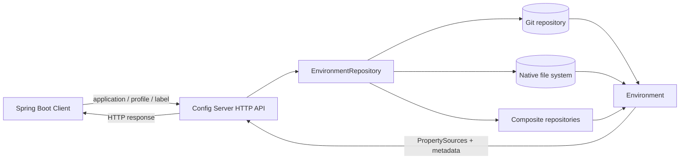

# EnvironmentRepository và mô hình Environment phía máy chủ

Spring Cloud Config Server cung cấp cấu hình tập trung cho nhiều ứng dụng Spring Boot. Để phục vụ một yêu cầu, server phải xác định ứng dụng nào đang hỏi, profile nào đang hoạt động, label nào được chọn và kho cấu hình nào cần đọc. Hai thành phần cốt lõi đảm nhiệm phần việc này là **`EnvironmentRepository`** và mô hình **`Environment`**.

`EnvironmentRepository` là lớp trừu tượng truy xuất cấu hình từ backend như Git, hệ thống file hoặc nhiều nguồn kết hợp. `Environment` là kết quả chuẩn hóa mà Config Server trả về cho client, gồm thông tin nhận diện yêu cầu và danh sách các `PropertySource`. Hiểu rõ hai thành phần giúp ta tổ chức repository, dự đoán thứ tự ưu tiên và chẩn đoán cấu hình sai một cách có hệ thống.

## 1. Vị trí của EnvironmentRepository trong kiến trúc

Config Server đứng giữa ứng dụng client và kho cấu hình. Client gửi yêu cầu theo tên ứng dụng, profile và label. Server chuyển yêu cầu đến repository phù hợp, xây dựng đối tượng `Environment`, sau đó trả kết quả qua HTTP.



Quy trình có thể chia thành các bước:

1. Client xác định `spring.application.name`, các profile đang hoạt động và label muốn sử dụng.
2. Client gọi Config Server, thường qua endpoint `/{application}/{profile}/{label}`.
3. Controller phía server chuyển ba thông tin đó cho `EnvironmentRepository`.
4. Repository đọc các tài liệu cấu hình phù hợp từ backend và chuyển chúng thành các property source.
5. Config Server tập hợp các property source thành `Environment`, gắn metadata như label và phiên bản nguồn nếu có, rồi trả kết quả.
6. Client tiếp nhận property source từ xa và đưa chúng vào `Environment` của ứng dụng để Spring Boot binding các thuộc tính.

`EnvironmentRepository` tách biệt cách truy xuất cấu hình khỏi giao thức HTTP. Config Server có thể thay Git bằng filesystem hoặc một repository tổng hợp mà vẫn giữ mô hình phản hồi cho client.

## 2. EnvironmentRepository là gì?

`EnvironmentRepository` là abstraction ở phía server dùng để tìm cấu hình theo ba tham số:

```java
public interface EnvironmentRepository {
    Environment findOne(String application, String profile, String label);
}
```

Đây là chữ ký rút gọn để thể hiện trách nhiệm chính của abstraction. `application` là tên ứng dụng cần cấu hình, `profile` là tập profile được yêu cầu và `label` xác định phiên bản hoặc nhánh cấu hình trong backend có hỗ trợ label.

Các implementation của repository quyết định cách ánh xạ yêu cầu thành dữ liệu:

| Loại repository | Backend | Trường hợp sử dụng |
|---|---|---|
| Git repository | Repository Git từ xa hoặc bản clone cục bộ | Quản lý cấu hình theo commit, branch, tag và hỗ trợ review thay đổi. |
| Native repository | Thư mục trên filesystem hoặc classpath | Phát triển cục bộ, kiểm thử hoặc môi trường mà cấu hình được cung cấp dưới dạng file. |
| Composite repository | Nhiều repository khác nhau | Kết hợp nhiều nguồn, ví dụ cấu hình chung từ Git và cấu hình riêng từ một kho khác. |
| Repository chuyên biệt | Cơ sở dữ liệu hoặc secret/configuration store được hỗ trợ hay tự tích hợp | Tổ chức đã có hệ thống lưu trữ cấu hình riêng. |

Client không cần biết repository đang đọc Git hay filesystem. Client chỉ cần biết địa chỉ Config Server và các thông tin application, profile, label cần yêu cầu.

## 3. Mô hình Environment phía máy chủ

`Environment` là đối tượng biểu diễn tập cấu hình mà Config Server tìm được cho một yêu cầu. Mô hình này chứa metadata và một danh sách các `PropertySource`.

| Trường | Ý nghĩa |
|---|---|
| `name` | Tên ứng dụng được yêu cầu, thường tương ứng với `spring.application.name` của client. |
| `profiles` | Các profile mà server đã dùng để tìm cấu hình. |
| `label` | Label được yêu cầu hoặc được repository sử dụng, chẳng hạn tên branch, tag hay phiên bản. |
| `version` | Thông tin phiên bản của nguồn cấu hình; với Git thường có thể là commit ID. |
| `state` | Metadata trạng thái do repository hoặc backend cung cấp khi có hỗ trợ. |
| `propertySources` | Danh sách các nguồn thuộc tính, mỗi nguồn có tên và một map chứa khóa cùng giá trị. |

Ví dụ, client `orders-service` yêu cầu profile `prod` ở label `main`. Config Server có thể trả một phản hồi JSON tương tự sau:

```json
{
  "name": "orders-service",
  "profiles": ["prod"],
  "label": "main",
  "version": "4f31a8c2d7e9",
  "state": "",
  "propertySources": [
    {
      "name": ".../orders-service-prod.yml",
      "source": {
        "server.port": 8081,
        "app.payment.enabled": true
      }
    },
    {
      "name": ".../orders-service.yml",
      "source": {
        "app.payment.enabled": false,
        "app.timeout": "3s"
      }
    },
    {
      "name": ".../application.yml",
      "source": {
        "app.region": "ap-southeast-1",
        "app.timeout": "5s"
      }
    }
  ]
}
```

Đây là ví dụ minh họa cấu trúc phản hồi; tên nguồn, commit ID và giá trị thực tế phụ thuộc backend. Một `PropertySource` có hai phần quan trọng:

- `name` cho biết dữ liệu đến từ tài liệu hoặc nguồn nào, hữu ích khi điều tra một giá trị bị ghi đè.
- `source` chứa các cặp khóa và giá trị cấu hình mà client có thể sử dụng.

Danh sách `propertySources` có thứ tự. Các nguồn được trả về theo thứ tự ưu tiên mà Config Server cung cấp; nguồn xuất hiện trước có mức ưu tiên cao hơn khi các khóa trùng nhau trong tập nguồn đó. Vì vậy, không nên chỉ xem giá trị của một khóa mà bỏ qua tên và vị trí của property source chứa nó.

`Environment` phía server là bản mô tả cấu hình cho một yêu cầu cụ thể. Nó không phải một đối tượng `Environment` dùng chung được chia sẻ trực tiếp giữa tất cả client. Mỗi client nhận phản hồi của riêng mình theo application, profile và label được yêu cầu, rồi tích hợp dữ liệu đó vào `Environment` cục bộ.

## 4. Application, profile và label quyết định tài liệu được chọn

Ba tham số đầu vào của `findOne` xác định phạm vi tìm kiếm.

**Application** thường lấy từ `spring.application.name`. Config Server dùng tên này để tìm các file dành riêng cho ứng dụng. Nếu client không đặt tên phù hợp, server có thể tìm nhầm tài liệu dùng chung hoặc không tìm thấy tài liệu riêng.

**Profile** cho biết môi trường chạy, ví dụ `dev`, `test` hoặc `prod`. Một profile có thể làm phát sinh các tài liệu chuyên biệt. Ví dụ với `orders-service` và profile `prod`, backend Git có thể chứa:

```text
config-repo/
├── application.yml
├── application-prod.yml
├── orders-service.yml
└── orders-service-prod.yml
```

`application.yml` cung cấp cấu hình dùng chung; `orders-service.yml` bổ sung cấu hình mặc định cho ứng dụng; các file có hậu tố `prod` cung cấp phần cấu hình theo profile. Repository và Config Server kết hợp các tài liệu phù hợp thành các property source theo quy tắc của backend và thứ tự ưu tiên đã cấu hình.

**Label** xác định phiên bản cấu hình. Với Git, label thường là branch, tag hoặc commit. Ví dụ `main` có thể trỏ đến cấu hình đang phát triển, còn một tag phát hành có thể giữ nguyên cấu hình đã được phê duyệt cho một đợt triển khai. Đặt label tường minh giúp các client và môi trường triển khai có thể yêu cầu đúng bộ cấu hình.

Endpoint chính có dạng:

```text
/{application}/{profile}/{label}
```

Ví dụ:

```text
http://localhost:8888/orders-service/prod/main
```

Config Server cũng hỗ trợ các endpoint trả cấu hình theo định dạng như YAML hoặc properties. Khi cần chẩn đoán toàn bộ metadata và thứ tự nguồn, endpoint Environment JSON là điểm kiểm tra thuận tiện.

## 5. Cấu hình Git EnvironmentRepository

Git là backend phổ biến vì mỗi thay đổi cấu hình có lịch sử commit, có thể review và có thể chọn lại phiên bản. Một Config Server tối thiểu có thể được khai báo như sau:

```java
@SpringBootApplication
@EnableConfigServer
public class ConfigServerApplication {
    public static void main(String[] args) {
        SpringApplication.run(ConfigServerApplication.class, args);
    }
}
```

Khai báo repository trong `application.yml` của Config Server:

```yaml
server:
  port: 8888

spring:
  cloud:
    config:
      server:
        git:
          uri: https://git.example.com/platform/config-repo.git
          default-label: main
          search-paths:
            - '{application}'
          clone-on-start: true
```

Các thuộc tính có vai trò như sau:

- `uri` chỉ đến repository Git chứa file cấu hình.
- `default-label` xác định label dùng khi yêu cầu không cung cấp label riêng. Khai báo tường minh giúp tránh phụ thuộc vào tên nhánh mặc định hoặc khác biệt giữa các phiên bản.
- `search-paths` chỉ định các thư mục cần tìm bên trong repository. Placeholder `{application}` cho phép tổ chức cấu hình theo từng ứng dụng.
- `clone-on-start` yêu cầu Config Server clone repository khi khởi động để lỗi truy cập Git được phát hiện sớm hơn.

Config Server có thể clone repository về thư mục làm việc cục bộ rồi cập nhật dữ liệu theo cấu hình vận hành. Tài khoản truy cập Git cần quyền đọc tối thiểu. Với repository riêng tư, thông tin xác thực phải được cung cấp qua cơ chế bảo mật của môi trường triển khai; không ghi token hoặc mật khẩu trực tiếp vào file cấu hình được commit.

`version` trong phản hồi Environment giúp liên hệ kết quả cấu hình với commit Git cụ thể. Khi cần triển khai có thể tái lập, hãy lưu lại label và commit ID được dùng trong lần triển khai đó. Branch có thể di chuyển khi có commit mới, trong khi tag hoặc commit ID cố định giúp nhận diện phiên bản chính xác hơn.

## 6. Native và Composite EnvironmentRepository

### Native repository

Native repository đọc file từ filesystem hoặc classpath. Cách này hữu ích khi phát triển, chạy thử Config Server hoặc khi nền tảng triển khai đã cung cấp file cấu hình ở một đường dẫn được kiểm soát.

```yaml
spring:
  profiles:
    active: native
  cloud:
    config:
      server:
        native:
          search-locations:
            - file:./config-repo
```

Profile `native` kích hoạt backend filesystem. `search-locations` chỉ định nơi tìm file cấu hình. Đường dẫn `file:` làm rõ rằng cấu hình đến từ filesystem; cần bảo đảm tiến trình Config Server có quyền đọc đúng thư mục khi chạy trong container hoặc trên máy chủ.

Native repository phù hợp với một số cách triển khai nhưng không tự cung cấp lịch sử thay đổi, review và khả năng chọn commit như Git. Nếu dùng filesystem làm nguồn chính, tổ chức cần có quy trình riêng để quản lý phiên bản và phân phối file nhất quán.

### Composite repository

Composite repository kết hợp nhiều `EnvironmentRepository` thành một kết quả Environment. Ví dụ, tổ chức có thể lấy cấu hình chung từ Git và bổ sung cấu hình của một nhóm ứng dụng từ repository khác.

```yaml
spring:
  cloud:
    config:
      server:
        composite:
          - type: git
            uri: https://git.example.com/platform/shared-config.git
            default-label: main
          - type: git
            uri: https://git.example.com/platform/team-config.git
            default-label: main
```

Thứ tự khai báo repository trong composite ảnh hưởng đến độ ưu tiên khi nhiều nguồn cung cấp cùng một khóa. Theo quy tắc composite, repository đứng trước có mức ưu tiên cao hơn repository đứng sau. Cần thiết kế thứ tự này có chủ đích và kiểm tra phản hồi Environment để chắc chắn giá trị mong muốn thắng khi có khóa trùng nhau.

Các repository thành phần cũng cần có cách xử lý lỗi rõ ràng. Nếu một nguồn bắt buộc không truy cập được, Config Server cần biểu hiện lỗi để người vận hành nhận ra cấu hình trả về có thể chưa đầy đủ. Không nên xem một phản hồi thiếu property source là thành công nếu hệ thống yêu cầu mọi nguồn đều sẵn sàng.

## 7. Đọc và kiểm tra Environment trả về

Khi Config Server đã chạy ở cổng `8888`, có thể gửi yêu cầu bằng `curl`:

```bash
curl http://localhost:8888/orders-service/prod/main
```

Khi đọc phản hồi, hãy kiểm tra lần lượt:

1. `name` có đúng tên ứng dụng mà client đang sử dụng không.
2. `profiles` có chứa profile cần thiết không.
3. `label` có đúng branch, tag hoặc commit được triển khai không.
4. `version` có khớp với phiên bản nguồn cấu hình mong đợi không.
5. `propertySources` có chứa những file dự kiến không, và thứ tự của chúng có đúng chính sách ưu tiên không.
6. Các khóa quan trọng có giá trị đúng trong nguồn có độ ưu tiên cao nhất không.

Ví dụ, nếu `app.timeout` có giá trị khác dự kiến, hãy tìm khóa này trong từng `propertySources`, ghi lại tên nguồn và xác định nguồn nào đứng trước. Việc này thường cho biết vấn đề nằm ở file profile, file dùng chung, thứ tự composite hay label được yêu cầu.

Một số tình huống thường gặp:

| Hiện tượng | Nguyên nhân cần kiểm tra |
|---|---|
| Không có property source mong đợi | Sai `application`, profile, label hoặc `search-paths`; file chưa có trong phiên bản Git đang được chọn. |
| Giá trị bị ghi đè | Nhiều nguồn có cùng khóa; kiểm tra thứ tự property source và thứ tự repository trong composite. |
| Cấu hình khác giữa hai lần yêu cầu | Label là branch đang thay đổi, repository vừa được cập nhật hoặc các instance Config Server đang dùng trạng thái backend khác nhau. |
| Không truy cập được repository | URI, quyền đọc, thông tin xác thực, chứng chỉ TLS hoặc kết nối mạng có vấn đề. |
| Environment không chứa metadata phiên bản như mong đợi | Backend có thể không cung cấp `version` hoặc `state`; kiểm tra khả năng hỗ trợ của repository đang dùng. |

## 8. Tổ chức và vận hành repository an toàn

Config Server có thể trả về nhiều loại cấu hình nhạy cảm, vì vậy endpoint Environment phải được bảo vệ như một API nội bộ quan trọng. Hãy bật xác thực và phân quyền phù hợp, dùng TLS khi truyền dữ liệu, giới hạn mạng có thể truy cập server và cấp quyền đọc tối thiểu cho tài khoản Git hoặc backend.

Không commit mật khẩu, access token, private key hoặc bí mật dùng chung ở dạng rõ vào repository cấu hình. Dùng secret manager hoặc cơ chế cung cấp bí mật của nền tảng triển khai. Nếu tổ chức sử dụng cơ chế mã hóa thuộc Spring Cloud Config, cần bảo vệ khóa mã hóa, giới hạn quyền gọi các endpoint mã hóa/giải mã và tránh để bí mật xuất hiện trong log.

Repository cấu hình nên có quy trình thay đổi tương tự mã nguồn ứng dụng: review, kiểm tra, phê duyệt và lưu lịch sử. Đối với thay đổi quan trọng, hãy dùng tag hoặc commit cố định để có thể truy vết bộ cấu hình đã được triển khai. Việc cập nhật Git làm thay đổi dữ liệu mà Config Server có thể đọc; nó không tự động bảo đảm mọi client đang chạy đã nhận cấu hình mới. Client vẫn cần quy trình lấy lại cấu hình và refresh phù hợp.

## 9. Phân biệt Environment phía server và Environment phía client

Hai khái niệm có tên giống nhau nhưng phục vụ hai giai đoạn khác nhau:

| Khía cạnh | Environment phía Config Server | Environment phía Spring Boot Client |
|---|---|---|
| Vai trò | Mô tả kết quả truy xuất từ repository cho một yêu cầu. | Tập hợp các property source mà ứng dụng sử dụng khi chạy. |
| Nguồn dữ liệu | Git, filesystem hoặc composite repository. | Cấu hình từ xa cùng file cục bộ, biến môi trường, JVM properties và các nguồn khác. |
| Nội dung | Metadata yêu cầu và danh sách property source server tìm được. | Các property source đã được tích hợp vào ngữ cảnh cấu hình của ứng dụng. |
| Phạm vi | Một yêu cầu application/profile/label. | Một tiến trình Spring Boot cụ thể. |
| Mục tiêu kiểm tra | Server tìm đúng file và trả đúng thứ tự nguồn. | Client chọn đúng giá trị cuối cùng sau khi áp dụng thứ tự ưu tiên của nó. |

Do đó, một phản hồi Environment đúng từ server là điều kiện quan trọng nhưng chưa đủ để kết luận ứng dụng đang dùng đúng giá trị. Client còn có thể nhận giá trị từ nguồn có ưu tiên cao hơn hoặc áp dụng chính sách override của Spring Cloud Config. Khi điều tra sự cố, hãy kiểm tra cả phản hồi server lẫn các property source trong ứng dụng client.

## 10. Tổng kết

- `EnvironmentRepository` nhận application, profile và label để truy xuất cấu hình từ backend.
- `Environment` là kết quả chuẩn hóa gồm metadata như `name`, `profiles`, `label`, `version`, `state` và danh sách `propertySources`.
- Mỗi `PropertySource` có tên nguồn và map khóa/giá trị; thứ tự nguồn quyết định ưu tiên khi khóa trùng nhau.
- Git phù hợp với quản lý cấu hình có lịch sử và phiên bản; Native đọc file từ filesystem/classpath; Composite kết hợp nhiều repository theo thứ tự ưu tiên.
- Application, profile và label cần được xác định nhất quán giữa client, Config Server và repository.
- Phản hồi Environment giúp truy vết cấu hình phía server; cần kiểm tra thêm Environment phía client để xác định giá trị ứng dụng thực sự sử dụng.
- Bảo vệ endpoint, backend credentials và bí mật cấu hình; quản trị thay đổi bằng review, phiên bản và quy trình refresh rõ ràng.
