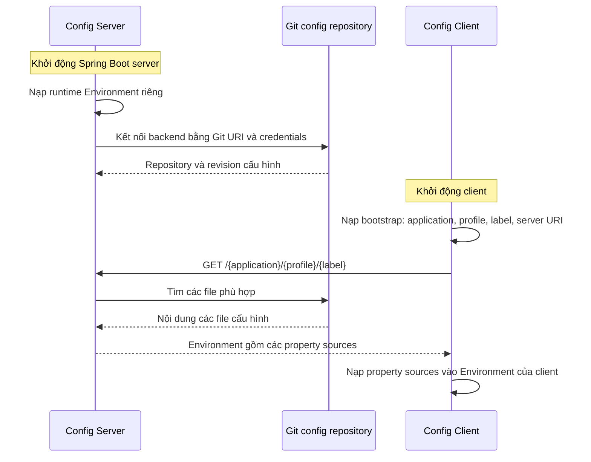

# Ranh giới giữa cấu hình riêng Config Server và cấu hình phục vụ client

## 1. Hai phạm vi cấu hình khác nhau

Trong hệ thống dùng Spring Cloud Config, có hai nhóm cấu hình thường bị đặt nhầm chỗ:

1. **Cấu hình để chính Config Server hoạt động**: cách server khởi động, cổng HTTP, kết nối đến Git, đường dẫn tìm kiếm, xác thực, khóa mã hóa, TLS, logging và health check.
2. **Cấu hình mà Config Server phân phối cho ứng dụng**: địa chỉ dịch vụ phụ thuộc, timeout, mức log, cờ tính năng, giới hạn nghiệp vụ và các thuộc tính runtime của từng Spring Boot client.

Hai nhóm này có thể cùng được biểu diễn bằng YAML hoặc properties, thậm chí có thể chứa những khóa có tên giống nhau. Tuy nhiên, chúng thuộc về hai Spring `Environment` khác nhau và được nạp ở hai thời điểm khác nhau. Config Server đọc cấu hình runtime của chính nó để biết cách cung cấp dịch vụ; sau đó nó đọc backend như Git để trả về các property source cho client yêu cầu.

Ví dụ, `server.port` trong file cấu hình triển khai Config Server quyết định cổng HTTP mà Config Server lắng nghe. Nếu `server.port` nằm trong file `order-service-prod.yml` ở Git repository được phục vụ, giá trị đó dành cho ứng dụng `order-service` khi chạy với profile `prod`. Nó không thay đổi cổng của Config Server.

Đây là ranh giới quan trọng khi thiết kế Spring Cloud Config: phải xác định rõ **tiến trình nào sẽ đọc cấu hình**, **cấu hình được nạp từ nguồn nào**, và **cấu hình có thể được trả cho client nào**.

## 2. Cấu hình runtime của Config Server

Config Server là một ứng dụng Spring Boot. Giống ứng dụng Boot thông thường, nó có `Environment` riêng, được hình thành từ các nguồn cấu hình lúc khởi động như file cấu hình đóng gói, file bên ngoài, biến môi trường, system property và tham số dòng lệnh.

Nhóm cấu hình runtime này quyết định cách Config Server vận hành. Những thuộc tính thường gặp gồm:

| Nhóm | Ví dụ | Tác dụng trên Config Server |
|---|---|---|
| Nhận diện và mạng | `spring.application.name`, `server.port`, SSL/TLS | Đặt tên ứng dụng server và cấu hình điểm lắng nghe HTTP/HTTPS. |
| Backend Git | `spring.cloud.config.server.git.uri`, `default-label`, `search-paths` | Xác định repository, nhánh mặc định và nơi tìm file cấu hình. |
| Xác thực backend | Git username/password hoặc private key | Cho phép server đọc repository riêng tư. |
| Bảo vệ endpoint | Spring Security, user/role, TLS | Kiểm soát client nào được gọi endpoint cấu hình. |
| Mã hóa và bí mật | Khóa hoặc keystore dùng cho encryption | Phục vụ giải mã giá trị được mã hóa theo cơ chế Spring Cloud Config. |
| Quản trị | `management.*`, logging, health check | Hỗ trợ giám sát và vận hành server. |

Ví dụ một file `application.yml` được triển khai cùng Config Server:

```yaml
server:
  port: 8888

spring:
  application:
    name: config-server
  cloud:
    config:
      server:
        git:
          uri: ${CONFIG_REPO_URI}
          default-label: main
          search-paths:
            - configs
          clone-on-start: true

management:
  endpoints:
    web:
      exposure:
        include: health,info
```

Trong ví dụ, `CONFIG_REPO_URI` được cung cấp từ môi trường triển khai. Nếu Git yêu cầu xác thực, thông tin truy cập cũng cần được cấp qua secret store hoặc cơ chế quản lý bí mật của nền tảng. Không ghi token, mật khẩu hay khóa giải mã trực tiếp vào file được commit.

Config Server cần biết repository nào để đọc. Vì vậy, `spring.cloud.config.server.git.uri` là thuộc tính runtime của server. Config Server dùng nó để kết nối Git backend; đây không phải thuộc tính mà mọi Config Client cần nhận.

`clone-on-start: true` giúp phát hiện sớm một số lỗi kết nối hoặc quyền đọc repository ngay khi server khởi động. `search-paths` xác định thư mục server tìm kiếm trong repository. Các thuộc tính này ảnh hưởng trực tiếp đến hoạt động backend của server.

## 3. Cấu hình được Config Server phục vụ cho client

Nhóm cấu hình thứ hai được lưu trong backend mà Config Server đọc, thường là một Git repository. Các file ở đây được chọn theo tên ứng dụng, profile và label của yêu cầu client.

Một cấu trúc ví dụ:

```text
config-repo/
└── configs/
    ├── application.yml
    ├── application-prod.yml
    ├── order-service.yml
    ├── order-service-dev.yml
    ├── order-service-prod.yml
    ├── payment-service.yml
    └── payment-service-prod.yml
```

Các file có ý nghĩa:

- `application.yml`: cấu hình mặc định dùng chung cho các ứng dụng client.
- `application-prod.yml`: cấu hình dùng chung khi client yêu cầu profile `prod`.
- `order-service.yml`: cấu hình mặc định dành cho `order-service`.
- `order-service-prod.yml`: cấu hình riêng cho `order-service` ở môi trường `prod`.
- `payment-service-prod.yml`: cấu hình riêng cho `payment-service` ở môi trường `prod`.

Ví dụ `configs/application.yml`:

```yaml
logging:
  level:
    root: INFO

platform:
  connect-timeout: 3s
  read-timeout: 10s
```

Ví dụ `configs/order-service-prod.yml`:

```yaml
server:
  port: 8081

orders:
  reservation-timeout: 8s
  max-items-per-request: 50
```

Khi `order-service` yêu cầu cấu hình với profile `prod`, các property source phù hợp được Config Server tìm thấy và trả về. `server.port` trong file trên sẽ là cấu hình cho tiến trình `order-service`; nó không điều khiển cổng `8888` của Config Server.

Các file client nên chứa thuộc tính phục vụ hành vi của ứng dụng nhận cấu hình. Ví dụ: `spring.datasource.*`, `logging.*`, `management.*`, `orders.*`, `payments.*` hoặc các thuộc tính được bind vào `@ConfigurationProperties`. Những giá trị nhạy cảm như mật khẩu database, API token và private key cần được cấp bằng secret manager hoặc cơ chế mã hóa được quản lý khóa an toàn.

## 4. Cùng tên file không có nghĩa là cùng phạm vi

Một điểm dễ gây nhầm lẫn là cả ứng dụng Config Server và Git repository đều có thể chứa file tên `application.yml`.

| Vị trí của file | Ai nạp file? | Phạm vi tác động |
|---|---|---|
| `config-server/src/main/resources/application.yml` hoặc file cấu hình triển khai server | Spring Boot Config Server lúc khởi động | Chính tiến trình Config Server. |
| `config-repo/configs/application.yml` | Config Server đọc từ Git khi xử lý yêu cầu | Các Config Client phù hợp với cấu hình chung đó. |
| `config-repo/configs/order-service-prod.yml` | Config Server đọc khi client yêu cầu `order-service` với profile `prod` | Ứng dụng `order-service` ở profile `prod`. |
| `order-service/src/main/resources/application.yml` | Spring Boot Config Client lúc khởi động | Chính tiến trình `order-service`, gồm cả các giá trị bootstrap cần có trước khi gọi Config Server. |

Tên file chỉ có ý nghĩa trong ngữ cảnh nơi file được nạp. Một file `application.yml` ở classpath của Config Server không tự động trở thành file cấu hình dùng chung mà server trả về client. Ngược lại, file `application.yml` trong Git backend không tự động trở thành cấu hình runtime của Config Server.

Tương tự, tên khóa cũng không tự quyết định phạm vi. Nếu đặt `spring.cloud.config.server.git.uri` trong Git repository, Config Server có thể trả khóa đó như một property của client. Nó không làm thay đổi Git backend đang được Config Server sử dụng. Chỉ một tiến trình có nạp property source đó vào `Environment` của chính nó mới có thể dùng giá trị để cấu hình hành vi của nó.

Nếu client cũng là một ứng dụng Config Server và nạp khóa `spring.cloud.config.server.git.uri` vào runtime của nó, khóa đó có thể có ý nghĩa đối với tiến trình client/server kép ấy. Đây là một trường hợp đặc biệt cần thiết kế có chủ đích; không nên đưa thuộc tính quản trị backend vào file cấu hình chung chỉ vì tên khóa trông có vẻ liên quan.

## 5. Cấu hình bootstrap của client cũng thuộc một ranh giới riêng

Config Client phải biết một số thông tin trước khi có thể gọi Config Server. Những thông tin ban đầu này thường được cung cấp tại môi trường triển khai hoặc file cấu hình cục bộ của client:

- Tên ứng dụng, thường qua `spring.application.name`.
- Profile cần kích hoạt, ví dụ `spring.profiles.active`.
- Địa chỉ Config Server được khai báo qua `spring.config.import`.
- Label cần đọc, nếu muốn ghim vào một phiên bản cụ thể.
- Thông tin xác thực để client truy cập endpoint, nếu server yêu cầu.

Ví dụ file cấu hình cục bộ của `order-service` dùng Config Data:

```yaml
spring:
  application:
    name: order-service
  profiles:
    active: prod
  config:
    import: "configserver:${CONFIG_SERVER_URI}"
  cloud:
    config:
      label: ${CONFIG_LABEL:main}
      username: ${CONFIG_SERVER_USER}
      password: ${CONFIG_SERVER_PASSWORD}
```

Các biến môi trường ở ví dụ được cung cấp từ nền tảng triển khai. `CONFIG_SERVER_URI` trỏ đến Config Server; `CONFIG_LABEL` chọn phiên bản cấu hình; username/password dùng để xác thực client nếu server được bảo vệ bằng cơ chế tương ứng.

Client cần những thông tin này trước khi lấy được cấu hình từ xa. Vì vậy không nên chỉ đặt địa chỉ server, danh tính client hoặc thông tin cần để kết nối ban đầu trong chính repository mà client phải kết nối đến để đọc. Nếu cấu hình bootstrap phụ thuộc hoàn toàn vào kết quả của yêu cầu lấy cấu hình, client sẽ không có đủ thông tin để thực hiện yêu cầu đầu tiên.

`optional:configserver:` có thể được dùng khi ứng dụng được phép khởi động với cấu hình dự phòng cục bộ nếu Config Server tạm thời không sẵn sàng. Với dịch vụ bắt buộc phải nhận cấu hình tập trung, nên giữ import bắt buộc để lỗi lấy cấu hình được phát hiện ngay lúc khởi động. Đây là quyết định về hành vi bootstrap của client.

Các dự án cũ có thể dùng `bootstrap.yml` và bootstrap context. Với Spring Boot hỗ trợ Config Data, `spring.config.import` là cách khai báo hiện đại. Không trộn hai cơ chế nếu chưa hiểu rõ phiên bản Spring Boot và Spring Cloud đang dùng.

## 6. Luồng xử lý từ lúc server khởi động đến lúc client nhận cấu hình



Hai luồng nạp cấu hình diễn ra ở hai phía:

1. Config Server nạp cấu hình runtime của chính nó, sau đó dùng các thuộc tính backend để truy cập Git.
2. Config Client nạp cấu hình bootstrap của chính nó, gọi endpoint Config Server, rồi đưa property source từ xa vào `Environment` của client.

Config Server không cần nạp toàn bộ cấu hình của mọi client vào `Environment` của chính nó. Nó chỉ đọc nội dung backend để tạo phản hồi cho từng yêu cầu. Điều này cho phép cùng một server phục vụ nhiều ứng dụng và nhiều profile mà không trộn cấu hình runtime của chúng vào tiến trình server.

## 7. Có nên để Config Server tự lấy cấu hình của chính nó từ Config Server?

Thông thường, Config Server nên có một nguồn cấu hình khởi động độc lập và đáng tin cậy. Những thông tin thiết yếu để truy cập backend — chẳng hạn Git URI, credential, khóa giải mã và cấu hình bảo vệ endpoint — cần có sẵn khi server khởi động.

Nếu Config Server phải gọi chính nó để lấy Git URI cần thiết cho việc phục vụ cấu hình, sẽ xuất hiện phụ thuộc vòng: server cần đọc cấu hình để biết cách đọc cấu hình. Nếu server chưa khởi động hoặc backend chưa được kết nối, nó không thể tự lấy thông tin cần để khôi phục chính nó.

Có thể xây dựng một mô hình trong đó Config Server cũng là Config Client của một Config Server khác, nhưng đây là kiến trúc riêng cần có bootstrap endpoint và nguồn tin cậy độc lập. Trong mô hình đó, phải xác định rõ server nào là nguồn khởi động, server nào phục vụ cấu hình nghiệp vụ và cách phục hồi khi nguồn upstream gặp sự cố. Không nên vô tình tạo vòng phụ thuộc giữa các Config Server.

Với hệ thống thông thường, cách đơn giản và dễ vận hành là cung cấp cấu hình runtime của Config Server qua file triển khai, biến môi trường, secret manager hoặc hệ thống quản trị cấu hình hạ tầng. Git repository mà Config Server phục vụ tập trung vào cấu hình của các client.

## 8. Tổ chức repository và quyền truy cập để giữ ranh giới

Tách file theo thư mục giúp dễ đọc và quản lý, nhưng **cấu trúc thư mục không tự tạo ra ranh giới bảo mật**. Nếu một client có quyền gọi endpoint và Config Server cho phép yêu cầu tên ứng dụng bất kỳ, client đó có thể thử yêu cầu cấu hình của ứng dụng khác. `search-paths` chỉ hướng dẫn nơi server tìm file; không nên coi nó là cơ chế phân quyền.

Có thể áp dụng các biện pháp sau:

- Dùng repository riêng cho cấu hình vận hành Config Server và repository phục vụ client. Không đưa Git credential, khóa mã hóa hoặc mật khẩu bảo vệ server vào repository client.
- Nếu nhiều nhóm hoặc tenant có yêu cầu cô lập, cân nhắc repository/backend riêng, Config Server riêng hoặc lớp phân quyền theo application/profile được kiểm tra ở phía server.
- Cấp quyền đọc Git tối thiểu cho service account của Config Server; tách quyền đọc repository khỏi quyền tạo pull request và merge thay đổi.
- Bảo vệ endpoint Config Server bằng HTTPS và xác thực. Thiết kế phân quyền để client chỉ đọc được cấu hình mà nó được phép nhận.
- Hạn chế việc expose endpoint Actuator. Endpoint như `env`, `configprops` hoặc endpoint quản trị có thể làm lộ giá trị cấu hình; chỉ mở trong mạng quản trị và với quyền phù hợp.
- Quản lý secret qua secret manager hoặc cơ chế mã hóa; giữ khóa giải mã bên ngoài repository, có audit và kế hoạch luân chuyển.
- Ghi nhận application, profile, label và revision Git thực tế khi phát hành để có thể truy vết cấu hình đã được phân phối.

Spring Cloud Config hỗ trợ cấu hình nhiều Git repository theo pattern của application trong các mô hình backend phù hợp. Có thể dùng tính năng này để định tuyến các ứng dụng đến những repository khác nhau. Tuy nhiên, định tuyến repository và phân quyền người gọi là hai vấn đề riêng: vẫn cần bảo vệ endpoint và xác minh danh tính client.

## 9. Kiểm tra đúng ranh giới trong thực tế

Khi triển khai hoặc điều tra sự cố, hãy kiểm tra riêng từng lớp.

| Câu hỏi | Nơi kiểm tra | Điều cần xác nhận |
|---|---|---|
| Config Server lắng nghe ở cổng nào? | Cấu hình runtime của server và health check | `server.port`, TLS, địa chỉ triển khai. |
| Server đang đọc repository nào? | Runtime Environment và log backend | Git URI, default label, search paths, quyền truy cập. |
| Client đang yêu cầu cấu hình nào? | Log khởi động client và request endpoint | Application, active profile, label, Config Server URI. |
| Server trả về file nào? | Endpoint `/{application}/{profile}/{label}` | Danh sách property source và revision tương ứng. |
| Giá trị nào thực sự được client sử dụng? | `Environment` và bean đã bind trong client | Thứ tự property source, biến môi trường, system property và tham số dòng lệnh. |
| Có nguy cơ lộ cấu hình server không? | Nội dung repository, endpoint, quyền truy cập và log | Credential backend, khóa mã hóa, cấu hình bảo vệ và dữ liệu nhạy cảm. |

Ví dụ có thể gọi endpoint bằng một request có application, profile và label cụ thể:

```text
GET https://config.example.internal/order-service/prod/release-2026-11
```

Endpoint trả về `Environment` cùng các property source phù hợp. Chỉ gọi endpoint này bằng tài khoản được phép và tránh sao chép phản hồi có secret vào log hoặc ticket. Nếu cần kiểm tra cấu hình runtime của Config Server, dùng công cụ quản trị nội bộ được bảo vệ; không suy luận nó từ phản hồi dành cho `order-service`.

## 10. Những lỗi phân định thường gặp

| Cách làm sai | Hệ quả | Cách xử lý |
|---|---|---|
| Đặt `spring.cloud.config.server.git.uri` vào Git repository phục vụ client và mong server tự đổi backend | Server không tự nạp khóa đó vào runtime chỉ vì nó nằm trong repository đang phục vụ. | Đặt Git URI trong cấu hình triển khai của Config Server hoặc nguồn bootstrap độc lập. |
| Đưa Git password, khóa mã hóa hoặc mật khẩu bảo vệ server vào `application.yml` dùng chung | Bí mật có thể bị trả về cho nhiều client có quyền đọc cấu hình. | Đưa secret sang secret manager hoặc nguồn bảo mật riêng của server. |
| Cho rằng `application.yml` ở classpath Config Server sẽ được phân phối cho mọi client | Nhầm lẫn hai vị trí nạp cấu hình độc lập. | Kiểm tra file trong backend mà server đang phục vụ và gọi endpoint theo application/profile/label. |
| Đặt `spring.config.import` và địa chỉ server chỉ trong remote repository | Client không có địa chỉ để thực hiện yêu cầu lấy cấu hình đầu tiên. | Cấp bootstrap settings từ file cục bộ, biến môi trường hoặc nền tảng triển khai. |
| Cho rằng `search-paths` ngăn client đọc cấu hình ngoài thư mục | Có thể tạo cảm giác an toàn giả; đường dẫn tìm file không phải authorization. | Bảo vệ endpoint, phân quyền theo application và tách backend khi cần cô lập. |
| Cho Config Server tự phụ thuộc vào chính endpoint của nó để lấy Git URI | Có thể tạo vòng phụ thuộc lúc khởi động hoặc phục hồi. | Giữ nguồn bootstrap của server độc lập hoặc thiết kế một upstream Config Server riêng. |
| Dùng endpoint `env` công khai để xem giá trị cấu hình | Có thể làm lộ secret và thông tin hạ tầng. | Giới hạn endpoint quản trị, xác thực và chỉ truy cập từ mạng quản trị. |

## 11. Bài thực hành phân biệt hai phạm vi

Thực hiện bài tập với một Config Server và một Config Client để kiểm tra trực tiếp ranh giới.

### Bước 1: Tạo cấu hình runtime riêng cho server

Đặt Config Server ở cổng `8888`, khai báo Git URI qua biến môi trường `CONFIG_REPO_URI`, cấu hình label mặc định và `search-paths`. Khởi động server và xác nhận nó có thể đọc repository.

**Kết quả cần đạt:** giải thích được mỗi thuộc tính runtime dùng để làm gì và nó được nạp vào tiến trình nào.

### Bước 2: Tạo cấu hình được phục vụ cho client

Trong repository, tạo `application.yml` với một giá trị dùng chung và `order-service-dev.yml` với một giá trị riêng. Không đưa Git credential hoặc khóa server vào các file này.

**Kết quả cần đạt:** phân biệt được file triển khai server với file trong Git backend.

### Bước 3: Gọi endpoint theo application/profile/label

Yêu cầu cấu hình `order-service/dev/main` từ Config Server. Quan sát các property source trả về và xác định file chung, file riêng nào được dùng.

**Kết quả cần đạt:** giải thích được vì sao server trả về cấu hình client nhưng không thay đổi runtime của chính nó.

### Bước 4: Kiểm chứng khóa trùng tên

Đặt `server.port` ở cấu hình runtime Config Server và một giá trị `server.port` khác trong file cấu hình của `order-service`. Khởi động lại server nếu cần, gọi endpoint và chạy client để xác nhận mỗi giá trị tác động đến đúng tiến trình.

**Kết quả cần đạt:** hiểu rằng phạm vi phụ thuộc vào tiến trình nạp property source, không phụ thuộc riêng vào tên khóa.

### Bước 5: Kiểm tra bootstrap và bảo mật

Đưa `spring.application.name`, `spring.config.import` và thông tin kết nối cần thiết vào cấu hình ban đầu của client. Bật xác thực endpoint Config Server, kiểm tra quyền đọc và xác nhận phản hồi không chứa Git credential hoặc khóa bí mật của server.

**Kết quả cần đạt:** có thể giải thích client cần gì trước lần gọi đầu tiên và cách giữ bí mật của server khỏi cấu hình phân phối.

## 12. Tự kiểm tra

1. Hai nhóm cấu hình chính trong Spring Cloud Config khác nhau ở điểm nào?
2. `spring.cloud.config.server.git.uri` được Config Server sử dụng ở giai đoạn nào?
3. Vì sao `server.port` trong file Git có thể cấu hình client mà không đổi cổng Config Server?
4. Hai file `application.yml` ở classpath server và Git repository khác nhau ra sao?
5. Client phải biết những thông tin nào trước khi gọi Config Server lần đầu?
6. Vì sao `search-paths` không thể thay thế cơ chế authorization?
7. Rủi ro gì xuất hiện nếu Config Server cần gọi chính nó để lấy thông tin kết nối Git?
8. Cần kiểm tra những đâu để chắc chắn secret runtime của server không bị phân phối cho client?

Khi trả lời được các câu hỏi trên và hoàn thành bài thực hành, người học có thể tổ chức cấu hình runtime của Config Server, cấu hình phân phối cho Config Client và cấu hình bootstrap của client thành các phạm vi rõ ràng, dễ bảo vệ và dễ vận hành.
