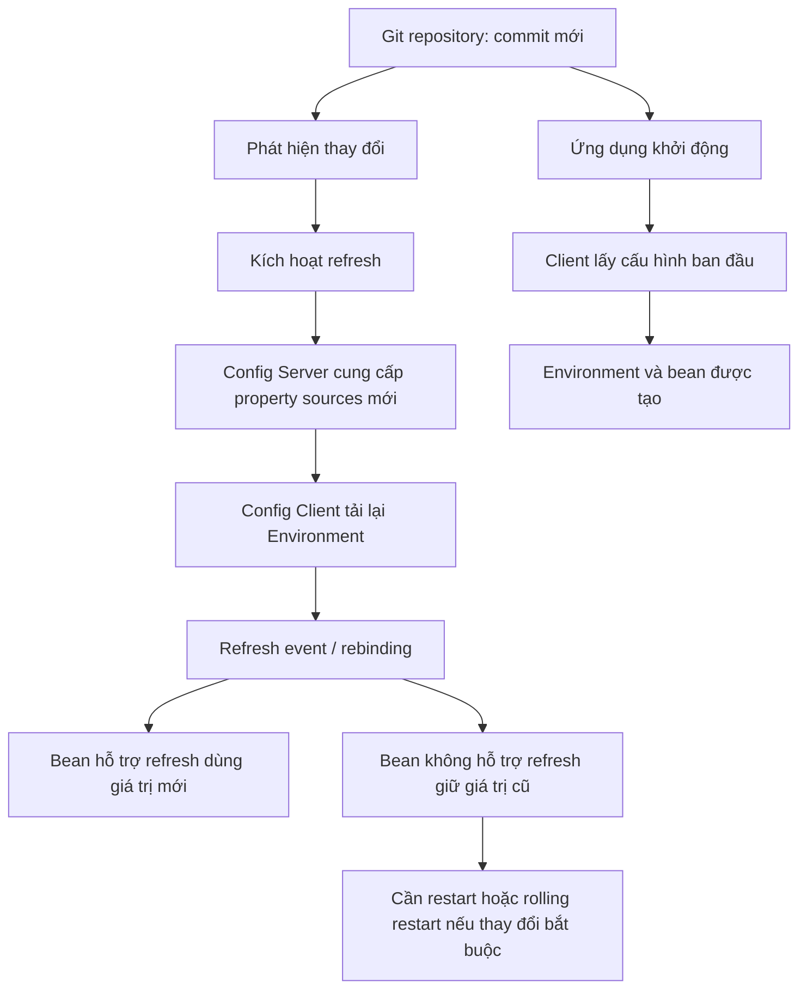
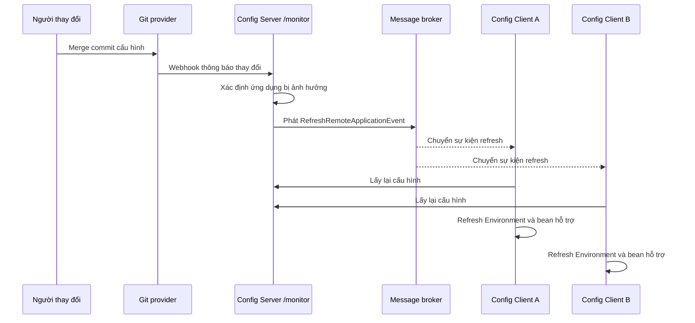

# Nạp lúc khởi động khác phát hiện và áp dụng thay đổi khi chạy

Trong hệ thống Spring Cloud Config, có ba việc thường bị hiểu nhầm là một: nạp cấu hình khi ứng dụng khởi động, phát hiện cấu hình ở nguồn trung tâm đã thay đổi và áp dụng giá trị mới vào một ứng dụng đang chạy. Chúng là ba giai đoạn riêng. Config Client thường tải cấu hình khi khởi động; một commit mới trong Git không tự làm các instance đang chạy thay đổi; và ngay cả khi client đã nhận cấu hình mới, chỉ những bean hoặc thành phần hỗ trợ refresh mới sử dụng được giá trị mới mà không khởi động lại.

Bài học này đặt ba giai đoạn đó trong kiến trúc Spring Cloud Config Server và Client, nơi Git là nguồn cấu hình có lịch sử, còn profile và label xác định bộ cấu hình được phân phối. Mục tiêu là thiết kế một luồng cập nhật có thể kiểm soát, quan sát và quay lui.

Sau bài học, bạn có thể:

- Mô tả luồng lấy cấu hình từ Git qua Config Server trong lúc Spring Boot khởi động.
- Phân biệt việc cập nhật repository, việc phát hiện thay đổi và việc refresh từng Config Client.
- Chọn cách kích hoạt cập nhật: thủ công, polling hoặc webhook kết hợp Spring Cloud Bus.
- Xác định bean nào cần `@RefreshScope`, bean nào có thể rebind và trường hợp cần restart.
- Thiết kế quy trình kiểm tra, bảo vệ và quay lui thay đổi cấu hình.

## 1. Ba giai đoạn trong vòng đời cấu hình

Hãy xét một dịch vụ `order-service` lấy cấu hình từ Config Server. Git repository có thể chứa `application.yml` dùng chung, `order-service.yml` riêng cho dịch vụ và `order-service-prod.yml` dành cho profile production. Config Server chọn property sources dựa trên application name, profile và label mà client yêu cầu.

Ba giai đoạn cần phân biệt:

1. **Nạp lúc khởi động (startup loading):** Config Client liên hệ Config Server, lấy property sources cho application/profile/label, đưa chúng vào Spring `Environment`, sau đó Spring tạo bean và bind cấu hình.
2. **Phát hiện thay đổi (change detection):** hệ thống nhận biết Git hoặc nguồn cấu hình đã có revision mới. Việc này cần một cơ chế riêng như webhook, polling hoặc thao tác của người vận hành.
3. **Áp dụng khi chạy (runtime refresh):** Config Client tải lại cấu hình và phát sự kiện refresh. Các bean hỗ trợ refresh được cập nhật hoặc tạo lại; các thành phần không hỗ trợ có thể vẫn giữ giá trị cũ.



Một commit thành công chỉ xác nhận nguồn cấu hình đã thay đổi. Nó không chứng minh Config Server đã nhìn thấy revision mới, Config Client đã tải revision đó hoặc toàn bộ bean trong client đã áp dụng giá trị mới.

## 2. Nạp cấu hình khi ứng dụng khởi động

Với Spring Boot hiện đại, Config Client có thể khai báo Config Server bằng Config Data import. Ví dụ:

```yaml
spring:
  application:
    name: order-service
  config:
    import: "configserver:http://config-server:8888"
  cloud:
    config:
      label: release-2026-11
```

Profile có thể được kích hoạt từ biến môi trường, tham số dòng lệnh hoặc cấu hình triển khai, ví dụ `SPRING_PROFILES_ACTIVE=prod`. Config Client gửi thông tin application, profile và label đến Config Server. Về mặt khái niệm, endpoint tra cứu có dạng:

```text
/{application}/{profile}/{label}
```

Với ví dụ trên, Config Server được yêu cầu cung cấp cấu hình cho `order-service`, profile `prod` và label `release-2026-11`. Label có thể là tên branch, tag hoặc commit mà Git backend hỗ trợ. Một label trỏ đến commit cụ thể giúp lần triển khai sau có thể tái tạo đúng bộ cấu hình; label là branch đang di chuyển sẽ lấy revision mới nhất mà server đang thấy.

Git repository có thể có các file:

```text
config-repo/
  application.yml
  application-prod.yml
  order-service.yml
  order-service-prod.yml
```

Ví dụ `order-service-prod.yml`:

```yaml
order:
  fulfillment:
    endpoint: https://fulfillment.internal
    connect-timeout: 2s
    max-attempts: 3
feature:
  expedited-checkout: false
```

Config Server kết hợp các property sources phù hợp với tên ứng dụng và profile. Quy tắc ưu tiên giữa các nguồn được quyết định bởi Spring Boot và cấu hình override của Spring Cloud Config. Sau khi client nhận được chúng, Spring đưa thuộc tính vào `Environment`, bind vào `@ConfigurationProperties` và giải quyết các placeholder `@Value` khi tạo bean.

Nếu Config Server là phụ thuộc bắt buộc, hãy dùng import không có tiền tố `optional:` để ứng dụng báo lỗi khởi động khi không thể lấy cấu hình cần thiết. Nếu dùng `optional:configserver:`, ứng dụng có thể tiếp tục khởi động khi server không truy cập được; khi đó phải bảo đảm các giá trị local mặc định đủ an toàn và ứng dụng có cách nhận biết nó đang chạy thiếu cấu hình từ xa.

Ở giai đoạn này, cấu hình được nạp trước khi phần lớn bean nghiệp vụ được tạo. Vì vậy, các giá trị dùng để mở cổng, thiết lập TLS, khởi tạo connection pool hoặc chọn hạ tầng thường cần có ngay lúc khởi động. Không nên giả định mọi thiết lập như vậy có thể đổi bằng refresh sau đó.

## 3. Vì sao commit Git không tự cập nhật client đang chạy?

Config Server đóng vai trò cung cấp cấu hình theo yêu cầu. Config Client lấy cấu hình khi khởi động và giữ môi trường cấu hình trong tiến trình của nó. Khi một commit mới xuất hiện trong Git:

- Git đã lưu revision mới.
- Config Server cần nhìn thấy revision đó trong working copy hoặc backend của nó.
- Các Config Client đang chạy vẫn giữ môi trường đã nạp trước đó cho đến khi chúng được kích hoạt refresh hoặc khởi động lại.

Config Server sử dụng bản sao repository Git ở phía server. Cách server đồng bộ bản sao này với remote repository phụ thuộc cấu hình backend, cache và `refreshRate`. Với cấu hình mặc định thường gặp, server kiểm tra cập nhật khi xử lý request; nếu đặt khoảng làm mới lớn hơn, có thể có độ trễ trước khi revision mới được cung cấp. Vì vậy, khi kiểm tra thay đổi, hãy xác nhận phản hồi trực tiếp từ Config Server đã chứa giá trị mới trước khi yêu cầu các client refresh.

Một phép thử đơn giản là gọi endpoint cấu hình tương ứng của Config Server trong môi trường kiểm thử, chẳng hạn:

```text
GET http://config-server:8888/order-service/prod/release-2026-11
```

Phản hồi biểu diễn các property sources mà client sẽ nhận. Endpoint này cũng có thể chứa thông tin nhạy cảm, vì vậy chỉ truy cập từ mạng và danh tính được phép; không đưa phản hồi đầy đủ vào log hoặc ticket công khai.

## 4. Phát hiện thay đổi: thủ công, polling và webhook

Phát hiện thay đổi trả lời câu hỏi: *khi nào hệ thống biết cần refresh?* Spring Cloud Config không mặc định biến mọi commit Git thành một lần cập nhật tức thì cho tất cả client. Cần chọn một cơ chế kích hoạt rõ ràng.

### Kích hoạt thủ công

Người vận hành hoặc pipeline sau khi triển khai cấu hình có thể gọi endpoint refresh trên một client, hoặc endpoint Bus nếu hệ thống đã cấu hình Spring Cloud Bus. Cách này đơn giản và dễ kiểm soát trong môi trường nhỏ, nhưng thao tác thủ công từng instance dễ bỏ sót khi số lượng replica tăng.

### Polling

Một scheduler hoặc công cụ vận hành có thể định kỳ kiểm tra revision/configuration version, sau đó gọi refresh khi phát hiện khác biệt. Polling dễ triển khai nhưng tạo độ trễ theo chu kỳ, sinh request đều đặn và cần tránh nhiều instance cùng phát hiện rồi kích hoạt refresh đồng thời. Nếu dùng polling, nên có giới hạn tần suất, timeout, retry có backoff và cơ chế chống kích hoạt trùng.

### Webhook kết hợp Config Monitor và Bus

Với hệ thống có nhiều ứng dụng, có thể dùng webhook từ Git provider để báo Config Server khi repository thay đổi. Spring Cloud Config Monitor cung cấp endpoint `/monitor` để nhận webhook từ các hệ thống Git được hỗ trợ. Khi kết hợp với Spring Cloud Bus, Config Server có thể phát sự kiện refresh đến các client liên quan.

Luồng khái quát:



Để triển khai luồng này cần cấu hình dependency Config Monitor ở Config Server, Spring Cloud Bus ở các thành phần tham gia, message broker được hỗ trợ và endpoint webhook có xác thực. Config Monitor có thể ánh xạ tên file thay đổi với ứng dụng bị ảnh hưởng; thay đổi file cấu hình dùng chung như `application.yml` có thể tác động đến nhiều ứng dụng. Cần kiểm thử cách ánh xạ file trong repository thực tế, đặc biệt khi dùng thư mục con hoặc nhiều tên file.

Webhook chỉ là tín hiệu rằng nguồn đã thay đổi. Client vẫn phải tải được cấu hình mới từ Config Server. Nếu webhook đến trước khi Config Server đồng bộ Git, client có thể refresh nhưng nhận lại revision cũ. Một pipeline đáng tin cậy nên đợi Config Server phục vụ đúng revision rồi mới phát tín hiệu refresh, hoặc có bước xác minh revision sau refresh.

## 5. Refresh ở phía Config Client

Với Spring Boot Actuator và Spring Cloud Context, client có thể cung cấp endpoint `POST /actuator/refresh` để tải lại cấu hình và phát sự kiện refresh trong tiến trình đó. Endpoint cần được bật/expose theo cấu hình Actuator của ứng dụng. Ví dụ cấu hình tối thiểu trong môi trường kiểm thử:

```yaml
management:
  endpoints:
    web:
      exposure:
        include: health,info,refresh
```

Sau khi endpoint được expose và bảo vệ bằng cơ chế xác thực phù hợp, thao tác refresh có dạng:

```bash
curl -X POST http://order-service:8080/actuator/refresh
```

Phản hồi thường là danh sách khóa cấu hình được xem là đã thay đổi. Phản hồi này giúp kiểm tra client nhận thấy thay đổi nào, nhưng không chứng minh mọi thành phần bên ngoài Spring đã tự cấu hình lại thành công.

Khi refresh xảy ra, Spring Cloud tải lại cấu hình từ Config Server và phát các sự kiện thay đổi môi trường. Các thành phần tích hợp với refresh có thể nhận giá trị mới. Ví dụ, bean có `@RefreshScope` được tạo lại khi được truy cập sau khi scope bị làm mới. Một số bean `@ConfigurationProperties` cũng được rebind theo cơ chế Spring Cloud Context; hành vi cụ thể phụ thuộc cách khai báo bean và phiên bản thư viện đang dùng.

### Dùng @RefreshScope cho bean cần tạo lại

Giả sử một client gọi dịch vụ fulfillment và cần cập nhật endpoint hoặc timeout mà không restart ứng dụng:

```java
import java.net.URI;
import java.time.Duration;

import org.springframework.beans.factory.annotation.Value;
import org.springframework.cloud.context.config.annotation.RefreshScope;
import org.springframework.stereotype.Component;

@Component
@RefreshScope
public class FulfillmentGateway {

    private final URI endpoint;
    private final Duration connectTimeout;

    public FulfillmentGateway(
            @Value("${order.fulfillment.endpoint}") URI endpoint,
            @Value("${order.fulfillment.connect-timeout:2s}") Duration connectTimeout) {
        this.endpoint = endpoint;
        this.connectTimeout = connectTimeout;
    }

    public URI endpoint() {
        return endpoint;
    }

    public Duration connectTimeout() {
        return connectTimeout;
    }
}
```

Khi refresh scope được làm mới, target bean cũ bị loại khỏi cache. Lần truy cập tiếp theo tạo target mới và giải quyết lại các placeholder. Bean cần được truy cập thông qua proxy do Spring quản lý; nếu mã giữ một tham chiếu đến object cũ được tạo bên ngoài Spring hoặc sao chép giá trị ra một nơi không refresh-aware, nơi đó vẫn có thể giữ giá trị cũ.

Không cần gắn `@RefreshScope` lên mọi bean. Chỉ dùng cho bean có thể tạo lại an toàn và thực sự cần đổi cấu hình khi tiến trình đang chạy. Việc tạo lại bean có thể làm gián đoạn một thao tác đang thực hiện nếu thiết kế không quản lý vòng đời và tài nguyên đúng cách.

### Environment, @Value và @ConfigurationProperties sau refresh

| Cách đọc | Hành vi cần hiểu |
|---|---|
| Gọi `Environment.getProperty(...)` mỗi lần cần giá trị | Có thể đọc giá trị mới sau khi Environment được refresh |
| Lưu kết quả `Environment.getProperty` vào field khi khởi tạo | Field vẫn giữ giá trị cũ nếu bean không được cập nhật |
| Tiêm `@Value` vào bean thông thường | Placeholder được giải quyết khi bean tạo; bean không tự đổi giá trị |
| Tiêm `@Value` vào bean thuộc `@RefreshScope` | Target được tạo lại khi scope refresh và có thể nhận giá trị mới |
| Dùng `@ConfigurationProperties` | Spring Cloud có cơ chế rebinding khi refresh; cần kiểm tra kiểu binding, vòng đời bean và phiên bản cụ thể |

Một record hoặc bean cấu hình bất biến được tạo bằng constructor không nhất thiết có thể cập nhật từng field tại chỗ. Nếu ứng dụng cần thay thế toàn bộ object cấu hình, hãy xác định rõ bean tiêu thụ nó có được tạo lại hay không. Viết kiểm thử tích hợp để chứng minh giá trị mới đi từ Config Server đến đúng nơi sử dụng.

## 6. Refresh một instance và refresh nhiều instance bằng Spring Cloud Bus

Endpoint `/actuator/refresh` tác động đến một client instance nhận request. Trong cụm nhiều replica, gọi endpoint đó trên một pod không tự làm mới các pod còn lại.

Spring Cloud Bus kết nối các ứng dụng qua message broker, thường là RabbitMQ hoặc Kafka. Khi một ứng dụng phát sự kiện refresh, Bus chuyển sự kiện đến các ứng dụng đã đăng ký. Endpoint Bus refresh thường có dạng:

```bash
curl -X POST http://config-client:8080/actuator/busrefresh
```

Endpoint phải được cấu hình expose và bảo vệ. Tên endpoint và cấu hình broker phải khớp với phiên bản Spring Cloud và hạ tầng triển khai. Khi một sự kiện được phát, các client nhận sự kiện sẽ tải lại cấu hình từ Config Server và refresh các bean hỗ trợ.

Bus hữu ích khi một thay đổi cần phân phối đến nhiều ứng dụng hoặc nhiều replica. Tuy nhiên, Bus không biến refresh thành giao dịch nguyên tử trên toàn cụm. Các instance có thể nhận sự kiện ở thời điểm khác nhau, mất kết nối broker, hoặc refresh thất bại riêng lẻ. Hệ thống cần theo dõi instance nào đã xử lý revision, phát hiện instance bị bỏ lỡ và có cách retry hoặc refresh bù.

Khi chỉ muốn refresh một nhóm ứng dụng, cần kiểm tra cơ chế định tuyến sự kiện và tên destination của Bus đang dùng. Đừng giả định mọi loại event luôn được gửi đến đúng một ứng dụng chỉ từ tên endpoint; hãy kiểm thử với topology và cấu hình destination thực tế.

## 7. Những thay đổi không thể áp dụng chỉ bằng refresh

Refresh cập nhật môi trường cấu hình và những bean tham gia cơ chế refresh. Nó không tự động chạy lại toàn bộ quá trình khởi động của JVM. Các thay đổi sau thường cần restart hoặc rolling restart, tùy thành phần và cách tích hợp:

- Cổng HTTP, địa chỉ bind hoặc một số thiết lập của embedded server.
- Cấu hình TLS/keystore đã được nạp vào listener lúc khởi động.
- Thông tin tạo connection pool hoặc driver mà thư viện không hỗ trợ tái cấu hình.
- Cấu hình khởi tạo một thư viện bên thứ ba không lắng nghe sự kiện refresh.
- Các giá trị đã được copy vào static field, singleton tự quản lý hoặc cache ngoài Spring.
- Những thiết lập được đọc đúng một lần trong startup hook.

Ví dụ, nếu thay đổi `server.port` trong Git rồi gọi refresh, không nên kỳ vọng web server đang lắng nghe tự chuyển sang cổng mới. Hãy lập kế hoạch rolling restart để instance mới khởi động với cấu hình mới, kiểm tra health và đưa traffic vào sau khi sẵn sàng.

Với cấu hình datasource, việc đổi URL hoặc credentials có thể cần tái tạo connection pool. Cần biết pool đang dùng có hỗ trợ refresh không, các connection đang mở được xử lý ra sao và có thể ảnh hưởng transaction đang chạy như thế nào. Không đưa thay đổi hạ tầng quan trọng vào production chỉ dựa trên việc endpoint refresh trả về thành công.

## 8. Quy trình quản trị một thay đổi cấu hình

Một luồng vận hành có kiểm soát nên ghi nhận được revision nguồn, đối tượng nhận thay đổi và kết quả áp dụng.

1. **Tạo thay đổi trong Git:** sửa đúng file application/profile, giữ tên khóa ổn định và tạo pull request để review.
2. **Kiểm tra trước khi merge:** xác thực YAML, kiểu dữ liệu, giá trị biên, profile bị ảnh hưởng và bí mật. Không đưa secret dạng rõ vào Git.
3. **Chọn revision triển khai:** xác định label là branch, tag hay commit. Với triển khai cần tái lập, ưu tiên label bất biến như tag hoặc commit.
4. **Xác nhận Config Server:** sau khi merge, kiểm tra Config Server đã phục vụ đúng revision và đúng application/profile/label.
5. **Phát hiện và kích hoạt:** dùng thao tác thủ công, polling hoặc webhook/Config Monitor kết hợp Bus theo thiết kế.
6. **Xác minh client:** theo dõi sự kiện refresh, các khóa thay đổi và trạng thái từng instance. Dùng endpoint quan sát có kiểm soát; che giá trị nhạy cảm.
7. **Kiểm tra hành vi:** xác nhận bean thực sự sử dụng giá trị mới, health check đạt và metric/log không xuất hiện lỗi tăng đột biến.
8. **Quay lui khi cần:** trỏ label về revision ổn định đã biết hoặc tạo commit revert, sau đó phát refresh/restart theo cùng quy trình. Ghi nhận instance nào đã nhận revision quay lui.

Với thay đổi có ảnh hưởng lớn, hãy áp dụng theo từng nhóm instance hoặc từng môi trường. Có thể triển khai vào staging, quan sát, rồi promote cùng revision cấu hình sang production. Nếu dùng label động, cần ghi lại commit SHA thực tế để biết mỗi môi trường đã nhận nội dung nào.

## 9. Bảo vệ luồng refresh và quan sát

Các endpoint như `/actuator/refresh`, `/actuator/busrefresh`, `/monitor`, `env` và `configprops` có thể ảnh hưởng đến ứng dụng hoặc tiết lộ thông tin cấu hình. Hãy:

- Chỉ expose endpoint cần thiết, trên mạng quản trị hoặc đường dẫn nội bộ.
- Bắt buộc xác thực và phân quyền; chỉ pipeline hoặc operator có thẩm quyền mới được kích hoạt refresh.
- Xác thực webhook từ Git provider, kiểm tra chữ ký/secret và giới hạn nguồn gửi.
- Bảo vệ kết nối đến broker và giới hạn quyền publish/subscribe Bus.
- Dùng TLS và xác thực khi Config Client kết nối Config Server.
- Che secret trong log, metric, trace và phản hồi chẩn đoán; không dump toàn bộ Environment.
- Ghi nhận revision, application, profile, label, thời điểm và kết quả refresh mà không ghi giá trị bí mật.

Một refresh event không nên được xem là bằng chứng duy nhất rằng triển khai thành công. Cần kết hợp revision mong đợi, trạng thái instance và kiểm tra chức năng sau cập nhật.

## 10. Lỗi thường gặp và cách chẩn đoán

| Hiện tượng | Nguyên nhân có thể | Cách xử lý |
|---|---|---|
| Git đã có commit mới nhưng Config Server trả giá trị cũ | Server chưa fetch revision hoặc cache/refreshRate chưa hết | Kiểm tra Git backend, label và phản hồi endpoint Config Server |
| Config Server trả giá trị mới nhưng client vẫn dùng giá trị cũ | Client chưa nhận trigger refresh hoặc refresh request thất bại | Kiểm tra event, Bus, quyền gọi endpoint và log Config Client |
| Một replica đã đổi, replica khác chưa đổi | Chỉ gọi local refresh hoặc Bus delivery không đồng đều | Kiểm tra từng instance và cấu hình Bus; phát refresh bù có kiểm soát |
| Endpoint refresh trả về khóa thay đổi nhưng hành vi không đổi | Bean giữ giá trị đã copy, không refresh-aware hoặc thư viện không hỗ trợ | Kiểm tra bean lifecycle, proxy, cache và yêu cầu restart |
| Webhook đã gửi nhưng không có refresh event | Monitor không nhận payload, không map được file hoặc Bus chưa cấu hình | Kiểm tra chữ ký, endpoint monitor, path mapping và broker |
| Refresh làm dịch vụ lỗi | Giá trị mới không hợp lệ hoặc bean tạo lại thất bại | Kiểm tra validation, log đã che dữ liệu và quay lui revision |
| Instance mới và cũ dùng cấu hình khác nhau | Rollout chưa hoàn tất hoặc các instance dùng label/revision khác nhau | Ghi nhận revision trên từng instance và hoàn tất rollout |

## 11. Tự kiểm tra

1. Vì sao một commit mới trong Git không tự thay đổi giá trị trong `Environment` của các Config Client đang chạy?
2. Khác biệt giữa webhook và `POST /actuator/refresh` là gì? Mỗi cơ chế giải quyết giai đoạn nào?
3. Trong cụm có sáu replica, vì sao gọi `/actuator/refresh` trên một replica không đủ để bảo đảm cả cụm đã cập nhật?
4. Một bean dùng `@Value` trong constructor thông thường có tự nhận giá trị mới sau refresh không? Điều gì thay đổi nếu bean dùng `@RefreshScope`?
5. Khi nào nên chọn rolling restart thay vì cố refresh nóng?
6. Sau khi webhook kích hoạt Bus refresh, những bằng chứng nào cần thu thập để xác nhận mọi instance đã nhận đúng revision?

Hãy thử nghiệm trong môi trường development: commit một thay đổi cho `order.fulfillment.connect-timeout`, xác nhận Config Server trả về giá trị mới, rồi gọi refresh cho một client. So sánh một bean thông thường với bean có `@RefreshScope`. Nếu chạy nhiều replica, kiểm tra từng replica trước và sau khi phát Bus refresh. Cuối cùng, thử quay lui về revision trước và xác minh các instance trở lại cùng một cấu hình đã biết là ổn định.

