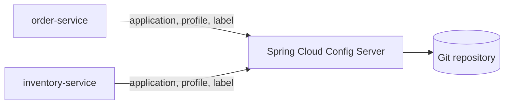
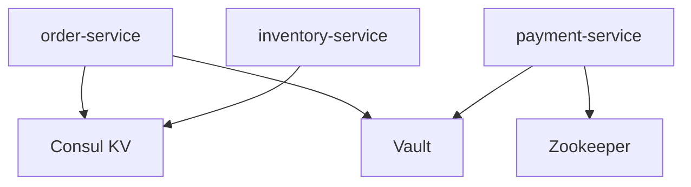
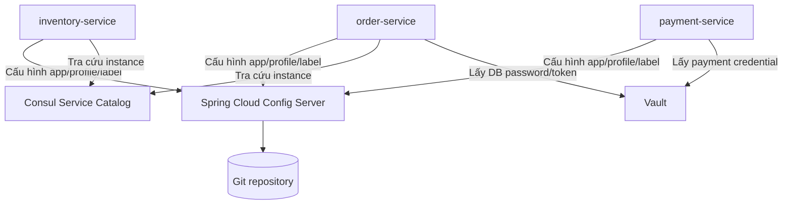

# Chọn Config Server hay nạp trực tiếp từ Consul, Zookeeper hoặc Vault

Khi nhiều ứng dụng Spring Boot cần cấu hình, nhóm phát triển có thể đặt một Spring Cloud Config Server ở giữa các ứng dụng và kho cấu hình, hoặc để từng ứng dụng nạp thuộc tính trực tiếp từ Consul, Zookeeper hay Vault. Hai cách tổ chức đều có thể hoạt động tốt; lựa chọn phù hợp phụ thuộc vào loại dữ liệu, khả năng của backend, cách phân quyền, yêu cầu quản trị phiên bản và mức độ phức tạp mà đội vận hành sẵn sàng đảm nhận.

Spring Cloud Config Server tạo một điểm truy cập cấu hình thống nhất cho Config Client. Consul và Zookeeper có thể cung cấp cấu hình qua tích hợp trực tiếp của Spring Cloud. Vault chủ yếu giải quyết bài toán quản lý bí mật và cũng có thể được tích hợp trực tiếp vào ứng dụng hoặc làm backend cho Config Server. Vì vậy, trước khi chọn kiến trúc, cần phân biệt cấu hình ứng dụng thông thường với bí mật và hiểu mỗi hệ thống chịu trách nhiệm gì.

## 1. Hai mô hình phân phối cấu hình

### Mô hình A: Ứng dụng lấy cấu hình qua Config Server

Config Client yêu cầu cấu hình từ Config Server bằng tên ứng dụng, profile và label. Config Server đọc backend được cấu hình, tổng hợp các property source rồi trả kết quả cho client.



Trong mô hình phổ biến dùng Git, repository lưu cấu hình dùng chung và cấu hình riêng theo ứng dụng. Config Server cung cấp API HTTP thống nhất; client không cần biết chi tiết cách repository được tổ chức hoặc cách server truy cập Git.

Ví dụ cấu hình client theo Spring Boot Config Data:

```yaml
spring:
  application:
    name: order-service
  config:
    import: "configserver:http://config-server:8888"
  profiles:
    active: production
```

Khai báo `spring.config.import` giúp Config Data tải cấu hình từ Config Server. Nếu dùng `optional:configserver:` thì client có thể tiếp tục khi Config Server không sẵn sàng; chỉ chọn cách này khi cấu hình cục bộ dự phòng đủ để ứng dụng khởi động đúng. Với cấu hình bắt buộc cho vận hành an toàn, hãy để việc không kết nối được Config Server làm quá trình khởi động thất bại rõ ràng.

### Mô hình B: Ứng dụng nạp trực tiếp từ backend

Trong mô hình này, mỗi ứng dụng tích hợp thư viện client tương ứng và kết nối tới backend để đọc cấu hình hoặc bí mật.



Ứng dụng chịu trách nhiệm biết địa chỉ backend, cách xác thực, cấu trúc đường dẫn hoặc key và cách chuyển dữ liệu thành thuộc tính Spring. Cách này giảm một lớp trung gian nhưng khiến từng ứng dụng phụ thuộc trực tiếp vào giao thức và chính sách của backend tương ứng.

Hai mô hình không loại trừ nhau. Một hệ thống có thể dùng Config Server cho cấu hình vận hành thông thường, Consul cho Service Discovery và Vault cho mật khẩu hoặc token. Việc phân chia này thường phù hợp hơn khi mỗi hệ thống có một nhiệm vụ rõ ràng.

## 2. Vai trò và đặc điểm của từng lựa chọn

| Thành phần | Vai trò chính | Phù hợp với | Điểm cần cân nhắc |
|---|---|---|---|
| Spring Cloud Config Server | Cung cấp API cấu hình tập trung cho nhiều client | Cấu hình ứng dụng dùng chung, cấu hình theo app/profile/label, quản trị thay đổi qua Git | Thêm một dịch vụ cần triển khai, bảo vệ, giám sát và duy trì tính sẵn sàng |
| Consul | Service Registry, health check và KV store | Service Discovery và các giá trị cấu hình có thể đọc từ Consul KV | Cần phân quyền ACL, tổ chức key, đồng bộ thay đổi và hiểu rõ cơ chế watch |
| Zookeeper | Coordination service và cây dữ liệu znodes | Cấu hình và điều phối cho hệ thống đã vận hành Zookeeper | Cần quản trị quorum, session, ACL, giới hạn kích thước dữ liệu và vòng đời node |
| Vault | Quản lý bí mật, chính sách truy cập và credential động | Password, token, certificate, khóa và bí mật có thời hạn | Cần thiết kế xác thực workload, policy, lease, renewal và khả năng sẵn sàng |

Consul và Zookeeper có thể được dùng làm nguồn cấu hình trực tiếp, nhưng không vì vậy mà mọi tính năng của chúng giống Config Server. Consul có thêm service catalog và health check; Zookeeper có mô hình cây dữ liệu và primitive điều phối. Vault tập trung vào bảo vệ bí mật, cấp phát credential động và kiểm soát quyền truy cập. Không nên dùng Vault như một kho Git thay thế cho toàn bộ cấu hình ứng dụng nếu nhu cầu chính là quản lý lịch sử và phiên bản cấu hình thông thường.

## 3. Khi nào nên chọn Spring Cloud Config Server?

Config Server phù hợp khi nhiều ứng dụng cần một hợp đồng truy cập cấu hình giống nhau và đội vận hành muốn quản lý thay đổi ở một nơi.

**Cấu hình dùng chung cho nhiều dịch vụ.** Các thuộc tính như mức log, timeout mặc định, giới hạn retry hoặc endpoint dịch vụ có thể được tổ chức thành cấu hình dùng chung và cấu hình riêng theo tên ứng dụng. Config Server cung cấp cùng một API cho các client, giảm việc mỗi dịch vụ phải tự tích hợp một backend khác nhau.

**Cần lịch sử thay đổi và khả năng quay lại phiên bản.** Khi backend là Git, mỗi thay đổi có thể được review qua pull request, gắn với commit, tag hoặc branch. Client có thể yêu cầu cấu hình theo label. Nhóm vận hành có thể xác định phiên bản cấu hình nào được phân phối cho một đợt triển khai và điều tra thay đổi đã gây ra sự cố.

**Muốn tách ứng dụng khỏi backend.** Client chỉ biết Config Server. Nhóm nền tảng có thể thay đổi cách lưu trữ hoặc cấu trúc backend trong phạm vi Config Server hỗ trợ mà không phải cập nhật tích hợp backend trong mọi ứng dụng. Sự tách biệt này có giá trị khi số lượng client lớn hoặc backend có thể thay đổi theo thời gian.

**Cần chính sách phân phối thống nhất.** Config Server là vị trí thuận tiện để thiết lập xác thực, TLS, kiểm soát truy cập và giám sát các yêu cầu lấy cấu hình. Tuy nhiên, quyền truy cập vẫn phải được phân chia theo ứng dụng và môi trường; một endpoint chung không đồng nghĩa mọi client được phép đọc mọi cấu hình.

Config Server cũng có chi phí. Đây là dịch vụ runtime mà client có thể cần truy cập lúc khởi động hoặc refresh. Cần triển khai đủ replica, quản lý kết nối backend, đặt timeout hợp lý, giám sát độ trễ và xác định hành vi khi server không sẵn sàng. Nếu Config Server là điểm phụ thuộc bắt buộc mà chỉ có một instance, nó có thể trở thành điểm lỗi tập trung.

## 4. Khi nào nên nạp trực tiếp từ Consul?

Consul có hai khả năng thường được dùng trong kiến trúc Spring Cloud: Service Discovery và KV store. Nếu hệ thống đã vận hành Consul, ứng dụng có thể dùng Spring Cloud Consul Config để nạp cấu hình từ KV, đồng thời dùng tích hợp discovery nếu cần tra cứu dịch vụ.

Ví dụ cấu hình khái quát cho client Consul Config trên Spring Boot Config Data:

```yaml
spring:
  application:
    name: order-service
  config:
    import: "optional:consul:"
  cloud:
    consul:
      host: consul.internal
      port: 8500
      config:
        enabled: true
        format: YAML
        prefixes: config
        default-context: application
```

Ứng dụng cần dependency tích hợp Consul Config tương ứng với release train Spring Cloud đang sử dụng. Ví dụ trên minh họa điểm cấu hình chính; cấu trúc key trong KV, cách lưu YAML và profile separator cần được thống nhất giữa các dịch vụ. Tùy phiên bản, các tùy chọn mặc định và cách phân giải context có thể khác nhau, vì vậy cần kiểm tra tài liệu đúng phiên bản trước khi triển khai.

Nạp trực tiếp từ Consul có lợi khi:

- Consul đã là dịch vụ hạ tầng được vận hành ổn định và ứng dụng cần dùng KV store.
- Muốn một backend hỗ trợ cả tra cứu dịch vụ và một số giá trị cấu hình.
- Cấu hình tương đối nhỏ, cấu trúc key đơn giản và không cần API trung gian riêng.
- Đội nền tảng có thể cấp ACL riêng cho từng workload, theo dõi thay đổi KV và bảo đảm Consul sẵn sàng.

Consul KV không tự động thay thế quy trình quản trị thay đổi kiểu Git. Nếu cần review, phê duyệt, lịch sử, rollback và promotion giữa môi trường, cần xây dựng quy trình xung quanh thao tác cập nhật KV hoặc dùng Config Server với backend phù hợp. Cũng cần phân biệt service catalog với KV: catalog cung cấp thông tin đăng ký và trạng thái dịch vụ; KV lưu dữ liệu cấu hình do hệ thống ghi vào.

## 5. Khi nào nên nạp trực tiếp từ Zookeeper?

Zookeeper lưu dữ liệu theo cây znodes và cung cấp các cơ chế điều phối phân tán. Spring Cloud Zookeeper Config cho phép ứng dụng nạp thuộc tính từ cấu trúc node đã quy ước.

Ví dụ cấu hình khái quát:

```yaml
spring:
  application:
    name: order-service
  config:
    import: "optional:zookeeper:"
  cloud:
    zookeeper:
      connect-string: zk-1.internal:2181,zk-2.internal:2181,zk-3.internal:2181
      config:
        enabled: true
        root: config
        default-context: application
        profile-separator: ","
```

Ứng dụng cần dependency Spring Cloud Zookeeper Config tương ứng. Các thuộc tính ví dụ cho biết cách khai báo kết nối và vùng cấu hình; cấu trúc znodes, quyền ACL và cách phân chia theo ứng dụng/profile phải được thống nhất trong toàn hệ thống. Hãy xác minh thuộc tính hỗ trợ trong phiên bản Spring Cloud đang dùng trước khi áp dụng.

Nạp trực tiếp từ Zookeeper phù hợp khi Zookeeper đã là thành phần nền tảng của hệ thống, dữ liệu cấu hình nhỏ, đội vận hành đã có kinh nghiệm quản trị quorum và client cần tận dụng mô hình watch hoặc coordination sẵn có.

Không nên bổ sung Zookeeper chỉ để lưu vài giá trị cấu hình nếu hệ thống chưa có nhu cầu coordination. Một cluster Zookeeper cần số lượng node phù hợp, quorum khỏe mạnh, quản trị session và ACL. Client kết nối trực tiếp làm tăng số workload có quyền truy cập vào cụm; cần giới hạn quyền đọc theo namespace hoặc node phù hợp. Zookeeper cũng không cung cấp trải nghiệm review và lịch sử thay đổi cấu hình theo kiểu Git một cách tự động.

## 6. Khi nào nên nạp trực tiếp từ Vault?

Vault chuyên quản lý bí mật. Ứng dụng có thể dùng Spring Cloud Vault để nạp các thuộc tính nhạy cảm từ Vault vào Spring Environment, thường thông qua Config Data import.

Ví dụ khai báo nguồn Vault:

```yaml
spring:
  config:
    import: "vault://"
  cloud:
    vault:
      uri: https://vault.internal:8200
      authentication: KUBERNETES
      kubernetes:
        role: order-service
```

Ví dụ này minh họa phương thức xác thực workload bằng Kubernetes. Pod cần có service account và cấu hình xác thực phù hợp với Vault; token hoặc thông tin xác thực không nên được ghi cứng trong file cấu hình hoặc image. Cần bật TLS và thiết lập policy chỉ cho phép workload đọc đúng secret path cần thiết.

Vault trực tiếp phù hợp khi ứng dụng cần:

- Mật khẩu database, API token hoặc credential cho dịch vụ bên ngoài.
- Credential động có thời hạn, có thể thu hồi và gia hạn theo lease.
- Chứng thư hoặc khóa được cấp phát theo policy.
- Audit việc truy cập bí mật và giới hạn quyền theo danh tính workload.

Vault không nên trở thành nơi chứa mọi tham số thông thường như mức log, timeout hay feature flag nếu không có lý do rõ ràng. Những giá trị đó thường dễ quản trị hơn trong Git/Config Server hoặc một nguồn cấu hình phù hợp. Tách cấu hình thông thường khỏi bí mật giúp policy Vault tập trung vào dữ liệu có rủi ro cao và giảm số lần workload phải xin quyền đọc secret.

Một ứng dụng có thể dùng cả Config Server và Vault: Config Server cung cấp tham số không nhạy cảm; Vault cung cấp password hoặc token. Nếu dùng Vault làm backend cho Spring Cloud Config Server, cần phân biệt server truy cập Vault rồi phân phối property source với client tự xác thực và đọc Vault trực tiếp. Hai cách có ranh giới tin cậy, nơi lưu credential và mô hình phân quyền khác nhau.

## 7. So sánh theo tiêu chí kiến trúc

| Tiêu chí | Config Server | Nạp trực tiếp Consul/Zookeeper | Nạp trực tiếp Vault |
|---|---|---|---|
| API cho client | API cấu hình HTTP thống nhất | Client tích hợp theo backend | Client tích hợp Vault và phương thức xác thực |
| Cấu hình dùng chung | Phù hợp, có thể chia sẻ theo application/profile | Có thể làm qua key/context và quy ước namespace | Có thể chia sẻ secret theo policy, không phải mục tiêu chính cho cấu hình thông thường |
| Phiên bản cấu hình | Label có thể trỏ branch, tag hoặc commit khi backend hỗ trợ | Phụ thuộc cách quản lý KV/znodes và quy trình xung quanh | Versioning tùy secrets engine và cấu hình Vault; bí mật động có lease riêng |
| Phân quyền | Tập trung tại server và backend; cần phân quyền client theo tài nguyên | Mỗi workload cần quyền backend phù hợp | Policy theo path và danh tính; hỗ trợ audit, lease và thu hồi |
| Tích hợp discovery | Không phải registry; có thể phối hợp với discovery riêng | Consul có service catalog; Zookeeper có tích hợp discovery riêng | Không phải service registry |
| Thành phần vận hành | Thêm Config Server ngoài backend | Không thêm server cấu hình trung gian nhưng client phụ thuộc trực tiếp backend | Không thêm server cấu hình trung gian nhưng client phụ thuộc trực tiếp Vault |
| Phù hợp nhất | Cấu hình ứng dụng có quản trị và phân phối tập trung | Hệ thống đã dùng Consul/Zookeeper và cần nạp cấu hình từ đó | Bí mật, credential động và dữ liệu cần policy bảo mật |

Không có lựa chọn thắng ở mọi tiêu chí. Hãy đánh giá theo yêu cầu thực tế: số lượng ứng dụng, số môi trường, nhu cầu audit, rollback, khả năng phân quyền, mức độ sẵn sàng của backend và kỹ năng vận hành hiện có.

## 8. Mô hình kết hợp thường gặp

Với một nền tảng Spring Boot có nhiều dịch vụ, cách phân chia sau thường dễ quản trị:



Trong mô hình này:

1. Git lưu cấu hình thông thường như timeout, retry, feature flag và endpoint logic. Config Server cung cấp cấu hình theo ứng dụng, profile và label.
2. Consul quản lý đăng ký dịch vụ và health check. Ứng dụng tra cứu instance qua discovery client khi cần.
3. Vault lưu bí mật và cấp quyền theo danh tính workload. Credential có thể được cấp ngắn hạn, gia hạn hoặc thu hồi theo policy.

Nếu nền tảng đã dùng Kubernetes Service/DNS để discovery, có thể không cần Consul chỉ cho mục đích tìm dịch vụ. Nếu đã dùng Consul KV cho cấu hình và quy trình cập nhật đơn giản, có thể nạp trực tiếp từ Consul mà không cần thêm Config Server. Nếu chỉ có một vài bí mật, Vault vẫn có thể được dùng độc lập mà không cần đưa toàn bộ cấu hình ứng dụng vào Vault.

## 9. Các câu hỏi cần trả lời trước khi quyết định

Trước khi chốt kiến trúc, hãy làm rõ các câu hỏi sau:

1. **Dữ liệu cần quản lý là gì?** Timeout, feature flag và endpoint thuộc cấu hình ứng dụng; mật khẩu, token và private key thuộc bí mật; danh sách instance đang hoạt động thuộc Service Discovery.
2. **Có cần một API cấu hình thống nhất không?** Nếu nhiều ứng dụng cần cùng cách truy cập và cần che giấu backend, Config Server có lợi thế.
3. **Có cần review, lịch sử và rollback theo Git không?** Nếu có, dùng Git làm backend của Config Server thường phù hợp hơn việc ghi trực tiếp KV/znodes.
4. **Backend đã tồn tại và được vận hành tốt chưa?** Tận dụng Consul hoặc Zookeeper hiện có có thể giảm số thành phần mới, nhưng cần tính cả chi phí phân quyền và kết nối trực tiếp từ từng workload.
5. **Có cần bí mật động hoặc rotation không?** Nếu có, Vault thường phù hợp hơn việc lưu credential lâu dài trong repository cấu hình.
6. **Ứng dụng phải làm gì khi backend không sẵn sàng?** Xác định fail-fast, cache, cấu hình cục bộ dự phòng, retry và timeout cho cả lúc khởi động lẫn refresh.
7. **Ai được đọc hoặc thay đổi cấu hình?** Thiết kế quyền theo workload, ứng dụng, môi trường và loại dữ liệu; không dùng profile như một ranh giới bảo mật.

Một quyết định tốt cần nêu được nguồn có thẩm quyền cho từng loại dữ liệu, luồng xác thực, cách cập nhật, cách quay lại phiên bản cũ và hành vi khi hệ thống nguồn bị lỗi. Việc có thêm một tầng trung gian chỉ đáng giá khi nó giải quyết được nhu cầu về chuẩn hóa, quản trị và kiểm soát truy cập.

## 10. Mục tiêu cần đạt sau bài học

Sau bài này, người học cần có khả năng:

- Giải thích được luồng lấy cấu hình qua Spring Cloud Config Server và luồng nạp trực tiếp từ backend.
- So sánh được vai trò của Config Server, Consul KV, Zookeeper và Vault.
- Chọn được trường hợp nên dùng Config Server để quản trị cấu hình theo application, profile và label.
- Nhận diện được trường hợp phù hợp để nạp trực tiếp từ Consul hoặc Zookeeper.
- Giải thích vì sao Vault phù hợp với bí mật và credential động hơn các tham số cấu hình thông thường.
- Thiết kế được mô hình kết hợp Config Server, Service Discovery và Vault với ranh giới trách nhiệm rõ ràng.
- Đánh giá được tác động của lựa chọn kiến trúc tới bảo mật, tính sẵn sàng, lịch sử thay đổi và vận hành.

**Tự kiểm tra:** Một hệ thống có 20 dịch vụ Spring Boot, cấu hình timeout cần review và rollback qua Git, Consul đã được vận hành cho Service Discovery, còn password database cần rotation tự động. Một phương án hợp lý là dùng Config Server với Git cho timeout và các thuộc tính thông thường, Consul cho discovery, Vault cho password động. Nếu nhóm quyết định nạp trực tiếp từ Consul KV thay Config Server, cần giải thích cách thay thế quy trình review, lịch sử, phân quyền và rollback cấu hình trước khi chọn phương án đó.
