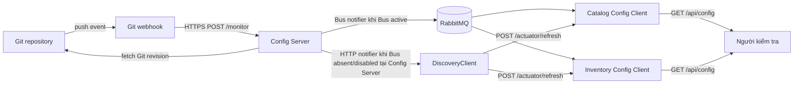

# Tự động kích hoạt làm mới từ webhook của kho Git

Bài thực hành này xây dựng một luồng hoàn chỉnh: thay đổi file cấu hình trong Git, Git provider gửi webhook đến Spring Cloud Config Server, Config Server xác thực và nhận diện file thay đổi, sau đó thông báo refresh qua Spring Cloud Bus hoặc HTTP notifier tùy cấu hình để các Config Client tải lại cấu hình. Bạn sẽ kiểm tra từng chặng bằng Environment API, log, Bus trace và giá trị mà ứng dụng đang phục vụ.

Dự án mô phỏng hai dịch vụ Spring Boot dùng chung một kho cấu hình. **catalog-service** có cấu hình riêng theo profile **prod**; **inventory-service** dùng một bộ thuộc tính riêng. Khi thay đổi file của Catalog, chỉ client tương ứng cần refresh. Khi thay đổi **application.yml**, mọi client nhận cấu hình chung có thể cần refresh.

## Kết quả cần đạt

Sau khi hoàn thành, bạn có thể:

- Tạo Git repository chứa cấu hình chung và cấu hình riêng theo application/profile.
- Chạy Config Server dùng Git backend và Spring Cloud Bus.
- Chạy Config Client có **spring-cloud-starter-bus-amqp**.
- Cấu hình webhook push từ Git provider đến endpoint **/monitor**.
- Bảo vệ webhook bằng secret và chữ ký HMAC.
- Theo dõi event refresh từ Config Server đến các client.
- Xác minh client đã nạp revision mới bằng API của ứng dụng.
- Chẩn đoán webhook được nhận nhưng cấu hình vẫn cũ.
- Quay lại revision cấu hình đã biết khi phát hành có lỗi.

## 1. Kiến trúc phòng lab

Luồng thực hành:



Các thành phần:

| Thành phần | Vai trò |
|---|---|
| Git repository | Nguồn cấu hình có version control, commit và tag. |
| Config Server | Đọc Git backend, cung cấp Environment API và nhận webhook tại **/monitor**. |
| Git provider | Gửi webhook cho push event; nếu chỉ xử lý một branch, lọc riêng trường `ref` trong payload. |
| RabbitMQ | Chuyển tiếp sự kiện Spring Cloud Bus giữa các ứng dụng. |
| Config Client | Tải cấu hình từ Config Server và làm mới Environment/bean khi nhận event. |
| Actuator và log | Cung cấp health, trạng thái refresh và bằng chứng chẩn đoán. |

**Điều kiện quan trọng:** **spring-cloud-config-monitor** phải có trên Config Server. Với luồng Bus của lab này, Spring Cloud Bus phải được bật ở cả Config Server và từng Config Client. Nếu Bus chỉ hoạt động ở Config Server nhưng một client thiếu Bus starter, client đó sẽ không nhận **RefreshRemoteApplicationEvent**; Config Server không tự chuyển riêng client đó sang HTTP notifier.

### HTTP notifier trong Spring Cloud Config 5.1

Spring Cloud Config 5.1 có thêm **HTTP property path notifier** như một lựa chọn thay cho Bus. Khi Bus không có hoặc bị tắt ở Config Server, HTTP notifier có thể được auto-configure nếu ứng dụng có một **DiscoveryClient** và `RestClient.Builder`. Nó dùng DiscoveryClient tìm các instance của những application bị ảnh hưởng, rồi gửi HTTP `POST` đến refresh endpoint của từng instance.

Khi Bus có mặt và được bật ở Config Server, Bus notifier được ưu tiên. Không xem HTTP notifier là fallback theo từng client: nếu Config Server vẫn đang dùng Bus nhưng một Config Client không tham gia Bus, instance đó sẽ bỏ lỡ event. Để dùng HTTP path, hãy chọn nó ở phía Config Server (Bus không có hoặc đặt `spring.cloud.bus.enabled=false`) và bảo đảm các ứng dụng đăng ký trong service discovery, đồng thời expose endpoint refresh tương ứng.

HTTP notifier mặc định gọi **`/actuator/refresh`**. Có thể cấu hình endpoint theo application:

```yaml
spring:
  cloud:
    config:
      server:
        monitor:
          http:
            endpoints:
              catalog-service: /management/refresh
              inventory-service: /actuator/custom-refresh
```

Hoặc đặt metadata **`refresh-endpoint`** trên từng `ServiceInstance`. Cấu hình endpoint theo application có độ ưu tiên cao hơn metadata; nếu cả hai đều không có, notifier dùng `/actuator/refresh`. Client đích phải expose endpoint đã chọn và bảo vệ nó bằng authentication/network policy. Lab hiện tại dùng Bus AMQP ở server và clients, vì vậy HTTP notifier là phương án triển khai thay thế, không phải một bước đã được chạy trong lab. Tham khảo [HTTP Property Path Notifications](https://docs.spring.io/spring-cloud-config/reference/server/push-notifications-and-bus.html).

## 2. Chuẩn bị môi trường

Cần có:

- JDK và Maven tương thích với phiên bản Spring Boot được chọn.
- Git.
- Một Git repository mà Config Server có thể đọc.
- RabbitMQ.
- Một địa chỉ HTTPS công khai trỏ đến Config Server để Git provider gửi webhook. Khi chạy trên máy local, dùng tunnel HTTPS có kiểm soát hoặc triển khai Config Server ở môi trường staging.
- Tài khoản Git provider có quyền cấu hình webhook.

### Chọn phiên bản Spring Boot và Spring Cloud

Dùng Spring Cloud BOM tương thích với Spring Boot release đang chọn. Không chọn ngẫu nhiên phiên bản **spring-cloud-*** riêng lẻ. Tài liệu Spring Cloud có bảng tương thích giữa release train và Spring Boot; hãy chốt một cặp phiên bản đã được hỗ trợ rồi dùng xuyên suốt Config Server và Config Client.

Vì project mở endpoint webhook **`/monitor`**, hãy pin Spring Cloud Config **5.1.0** cùng Spring Boot tương thích. Nếu phải dùng nhánh cũ, tối thiểu phải ở bản đã vá: **5.0.5**, **4.3.5**, **4.2.9** hoặc **3.1.15** (một số bản 4.x/3.x chỉ có qua Enterprise Support). Các bản bị ảnh hưởng bởi **CVE-2026-47837** không xác thực webhook ở `/monitor`; chỉ cấu hình `webhook-secret` không thể bảo vệ chúng vì code của các bản đó chưa kiểm tra chữ ký. Kiểm tra version thực tế trong dependency tree trước khi mở endpoint:

```bash
mvn dependency:tree -Dincludes=org.springframework.cloud:spring-cloud-config-monitor
```

Tham khảo [Spring Security Advisory CVE-2026-47837](https://spring.io/security/cve-2026-47837).

Ví dụ cấu trúc Maven rút gọn:

```xml
<dependencyManagement>
    <dependencies>
        <dependency>
            <groupId>org.springframework.cloud</groupId>
            <artifactId>spring-cloud-dependencies</artifactId>
            <version>SPRING_CLOUD_VERSION</version>
            <type>pom</type>
            <scope>import</scope>
        </dependency>
    </dependencies>
</dependencyManagement>
```

**SPRING_CLOUD_VERSION** là phiên bản release train đã chọn theo ma trận tương thích. Spring Boot parent hoặc Spring Boot BOM được quản lý riêng theo phiên bản dự án.

## 3. Tạo Git repository cấu hình

Tạo repository tên **platform-config**. Dùng branch **main** cho lab; trong production, nên phát hành bằng tag hoặc commit SHA đã được phê duyệt để có thể tái hiện cấu hình.

Cấu trúc ban đầu:

```text
platform-config/
├── application.yml
├── catalog-service.yml
├── catalog-service-prod.yml
└── inventory-service.yml
```

### File cấu hình chung

**application.yml**:

```yaml
platform:
  support:
    contact: platform-team@example.internal

catalog:
  feature:
    checkout-enabled: false
```

File này cung cấp giá trị mặc định chung. Một thay đổi ở **application.yml** có thể ảnh hưởng nhiều application, vì vậy webhook cho file này thường dẫn đến refresh diện rộng.

### Cấu hình mặc định của Catalog

**catalog-service.yml**:

```yaml
catalog:
  message: "Catalog default configuration"
  release-id: "catalog-default"
  feature:
    checkout-enabled: false
```

### Cấu hình production của Catalog

**catalog-service-prod.yml**:

```yaml
catalog:
  message: "Catalog production configuration v1"
  release-id: "catalog-prod-v1"
  feature:
    checkout-enabled: true
```

### Cấu hình Inventory

**inventory-service.yml**:

```yaml
inventory:
  message: "Inventory default configuration"
  release-id: "inventory-v1"
```

Commit và push các file:

```bash
git add application.yml catalog-service.yml catalog-service-prod.yml inventory-service.yml
git commit -m "config: add initial service configuration"
git push origin main
```

Ghi lại commit SHA. Config Server sẽ dùng branch **main** trong lab. Khi kiểm tra release production, hãy ghi cả label và revision thực tế.

## 4. Tạo ứng dụng Config Server

Tạo một Spring Boot project tên **config-server**.

### Dependencies

Thêm các dependency sau vào **pom.xml**:

```xml
<dependencies>
    <dependency>
        <groupId>org.springframework.cloud</groupId>
        <artifactId>spring-cloud-config-server</artifactId>
    </dependency>

    <dependency>
        <groupId>org.springframework.cloud</groupId>
        <artifactId>spring-cloud-config-monitor</artifactId>
    </dependency>

    <dependency>
        <groupId>org.springframework.cloud</groupId>
        <artifactId>spring-cloud-starter-bus-amqp</artifactId>
    </dependency>

    <dependency>
        <groupId>org.springframework.boot</groupId>
        <artifactId>spring-boot-starter-actuator</artifactId>
    </dependency>
</dependencies>
```

**spring-cloud-config-server** cung cấp Config Server; **spring-cloud-config-monitor** bổ sung webhook monitor; **spring-cloud-starter-bus-amqp** kích hoạt Bus qua RabbitMQ.

### Main class

```java
package com.example.configserver;

import org.springframework.boot.SpringApplication;
import org.springframework.boot.autoconfigure.SpringBootApplication;
import org.springframework.cloud.config.server.EnableConfigServer;

@SpringBootApplication
@EnableConfigServer
public class ConfigServerApplication {

    public static void main(String[] args) {
        SpringApplication.run(ConfigServerApplication.class, args);
    }
}
```

### Cấu hình application.yml

```yaml
server:
  port: 8888

spring:
  application:
    name: config-server

  cloud:
    config:
      server:
        git:
          uri: ${CONFIG_REPO_URI}
          default-label: main
          clone-on-start: true
          refresh-rate: 10
          username: ${CONFIG_REPO_USERNAME:}
          password: ${CONFIG_REPO_TOKEN:}

        monitor:
          github:
            webhook-secret: ${GITHUB_WEBHOOK_SECRET}
          ignored-paths:
            - "docs/.*"
            - "README\\.md"
          max-paths: 20

    bus:
      trace:
        enabled: true

  rabbitmq:
    host: ${RABBITMQ_HOST:localhost}
    port: ${RABBITMQ_PORT:5672}
    username: ${RABBITMQ_USERNAME:configbus}
    password: ${RABBITMQ_PASSWORD}

management:
  endpoints:
    web:
      exposure:
        include: health,info,bustrace
  endpoint:
    health:
      probes:
        enabled: true
```

Thay các biến môi trường bằng giá trị phù hợp:

| Biến | Ý nghĩa |
|---|---|
| **CONFIG_REPO_URI** | URL clone Git mà Config Server dùng để fetch repository. |
| **CONFIG_REPO_USERNAME** | Username nếu repository private dùng HTTPS authentication. |
| **CONFIG_REPO_TOKEN** | Token đọc repository; không ghi vào Git. |
| **GITHUB_WEBHOOK_SECRET** | Secret dùng để xác minh webhook GitHub. |
| **RABBITMQ_HOST** | Host broker; mặc định **localhost** cho ứng dụng chạy trên máy host. |
| **RABBITMQ_USERNAME / RABBITMQ_PASSWORD** | Tài khoản broker dành riêng cho lab. |

Với repository public, có thể bỏ username/token nếu backend cho phép clone không xác thực. Với repository private, dùng token chỉ có quyền đọc cần thiết. Không nhúng credential vào **CONFIG_REPO_URI** vì URI có thể xuất hiện trong log.

Thiết lập các biến lab trước khi chạy Config Server. Thay URL bằng URL clone thật của repository và tạo một webhook secret riêng:

```bash
export CONFIG_REPO_URI="https://github.com/<owner>/platform-config.git"
export GITHUB_WEBHOOK_SECRET="<random-secret>"
export RABBITMQ_USERNAME="configbus"
export RABBITMQ_PASSWORD="local-only-password"
```

Trong PowerShell, dùng cú pháp tương đương:

```powershell
$env:CONFIG_REPO_URI = "https://github.com/<owner>/platform-config.git"
$env:GITHUB_WEBHOOK_SECRET = "<random-secret>"
$env:RABBITMQ_USERNAME = "configbus"
$env:RABBITMQ_PASSWORD = "local-only-password"
```

Nếu repository private, thiết lập thêm **CONFIG_REPO_USERNAME** và **CONFIG_REPO_TOKEN**. Giá trị mẫu chỉ dùng trong lab local; trong môi trường dùng chung, cấp các secret từ secret manager thay vì lưu trong shell profile hoặc file cấu hình.

**refresh-rate: 10** giúp lab có khoảng fetch ngắn. Khi webhook chứa repository URL khớp với URL Git backend, Config Server sẽ làm hết hạn refresh interval của repository trước khi thông báo ứng dụng. Nếu payload không nhận diện được repository, ứng dụng vẫn có thể được thông báo nhưng repository có thể tiếp tục dùng clone cũ cho đến lần refresh kế tiếp. Tham khảo [cơ chế nhận diện repository trong webhook](https://docs.spring.io/spring-cloud-config/reference/server/push-notifications-and-bus.html).

Việc nhận diện repository so sánh **host và repository path**. So sánh không phụ thuộc protocol, credential, SSH username hoặc port; host/path được so sánh không phân biệt hoa thường, chuẩn hóa slash ở đầu/cuối và hậu tố **`.git`**. Vì vậy webhook GitHub có thể gửi `clone_url` dạng HTTPS trong khi Config Server clone cùng repository bằng SSH:

| Nguồn | Repository URL |
|---|---|
| GitHub webhook `clone_url` | `https://github.com/acme/platform-config.git` |
| Config Server `spring.cloud.config.server.git.uri` | `ssh://git@github.com:2222/acme/platform-config.git` |

Hai URL trên vẫn nhận diện cùng repository vì host là `github.com` và path là `acme/platform-config`. Nếu host hoặc repository path khác, Config Server có thể không expire refresh interval: webhook vẫn có thể xác định application cần thông báo, nhưng lần client đọc cấu hình tiếp theo có thể lấy clone cũ. Khi đó hãy kiểm tra payload `clone_url`/`ssh_url`, Git URI và trường `version` từ Environment API.

## 5. Khởi chạy RabbitMQ

Tạo file **compose.yaml** cho broker dùng trong lab:

```yaml
services:
  rabbitmq:
    image: rabbitmq:3-management
    hostname: rabbitmq
    environment:
      RABBITMQ_DEFAULT_USER: configbus
      RABBITMQ_DEFAULT_PASS: local-only-password
    ports:
      - "5672:5672"
      - "15672:15672"
    healthcheck:
      test: ["CMD", "rabbitmq-diagnostics", "-q", "ping"]
      interval: 10s
      timeout: 5s
      retries: 10
```

Khởi động:

```bash
docker compose up -d
docker compose ps
```

RabbitMQ management UI của lab có thể truy cập ở **http://localhost:15672**. Chỉ dùng tài khoản và mật khẩu ví dụ trong môi trường local cô lập; thay bằng secret riêng trong staging/production. Không public cổng management ra Internet.

## 6. Tạo Config Client

Tạo project **catalog-service**.

### Dependencies

```xml
<dependencies>
    <dependency>
        <groupId>org.springframework.boot</groupId>
        <artifactId>spring-boot-starter-web</artifactId>
    </dependency>

    <dependency>
        <groupId>org.springframework.boot</groupId>
        <artifactId>spring-boot-starter-actuator</artifactId>
    </dependency>

    <dependency>
        <groupId>org.springframework.cloud</groupId>
        <artifactId>spring-cloud-starter-config</artifactId>
    </dependency>

    <dependency>
        <groupId>org.springframework.cloud</groupId>
        <artifactId>spring-cloud-starter-bus-amqp</artifactId>
    </dependency>
</dependencies>
```

Bus starter ở client là bắt buộc để client tham gia broker và nhận **RefreshRemoteApplicationEvent**.

### Cấu hình Config Data

**application.yml** của Catalog:

```yaml
server:
  port: ${SERVER_PORT:8081}

spring:
  application:
    name: catalog-service

  profiles:
    active: prod

  config:
    import: "configserver:${CONFIG_SERVER_URL:http://localhost:8888}"

  cloud:
    config:
      label: ${CONFIG_LABEL:main}

    bus:
      trace:
        enabled: true

  rabbitmq:
    host: ${RABBITMQ_HOST:localhost}
    port: ${RABBITMQ_PORT:5672}
    username: ${RABBITMQ_USERNAME:configbus}
    password: ${RABBITMQ_PASSWORD:local-only-password}

management:
  endpoints:
    web:
      exposure:
        include: health,info,refresh,bustrace
```

Import không có tiền tố **optional:** để Config Server là nguồn cấu hình bắt buộc trong lab. Nếu Config Server không truy cập được, ứng dụng sẽ báo lỗi khởi động thay vì âm thầm chạy với giá trị local thiếu. **spring.cloud.config.label** ghim label mà client yêu cầu; lab dùng **main**, còn release production nên dùng tag/commit đã được kiểm soát.

### Bean đọc cấu hình và hỗ trợ refresh

```java
package com.example.catalog;

import org.springframework.beans.factory.annotation.Value;
import org.springframework.cloud.context.config.annotation.RefreshScope;
import org.springframework.stereotype.Component;

@Component
@RefreshScope
public class CatalogSettings {

    @Value("${catalog.message:Local fallback}")
    private String message;

    @Value("${catalog.release-id:local}")
    private String releaseId;

    @Value("${catalog.feature.checkout-enabled:false}")
    private boolean checkoutEnabled;

    public String getMessage() {
        return message;
    }

    public String getReleaseId() {
        return releaseId;
    }

    public boolean isCheckoutEnabled() {
        return checkoutEnabled;
    }
}
```

**@RefreshScope** cho phép bean được tạo lại khi refresh scope bị làm mới. Controller giữ proxy của bean và đọc giá trị mới sau khi scope được refresh.

### Endpoint để quan sát cấu hình

```java
package com.example.catalog;

import java.util.Map;

import org.springframework.web.bind.annotation.GetMapping;
import org.springframework.web.bind.annotation.RestController;

@RestController
public class ConfigViewController {

    private final CatalogSettings settings;

    public ConfigViewController(CatalogSettings settings) {
        this.settings = settings;
    }

    @GetMapping("/api/config")
    public Map<String, Object> config() {
        return Map.of(
            "message", settings.getMessage(),
            "releaseId", settings.getReleaseId(),
            "checkoutEnabled", settings.isCheckoutEnabled()
        );
    }
}
```

Main class:

```java
package com.example.catalog;

import org.springframework.boot.SpringApplication;
import org.springframework.boot.autoconfigure.SpringBootApplication;

@SpringBootApplication
public class CatalogApplication {

    public static void main(String[] args) {
        SpringApplication.run(CatalogApplication.class, args);
    }
}
```

Endpoint **/api/config** chỉ phục vụ kiểm tra lab. Không tạo endpoint công khai trả toàn bộ Environment hoặc các property có thể chứa secret.

## 7. Tạo Config Client thứ hai để kiểm tra định tuyến

Tạo project **inventory-service** từ cùng cấu trúc client. Thay các giá trị:

```yaml
server:
  port: 8082

spring:
  application:
    name: inventory-service
  config:
    import: "configserver:http://localhost:8888"
  cloud:
    config:
      label: main
    bus:
      trace:
        enabled: true
  rabbitmq:
    host: localhost
    port: 5672
    username: configbus
    password: local-only-password

management:
  endpoints:
    web:
      exposure:
        include: health,info,refresh,bustrace
```

Endpoint của Inventory có thể trả về **inventory.message** và **inventory.release-id**. Hai ứng dụng phải dùng cùng broker nhưng có **spring.application.name** khác nhau. Nếu chạy nhiều instance của cùng application, cần để Bus ID của mỗi instance là duy nhất; mặc định thường kết hợp application name với port hoặc instance index.

Để Inventory có endpoint quan sát tương đương, tạo bean và controller sau:

```java
package com.example.inventory;

import java.util.Map;

import org.springframework.beans.factory.annotation.Value;
import org.springframework.cloud.context.config.annotation.RefreshScope;
import org.springframework.stereotype.Component;
import org.springframework.web.bind.annotation.GetMapping;
import org.springframework.web.bind.annotation.RestController;

@Component
@RefreshScope
class InventorySettings {

    @Value("${inventory.message:Inventory fallback}")
    private String message;

    @Value("${inventory.release-id:local}")
    private String releaseId;

    String getMessage() {
        return message;
    }

    String getReleaseId() {
        return releaseId;
    }
}

@RestController
class InventoryConfigViewController {

    private final InventorySettings settings;

    InventoryConfigViewController(InventorySettings settings) {
        this.settings = settings;
    }

    @GetMapping("/api/config")
    Map<String, String> config() {
        return Map.of(
            "message", settings.getMessage(),
            "releaseId", settings.getReleaseId()
        );
    }
}
```

## 8. Khởi động theo đúng thứ tự

Khởi động broker trước, sau đó Config Server, rồi các client:

1. RabbitMQ phải healthy.
2. Config Server clone được Git repository và kết nối được RabbitMQ.
3. Config Client lấy được Environment từ Config Server và kết nối broker.
4. Kiểm tra health trước khi cấu hình webhook.

Ví dụ chạy ứng dụng bằng Maven:

```bash
# Terminal 1 - Config Server
mvn spring-boot:run
```

```bash
# Terminal 2 - Catalog
mvn spring-boot:run
```

```bash
# Terminal 3 - Inventory
mvn spring-boot:run
```

Các lệnh được chạy trong thư mục project tương ứng. Nếu dùng terminal PowerShell, đặt biến môi trường bằng cú pháp **$env:CONFIG_REPO_URI = "..."** trước khi chạy Maven; cú pháp **export** trong ví dụ chỉ dành cho Bash.

Kiểm tra:

```bash
curl -i http://localhost:8888/actuator/health
curl -i http://localhost:8081/actuator/health
curl -i http://localhost:8082/actuator/health
```

Nếu Config Server chưa clone được repository, kiểm tra URL, credential, DNS và quyền đọc Git trước khi tiếp tục.

## 9. Xác minh Config Server trả đúng cấu hình

Gọi Environment API trực tiếp:

```bash
curl -H "Accept: application/json" \
  http://localhost:8888/catalog-service/prod/main
```

Kiểm tra các trường:

- **name** là **catalog-service**.
- **profiles** có **prod**.
- **label** là **main**.
- **version** là commit Git mà server đã checkout.
- **propertySources** có **catalog-service.yml**, **catalog-service-prod.yml** và nguồn chung phù hợp.

Gọi Inventory:

```bash
curl -H "Accept: application/json" \
  http://localhost:8888/inventory-service/default/main
```

Kiểm tra endpoint client:

```bash
curl http://localhost:8081/api/config
curl http://localhost:8082/api/config
```

Kết quả ban đầu của Catalog dự kiến có **releaseId** là **catalog-prod-v1**; Inventory có **inventory-v1**.

Nếu Environment API trả đúng nhưng **/api/config** sai, điều tra Config Client, active profile, **@RefreshScope** và thứ tự nguồn cấu hình. Nếu Environment API đã sai, sửa Git backend, application/profile/label hoặc repository trước.

## 10. Công bố endpoint webhook an toàn

Git provider cần gọi được Config Server từ Internet. Không cấu hình webhook trỏ đến **localhost**; địa chỉ đó là máy của Git provider, không phải máy chạy Config Server.

Với lab local:

- Dùng một HTTPS tunnel có xác thực/giới hạn truy cập để ánh xạ đến port **8888**.
- Chỉ chuyển tiếp endpoint cần thiết.
- Không mở RabbitMQ hoặc Actuator management port qua tunnel.
- Dùng webhook secret riêng cho lab.
- Thu hồi tunnel sau khi kết thúc.

Với staging/production, đặt Config Server sau HTTPS ingress hoặc API gateway có kiểm soát. Chỉ expose **/monitor** cho webhook provider và các endpoint cần thiết; bảo vệ Environment API, Actuator và broker theo network policy riêng.

## 11. Cấu hình webhook GitHub

Trong repository **platform-config**:

1. Mở **Settings → Webhooks → Add webhook**.
2. Đặt Payload URL là **https://<public-host>/monitor**.
3. Chọn Content type **application/json**.
4. Điền secret trùng với giá trị **GITHUB_WEBHOOK_SECRET** trên Config Server.
5. Chọn sự kiện **Just the push event**.
6. Bật SSL verification.
7. Lưu webhook.

Lựa chọn **Just the push event** chỉ lọc loại sự kiện, không giới hạn branch. GitHub gửi push payload cho mọi ref được push; trường **`ref`** trong payload cho biết ref cụ thể, ví dụ **`refs/heads/main`** hoặc **`refs/heads/feature-x`**. Nếu chỉ muốn branch `main` kích hoạt refresh, hãy lọc ref ở ingress/CI hoặc trong một `PropertyPathNotificationExtractor` tùy chỉnh. Ví dụ mảnh logic trong extractor xử lý GitHub push sau khi webhook đã được xác thực:

```java
if (!"push".equals(headers.getFirst("X-GitHub-Event"))) {
    return null; // không phải GitHub push; để extractor khác xử lý
}
if (!"refs/heads/main".equals(payload.get("ref"))) {
    return new PropertyPathNotification(); // push đã nhận diện nhưng không refresh
}
// Với ref main, tiếp tục trích xuất các file path thay đổi.
```

Đăng ký extractor này với thứ tự phù hợp để nó xử lý GitHub push trước extractor mặc định; notification rỗng giúp request ngoài `main` không rơi tiếp xuống extractor khác. Giữ nguyên webhook signature validation ở Config Server khi thêm bộ lọc branch.

Với GitHub push payload, extractor mặc định của Config Monitor đọc các danh sách file trong từng commit: **`commits[].added`**, **`commits[].modified`** và **`commits[].removed`**. Đây là các path mà monitor dùng để xác định application cần thông báo; nếu cần lọc branch, hãy kiểm tra **`ref`** trước khi chuyển các danh sách này thành notification.

GitHub giới hạn push webhook payload ở **2.048 commit**. Một push lớn hơn giới hạn này không cung cấp đầy đủ danh sách commit trong webhook; do đó không thể coi các path trích xuất từ payload là toàn bộ thay đổi của lần push. Với batch lớn, hãy để CI lấy diff đầy đủ qua Git/provider API hoặc gửi manifest path riêng, rồi gọi monitor theo batch có kiểm soát. Sau khi nhận webhook, đối chiếu commit/revision và tập destination thực tế để phát hiện payload bị giới hạn.

GitHub ký raw request body bằng HMAC-SHA256 và gửi chữ ký trong header **X-Hub-Signature-256**. Config Server kiểm tra chữ ký với **spring.cloud.config.server.monitor.github.webhook-secret**; request sai hoặc thiếu chữ ký hợp lệ bị từ chối HTTP 403. Khi chưa cấu hình secret cho provider nào, endpoint monitor từ chối webhook theo mặc định. Không tắt validation filter chỉ để làm cho webhook hoạt động. Tham khảo [Webhook Secret Validation](https://docs.spring.io/spring-cloud-config/reference/server/push-notifications-and-bus.html).

Cần bảo đảm:

- Secret trên GitHub và Config Server giống nhau.
- Secret không được commit vào Git hoặc đưa vào ảnh container.
- Config Server đang chạy với đúng biến môi trường.
- URL repository trong webhook payload nhận diện được repository đã cấu hình ở Git backend.
- Config Server có thể fetch revision mới sau khi push.

## 12. Thực hiện thay đổi và quan sát tự động refresh

Mở file **catalog-service-prod.yml** trong Git repository, đổi nội dung:

```yaml
catalog:
  message: "Catalog production configuration v2"
  release-id: "catalog-prod-v2"
  feature:
    checkout-enabled: false
```

Commit và push:

```bash
git add catalog-service-prod.yml
git commit -m "config(catalog): publish production v2"
git push origin main
```

Theo dõi lần lượt:

1. Git provider ghi nhận webhook delivery thành công.
2. Config Server nhận POST **/monitor** và xác thực chữ ký.
3. Monitor trích xuất path **catalog-service-prod.yml**.
4. Config Server suy ra destination ứng dụng Catalog.
5. Config Server phát **RefreshRemoteApplicationEvent**.
6. RabbitMQ chuyển event đến các Config Client phù hợp.
7. Catalog Client tải lại Environment và refresh bean.
8. Inventory không cần thay đổi vì file riêng Catalog không nhắm đến Inventory.

Đợi webhook và refresh hoàn tất, sau đó gọi:

Trước khi kết luận Bus/client refresh thành công hay thất bại, xác minh **Config Server đã fetch revision mới**. Gọi Environment API với cùng application, profile và label mà Catalog đang dùng:

```bash
curl -sS -H "Accept: application/json" \
  http://localhost:8888/catalog-service/prod/main \
  | jq '{name, profiles, label, version, releaseIds: [.propertySources[].source["catalog.release-id"]]}'
```

So sánh `version` với SHA của commit vừa push và kiểm tra `releaseIds` có **`catalog-prod-v2`** thay cho **`catalog-prod-v1`**. Nếu Config Server vẫn trả version/marker cũ, điều tra repository URL matching, `refresh-rate`, Git fetch và cache trước; chưa cần điều tra Bus. Nếu Config Server đã trả revision và marker mới nhưng client vẫn trả giá trị cũ, chuyển sang kiểm tra notifier, broker, Bus ID/destination và log refresh của client.

```bash
curl http://localhost:8081/api/config
curl http://localhost:8082/api/config
```

Catalog phải trả **catalog-prod-v2**; Inventory vẫn trả **inventory-v1**. Nếu giá trị không đổi, dùng ma trận xử lý sự cố bên dưới để tìm chính xác chặng bị lỗi.

## 13. Kiểm tra phạm vi refresh

Thực hiện thêm hai thay đổi riêng biệt để kiểm tra định tuyến.

| Thay đổi trong Git | Client dự kiến nhận refresh | Kết quả kiểm tra |
|---|---|---|
| **catalog-service-prod.yml** | **catalog-service** | Catalog đổi release marker; Inventory giữ nguyên. |
| **inventory-service.yml** | **inventory-service** | Inventory đổi marker; Catalog giữ nguyên. |
| **application.yml** | Tất cả application phù hợp | Cả Catalog và Inventory có thể nhận refresh. |
| **docs/runbook.md** | Không client nào | Không tạo refresh nếu path bị ignored. |

Config Monitor mặc định suy ra application từ tên file: **foo.properties** nhắm đến **foo**, còn **application.properties** nhắm đến mọi ứng dụng. Với YAML, dùng quy ước tên file tương ứng của repository. Có thể dùng **ignored-paths** để loại tài liệu hoặc file không liên quan. Mỗi notification xử lý tối đa 20 path theo mặc định; **max-paths** có thể thay đổi giới hạn này. Tham khảo [Ignoring Paths và Path Matching](https://docs.spring.io/spring-cloud-config/reference/server/push-notifications-and-bus.html).

### Tên file có dấu gạch ngang là heuristic

`PropertyPathEndpoint` suy ra service name bằng cách thử basename của file rồi lần lượt bỏ các segment ở cuối được phân tách bằng dấu gạch ngang. Vì vậy **`catalog-service-prod.yml`** có thể tạo các candidate **`catalog-service-prod`**, **`catalog-service`** và **`catalog`**. Nếu hệ thống có application trùng với nhiều candidate, một thay đổi có thể kích hoạt refresh nhiều service ngoài ý muốn.

Spring Cloud Config 5.1 giới hạn số dấu gạch ngang được xét bằng **`spring.cloud.config.server.monitor.max-dashes`**; mặc định là **20**. Có thể đặt giới hạn phù hợp với quy ước tên application:

```yaml
spring:
  cloud:
    config:
      server:
        monitor:
          max-dashes: 20
```

Giới hạn này chặn việc tạo quá nhiều candidate, nhưng không biến heuristic thành ánh xạ một-một. Nếu webhook payload có thông tin application đích rõ ràng và cần mapping nghiêm ngặt, dùng `PropertyPathNotificationExtractor` tùy chỉnh để chuẩn hóa/allowlist path theo quy ước đích đã xác định; nếu cần ánh xạ vượt quá quy tắc basename mặc định, tùy biến cả bước routing tương ứng. Sau khi cấu hình, kiểm tra response của `/monitor` và danh sách destination thực tế trong Bus/HTTP notifier trước khi coi mapping là chính xác.

## 14. Theo dõi Bus event và ACK

Bật tracing ở Config Server và các client:

```yaml
spring:
  cloud:
    bus:
      trace:
        enabled: true
```

Khi **TraceRepository** có mặt trong ứng dụng, Spring Cloud Bus có thể ghi event sent và ACK của từng instance. Các trường hữu ích:

| Trường | Ý nghĩa |
|---|---|
| **type** | Loại event, ví dụ **RefreshRemoteApplicationEvent**. |
| **id** | ID dùng đối chiếu event và ACK. |
| **origin** | Instance phát event. |
| **destination** | Ứng dụng/instance đích. |
| **signal** | **spring.cloud.bus.sent** hoặc **spring.cloud.bus.ack**. |

Các file `application.yml` của Config Server, Catalog và Inventory trong lab đã expose endpoint **`bustrace`** cùng `health`, `info` và các endpoint cần thiết khác. Đọc trace trên từng process:

```bash
curl http://localhost:8888/actuator/bustrace
curl http://localhost:8081/actuator/bustrace
curl http://localhost:8082/actuator/bustrace
```

Cách lưu trữ và định dạng trace phụ thuộc phiên bản Spring Cloud Bus/Spring Boot. Nếu endpoint không có trong release train đang dùng, kiểm tra endpoint ID và cấu hình Actuator của phiên bản đó; dùng log Bus, broker metrics và log refresh ở client làm bằng chứng thay thế. Chỉ expose endpoint trace trên management network và yêu cầu xác thực. Tham khảo [Spring Cloud Bus tracing](https://docs.spring.io/spring-cloud-bus/reference/spring-cloud-bus/configuration.html).

ACK xác nhận instance nhận event theo cơ chế Bus; nó chưa chứng minh bean nghiệp vụ đã áp dụng giá trị mới. Vì vậy, luôn kiểm tra thêm **/api/config** hoặc một release marker an toàn.

## 15. Thử webhook sai chữ ký

Gửi một request giả có header GitHub event nhưng chữ ký không hợp lệ. Config Server phải từ chối request với HTTP 403.

Không cần gửi cấu hình hoặc secret thật trong body. Mục tiêu chỉ là xác minh webhook validation đang hoạt động.

Nếu request giả vẫn được chấp nhận:

- Kiểm tra **spring.cloud.config.server.monitor.github.webhook-secret**.
- Xác minh Config Server đã nhận biến môi trường mới và được restart.
- Kiểm tra có cấu hình tắt **validation-filter-enabled** hoặc **github.validation-enabled** không.
- Xác nhận request đang đi đúng ingress và Config Server instance dự kiến.

Không tắt webhook validation trong môi trường dùng chung để vượt qua lỗi chữ ký.

## 16. Ma trận xử lý sự cố

| Triệu chứng | Điểm kiểm tra | Cách xử lý |
|---|---|---|
| GitHub delivery timeout | Public URL, TLS, ingress và port | Kiểm tra tunnel/ingress và route đến **/monitor**. |
| **/monitor** trả 403 | Webhook secret và **X-Hub-Signature-256** | Đồng bộ secret, xác minh raw-body signature; không tắt filter. |
| **/monitor** trả 404 | URL webhook hoặc endpoint không được bật | Xác nhận **spring-cloud-config-monitor** và URL **/monitor**. |
| Webhook 2xx nhưng Config Server vẫn trả version cũ | Repository URL trong payload và Git **refresh-rate** | Đảm bảo host/path repo khớp, kiểm tra Git fetch và **version**. |
| Config Server nhận webhook nhưng không có Bus event | Bus starter, broker connection và log publisher | Bật Bus ở server, kiểm tra RabbitMQ credentials/ACL. |
| Một client không nhận event | Bus starter, Bus ID, destination và broker consumer | Bật Bus ở client, đảm bảo ID duy nhất và client kết nối broker. |
| Client ACK nhưng giá trị API không đổi | Config Data fetch, profile/label và bean lifecycle | Kiểm tra Environment mới, **@RefreshScope** và bind/rebind. |
| Mọi ứng dụng đều refresh | File **application.yml** hoặc path mapping | Xem file thay đổi và destination; tách file riêng application khi phù hợp. |
| Chỉ một số file trong batch được xử lý | **max-paths** và warning log | Chia batch hoặc điều chỉnh giới hạn có kiểm soát. |
| Client khởi động với giá trị cũ | Import optional hoặc Config Server unavailable lúc startup | Xem startup log và xác minh nguồn cấu hình bắt buộc. |

### Chẩn đoán theo từng chặng

Dùng thứ tự này để không nhầm một webhook thành công với một lần refresh thành công:

1. Git provider có delivery record và HTTP response nào?
2. Config Server có log nhận **/monitor** và xác thực thành công?
3. Repository URL có được nhận diện để expire refresh interval không?
4. Environment API của Config Server đã trả commit mới?
5. Có **RefreshRemoteApplicationEvent** được publish?
6. Broker có chuyển event và client có ACK?
7. Client có tải lại Environment thành công?
8. Giá trị bean/endpoint có phản ánh release marker mới?

## 17. Refresh thủ công khi cần phục hồi

Webhook và Bus là đường tự động. Khi đang điều tra, có thể gọi endpoint refresh thủ công trên một instance để xác định lỗi nằm ở Bus hay Config Client.

Nếu đã expose endpoint **refresh** và bảo vệ nó, request sau chỉ refresh instance được gọi:

```bash
curl -X POST http://localhost:8081/actuator/refresh
```

Để yêu cầu Bus refresh nhiều instance, Spring Cloud Bus cung cấp endpoint **POST /actuator/busrefresh** khi endpoint được expose và bảo vệ. Endpoint này không thay thế việc sửa webhook hoặc Git backend; nó chỉ là thao tác refresh có chủ đích. Không expose các endpoint refresh ra Internet công khai.

Nếu muốn dùng endpoint đó trong lab, thêm **busrefresh** vào danh sách **management.endpoints.web.exposure.include** của client, ví dụ **health,info,refresh,busrefresh**. Giữ endpoint trên management network và bật xác thực trước khi sử dụng.

## 18. Rollback cấu hình

Giả sử release **catalog-prod-v2** có lỗi. Lấy commit trước đó đã được xác minh, ví dụ commit chứa **catalog-prod-v1**, rồi tạo/chọn tag rollback hoặc revert commit lỗi trên branch đang dùng.

Quy trình:

1. Xác định commit ổn định trong Git history.
2. Đưa revision rollback lên remote dưới tag/commit có thể truy vết; nếu client dùng branch lab **main**, tạo commit revert thay đổi lỗi rồi push.
3. Gọi Environment API bằng application/profile và label rollback, xác minh **version** cùng release marker trước khi tác động đến client.
4. Nếu client ghim tag/commit qua **`spring.cloud.config.label`**, cập nhật label trong deployment/environment và thực hiện rolling redeploy hoặc restart client để Config Data import khởi động lại với label mới.
5. Nếu client theo branch **main**, chờ webhook xử lý commit revert; sau khi Config Server trả revision đã rollback, phát refresh theo Bus/HTTP notifier đang dùng.
6. Xác minh từng instance/cohort đã khởi động hoặc refresh và trả release marker mong muốn.
7. Ghi lại incident, commit gây lỗi, revision rollback và người phê duyệt.

**Lưu ý:** `spring.cloud.config.label` được dùng khi Config Client bootstrap Config Data. Một webhook hoặc Bus refresh trong process đang chạy không thay đổi label đã bootstrap. Với client ghim label, chỉ đổi biến môi trường/deployment chưa đủ; phải tạo process mới bằng rolling restart/redeploy rồi xác minh `version` trên từng cohort.

Không force-update tag đã phát hành. Giữ lịch sử commit để có thể audit. Nếu thay đổi cấu hình có liên quan secret rotation hoặc schema bên ngoài, xác minh hệ thống đích còn tương thích với revision cũ trước khi rollback.

## 19. Hardening trước khi dùng ở môi trường thật

Lab dùng RabbitMQ và credential minh họa. Trước khi đưa vào production:

- Dùng HTTPS cho Git webhook và Config Server API.
- Bắt buộc webhook secret validation; xoay secret theo quy trình.
- Không commit Git token, RabbitMQ password hoặc secret ứng dụng.
- Dùng secret manager hoặc Vault để cấp credential.
- Giới hạn quyền Git token ở mức read-only.
- Giới hạn RabbitMQ user/vhost/permissions theo ứng dụng.
- Đặt Config Server và broker trong mạng riêng.
- Bảo vệ Actuator, Environment API, **/refresh** và **/busrefresh**.
- Dùng protected branch, review, CI và release tag bất biến.
- Theo dõi Bus ACK, Git revision, refresh failure và thời gian hội tụ.
- Kiểm thử webhook retry/duplicate và có quy trình refresh bù cho client offline.
- Đặt timeout/retry hợp lý cho Git fetch và broker; kiểm tra replica Config Server trả cùng revision.

Không dùng **application.yml** cho các thay đổi nhỏ nếu nó khiến toàn bộ hệ thống refresh không cần thiết. Tách file theo application giúp thu hẹp phạm vi ảnh hưởng.

## 20. Checklist hoàn thành lab

- [ ] Git repository có **application.yml** và file riêng cho từng application/profile.
- [ ] Config Server clone được Git repository.
- [ ] Config Server có **spring-cloud-config-monitor**.
- [ ] Config Server và Config Clients đều có Spring Cloud Bus AMQP starter.
- [ ] RabbitMQ healthy và các ứng dụng kết nối được broker.
- [ ] Environment API trả đúng application, profile, label và version.
- [ ] GitHub webhook trỏ đến HTTPS **/monitor**, chỉ nhận push event.
- [ ] Webhook secret được cấu hình trên GitHub và Config Server.
- [ ] Request sai chữ ký bị trả HTTP 403.
- [ ] Push thay đổi file Catalog làm Catalog refresh.
- [ ] Push thay đổi file chung làm các client phù hợp refresh.
- [ ] Bus sent/ACK hoặc log tương đương có thể đối chiếu.
- [ ] API ứng dụng trả release marker mới.
- [ ] Đã thử một tình huống lỗi và thực hiện rollback.

## 21. Những điểm cần ghi nhớ

- **/monitor** nhận webhook; **spring-cloud-config-monitor** phải có trên Config Server.
- **RefreshRemoteApplicationEvent** được truyền qua Bus khi Bus hoạt động ở cả Config Server và Config Client.
- Git provider gửi thông báo; Git repository vẫn là nguồn dữ liệu cấu hình chuẩn.
- Webhook secret validation ngăn caller không xác thực kích hoạt refresh.
- Tên file thay đổi quyết định application destination; **application.yml** có thể ảnh hưởng mọi ứng dụng.
- Repository URL khớp payload giúp Config Server expire **refresh-rate** để lần đọc tiếp theo fetch commit mới.
- Bus ACK chứng minh event được nhận; API ứng dụng/release marker mới xác minh cấu hình đã có hiệu lực.
- Git branch phù hợp cho lab; production nên dùng revision/tag có thể truy vết.
- Cần có cảnh báo, reconciliation và rollback cho client bỏ lỡ event.

Khi hoàn thành lab, một commit Git có thể kích hoạt refresh có kiểm soát từ đầu đến cuối: webhook được xác thực, Config Server nhận diện file và repository, Bus phân phối event, Config Client tải cấu hình mới, và release marker chứng minh ứng dụng đã áp dụng thay đổi.

## Tài liệu tham khảo

- [Spring Cloud Config – Push Notifications and Spring Cloud Bus](https://docs.spring.io/spring-cloud-config/reference/server/push-notifications-and-bus.html)
- [Spring Cloud Config – Git Backend](https://docs.spring.io/spring-cloud-config/reference/server/environment-repository/git-backend.html)
- [Spring Cloud Bus – Quickstart](https://docs.spring.io/spring-cloud-bus/reference/quickstart.html)
- [Spring Cloud Bus – Configuration and Tracing](https://docs.spring.io/spring-cloud-bus/reference/spring-cloud-bus/configuration.html)
- [Spring Boot – Externalized Configuration](https://docs.spring.io/spring-boot/reference/features/external-config.html)
