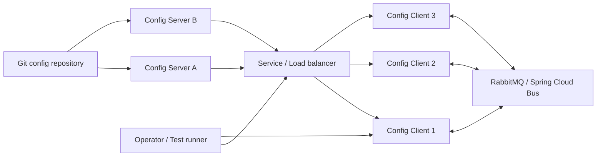

# Gây lỗi Config Server, kho nguồn và broker rồi kiểm chứng phục hồi

Spring Cloud Config phân phối cấu hình tập trung cho nhiều ứng dụng Spring Boot. Độ sẵn sàng của luồng này phụ thuộc vào nhiều thành phần: Config Server, Git hoặc secret/config backend, mạng và load balancer, Config Client, cùng broker nếu dùng Spring Cloud Bus. Một endpoint trả HTTP 200 không chứng minh toàn bộ ứng dụng đã nhận và áp dụng cấu hình mới.

Bài thực hành này dựng một môi trường staging có Config Server, Git backend, nhiều Config Client và RabbitMQ cho Bus. Bạn sẽ chủ động gây lỗi từng thành phần, ghi nhận tác động, khôi phục dependency rồi xác minh revision và trạng thái ở từng client. Các thí nghiệm được chạy riêng lẻ để biết chính xác lớp nào gây ra sự cố.

## 1. Kết quả cần đạt

Sau bài thực hành, bạn có thể:

- Dựng luồng cấu hình từ Git qua Config Server tới Config Client.
- Xác định baseline của application, profile, label và Git revision.
- Phân biệt lỗi Config Server, lỗi Git backend và lỗi broker.
- Kiểm tra khác biệt giữa client đang chạy và client mới khởi động khi Config Server mất kết nối.
- Xác minh hành vi của Git backend khi remote không truy cập được.
- Kiểm tra Spring Cloud Bus khi broker ngừng hoạt động và khi broker phục hồi.
- Đo thời gian phát hiện, failover, refresh và phục hồi.
- Đối chiếu commit/revision để xác định cấu hình có bị cũ hoặc mất hay không.
- Viết runbook phục hồi có bằng chứng xác nhận thay vì chỉ dựa vào trạng thái process.

## 2. Phạm vi và quy tắc an toàn

Chỉ thực hiện bài này trong môi trường local hoặc staging cô lập. Không dừng Config Server, Git, broker, DNS hay network của production. Không dùng credential, secret, dữ liệu khách hàng hoặc repository production trong thí nghiệm.

Trước khi bắt đầu:

1. Chọn namespace/project riêng cho lab.
2. Dùng Git repository và branch thử nghiệm riêng.
3. Dùng credential giả, chỉ có quyền trong lab.
4. Xác định người có quyền dừng thí nghiệm và lệnh rollback cho từng fault.
5. Ghi lại thời điểm bắt đầu/kết thúc, request ID, revision và số client tham gia.
6. Chỉ gây một lỗi tại một thời điểm. Chỉ thử nhiều lỗi đồng thời sau khi từng thí nghiệm riêng lẻ đã an toàn và có kết quả rõ ràng.

Nếu một fault ảnh hưởng ra ngoài phạm vi đã chọn, dừng ngay và khôi phục trạng thái trước thí nghiệm.

## 3. Kiến trúc lab



Các thành phần:

| Thành phần | Vai trò trong lab |
| --- | --- |
| Git repository | Nguồn cấu hình có commit SHA và branch cố định |
| Config Server A/B | Đọc Git và trả `Environment` cho client |
| Load balancer/Service | Đưa request tới instance Config Server khỏe |
| Config Client 1/2/3 | Nạp cấu hình, hiển thị marker và nhận refresh event |
| RabbitMQ | Vận chuyển Spring Cloud Bus event |
| Test runner | Gọi endpoint, ghi timestamp, so sánh revision và tổng hợp kết quả |

Nếu chưa có hai Config Server instance, vẫn có thể chạy các thí nghiệm Git và broker với một instance; phần failover một instance sẽ được đánh dấu là chưa kiểm chứng. Không coi một instance duy nhất là bài test HA.

## 4. Chuẩn bị phiên bản và dependency

Chọn một cặp Spring Boot/Spring Cloud release train tương thích theo ma trận chính thức của dự án. Dùng Spring Cloud BOM để quản lý Config, Bus và Stream; không ghép phiên bản riêng lẻ tùy ý.

Config Server cần dependency server và broker binder tương ứng nếu chính server cũng tham gia Bus:

```xml
<dependencies>
    <dependency>
        <groupId>org.springframework.cloud</groupId>
        <artifactId>spring-cloud-config-server</artifactId>
    </dependency>
    <dependency>
        <groupId>org.springframework.cloud</groupId>
        <artifactId>spring-cloud-starter-bus-amqp</artifactId>
    </dependency>
</dependencies>
```

Config Client cần:

```xml
<dependencies>
    <dependency>
        <groupId>org.springframework.cloud</groupId>
        <artifactId>spring-cloud-starter-config</artifactId>
    </dependency>
    <dependency>
        <groupId>org.springframework.cloud</groupId>
        <artifactId>spring-cloud-starter-bus-amqp</artifactId>
    </dependency>
</dependencies>
```

Nếu lab chỉ cần Bus trên các client, có thể không thêm Bus starter vào Config Server. Tất cả ứng dụng cần tham gia cùng Bus phải dùng broker destination và cấu hình binder tương thích.

Ví dụ RabbitMQ được dùng trong bài để dễ quan sát. Nếu production sử dụng Kafka, hãy lặp lại thí nghiệm với Kafka binder và broker thật tương ứng; không suy ra semantics của Kafka từ kết quả RabbitMQ.

## 5. Tạo repository cấu hình thử nghiệm

Tạo một Git repository riêng, ví dụ `config-ha-lab`, với các file:

```text
config-ha-lab/
├── application.yml
├── billing-api.yml
└── billing-api-prod.yml
```

`application.yml` chứa cấu hình chung:

```yaml
lab:
  environment: staging
  shared-message: config-from-git
```

`billing-api.yml` chứa cấu hình riêng của application:

```yaml
lab:
  revision: rev-a
  service-message: billing-default
```

`billing-api-prod.yml` ghi đè marker theo profile:

```yaml
lab:
  revision: rev-a
  service-message: billing-production
```

Commit và push repository:

```bash
git init
git add application.yml billing-api.yml billing-api-prod.yml
git commit -m "Create Config HA lab baseline"
git branch -M main
git remote add origin https://git.example.test/lab/config-ha-lab.git
git push -u origin main
git rev-parse HEAD
```

Ghi lại commit SHA. Không sử dụng branch có thay đổi liên tục trong lúc so sánh một thí nghiệm; nếu cần kiểm tra branch mới, ghi rõ SHA trước và sau.

## 6. Cấu hình Config Server

Ứng dụng Config Server bật server mode:

```java
@SpringBootApplication
@EnableConfigServer
public class ConfigServerApplication {
    public static void main(String[] args) {
        SpringApplication.run(ConfigServerApplication.class, args);
    }
}
```

Ví dụ `application.yml`:

```yaml
server:
  port: 8888

spring:
  application:
    name: config-server
  cloud:
    config:
      server:
        git:
          uri: https://git.example.test/lab/config-ha-lab.git
          default-label: main
          clone-on-start: true
          basedir: ${CONFIG_REPO_BASEDIR:./config-repo-cache}
          refresh-rate: 5

management:
  endpoints:
    web:
      exposure:
        include: health,info
```

Các giá trị cần điều chỉnh:

- `uri`: URL Git lab.
- `default-label`: branch/tag mặc định cần đọc.
- `clone-on-start`: yêu cầu clone repository khi server khởi động, giúp lỗi clone xuất hiện sớm.
- `basedir`: thư mục working copy của instance. Mỗi instance cần vùng lưu trữ riêng, không chia sẻ một working directory cho nhiều process nếu không có cơ chế đồng bộ được hỗ trợ.
- `refresh-rate`: khoảng thời gian tối thiểu giữa các lần fetch, tính bằng giây; kiểm tra tài liệu đúng phiên bản vì giá trị `0` có thể mang nghĩa fetch ở mỗi request.

Nếu Git repository private, cấp credential từ secret manager/environment. Không ghi username/password vào URI, log hoặc file cấu hình được commit. Với SSH, kiểm tra host key và không tắt strict host key verification để làm cho test pass.

Khi chạy nhiều Config Server instance, cùng trỏ tới một repository/label nhưng dùng working copy riêng. Kiểm tra cả hai server phục vụ cùng revision trước khi bắt đầu fault injection.

## 7. Cấu hình Config Client và marker quan sát

Client nạp cấu hình bắt buộc từ Config Server:

```yaml
spring:
  application:
    name: billing-api
  profiles:
    active: prod
  config:
    import: "configserver:http://config-server:8888"
  cloud:
    bus:
      enabled: true
      refresh:
        enabled: true
      destination: config-ha-lab-events

management:
  endpoints:
    web:
      exposure:
        include: health,info,refresh,busrefresh
```

Trong lab, `config-server` là DNS/service name của load balancer trong mạng container hoặc Kubernetes Service. Không dùng hostname giả định nếu môi trường của bạn có tên khác.

Tạo một bean refresh scope đọc marker để quan sát thay đổi:

```java
@Component
@RefreshScope
public class LabRevisionView {

    @Value("${lab.revision:missing}")
    private String revision;

    @Value("${lab.service-message:missing}")
    private String message;

    public Map<String, String> current() {
        return Map.of("revision", revision, "message", message);
    }
}
```

Expose endpoint lab chỉ trong profile test/staging:

```java
@RestController
@Profile("lab")
public class LabStatusController {

    private final LabRevisionView view;

    public LabStatusController(LabRevisionView view) {
        this.view = view;
    }

    @GetMapping("/lab/status")
    public Map<String, String> status() {
        return view.current();
    }
}
```

Kích hoạt thêm profile `lab` trong môi trường test. Endpoint chỉ trả marker không nhạy cảm và không được expose công khai. Có thể thêm `INSTANCE_ID` để phân biệt từng client replica.

`@RefreshScope` làm bean được tạo lại khi refresh scope bị làm mới. Với `@ConfigurationProperties`, Spring Cloud Context có cơ chế rebind phù hợp; cần test đúng loại bean đang dùng. Không kết luận chỉ từ marker của một bean rằng mọi bean trong ứng dụng đã được cập nhật.

## 8. Khởi động RabbitMQ và kiểm tra baseline

Khởi động broker RabbitMQ trong lab bằng Docker Compose hoặc môi trường tương đương. Ví dụ Compose tối giản:

```yaml
services:
  rabbitmq:
    image: rabbitmq:3.13-management
    hostname: rabbitmq
    ports:
      - "5672:5672"
      - "15672:15672"
    environment:
      RABBITMQ_DEFAULT_USER: lab-user
      RABBITMQ_DEFAULT_PASS: lab-password
```

Chỉ dùng credential giả cho lab; không expose management UI ra mạng công cộng. Trong môi trường CI/staging thật, dùng secret injection và network policy.

Trước khi test Bus, xác nhận:

1. RabbitMQ health/readiness đạt.
2. Mọi client kết nối được broker.
3. Các instance có Bus ID duy nhất.
4. Broker destination `config-ha-lab-events` giống nhau ở các node tham gia Bus.
5. Endpoint `busrefresh` được expose và caller có quyền.

Kiểm tra từng client:

```bash
curl -sS http://client-1:8080/lab/status
curl -sS http://client-2:8080/lab/status
curl -sS http://client-3:8080/lab/status
```

Kết quả baseline mong đợi:

```json
{
  "revision": "rev-a",
  "message": "billing-production"
}
```

Ghi lại từng instance ID, marker và timestamp. Nếu một client đã không ở `rev-a`, dừng tại đây để sửa baseline trước khi gây lỗi.

## 9. Ghi baseline Config Server response

Gọi endpoint theo application/profile/label:

```bash
curl -sS \
  http://config-server:8888/billing-api/prod/main
```

Lưu các metadata không nhạy cảm:

- `name` và `profiles`.
- `label` được trả về.
- `version`/commit SHA nếu backend cung cấp.
- `propertySources` và thứ tự của chúng.
- Giá trị marker `lab.revision`.

Không lưu toàn bộ response nếu nó có password, token hoặc secret. Chỉ trích xuất field cần thiết hoặc dùng dữ liệu lab không nhạy cảm.

Đo baseline request latency và tỷ lệ thành công. Với hai Config Server instance, có thể kiểm tra trực tiếp từng instance trong mạng nội bộ để xác nhận cả hai đọc cùng Git revision, sau đó kiểm tra endpoint qua load balancer.

## 10. Thí nghiệm A — Mất một Config Server instance

**Giả thuyết:** khi một Config Server replica dừng, load balancer chuyển request sang replica còn lại và client vẫn lấy được cấu hình đúng.

### Chuẩn bị

- Có ít nhất hai Config Server instance.
- Cả hai đã clone repository và phục vụ cùng revision `rev-a`.
- Load balancer/Service đang route request tới cả hai.
- Synthetic request gọi liên tục endpoint `/billing-api/prod/main`.

### Gây lỗi

Trong Kubernetes staging, xác định pod Config Server rồi xóa một pod:

```bash
kubectl get pods -n config-lab -l app=config-server
kubectl delete pod <config-server-pod> -n config-lab
```

Trong Docker Compose, có thể dừng đúng một container Config Server nếu lab đã tách tên service/container. Không dừng Git hoặc RabbitMQ trong thí nghiệm này.

### Xác minh

1. Ghi thời điểm pod bị dừng.
2. Theo dõi readiness/load balancer loại instance lỗi.
3. Tiếp tục gọi Config Server qua Service/LB.
4. Xác nhận response trả `rev-a` và đúng profile `prod`.
5. Kiểm tra client hiện tại có tiếp tục hoạt động và client mới có thể lấy cấu hình.
6. Chờ replica được tạo lại, xác nhận readiness và revision.

**Pass khi:** request phục hồi trong RTO đặt trước, không trả nhầm label/revision và replica còn lại đủ khả năng phục vụ. Nếu không có load balancer hoặc chỉ có một server, ghi rõ thí nghiệm HA chưa đạt điều kiện chạy.

## 11. Thí nghiệm B — Mất toàn bộ Config Server

Thí nghiệm này phân biệt client đang chạy với client mới khởi động.

### Gây lỗi

Trong staging, scale Config Server về 0 hoặc chặn toàn bộ đường kết nối từ client tới Config Server:

```bash
kubectl scale deployment/config-server --replicas=0 -n config-lab
```

Không dừng Git hay broker trong thí nghiệm này; chỉ cô lập Config Server.

### Kiểm tra client đang chạy

- Gọi `/lab/status` trên client hiện có.
- Quan sát xem bean vẫn giữ `rev-a` đã nạp hay không.
- Thử gọi `/actuator/refresh` trên một client test nếu endpoint được expose và bảo vệ; ghi nhận lỗi khi không thể fetch Config Server.

Một client đang chạy thường vẫn giữ các giá trị đã nạp trong memory cho tới khi ứng dụng hoặc bean được thay đổi. Điều này không có nghĩa client có thể tải revision mới khi server đã mất.

### Kiểm tra client mới khởi động

Tạo một client mới với import bắt buộc:

```yaml
spring:
  config:
    import: "configserver:http://config-server:8888"
```

Khi Config Server không khả dụng, startup dự kiến thất bại theo chính sách fail-fast/import bắt buộc.

Thử riêng biến thể optional:

```yaml
spring:
  config:
    import: "optional:configserver:http://config-server:8888"
```

Client có thể khởi động với cấu hình local còn lại nếu đủ điều kiện. Xác minh rõ marker có phải `missing`/local fallback hay không. Không coi startup thành công là đúng nếu thiếu cấu hình bắt buộc làm ứng dụng hoạt động sai.

### Khôi phục

```bash
kubectl scale deployment/config-server --replicas=2 -n config-lab
```

Chờ readiness của cả hai replica, gọi endpoint Config Server, xác minh `rev-a` và khởi động lại client thử nghiệm. Ghi thời gian từ lúc bắt đầu lỗi tới lúc mọi điều kiện phục hồi đạt.

## 12. Thí nghiệm C — Git remote mất kết nối

Git là nguồn sự thật của cấu hình. Mất Git remote có thể ảnh hưởng khác nhau tùy Config Server đã có working copy hay chưa, thời điểm fetch và cấu hình backend.

### Biến thể C1: Config Server đã clone repository

1. Xác nhận Config Server đã clone `config-ha-lab` và đọc được `rev-a`.
2. Chặn egress từ Config Server staging tới Git host bằng network policy/firewall có phạm vi hẹp.
3. Gọi endpoint `/billing-api/prod/main` ngay sau khi chặn.
4. Gọi lại sau khi khoảng `refresh-rate` đã trôi qua.
5. Ghi response status, `version`, marker và log fetch.

Không giả định server luôn phục vụ local working copy cũ khi remote lỗi. Hành vi phụ thuộc phiên bản, loại lỗi, trạng thái clone/fetch và cấu hình refresh. Kết quả đo ở phiên bản đang chạy là bằng chứng cần lưu.

### Biến thể C2: Config Server chưa có working copy

1. Khởi động một Config Server test mới với `basedir` trống.
2. Chặn kết nối tới Git trước khi server clone.
3. Khởi động server với `clone-on-start: true`.
4. Quan sát startup/readiness và request endpoint.
5. Khôi phục kết nối Git, xác nhận clone thành công và response trả đúng revision.

Biến thể này giúp phân biệt cache đã có với khả năng clone lần đầu. Một server mới không có dữ liệu local không thể dựa vào working copy cũ.

### Khôi phục Git

Gỡ network policy/firewall đã tạo và xác nhận Config Server có thể fetch. Thêm một commit mới với marker `rev-b`:

```yaml
lab:
  revision: rev-b
  service-message: billing-production-updated
```

Commit và push, ghi SHA mới. Gọi endpoint Config Server sau khoảng fetch/refresh phù hợp và xác minh `version`/marker đã chuyển sang `rev-b`. Nếu branch di chuyển nhưng server vẫn trả `rev-a`, kiểm tra fetch log, `refresh-rate`, label và working copy của từng instance.

## 13. Thí nghiệm D — Broker RabbitMQ ngừng hoạt động

Broker outage ảnh hưởng việc phân phối refresh event, nhưng không nhất thiết làm Config Server HTTP endpoint ngừng phục vụ.

### Gây lỗi

Trong lab, dừng RabbitMQ:

```bash
docker compose stop rabbitmq
```

Hoặc dừng broker pod trong namespace staging. Không dừng Config Server hay Git trong thí nghiệm này.

### Kiểm tra đường Config API trực tiếp

Gọi Config Server:

```bash
curl -sS http://config-server:8888/billing-api/prod/main
```

Nếu Git còn hoạt động, Config Server vẫn có thể trả cấu hình trực tiếp. Ghi lại response và revision. Điều này chứng minh đường HTTP Config API độc lập với Bus broker trong cấu hình lab, không chứng minh refresh event có thể lan truyền.

### Thử phát Bus event

Thay marker trong Git thành `rev-c`, push và xác nhận Config Server trả `rev-c`. Sau đó gọi:

```bash
curl -i -X POST \
  http://client-1:8080/actuator/busrefresh
```

Khi broker offline, publish có thể thất bại, timeout hoặc được xử lý theo retry/binder policy. Ghi HTTP status, log producer và trạng thái từng client. Không giả định message được lưu để tự động phát lại sau khi broker phục hồi; điều này phụ thuộc broker topology, durability, binder và thời điểm lỗi.

Kiểm tra riêng refresh trực tiếp trên một client:

```bash
curl -i -X POST \
  http://client-1:8080/actuator/refresh
```

Nếu client gọi trực tiếp Config Server được, refresh cục bộ có thể thành công dù Bus không hoạt động. Đây là cách phân biệt lỗi broker với lỗi Config Server/backend.

## 14. Khôi phục broker và phát refresh bù

Khởi động lại RabbitMQ:

```bash
docker compose start rabbitmq
```

Chờ broker health, binder reconnect và topology/consumer sẵn sàng. Không phát event ngay khi process broker vừa xuất hiện; chờ kết nối thực tế từ các client.

Sau đó:

1. Xác nhận Config Server vẫn trả `rev-c`.
2. Gửi một `busrefresh` mới từ một client/operator được ủy quyền.
3. Theo dõi log/trace/ack của từng client.
4. Gọi `/lab/status` trên từng instance.
5. Xác nhận tất cả đã đạt marker `rev-c`.
6. Với client offline trong lúc event phát, khởi động lại hoặc refresh bù theo runbook.

HTTP 200 từ endpoint gửi event không chứng minh mọi client đã nhận và áp dụng. Phải kiểm tra từng instance hoặc một metric tổng hợp có danh sách client/revision rõ ràng.

## 15. Thí nghiệm E — Một client offline khi Bus event được phát

Thí nghiệm này xác định hành vi với client bỏ lỡ event:

1. Ghi marker và instance ID của ba client.
2. Dừng client thứ ba.
3. Cập nhật Git thành marker mới và push.
4. Xác nhận Config Server trả revision mới.
5. Phát `busrefresh` khi client thứ ba offline.
6. Khởi động lại client thứ ba.
7. Kiểm tra client có lấy revision mới khi startup hay không.
8. Nếu client vẫn giữ dữ liệu cũ do cache/local fallback, thực hiện refresh bù hoặc restart theo runbook.

Bus là cơ chế event distribution, không phải kho lưu trạng thái cấu hình mới nhất cho client offline. Một client không kết nối broker trong lúc event được phát có thể bỏ lỡ event. Cần dùng startup fetch, revision reconciliation hoặc refresh bù để đưa client về trạng thái mong muốn.

## 16. Bảng phân biệt lỗi theo từng lớp

| Triệu chứng | Config Server | Git backend | Broker/Bus |
| --- | --- | --- | --- |
| GET Config API thất bại | Có thể do server/LB/network | Có thể do clone/fetch/backend | Thường không phải nguyên nhân trực tiếp |
| GET Config API thành công nhưng client không đổi | Có thể response chưa đúng profile/label | Có thể server trả revision cũ | Có thể event không tới hoặc client chưa refresh |
| Client đang chạy vẫn giữ cấu hình cũ | Có thể do không fetch được | Có thể do source chưa cập nhật | Có thể do không nhận refresh event |
| Client mới không startup | Import bắt buộc không tới server | Server không clone/đọc được source | Bus thường không cần cho startup fetch trực tiếp |
| Một số replica không đổi | Route tới server/response không nhất quán | Mỗi server có working copy/revision khác nhau | ID trùng, destination sai hoặc consumer offline |
| Sau khi broker phục hồi vẫn có client cũ | Kiểm tra client endpoint | Kiểm tra Config Server revision | Event cũ có thể không được replay; cần refresh bù |

## 17. Đo RTO, RPO và configuration staleness

Ghi các mốc thời gian:

- `T0`: thời điểm tạo fault.
- `Tdetect`: thời điểm monitoring/alert phát hiện.
- `Tfailover`: thời điểm request chuyển sang instance/backend khỏe.
- `Tsource`: thời điểm nguồn cấu hình đã phục hồi và có revision mục tiêu.
- `Tclient`: thời điểm tất cả client đạt revision mục tiêu.

Các phép đo:

```text
Detection time = Tdetect - T0
Failover time  = Tfailover - T0
Recovery time  = Tclient - T0
Configuration staleness = Tclient - Tsource
```

RPO nên gắn với commit SHA hoặc version secret có thể phục hồi. Nếu commit đã push và được xác nhận nhưng không thể lấy lại sau phục hồi, cần ghi nhận mất revision. Nếu Git không mất commit nhưng client vẫn dùng `rev-a` sau khi `rev-b` đã phát hành, đó là configuration staleness, không phải mất dữ liệu Git.

Ví dụ bảng ghi kết quả:

| Thí nghiệm | RTO mục tiêu | RTO đo được | Revision cuối | Kết quả |
| --- | ---: | ---: | --- | --- |
| Mất một Config Server | 120 giây | Ghi số đo | `rev-a` | Pass/Fail |
| Mất toàn bộ Config Server | 300 giây | Ghi số đo | `rev-a` | Pass/Fail |
| Git remote offline | 300 giây | Ghi số đo | Ghi SHA/marker | Pass/Fail |
| Broker offline | 300 giây | Ghi số đo | `rev-c` ở mọi client | Pass/Fail |
| Client bỏ lỡ event | 300 giây | Ghi số đo | `rev-c` sau refresh bù | Pass/Fail |

Các mục tiêu trên chỉ là ví dụ lab. Hãy thay bằng SLO đã được nghiệp vụ và đội vận hành thống nhất.

## 18. Runbook phục hồi tổng hợp

Khi phát hiện cấu hình không cập nhật:

1. Xác định phạm vi client bị ảnh hưởng và marker/revision hiện tại.
2. Gọi Config Server trực tiếp với đúng application/profile/label.
3. Nếu Config API lỗi, kiểm tra Config Server instance, readiness, load balancer và network.
4. Nếu server lỗi khi truy cập Git, kiểm tra DNS, TLS, credential, branch, fetch log và working copy.
5. Nếu Config API đúng nhưng client không đổi, kiểm tra Bus ID, destination, broker connection, trace/ack và client refresh log.
6. Khôi phục dependency đã hỏng và xác nhận health/readiness thực tế.
7. Phát refresh bù hoặc restart client theo chính sách đã định.
8. Kiểm tra marker/revision trên từng replica; không chỉ kiểm tra một pod.
9. Ghi timeline, commit SHA, lỗi gốc, RTO, staleness và hành động ngăn tái diễn.

Không khắc phục bằng cách xóa cache hoặc force refresh đồng loạt trước khi xác định nguyên nhân. Thao tác đó có thể tăng tải lên backend hoặc khiến nhiều client cùng khởi động lại trong lúc dependency chưa phục hồi.

## 19. Điều kiện dừng và rollback

Dừng thí nghiệm nếu:

- Network policy/firewall tác động ra ngoài lab.
- Request thất bại vượt ngưỡng abort đã thống nhất.
- Client hoặc dữ liệu ngoài phạm vi bị ảnh hưởng.
- Không thể khôi phục Git, broker hoặc Config Server trong cửa sổ test.
- Secret thật xuất hiện trong log hoặc response.
- Người phụ trách môi trường yêu cầu dừng.

Rollback theo thứ tự dependency:

1. Gỡ rule chặn network và khôi phục DNS/TLS/credential nếu đã thay đổi.
2. Khởi động Git service, broker và Config Server theo thứ tự phù hợp.
3. Chờ readiness và xác nhận kết nối thực tế.
4. Xác nhận repository branch/commit mục tiêu.
5. Khôi phục số replica ban đầu.
6. Phát refresh bù và kiểm tra mọi client.
7. Xóa namespace/key/queue/topic thử nghiệm nếu cần.

Chuẩn bị lệnh rollback trước khi gây lỗi. Không bắt đầu một thí nghiệm nếu không có quyền hoặc khả năng khôi phục.

## 20. Mẫu báo cáo thực hành

Sau mỗi fault, ghi một bản báo cáo ngắn:

```text
Experiment ID:
Environment/namespace:
Application/profile/label:
Config Server version:
Config Client version:
Git commit before/after:
Fault injected:
T0 / Tdetect / Tfailover / Tsource / Tclient:
HTTP status and latency:
Client IDs and revisions:
Bus event/ack observations:
RTO target / measured:
RPO target / observed:
Configuration staleness:
Recovery actions:
Pass/Fail and evidence:
Follow-up owner:
```

Không đưa token, password, private key hoặc payload chứa secret vào báo cáo.

## 21. Checklist hoàn thành lab

- [ ] Git repository lab có baseline commit SHA và marker `rev-a`.
- [ ] Config Server trả đúng application/profile/label.
- [ ] Hai Config Server instance phục vụ cùng revision nếu kiểm tra HA.
- [ ] Ba Config Client có instance ID riêng và marker baseline giống nhau.
- [ ] RabbitMQ và Spring Cloud Bus kết nối được trước fault.
- [ ] Đã gây lỗi một Config Server instance và xác minh failover.
- [ ] Đã gây lỗi toàn bộ Config Server và so sánh client đang chạy với client mới.
- [ ] Đã thử Git outage với working copy có sẵn và working copy trống.
- [ ] Đã khôi phục Git và xác minh commit/marker mới.
- [ ] Đã gây lỗi broker và phân biệt Config API với Bus refresh.
- [ ] Đã khôi phục broker, phát refresh bù và kiểm tra từng client.
- [ ] Đã thử một client offline khi event phát.
- [ ] Đã đo RTO, RPO/revision loss và configuration staleness.
- [ ] Đã ghi stop condition, rollback và runbook.
- [ ] Đã xác nhận mọi dependency trở về trạng thái khỏe và không còn fault rule.

## 22. Tài liệu tham khảo

- [Spring Cloud Config Reference](https://docs.spring.io/spring-cloud-config/reference/): Config Server, Git backend, Config Client và health indicator.
- [Spring Cloud Bus Reference](https://docs.spring.io/spring-cloud-bus/reference/): event distribution, broker destination, addressing và Bus endpoints.
- [Spring Cloud Config Client](https://docs.spring.io/spring-cloud-config/reference/client.html): Config Data import, optional/fail-fast và retry.
- [Spring Boot Actuator](https://docs.spring.io/spring-boot/reference/actuator/index.html): health, readiness và management endpoints.
- [Kubernetes probes](https://kubernetes.io/docs/concepts/configuration/liveness-readiness-startup-probes/): liveness, readiness và startup probe.

Một bài kiểm tra phục hồi chỉ hoàn tất khi nguồn cấu hình, Config Server, broker và từng Config Client đều được xác minh sau khi khôi phục. Hãy dùng revision/commit làm mốc đối chiếu, phân biệt Config API với Bus event, đo thời gian từ lúc tạo lỗi tới khi client cuối cùng đạt cấu hình mục tiêu và lưu bằng chứng cho từng bước. Nhờ đó, nhóm biết hệ thống thực sự chịu được loại sự cố nào, còn khoảng trống nào và cần cải thiện điều gì trước khi áp dụng quy trình tương tự ở production.
