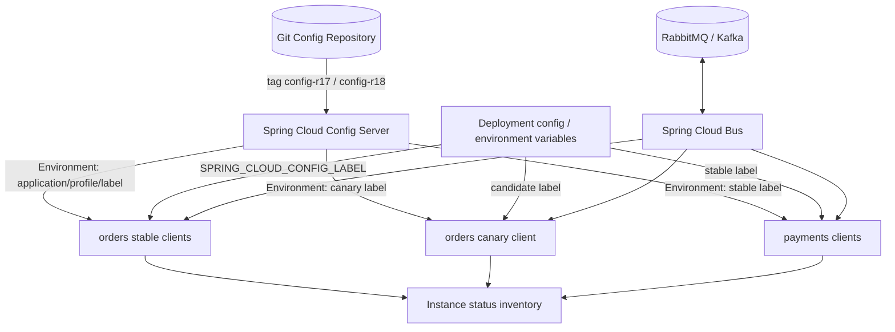

# Phát hành thử, quay lại cấu hình và đối chiếu trạng thái mọi client

Trong dự án này, bạn sẽ xây dựng một quy trình phát hành cấu hình có kiểm soát cho nhiều ứng dụng Spring Boot dùng Spring Cloud Config. Một thay đổi trong Git repository sẽ được đóng gói thành một release có định danh, triển khai trước cho nhóm canary, theo dõi trạng thái của từng Config Client, sau đó mở rộng dần. Nếu phát hiện lỗi, nhóm vận hành có thể đưa client về release cấu hình đã biết tốt và xác minh rằng mọi instance đã hội tụ về cùng trạng thái mong muốn.

Mục tiêu không chỉ là gọi được endpoint refresh. Một lần phát hành chỉ được coi là hoàn tất khi biết rõ client nào đã nhận release nào, thời điểm refresh gần nhất, instance nào còn lệch phiên bản và cách khôi phục khi cấu hình mới gây lỗi. Quy trình cũng phải giữ được khả năng rollback trong suốt thời gian rollout.

## 1. Kết quả cần đạt

Hoàn thành bài thực hành, bạn sẽ có:

- Một Git Config repository chứa cấu hình dùng chung, cấu hình theo application và profile.
- Một release cấu hình có label/tag bất biến và `config.release-id` không nhạy cảm.
- Config Server trả đúng Environment theo application, profile và label.
- Config Client canary lấy cấu hình từ release mới trong khi nhóm stable vẫn dùng release trước.
- Cơ chế ghi nhận revision, label, `lastRefreshAt` và trạng thái refresh ở từng instance.
- Quy trình refresh canary, mở rộng rollout và đối chiếu trạng thái mọi client.
- Kịch bản rollback về release trước, bao gồm trường hợp phải restart client để đổi label.
- Checklist phê duyệt, quan sát, bảo mật và kết thúc phát hành.

## 2. Kiến trúc thực hành

Ta giả lập một nền tảng có hai ứng dụng `orders` và `payments`. Cả hai nhận cấu hình từ một Config Server. Mỗi ứng dụng có nhiều instance. Git repository chứa các file cấu hình, còn deployment configuration quyết định client sử dụng label nào.



Các vai trò:

| Thành phần | Trách nhiệm |
| --- | --- |
| Git Config repository | Lưu nội dung cấu hình có review và lịch sử |
| Release tag/label | Chỉ ra snapshot cấu hình cần triển khai |
| Config Server | Trả Environment theo application/profile/label |
| Config Client | Nạp cấu hình, refresh Environment và cập nhật bean phù hợp |
| Deployment system | Gán label cho từng nhóm client, restart/rollout khi cần |
| Spring Cloud Bus | Phát sự kiện refresh đến các client được chọn |
| Status inventory | Thu thập release marker và thời điểm refresh từ từng instance |

Trong ví dụ, `orders-canary-1` dùng release mới `config-r18`, còn `orders-1`, `orders-2` và `payments-1` tiếp tục dùng `config-r17`. Sau khi canary đạt tiêu chí, rollout mới chuyển các instance còn lại sang `config-r18`.

## 3. Nguyên tắc phát hành và rollback

Trước khi thao tác, thống nhất các nguyên tắc sau:

1. Mỗi release cấu hình có một định danh duy nhất.
2. Ưu tiên Git tag hoặc commit SHA bất biến để tái lập chính xác nội dung.
3. Label mà Config Client sử dụng phải được cung cấp từ deployment/local configuration trước khi Config Data import chạy.
4. Không đổi `spring.cloud.config.label` bằng cách chỉ sửa một property từ xa rồi giả định client sẽ tự truy vấn label mới.
5. Chỉ mở rộng rollout khi canary đã qua các kiểm tra chức năng, an toàn và vận hành.
6. Giữ release trước trong thời gian rollback window.
7. Không xóa tag, commit, secret version hoặc artifact mà release đang chạy còn tham chiếu.
8. Không coi HTTP 200 từ Config Server hoặc Bus publish thành công là bằng chứng mọi client đã áp dụng cấu hình.

**Lưu ý về label:** Config Client cần biết label trước khi gọi Config Server. Có thể truyền qua biến môi trường `SPRING_CLOUD_CONFIG_LABEL`, tham số dòng lệnh hoặc cấu hình cục bộ tương ứng. Khi cần chuyển một client đang chạy từ tag này sang tag khác, quy trình đơn giản và dễ dự đoán nhất là cập nhật deployment configuration rồi restart/rollout client đó. Endpoint refresh thông thường tải lại cấu hình theo các tham số lookup hiện tại; nó không tự thay đổi label bootstrap của client.

## 4. Chuẩn bị Git Config repository

Tạo repository riêng cho bài thực hành, ví dụ:

```text
config-repo/
├── application.yml
├── application-prod.yml
├── orders.yml
├── orders-prod.yml
├── payments.yml
└── payments-prod.yml
```

`application.yml` chứa giá trị dùng chung. File theo application chứa cấu hình riêng. File profile `-prod` ghi đè các giá trị phù hợp với production.

### Release ban đầu: `config-r17`

`application.yml`:

```yaml
config:
  release-id: config-r17
  published-at: "2026-11-27T09:00:00Z"

platform:
  connect-timeout: 500ms
  logging:
    level: INFO
```

`orders.yml`:

```yaml
orders:
  checkout:
    enabled: true
    max-items: 20
  api:
    read-timeout: 3s
```

`orders-prod.yml`:

```yaml
orders:
  checkout:
    max-items: 20
  api:
    read-timeout: 3s
```

`payments.yml`:

```yaml
payments:
  authorization:
    strict-mode: true
  api:
    read-timeout: 2s
```

`payments-prod.yml`:

```yaml
payments:
  authorization:
    strict-mode: true
  api:
    read-timeout: 2s
```

Commit và tạo tag release:

```bash
git add application.yml application-prod.yml orders.yml orders-prod.yml payments.yml payments-prod.yml
git commit -m "Release config r17"
git tag -a config-r17 -m "Configuration release r17"
git push origin main --tags
```

Các lệnh trên giả định branch `main` và remote `origin` đã được cấu hình. Dùng repository thực hành riêng; không chạy lệnh push vào repository production nếu chưa qua quy trình phê duyệt.

Tag `config-r17` là mốc cấu hình ổn định. Khi phát hành nội dung mới, tạo commit mới và tag mới `config-r18`; không di chuyển tag cũ để làm cho rollback có thể tái lập.

## 5. Cấu hình Config Server

Config Server cần dùng đúng repository và có khả năng đọc các tag. Ví dụ cấu hình:

```yaml
server:
  port: 8888

spring:
  application:
    name: configserver
  cloud:
    config:
      server:
        git:
          uri: https://git.example.internal/platform/config-repo.git
          default-label: main
          clone-on-start: true
```

Đây là cấu hình minh họa; trong môi trường lab có thể trỏ `uri` đến repository local/bare repository. Credential Git phải được cấp qua secret manager hoặc cơ chế injection an toàn, không viết vào file hoặc URL có credential.

Config Server API có dạng:

```text
GET /{application}/{profile}/{label}
```

Ví dụ lấy cấu hình `orders`, profile `prod`, label `config-r17`:

```bash
curl --fail --silent --show-error \
  http://localhost:8888/orders/prod/config-r17
```

Response Environment chứa application, profiles, label, version và property sources. `version` có thể cho biết revision của Git backend. Không in toàn bộ response ra log trong production vì property source có thể chứa secret đã được giải mã.

Chỉ truy vấn metadata an toàn khi kiểm tra:

```bash
curl --fail --silent --show-error \
  http://localhost:8888/orders/prod/config-r17 \
  | jq '{name, profiles, label, version}'
```

Nếu cần kiểm tra `config.release-id`, chỉ trích xuất đúng key đó từ property source sau khi đã xác nhận nó là metadata không nhạy cảm. Không dump toàn bộ `.propertySources[].source`.

## 6. Cấu hình Config Client với label ổn định

Một client sử dụng Config Data API:

```yaml
spring:
  application:
    name: orders
  profiles:
    active: prod
  config:
    import: "configserver:https://config.internal.example"
```

Deployment group stable cung cấp label:

```text
SPRING_CLOUD_CONFIG_LABEL=config-r17
```

Deployment group canary cung cấp:

```text
SPRING_CLOUD_CONFIG_LABEL=config-r18
```

Với Spring Boot/Spring Cloud Config tương thích, relaxed binding ánh xạ biến môi trường này thành `spring.cloud.config.label`. Giá trị label phải có sẵn ở phía client trước Config Data import. Không đặt label duy nhất trong remote Config repository vì client cần label để yêu cầu repository đó.

Trong hệ thống có nhiều ứng dụng, mỗi client khai báo `spring.application.name` riêng. Có thể dùng chung Config Server URL nhưng label và profile cần được quản lý theo từng deployment group.

## 7. Thêm release mới `config-r18`

Giả sử nhóm muốn thử thay đổi giới hạn giỏ hàng của `orders` và thời gian đọc API. Tạo thay đổi trong branch release candidate:

`application.yml`:

```yaml
config:
  release-id: config-r18
  published-at: "2026-11-27T10:00:00Z"

platform:
  connect-timeout: 500ms
  logging:
    level: INFO
```

`orders-prod.yml`:

```yaml
orders:
  checkout:
    max-items: 25
  api:
    read-timeout: 4s
```

`payments-prod.yml` giữ nguyên nội dung của release trước nếu không nằm trong phạm vi thay đổi. Điều này cho phép cùng một release snapshot có marker mới nhưng chỉ thay đổi đúng nhóm cấu hình được phê duyệt.

Trước khi tag:

- Parse toàn bộ YAML và phát hiện duplicate key.
- Chạy schema/binding/validation cho `orders/prod` và các consumer kế thừa `application.yml`.
- Kiểm tra các key thay đổi, default và giới hạn nghiệp vụ.
- Secret scan diff và xác minh không có credential thật.
- Review owner của `orders` và config platform.
- Xác nhận rollback release `config-r17` vẫn còn khả dụng.

Sau khi các gate pass, commit và tạo tag:

```bash
git add application.yml orders-prod.yml
git commit -m "Prepare orders canary config r18"
git tag -a config-r18 -m "Configuration release r18"
git push origin main --tags
```

Nếu branch release candidate khác `main`, merge theo quy trình repository trước khi tạo tag. Lưu commit SHA thực tế và liên kết nó với `config-r18` trong release record.

## 8. Kiểm tra release candidate trước khi triển khai

Gọi Config Server trực tiếp với đúng bộ tham số:

```bash
curl --fail --silent --show-error \
  http://localhost:8888/orders/prod/config-r18 \
  | jq '{name, profiles, label, version}'
```

Xác nhận:

| Kiểm tra | Kết quả mong đợi |
| --- | --- |
| `name` | `orders` |
| `profiles` | Có `prod` |
| `label` | `config-r18` |
| `version` | Revision Git tương ứng commit đã phát hành |
| Release marker | `config-r18` trong metadata không nhạy cảm |
| Property sources | Có các nguồn dùng chung và riêng application cần thiết |

HTTP 200 chưa đủ. Cần xác nhận đúng label và giá trị của các key đã thay đổi. Để tránh lộ secret, chỉ truy xuất một allowlist key không nhạy cảm hoặc kiểm tra binding thông qua một client test có quyền hạn phù hợp.

## 9. Ghi nhận trạng thái tại từng Config Client

Mỗi client instance nên công bố tối thiểu:

- Application name.
- Instance ID hoặc pod name.
- Profile đang hoạt động.
- Config label được deployment gán.
- `config.release-id` đang áp dụng.
- Git revision nếu có kênh metadata tin cậy.
- Thời điểm load ban đầu.
- Thời điểm refresh thành công gần nhất.
- Kết quả refresh gần nhất.

Một bảng trạng thái có thể có dạng:

| Application | Instance | Profile | Label yêu cầu | Release ID áp dụng | Last refresh | Kết quả |
| --- | --- | --- | --- | --- | --- | --- |
| orders | orders-1 | prod | config-r17 | config-r17 | 09:10Z | success |
| orders | orders-2 | prod | config-r17 | config-r17 | 09:11Z | success |
| orders | orders-canary-1 | prod | config-r18 | config-r18 | 10:05Z | success |
| payments | payments-1 | prod | config-r17 | config-r17 | 09:12Z | success |

Label yêu cầu và release ID áp dụng là hai thông tin khác nhau. Label cho biết client yêu cầu nguồn nào; release marker cho biết bộ cấu hình mà client thực sự đã nạp. Hai trường cần được đối chiếu để phát hiện client dùng nhầm nguồn hoặc metadata không đồng nhất.

### Mẫu properties cho metadata

```java
public record ConfigReleaseStatus(
        String application,
        String instanceId,
        String profile,
        String requestedLabel,
        String appliedReleaseId,
        Instant initialLoadedAt,
        Instant lastRefreshAt,
        String lastRefreshResult) {
}
```

Ứng dụng có thể dùng `InfoContributor` để công bố allowlist metadata qua `/actuator/info`. Khi refresh hoàn tất, tracker cập nhật snapshot mới; không đưa password, token hoặc property source vào response.

Ví dụ response:

```json
{
  "configuration": {
    "application": "orders",
    "instanceId": "orders-canary-1",
    "profile": "prod",
    "requestedLabel": "config-r18",
    "appliedReleaseId": "config-r18",
    "initialLoadedAt": "2026-11-27T10:01:00Z",
    "lastRefreshAt": "2026-11-27T10:05:12Z",
    "lastRefreshResult": "success"
  }
}
```

Các trường trên là contract minh họa, cần triển khai trong client. Không mặc định mọi trường đều có sẵn trong Actuator hoặc Config Client. Endpoint `info` phải được bảo vệ theo chính sách vận hành.

## 10. Chuẩn bị rollout canary

Trước khi triển khai, lập danh sách instance và release mục tiêu:

| Nhóm | Instance | Label mục tiêu | Release ID mục tiêu |
| --- | --- | --- | --- |
| Canary | orders-canary-1 | config-r18 | config-r18 |
| Stable | orders-1, orders-2 | config-r17 | config-r17 |
| Stable | payments-1, payments-2 | config-r17 | config-r17 |

Chỉ instance canary được cập nhật deployment environment thành `SPRING_CLOUD_CONFIG_LABEL=config-r18`. Stable clients tiếp tục dùng `config-r17`.

Nếu môi trường dùng Kubernetes, có thể triển khai canary dưới Deployment riêng hoặc một nhóm Pod có label/selector riêng. Không thay biến môi trường của toàn bộ Deployment stable khi mục tiêu mới chỉ là thử nghiệm một instance.

Khi thay đổi label, cần tạo Pod mới hoặc restart client theo quy trình deployment để Config Data import đọc label mới lúc startup. Tránh sửa trực tiếp một biến trong hệ thống quản lý deployment mà không rollout Pod tương ứng.

## 11. Khởi động canary và xác minh ban đầu

Sau khi canary khởi động:

1. Kiểm tra readiness và health.
2. Kiểm tra application name/profile/label được client sử dụng.
3. Đọc `/actuator/info` bằng danh tính operator.
4. Xác nhận `requestedLabel=config-r18` và `appliedReleaseId=config-r18`.
5. Kiểm tra Git revision hoặc release record tương ứng.
6. Chạy smoke test nghiệp vụ liên quan đến cấu hình mới.
7. So sánh log/error rate/latency với baseline.

Không truy cập `/actuator/env` công khai để lấy thông tin. Nếu cần kiểm tra giá trị, dùng endpoint nội bộ đã bảo vệ hoặc test function chuyên biệt chỉ trả kết quả không nhạy cảm.

Ví dụ kiểm tra metadata:

```bash
curl --fail --silent --show-error \
  -H "Authorization: Bearer ${OPS_TOKEN}" \
  https://orders-canary.internal.example/actuator/info \
  | jq '.configuration | {application, instanceId, profile, requestedLabel, appliedReleaseId, lastRefreshAt, lastRefreshResult}'
```

Không bật shell tracing (`set -x`) khi dùng token. Token chỉ được cấp cho operator và không được lưu trong file log hoặc CI artifact.

## 12. Refresh canary

Nếu canary đã khởi động với label `config-r18`, cấu hình ban đầu đã được nạp từ release đó. Khi có thay đổi tiếp theo trong cùng nguồn mutable hoặc cần thử luồng refresh, có thể gọi refresh endpoint của chính instance canary:

```bash
curl --fail --request POST \
  -H "Authorization: Bearer ${OPS_TOKEN}" \
  https://orders-canary.internal.example/actuator/refresh
```

Endpoint refresh phải được expose và bảo vệ bằng security phù hợp. Nó tải lại cấu hình theo lookup hiện tại; không tự chuyển label của client sang một tag khác.

Nếu hệ thống dùng Spring Cloud Bus, có thể phát sự kiện refresh qua broker. Với một canary duy nhất, gọi refresh trực tiếp giúp phạm vi thay đổi dễ xác định hơn. Nếu dùng bus destination targeting, phải xác minh destination pattern và service identity của phiên bản đang chạy để tránh phát nhầm đến toàn bộ client.

Sau refresh, đối chiếu:

- Request/refresh result thành công.
- `lastRefreshAt` mới hơn thời điểm trước.
- `appliedReleaseId` bằng release mục tiêu.
- Bean refresh-scoped hoặc thành phần được hỗ trợ đã dùng giá trị mới.
- Smoke test và metric nghiệp vụ vẫn đạt.

`Environment` được cập nhật không có nghĩa mọi singleton bean đã tự thay đổi. Những bean giữ giá trị từ constructor có thể cần `@RefreshScope`, rebind hoặc cơ chế cập nhật riêng. Connection pool, client SDK và tài nguyên đang mở có thể cần thay thế có kiểm soát.

## 13. Mở rộng rollout theo từng đợt

Chỉ mở rộng khi canary đạt tiêu chí trong khoảng quan sát đã thống nhất. Ví dụ:

| Giai đoạn | Tỷ lệ/nhóm | Điều kiện chuyển bước |
| --- | --- | --- |
| Canary | 1 instance | Startup, binding, smoke test và telemetry pass |
| Wave 1 | 10% instance | Không có lỗi nghiêm trọng; revision đúng; latency/error rate trong ngưỡng |
| Wave 2 | 50% instance | Mọi client trong wave đã hội tụ; không có drift hoặc refresh failure |
| Wave 3 | 100% instance | Toàn bộ client mục tiêu báo release mới và nghiệp vụ ổn định |
| Soak | Toàn bộ trong thời gian quan sát | Không phát sinh lỗi trễ, job nền hoặc consumer chưa được kiểm tra |

Tỷ lệ chỉ là ví dụ. Với service ít instance, có thể rollout theo từng replica hoặc từng zone. Với nhiều application, rollout theo application group và dependency order.

Ở mỗi wave:

1. Cập nhật label trong deployment configuration của nhóm đó.
2. Rollout/restart đúng số instance được chọn.
3. Chờ readiness.
4. Đối chiếu label và release marker trên từng instance.
5. Chạy smoke test và theo dõi metric.
6. Ghi lại thời điểm, commit, người phê duyệt và kết quả.
7. Chỉ tiếp tục khi không còn instance ngoài dự kiến.

## 14. Đối chiếu trạng thái mọi client

Tạo inventory các client thuộc phạm vi phát hành. Với mỗi instance, so sánh trạng thái quan sát được với trạng thái mong muốn.

| Trạng thái quan sát | Diễn giải | Hành động |
| --- | --- | --- |
| Label và release ID đúng, refresh thành công | Đã hội tụ | Tiếp tục quan sát |
| Label đúng nhưng release ID cũ | Client chưa tải được snapshot mong đợi hoặc marker không đồng bộ | Kiểm tra Config Server response, cache và refresh result |
| Label cũ nhưng release ID mới | Deployment metadata và nội dung remote không khớp | Kiểm tra override, branch/tag mapping và marker |
| Label mới nhưng instance chưa ready | Rollout chưa hoàn tất | Chờ trong deadline hoặc điều tra startup |
| Last refresh quá cũ | Client có thể bỏ lỡ event hoặc chưa refresh | Kiểm tra Bus/HTTP notifier và client logs |
| Instance không có trong inventory | Pod/job có thể chưa đăng ký hoặc telemetry thiếu | Kiểm tra discovery, scrape target và deployment inventory |
| Refresh failed | Client không xác nhận được trạng thái mới | Giữ wave, điều tra lỗi và chuẩn bị rollback |

Không chỉ so sánh release ID tổng thể. Nên đối chiếu theo application, profile, instance và label. Hai application có thể cùng dùng release tag nhưng có property source khác nhau theo tên application.

### Điều kiện hoàn tất một wave

- Mọi instance dự kiến đều xuất hiện trong inventory.
- `requestedLabel` bằng label mục tiêu.
- `appliedReleaseId` bằng release ID mục tiêu.
- `lastRefreshResult` là `success` hoặc instance đã khởi động thành công với release đó.
- Không có instance cũ còn phục vụ traffic ngoài kế hoạch.
- Smoke test và metric đạt ngưỡng.
- Không có secret, token hoặc nội dung Environment bị ghi ra log.

Nếu inventory thiếu một instance, không được coi là “đã hội tụ” chỉ vì các instance đang hiển thị đều đúng. Cần phân biệt `missing`, `unknown`, `stale` và `converged`.

## 15. Dùng Spring Cloud Bus khi cần refresh diện rộng

Spring Cloud Bus có thể phát refresh event qua RabbitMQ hoặc Kafka để nhiều instance nhận cùng sự kiện. Ví dụ endpoint Actuator thường dùng:

```text
POST /actuator/busrefresh
```

Endpoint ID và path mapping phụ thuộc phiên bản và cấu hình Actuator. Chỉ expose khi ứng dụng có Bus và broker được cấu hình.

Khi phát hành canary:

- Có thể gọi `/actuator/refresh` trực tiếp cho canary.
- Có thể dùng Bus với destination targeting nếu phiên bản hỗ trợ và cấu hình destination đã được kiểm chứng.
- Nếu broadcast cho tất cả client, mỗi client sẽ refresh theo label hiện tại của chính nó; stable clients vẫn cần được bảo đảm đang pin vào release cũ.
- Không giả định Bus message thành công đồng nghĩa mọi consumer đã xử lý thành công.

Sau khi phát Bus event, đối chiếu từng client qua inventory. Kiểm tra broker consumer lag, event ID, client refresh result và revision. Không dùng một metric tổng thể để suy ra mọi instance đã cập nhật.

## 16. Tiêu chí quyết định tiếp tục hay dừng rollout

Trước khi phát hành, nhóm cần thống nhất ngưỡng dừng. Ví dụ:

| Chỉ số/điều kiện | Ví dụ ngưỡng dừng |
| --- | --- |
| Config Client startup failure | Bất kỳ lỗi mới nào liên quan cấu hình trong canary |
| Refresh failure | Một instance canary không thể refresh trong deadline |
| Release mismatch | `appliedReleaseId` không bằng release mục tiêu |
| HTTP 5xx của service | Tăng vượt baseline/ngưỡng SLO đã định |
| Latency | p95/p99 vượt ngưỡng đã phê duyệt |
| Business error | Checkout/payment failure tăng bất thường |
| Missing instance | Không giải thích được instance vắng khỏi inventory |
| Secret/security | Bất kỳ dấu hiệu lộ secret hoặc policy bị nới ngoài dự kiến |

Ngưỡng cụ thể phải dựa trên SLO và đặc tính ứng dụng. Không lấy các con số ví dụ làm chuẩn production cho mọi service.

Khi có điều kiện dừng:

1. Dừng rollout wave tiếp theo.
2. Giữ lại release tag và bằng chứng quan sát.
3. Xác định lỗi thuộc nội dung cấu hình, code, backend hay cơ chế refresh.
4. Chọn sửa tiếp trên release mới hoặc rollback về release đã biết tốt.
5. Ghi nhận quyết định và người phê duyệt.

## 17. Rollback về release trước

Giả sử `config-r18` làm tăng lỗi checkout. Release trước `config-r17` vẫn còn trong Git và client stable vẫn dùng nó.

### Trường hợp A: Client được pin bằng immutable tag

Để rollback canary:

1. Cập nhật deployment config của canary thành `SPRING_CLOUD_CONFIG_LABEL=config-r17`.
2. Rollout/restart canary để Config Data import đọc label mới.
3. Chờ readiness và kiểm tra `requestedLabel=config-r17`.
4. Xác nhận `appliedReleaseId=config-r17`.
5. Chạy smoke test và theo dõi metric.
6. Khi canary đã ổn định, quyết định rollback các wave đã rollout hoặc dừng tại phạm vi hiện tại.

Không kỳ vọng chỉ gọi `/actuator/refresh` sẽ đổi label từ `config-r18` về `config-r17`; label là tham số lookup của client và thường phải được thay ở nguồn cấu hình local/deployment rồi restart.

### Trường hợp B: Client dùng branch mutable

Nếu client dùng branch như `main`, việc revert commit trên branch có thể khiến lần fetch tiếp theo nhận nội dung cũ đã được khôi phục. Tuy nhiên:

- Cần hiểu cache/refresh-rate của Git backend.
- Các Config Server replica có thể fetch ở thời điểm khác nhau.
- Không rewrite branch lịch sử đã được chia sẻ nếu chính sách repository không cho phép.
- Phải kiểm tra revision thực tế từng replica và từng client.

Để rollback tái lập hơn, ưu tiên phát hành bằng tag/commit bất biến và chuyển client sang label cũ.

## 18. Xác minh sau rollback

Rollback chỉ hoàn tất khi client đã áp dụng release cũ và hành vi nghiệp vụ phục hồi.

Checklist:

| Kiểm tra | Kết quả mong đợi |
| --- | --- |
| Deployment label | `config-r17` |
| Config Server Environment | Đúng label và revision của release r17 |
| Client release marker | `config-r17` |
| Last refresh/startup | Thời điểm sau khi rollback bắt đầu |
| Readiness | Healthy/ready |
| Business smoke test | Pass |
| Error rate/latency | Trở về ngưỡng chấp nhận |
| Inventory | Không còn instance mục tiêu chạy r18 ngoài kế hoạch |

Nếu client báo label cũ nhưng marker vẫn là `config-r18`, kiểm tra remote property source, local override và cách ứng dụng lấy marker. Nếu marker cũ nhưng bean vẫn có hành vi mới, kiểm tra bean lifecycle, singleton state và tài nguyên chưa được refresh/recreate.

## 19. Quản lý rollback window và release cũ

Giữ các release cần thiết trong thời gian rollback window:

- Git tag và commit không bị xóa.
- Config Server vẫn có thể fetch label cũ.
- Secret version và encryption material cần cho release cũ còn hợp lệ.
- Artifact ứng dụng tương thích với release cũ vẫn được lưu.
- Deployment manifest/Helm values của từng wave có thể khôi phục.
- Dashboard và release record giữ lịch sử trạng thái.

Không giữ secret hoặc certificate đã bị thu hồi chỉ để hỗ trợ rollback. Nếu release cũ phụ thuộc credential đã bị lộ, cần một bản rollback an toàn đã được cập nhật secret/certificate.

Kết thúc rollback window chỉ khi owner ứng dụng và nền tảng xác nhận release cũ không còn là phương án khôi phục được hỗ trợ.

## 20. Bảo mật quy trình phát hành

Release metadata nên không nhạy cảm. Không đưa password, token, private key hoặc secret path nhạy cảm vào `config.release-id`, label, log hoặc dashboard.

Các endpoint cần bảo vệ:

- Config Server Environment API nếu response có cấu hình nhạy cảm.
- `/actuator/info` nếu công bố revision và instance metadata.
- `/actuator/refresh` và `/actuator/busrefresh` vì có thể thay đổi cấu hình runtime.
- Config Server `/monitor` nếu nhận webhook từ Git provider.

Biện pháp:

- TLS/mTLS hoặc OAuth2 service identity cho các kết nối.
- Authentication/authorization theo role và application scope.
- Network policy chỉ cho phép operator/pipeline gọi endpoint quản trị.
- Webhook signature/token được xác minh và rotate theo chính sách.
- Audit ai phát hành, ai refresh, ai rollback và thời điểm.
- Redact secret trong log, trace, error response và CI output.
- Không expose `/actuator/env` hoặc toàn bộ Environment cho dashboard chung.

## 21. Tự động hóa đối chiếu trạng thái

Một pipeline hoặc deployment controller có thể tạo danh sách mục tiêu:

```yaml
release:
  id: config-r18
  label: config-r18
  applications:
    - name: orders
      profile: prod
      instances:
        - orders-canary-1
```

Đây là manifest quản lý rollout minh họa, không phải schema mặc định của Spring Cloud Config. Controller đọc inventory từ orchestrator/service registry và thu thập metadata đã allowlist từ từng client.

Logic đối chiếu có thể mô tả như sau:

```text
for each expected instance:
    if instance is missing:
        state = UNKNOWN
    else if requestedLabel != targetLabel:
        state = WRONG_LABEL
    else if appliedReleaseId != targetReleaseId:
        state = RELEASE_MISMATCH
    else if lastRefreshResult != SUCCESS:
        state = REFRESH_NOT_CONFIRMED
    else:
        state = CONVERGED

release is complete only when every required instance is CONVERGED
```

Trong triển khai thật, cần xử lý instance mới tạo, instance đang terminating, job theo lịch và client không expose metadata. Có thể phân loại instance theo trạng thái rollout thay vì coi tất cả instance không phản hồi là đã thành công.

## 22. Chẩn đoán lỗi trong dự án

| Biểu hiện | Nguyên nhân có thể | Cách kiểm tra |
| --- | --- | --- |
| Config Server không tìm thấy label | Tag/branch chưa push hoặc tên label sai | Kiểm tra `git show-ref` và Environment API |
| Canary vẫn dùng release cũ | Biến môi trường chưa được cập nhật hoặc Pod chưa restart | Kiểm tra deployment spec và runtime label |
| Canary label mới nhưng marker cũ | Config Server trả source cũ, cache hoặc file marker chưa đổi | So sánh Git revision, Config Server replica và property source |
| Stable client bất ngờ dùng release mới | Label bị override từ environment/deployment hoặc dùng branch mutable | Kiểm tra effective client properties và label pinning |
| `/actuator/refresh` trả 404 | Endpoint chưa expose hoặc thiếu Spring Cloud Context | Kiểm tra dependency, enabled và management base path |
| Refresh trả 403 | Security/CSRF policy chặn operator | Kiểm tra authentication, role và request method |
| Bus event publish thành công nhưng client không đổi | Consumer offline, broker lag hoặc refresh thất bại | Đối chiếu broker, client log và status inventory |
| Một số instance không xuất hiện | Discovery/scrape/inventory không đầy đủ | Đối chiếu orchestrator và monitoring target |
| Rollback label đã đổi nhưng bean vẫn dùng giá trị mới | Bean singleton giữ state hoặc resource chưa được thay | Kiểm tra `@RefreshScope`, rebind và lifecycle |
| Config Server replica trả revision khác nhau | Local clone/cache fetch không đồng nhất | Kiểm tra từng replica, Git fetch và backend state |
| Rollback thất bại do secret | Release cũ dùng credential/certificate đã rotate | Chuẩn bị rollback-compatible secret hoặc release an toàn |

## 23. Kịch bản diễn tập hoàn chỉnh

Thực hiện trong môi trường staging hoặc lab cô lập:

1. Tạo release `config-r17`, push tag và xác minh Config Server trả đúng revision.
2. Khởi động hai stable client `orders-1`, `orders-2` với label `config-r17`.
3. Ghi trạng thái ban đầu của mọi client.
4. Tạo commit thay đổi `orders-prod.yml`, cập nhật marker thành `config-r18` và tạo tag bất biến.
5. Gọi Config Server API theo `orders/prod/config-r18`, kiểm tra revision và các key không nhạy cảm.
6. Triển khai một canary client với label `config-r18`.
7. Xác minh canary marker và thời điểm load ban đầu.
8. Thử refresh canary, xác nhận timestamp và hành vi bean.
9. Theo dõi canary qua khoảng quan sát; quyết định tiếp tục hay dừng.
10. Nếu pass, chuyển từng wave stable sang label `config-r18`, restart và đối chiếu inventory.
11. Nếu fail, chuyển canary hoặc các wave đã triển khai về `config-r17`, restart và xác minh rollback.
12. Kiểm tra mọi instance mục tiêu đã hội tụ và không còn client chạy release ngoài kế hoạch.
13. Lưu release record, kết quả canary, quyết định rollout/rollback và bằng chứng trạng thái.

## 24. Tiêu chí nghiệm thu

Project đạt yêu cầu khi:

- Config Server trả đúng Environment cho ít nhất hai application và profile mục tiêu.
- Git release có label/tag bất biến và commit SHA được ghi lại.
- Canary dùng label mới trong khi stable group vẫn dùng label cũ.
- Release marker không nhạy cảm có thể được đối chiếu ở từng client.
- Status inventory phân biệt được converged, stale, failed và missing.
- Refresh canary được xác minh qua timestamp, revision và smoke test.
- Rollout có các gate rõ ràng và có thể dừng trước wave tiếp theo.
- Rollback về label cũ hoạt động theo quy trình restart/rollout.
- Mọi instance mục tiêu được đối chiếu sau rollback hoặc sau phát hành hoàn tất.
- Endpoint quản trị được bảo vệ và không lộ secret.
- Release cũ được giữ trong rollback window.

## 25. Checklist vận hành

- [ ] Có commit SHA và label/tag bất biến cho release.
- [ ] `config.release-id` khớp release record.
- [ ] Config Server API trả đúng application/profile/label.
- [ ] Canary label được đặt ở deployment/local configuration trước Config Data import.
- [ ] Stable clients tiếp tục dùng release ổn định.
- [ ] Canary readiness, smoke test, error rate và latency đạt yêu cầu.
- [ ] Mọi client có instance ID và trạng thái revision/refresh quan sát được.
- [ ] Inventory có trạng thái cho cả instance missing hoặc stale.
- [ ] Bus destination/broadcast được kiểm soát và xác minh consumer.
- [ ] Mỗi wave có phê duyệt, thời gian quan sát và điều kiện dừng.
- [ ] Rollback label cũ và restart path đã được diễn tập.
- [ ] Bean/resource thực sự áp dụng cấu hình mới sau refresh.
- [ ] Config Server replica không trả revision khác nhau ngoài dự kiến.
- [ ] Endpoint Config Server, Actuator và webhook được bảo vệ.
- [ ] Không có secret trong metadata, log, trace hoặc CI artifact.
- [ ] Release trước và artifact tương thích được giữ trong rollback window.
- [ ] Kết quả phát hành/rollback được lưu với người thực hiện và timestamp.

## 26. Tài liệu tham khảo

- [Spring Cloud Config — Config Client](https://docs.spring.io/spring-cloud-config/reference/client.html)
- [Spring Cloud Config — Git Backend](https://docs.spring.io/spring-cloud-config/reference/server/environment-repository/git-backend.html)
- [Spring Cloud Config — Environment Repository](https://docs.spring.io/spring-cloud-config/reference/server/environment-repository.html)
- [Spring Cloud Commons — Refresh Scope](https://docs.spring.io/spring-cloud-commons/reference/spring-cloud-commons/application-context-services.html)
- [Spring Cloud Bus — Configuration and Bus Endpoints](https://docs.spring.io/spring-cloud-bus/reference/spring-cloud-bus/configuration.html)
- [Spring Boot Actuator — Endpoints](https://docs.spring.io/spring-boot/reference/actuator/endpoints.html)
