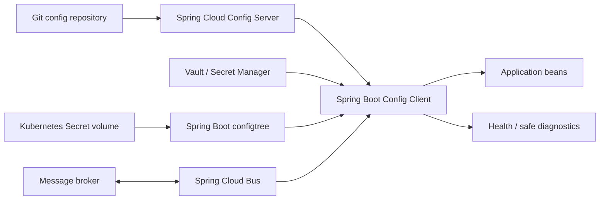

# Viết hướng dẫn vận hành cùng bằng chứng cấu hình không lộ bí mật

Một hệ thống Spring Cloud Configuration chỉ vận hành tốt khi đội phát triển và đội vận hành có thể trả lời được ba câu hỏi: ứng dụng đang nhận cấu hình từ đâu, phiên bản cấu hình nào đang có hiệu lực, và secret có được sử dụng đúng mà không bị lộ trong log hoặc bằng chứng vận hành hay không. Một runbook tốt phải giúp kiểm tra các câu hỏi đó bằng dữ liệu có thể chia sẻ, đồng thời giữ nguyên bí mật của hệ thống.

Bài thực hành này xây dựng một hướng dẫn vận hành cho ứng dụng Spring Boot dùng Spring Cloud Config Server, Git làm nguồn cấu hình và một secret store hoặc Kubernetes Secret để cấp credential. Bạn sẽ tạo quy trình kiểm tra trước/sau thay đổi, xác minh application/profile/label/revision, kiểm tra refresh và health, chứng minh secret được nạp mà không in giá trị, rồi lưu một evidence pack đã làm sạch để phục vụ audit và xử lý sự cố.

## 1. Kết quả cần bàn giao

Sau khi hoàn thành, runbook cần có:

1. Sơ đồ luồng cấu hình và ranh giới trách nhiệm giữa Config Server, Config Client và secret store.
2. Các bước kiểm tra application, profile, label và revision đang được Config Server phục vụ.
3. Cách xác nhận client đã nạp đúng cấu hình và áp dụng thay đổi.
4. Cách xác nhận secret tồn tại, đúng nguồn và được consumer sử dụng thành công mà không hiển thị plaintext.
5. Quy tắc thu thập log, metric, HTTP response và metadata theo nguyên tắc redaction.
6. Kiểm thử âm tính để phát hiện secret xuất hiện trong log, response, artifact hoặc bằng chứng.
7. Mẫu evidence pack có thể lưu trong change record hoặc ticket.
8. Quy trình rollback và checklist đóng thay đổi.

Runbook phải giúp người trực ca thao tác được mà không cần mở file secret, dump toàn bộ Spring `Environment` hoặc sao chép raw response chứa giá trị cấu hình nhạy cảm.

## 2. Kiến trúc tham chiếu và ranh giới dữ liệu

Một kiến trúc điển hình:



Luồng thực tế phụ thuộc cách triển khai secret:

- Config Server có thể trả cấu hình nghiệp vụ từ Git.
- Config Client có thể tự đọc Vault bằng Spring Cloud Vault hoặc nhận secret qua một integration riêng.
- Kubernetes có thể mount Secret thành file và Spring Boot đọc bằng `configtree:`.
- Spring Cloud Bus có thể phát sự kiện refresh để client fetch lại cấu hình.

Không mặc định rằng Config Server luôn nhìn thấy hoặc giải mã mọi secret của client. Ghi rõ secret được phân phối theo đường nào và thành phần nào chịu trách nhiệm xác thực.

| Dữ liệu | Nguồn có thẩm quyền | Bằng chứng được phép lưu |
|---|---|---|
| Timeout, retry, feature flag | Git Config Repository | Key allowlist, giá trị không nhạy cảm, label và commit. |
| Database password | Vault/Secret Manager/Kubernetes Secret | Tên secret đã làm sạch, version/rotation metadata, trạng thái tồn tại và kết quả kết nối. |
| OAuth client secret | Secret Manager hoặc workload identity | Secret reference, identity/role và kết quả token acquisition; không lưu token. |
| TLS private key | Secret Manager hoặc mounted Secret | Certificate metadata cần thiết, expiry và handshake result; không lưu private key. |
| Application/profile/label | Deployment và Config Client | Tên application, profile, label và revision đã được phê duyệt. |

## 3. Nguyên tắc tạo bằng chứng không lộ bí mật

Trước khi thu thập evidence, phân loại dữ liệu thành ba nhóm:

- **Có thể công bố trong change record:** application name, profile, label, commit SHA, timestamp, HTTP status, health status và kết quả kiểm thử.
- **Chỉ công bố sau khi làm sạch:** property source names, tên key, secret path, namespace, service account, host nội bộ và thông tin hạ tầng. Các giá trị này có thể tiết lộ topology hoặc quy ước nội bộ.
- **Không được ghi vào evidence:** password, token, API key, private key, decrypted property value, Authorization header, cookie, raw secret payload hoặc toàn bộ Environment dump.

Áp dụng các quy tắc sau:

1. Chỉ thu thập field nằm trong allowlist đã được phê duyệt.
2. Ưu tiên trạng thái boolean, metadata version và kết quả kiểm tra thay cho giá trị bí mật.
3. Redact trước khi ghi file, gửi ticket hoặc đính kèm CI artifact.
4. Không dựa hoàn toàn vào masking mặc định của Actuator; kiểm tra cấu hình sanitization của phiên bản đang chạy.
5. Không đưa secret vào command-line argument, shell history, URL query, log hoặc tên metric.
6. Không dùng hash của password/token ngắn hoặc có entropy thấp làm bằng chứng; hash có thể bị dò từ điển.
7. Lưu evidence trong nơi có access control và retention phù hợp.

Ví dụ một bằng chứng tốt: “property `spring.datasource.password` tồn tại từ nguồn `mounted-secret`; kết nối database thành công; không ghi giá trị vào log”. Bằng chứng này chứng minh luồng hoạt động mà không tiết lộ password.

## 4. Chuẩn bị trước khi thao tác

Người vận hành cần có:

- Quyền đọc metadata của Config Server và quyền gọi health endpoint được phê duyệt.
- Danh tính workload hoặc cơ chế xác thực được cấp sẵn; không yêu cầu người trực sao chép token vào command line.
- Application, profile, label và revision dự kiến.
- Change ID, người chịu trách nhiệm, cửa sổ triển khai và điều kiện dừng.
- Secret reference/version hoặc Kubernetes Secret name đã được phép hiển thị trong nội bộ.
- Danh sách property key được phép xuất hiện trong evidence.
- Runbook rollback và artifact/revision cấu hình đã biết là tốt.

### Bảng preflight biến môi trường và danh tính

Điền các biến định danh trước khi chạy lệnh. Chúng chỉ chứa URL không có credential, tên tài nguyên, version ID hoặc đường dẫn file; không chứa password, token hay private key.

| Biến | Bắt buộc ở bước | Giá trị cần cung cấp |
|---|---|---|
| `AUTH_CONTEXT` | Mọi lệnh cần xác thực | Tên context workload identity/mTLS/credential helper đã được phê duyệt và đăng nhập sẵn; không phải token. |
| `HTTP_AUTH_MODE`, `HTTP_CURL_CONFIG` | Mọi HTTP request cần xác thực | Chế độ mtls, credential-helper hoặc workload-identity; file curl config do cơ chế được duyệt tạo, quyền 0600. |
| `MTLS_CERT_FILE`, `MTLS_KEY_FILE`, `MTLS_CA_FILE` | Khi HTTP_AUTH_MODE=mtls | Đường dẫn certificate, private key và CA; key file chỉ đọc bởi operator/service account. |
| `CONFIG_SERVER_URL` | Kiểm tra Config Server | Base URL HTTPS, không có userinfo, query hoặc token. |
| `CONFIG_LABEL` | Kiểm tra revision | Branch/tag/label đã được duyệt. |
| `CONFIG_REPOSITORY_ID`, `RELEASE_INVENTORY_FILE`, `CONFIG_REPO_CHECKOUT` | Đối chiếu Git revision | Alias do controlled release inventory/pipeline binding cung cấp, inventory đã xác thực và checkout read-only; operator không tự nhập alias. |
| `APP_URL` | Kiểm tra client health | Base URL của client hoặc cohort được kiểm tra. |
| `POD_NAME`, `NAMESPACE` | Chỉ khi kiểm tra Kubernetes | Pod và namespace đã được duyệt. |
| `VAULT_ADDR`, `VAULT_MOUNT`, `VAULT_PATH`, `VAULT_TOKEN_FILE` | Chỉ khi kiểm tra Vault KV v2 metadata | HTTPS endpoint không chứa credential, mount/path đã được phân loại và file 0600 chứa token metadata-reader ngắn hạn; không dùng Config Server data token cho metadata API. |
| `APP_NAME`, `APP_PROFILE`, `CLIENT_COHORT` | Refresh/rollback | Application, profile và cohort đích. |
| `SECRET_REF`, `SECRET_ACTIVE_ALIAS` | Rollback secret | Secret reference và alias đang được workload sử dụng; không phải secret value. |
| `FAULTY_VERSION`, `KNOWN_GOOD_VERSION` | Rollback secret | Version ID lỗi và version tốt đã xác minh; `KNOWN_GOOD_VERSION` chỉ cần khi không nghi ngờ compromise. |
| `SECRET_COMPROMISED` | Rollback secret | Bắt buộc đúng literal `true` hoặc `false`; giá trị khác phải dừng trước mọi thao tác rollback. |
| `SECRET_ALIAS_SUPPORTED`, `SECRET_REISSUE_POLICY` | Rollback secret | `SECRET_ALIAS_SUPPORTED` cũng phải đúng literal `true` hoặc `false`; policy cấp credential mới khi rotate-forward. |

Ví dụ kiểm tra biến trước khi thao tác:

```bash
: "${AUTH_CONTEXT:?Activate the approved workload identity or mTLS context first}"
: "${HTTP_AUTH_MODE:?Set mtls, credential-helper, or workload-identity}"
: "${HTTP_CURL_CONFIG:?Set the protected curl config generated by the approved auth context}"
: "${CONFIG_SERVER_URL:?Set the HTTPS Config Server base URL}"
: "${CONFIG_LABEL:?Set the approved configuration label}"
: "${APP_URL:?Set the client base URL}"
: "${APP_NAME:?Set the application name used for the authenticated probe}"
: "${APP_PROFILE:?Set the active application profile}"
approved-http-auth render-curl-config --context "$AUTH_CONTEXT" \
  --mode "$HTTP_AUTH_MODE" --audience "$CONFIG_SERVER_URL" \
  --output "$HTTP_CURL_CONFIG"
test -r "$HTTP_CURL_CONFIG" || { echo "HTTP auth config is not readable" >&2; exit 2; }
test "$(stat -c '%a' "$HTTP_CURL_CONFIG")" = "600" || {
  echo "HTTP auth config must have mode 0600" >&2
  exit 2
}
case "$HTTP_AUTH_MODE" in
  mtls)
    : "${MTLS_CERT_FILE:?Set the mTLS client certificate path}"
    : "${MTLS_KEY_FILE:?Set the mTLS private key path}"
    : "${MTLS_CA_FILE:?Set the trusted CA path}"
    test -r "$MTLS_CERT_FILE" && test -r "$MTLS_KEY_FILE" && test -r "$MTLS_CA_FILE" \
      || { echo "mTLS certificate/key/CA file is not readable" >&2; exit 2; }
    test "$(stat -c '%a' "$MTLS_KEY_FILE")" = "600" \
      || { echo "mTLS private key must have mode 0600" >&2; exit 2; }
    openssl x509 -in "$MTLS_CERT_FILE" -noout -checkend 0 >/dev/null
    ;;
  credential-helper|workload-identity)
    # The approved helper writes a short-lived Authorization header to HTTP_CURL_CONFIG.
    # Never print that file; curl reads it directly from the protected path.
    ;;
  *)
    echo "Unsupported HTTP_AUTH_MODE" >&2
    exit 2
    ;;
esac
case "$CONFIG_SERVER_URL" in
  *://*@*|*\?*|*#*) echo "CONFIG_SERVER_URL must not contain credentials, query, or fragment" >&2; exit 2 ;;
esac
HTTP_AUTH_STATUS="$(curl --config "$HTTP_CURL_CONFIG" --silent --show-error \
  --output /dev/null --write-out '%{http_code}' \
  "$CONFIG_SERVER_URL/$APP_NAME/$APP_PROFILE/$CONFIG_LABEL")"
test "$HTTP_AUTH_STATUS" = "200" || {
  echo "Approved HTTP auth context failed (status $HTTP_AUTH_STATUS)" >&2
  exit 1
}
printf 'Approved HTTP auth context: PASS\n'
```

approved-http-auth là wrapper do tổ chức cung cấp; thay bằng tên helper đã được phê duyệt tại môi trường triển khai. Hợp đồng của helper là gắn AUTH_CONTEXT với audience CONFIG_SERVER_URL, ghi file curl config quyền 0600 và không bao giờ in token/credential ra stdout hoặc log. Với mTLS, HTTP_CURL_CONFIG chứa các chỉ thị cert, key, cacert trỏ tới ba file đã kiểm tra ở trên. Với credential-helper/workload-identity, helper tạo file này với header xác thực ngắn hạn; không tạo thủ công, đọc, in hoặc đính kèm file. Ví dụ file mTLS chỉ chứa các đường dẫn cert/key/CA; file do workload identity helper tạo có thể chứa một header Authorization ngắn hạn nhưng không được hiển thị. Mọi HTTP request cần xác thực phải dùng curl --config "$HTTP_CURL_CONFIG"; phép thử ở trên kiểm tra trực tiếp Config API và chỉ ghi status, không in Environment body. Request âm tính cố ý không xác thực (AUTH-01) sẽ bỏ --config. Không đặt bearer token, Basic password hoặc private-key content vào command line, URL hay shell variable được echo.

Không chạy lệnh có `set -x`, `bash -x`, PowerShell transcription không kiểm soát hoặc debug HTTP client khi đang xử lý secret. Những chế độ này có thể ghi lại command, header và payload.

Nếu cần xác thực HTTP, dùng workload identity, mTLS hoặc credential helper được tổ chức quản lý. Tránh truyền token trực tiếp trong URL hoặc đối số dòng lệnh vì chúng có thể xuất hiện trong shell history, process listing hoặc log của công cụ.

## 5. Ghi nhận baseline trước thay đổi

Trước khi refresh hoặc rollout, ghi lại metadata baseline:

| Trường | Ví dụ | Lý do |
|---|---|---|
| Change ID | `CHG-2026-0421` | Liên kết evidence với thay đổi được duyệt. |
| Application | `orders-service` | Xác định client. |
| Profile | `prod` | Xác định môi trường cấu hình. |
| Label | `release-stable` | Xác định selector Git/backend. |
| Repository identity | `config-repo-prod` (alias đã duyệt) | Xác định Git repository mà không ghi raw remote URL. |
| Revision | Full Git object ID (40 ký tự hex với SHA-1 hoặc 64 với SHA-256) | Định danh commit chính xác; không dùng SHA rút gọn làm bằng chứng authoritative. |
| Config Server | Alias đã làm sạch | Ghi nhận endpoint logic mà không cần hostname nhạy cảm. |
| Client cohort | `orders-prod-canary` | Xác định nhóm instance được kiểm tra. |
| Timestamp | UTC ISO-8601 | So sánh trước và sau thay đổi. |
| Operator | User/team ID nội bộ | Truy vết trách nhiệm. |

Không đưa giá trị secret vào baseline. Nếu cần xác định credential version, dùng version ID do secret manager cấp hoặc rotation timestamp, không dùng plaintext hay hash tự tạo.

## 6. Kiểm tra Config Server mà không in property values

Config Server Environment API trả application, profile, label, version và các property source. Raw response có thể chứa secret hoặc giá trị nhạy cảm; vì vậy, không dùng `curl` trực tiếp để in toàn bộ JSON ra terminal hoặc dán response vào ticket.

Một cách an toàn hơn là pipe response qua bộ lọc chỉ xuất metadata và một danh sách key không nhạy cảm đã cho phép:

```bash
: "${CONFIG_REPOSITORY_ID:?Must be injected by the controlled release pipeline}"
: "${RELEASE_INVENTORY_FILE:?Set the authenticated release inventory file}"
: "${CONFIG_REPO_CHECKOUT:?Set the read-only release checkout path}"
test -r "$RELEASE_INVENTORY_FILE" || { echo "Release inventory is not readable" >&2; exit 2; }
INVENTORY_REPOSITORY_ID="$(jq -er '.repositoryId' "$RELEASE_INVENTORY_FILE")"
INVENTORY_CANONICAL_URI="$(jq -er '.canonicalUri' "$RELEASE_INVENTORY_FILE")"
test "$CONFIG_REPOSITORY_ID" = "$INVENTORY_REPOSITORY_ID" || {
  echo "Repository ID does not match controlled release inventory" >&2
  exit 1
}
ACTUAL_CANONICAL_URI="$(git -C "$CONFIG_REPO_CHECKOUT" remote get-url origin)"
case "$ACTUAL_CANONICAL_URI" in
  *://*@*|*\?*|*#*) echo "Checkout remote must not embed credentials or query data" >&2; exit 2 ;;
esac
test "$ACTUAL_CANONICAL_URI" = "$INVENTORY_CANONICAL_URI" || {
  echo "Checkout origin does not match controlled release inventory" >&2
  exit 1
}

curl --fail --silent --show-error \
  --config "$HTTP_CURL_CONFIG" \
  "$CONFIG_SERVER_URL/orders-service/prod/$CONFIG_LABEL" \
  | jq -e --arg repository "$CONFIG_REPOSITORY_ID" '{
      application: .name,
      profiles: .profiles,
      label: .label,
      repositoryId: $repository,
      version: .version,
      propertySources: [
        .propertySources[]? | {
          category: (
            (.name // "") as $source
            | if ($source | test("vault"; "i")) then "vault"
              elif ($source | test("config.?tree|mounted.?secret"; "i")) then "mounted-secret"
              elif ($source | test("\\.git|git"; "i")) then "git-config"
              elif ($source | test("config.?server"; "i")) then "config-server"
              else "other-approved"
              end
          ),
          approvedKeys: ((.source // {} | keys) |
            map(select(. == "app.payment.timeout" or
                       . == "logging.level.root")))
        }
      ]
    }'
```

Lệnh này chỉ xuất metadata, alias repository đã duyệt, category nguồn và tên một số key allowlist; nó không xuất raw propertySources[].name hoặc giá trị property. CONFIG_REPOSITORY_ID phải được inject từ controlled release inventory/pipeline binding, không do operator tự nhập. Release pipeline phải xác thực chữ ký/nguồn gốc inventory trước khi cấp RELEASE_INVENTORY_FILE; không chấp nhận file do operator tự tạo hoặc sửa. Script so sánh alias với inventory đã xác thực, rồi so sánh canonical remote của checkout với canonical URI trong inventory mà không in URI. Chạy trong môi trường đã xác thực bằng curl --config HTTP_CURL_CONFIG; không thêm token vào URL hoặc command line.

Với Git backend, đối chiếu `version` trả về với full object ID từ checkout read-only của release pipeline. Lệnh dưới đây chỉ in alias repository và full commit ID:

```bash
: "${CONFIG_REPOSITORY_ID:?Set the approved repository alias}"
: "${CONFIG_REPO_CHECKOUT:?Set the read-only release checkout path}"
SERVER_VERSION="$(curl --fail --silent --show-error \
  --config "$HTTP_CURL_CONFIG" \
  "$CONFIG_SERVER_URL/orders-service/prod/$CONFIG_LABEL" | jq -er '.version')"
FULL_GIT_OBJECT_ID="$(git -C "$CONFIG_REPO_CHECKOUT" \
  rev-parse --verify "${CONFIG_LABEL}^{commit}")"
case "$FULL_GIT_OBJECT_ID" in
  *[!0-9a-f]*|'') echo "Invalid full Git object ID" >&2; exit 2 ;;
esac
case "${#FULL_GIT_OBJECT_ID}" in
  40|64) ;;
  *) echo "Expected a full SHA-1 or SHA-256 object ID" >&2; exit 2 ;;
esac
if [ "$SERVER_VERSION" != "$FULL_GIT_OBJECT_ID" ]; then
  echo "Config Server revision does not match the release checkout" >&2
  exit 1
fi
printf 'repository_id=%s\nfull_git_object_id=%s\n' \
  "$CONFIG_REPOSITORY_ID" "$FULL_GIT_OBJECT_ID"
```

Lưu cặp `repositoryId` + full Git object ID làm bằng chứng revision authoritative. Checkout phải là bản read-only đã fetch label cần kiểm tra; với annotated tag, `^{commit}` phân giải về commit được tag trỏ tới. Nếu repository dùng object format SHA-256, full ID dài 64 ký tự; SHA-1 thường dài 40 ký tự. Không cắt ngắn ID trong manifest/evidence. Với backend không phải Git, dùng version identifier riêng của backend thay cho Git object ID.

Nếu `jq` hoặc bộ lọc lỗi, không chuyển sang in raw response để “xem thử”. Hãy dừng, sửa bộ lọc trong môi trường test với dữ liệu giả rồi chạy lại. HTTP `4xx`/`5xx` cũng cần được ghi nhận bằng status và correlation ID; không đính kèm error body chưa được làm sạch.

### Những metadata cần xác nhận

- `application` đúng với client.
- `profiles` đúng profile đang chạy.
- `label` đúng branch/tag/commit selector.
- `version` khớp full Git object ID trong repository identity đã duyệt; không dùng SHA rút gọn làm bằng chứng authoritative.
- Danh sách property source phù hợp với layout dự kiến.
- Các key không nhạy cảm cần thiết có mặt trong source được kỳ vọng.

Không dùng việc một key xuất hiện trong response làm bằng chứng rằng bean đã áp dụng nó. Đây mới là bằng chứng Config Server đã trả dữ liệu.

## 7. Xác minh client đã nạp đúng cấu hình

Kiểm tra ở phía client theo hai lớp:

1. **Nạp cấu hình:** client khởi động thành công, chọn đúng application/profile/label và fetch đúng revision.
2. **Áp dụng cấu hình:** Environment hoặc bean liên quan đã nhận giá trị mới; nếu property cần restart, instance mới đã được tạo và trở nên ready.

Có thể dùng Actuator `health` để xác nhận trạng thái tổng quát:

```bash
curl --fail --silent --show-error --config "$HTTP_CURL_CONFIG" \
  "$APP_URL/actuator/health" \
  | jq -e '{status: .status}'
```

Chỉ xuất `status`; không xuất toàn bộ component details nếu chúng chứa hostname, username, endpoint hoặc metadata nhạy cảm. Health `UP` là tín hiệu cần thiết nhưng không chứng minh đúng revision cấu hình.

Đối với cấu hình quan trọng, nên có safe diagnostic do ứng dụng cung cấp, chỉ trả về:

- Application/profile/label hoặc config revision đã được nạp.
- Property key có tồn tại hay không.
- Nhóm nguồn cấu hình đã cung cấp key, ví dụ `config-server`, `vault` hoặc `mounted-secret`.
- Kết quả kiểm tra consumer, ví dụ database connection thành công.

Diagnostic không được trả property value, secret path đầy đủ nếu path nhạy cảm, token, credential hoặc raw `PropertySource`.

## 8. Xác minh secret source mà không đọc secret

Để xác minh secret được phân phối đúng, kiểm tra metadata và hành vi consumer:

| Cơ chế | Bằng chứng an toàn |
|---|---|
| Vault | Auth method/role alias, secret version hoặc lease metadata đã làm sạch, trạng thái renewal và kết quả consumer. |
| Kubernetes Secret volume | Secret object name đã được duyệt, Pod volume reference, file tồn tại/đọc được và consumer thành công. |
| `configtree:` | Property tồn tại trong Environment, source category là mounted secret và bean bind thành công; không đọc/print value. |
| Spring Cloud Kubernetes API | Application identity, namespace/resource name đã làm sạch, RBAC check và kết quả property binding. |
| Secret Manager API | Secret version ID, access audit event và consumer health; không lưu response payload. |

### Vault KV v2: kiểm tra version metadata, không đọc data

Trước mọi lệnh metadata, chạy preflight dưới đây trong cùng shell. Nó kiểm tra đủ VAULT_ADDR, VAULT_MOUNT, VAULT_PATH và token file, chỉ cho phép HTTPS (hoặc Vault dev loopback), nạp identity metadata-reader từ file 0600 và xác thực token bằng một projection không chứa token ID/value:

```bash
vault_metadata_preflight() {
  : "${VAULT_ADDR:?Set the Vault HTTPS address}"
  : "${VAULT_MOUNT:?Set the KV v2 mount name}"
  : "${VAULT_PATH:?Set the secret path whose metadata is required}"
  : "${VAULT_TOKEN_FILE:?Set the protected metadata-reader token file}"
  case "$VAULT_ADDR" in
    https://*|http://127.0.0.1:8200) ;;
    *) echo "Vault must use HTTPS except for the local dev listener" >&2; return 2 ;;
  esac
  case "$VAULT_ADDR" in
    *://*@*|*\?*|*#*) echo "VAULT_ADDR must not contain credentials, query, or fragment" >&2; return 2 ;;
  esac
  test -r "$VAULT_TOKEN_FILE" || { echo "Vault token file is not readable" >&2; return 2; }
  test "$(stat -c '%a' "$VAULT_TOKEN_FILE")" = "600" || {
    echo "Vault token file must have mode 0600" >&2
    return 2
  }
  export VAULT_ADDR
  export VAULT_TOKEN="$(< "$VAULT_TOKEN_FILE")"
  vault token lookup -format=json | jq -e '
    .data as $token |
    {
      authenticated: ($token.id != null),
      metadataReader: (($token.policies // []) | index("metadata-reader") != null),
      rootPolicy: (($token.policies // []) | index("root") != null),
      ttlSeconds: $token.ttl,
      renewable: $token.renewable
    } |
    select(.authenticated and .metadataReader and (.rootPolicy | not))
  ' >/dev/null || { echo "Vault metadata auth check failed" >&2; return 1; }
  printf 'Vault metadata auth context: PASS\n'
}

vault_metadata_preflight
```

Lệnh auth check chỉ in trạng thái PASS/FAIL; không in token ID, token value hoặc raw lookup response. Token file phải thuộc identity metadata-reader được phê duyệt và có TTL ngắn; không dùng Config Server data token hoặc dev/root token cho metadata API. Sau khi đổi VAULT_ADDR/MOUNT/PATH hoặc token file, chạy lại preflight.

Với KV v2, dùng metadata endpoint để xác nhận version hiện hành và trạng thái các version. Lệnh dưới đây không gọi `vault kv get` và chỉ xuất các trường metadata đã allowlist:

```bash
vault_metadata_preflight
vault kv metadata get -format=json -mount="$VAULT_MOUNT" "$VAULT_PATH" \
  | jq -e '{
      currentVersion: .data.current_version,
      oldestVersion: .data.oldest_version,
      versions: ((.data.versions // {}) | with_entries(
        .value |= {
          created_time,
          deletion_time,
          destroyed
        }
      ))
    }'
```

Không truyền Vault token trên command line. Không thêm `custom_metadata` hoặc secret data vào projection nếu chưa được phân loại. KV v2 version không phải lease: với dynamic secret có lease, dùng runbook lifecycle đã được phê duyệt của nền tảng để kiểm tra TTL/renewable state qua metadata-only API; không đưa lease ID hoặc secret value vào terminal/evidence.

Với Kubernetes, có thể xác nhận Pod đã sẵn sàng và file secret tồn tại mà không in nội dung:

```bash
kubectl get pod "$POD_NAME" -n "$NAMESPACE" \
  -o jsonpath='{range .status.containerStatuses[*]}{.name}{" ready="}{.ready}{"\n"}{end}'

kubectl exec -n "$NAMESPACE" "$POD_NAME" -- \
  sh -c 'test -s /run/secrets/spring.datasource.password && printf "secret_file_present=true\n"'
```

Lệnh thứ hai chỉ xuất trạng thái file có tồn tại và không rỗng. Nó không chứng minh giá trị hợp lệ; bước kiểm tra kết nối database ở phần sau mới xác nhận consumer sử dụng được credential.

### Khai báo configtree và ánh xạ Secret vào Pod

Với Spring Boot, import thư mục secret bằng Config Data. Tên file trong thư mục trở thành property key; ví dụ file `/run/secrets/spring.datasource.password` cung cấp property `spring.datasource.password`:

```yaml
spring:
  config:
    import: "configtree:/run/secrets/"
```

Secret object `orders-db-credentials` phải được provision trước trong cùng namespace bởi External Secrets Operator, Secrets Store integration hoặc quy trình secret manager đã được phê duyệt. Object có key tên `spring.datasource.password`; manifest dưới đây chỉ ánh xạ key đó, không chứa secret value:

```yaml
apiVersion: v1
kind: Pod
metadata:
  name: orders-service
spec:
  containers:
    - name: orders-service
      volumeMounts:
        - name: db-credentials
          mountPath: /run/secrets
          readOnly: true
  volumes:
    - name: db-credentials
      secret:
        secretName: orders-db-credentials
        items:
          - key: spring.datasource.password
            path: spring.datasource.password
```

Ánh xạ `key` sang `path` giữ nguyên tên property mà `configtree:` đọc. Không tạo Secret bằng lệnh `kubectl create secret --from-literal` trong terminal dùng chung vì giá trị có thể lọt vào shell history/process arguments; hãy để secret controller hoặc pipeline bảo mật provision object. Giới hạn RBAC đọc Secret, mount read-only và xác minh quyền file theo UID/GID của container.

Không dùng `kubectl get secret -o yaml`, `kubectl get secret -o json`, `kubectl describe secret` hoặc `cat /run/secrets/...` làm evidence. Các thao tác đó có thể hiển thị hoặc làm lộ metadata/giá trị không cần thiết.

## 9. Chứng minh secret được consumer sử dụng thành công

Một secret có thể tồn tại nhưng sai, hết hạn hoặc không có quyền. Thay vì in giá trị, kiểm tra thao tác cần credential:

- Database: pool tạo được connection và truy vấn health như `SELECT 1` thành công.
- Broker: client xác thực thành công và thực hiện health check không gây side effect.
- OAuth2: workload lấy được access token và gọi endpoint kiểm tra quyền; không ghi token ra log.
- TLS: handshake và hostname verification thành công; chỉ lưu certificate metadata cần thiết, không lưu private key.
- External API: request kiểm tra có quyền tối thiểu thành công; response đã được lọc.

Ví dụ evidence database:

```json
{
  "consumer": "orders-datasource",
  "credentialSource": "vault-secret-reference",
  "credentialVersion": "version-42",
  "connectionCheck": "PASS",
  "queryCheck": "SELECT_1_PASS",
  "credentialValueRecorded": false
}
```

Các giá trị trong JSON là metadata minh họa. Không ghi password, JDBC URL có credential nhúng, username nếu policy yêu cầu ẩn, hoặc exception chứa connection string. Với OAuth, không lưu access token hay refresh token để chứng minh xác thực thành công.

## 10. Kiểm tra refresh và rollout

Sau khi thay đổi Git config hoặc secret reference, xác định loại property:

| Loại thay đổi | Hành động |
|---|---|
| Runtime property được hỗ trợ rebind | Refresh client hoặc gửi Spring Cloud Bus event theo phạm vi. |
| Bean `@RefreshScope` | Refresh target và xác nhận lần gọi sau dùng cấu hình mới. |
| Startup-only property | Rollout/restart instance để khởi tạo lại bean/tài nguyên. |
| Environment variable trong container | Tạo Pod/container mới để nhận giá trị mới. |
| Secret volume/configtree | Xác minh volume propagation, sau đó dùng reload được hỗ trợ hoặc restart; file đổi không tự đồng nghĩa Environment đã đổi. |

Khi dùng Spring Cloud Bus, lưu evidence về:

- Event ID/correlation ID nếu có.
- Destination/Bus ID đã làm sạch.
- Thời điểm publish và số client mục tiêu xác nhận đã xử lý.
- Revision sau refresh.
- Health và consumer check sau refresh.

HTTP response thành công từ endpoint `busrefresh` chỉ chứng minh event đã được chấp nhận/phát đi theo cơ chế endpoint. Nó không chứng minh mọi client đã nhận và áp dụng. Theo dõi từng cohort và chờ xác nhận bất đồng bộ.

## 11. Safe diagnostics trong ứng dụng

Nếu runbook cần biết property đến từ đâu, xây dựng diagnostic có allowlist thay vì expose toàn bộ Actuator `env`.

Ví dụ Java dạng pseudocode (minh họa logic, không phải đoạn mã biên dịch độc lập):

```java
record ConfigEvidence(
    boolean propertyPresent,
    String sourceCategory
) {}

ConfigEvidence inspectSecretProperty(Environment environment) {
    String key = "spring.datasource.password";

    String category = StreamSupport.stream(
            ((ConfigurableEnvironment) environment)
                .getPropertySources().spliterator(), false)
        .filter(source -> source.containsProperty(key))
        .map(source -> classifyToApprovedCategory(source.getName()))
        .findFirst()
        .orElse("missing");

    return new ConfigEvidence(environment.containsProperty(key), category);
}
```

`classifyToApprovedCategory` là helper giả định trong pseudocode; khi triển khai thật, helper phải ánh xạ tên source nội bộ sang một nhãn đã duyệt, ví dụ `config-server`, `vault` hoặc `mounted-secret`. Không trả nguyên source name nếu nó chứa đường dẫn, tenant hoặc namespace nhạy cảm. Không gọi `environment.getProperty(key)` trong diagnostic chỉ để in ra; mục tiêu là xác minh sự hiện diện và nguồn, không xuất value.

Đặt endpoint diagnostic sau authentication/authorization, chỉ expose trong mạng quản trị và audit mỗi lần truy cập. Nếu không có nhu cầu vận hành rõ ràng, ưu tiên test/metric nội bộ thay vì tạo endpoint mới.

## 12. Không dùng Actuator env/configprops như bản dump bằng chứng

Actuator `env` và `configprops` hữu ích khi debug, nhưng response có thể chứa tên nguồn, origin, giá trị hoặc metadata nhạy cảm. Cơ chế sanitization/masking thay đổi theo phiên bản Spring Boot và cấu hình `show-values`/sanitization.

Quy tắc vận hành:

- Không expose `env` hoặc `configprops` công khai.
- Nếu buộc phải dùng, chỉ truy cập qua kênh quản trị có kiểm soát và chỉ lấy key cần thiết.
- Xác minh redaction trên đúng phiên bản đang chạy trước khi chụp màn hình hoặc lưu response.
- Không giả định chuỗi `******` chứng minh giá trị thật đã được che ở mọi nested structure.
- Không gửi raw response vào ticket, chat, CI log hoặc observability platform.
- Xóa/thu hồi evidence đã lỡ chứa secret theo quy trình incident và rotate credential nếu có khả năng bị lộ.

## 13. Kiểm thử âm tính: secret không xuất hiện trong log hoặc artifact

Một quy trình bảo vệ secret cần kiểm tra cả điều không được xảy ra. Trong môi trường test cô lập, tạo một secret canary giả, không dùng credential production. Chạy ứng dụng và kiểm tra toàn bộ ranh giới có thể lưu hoặc phát tán dữ liệu: application log; raw HTTP response và Actuator response; exception message/stack trace; diagnostic/report; CI artifact; terminal transcript; distributed trace attributes; metric names/labels; và evidence pack. Xác nhận canary không xuất hiện trong bất kỳ đầu ra nào được phép chia sẻ.

Ví dụ JUnit dạng pseudocode (các fixture và capture helper là placeholder của test harness, không phải mã biên dịch độc lập):

```java
@Test
void secretCanaryIsNotWrittenToOperationalOutputs() {
    String canary = testSecretFixture.value();

    String logs = capturedApplicationLogs();
    String httpAndActuatorResponses = capturedHttpAndActuatorResponses();
    String exceptionOutput = capturedExceptionMessagesAndStackTraces();
    String diagnostics = serializedSafeDiagnostics();
    String evidence = generatedEvidenceDocument();
    String ciArtifacts = collectedCiArtifacts();
    String terminalTranscripts = capturedTerminalTranscripts();
    String traceAndMetricLabels = exportedTraceAttributesAndMetricLabels();

    assertFalse(logs.contains(canary));
    assertFalse(httpAndActuatorResponses.contains(canary));
    assertFalse(exceptionOutput.contains(canary));
    assertFalse(diagnostics.contains(canary));
    assertFalse(evidence.contains(canary));
    assertFalse(ciArtifacts.contains(canary));
    assertFalse(terminalTranscripts.contains(canary));
    assertFalse(traceAndMetricLabels.contains(canary));
}
```

Test không được in `canary` trong assertion message hoặc khi thất bại. Chỉ xuất kết quả `PASS/FAIL` và test case ID. Secret canary chỉ tồn tại trong fixture test và phải được xóa sau test.

Ngoài canary test, chạy secret scanner trên diff, log bundle và evidence directory với chế độ redact. Pipeline chỉ nên công bố trạng thái scan, số finding và reference bảo mật; không in matched value hoặc dòng chứa secret ra CI log.

## 14. Evidence pack: lưu gì và không lưu gì

Một evidence pack có thể tổ chức như sau:

```text
evidence-CHG-2026-0421/
├── change-metadata.json
├── config-server-metadata.json
├── client-health.json
├── secret-provenance.json
├── refresh-result.json
├── regression-summary.json
├── redaction-scan-summary.json
└── operator-approval.txt
```

Đây là tên file gợi ý; chỉ tạo những artifact cần thiết theo quy trình nội bộ. Không lưu raw Config Server Environment response, Secret YAML, Actuator dump, Authorization header, token, private key hoặc shell transcript không được làm sạch.

### Mẫu evidence tổng hợp

```json
{
  "changeId": "CHG-2026-0421",
  "application": "orders-service",
  "profiles": ["prod"],
  "label": "release-stable",
  "repositoryId": "config-repo-prod",
  "configRevision": "4b7f2b6d7b0e9c1a2f3d4e5f60718293a4b5c6d7",
  "configServerCheck": "PASS",
  "clientFetchCheck": "PASS",
  "approvedPropertyChecks": [
    {
      "key": "app.payment.timeout",
      "value": "3s",
      "sensitive": false
    }
  ],
  "secretChecks": [
    {
      "property": "spring.datasource.password",
      "sourceCategory": "mounted-secret",
      "present": true,
      "consumerConnection": "PASS",
      "valueRecorded": false
    }
  ],
  "refreshCheck": "PASS",
  "applicationHealth": "UP",
  "secretLeakScan": "PASS",
  "operatorApproval": "team-platform",
  "timestamp": "2026-11-27T10:30:00Z"
}
```

Chỉ đưa giá trị không nhạy cảm đã được duyệt vào `approvedPropertyChecks`. Nếu key, source category hoặc revision có thể tiết lộ thông tin nội bộ, áp dụng cách làm sạch theo phân loại dữ liệu của tổ chức. Mẫu JSON không chứa password/token và không dùng hash secret.

## 15. Runbook mẫu cho một thay đổi cấu hình production

Ví dụ thay timeout của payment client và xác minh database secret rotation trong cùng cửa sổ thay đổi. Nếu hai việc không có quan hệ vận hành, nên tách thành hai change record để dễ xác định nguyên nhân khi rollback.

### Trước thay đổi

1. Xác nhận change record, owner, reviewer và cửa sổ triển khai.
2. Ghi application, profile, label và revision hiện tại.
3. Kiểm tra Config Server health và Environment metadata bằng bộ lọc an toàn.
4. Ghi client health, config revision và consumer checks hiện tại.
5. Xác nhận secret reference/version hiện tại bằng metadata đã làm sạch.
6. Kiểm tra evidence directory không chứa file raw hoặc transcript cũ.

### Phát hành cấu hình

1. Merge PR đã được review vào branch/tag theo release policy.
2. Ghi commit SHA và label phát hành.
3. Xác nhận Config Server trả đúng application/profile/label/revision.
4. Xác minh các key không nhạy cảm trong allowlist có mặt và giá trị đúng.
5. Không tải hoặc lưu property values nhạy cảm trong evidence.

### Phát hành secret

1. Tạo/rotate secret trong secret manager theo quy trình được duyệt.
2. Ghi secret version ID hoặc rotation event ID, không ghi value.
3. Xác minh workload identity/RBAC hoặc volume reference.
4. Xác minh file/property có mặt mà không đọc nội dung.
5. Thực hiện consumer check, ví dụ database connection thành công.
6. Chỉ revoke credential cũ sau khi mọi replica đã chuyển sang version mới và có bằng chứng sử dụng thành công.

### Áp dụng và xác minh

1. Chọn refresh, Bus refresh hoặc restart theo loại property.
2. Thực hiện trên canary/cohort đầu tiên nếu thay đổi có phạm vi rộng.
3. Xác nhận từng client nhận revision dự kiến.
4. Kiểm tra health, error rate, latency và consumer operation.
5. Chạy secret leak scan trên log/evidence đã làm sạch.
6. Mở rộng rollout khi tiêu chí chấp nhận đạt.

### Đóng thay đổi

1. Lưu evidence pack đã redacted trong nơi được phê duyệt.
2. Ghi người phê duyệt, timestamp, commit, label và client cohort.
3. Xác nhận không có secret trong artifact, ticket hoặc log chia sẻ.
4. Đóng change record hoặc ghi rõ blocker/rollback.

## 16. Phương án rollback

Rollback phải khôi phục được cả cấu hình và khả năng xác thực của client:

1. Dừng rollout và giữ lại revision hiện tại để điều tra.
2. Chuyển Config Server về commit/tag đã biết là tốt hoặc tạo commit revert.
3. Xác minh Environment metadata trả đúng revision rollback.
4. Phát refresh hoặc restart tùy loại property.
5. Nếu secret đã rotate, giữ credential cũ trong giai đoạn overlap cho đến khi client rollback đã xác thực thành công.
6. Không khôi phục secret cũ nếu nó đã bị nghi ngờ lộ; trong trường hợp đó cần incident response và rotation mới.
7. Xác minh client health, consumer check và revision sau rollback.
8. Lưu evidence rollback không chứa plaintext secret.

Không force-push để viết lại lịch sử config production. Không revoke credential cũ chỉ vì candidate đã được deploy; chờ mọi client mục tiêu được xác nhận. Với thay đổi không thể đảo ngược, đánh giá roll-forward và giữ phạm vi ảnh hưởng nhỏ.

### Rollback Config Client đang ghim label

Một Config Client có thể đặt label tường minh bằng `spring.cloud.config.label` hoặc biến môi trường `SPRING_CLOUD_CONFIG_LABEL`. Revert branch `main` hoặc đổi `spring.cloud.config.server.git.default-label` không thay đổi label mà client đã ghim; client đó vẫn yêu cầu tag/commit cũ cho đến khi deployment của chính client được cập nhật.

1. Liệt kê từng application/cohort và xác định label đến từ manifest, Helm values, ConfigMap hay environment variable.
2. Chọn immutable tag hoặc full commit ID đã biết là tốt trong đúng repository; không di chuyển hoặc ghi đè tag cũ.
3. Cập nhật label ở nguồn deployment của từng cohort. Ví dụ:

   ```yaml
   env:
     - name: SPRING_CLOUD_CONFIG_LABEL
       value: "release-stable-previous"
   ```

4. Rolling restart/rollout client để Config Data import đọc label mới lúc khởi động. Chỉ dùng refresh thay cho restart nếu phiên bản client và cách cung cấp label hỗ trợ nạp lại label; không mặc định `/actuator/refresh` sẽ đổi selector đã dùng trong bootstrap.
5. Sau khi client khởi động với label mới, refresh runtime property nếu cần và được hỗ trợ.
6. Với từng cohort, kiểm tra Config Server response theo application/profile/label, đối chiếu repository identity + full Git object ID, rồi xác nhận từng client instance báo release ID mong muốn và consumer check đạt.
7. Chỉ kết thúc rollback khi mọi cohort mục tiêu đã được xác minh; ghi rõ instance offline hoặc chưa hội tụ.

Nếu client không ghim label và dùng default label của server, việc revert branch/default-label có thể đủ để đổi selector ở lần fetch tiếp theo. Vẫn phải xác nhận request thực tế và revision trên từng client; không suy luận từ cấu hình server.

### Rollback/reissue secret theo giao diện provider-neutral

Secret provider không có một API rollback chung. Để runbook có thể dùng cùng một quy trình với Vault, cloud secret manager hoặc hệ thống đồng bộ Kubernetes Secret, tổ chức cần cung cấp adapter nội bộ `ops-secret`, `ops-config` và `ops-consumer`. Đây là giao diện vận hành chuẩn hóa của tổ chức, không phải lệnh có sẵn của Spring hay của mọi nhà cung cấp. Adapter chỉ nhận secret reference/version ID, thực hiện thao tác bên trong provider và chỉ trả metadata/status; tuyệt đối không in secret value.

| Adapter command | Hợp đồng bắt buộc |
|---|---|
| `ops-secret auth check` | Xác nhận `AUTH_CONTEXT` hợp lệ; chỉ trả trạng thái. |
| `ops-secret version verify` | Xác nhận version tồn tại, có thể dùng và không bị revoke; chỉ trả metadata. |
| `ops-secret alias set` | Chuyển alias tới version đã biết tốt một cách atomic, không xuất value. |
| `ops-secret version restore` | Nếu provider không hỗ trợ alias, copy provider-side version tốt thành version current mới và cập nhật current pointer/alias do adapter quản lý; không xuất value và không sửa lịch sử. |
| `ops-secret version reissue` | Cấp credential mới theo policy/issuer và kích hoạt alias; chỉ trả version ID. |
| `ops-secret version revoke` / `retire` | Revoke khi compromise hoặc retire version lỗi sau khi mọi consumer đã chuyển. |
| `ops-secret alias show` | Chỉ trả version ID hiện được alias trỏ tới. |
| `ops-config refresh` | Refresh/restart đúng application/profile/cohort theo runbook triển khai. |
| `ops-consumer verify` | Thử kết nối/xác thực bằng secret đang được workload sử dụng; chỉ trả PASS/FAIL và metadata. |

Đặt các biến định danh trong bảng preflight ở trên. Chạy bằng shell không bật tracing; adapter phải lấy quyền từ `AUTH_CONTEXT`/workload identity, không nhận token hoặc secret value qua argument:

```bash
set -euo pipefail
: "${AUTH_CONTEXT:?}"
: "${SECRET_REF:?}"
: "${SECRET_ACTIVE_ALIAS:?}"
: "${FAULTY_VERSION:?}"
: "${SECRET_COMPROMISED:?Set true or false}"
: "${APP_NAME:?}"
: "${APP_PROFILE:?}"
: "${CLIENT_COHORT:?}"

# Fail closed before authentication, refresh, restore, reissue or revoke.
case "${SECRET_COMPROMISED-}" in
  true|false) ;;
  *)
    echo "SECRET_COMPROMISED must be exactly true or false; aborting" >&2
    exit 2
    ;;
esac
ops-secret auth check --context "$AUTH_CONTEXT" --quiet

if [ "$SECRET_COMPROMISED" = "true" ]; then
  : "${SECRET_REISSUE_POLICY:?Set the approved reissue policy}"
  ops-secret version reissue --context "$AUTH_CONTEXT" \
    --ref "$SECRET_REF" --policy "$SECRET_REISSUE_POLICY" \
    --activate-alias "$SECRET_ACTIVE_ALIAS" --quiet
  TARGET_VERSION="$(ops-secret alias show --context "$AUTH_CONTEXT" \
    --ref "$SECRET_REF" --alias "$SECRET_ACTIVE_ALIAS" --field version)"
  # Rotate forward: do not restore or reactivate a possibly compromised version.
  ops-secret version revoke --context "$AUTH_CONTEXT" \
    --ref "$SECRET_REF" --version "$FAULTY_VERSION" --quiet
else
  case "${SECRET_ALIAS_SUPPORTED-}" in
    true|false) ;;
    *)
      echo "SECRET_ALIAS_SUPPORTED must be exactly true or false; aborting" >&2
      exit 2
      ;;
  esac
  : "${KNOWN_GOOD_VERSION:?Set the previously verified version ID}"
  ops-secret version verify --context "$AUTH_CONTEXT" \
    --ref "$SECRET_REF" --version "$KNOWN_GOOD_VERSION" --usable --quiet
  if [ "$SECRET_ALIAS_SUPPORTED" = "true" ]; then
    ops-secret alias set --context "$AUTH_CONTEXT" --ref "$SECRET_REF" \
      --alias "$SECRET_ACTIVE_ALIAS" --version "$KNOWN_GOOD_VERSION" --atomic
  else
    ops-secret version restore --context "$AUTH_CONTEXT" --ref "$SECRET_REF" \
      --source-version "$KNOWN_GOOD_VERSION" --create-new-current --quiet
  fi
  TARGET_VERSION="$(ops-secret alias show --context "$AUTH_CONTEXT" \
    --ref "$SECRET_REF" --alias "$SECRET_ACTIVE_ALIAS" --field version)"
fi

ops-config refresh --context "$AUTH_CONTEXT" --application "$APP_NAME" \
  --profile "$APP_PROFILE" --cohort "$CLIENT_COHORT" --wait-for-convergence
ops-consumer verify --context "$AUTH_CONTEXT" --application "$APP_NAME" \
  --cohort "$CLIENT_COHORT" --secret-ref "$SECRET_REF" \
  --expected-version "$TARGET_VERSION" --quiet

if [ "$SECRET_COMPROMISED" = "false" ]; then
  # Retire the faulty version only after every target consumer passed verification.
  ops-secret version retire --context "$AUTH_CONTEXT" \
    --ref "$SECRET_REF" --version "$FAULTY_VERSION" --quiet
fi
```

Với version lỗi nhưng không bị nghi ngờ compromise, quy trình chuyển alias về version tốt hoặc tạo một version current mới từ version tốt, refresh cohort, xác minh consumer rồi mới retire version lỗi. Nếu nghi ngờ secret bị lộ, không chạy nhánh restore: cấp credential mới, chuyển alias, revoke credential bị nghi ngờ theo chính sách incident, refresh client và xác minh kết nối. Việc revoke sớm có thể làm gián đoạn instance chưa chuyển đổi; trong incident compromise, ưu tiên containment và tuân theo quyết định incident commander thay vì giữ credential có nguy cơ để duy trì overlap.

Nếu tổ chức chưa có các adapter với hợp đồng trên, dừng ở bước chuẩn bị và dùng runbook/provider CLI đã được phê duyệt; không thay bằng lệnh vendor tự đoán hoặc copy secret qua terminal. Ghi lại version ID cũ/mới, alias, cohort, consumer result và thời điểm, không ghi secret value.

## 17. Lưu trữ, chia sẻ và xử lý evidence

Evidence vẫn có thể tiết lộ topology, tên ứng dụng, namespace, repository hoặc secret path dù không có plaintext. Vì vậy:

- Gắn classification và owner cho evidence pack.
- Lưu trong hệ thống change management/audit có access control.
- Chỉ chia sẻ link có quyền truy cập tối thiểu; không gửi file qua kênh công khai.
- Áp dụng retention và deletion policy.
- Kiểm tra file trước khi upload, đặc biệt screenshot, terminal transcript và raw JSON.
- Nếu phát hiện secret, ngừng chia sẻ, thu hồi quyền truy cập, xử lý artifact và rotate credential theo incident policy.

Không chụp màn hình terminal nếu command trước đó có thể đã in token/secret. Khi cần ảnh minh chứng, tạo màn hình riêng chỉ chứa output đã lọc.

## 18. Checklist vận hành

### Trước thao tác

- [ ] Có change ID, owner, reviewer và rollback plan.
- [ ] Đã xác định application/profile/label/revision.
- [ ] Đã xác định nguồn có thẩm quyền cho từng nhóm property.
- [ ] Authentication dùng identity/credential helper được duyệt.
- [ ] Không bật shell tracing hoặc debug payload.

### Khi xác minh cấu hình

- [ ] Config Server response chỉ được lọc thành metadata/allowlisted keys.
- [ ] Client đã fetch đúng revision.
- [ ] Property source precedence đúng.
- [ ] Refresh/restart đã được chọn đúng với lifecycle của property.
- [ ] Health và consumer checks đạt.

### Khi xác minh secret

- [ ] Secret reference/version đã được xác minh mà không đọc value.
- [ ] Workload identity/RBAC đúng phạm vi.
- [ ] Secret file/property có mặt nếu dùng mount/configtree.
- [ ] Consumer xác thực thành công.
- [ ] Không có plaintext trong log, response, ticket hoặc evidence.
- [ ] Rotation chỉ revoke credential cũ sau khi chuyển đổi hoàn tất.

### Trước khi đóng thay đổi

- [ ] Evidence pack chỉ chứa field đã duyệt.
- [ ] Secret leak scan đạt và chỉ lưu summary.
- [ ] Commit, label, revision, cohort và timestamp được ghi nhận.
- [ ] Rollback/recovery status được ghi rõ.
- [ ] Evidence được lưu đúng nơi và đúng retention.

## 19. Lỗi thường gặp và cách xử lý

| Hiện tượng | Nguyên nhân có thể | Hướng xử lý |
|---|---|---|
| Config Server trả đúng revision nhưng ứng dụng dùng giá trị cũ | Client chưa refresh/restart hoặc source khác có precedence cao hơn. | Kiểm tra Environment/source order và lifecycle consumer. |
| Health `UP` nhưng database connection fail | Secret sai/hết hạn, network hoặc datasource chưa được tạo lại. | Kiểm tra secret version metadata, connectivity và restart/rebind behavior. |
| Secret file tồn tại nhưng consumer không xác thực | File rỗng, sai format, permission hoặc credential đã revoke. | Chỉ kiểm tra metadata/consumer result; rotate hoặc remount theo runbook. |
| Secret xuất hiện trong Actuator response | Sanitization chưa bật/không áp dụng cho source đó. | Ngừng chia sẻ response, siết endpoint và kiểm thử redaction. |
| Evidence JSON có field nhạy cảm | Bộ lọc allowlist quá rộng hoặc raw response bị lưu. | Xóa khỏi luồng chia sẻ, tạo lại evidence từ metadata đã lọc. |
| Bus endpoint trả thành công nhưng client không đổi | Event bất đồng bộ chưa tới hoặc client fetch lỗi. | Theo dõi từng Bus ID, revision và client health. |
| Secret scanner báo finding | Có thể là secret thật, fixture hoặc false positive. | Xử lý trong kênh bảo mật; không paste finding chứa matched value vào ticket. |
| Rollback cấu hình nhưng kết nối vẫn lỗi | Client chưa áp dụng revision cũ hoặc credential cũ không còn hợp lệ. | Xác minh revision, restart/reload và kiểm tra chính sách credential. |

## 20. Tổng kết

- Runbook phải xác định nguồn có thẩm quyền, application/profile/label/revision và người chịu trách nhiệm.
- Bằng chứng Config Server nên chỉ chứa metadata và key allowlist; không in raw Environment response.
- Xác minh secret bằng source category, version metadata, file presence và consumer operation thay vì đọc hoặc hash plaintext.
- `configtree:`, Vault, Kubernetes Secret và Spring Cloud Config là các đường phân phối khác nhau; runbook phải ghi đúng đường thực tế.
- Refresh event không chứng minh mọi bean hoặc client đã áp dụng; xác nhận từng cohort và phân biệt refresh với restart.
- Actuator `env`/`configprops`, log, terminal transcript và CI artifact đều có thể làm lộ dữ liệu nếu không được lọc.
- Dùng secret canary trong test cô lập để kiểm tra âm tính; chỉ công bố PASS/FAIL, không in canary.
- Evidence pack cần redaction, access control, retention và liên kết với change ID/commit/revision.
- Rollback phải khôi phục cả revision cấu hình lẫn khả năng xác thực, đồng thời giữ overlap credential khi an toàn.
