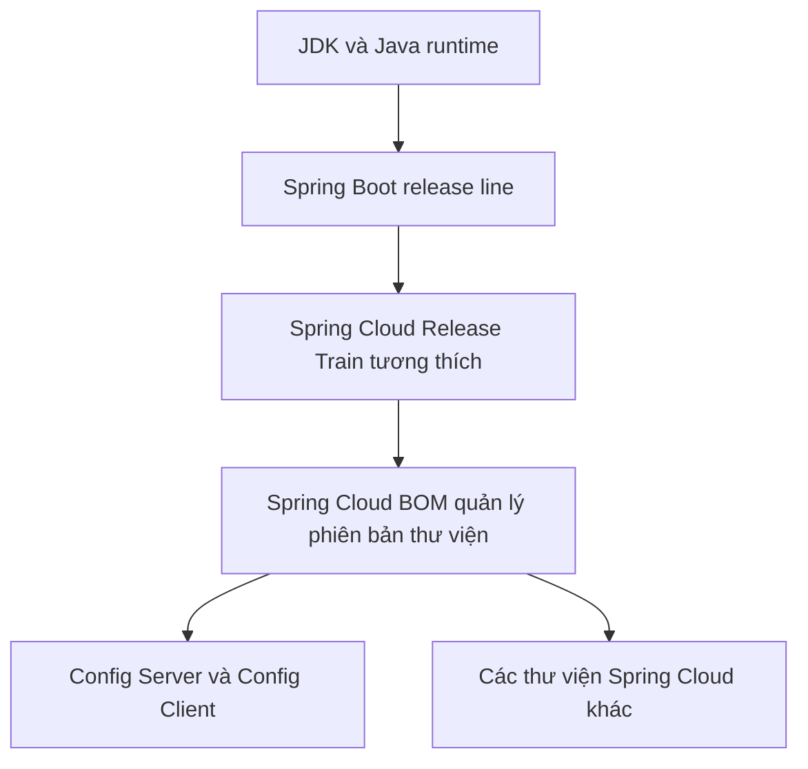

# Chọn tổ hợp Java, Spring Boot và Spring Cloud Release Train tương thích

Trước khi xây dựng Spring Cloud Config Server và các ứng dụng Config Client, cần thống nhất phiên bản Java, Spring Boot và Spring Cloud. Ba thành phần này có quan hệ tương thích: Spring Boot quy định nền tảng Java và Spring Framework mà ứng dụng sử dụng; Spring Cloud bổ sung các thư viện tích hợp và phát hành theo từng release train tương ứng với một số dòng Spring Boot.

Nếu chọn các phiên bản rời rạc, dự án có thể gặp lỗi dependency, lỗi biên dịch, lỗi khởi động hoặc những API không tương thích. Vì vậy, hãy chọn một bộ phiên bản có hỗ trợ rõ ràng, quản lý chúng bằng BOM và kiểm tra lại bằng công cụ build trước khi bắt đầu cấu hình Config Server/Client.

## 1. Mục tiêu học tập

Sau bài học, bạn có thể:

- Giải thích mối quan hệ giữa JDK, Spring Boot và Spring Cloud Release Train.
- Chọn phiên bản Java đáp ứng yêu cầu của Spring Boot và các thư viện được sử dụng.
- Tra cứu release train tương thích với dòng Spring Boot đã chọn.
- Quản lý dependency Spring Cloud bằng `spring-cloud-dependencies` BOM thay vì tự đặt phiên bản cho từng thư viện.
- Kiểm tra phiên bản JDK thực tế của terminal, Maven/Gradle và IDE.
- Nhận biết các lỗi thường gặp khi trộn phiên bản hoặc nâng cấp không đồng bộ.

## 2. Vì sao phải chọn phiên bản theo một bộ?

Một ứng dụng Spring Cloud thường gồm nhiều lớp thư viện:

- **Java Development Kit (JDK):** cung cấp compiler, runtime và các API nền tảng.
- **Spring Boot:** cung cấp cơ chế khởi động ứng dụng, auto-configuration, quản lý dependency và tích hợp các thành phần Spring.
- **Spring Cloud:** bổ sung các thư viện cho hệ thống phân tán, ví dụ Config, Gateway, LoadBalancer và các tích hợp khác.
- **Thư viện nền tảng:** Spring Framework, Reactor, Jackson, Netty và nhiều thư viện phụ thuộc khác được các BOM quản lý.

Các lớp này có quan hệ phụ thuộc. Một release train Spring Cloud được kiểm thử với những dòng Spring Boot cụ thể. Nếu dùng Spring Cloud quá cũ với Spring Boot mới, hoặc ngược lại, một số lớp có thể tham chiếu API đã thay đổi hoặc bị loại bỏ. Nếu compiler dùng JDK mới nhưng runtime lại chạy bằng JDK thấp hơn, ứng dụng cũng có thể không khởi động.



Mục tiêu là tạo một tổ hợp mà từng thành phần đều nằm trong phạm vi hỗ trợ của thành phần còn lại. Chỉ thấy dự án tải được dependency hoặc biên dịch thành công chưa đủ để kết luận tổ hợp đó được hỗ trợ.

## 3. Phân biệt các loại phiên bản

Các số phiên bản xuất hiện trong dự án có ý nghĩa khác nhau:

| Thành phần | Ví dụ cách gọi | Vai trò |
| --- | --- | --- |
| Java | Java 17, Java 21 | Phiên bản ngôn ngữ và runtime JDK mà ứng dụng biên dịch/chạy trên đó |
| Spring Boot | 3.5.x, 4.0.x | Dòng nền tảng ứng dụng và bộ dependency nền |
| Spring Cloud Release Train | 2025.0.x, 2025.1.x | Dòng phát hành phối hợp các dự án Spring Cloud |
| Spring Cloud Config | Phiên bản được BOM quản lý | Phiên bản thư viện Config Server/Client nằm trong release train |

Release train không phải phiên bản của Spring Boot và cũng không phải phiên bản của riêng Spring Cloud Config. Ví dụ, `spring-cloud-starter-config` thường không cần khai báo version trực tiếp khi dự án đã import đúng `spring-cloud-dependencies` BOM.

## 4. Chọn phiên bản Java trước khi tạo dự án

Java là nền tảng thực thi của ứng dụng. Hãy kiểm tra yêu cầu Java tối thiểu và phạm vi hỗ trợ của dòng Spring Boot dự định sử dụng. Đồng thời, kiểm tra yêu cầu của các thư viện bổ sung và môi trường triển khai.

### Chọn JDK phù hợp

Khi chọn JDK, cân nhắc các yếu tố sau:

- **Phiên bản tối thiểu:** JDK phải đáp ứng mức tối thiểu mà Spring Boot và các dependency yêu cầu.
- **Phiên bản LTS:** ưu tiên một bản Java LTS còn được tổ chức hỗ trợ, để thuận tiện cho cập nhật bảo mật và vận hành dài hạn.
- **Môi trường sản xuất:** JDK phải có sẵn trong image/container, máy chủ hoặc nền tảng triển khai.
- **Công cụ phát triển:** IDE, Maven/Gradle wrapper và pipeline CI phải dùng được cùng phiên bản JDK.
- **Thư viện nội bộ:** kiểm tra các thư viện riêng của tổ chức có yêu cầu Java cao hơn hay không.

Không nên chỉ dựa vào phiên bản Java được cài trên máy cá nhân. Cần biết rõ JDK nào đang được terminal, Maven/Gradle, IDE và CI sử dụng.

### Kiểm tra JDK đang hoạt động

Trên Windows PowerShell, Linux hoặc macOS, có thể kiểm tra:

```bash
java -version
javac -version
```

Với Maven Wrapper:

```bash
./mvnw -version
```

Trên Windows, dùng `mvnw.cmd -version`. Với Gradle Wrapper:

```bash
./gradlew -version
```

Các lệnh wrapper cho biết JVM mà công cụ build thực sự đang dùng. Nếu `java -version` và thông tin JVM của Maven/Gradle khác nhau, hãy kiểm tra `JAVA_HOME`, `PATH` và cấu hình JDK của IDE.

### Phân biệt JDK chạy và mức Java đích

JDK đang chạy compiler không nhất thiết đồng nghĩa với mức bytecode mà dự án tạo ra. Dự án có thể dùng JDK 21 để build nhưng đặt mức tương thích Java thấp hơn, miễn là Spring Boot và toàn bộ dependency hỗ trợ mức đó.

Với Spring Boot Maven plugin và `spring-boot-starter-parent`, thuộc tính `java.version` thường được dùng để cấu hình mức Java của dự án. Nếu dự án dùng Maven Compiler Plugin hoặc Gradle Java Toolchains trực tiếp, cần bảo đảm các thiết lập không mâu thuẫn.

Ví dụ cấu hình Java toolchain trong Gradle Kotlin DSL:

```kotlin
java {
    toolchain {
        languageVersion = JavaLanguageVersion.of(21)
    }
}
```

Số `21` ở đây chỉ là ví dụ. Hãy thay bằng phiên bản JDK đã được chọn sau khi kiểm tra yêu cầu của Spring Boot, Spring Cloud và môi trường triển khai.

## 5. Chọn dòng Spring Boot

Sau khi xác định được JDK có thể sử dụng, hãy chọn dòng Spring Boot dựa trên các tiêu chí:

1. Dòng phiên bản còn được duy trì và nhận bản sửa lỗi/bảo mật phù hợp với thời gian vận hành dự kiến.
2. Hỗ trợ JDK mà nhóm đã chuẩn hóa.
3. Tương thích với các thư viện nền tảng và dependency bắt buộc của dự án.
4. Có lộ trình nâng cấp rõ ràng từ phiên bản hiện tại nếu đây là dự án đang tồn tại.
5. Phù hợp với nền tảng triển khai và tiêu chuẩn nội bộ.

Không nên chọn Spring Boot chỉ vì đó là phiên bản mới nhất nhìn thấy trên một ví dụ trực tuyến. Phiên bản mới có thể yêu cầu một release train Spring Cloud khác, thay đổi hành vi mặc định hoặc kéo theo việc nâng cấp nhiều thư viện.

Nếu bắt đầu một dự án mới, hãy ưu tiên dòng Spring Boot ổn định đang được hỗ trợ và có release train Spring Cloud tương ứng. Nếu dự án hiện hữu đang dùng dòng Boot cũ, hãy kiểm tra trạng thái hỗ trợ và lập kế hoạch nâng cấp theo từng bước thay vì chỉ đổi một con số trong file build.

## 6. Chọn Spring Cloud Release Train tương thích

Spring Cloud phát hành các dự án liên quan theo release train. Một release train xác định tập hợp phiên bản tương thích giữa các dự án như Config, Gateway, Commons và LoadBalancer. Vì vậy, hãy chọn release train dựa trên dòng Spring Boot, không chọn độc lập theo số phiên bản cao nhất.

Quy trình tra cứu:

1. Ghi lại phiên bản Spring Boot dự kiến dùng, bao gồm dòng minor và patch.
2. Mở bảng tương thích và trạng thái hỗ trợ trên trang chính thức của Spring Cloud.
3. Tìm release train hỗ trợ dòng Spring Boot đó.
4. Kiểm tra trạng thái phát hành của train: còn được hỗ trợ, đã kết thúc hỗ trợ hay chỉ là bản milestone/snapshot.
5. Chọn bản service release ổn định mới nhất trong train phù hợp, theo chính sách nâng cấp của tổ chức.
6. Kiểm tra ghi chú phát hành nếu dự án dùng thư viện Spring Cloud cụ thể hoặc có thay đổi hành vi quan trọng.

Nguồn tra cứu chính nên là trang dự án và tài liệu phát hành chính thức:

- [Spring Cloud — Overview và Release Trains](https://spring.io/projects/spring-cloud#overview)
- [Spring Cloud Reference Documentation](https://docs.spring.io/spring-cloud/docs/current/reference/html/)
- [Spring Boot Reference Documentation](https://docs.spring.io/spring-boot/index.html)

Bảng tương thích thay đổi theo thời gian. Vì vậy, không sao chép một cặp phiên bản từ bài viết cũ mà chưa xác minh lại. Khi tổ chức nâng cấp Spring Boot lên dòng mới, cần kiểm tra xem release train hiện tại có hỗ trợ dòng đó hay phải nâng cấp Spring Cloud đồng thời.

### Đọc bảng tương thích

Hãy xem bảng tương thích như một phép đối chiếu hai chiều:

| Câu hỏi | Điều cần xác minh |
| --- | --- |
| Dòng Boot đã chọn được hỗ trợ bởi train nào? | Release train liệt kê dòng Boot đó trong phạm vi tương thích |
| Dòng train còn được hỗ trợ không? | Trạng thái hỗ trợ và lịch phát hành của train |
| JDK có phù hợp không? | Yêu cầu Java của Boot và các thành phần trong train |
| Có dùng milestone hoặc snapshot không? | Chỉ dùng trong thử nghiệm có chủ đích, không dùng thay bản stable trong sản xuất |
| Có dependency riêng vượt ngoài BOM không? | Kiểm tra ghi chú tương thích và dependency tree |

Nếu không tìm thấy dòng Boot trong bảng tương thích, hãy xem tổ hợp đó là chưa được xác nhận. Không nên tắt kiểm tra tương thích chỉ để buộc ứng dụng khởi động.

## 7. Dùng BOM để quản lý phiên bản Spring Cloud

BOM (Bill of Materials) là một POM quản lý tập hợp phiên bản dependency đã được phối hợp. Spring Cloud cung cấp BOM có tọa độ:

```text
org.springframework.cloud:spring-cloud-dependencies
```

Khi import BOM phù hợp với Spring Boot, các dependency Spring Cloud như Config Client có thể bỏ phần version. Điều này giúp tránh việc mỗi thư viện dùng một phiên bản riêng và giảm nguy cơ tạo ra tổ hợp không được kiểm thử cùng nhau.

### Ví dụ với Maven

Đoạn dưới minh họa cấu trúc quản lý phiên bản. Phiên bản Spring Boot trong `parent` và giá trị `spring-cloud.version` phải được thay bằng cặp đã xác minh từ bảng tương thích chính thức. Không sao chép số phiên bản minh họa mà chưa đối chiếu với dòng Boot thực tế của dự án.

```xml
<parent>
    <groupId>org.springframework.boot</groupId>
    <artifactId>spring-boot-starter-parent</artifactId>
    <version>3.5.0</version>
    <relativePath/>
</parent>

<properties>
    <java.version>21</java.version>
    <spring-cloud.version>2025.0.0</spring-cloud.version>
</properties>

<dependencyManagement>
    <dependencies>
        <dependency>
            <groupId>org.springframework.cloud</groupId>
            <artifactId>spring-cloud-dependencies</artifactId>
            <version>${spring-cloud.version}</version>
            <type>pom</type>
            <scope>import</scope>
        </dependency>
    </dependencies>
</dependencyManagement>

<dependencies>
    <dependency>
        <groupId>org.springframework.cloud</groupId>
        <artifactId>spring-cloud-starter-config</artifactId>
    </dependency>
</dependencies>
```

Ví dụ trên dùng một cặp phiên bản để minh họa cách khai báo BOM. Trong dự án thực tế, hãy chọn patch release đang được hỗ trợ trong dòng Boot và Cloud đã xác minh. Nếu dùng `spring-boot-starter-parent` khác, hãy giữ nguyên nguyên tắc import Spring Cloud BOM tương ứng.

Với Config Server, ứng dụng server thường khai báo dependency `spring-cloud-config-server` và bật `@EnableConfigServer`. Với Config Client, ứng dụng khai báo `spring-cloud-starter-config`. Cả hai đều nhận phiên bản từ cùng Spring Cloud BOM.

### Ví dụ với Gradle Kotlin DSL

Khi dùng plugin quản lý dependency của Spring, có thể import BOM như sau:

```kotlin
plugins {
    id("java")
    id("org.springframework.boot") version "<spring-boot-version>"
    id("io.spring.dependency-management") version "<dependency-management-plugin-version>"
}

extra["springCloudVersion"] = "<compatible-spring-cloud-train-version>"

dependencyManagement {
    imports {
        mavenBom("org.springframework.cloud:spring-cloud-dependencies:${property("springCloudVersion")}")
    }
}

dependencies {
    implementation("org.springframework.cloud:spring-cloud-starter-config")
}
```

Các chuỗi đặt trong dấu ngoặc nhọn là chỗ điền phiên bản thực tế, không phải version hợp lệ để build. Hãy chọn plugin dependency management và các phiên bản Boot/Cloud tương thích theo tài liệu của dự án. Nếu dùng Gradle native platform/BOM thay cho plugin, không import BOM theo cả hai cách cùng lúc nếu không có chủ đích.

## 8. Không tự ghép phiên bản của từng thư viện Spring Cloud

Một lỗi thường gặp là khai báo version riêng cho `spring-cloud-starter-config`, `spring-cloud-commons` hoặc các thư viện Spring Cloud khác trong khi dự án đã import BOM. Việc này có thể ghi đè phiên bản mà release train đã chọn.

Nên tuân theo các nguyên tắc:

- Import một Spring Cloud BOM tương ứng với dòng Spring Boot.
- Không khai báo version riêng cho các dependency Spring Cloud do BOM quản lý, trừ khi có lý do tương thích đã được xác minh.
- Tránh import nhiều Spring Cloud BOM khác release train trong cùng một module.
- Không ép phiên bản Spring Framework, Reactor hoặc thư viện nền tảng bằng cách ghi đè tùy tiện.
- Nếu một thư viện bên thứ ba yêu cầu version khác, hãy kiểm tra dependency tree và tài liệu tương thích trước khi override.

Nếu dự án cần nâng cấp một dependency riêng, hãy xác định BOM nào đang quản lý dependency đó, vì việc ghi đè có thể ảnh hưởng đến nhiều thành phần khác.

## 9. Kiểm tra tổ hợp phiên bản sau khi cấu hình

Sau khi cập nhật file build, thực hiện các bước kiểm tra trước khi thêm cấu hình Git hoặc endpoint cho Config Server.

### Kiểm tra môi trường build

```bash
java -version
./mvnw -version
```

Hoặc với Gradle:

```bash
./gradlew -version
```

Xác nhận JDK hiển thị đúng phiên bản mà nhóm đã thống nhất. Trong CI, dùng cùng major JDK và cùng wrapper với môi trường phát triển.

### Kiểm tra dependency tree

Với Maven:

```bash
./mvnw dependency:tree
./mvnw help:effective-pom
```

Với Gradle:

```bash
./gradlew dependencies
./gradlew dependencyInsight --dependency spring-cloud-config
```

Kiểm tra các điểm sau:

- Chỉ có release train dự kiến được import.
- Phiên bản Spring Cloud Config đến từ BOM mong muốn.
- Không có dependency Spring Cloud bị kéo về phiên bản cũ do khai báo trực tiếp hoặc dependency bắc cầu.
- Các thư viện nền tảng không bị override ngoài dự kiến.

### Build và chạy kiểm tra

Với Maven:

```bash
./mvnw clean verify
```

Với Gradle:

```bash
./gradlew clean build
```

Sau khi build thành công, khởi động ứng dụng và kiểm tra log đầu tiên. Các lỗi như `NoSuchMethodError`, `ClassNotFoundException`, lỗi tạo bean hoặc thông báo compatibility verifier thường cho thấy có vấn đề về phiên bản hoặc cấu hình dependency.

Spring Cloud có cơ chế kiểm tra tương thích một số dòng Spring Boot khi ứng dụng khởi động. Nếu kiểm tra báo phiên bản không tương thích, hãy đối chiếu lại release train và Spring Boot. Không nên tắt compatibility verifier để che lỗi; chỉ cân nhắc tùy chỉnh khi đã xác định rõ tổ hợp, có bằng chứng kiểm thử và hiểu rủi ro.

## 10. Chuẩn bị môi trường riêng cho Config Server và Config Client

Khi đã thống nhất bộ phiên bản, hãy xác định hai ứng dụng hoặc hai vai trò cần build:

| Vai trò | Dependency chính | Trách nhiệm |
| --- | --- | --- |
| Config Server | `spring-cloud-config-server` | Đọc repository cấu hình và cung cấp API cho client |
| Config Client | `spring-cloud-starter-config` | Kết nối server và nạp property source vào ứng dụng |

Hai ứng dụng có thể nằm trong hai repository hoặc hai module riêng. Nếu nằm trong cùng một multi-module build, nên quản lý phiên bản Boot và Cloud tập trung ở parent/root build để tránh lệch phiên bản giữa các module.

Một số công cụ và thành phần nên chuẩn bị:

- JDK đã thống nhất, được cài trong môi trường phát triển và CI.
- Maven Wrapper hoặc Gradle Wrapper được commit cùng repository để cố định phiên bản build tool.
- IDE có hỗ trợ dòng Java đã chọn.
- Git để quản lý mã nguồn và repository cấu hình.
- Container hoặc dịch vụ Git có thể truy cập từ môi trường chạy Config Server.
- Công cụ kiểm tra HTTP như `curl` hoặc REST client để kiểm tra API sau khi ứng dụng chạy.
- Cơ chế quản lý bí mật để cung cấp thông tin xác thực Git hoặc các bí mật mà ứng dụng cần.

Không cần cài mọi dịch vụ phụ trợ ngay trên máy phát triển nếu có thể dùng container hoặc môi trường dùng chung. Tuy nhiên, cần ghi rõ các phụ thuộc bắt buộc để người khác có thể dựng lại môi trường.

## 11. Những lỗi tương thích thường gặp

| Biểu hiện | Nguyên nhân thường gặp | Cách xử lý |
| --- | --- | --- |
| Maven/Gradle báo không hỗ trợ Java version | JDK chạy build thấp hơn yêu cầu của plugin hoặc dependency | Kiểm tra `JAVA_HOME`, wrapper và JDK trong IDE/CI |
| Spring Cloud compatibility verifier từ chối khởi động | Release train không hỗ trợ dòng Spring Boot đang dùng | Chọn train tương thích theo bảng chính thức |
| `NoSuchMethodError` hoặc `NoClassDefFoundError` | Các thư viện Spring/Cloud bị trộn phiên bản | Kiểm tra BOM, dependency tree và các version override |
| Build thành công nhưng ứng dụng lỗi khi chạy | Runtime JDK hoặc classpath khác môi trường build | Kiểm tra image runtime, Java version và dependency đóng gói |
| Config Client không nhận được cấu hình | Thiếu starter, sai tên ứng dụng, sai địa chỉ server hoặc lỗi khởi tạo Config Data | Kiểm tra dependency, `spring.application.name`, `spring.config.import` và log khởi động |
| IDE build được nhưng CI thất bại | IDE dùng JDK hoặc dependency cache khác CI | Dùng wrapper, toolchain và cấu hình CI nhất quán |
| Một module dùng phiên bản Cloud khác module còn lại | Khai báo BOM hoặc version riêng ở nhiều nơi | Đưa quản lý phiên bản về parent/root build |

Không phải mọi lỗi khởi động đều do lệch version. Hãy đọc thông báo lỗi đầu tiên trong log, xem dependency tree và xác minh cấu hình trước khi thay đổi nhiều dependency cùng lúc.

## 12. Quy trình chọn phiên bản cho dự án mới

Có thể dùng trình tự sau như một checklist khi tạo dự án:

1. Xác định thời gian hỗ trợ và yêu cầu triển khai của dự án.
2. Chọn JDK LTS được tổ chức hỗ trợ và đáp ứng yêu cầu của Spring Boot.
3. Chọn dòng Spring Boot ổn định còn được duy trì.
4. Tra bảng chính thức để chọn Spring Cloud Release Train tương thích với dòng Boot đó.
5. Chọn patch release phù hợp trong từng dòng và import Spring Cloud BOM.
6. Tạo Maven/Gradle Wrapper, cấu hình Java toolchain và thống nhất JDK cho IDE/CI.
7. Thêm dependency Config Server hoặc Config Client theo vai trò ứng dụng.
8. Kiểm tra dependency tree, chạy build và khởi động thử.
9. Ghi lại các phiên bản đã chọn trong tài liệu dự án để các thành viên dùng cùng một bộ.

## 13. Quy trình nâng cấp dự án hiện hữu

Với dự án đã chạy ổn định, nâng cấp nên được thực hiện có kiểm soát:

- Ghi nhận JDK, Spring Boot, Spring Cloud train và các dependency override hiện tại.
- Kiểm tra trạng thái hỗ trợ và các dòng nâng cấp được tài liệu chính thức khuyến nghị.
- Đọc migration guide và release notes của Spring Boot và Spring Cloud cho các dòng sẽ đi qua.
- Xác định thay đổi Java, API bị loại bỏ, cấu hình mặc định và các dependency bắc cầu.
- Nâng cấp theo một kế hoạch có thể kiểm thử, tránh thay đổi đồng thời nhiều lớp không liên quan.
- Chạy test, kiểm tra khởi động Config Server/Client, kết nối Git, lấy cấu hình và refresh trong môi trường thử nghiệm.
- Ghi lại cách quay lui nếu bản nâng cấp làm thay đổi hành vi hoặc không đáp ứng yêu cầu vận hành.

Không nên chỉ cập nhật Spring Boot parent mà giữ nguyên Spring Cloud train cũ nếu train đó không hỗ trợ dòng Boot mới. Tương tự, không nên nâng Spring Cloud train mà bỏ qua yêu cầu Java hoặc thay đổi API của Spring Boot.

## 14. Checklist xác nhận môi trường sẵn sàng

- [ ] JDK đáp ứng yêu cầu của Spring Boot và các dependency.
- [ ] Terminal, IDE, Maven/Gradle và CI sử dụng JDK đã thống nhất.
- [ ] Spring Boot thuộc dòng còn được hỗ trợ và phù hợp với dự án.
- [ ] Spring Cloud Release Train được xác nhận tương thích với dòng Spring Boot.
- [ ] Spring Cloud BOM đã được import đúng một lần ở phạm vi quản lý thích hợp.
- [ ] Dependency Spring Cloud không bị ghim version riêng ngoài chủ đích.
- [ ] Maven/Gradle Wrapper và Java toolchain đã được cấu hình.
- [ ] Dependency tree không có xung đột ngoài dự kiến.
- [ ] Build và kiểm tra khởi động thành công.
- [ ] Các phiên bản đã được ghi lại để cả nhóm và CI sử dụng nhất quán.

Một môi trường Spring Cloud Config sẵn sàng bắt đầu từ bộ Java, Spring Boot và Spring Cloud có hỗ trợ tương thích. Khi JDK được chuẩn hóa, release train được chọn theo bảng chính thức và dependency được quản lý bằng BOM, nhóm có nền tảng ổn định để tiếp tục cấu hình Git repository, Config Server và Config Client.
