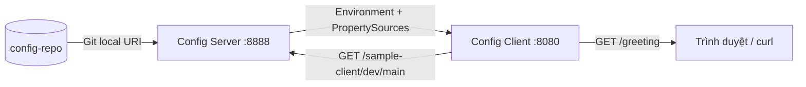

# Dựng kho Git cấu hình cùng ứng dụng client tối thiểu

Bài thực hành này dựng một môi trường Spring Cloud Config nhỏ trên máy phát triển: một repository Git lưu cấu hình, một ứng dụng Config Server đọc repository đó và một ứng dụng Spring Boot đóng vai trò Config Client. Sau khi hoàn thành, client sẽ lấy giá trị từ Git thông qua Config Server và sử dụng giá trị đó trong một REST endpoint.

Mục tiêu là hiểu được toàn bộ đường đi của cấu hình và biết cách kiểm tra từng chặng khi có lỗi. Môi trường local dùng Git repository trên máy để dễ quan sát; khi đưa lên môi trường dùng chung, có thể thay URI local bằng URL của Git server và cấu hình credential phù hợp.

## 1. Kiến trúc và các thành phần cần chuẩn bị

Ta tạo ba phần độc lập:

1. `config-repo`: repository Git chứa các tệp YAML dùng chung và riêng cho ứng dụng.
2. `config-server`: ứng dụng Spring Boot có Spring Cloud Config Server, phục vụ cấu hình qua HTTP tại cổng `8888`.
3. `sample-client`: ứng dụng Spring Boot có Spring Cloud Config Client, đọc cấu hình từ server và cung cấp endpoint kiểm tra tại cổng `8080`.



Chuẩn bị các công cụ:

- JDK phù hợp với phiên bản Spring Boot mà dự án chọn; JDK 17 là mức nền phổ biến cho nhiều dự án Spring Boot 3.x.
- Git để tạo repository và commit cấu hình.
- Maven hoặc Gradle để build hai ứng dụng.
- IDE hoặc editor để tạo project và chỉnh sửa Java/YAML.
- Cổng `8888` và `8080` chưa bị ứng dụng khác sử dụng.

Khi tạo project, chọn phiên bản Spring Boot và Spring Cloud release train tương thích theo bảng tương thích chính thức của Spring Cloud. Có thể tạo hai project riêng bằng Spring Initializr:

| Project | Dependencies cần chọn |
|---|---|
| `config-server` | Spring Cloud Config Server |
| `sample-client` | Spring Web, Config Client |

Hai project phải dùng cùng bộ quản lý phiên bản Spring Boot/Spring Cloud tương thích. Không tự ghép các phiên bản starter khác release train vì có thể gặp lỗi dependency hoặc lỗi khi khởi động.

## 2. Tạo repository Git chứa cấu hình

Tạo thư mục `config-repo` ở vị trí dễ tìm. Ví dụ dưới đây dùng PowerShell trên Windows:

```powershell
New-Item -ItemType Directory -Force "$HOME\config-repo" | Out-Null
Set-Location "$HOME\config-repo"
git init -b main
```

Nếu Git cũ không hỗ trợ `git init -b`, dùng `git init` rồi đổi tên nhánh bằng `git branch -M main`.

Tạo tệp `application.yml` chứa cấu hình dùng chung:

```yaml
app:
  greeting: "Xin chào từ cấu hình tập trung"

service:
  region: local
```

Tạo tệp `sample-client.yml` chứa cấu hình riêng của client:

```yaml
service:
  name: sample-client
```

Tạo tệp `sample-client-dev.yml` chứa giá trị riêng cho profile `dev`:

```yaml
app:
  greeting: "Xin chào từ profile dev"
```

Cấu trúc repository lúc này:

```text
config-repo/
├── application.yml
├── sample-client.yml
└── sample-client-dev.yml
```

Quy ước tên tệp giúp Config Server tìm cấu hình theo application và profile:

- `application.yml`: áp dụng chung cho các ứng dụng.
- `sample-client.yml`: áp dụng riêng cho ứng dụng có tên `sample-client`.
- `sample-client-dev.yml`: áp dụng riêng cho `sample-client` khi profile là `dev`.

Commit các tệp vào Git:

```powershell
git add application.yml sample-client.yml sample-client-dev.yml
git commit -m "Add initial sample client configuration"
git branch --show-current
```

Lệnh cuối cần hiển thị `main`, vì Config Server sẽ được cấu hình dùng label này. Nếu Git yêu cầu danh tính commit, cấu hình `user.name` và `user.email` cho môi trường phát triển rồi commit lại. Không đưa mật khẩu, token, private key hoặc dữ liệu bí mật vào các tệp mẫu này.

## 3. Tạo ứng dụng Config Server

Trong project `config-server`, bảo đảm có dependency `spring-cloud-config-server`. Nếu project được tạo bằng Spring Initializr, dependency management của Spring Cloud thường đã được khai báo theo release train đã chọn. Với Maven, cấu trúc dependency cốt lõi có dạng:

```xml
<dependencyManagement>
    <dependencies>
        <dependency>
            <groupId>org.springframework.cloud</groupId>
            <artifactId>spring-cloud-dependencies</artifactId>
            <version>${spring-cloud.version}</version>
            <type>pom</type>
            <scope>import</scope>
        </dependency>
    </dependencies>
</dependencyManagement>

<dependencies>
    <dependency>
        <groupId>org.springframework.cloud</groupId>
        <artifactId>spring-cloud-config-server</artifactId>
    </dependency>
</dependencies>
```

`spring-cloud.version` phải được khai báo trong phần `properties` của POM bằng release train tương thích với phiên bản Spring Boot đã chọn. Không dùng đoạn dependency này như một dự án độc lập nếu chưa có parent/plugin và cấu hình build của Spring Boot.

Tại lớp khởi động, bật Config Server bằng `@EnableConfigServer`:

```java
package com.example.configserver;

import org.springframework.boot.SpringApplication;
import org.springframework.boot.autoconfigure.SpringBootApplication;
import org.springframework.cloud.config.server.EnableConfigServer;

@SpringBootApplication
@EnableConfigServer
public class ConfigServerApplication {

    public static void main(String[] args) {
        SpringApplication.run(ConfigServerApplication.class, args);
    }
}
```

Khai báo tên ứng dụng, cổng và Git backend trong `config-server/src/main/resources/application.yml`:

```yaml
server:
  port: 8888

spring:
  application:
    name: config-server
  cloud:
    config:
      server:
        git:
          uri: "file:///C:/path/to/config-repo"
          default-label: main
          clone-on-start: true
```

Thay `C:/path/to/config-repo` bằng đường dẫn tuyệt đối đến thư mục `config-repo` trên máy Windows. URI dùng dấu `/`, không dùng dấu `\`. Ví dụ nếu repository nằm tại `D:\workspace\config-repo`, URI tương ứng là `file:///D:/workspace/config-repo`.

Trên Linux hoặc macOS, có thể dùng đường dẫn tương ứng như `file:///home/user/config-repo`. Khi repository đã được đưa lên Git server, thay URI `file:///...` bằng URL HTTPS hoặc SSH phù hợp và cấp credential cho Config Server qua secret manager hoặc biến môi trường. Không commit credential vào `application.yml`.

Các thuộc tính quan trọng:

- `uri`: địa chỉ Git repository mà Config Server đọc.
- `default-label`: nhánh/tag mặc định khi client không truyền label; ở đây là `main`.
- `clone-on-start`: yêu cầu server clone repository khi khởi động, giúp phát hiện sớm lỗi URI hoặc quyền truy cập.

## 4. Khởi động và kiểm tra Config Server

Chạy ứng dụng Config Server từ thư mục project:

```powershell
.\mvnw.cmd spring-boot:run
```

Nếu dùng Gradle wrapper, chạy `.\gradlew.bat bootRun`. Khi khởi động thành công, server lắng nghe tại `http://localhost:8888`.

Gửi yêu cầu lấy cấu hình của `sample-client`, profile `dev`, label `main`:

```powershell
Invoke-RestMethod "http://localhost:8888/sample-client/dev/main" |
    ConvertTo-Json -Depth 10
```

Response là một Environment, trong đó có thông tin application/profile/label và danh sách `propertySources`. Các giá trị dự kiến gồm:

- `app.greeting` có giá trị `Xin chào từ profile dev`.
- `service.name` có giá trị `sample-client`.
- `service.region` có giá trị `local`.

Nếu không thấy các key, kiểm tra tên tệp, nhánh Git, URI và commit. Config Server đọc nội dung Git đã commit; thay đổi chưa commit trong thư mục làm việc có thể không được phục vụ như bạn mong đợi. Nếu repository thay đổi sau khi server đã clone, cần bảo đảm server làm mới bản clone theo cơ chế đang dùng hoặc khởi động lại server trong bài thực hành local này.

## 5. Tạo ứng dụng Config Client tối thiểu

Trong project `sample-client`, thêm dependency `spring-cloud-starter-config` và `spring-boot-starter-web`. Với Maven, phần dependencies cốt lõi:

```xml
<dependencies>
    <dependency>
        <groupId>org.springframework.boot</groupId>
        <artifactId>spring-boot-starter-web</artifactId>
    </dependency>

    <dependency>
        <groupId>org.springframework.cloud</groupId>
        <artifactId>spring-cloud-starter-config</artifactId>
    </dependency>
</dependencies>
```

Project client cũng cần import cùng Spring Cloud BOM qua `${spring-cloud.version}` như Config Server để dependency được quản lý đồng bộ.

Tạo lớp khởi động:

```java
package com.example.sampleclient;

import org.springframework.boot.SpringApplication;
import org.springframework.boot.autoconfigure.SpringBootApplication;

@SpringBootApplication
public class SampleClientApplication {

    public static void main(String[] args) {
        SpringApplication.run(SampleClientApplication.class, args);
    }
}
```

Khai báo Config Data import trong `sample-client/src/main/resources/application.yml`:

```yaml
server:
  port: 8080

spring:
  application:
    name: sample-client
  profiles:
    active: dev
  config:
    import: "configserver:http://localhost:8888"
  cloud:
    config:
      label: main
```

Với Spring Boot 2.4 trở lên, `spring.config.import` là cách nạp Config Data phổ biến. Nếu Config Server là bắt buộc, giữ `configserver:` để ứng dụng báo lỗi khi không thể lấy cấu hình. Nếu môi trường phát triển cần cho phép chạy khi Config Server tạm thời không sẵn sàng và có giá trị mặc định an toàn, có thể dùng `optional:configserver:http://localhost:8888`.

Các dự án dùng cơ chế bootstrap cũ có thể cần `bootstrap.yml` cùng bootstrap starter. Hãy theo đúng cách cấu hình của phiên bản Spring Boot/Spring Cloud trong project, không trộn bootstrap cũ với Config Data import nếu chưa có chủ đích rõ ràng.

Tạo REST controller đọc property từ `Environment` thông qua `@Value`:

```java
package com.example.sampleclient;

import org.springframework.beans.factory.annotation.Value;
import org.springframework.web.bind.annotation.GetMapping;
import org.springframework.web.bind.annotation.RestController;

@RestController
public class GreetingController {

    private final String greeting;
    private final String serviceName;
    private final String region;

    public GreetingController(
            @Value("${app.greeting:Chua co loi chao}") String greeting,
            @Value("${service.name:unknown}") String serviceName,
            @Value("${service.region:unknown}") String region) {
        this.greeting = greeting;
        this.serviceName = serviceName;
        this.region = region;
    }

    @GetMapping("/greeting")
    public GreetingResponse greeting() {
        return new GreetingResponse(greeting, serviceName, region);
    }

    public record GreetingResponse(String greeting, String serviceName, String region) {
    }
}
```

Các giá trị được inject khi bean được tạo. Bài thực hành này chỉ cần xác nhận cấu hình được lấy lúc khởi động; refresh runtime và cách cập nhật bean sẽ được xử lý ở phần học về refresh.

## 6. Chạy client và xác minh cấu hình đã được nạp

Giữ Config Server đang chạy. Mở terminal thứ hai, chuyển vào thư mục project `sample-client` và chạy:

```powershell
.\mvnw.cmd spring-boot:run
```

Hoặc dùng Gradle wrapper bằng `.\gradlew.bat bootRun`. Khi client khởi động, log cần thể hiện ứng dụng kết nối Config Server và hoàn tất việc nạp cấu hình. Nếu Config Server không sẵn sàng mà `spring.config.import` không có `optional:`, ứng dụng sẽ báo lỗi trong quá trình khởi động.

Gọi endpoint của client:

```powershell
Invoke-RestMethod "http://localhost:8080/greeting" |
    ConvertTo-Json -Depth 5
```

Response mong đợi có dạng:

```json
{
  "greeting": "Xin chào từ profile dev",
  "serviceName": "sample-client",
  "region": "local"
}
```

Kết quả này xác nhận chuỗi hoạt động cơ bản: Git chứa tệp đã commit, Config Server đọc Git, Config Client yêu cầu đúng application/profile/label, và Spring inject property vào bean.

## 7. Thử thay đổi cấu hình và kiểm tra lại

Để quan sát cách Git version control cấu hình, sửa `app.greeting` trong `sample-client-dev.yml`:

```yaml
app:
  greeting: "Cau hinh dev da duoc cap nhat"
```

Commit thay đổi:

```powershell
git add sample-client-dev.yml
git commit -m "Update sample client greeting"
```

Trong môi trường local đơn giản này, khởi động lại Config Server để nó đọc phiên bản repository mới, sau đó khởi động lại Config Client để client yêu cầu cấu hình mới. Gọi lại `/greeting` và xác nhận giá trị đã đổi.

Việc commit vào Git không tự động thay đổi bean trong client đang chạy. Khi chưa cấu hình refresh hoặc webhook/Bus, client chỉ lấy lại cấu hình khi khởi động lại. Đây là hành vi cần hiểu rõ trước khi triển khai hệ thống nhiều instance.

## 8. Kiểm tra các biến thể application, profile và label

Thử đổi profile của client từ `dev` sang `default` hoặc tạo một profile khác, ví dụ `test`, bằng cách thêm tệp `sample-client-test.yml` vào Git:

```yaml
app:
  greeting: "Xin chao tu profile test"
```

Commit tệp, đổi `spring.profiles.active` thành `test`, rồi khởi động lại client. Config Server sẽ tìm cấu hình theo application `sample-client`, profile `test` và label `main`.

Để thử label, tạo nhánh Git khác:

```powershell
git switch -c experiment
```

Thay đổi một giá trị, commit trên nhánh `experiment`, rồi gửi yêu cầu trực tiếp đến Config Server:

```powershell
Invoke-RestMethod "http://localhost:8888/sample-client/dev/experiment" |
    ConvertTo-Json -Depth 10
```

Vì Config Server đang giữ bản clone của repository local từ lần khởi động trước, hãy dừng và chạy lại Config Server sau khi tạo nhánh mới để bản clone nhận được label `experiment`. Trong hệ thống dùng remote Git, cần cấu hình và kiểm tra chu kỳ cập nhật repository phù hợp.

Client có thể yêu cầu label này bằng cách đổi `spring.cloud.config.label` thành `experiment`, sau đó khởi động lại. Khi hoàn tất thử nghiệm, có thể quay về nhánh chính bằng `git switch main`. Không dùng nhánh thử nghiệm cho môi trường production nếu chưa qua quy trình review và phát hành cấu hình.

## 9. Sự cố thường gặp và cách xử lý

| Hiện tượng | Nguyên nhân thường gặp | Cách kiểm tra |
|---|---|---|
| Config Server không khởi động | Thiếu `@EnableConfigServer`, dependency sai phiên bản hoặc URI Git không hợp lệ | Xem log startup, kiểm tra dependency và `spring.cloud.config.server.git.uri` |
| Config Server không đọc được repository | Sai đường dẫn, branch không tồn tại, thư mục chưa `git init` hoặc server không có quyền đọc | Chạy `git status`, `git branch --show-current`, kiểm tra URI tuyệt đối và quyền filesystem |
| Endpoint trả về 404 hoặc thiếu key | Sai application/profile/label hoặc tên tệp không theo quy ước | Gọi endpoint đúng dạng `/{application}/{profile}/{label}` và kiểm tra tên YAML |
| Client không kết nối được Config Server | Sai host/port, server chưa chạy, firewall hoặc dependency Config Client thiếu | Gọi endpoint server từ cùng máy/container với client; kiểm tra log kết nối |
| Client khởi động nhưng không có property mong muốn | `spring.application.name`, profile hoặc label sai; cấu hình chưa commit | Kiểm tra application.yml của client và response Environment từ server |
| Sửa YAML nhưng response vẫn là giá trị cũ | Config Server đang dùng bản clone/cache cũ hoặc commit vào nhánh khác | Xác nhận commit/branch, làm mới repository theo cấu hình hoặc restart server trong lab |
| Client không tự đổi sau commit | Client chưa đọc lại cấu hình và chưa nhận refresh event | Restart client trong bài lab; tìm hiểu Actuator refresh/Bus ở bài tương ứng |

Khi chẩn đoán, hãy kiểm tra lần lượt từ nguồn đến nơi sử dụng: Git có commit đúng không, Config Server có trả đúng Environment không, client có yêu cầu đúng application/profile/label không, và bean có đọc đúng key không. Cách tách từng chặng giúp xác định lỗi nằm ở repository, server, client hay cách bind property.

## 10. Đưa cấu hình local sang Git server dùng chung

Khi bài thực hành đã chạy ổn, có thể chuyển repository từ filesystem local lên Git server nội bộ hoặc dịch vụ Git được tổ chức cho phép:

1. Tạo repository riêng cho cấu hình và đẩy các commit lên remote.
2. Cấu hình quyền đọc tối thiểu cho tài khoản mà Config Server sử dụng.
3. Thay `spring.cloud.config.server.git.uri` từ `file:///...` sang URL remote.
4. Lưu credential trong secret manager hoặc biến môi trường được bảo vệ; không ghi credential vào Git.
5. Chọn branch/tag làm `default-label` và quy định cách phát hành label cho từng môi trường.
6. Kiểm tra HTTPS/TLS, xác thực client, quyền truy cập endpoint Config Server và chính sách log.

Trong production, nên triển khai Config Server có giám sát và khả năng sẵn sàng phù hợp với mức độ phụ thuộc của các ứng dụng. Không expose endpoint cấu hình hoặc endpoint quản trị ra Internet công cộng. Repository Git nên có review và lịch sử thay đổi; bí mật cần được quản lý qua hệ thống secret riêng.

Sau bài thực hành, bạn đã có một kho Git cấu hình, một Config Server đọc kho đó và một Config Client nhận property theo application/profile/label. Đây là môi trường nền để tiếp tục học về thứ tự ưu tiên property source, refresh khi chạy, Spring Cloud Bus, bảo vệ bí mật và quy trình quản trị thay đổi cấu hình.
