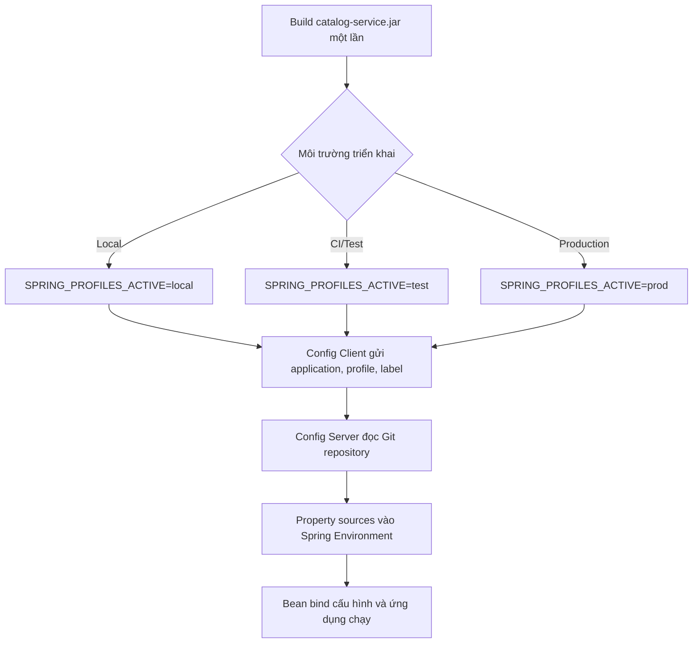

# Tách profile chạy cục bộ, kiểm thử và sản xuất

Một ứng dụng Spring Boot thường chạy trong nhiều môi trường. Lập trình viên cần kết nối các dịch vụ trên máy cá nhân; bộ kiểm thử cần dữ liệu có thể tái tạo; production cần địa chỉ dịch vụ, giới hạn tài nguyên và chính sách vận hành phù hợp với hệ thống thật. Nếu các giá trị này nằm rải rác trong mã nguồn hoặc bị đóng gói thành một bộ cấu hình duy nhất, việc triển khai dễ nhầm môi trường và khó kiểm soát thay đổi.

Spring Profiles cung cấp cách đặt tên cho những nhóm cấu hình và bean chỉ nên hoạt động trong một số ngữ cảnh. Spring Boot kết hợp profile với Config Data để nạp cấu hình chung và cấu hình riêng theo môi trường. Trong hệ thống Spring Cloud Configuration, cùng một profile còn được gửi đến Config Server để lấy bộ cấu hình tương ứng với ứng dụng và phiên bản cấu hình (label).

Bài học sử dụng ba profile tiêu biểu: `local` cho máy lập trình, `test` cho kiểm thử và `prod` cho production. Tên profile là quy ước của dự án; bạn có thể bổ sung `dev`, `staging` hoặc profile chuyên biệt khi kiến trúc triển khai cần chúng.

## Mục tiêu học tập

Sau bài học, bạn có thể:

- Giải thích mục đích của profile và phân biệt profile với môi trường triển khai thực tế.
- Tổ chức cấu hình dùng chung và cấu hình riêng cho `local`, `test`, `prod`.
- Kích hoạt profile bằng biến môi trường, tham số dòng lệnh và cấu hình kiểm thử.
- Dùng `@Profile` để chọn bean phù hợp với môi trường.
- Kết hợp profile với Spring Cloud Config Server, application name và label.
- Giữ bí mật ngoài Git, kiểm tra cấu hình trước khi phát hành và xử lý lỗi chọn nhầm profile.

## 1. Profile giải quyết vấn đề gì?

Giả sử `catalog-service` gọi một dịch vụ tìm kiếm, sử dụng PostgreSQL và ghi log. Các giá trị thay đổi theo nơi chạy:

| Thành phần | Local | Test | Production |
|---|---|---|---|
| Cơ sở dữ liệu | PostgreSQL trên máy lập trình hoặc container cục bộ | Cơ sở dữ liệu tạm cho test | Cụm cơ sở dữ liệu production |
| Dịch vụ tìm kiếm | `localhost` hoặc container local | Stub, mock server hoặc container test | Endpoint nội bộ của production |
| Log | Có thể bật log chi tiết khi phát triển | Log hỗ trợ điều tra lỗi test | Mức log phù hợp vận hành |
| Tài nguyên | Giới hạn nhỏ | Phù hợp số lượng test | Theo tải và năng lực cụm |
| Bí mật | Lấy từ môi trường local hoặc secret store | Secret dành riêng cho pipeline test | Secret do nền tảng production cấp |

Profile giúp gom các khác biệt này thành những nhóm có tên. Khi chạy với profile `local`, Spring Boot nạp cấu hình local; khi chạy với `prod`, ứng dụng nhận cấu hình production. Mã nghiệp vụ vẫn dùng cùng các khóa như `catalog.search.base-url` hoặc `spring.datasource.url`.

Profile là lựa chọn cấu hình trong tiến trình ứng dụng. Nó không tự tạo ra một môi trường mạng, một cơ sở dữ liệu, một tài khoản người dùng hay một ranh giới bảo mật. Hạ tầng và quyền truy cập vẫn phải được quản lý bởi nền tảng triển khai và hệ thống quản lý bí mật.

## 2. Quy ước đặt tên và phân chia cấu hình

Trước khi tạo tệp, nhóm phát triển nên thống nhất tên profile và ý nghĩa của chúng. Ví dụ:

| Profile | Mục đích | Nơi thường kích hoạt |
|---|---|---|
| `local` | Chạy ứng dụng trên máy cá nhân, kết nối tài nguyên local | IDE, Maven/Gradle hoặc lệnh chạy local |
| `test` | Chạy kiểm thử tự động với dữ liệu và dịch vụ có thể tái tạo | JUnit, CI pipeline |
| `prod` | Phục vụ lưu lượng thật, dùng endpoint và secret production | Deployment manifest, container platform hoặc hệ thống phát hành |

Một số dự án có profile `dev` cho môi trường phát triển dùng chung. Hãy phân biệt `local` (tài nguyên trên máy cá nhân) với `dev` (một môi trường dùng chung trên hạ tầng). Nếu hai profile có mục đích giống nhau nhưng cấu hình khác nhau, tài liệu vận hành cần giải thích rõ lý do.

Nguyên tắc tổ chức thường hữu ích:

1. Đặt các giá trị chung và an toàn trong `application.yml`.
2. Chỉ đặt khác biệt thực sự theo môi trường trong `application-local.yml`, `application-test.yml` và `application-prod.yml`.
3. Giữ cùng tên khóa giữa các profile để bean không phải biết mình đang chạy ở đâu.
4. Đưa mật khẩu, token, private key và chứng thư riêng tư vào secret store hoặc biến môi trường được cấp quyền.
5. Chọn profile tường minh tại điểm chạy hoặc triển khai; ghi lại profile và label được sử dụng trong mỗi lần phát hành.

Không nên tạo quá nhiều profile để biểu diễn mọi tổ hợp tính năng. Khi một khác biệt không gắn với môi trường, hãy cân nhắc dùng thuộc tính tính năng hoặc một cấu hình chuyên biệt thay vì thêm profile mới.

## 3. Cấu hình chung trong application.yml

Spring Boot tự động đọc `application.properties` hoặc `application.yml` từ các vị trí Config Data. Tệp `application.yml` thường chứa những thiết lập dùng chung cho mọi môi trường.

Ví dụ:

```yaml
# application.yml
spring:
  application:
    name: catalog-service

catalog:
  search:
    connect-timeout: 3s
    enabled: true
  cache:
    enabled: true
    ttl: 60s

logging:
  level:
    root: INFO
```

Những giá trị trong ví dụ là mặc định có thể dùng chung. Địa chỉ cơ sở dữ liệu và endpoint tìm kiếm chưa được cố định ở đây vì mỗi môi trường có tài nguyên riêng. Tên ứng dụng `catalog-service` cũng quan trọng khi dùng Spring Cloud Config: Config Client gửi tên này để Config Server tìm cấu hình dành riêng cho ứng dụng.

Giữ cấu hình chung nhỏ và ổn định giúp mỗi profile chỉ cần khai báo phần khác biệt. Khi sửa một giá trị chung, hãy đánh giá tác động đến cả local, test và production.

## 4. Tạo tệp cấu hình theo profile

Spring Boot hỗ trợ tệp theo quy ước `application-{profile}.yml`. Tệp chỉ được nạp khi profile tương ứng hoạt động.

### application-local.yml

```yaml
# application-local.yml
spring:
  datasource:
    url: jdbc:postgresql://localhost:5432/catalog_local
    username: ${DB_USERNAME}
    password: ${DB_PASSWORD}

catalog:
  search:
    base-url: http://localhost:9080

logging:
  level:
    com.example.catalog: DEBUG
```

Ứng dụng local kết nối đến cơ sở dữ liệu và dịch vụ tìm kiếm trên máy hoặc container của lập trình viên. Thông tin đăng nhập được lấy từ môi trường chạy. Mỗi lập trình viên có thể cung cấp các biến đó qua cấu hình IDE, secret manager cục bộ hoặc công cụ phát triển của nhóm.

### application-test.yml

```yaml
# application-test.yml
catalog:
  search:
    base-url: http://localhost:19080

logging:
  level:
    root: WARN
    com.example.catalog: INFO
```

Địa chỉ `19080` ở đây đại diện cho một mock server hoặc dịch vụ thử nghiệm được khởi chạy trong test setup. Nếu test dùng Testcontainers, nên cung cấp URL thực tế từ container đang chạy bằng `@DynamicPropertySource` thay vì giả định cổng cố định.

### application-prod.yml

```yaml
# application-prod.yml
spring:
  datasource:
    url: ${CATALOG_DATABASE_URL}
    username: ${CATALOG_DATABASE_USERNAME}
    password: ${CATALOG_DATABASE_PASSWORD}
    hikari:
      maximum-pool-size: 20

catalog:
  search:
    base-url: ${CATALOG_SEARCH_BASE_URL}
    connect-timeout: 2s

logging:
  level:
    root: INFO
```

Production lấy endpoint và thông tin xác thực từ môi trường triển khai hoặc secret store. Các biến như `CATALOG_DATABASE_PASSWORD` phải được cấp an toàn cho tiến trình; không đưa giá trị thật vào repository cấu hình.

Khi một khóa có mặt trong cả `application.yml` và tệp profile, giá trị theo profile sẽ được dùng cho cấu hình đó. Các nguồn có độ ưu tiên cao hơn, ví dụ biến môi trường hoặc tham số dòng lệnh, vẫn có thể ghi đè giá trị trong tệp. Quy tắc ưu tiên cụ thể cần được xác nhận theo phiên bản Spring Boot và các nguồn bổ sung mà ứng dụng sử dụng.

## 5. Kích hoạt profile khi chạy ứng dụng

Profile đang hoạt động có thể được chọn bằng thuộc tính `spring.profiles.active`. Có nhiều cách truyền thuộc tính này.

### Tham số dòng lệnh

```bash
java -jar catalog-service.jar --spring.profiles.active=local
java -jar catalog-service.jar --spring.profiles.active=test
java -jar catalog-service.jar --spring.profiles.active=prod
```

Tham số dòng lệnh hữu ích khi chạy thử một lần hoặc khi muốn thấy profile ngay trong lệnh khởi động. Nếu cần bật nhiều profile, có thể phân tách bằng dấu phẩy, ví dụ `--spring.profiles.active=local,diagnostic`.

### Biến môi trường

Spring Boot ánh xạ `spring.profiles.active` thành biến môi trường `SPRING_PROFILES_ACTIVE`:

```bash
SPRING_PROFILES_ACTIVE=local java -jar catalog-service.jar
```

Trong PowerShell:

```powershell
$env:SPRING_PROFILES_ACTIVE = "local"
java -jar catalog-service.jar
```

Khi triển khai production, nền tảng chạy ứng dụng nên cấp `SPRING_PROFILES_ACTIVE=prod` qua deployment configuration. Cách này giúp cùng một artifact có thể được triển khai ở nhiều môi trường và nhận cấu hình tương ứng từ bên ngoài.

### Thuộc tính JVM

```bash
java -Dspring.profiles.active=local -jar catalog-service.jar
```

Thuộc tính JVM phải đứng trước `-jar`. Lệnh sau là một cách truyền sai vì đối số sau tên JAR được chuyển cho ứng dụng chứ không phải JVM:

```bash
java -jar catalog-service.jar -Dspring.profiles.active=local
```

### Chạy từ Maven, Gradle hoặc IDE

Với Spring Boot Maven Plugin, có thể truyền profile qua thuộc tính của plugin:

```bash
./mvnw spring-boot:run -Dspring-boot.run.profiles=local
```

Với Gradle:

```bash
./gradlew bootRun --args='--spring.profiles.active=local'
```

Trong IDE, đặt `SPRING_PROFILES_ACTIVE=local` ở phần environment variables của Run Configuration hoặc truyền `--spring.profiles.active=local` vào program arguments. Hãy thống nhất cách chạy trong nhóm để tránh mỗi người vô tình dùng một profile khác nhau.

## 6. Profile mặc định và những giới hạn khi khai báo

Nếu không có profile nào được kích hoạt, Spring sử dụng profile mặc định tên `default`. Có thể thay tên profile mặc định bằng `spring.profiles.default`, ví dụ:

```yaml
spring:
  profiles:
    default: local
```

Chỉ đặt mặc định thành `local` khi dự án chủ ý muốn hành vi đó cho môi trường phát triển. Với ứng dụng triển khai production, nên truyền profile tường minh từ nền tảng vận hành và kiểm tra cấu hình khi khởi động. Một mặc định local vô tình được mang sang production có thể khiến ứng dụng kết nối nhầm tài nguyên.

Các thuộc tính điều khiển việc kích hoạt profile như `spring.profiles.active`, `spring.profiles.default` và `spring.profiles.include` phải được khai báo trong tài liệu cấu hình không gắn profile. Không đặt chúng bên trong `application-prod.yml` hoặc một tài liệu YAML chỉ được kích hoạt bởi profile; Boot cần biết profile nào hoạt động trước khi quyết định nạp tài liệu tương ứng.

`spring.profiles.include` có thể thêm profile phụ vào danh sách đang hoạt động. Ví dụ:

```yaml
spring:
  profiles:
    include:
      - observability
```

Profile group gom nhiều profile thành một tên dễ kích hoạt:

```yaml
spring:
  profiles:
    group:
      production:
        - prod
        - observability
        - metrics
```

Khi chạy với `--spring.profiles.active=production`, các profile thành viên cũng được kích hoạt. Profile group hữu ích khi một môi trường cần nhiều nhóm cấu hình phối hợp. Khai báo `include` và `group` tại cấu hình không gắn profile để quá trình phân giải có thể diễn ra từ đầu.

## 7. Dùng nhiều tài liệu trong một YAML

Ngoài cách tách thành nhiều tệp, YAML có thể chứa nhiều tài liệu được phân tách bằng `---`. Thuộc tính `spring.config.activate.on-profile` xác định tài liệu nào được áp dụng.

```yaml
# application.yml
spring:
  application:
    name: catalog-service

catalog:
  search:
    enabled: true
    connect-timeout: 3s

---
spring:
  config:
    activate:
      on-profile: local

catalog:
  search:
    base-url: http://localhost:9080

logging:
  level:
    com.example.catalog: DEBUG

---
spring:
  config:
    activate:
      on-profile: prod

catalog:
  search:
    base-url: ${CATALOG_SEARCH_BASE_URL}
    connect-timeout: 2s
```

Cách này phù hợp với module nhỏ có ít cấu hình. Khi số môi trường tăng hoặc mỗi nhóm cần review riêng, các tệp `application-{profile}.yml` thường dễ quản lý hơn. Không khai báo `spring.profiles.active` trong một tài liệu có `on-profile`, vì profile đang hoạt động phải được xác định trước khi tài liệu đó được chọn.

## 8. Chọn bean theo profile bằng @Profile

Profile cũng có thể điều khiển bean nào được đăng ký trong `ApplicationContext`. Ví dụ, ứng dụng có thể dùng một adapter tìm kiếm giả lập ở local và adapter HTTP thật trong production.

```java
import org.springframework.context.annotation.Profile;
import org.springframework.stereotype.Component;

@Component
@Profile({"local", "test"})
public class LocalSearchClient implements SearchClient {
    @Override
    public SearchResult search(String query) {
        return SearchResult.empty();
    }
}
```

```java
import org.springframework.context.annotation.Configuration;
import org.springframework.context.annotation.Profile;

@Configuration
@Profile("prod")
public class ProductionSearchConfiguration {
    // Khai báo bean SearchClient dùng HTTP gateway của production.
}
```

`@Profile` cũng có thể đặt trên lớp `@Configuration` hoặc phương thức `@Bean`. Một biểu thức như `@Profile("local | test")` áp dụng cho local hoặc test; `@Profile("!prod")` áp dụng khi profile `prod` không hoạt động. Với nhiều implementation cùng thỏa điều kiện, cần thiết kế điều kiện để tránh tạo nhiều bean cùng vai trò gây xung đột.

Chỉ dùng `@Profile` khi thành phần thực sự khác nhau theo môi trường, chẳng hạn adapter giả lập chỉ dành cho local. Với các giá trị như URL, timeout, số kết nối hoặc mức log, ưu tiên cấu hình thuộc tính; không tạo một lớp Java riêng cho mỗi môi trường nếu chỉ khác dữ liệu.

## 9. Profile trong kiểm thử tự động

Kiểm thử cần cấu hình có thể lặp lại và không phụ thuộc production. Spring Test cho phép kích hoạt profile bằng `@ActiveProfiles`:

```java
import org.springframework.boot.test.context.SpringBootTest;
import org.springframework.test.context.ActiveProfiles;

@SpringBootTest
@ActiveProfiles("test")
class CatalogServiceIntegrationTest {
    // Các kiểm thử dùng cấu hình application-test.yml.
}
```

`@ActiveProfiles("test")` khiến Spring Test khởi tạo context với profile `test`. Cách này làm ý định của test thể hiện ngay trong mã và không phụ thuộc profile mà lập trình viên đang dùng để chạy ứng dụng local.

Khi endpoint được cấp động, ví dụ bởi Testcontainers, có thể đăng ký thuộc tính bằng `@DynamicPropertySource`:

```java
@DynamicPropertySource
static void registerProperties(DynamicPropertyRegistry registry) {
    registry.add("spring.datasource.url", postgres::getJdbcUrl);
    registry.add("spring.datasource.username", postgres::getUsername);
    registry.add("spring.datasource.password", postgres::getPassword);
}
```

Đoạn mã là phần phương thức trong lớp test có khai báo container `postgres`. Giá trị do container cung cấp được đưa vào hệ thống thuộc tính kiểm thử, nhờ đó test không cần ghi cứng cổng hoặc thông tin đăng nhập.

Có thể dùng `@TestPropertySource` hoặc thuộc tính của `@SpringBootTest` cho những ghi đè nhỏ, chỉ có ý nghĩa trong test. Nên dành `application-test.yml` cho các thiết lập dùng chung giữa nhiều test và dùng thuộc tính test khi một lớp cần một tình huống riêng.

Không để test tự động gọi dịch vụ production. Pipeline nên cấp profile `test`, tài khoản và dữ liệu test riêng; đồng thời tách quyền truy cập của pipeline khỏi secret production.

## 10. Kết hợp profile với Spring Cloud Config

Spring Cloud Config mở rộng cách tổ chức này ra repository cấu hình tập trung. Config Client gửi thông tin nhận diện ứng dụng, profile và label đến Config Server. Ba thành phần có ý nghĩa khác nhau:

- **Application name:** xác định dịch vụ cần lấy cấu hình, thường được đặt bằng `spring.application.name`.
- **Profile:** xác định nhóm cấu hình môi trường, ví dụ `local`, `test` hoặc `prod`.
- **Label:** xác định nhánh, tag hoặc revision của repository cấu hình mà Config Server phục vụ.

Ví dụ, `catalog-service` với profile `prod` và label `release-2026-11` yêu cầu bộ cấu hình dành cho đúng ứng dụng, môi trường và phiên bản cấu hình đó.

### Cấu hình phía Config Client

```yaml
# application.yml của catalog-service
spring:
  application:
    name: catalog-service
  config:
    import: "configserver:http://config-server:8888"
  cloud:
    config:
      label: release-2026-11
```

Ứng dụng cần có dependency `spring-cloud-starter-config` tương thích với phiên bản Spring Boot và Spring Cloud đang sử dụng. `spring.config.import` kích hoạt Config Data integration của Spring Cloud Config Client. Nếu Config Server là thành phần bắt buộc để ứng dụng hoạt động, giữ import ở dạng bắt buộc như ví dụ để ứng dụng báo lỗi khi không thể lấy cấu hình. Trong local, nếu nhóm cho phép khởi động khi Config Server tạm thời không sẵn sàng, có thể dùng tiền tố `optional:`; quyết định này phải phù hợp với cách ứng dụng xử lý khi thiếu cấu hình.

Profile được chọn qua `SPRING_PROFILES_ACTIVE` hoặc tham số `--spring.profiles.active`. Label có thể được cấu hình từ biến môi trường `SPRING_CLOUD_CONFIG_LABEL` hoặc từ thuộc tính ngoài khác. Với release production, ưu tiên label bất biến như tag phát hành hoặc commit cụ thể để có thể tái tạo đúng bộ cấu hình đã triển khai.

### Cấu trúc repository cấu hình

Một repository Git có thể tổ chức cấu hình theo quy ước tên file của Config Server:

```text
config-repo/
├── application.yml
├── application-local.yml
├── application-test.yml
├── application-prod.yml
├── catalog-service.yml
├── catalog-service-local.yml
├── catalog-service-test.yml
└── catalog-service-prod.yml
```

`application.yml` chứa cấu hình chung cho các ứng dụng. `application-prod.yml` chứa khác biệt chung của profile production. `catalog-service.yml` và `catalog-service-prod.yml` bổ sung cấu hình riêng cho `catalog-service`. Các file profile-specific chỉ được dùng khi profile tương ứng được yêu cầu.

Không cần tạo đủ mọi tệp cho mọi ứng dụng. Hãy thêm file khi có cấu hình thực sự cần chia sẻ hoặc cần ghi đè. Giữ tên khóa nhất quán và review thay đổi repository như thay đổi mã nguồn vì một chỉnh sửa có thể tác động đến nhiều instance.

### Cùng một artifact, nhiều cấu hình

Một luồng triển khai điển hình là:



Nhờ vậy, nhóm có thể phát hành cùng một binary qua các môi trường, còn cấu hình được cấp tại thời điểm khởi động. Để tránh sai lệch, hãy ghi lại artifact version, profile, label và commit cấu hình đã dùng cho mỗi lần triển khai.

## 11. Bảo vệ bí mật giữa các môi trường

Mỗi môi trường phải có bộ thông tin xác thực riêng và quyền truy cập tối thiểu. Ví dụ, tài khoản cơ sở dữ liệu local không nên được dùng trong production; tài khoản của pipeline test không nên có quyền truy cập dữ liệu thật.

Áp dụng các nguyên tắc sau:

- Không lưu mật khẩu, token, private key hoặc chứng thư riêng tư trong `application-*.yml` được commit vào Git.
- Lưu secret trong Vault hoặc secret store của nền tảng; cấp chúng cho đúng workload và đúng môi trường.
- Dùng placeholder để ánh xạ secret vào thuộc tính mà ứng dụng cần, ví dụ `${CATALOG_DATABASE_PASSWORD}`.
- Giới hạn quyền đọc repository cấu hình và quyền giải mã cấu hình; không coi việc ẩn một profile là biện pháp bảo mật.
- Không in giá trị bí mật ra log, endpoint Actuator hoặc thông báo lỗi.
- Luân chuyển secret và thu hồi quyền khi tài khoản hoặc workload không còn cần truy cập.

Mã hóa thuộc tính trong Spring Cloud Config có thể bổ sung một lớp bảo vệ khi lưu hoặc truyền cấu hình. Khóa giải mã phải được quản lý bên ngoài repository và chỉ cấp cho Config Server hoặc thành phần được phép. Mã hóa không thay thế phân quyền truy cập và quản lý vòng đời secret.

## 12. Quy trình thay đổi cấu hình và phát hành

Thay đổi cấu hình production có thể ảnh hưởng đồng thời nhiều instance. Một quy trình đơn giản nên có các bước:

1. Tạo thay đổi trong nhánh hoặc pull request của repository cấu hình.
2. Review khóa mới, giá trị mặc định, profile áp dụng và tác động đến các ứng dụng liên quan.
3. Kiểm tra cấu trúc YAML và chạy kiểm thử hoặc smoke test với profile tương ứng.
4. Phát hành một tag hoặc revision rõ ràng để xác định chính xác cấu hình.
5. Triển khai ứng dụng với profile và label đã được phê duyệt.
6. Theo dõi log, health check và metric sau triển khai; rollback về label trước đó nếu có lỗi.

Khi cấu hình thay đổi trong lúc ứng dụng đang chạy, việc Config Client đã lấy cấu hình lúc khởi động không có nghĩa bean tự động cập nhật. Cần một cơ chế refresh phù hợp như refresh endpoint được bảo vệ hoặc Spring Cloud Bus. Phạm vi refresh và cách bean nhận giá trị mới cần được kiểm thử riêng.

## 13. Chẩn đoán khi ứng dụng dùng sai profile

Nếu ứng dụng kết nối nhầm database hoặc gọi nhầm endpoint, hãy kiểm tra theo thứ tự:

1. Xem giá trị `Environment.getActiveProfiles()` để xác nhận profile thực sự đang hoạt động.
2. Kiểm tra `SPRING_PROFILES_ACTIVE`, tham số dòng lệnh và thuộc tính JVM tại tiến trình đang chạy.
3. Xác nhận đúng tên tệp `application-{profile}.yml`, đúng thư mục Config Data và đúng cách viết khóa.
4. Kiểm tra biến môi trường hoặc tham số dòng lệnh có ghi đè giá trị trong tệp hay không.
5. Nếu dùng Config Server, xác nhận `spring.application.name`, profile, label, URL Config Server và các property source nhận về.
6. Kiểm tra log khởi động và trạng thái kết nối của dịch vụ phụ thuộc; tránh in giá trị secret khi điều tra.

Có thể ghi lại tên các profile đang hoạt động:

```java
import java.util.Arrays;
import org.slf4j.Logger;
import org.slf4j.LoggerFactory;
import org.springframework.core.env.Environment;
import org.springframework.stereotype.Component;

@Component
public class ActiveProfileReporter {
    private static final Logger log =
        LoggerFactory.getLogger(ActiveProfileReporter.class);

    public ActiveProfileReporter(Environment environment) {
        log.info("Active profiles: {}", Arrays.toString(
            environment.getActiveProfiles()
        ));
    }
}
```

Nếu danh sách rỗng, kiểm tra `spring.profiles.default`; Spring có thể đang dùng profile `default`. Trong production, nên đưa profile vào cấu hình triển khai và kiểm tra nó như một phần của readiness hoặc quy trình phát hành.

## 14. Ví dụ vận hành hoàn chỉnh

Giả sử nhóm phát hành `catalog-service` từ cùng một JAR. Cấu hình dùng chung khai báo tên ứng dụng và timeout mặc định:

```yaml
# application.yml
spring:
  application:
    name: catalog-service

catalog:
  search:
    enabled: true
    connect-timeout: 3s
```

Lập trình viên chạy local với `SPRING_PROFILES_ACTIVE=local`, cung cấp `DB_USERNAME` và `DB_PASSWORD`, rồi kết nối đến PostgreSQL và dịch vụ tìm kiếm local. CI chạy test với `@ActiveProfiles("test")`; các endpoint do Testcontainers cung cấp được đăng ký qua `@DynamicPropertySource`. Khi triển khai production, nền tảng cấp `SPRING_PROFILES_ACTIVE=prod`, endpoint Config Server, label phát hành và các secret production.

Config Client dùng `spring.application.name=catalog-service` để nhận cấu hình chung và cấu hình riêng của dịch vụ. Profile `prod` chọn phần cấu hình production, còn label xác định revision Git. Ứng dụng bind các khóa vào `@ConfigurationProperties` và kiểm tra giá trị bắt buộc ngay khi khởi động. Nhóm vận hành có thể lần theo artifact version, profile và label để tái tạo cấu hình của một lần phát hành.

## 15. Những điểm cần ghi nhớ

- `local`, `test` và `prod` là các tên profile do dự án quy ước để chọn cấu hình và bean phù hợp.
- `application.yml` chứa phần chung; `application-{profile}.yml` chứa khác biệt theo môi trường.
- Kích hoạt profile từ bên ngoài bằng `SPRING_PROFILES_ACTIVE`, tham số dòng lệnh hoặc thuộc tính JVM.
- Dùng `@ActiveProfiles("test")` và thuộc tính động để kiểm thử có thể tái tạo.
- Spring Cloud Config dùng application name, profile và label để xác định bộ cấu hình cần cung cấp.
- Giữ secret ngoài Git, tách quyền truy cập theo môi trường và kiểm soát thay đổi bằng review cùng revision có thể rollback.
- Profile không phải ranh giới bảo mật; hạ tầng, danh tính workload và secret store vẫn chịu trách nhiệm bảo vệ tài nguyên.

Khi tách profile rõ ràng, nhóm có thể dùng cùng một artifact xuyên suốt local, test và production, đồng thời biết chính xác cấu hình nào được áp dụng ở mỗi lần chạy. Đây là nền tảng để triển khai Config Server, refresh và quản trị thay đổi cấu hình tập trung trên nhiều dịch vụ Spring Boot.
