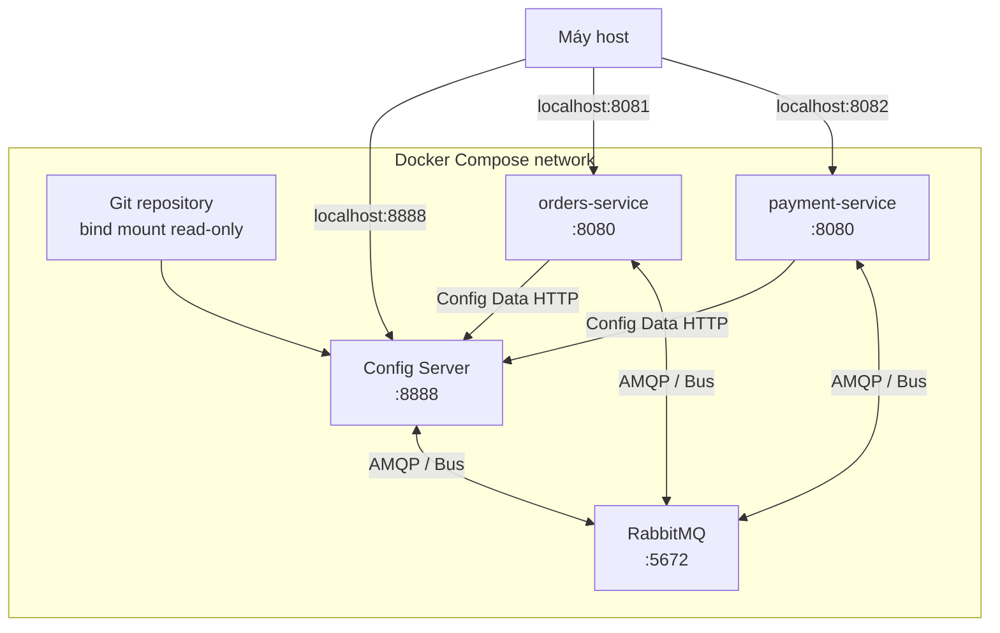

# Chạy nhiều client và hạ tầng hỗ trợ bằng Docker Compose

Spring Cloud Config thường được triển khai cùng nhiều ứng dụng Spring Boot. Khi phát triển hoặc kiểm thử trên máy cá nhân, Docker Compose có thể dựng một môi trường gồm Config Server, một Git repository chứa cấu hình, message broker cho Spring Cloud Bus và nhiều Config Client. Các container dùng chung một mạng Compose nên có thể gọi nhau bằng tên service; người phát triển vẫn truy cập các cổng cần thiết từ máy host.

Bài này xây dựng môi trường minh họa có một Config Server, hai client là `orders-service` và `payment-service`, Git repository được mount vào server và RabbitMQ làm broker cho Bus. Ví dụ tập trung vào cách chuẩn bị image, cấu hình biến môi trường, thứ tự khởi động, kiểm tra kết nối và thử refresh. Các đường dẫn build cần điều chỉnh theo cấu trúc dự án thực tế.

## 1. Kiến trúc môi trường Compose

Các thành phần và vai trò:

| Service | Vai trò | Cổng trong container |
| --- | --- | --- |
| `config-server` | Đọc Git repository và trả cấu hình qua HTTP | 8888 |
| `orders-service` | Config Client thứ nhất, lấy cấu hình của ứng dụng đơn hàng | 8080 |
| `payment-service` | Config Client thứ hai, lấy cấu hình của ứng dụng thanh toán | 8080 |
| `rabbitmq` | Message broker để Spring Cloud Bus gửi sự kiện refresh | 5672, giao diện quản trị 15672 |

Sơ đồ kết nối:



Compose tự tạo một bridge network cho project. Trong mạng này, client gọi Config Server bằng hostname `config-server`, còn các ứng dụng kết nối RabbitMQ bằng hostname `rabbitmq`. Tên service được Docker DNS phân giải. Bên trong container, `localhost` luôn trỏ về chính container đó; vì vậy client không được dùng `localhost:8888` để gọi Config Server.

Các cổng host trong ví dụ được bind vào `127.0.0.1` để chỉ truy cập từ máy phát triển. Khi triển khai thật, cần thiết kế network, ingress, xác thực và chính sách truy cập riêng.

## 2. Chuẩn bị Git repository cấu hình

Tạo thư mục `config-repo` ở cạnh file `compose.yaml`. Đây là một Git repository thật; Config Server sẽ clone nội dung từ đường dẫn được mount trong container.

Cấu trúc ví dụ:

```text
config-repo/
├── application.yml
├── orders-service-docker.yml
└── payment-service-docker.yml
```

`application.yml` chứa cấu hình dùng chung:

```yaml
platform:
  environment-name: compose-lab
```

`orders-service-docker.yml` chứa cấu hình riêng cho client đơn hàng:

```yaml
demo:
  greeting: "Hello from orders config"
  timeout: 5s
```

`payment-service-docker.yml` chứa cấu hình riêng cho client thanh toán:

```yaml
demo:
  greeting: "Hello from payment config"
  timeout: 3s
```

Tên file được ghép từ application name và profile. Khi client có `spring.application.name=orders-service` và profile `docker`, Config Server tìm cấu hình dùng chung cùng cấu hình `orders-service` cho profile `docker`.

Khởi tạo repository và commit dữ liệu ban đầu:

```bash
cd config-repo
git init -b main
git add .
git commit -m "Add configuration for Compose lab"
```

Nếu Git chưa thiết lập danh tính commit trên máy, cấu hình `user.name` và `user.email` trước khi commit. Config Server đọc trạng thái đã commit; sửa file nhưng chưa commit không tạo revision mới để client nhận.

## 3. Chuẩn bị ứng dụng Config Server và Config Client

Config Server cần các dependency tương ứng với phiên bản Spring Boot/Spring Cloud mà dự án sử dụng:

- `spring-cloud-config-server` để phục vụ cấu hình.
- `spring-boot-starter-actuator` để kiểm tra health.
- `spring-cloud-starter-bus-amqp` để tham gia Spring Cloud Bus qua RabbitMQ.
- `spring-boot-starter-web` để cung cấp HTTP endpoint.

Lớp khởi động bật Config Server:

```java
@SpringBootApplication
@EnableConfigServer
public class ConfigServerApplication {
    public static void main(String[] args) {
        SpringApplication.run(ConfigServerApplication.class, args);
    }
}
```

Mỗi Config Client cần tối thiểu:

- `spring-cloud-starter-config` để nhập cấu hình từ Config Server.
- `spring-cloud-starter-bus-amqp` để nhận sự kiện Bus.
- `spring-boot-starter-actuator` để cung cấp health và endpoint vận hành.
- `spring-boot-starter-web` nếu ứng dụng cung cấp HTTP API.

Đảm bảo dự án nhập Spring Cloud BOM tương thích với phiên bản Spring Boot đang dùng. Không trộn các release train không tương thích giữa Config Server, Config Client và Bus.

Ở phía client, tên ứng dụng và Config Data import có thể khai báo trong `application.yml`:

```yaml
spring:
  application:
    name: orders-service
  profiles:
    active: docker
  config:
    import: "configserver:http://config-server:8888"
  cloud:
    config:
      label: main
```

Với `payment-service`, đổi `spring.application.name` thành `payment-service`. Trong Compose, các giá trị này sẽ được truyền bằng environment variable để hai image có thể dùng cùng một cách đóng gói.

## 4. Đóng gói các ứng dụng thành Docker image

Ví dụ giả định cấu trúc dự án có ba thư mục cạnh `compose.yaml`:

```text
workspace/
├── compose.yaml
├── .env
├── config-repo/
├── config-server/
│   ├── Dockerfile
│   └── target/config-server.jar
├── orders-service/
│   ├── Dockerfile
│   └── target/orders-service.jar
└── payment-service/
    ├── Dockerfile
    └── target/payment-service.jar
```

Hãy build JAR trước khi Compose build image. Nếu dự án dùng Maven multi-module, có thể chạy lệnh tương ứng từ thư mục root, ví dụ:

```bash
mvn -pl config-server,orders-service,payment-service -am package -DskipTests
```

Điều chỉnh danh sách module theo tên module thực tế. Nếu dùng Gradle, thay bằng task build của dự án.

Dockerfile cho Config Server cần có Git CLI vì backend Git sử dụng Git để clone repository. Dockerfile cũng cài curl để healthcheck gọi Actuator:

```dockerfile
FROM eclipse-temurin:17-jre-jammy

RUN apt-get update \
    && apt-get install -y --no-install-recommends git curl \
    && rm -rf /var/lib/apt/lists/*

WORKDIR /app
COPY target/*.jar app.jar

ENTRYPOINT ["java", "-jar", "/app/app.jar"]
```

Dockerfile cho mỗi client chỉ cần curl phục vụ healthcheck:

```dockerfile
FROM eclipse-temurin:17-jre-jammy

RUN apt-get update \
    && apt-get install -y --no-install-recommends curl \
    && rm -rf /var/lib/apt/lists/*

WORKDIR /app
COPY target/*.jar app.jar

ENTRYPOINT ["java", "-jar", "/app/app.jar"]
```

Ví dụ dùng Java 17; chọn base image phù hợp với Java version của dự án. Mỗi thư mục `target` phải có đúng JAR có thể chạy. Nếu tên artifact hoặc cấu trúc build khác, điều chỉnh lệnh COPY và build context tương ứng.

## 5. Khai báo thông tin môi trường

Compose dùng file `.env` để nội suy biến khi đọc `compose.yaml`. Tạo `.env` ở cạnh Compose file:

```dotenv
CONFIG_GIT_LABEL=main
RABBITMQ_USER=configlab
RABBITMQ_PASSWORD=change-this-local-password
```

Thêm `.env` vào `.gitignore`; không commit mật khẩu thực vào Git. Có thể commit file `.env.example` chỉ chứa tên biến và giá trị minh họa để thành viên khác biết cần chuẩn bị gì. Trong môi trường dùng chung hoặc production, lấy credential từ secret manager của nền tảng triển khai.

## 6. File compose.yaml cho Config Server, RabbitMQ và hai client

File sau minh họa cách nối các service, mount Git repository, truyền cấu hình và chờ dependency sẵn sàng:

```yaml
services:
  rabbitmq:
    image: rabbitmq:3-management
    hostname: rabbitmq
    environment:
      RABBITMQ_DEFAULT_USER: "${RABBITMQ_USER:?Set RABBITMQ_USER in .env}"
      RABBITMQ_DEFAULT_PASS: "${RABBITMQ_PASSWORD:?Set RABBITMQ_PASSWORD in .env}"
    ports:
      - "127.0.0.1:5672:5672"
      - "127.0.0.1:15672:15672"
    volumes:
      - rabbitmq-data:/var/lib/rabbitmq
    healthcheck:
      test: ["CMD", "rabbitmq-diagnostics", "-q", "ping"]
      interval: 10s
      timeout: 5s
      retries: 12
      start_period: 20s
    restart: unless-stopped

  config-server:
    build:
      context: ./config-server
      dockerfile: Dockerfile
    environment:
      SERVER_PORT: "8888"
      SPRING_APPLICATION_NAME: config-server
      SPRING_CLOUD_CONFIG_SERVER_GIT_URI: file:///config-repo
      SPRING_CLOUD_CONFIG_SERVER_GIT_DEFAULT_LABEL: "${CONFIG_GIT_LABEL:-main}"
      SPRING_CLOUD_CONFIG_SERVER_GIT_CLONE_ON_START: "true"
      SPRING_CLOUD_CONFIG_SERVER_GIT_BASEDIR: /tmp/config-server/git-cache
      SPRING_CLOUD_BUS_ENABLED: "true"
      SPRING_RABBITMQ_HOST: rabbitmq
      SPRING_RABBITMQ_PORT: "5672"
      SPRING_RABBITMQ_USERNAME: "${RABBITMQ_USER:?Set RABBITMQ_USER in .env}"
      SPRING_RABBITMQ_PASSWORD: "${RABBITMQ_PASSWORD:?Set RABBITMQ_PASSWORD in .env}"
      MANAGEMENT_ENDPOINTS_WEB_EXPOSURE_INCLUDE: "health,info,busrefresh"
      MANAGEMENT_ENDPOINT_HEALTH_PROBES_ENABLED: "true"
    volumes:
      - ./config-repo:/config-repo:ro
    ports:
      - "127.0.0.1:8888:8888"
    depends_on:
      rabbitmq:
        condition: service_healthy
    healthcheck:
      test: ["CMD-SHELL", "curl -fsS http://localhost:8888/actuator/health/readiness >/dev/null || exit 1"]
      interval: 10s
      timeout: 5s
      retries: 12
      start_period: 30s
    restart: unless-stopped

  orders-service:
    build:
      context: ./orders-service
      dockerfile: Dockerfile
    environment:
      SERVER_PORT: "8080"
      SPRING_APPLICATION_NAME: orders-service
      SPRING_PROFILES_ACTIVE: docker
      SPRING_CONFIG_IMPORT: configserver:http://config-server:8888
      SPRING_CLOUD_CONFIG_LABEL: "${CONFIG_GIT_LABEL:-main}"
      SPRING_CLOUD_BUS_ENABLED: "true"
      SPRING_RABBITMQ_HOST: rabbitmq
      SPRING_RABBITMQ_PORT: "5672"
      SPRING_RABBITMQ_USERNAME: "${RABBITMQ_USER:?Set RABBITMQ_USER in .env}"
      SPRING_RABBITMQ_PASSWORD: "${RABBITMQ_PASSWORD:?Set RABBITMQ_PASSWORD in .env}"
      MANAGEMENT_ENDPOINTS_WEB_EXPOSURE_INCLUDE: "health,info,busrefresh"
      MANAGEMENT_ENDPOINT_HEALTH_PROBES_ENABLED: "true"
    ports:
      - "127.0.0.1:8081:8080"
    depends_on:
      config-server:
        condition: service_healthy
      rabbitmq:
        condition: service_healthy
    healthcheck:
      test: ["CMD-SHELL", "curl -fsS http://localhost:8080/actuator/health/readiness >/dev/null || exit 1"]
      interval: 10s
      timeout: 5s
      retries: 12
      start_period: 30s
    restart: unless-stopped

  payment-service:
    build:
      context: ./payment-service
      dockerfile: Dockerfile
    environment:
      SERVER_PORT: "8080"
      SPRING_APPLICATION_NAME: payment-service
      SPRING_PROFILES_ACTIVE: docker
      SPRING_CONFIG_IMPORT: configserver:http://config-server:8888
      SPRING_CLOUD_CONFIG_LABEL: "${CONFIG_GIT_LABEL:-main}"
      SPRING_CLOUD_BUS_ENABLED: "true"
      SPRING_RABBITMQ_HOST: rabbitmq
      SPRING_RABBITMQ_PORT: "5672"
      SPRING_RABBITMQ_USERNAME: "${RABBITMQ_USER:?Set RABBITMQ_USER in .env}"
      SPRING_RABBITMQ_PASSWORD: "${RABBITMQ_PASSWORD:?Set RABBITMQ_PASSWORD in .env}"
      MANAGEMENT_ENDPOINTS_WEB_EXPOSURE_INCLUDE: "health,info,busrefresh"
      MANAGEMENT_ENDPOINT_HEALTH_PROBES_ENABLED: "true"
    ports:
      - "127.0.0.1:8082:8080"
    depends_on:
      config-server:
        condition: service_healthy
      rabbitmq:
        condition: service_healthy
    healthcheck:
      test: ["CMD-SHELL", "curl -fsS http://localhost:8080/actuator/health/readiness >/dev/null || exit 1"]
      interval: 10s
      timeout: 5s
      retries: 12
      start_period: 30s
    restart: unless-stopped

volumes:
  rabbitmq-data:
```

Các chi tiết cần hiểu trong cấu hình:

- `file:///config-repo` là đường dẫn Git repository bên trong container Config Server. Bind mount đưa thư mục `./config-repo` trên host vào đúng đường dẫn này.
- `SPRING_CLOUD_CONFIG_SERVER_GIT_DEFAULT_LABEL` và `SPRING_CLOUD_CONFIG_LABEL` giúp server và client dùng cùng label.
- `SPRING_CONFIG_IMPORT` yêu cầu client nạp cấu hình từ Config Server. Địa chỉ dùng hostname nội bộ `config-server`.
- `SPRING_RABBITMQ_HOST=rabbitmq` giúp Config Server và các client kết nối cùng broker để trao đổi Bus event.
- `depends_on.condition: service_healthy` chờ RabbitMQ và Config Server qua healthcheck. Điều này kiểm soát thứ tự khởi động ban đầu; ứng dụng vẫn nên có timeout và retry hợp lý cho sự cố xảy ra sau đó.
- `rabbitmq-data` giữ dữ liệu broker khi container được tạo lại. Không xóa volume nếu muốn giữ trạng thái RabbitMQ của môi trường lab.

Healthcheck của Config Server và client dùng curl, vì vậy Dockerfile đã cài curl. Healthcheck readiness chỉ báo ứng dụng đã sẵn sàng theo health group; nó không thay thế việc kiểm tra Config Server thực sự trả đúng application/profile/label.

## 7. Khởi động và kiểm tra từng thành phần

Từ thư mục chứa `compose.yaml`, kiểm tra file và biến nội suy trước:

```bash
docker compose config
```

Build image và khởi động các service:

```bash
docker compose up --build -d
```

Xem trạng thái:

```bash
docker compose ps
```

Xem log khi một service chưa healthy hoặc khởi động thất bại:

```bash
docker compose logs -f config-server rabbitmq orders-service payment-service
```

Kiểm tra Config Server từ máy host:

```bash
curl http://localhost:8888/actuator/health
curl http://localhost:8888/orders-service/docker/main
curl http://localhost:8888/payment-service/docker/main
```

Request thứ nhất kiểm tra health; hai request sau kiểm tra Config Server có thể trả cấu hình cho từng client. Trong response Environment, xác nhận `name`, `profiles`, `label`, revision và các property source đúng với repository.

Kiểm tra health của hai client:

```bash
curl http://localhost:8081/actuator/health
curl http://localhost:8082/actuator/health
```

Nếu client không khởi động, xem log để phân biệt lỗi DNS/network, Config Server chưa sẵn sàng, sai label, sai tên application, Git repository không có commit hoặc lỗi binding. Có thể vào RabbitMQ Management UI tại `http://localhost:15672` để kiểm tra broker và kết nối trong môi trường lab; đăng nhập bằng credential trong file `.env`.

## 8. Kiểm thử Spring Cloud Bus với nhiều client

Cả Config Server và hai Config Client cần dependency `spring-cloud-starter-bus-amqp`, cấu hình kết nối đến cùng RabbitMQ và bật endpoint `busrefresh`. Khi các container đã chạy, có thể kiểm tra luồng sự kiện bằng cách thay đổi một giá trị không nhạy cảm trong repository:

1. Sửa `demo.greeting` trong `orders-service-docker.yml`.
2. Commit thay đổi vào branch `main`.
3. Gọi endpoint Config Server để xác nhận revision và giá trị mới đã được server trả về.
4. Gửi sự kiện refresh qua Bus.
5. Kiểm tra từng client bằng endpoint chẩn đoán ứng dụng hoặc log để xác nhận bean đã nhận giá trị mới.

Ví dụ gọi refresh trong môi trường lab:

```bash
curl -X POST http://localhost:8888/actuator/busrefresh
```

Endpoint này phát sự kiện refresh đến các ứng dụng tham gia Bus. Với cấu hình thực tế, phải bảo vệ endpoint bằng xác thực và phân quyền; không expose endpoint quản trị công khai. Nếu chỉ refresh một client, có thể dùng endpoint refresh riêng của client đó. Khi dùng Bus, theo dõi log của cả hai client để xác nhận sự kiện đã được nhận và xử lý.

Sự kiện Bus không làm một bean bất kỳ tự thay đổi nếu bean không hỗ trợ cơ chế refresh. Dùng `@RefreshScope` hoặc thiết kế bean cấu hình có thể được cập nhật theo cơ chế của Spring Cloud Context; sau đó kiểm tra hành vi trên đúng phiên bản Spring Cloud đang dùng. Không đưa secret vào endpoint chẩn đoán khi kiểm thử.

Nếu Config Server không nhận revision Git mới ngay, kiểm tra label, commit và cấu hình refresh của Git backend. Với Git backend, `spring.cloud.config.server.git.refresh-rate` điều khiển khoảng thời gian giữa các lần fetch; giá trị mặc định thường khiến server kiểm tra repository ở mỗi request. Nếu đặt khoảng thời gian lớn hơn, có thể cần đợi cache hết hạn trước khi xác nhận response mới.

## 9. Những lỗi phổ biến trong môi trường nhiều container

| Hiện tượng | Nguyên nhân thường gặp | Cách xử lý |
| --- | --- | --- |
| Client gọi Config Server nhưng bị connection refused | Dùng `localhost` bên trong container hoặc server chưa sẵn sàng | Dùng `http://config-server:8888`, kiểm tra health và log |
| Config Server không đọc được Git | Mount sai đường dẫn, thư mục không phải Git repo hoặc chưa commit | Kiểm tra `./config-repo/.git`, label và volume mount |
| Server trả về cấu hình không đúng | Sai application, profile hoặc label | Gọi endpoint `/{application}/{profile}/{label}` để đối chiếu |
| Client khởi động trước khi Config Server sẵn sàng | Chỉ dùng thứ tự `depends_on` mặc định | Dùng healthcheck và `condition: service_healthy`; thêm retry cho kết nối |
| Bus không refresh được các client | Thiếu Bus dependency, broker khác nhau hoặc credential sai | Kiểm tra log AMQP và cấu hình RabbitMQ trên từng service |
| Container liên tục unhealthy | Healthcheck gọi sai port/path hoặc image thiếu curl | Kiểm tra Actuator exposure, readiness group và Dockerfile |
| Máy host không truy cập được service | Port đã bị chiếm hoặc port mapping sai | Kiểm tra `docker compose ps` và tiến trình dùng port |
| Thay đổi Git chưa xuất hiện | Chưa commit, client chưa refresh hoặc server còn cache revision | Kiểm tra revision response, fetch interval và Bus event |

## 10. Vận hành, dừng và làm sạch môi trường

Một số lệnh hữu ích khi làm việc hàng ngày:

```bash
# Khởi động lại riêng Config Server
docker compose restart config-server

# Theo dõi log của một client
docker compose logs -f orders-service

# Khởi động lại một client sau khi thay image
docker compose up -d --build orders-service

# Dừng các container nhưng giữ volume
docker compose down
```

`docker compose down` dừng và xóa container cùng network của project, nhưng giữ named volume. Nếu dùng `docker compose down -v`, volume RabbitMQ cũng bị xóa; chỉ dùng khi muốn xóa dữ liệu broker của lab.

Khi thay mã nguồn ứng dụng, build lại image tương ứng rồi chạy `docker compose up -d --build <service>`. Khi chỉ thay cấu hình trong Git, commit thay đổi, xác nhận Config Server trả revision mới, sau đó kích hoạt refresh theo chính sách đã chọn.

## 11. Chuyển từ lab sang môi trường triển khai

Docker Compose phù hợp để dựng môi trường phát triển hoặc kiểm thử tích hợp trên một host. Khi chuyển sang môi trường dùng chung hoặc production, cần bổ sung các kiểm soát vận hành:

- Pin phiên bản image của Config Server, client và RabbitMQ thay vì phụ thuộc tag thay đổi.
- Dùng secret manager hoặc secret mechanism của nền tảng để cấp credential Git và RabbitMQ; không commit `.env` có mật khẩu.
- Bật TLS và xác thực giữa client với Config Server, giới hạn quyền đọc Git repository.
- Bảo vệ Actuator, đặc biệt các endpoint `refresh` và `busrefresh`; chỉ expose qua mạng quản trị.
- Dùng healthcheck, resource limit, log tập trung và metric để quan sát từng service.
- Có chính sách backup cho repository cấu hình và dữ liệu broker nếu Bus cần độ bền thông điệp.
- Ghim label hoặc commit đã được phê duyệt để có thể truy vết cấu hình từng instance đang sử dụng.
- Kiểm thử việc Config Server, RabbitMQ hoặc Git tạm thời không khả dụng; xác định rõ client có được phép khởi động thiếu cấu hình từ xa hay phải dừng.

Môi trường Compose giúp tái hiện luồng cấu hình của nhiều ứng dụng trong một mạng có thể kiểm soát. Khi Config Server, Git, RabbitMQ và các Config Client được khai báo nhất quán, nhóm phát triển có thể kiểm tra việc phân phối cấu hình, precedence và refresh trước khi đưa cùng cách vận hành vào môi trường triển khai lớn hơn.

