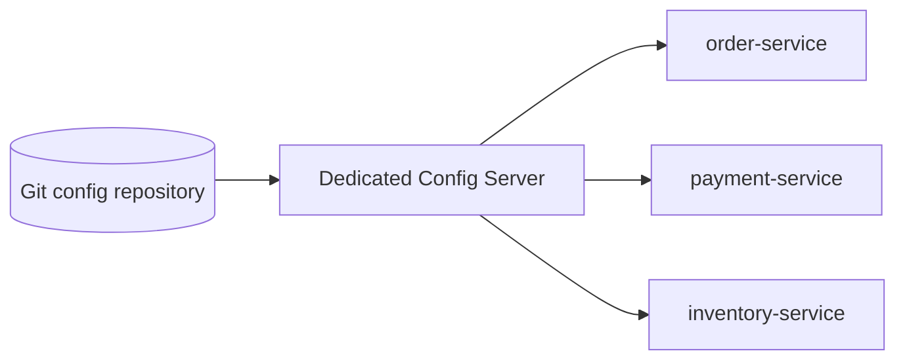
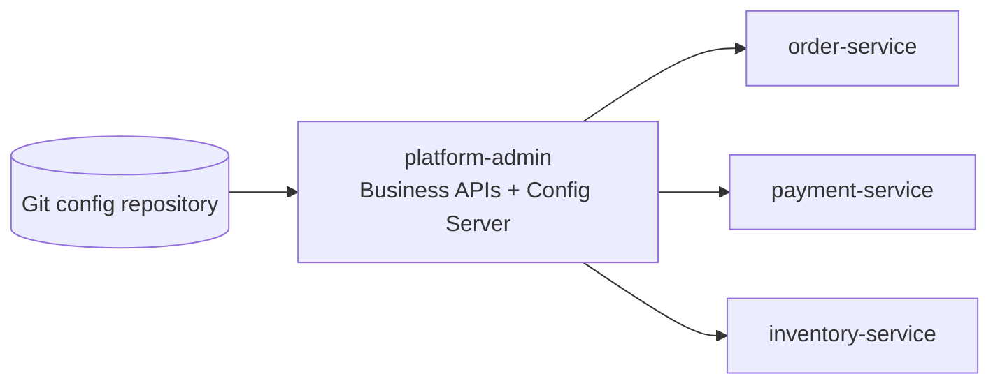
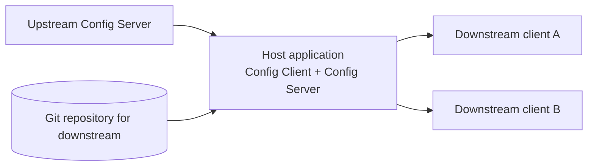

# Đánh giá phạm vi sử dụng Config Server nhúng trong ứng dụng khác

## 1. Config Server nhúng là gì?

Spring Cloud Config Server có thể chạy như một ứng dụng Spring Boot độc lập hoặc được bật bên trong một ứng dụng Spring Boot đã tồn tại. Ở mô hình thứ hai, ứng dụng host thêm dependency Config Server và đặt `@EnableConfigServer` lên lớp cấu hình chính. Các endpoint cung cấp cấu hình khi đó chạy trong cùng tiến trình và máy chủ HTTP với các API hiện có của ứng dụng host.

Ví dụ, một ứng dụng `platform-admin` đang cung cấp API quản trị nội bộ có thể đồng thời phục vụ cấu hình cho `order-service`, `payment-service` và `inventory-service`. Config Server vẫn đọc Git backend và trả về `Environment` theo application, profile và label. Điểm khác biệt nằm ở cách triển khai: chức năng Config Server chia sẻ vòng đời, tài nguyên, mạng và bảo mật với ứng dụng host.

Nhúng Config Server không có nghĩa là các ứng dụng client tự động nhận cấu hình. Client vẫn phải được cấu hình để gọi endpoint của ứng dụng host, và host phải sẵn sàng phục vụ các yêu cầu đó.

## 2. Hai cách triển khai

### Config Server chạy độc lập



Config Server có tiến trình, deployment, tài nguyên và chính sách bảo mật riêng. Các dịch vụ nghiệp vụ gọi đến nó qua mạng.

### Config Server nhúng trong ứng dụng host



Ứng dụng host vừa xử lý nghiệp vụ riêng vừa cung cấp endpoint Config Server. Các client gọi cùng địa chỉ host, nhưng dùng các đường dẫn endpoint Config Server theo application/profile/label.

Hai mô hình đều có thể dùng Git backend, profile, label, xác thực và Spring Cloud Bus. Việc lựa chọn cần dựa trên yêu cầu về mức độ sẵn sàng, phạm vi truy cập, quy mô client, quyền sở hữu và vòng đời triển khai.

## 3. Bật Config Server trong ứng dụng Spring Boot hiện có

Ứng dụng host cần dependency `spring-cloud-config-server`. Các dependency Spring Boot và Spring Cloud phải dùng phiên bản tương thích theo release train; nên quản lý phiên bản bằng Spring Cloud BOM.

Giả sử ứng dụng hiện tại có lớp main như sau:

```java
@SpringBootApplication
public class PlatformAdminApplication {
    public static void main(String[] args) {
        SpringApplication.run(PlatformAdminApplication.class, args);
    }
}
```

Để bật Config Server, thêm `@EnableConfigServer`:

```java
@SpringBootApplication
@EnableConfigServer
public class PlatformAdminApplication {
    public static void main(String[] args) {
        SpringApplication.run(PlatformAdminApplication.class, args);
    }
}
```

Sau khi khởi động, ứng dụng host vẫn phục vụ các controller nghiệp vụ vốn có và đồng thời có các endpoint Config Server. Ví dụ cấu hình runtime cho host:

```yaml
server:
  port: 8080

spring:
  application:
    name: platform-admin
  cloud:
    config:
      server:
        git:
          uri: ${CONFIG_REPO_URI}
          default-label: main
          search-paths:
            - '{application}'
            - common
          clone-on-start: true

management:
  endpoints:
    web:
      exposure:
        include: health,info
```

Trong ví dụ, `server.port` là cổng chung cho HTTP server của `platform-admin`, gồm API nghiệp vụ và endpoint Config Server. `spring.cloud.config.server.git.*` là cấu hình runtime để host đọc repository. Các file Git mà host phục vụ cho client cần được tổ chức theo application/profile; chúng không tự trở thành cấu hình runtime của `platform-admin`.

Một client có thể trỏ đến host như sau:

```yaml
spring:
  application:
    name: order-service
  profiles:
    active: prod
  config:
    import: "configserver:${CONFIG_SERVER_URI}"
```

Trong môi trường triển khai, `CONFIG_SERVER_URI` trỏ đến địa chỉ của `platform-admin`, chẳng hạn `https://platform-admin.internal`. Client gọi endpoint theo application/profile/label để lấy cấu hình.

## 4. Khi nào nhúng Config Server là hợp lý?

Mô hình nhúng có thể phù hợp trong các tình huống sau:

- **Môi trường học tập hoặc thử nghiệm**: giảm số ứng dụng phải khởi chạy, giúp người học tập trung vào Git backend, endpoint và Config Client.
- **Công cụ quản trị nội bộ quy mô nhỏ**: host vốn là ứng dụng quản trị nền tảng, chỉ một nhóm nhỏ dịch vụ cần lấy cấu hình và cùng một nhóm chịu trách nhiệm vận hành.
- **Giai đoạn chuyển đổi**: một ứng dụng hiện có tạm thời cung cấp Config Server trong lúc tổ chức tách dần dịch vụ cấu hình độc lập.
- **Hệ thống nhỏ có yêu cầu sẵn sàng tương đồng**: host và chức năng Config Server có cùng lịch triển khai, cùng vùng mạng, cùng người sở hữu và có thể chấp nhận chung một miền lỗi.

Trong các trường hợp này, việc dùng chung một tiến trình có thể giảm chi phí triển khai, số địa chỉ dịch vụ và công việc vận hành. Đổi lại, nhóm phát triển cần chấp nhận rằng lỗi hoặc lần bảo trì của host có thể làm gián đoạn khả năng lấy cấu hình của các client.

## 5. Khi nào nên dùng Config Server độc lập?

Nên ưu tiên triển khai riêng khi Config Server là hạ tầng dùng chung quan trọng hoặc có yêu cầu vận hành khác với ứng dụng host.

| Điều kiện | Lý do nên tách riêng |
|---|---|
| Nhiều dịch vụ và nhiều nhóm cùng phụ thuộc | Có thể quản lý tài nguyên, quyền truy cập và lịch bảo trì theo vai trò hạ tầng. |
| Config Server cần mức sẵn sàng cao hơn host | Sự cố hoặc triển khai host không làm gián đoạn điểm cung cấp cấu hình chung. |
| Host có lưu lượng nghiệp vụ biến động mạnh | Tải API nghiệp vụ không làm cạnh tranh tài nguyên với các yêu cầu lấy cấu hình. |
| Cấu hình chứa dữ liệu nhạy cảm hoặc nhiều miền tin cậy | Dễ thiết lập mạng, danh tính, phân quyền và audit riêng. |
| Host thường xuyên triển khai hoặc scale theo nghiệp vụ | Thay đổi số instance và lịch phát hành host không tác động trực tiếp đến tầng cấu hình. |
| Cần mở rộng hoặc bảo trì độc lập | Có thể nâng cấp Spring Cloud Config, Git backend và chính sách cache riêng. |

Một Config Server dùng chung thường là thành phần hạ tầng có ảnh hưởng rộng. Tách riêng giúp tổ chức kiểm soát thay đổi và sự cố theo đúng phạm vi của dịch vụ cấu hình.

## 6. Các ràng buộc khi chia sẻ tiến trình và HTTP server

Khi Config Server được nhúng, các thành phần sau được chia sẻ với ứng dụng host:

- **Vòng đời tiến trình**: host khởi động thì Config Server khởi động; host dừng hoặc crash thì endpoint cấu hình cũng ngừng phục vụ.
- **Cổng và servlet context**: API nghiệp vụ và endpoint Config Server dùng cùng HTTP server, cổng và cấu hình context path. Cần tránh xung đột route và kiểm soát rõ đường dẫn public/internal.
- **Tài nguyên**: CPU, heap, thread pool, connection pool và giới hạn mạng được chia sẻ. Một đợt tải cao ở API host có thể ảnh hưởng thời gian phản hồi Config Server.
- **Dependency và nâng cấp**: dependency Spring Cloud Config có thể ảnh hưởng dependency graph, auto-configuration và tương thích của toàn ứng dụng host.
- **Security chain**: quy tắc xác thực và phân quyền của host phải bao phủ đúng endpoint Config Server. Không để việc thêm endpoint cấu hình vô tình mở rộng bề mặt truy cập.
- **Lịch phát hành**: thay đổi mã nguồn hoặc cấu hình runtime của host có thể buộc triển khai lại cả chức năng Config Server.

Ví dụ, nếu `platform-admin` có lưu lượng API tăng mạnh, các request lấy cấu hình từ `order-service` và `payment-service` có thể phải chờ thread hoặc tài nguyên mà API quản trị đang sử dụng. Có thể tăng tài nguyên hoặc tách pool theo thiết kế, nhưng khi yêu cầu cô lập trở nên phức tạp, triển khai Config Server riêng thường dễ vận hành hơn.

Lưu ý về cổng quản trị: cấu hình `management.server.port` có thể tách các endpoint Actuator sang một cổng khác, nhưng không tự động chuyển endpoint Config Server sang cổng đó. Endpoint Config Server vẫn thuộc HTTP server của ứng dụng host, trừ khi có kiến trúc proxy hoặc định tuyến riêng.

## 7. Tác động đến scale và tính sẵn sàng

Nếu ứng dụng host chạy nhiều instance sau load balancer, mỗi instance cũng là một Config Server instance. Cần bảo đảm các instance có cấu hình backend tương đương và có thể truy cập Git ổn định.

Một số vấn đề cần đánh giá:

1. **Tải Git**: các instance có thể clone hoặc fetch repository theo cơ chế backend. Cần tính đến số lần truy cập, cache local và hành vi khi Git chậm hoặc mất kết nối.
2. **Tính nhất quán**: nếu các instance đang giữ bản clone/cache khác nhau trong lúc repository thay đổi, cần kiểm chứng chúng trả về revision nào. Dùng label cố định và quan sát revision giúp giảm mơ hồ.
3. **Readiness**: host có thể phục vụ API nghiệp vụ nhưng chưa đọc được Git. Cần quyết định readiness của toàn host có phụ thuộc backend cấu hình hay không, dựa trên việc các client có thể tiếp tục hoạt động với dữ liệu đã cache hay không.
4. **Triển khai cuốn chiếu**: khi host được nâng cấp nhiều instance, phải bảo đảm client không nhận phản hồi khác nhau ngoài dự kiến trong khoảng thời gian rollout.
5. **Khả năng chịu lỗi**: nếu host là điểm cung cấp cấu hình duy nhất, cần có nhiều instance, load balancing, health check và phương án khôi phục.

Việc nhúng không tự làm giảm khả năng scale. Tuy nhiên, scale host theo tải nghiệp vụ cũng đồng thời scale Config Server, dù nhu cầu hai loại tải có thể rất khác nhau. Ngược lại, nếu scale host xuống thấp vào ban đêm, số instance Config Server cũng giảm theo.

## 8. Bảo mật khi Config Server dùng chung ứng dụng host

Endpoint Config Server có thể trả về nhiều thuộc tính nội bộ. Nếu repository chứa giá trị đã giải mã, người gọi có quyền đọc có thể nhận được các giá trị đó. Vì vậy, bảo vệ endpoint là yêu cầu bắt buộc.

Khi nhúng, cần rà soát:

- **Xác thực và phân quyền**: chỉ danh tính client được phép mới được gọi endpoint; nếu các client có phạm vi khác nhau, phải kiểm tra quyền theo application/profile ở phía server.
- **HTTPS và mạng nội bộ**: hạn chế endpoint trong mạng dịch vụ hoặc qua gateway có chính sách phù hợp; không công khai chỉ vì host đã có API public.
- **Security filter chain**: kiểm tra matcher và thứ tự filter của ứng dụng host. Một quy tắc cho API nghiệp vụ có thể vô tình chặn Config Client hoặc mở quá rộng endpoint cấu hình.
- **Actuator**: chỉ expose endpoint cần thiết. Các endpoint như `env`, `configprops` và thông tin chẩn đoán có thể làm lộ giá trị nhạy cảm.
- **Git credentials**: service account mà host dùng để đọc Git chỉ có quyền tối thiểu và được cấp từ secret manager hoặc môi trường triển khai.
- **Khóa mã hóa**: khóa giải mã của Spring Cloud Config được lưu và cấp độc lập; không đưa vào repository mà host phân phối.
- **Audit**: ghi nhận danh tính, thời điểm, application/profile/label được yêu cầu ở mức đủ để điều tra mà không log toàn bộ giá trị cấu hình nhạy cảm.

Nếu host phục vụ cả API cho người dùng bên ngoài và endpoint cấu hình cho service nội bộ, cần tách miền truy cập qua mạng, gateway hoặc policy phù hợp. Chỉ thêm một URL khó đoán không phải là biện pháp bảo mật.

## 9. Tránh phụ thuộc bootstrap vòng lặp

Config Server nhúng trong host có thể phục vụ cấu hình cho các ứng dụng khác. Nhưng nếu chính host lại khai báo Config Client để lấy cấu hình từ endpoint Config Server mà nó đang tự cung cấp, sẽ có phụ thuộc vòng.

Trong quá trình khởi động, Config Data được nạp trước khi ứng dụng mở HTTP server và endpoint Config Server sẵn sàng. Host không thể gọi endpoint của chính nó để lấy cấu hình cần cho bước khởi động đó.

Nếu host cần lấy cấu hình từ xa, có thể dùng một Config Server upstream độc lập. Khi đó host là Config Client của upstream và đồng thời là Config Server phục vụ các client downstream. Cần có bootstrap settings độc lập như địa chỉ upstream, application name, profile và thông tin xác thực để host có thể kết nối trước khi endpoint downstream hoạt động.

Ví dụ sơ đồ:



Đây là mô hình hai vai trò có chủ đích. Nó khác với việc host gọi chính URL của mình trong `spring.config.import`. Nếu không có upstream hoặc nguồn bootstrap độc lập, hãy cấp cấu hình khởi động của host qua file triển khai, biến môi trường hoặc secret manager.

## 10. Tổ chức repository và cấu hình runtime

Khi nhúng Config Server, vẫn phải phân biệt cấu hình runtime của host với cấu hình được host phục vụ cho client.

| Vị trí | Ví dụ | Mục đích |
|---|---|---|
| Cấu hình runtime của host | `server.port`, `spring.cloud.config.server.git.uri`, credentials, TLS | Điều khiển ứng dụng host và Config Server nhúng. |
| Git repository downstream | `application.yml`, `order-service-prod.yml` | Cung cấp property source cho các Config Client. |
| Bootstrap của host nếu là client upstream | `spring.config.import`, application name, profile, upstream credentials | Cho phép host lấy cấu hình ban đầu từ upstream. |

Không đưa Git URI, Git credential, khóa mã hóa hoặc thông tin xác thực endpoint của host vào file cấu hình dùng chung mà mọi client có thể đọc. Repository downstream nên chỉ chứa cấu hình cần thiết cho các ứng dụng nhận cấu hình.

Nên chọn cấu trúc repository phù hợp với số lượng dịch vụ. Có thể dùng file phẳng, thư mục `{application}` và `common`, hoặc nhiều repository theo pattern. `search-paths` hỗ trợ tìm kiếm file nhưng không thay thế phân quyền. Nếu có nhiều nhóm hoặc tenant, cần tách repository hoặc áp dụng authorization theo danh tính client.

## 11. Checklist ra quyết định

Trước khi nhúng Config Server vào ứng dụng hiện có, hãy trả lời:

| Câu hỏi | Nếu câu trả lời là có | Hướng đánh giá |
|---|---|---|
| Host vốn là dịch vụ quản trị nội bộ? | Cùng nhóm người dùng và người vận hành | Có thể phù hợp với mô hình nhúng. |
| Chỉ một số ít client phụ thuộc? | Phạm vi ảnh hưởng nhỏ | Mô hình nhúng có thể đơn giản và tiết kiệm. |
| Host và Config Server có cùng yêu cầu sẵn sàng? | Lịch bảo trì và downtime tương đồng | Có thể chấp nhận chung vòng đời. |
| Host thường xuyên scale hoặc deploy độc lập? | Tải và lịch triển khai biến động | Cân nhắc tách để cô lập vận hành. |
| Config Server là dependency trọng yếu của nhiều hệ thống? | Nhiều nhóm không cùng sở hữu host | Ưu tiên dịch vụ Config Server riêng. |
| Host có API public hoặc miền tin cậy khác? | Endpoint cấu hình cần bảo vệ nghiêm ngặt | Tách network, gateway hoặc triển khai riêng. |
| Host cần tự lấy cấu hình từ chính endpoint nó cung cấp? | Có nguy cơ bootstrap cycle | Thiết kế upstream độc lập hoặc nguồn bootstrap khác. |

Không quyết định chỉ dựa trên việc có thể thêm `@EnableConfigServer`. Hãy so sánh miền lỗi, quyền truy cập, lưu lượng, vòng đời phát hành và trách nhiệm vận hành của hai chức năng.

## 12. Lộ trình tách Config Server nhúng thành dịch vụ độc lập

Nếu mô hình nhúng ban đầu không còn đáp ứng yêu cầu, có thể tách dần:

1. **Tạo ứng dụng Config Server riêng**: chuyển dependency, `@EnableConfigServer` và cấu hình Git backend sang ứng dụng mới.
2. **Giữ nguyên repository và quy ước endpoint**: bảo đảm application/profile/label vẫn ánh xạ đến cùng file và revision.
3. **Bảo vệ server mới**: cấu hình TLS, xác thực, phân quyền, Git credentials và khóa giải mã độc lập.
4. **Kiểm thử song song**: gọi cùng application/profile/label ở cả host cũ và server mới; so sánh property source và revision.
5. **Chuyển client theo từng nhóm**: cập nhật `spring.config.import` hoặc bootstrap URI của client, triển khai và theo dõi lỗi lấy cấu hình.
6. **Xác nhận không còn client phụ thuộc host cũ**: kiểm tra log truy cập và danh sách client đã chuyển.
7. **Gỡ chức năng nhúng**: chỉ bỏ `@EnableConfigServer` và dependency sau khi client đã dùng server mới và có kế hoạch rollback.

Không đổi đồng thời repository, label và endpoint trong một lần chuyển nếu không cần thiết. Giữ nguyên nguồn dữ liệu và label trong giai đoạn chuyển giúp xác định sự khác biệt đến từ endpoint hay từ nội dung cấu hình.

## 13. Bài thực hành

### Bước 1: Bật Config Server trong host app

Chọn một ứng dụng Spring Boot nội bộ, thêm dependency Config Server và `@EnableConfigServer`. Cấu hình Git URI, default label và search path từ môi trường triển khai.

**Kết quả cần đạt:** host khởi động được, API hiện có vẫn hoạt động và endpoint Config Server trả về cấu hình.

### Bước 2: Kết nối một Config Client

Tạo hoặc dùng một ứng dụng `order-service`, khai báo `spring.config.import` trỏ đến host, tên ứng dụng và profile. Gọi endpoint theo application/profile/label để đối chiếu.

**Kết quả cần đạt:** client nhận đúng property source từ Git thông qua host.

### Bước 3: Đánh giá tải và vòng đời

Chạy nhiều instance host sau load balancer, thử restart/rolling deployment và quan sát khả năng truy cập endpoint cấu hình. Kiểm tra log Git và revision mà từng instance trả về.

**Kết quả cần đạt:** xác định ảnh hưởng của scale, restart và backend Git đến client.

### Bước 4: Kiểm tra bảo mật

Bật xác thực endpoint, giới hạn danh tính được phép đọc cấu hình và thử truy cập bằng danh tính không có quyền. Kiểm tra các endpoint Actuator và log để bảo đảm không lộ secret.

**Kết quả cần đạt:** chứng minh endpoint Config Server chỉ được truy cập theo policy đã định.

### Bước 5: Thử nghiệm tách server

Dựng Config Server độc lập dùng cùng repository và label. Gọi cùng endpoint ở hai server, so sánh phản hồi rồi chuyển một client thử nghiệm sang server mới.

**Kết quả cần đạt:** hiểu quy trình di chuyển từ mô hình nhúng sang dịch vụ cấu hình độc lập.

## 14. Tự kiểm tra

1. Thêm `@EnableConfigServer` vào ứng dụng hiện có làm thay đổi vai trò của ứng dụng như thế nào?
2. Khi nhúng, API nghiệp vụ và endpoint Config Server chia sẻ những tài nguyên nào?
3. Trường hợp nào phù hợp với mô hình nhúng? Trường hợp nào nên tách riêng?
4. Vì sao `management.server.port` không tự tách endpoint Config Server sang cổng quản trị?
5. Host chạy nhiều instance sẽ ảnh hưởng thế nào đến tải Git và tính nhất quán cấu hình?
6. Vì sao host không thể gọi chính endpoint Config Server của nó để lấy cấu hình cần trong giai đoạn bootstrap?
7. Cần bảo vệ những gì khi host vừa có API public vừa phục vụ cấu hình nội bộ?
8. Những bước nào giúp tách Config Server nhúng mà không làm thay đổi nội dung cấu hình của client?

Khi hoàn thành bài thực hành, người học có thể đánh giá đúng lợi ích và giới hạn của Config Server nhúng, lựa chọn mô hình triển khai theo yêu cầu thực tế và lập kế hoạch tách riêng khi hệ thống cần vòng đời, bảo mật hoặc khả năng sẵn sàng độc lập.
