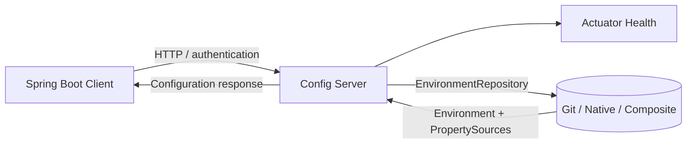

# Đọc trạng thái sức khỏe và xác minh kết nối kho cấu hình

Spring Cloud Config Server nằm giữa các ứng dụng Spring Boot và kho cấu hình tập trung. Để hệ thống hoạt động ổn định, cần kiểm tra được cả tiến trình Config Server, khả năng truy cập backend như Git hoặc filesystem, và khả năng phục vụ một yêu cầu cấu hình cụ thể. Một endpoint trả về `UP` là tín hiệu hữu ích, nhưng cần hiểu phạm vi của phép kiểm tra đó trước khi kết luận toàn bộ luồng cấu hình đang hoạt động.

Bài học này hướng dẫn cách dùng Spring Boot Actuator để đọc health status, cấu hình health check cho repository, xác minh kết nối bằng Config Server API và phân tích lỗi theo từng chặng.

## 1. Hai chặng kết nối cần kiểm tra

Một luồng lấy cấu hình có ít nhất hai kết nối độc lập:

1. **Client đến Config Server:** ứng dụng Spring Boot phải phân giải được hostname, kết nối được HTTP endpoint, vượt qua xác thực và nhận được phản hồi cấu hình.
2. **Config Server đến repository:** tiến trình Config Server phải truy cập được Git, filesystem hoặc các backend cấu hình khác bằng đúng quyền và thông tin xác thực.



Hai chặng có thể hỏng độc lập. Ví dụ, Config Server truy cập Git thành công nhưng client không kết nối được do DNS, firewall, TLS hoặc thông tin xác thực giữa client và server. Ngược lại, client truy cập được Config Server nhưng server không đọc được repository Git.

Vì vậy, cần dùng cả health endpoint lẫn một yêu cầu cấu hình thật. Health endpoint giúp theo dõi trạng thái thành phần phía server; yêu cầu `/{application}/{profile}/{label}` xác minh một bộ cấu hình cụ thể có thể được tìm và trả về.

## 2. Bật Spring Boot Actuator và Health endpoint

Config Server là một ứng dụng Spring Boot, vì vậy có thể sử dụng Spring Boot Actuator để công bố thông tin sức khỏe. Thêm dependency Actuator vào dự án Config Server theo cơ chế quản lý dependency của dự án:

```gradle
dependencies {
    implementation 'org.springframework.boot:spring-boot-starter-actuator'
}
```

Mặc định, các endpoint Actuator qua HTTP được giới hạn exposure. Có thể cấu hình chỉ công bố những endpoint cần thiết:

```yaml
management:
  endpoints:
    web:
      exposure:
        include: health,info
  endpoint:
    health:
      show-details: when-authorized
```

Sau khi ứng dụng khởi động, health endpoint thường có địa chỉ:

```text
http://localhost:8888/actuator/health
```

Nếu Config Server chạy cổng hoặc management base path riêng, URL thực tế sẽ thay đổi theo cấu hình. `management.endpoints.web.exposure.include` chỉ quyết định endpoint nào được công bố qua HTTP; nó không thay thế xác thực, phân quyền hoặc giới hạn truy cập mạng.

Không nên công khai toàn bộ endpoint Actuator chỉ để lấy health status. Các endpoint quản trị có thể tiết lộ thông tin nội bộ hoặc cho phép thay đổi trạng thái ứng dụng. Với môi trường production, chỉ công bố endpoint cần thiết và bảo vệ endpoint bằng Spring Security, gateway nội bộ hoặc chính sách mạng phù hợp.

## 3. Đọc trạng thái health

Gửi yêu cầu GET đến health endpoint:

```bash
curl -i http://localhost:8888/actuator/health
```

Một phản hồi thành công có thể có dạng:

```json
{
  "status": "UP",
  "components": {
    "diskSpace": {
      "status": "UP"
    },
    "configServer": {
      "status": "UP"
    }
  }
}
```

Đây là JSON minh họa. Các component hiển thị phụ thuộc dependency, cấu hình health indicator, phiên bản Spring Boot/Spring Cloud và quyền xem chi tiết. Nếu quyền của người gọi không cho phép xem details, endpoint có thể chỉ trả trạng thái tổng hợp.

Các trạng thái thường gặp:

| Trạng thái | Ý nghĩa vận hành |
|---|---|
| `UP` | Thành phần được kiểm tra báo hoạt động bình thường. |
| `DOWN` | Thành phần không thể thực hiện kiểm tra hoặc báo lỗi. |
| `OUT_OF_SERVICE` | Thành phần không sẵn sàng phục vụ yêu cầu theo trạng thái được khai báo. |
| `UNKNOWN` | Không xác định được trạng thái của thành phần. |

Spring Boot tổng hợp trạng thái từ các health contributor được bật. Một component `DOWN` có thể khiến trạng thái tổng hợp trở thành `DOWN`, tùy cấu hình status aggregator và health group. Hãy đọc cả HTTP status lẫn trường JSON `status`.

Không nên chỉ dựa vào mã HTTP `200` để kết luận repository hoạt động. Hãy kiểm tra nội dung JSON, các component liên quan và log của Config Server. Chính sách ánh xạ trạng thái sang HTTP có thể được tùy chỉnh trong Spring Boot.

## 4. Config Server Health Indicator

Spring Cloud Config Server cung cấp health indicator để kiểm tra các repository mà server quản lý. Health indicator thực hiện truy xuất cấu hình theo application, profile và label được cấu hình cho phép kiểm tra. Nếu backend không thể phục vụ yêu cầu kiểm tra, trạng thái của component có thể phản ánh lỗi repository.

Có thể khai báo các repository và bộ tham số kiểm tra riêng trong `application.yml` của Config Server:

```yaml
spring:
  cloud:
    config:
      server:
        health:
          enabled: true
          repositories:
            orders-prod:
              name: orders-service
              profiles: prod
              label: main
            inventory-prod:
              name: inventory-service
              profiles: prod
              label: main
```

Mỗi mục health repository mô tả một yêu cầu kiểm tra:

- `name`: application cần kiểm tra.
- `profiles`: profile cần kiểm tra.
- `label`: label hoặc phiên bản backend cần kiểm tra.

`spring.cloud.config.server.health.enabled` ở cấp `health` bật hoặc tắt health indicator của Config Server theo cấu hình phiên bản đang dùng. Nó không phải thuộc tính của từng mục repository.

Các tên như `orders-prod` và `inventory-prod` là tên định danh của mục kiểm tra, giúp nhận biết kết quả trong health details. Nên chọn application, profile và label đại diện cho các đường cấu hình quan trọng của hệ thống.

Health check không mặc nhiên chứng minh mọi file, mọi application, mọi profile và mọi label đều có thể đọc. Nó chỉ kiểm tra những yêu cầu mà indicator được cấu hình để thực hiện. Nếu có nhiều repository hoặc nhiều môi trường triển khai, hãy cấu hình các mục kiểm tra phù hợp và bổ sung kiểm tra chủ động cho những đường cấu hình trọng yếu.

Trong một số tình huống, health check có thể làm phát sinh truy cập backend. Cần cân nhắc số lượng mục kiểm tra, thời gian truy cập Git và tần suất gọi health endpoint để tránh tạo tải không cần thiết lên repository.

## 5. Xác minh Git repository

Với backend Git, cấu hình cơ bản của Config Server có thể như sau:

```yaml
server:
  port: 8888

spring:
  cloud:
    config:
      server:
        git:
          uri: ${CONFIG_REPO_URI}
          default-label: main
          clone-on-start: true
          timeout: 5
```

Các thuộc tính quan trọng:

- `uri` chỉ đến repository Git chứa cấu hình.
- `default-label` là label mặc định khi client không chỉ định label.
- `clone-on-start` yêu cầu Config Server clone repository lúc khởi động, giúp phát hiện sớm một số lỗi truy cập hoặc cấu hình repository.
- `timeout` giới hạn thời gian chờ thao tác Git theo đơn vị giây.

Với repository riêng tư, thông tin xác thực cần được cung cấp qua biến môi trường hoặc secret manager. Ví dụ dùng username và token:

```yaml
spring:
  cloud:
    config:
      server:
        git:
          uri: ${CONFIG_REPO_URI}
          username: ${CONFIG_REPO_USERNAME}
          password: ${CONFIG_REPO_TOKEN}
```

Không commit token, mật khẩu hoặc private key trực tiếp vào repository cấu hình của Config Server. Hạn chế quyền của tài khoản Git ở mức chỉ đọc nếu Config Server chỉ cần lấy cấu hình.

Khi kiểm tra kết nối Git, xác minh từ chính môi trường chạy Config Server:

1. Hostname Git phân giải được qua DNS.
2. Container hoặc máy chủ có thể kết nối đến cổng HTTPS/SSH mà Git server sử dụng.
3. TLS certificate hoặc SSH host key được tin cậy.
4. URI, branch hoặc label có tồn tại.
5. Tài khoản và token còn hiệu lực, có quyền đọc repository.
6. Proxy, firewall và network policy cho phép kết nối.

Kiểm tra Git từ máy phát triển không chứng minh Config Server trong container có cùng DNS, route mạng hoặc credential. Khi lỗi chỉ xuất hiện trên môi trường triển khai, hãy kiểm tra từ đúng container, pod hoặc máy chủ đang chạy Config Server.

## 6. Xác minh Native repository và Composite repository

### Native repository

Native repository đọc file từ filesystem hoặc classpath. Ví dụ:

```yaml
spring:
  profiles:
    active: native
  cloud:
    config:
      server:
        native:
          search-locations:
            - file:/etc/config-repo
```

Khi health check hoặc request cấu hình thất bại, kiểm tra:

- Thư mục có tồn tại trong filesystem của tiến trình Config Server không.
- User chạy tiến trình có quyền đọc thư mục và file không.
- Đường dẫn mount trong container có đúng không.
- File cấu hình có đúng tên application và profile không.
- YAML hoặc properties có cú pháp hợp lệ không.

Đường dẫn tồn tại trên máy host chưa chắc tồn tại bên trong container. Hãy xác minh đường dẫn từ môi trường runtime của Config Server.

### Composite repository

Composite repository kết hợp nhiều backend, ví dụ hai Git repository:

```yaml
spring:
  cloud:
    config:
      server:
        composite:
          - type: git
            uri: https://git.example.com/platform/shared-config.git
            default-label: main
          - type: git
            uri: https://git.example.com/platform/team-config.git
            default-label: main
```

Khi composite có nhiều nguồn, một nguồn thành công không có nghĩa tất cả nguồn đều hoạt động. Cần xem health details và log để nhận diện backend nào lỗi. Nếu một repository là bắt buộc đối với cấu hình ứng dụng, lỗi của nó cần được xử lý như lỗi phục vụ cấu hình; không âm thầm xem kết quả thiếu nguồn là đầy đủ.

Thứ tự repository trong composite còn ảnh hưởng thứ tự ưu tiên khi các nguồn có cùng khóa. Vì vậy, khi một giá trị không đúng, cần kiểm tra cả tình trạng kết nối lẫn thứ tự property source được trả về.

## 7. Xác minh một yêu cầu cấu hình thực tế

Health endpoint cho biết trạng thái của các phép kiểm tra đã cấu hình. Để xác minh một bộ cấu hình cụ thể, hãy gọi Environment API:

```bash
curl -i http://localhost:8888/orders-service/prod/main
```

Một phản hồi thành công thường có các trường như:

```json
{
  "name": "orders-service",
  "profiles": ["prod"],
  "label": "main",
  "version": "4f31a8c2d7e9",
  "propertySources": [
    {
      "name": ".../orders-service-prod.yml",
      "source": {
        "app.payment.mode": "live"
      }
    }
  ]
}
```

JSON trên chỉ minh họa cấu trúc phản hồi. Giá trị `version`, tên property source và số lượng nguồn phụ thuộc backend và cấu hình thực tế.

Kiểm tra các trường sau:

| Trường | Điều cần xác minh |
|---|---|
| `name` | Đúng application mà client yêu cầu. |
| `profiles` | Chứa đúng profile đang chạy. |
| `label` | Đúng branch, tag hoặc commit cần triển khai. |
| `version` | Có thể liên hệ phản hồi với phiên bản Git nếu backend cung cấp. |
| `propertySources` | Chứa file dự kiến và thứ tự nguồn hợp lý. |

Nếu yêu cầu thành công nhưng một khóa bị thiếu, hãy kiểm tra tên file, profile, label và `search-paths`. Nếu khóa có mặt nhưng giá trị sai, tìm khóa trong từng property source và xác định nguồn nào có độ ưu tiên cao nhất.

## 8. Phân biệt lỗi bằng HTTP status và log

Các mã HTTP giúp phân loại vấn đề ban đầu, nhưng cần kết hợp với response body và log:

| Kết quả | Hướng điều tra |
|---|---|
| `200 OK` với health `UP` | Các phép kiểm tra health đã cấu hình thành công. Tiếp tục kiểm tra request cụ thể nếu cần. |
| `200 OK` nhưng health `DOWN` trong JSON | Đọc trạng thái JSON và health details; status body mới cho biết component đang lỗi. |
| `401 Unauthorized` | Kiểm tra xác thực giữa caller và Config Server; nếu API đã vào server rồi mới lỗi backend, xem log để phân biệt lỗi credential Git. |
| `403 Forbidden` | Kiểm tra quyền truy cập endpoint, policy bảo mật hoặc quyền đọc repository. |
| `404 Not Found` | Kiểm tra URL, management base path, application/profile/label và file có tồn tại trong repository hay không. |
| `5xx` | Kiểm tra log Config Server, lỗi Git/Native, timeout, TLS, DNS và backend không sẵn sàng. |

Ví dụ, Config Server có thể trả `5xx` khi Git không truy cập được, nhưng nguyên nhân thật chỉ rõ trong log: DNS không phân giải, token hết hạn, certificate không được tin cậy, timeout hoặc branch không tồn tại. Không nên kết luận mọi lỗi `5xx` đều do Git; controller, cấu hình server hoặc lỗi xử lý dữ liệu cũng có thể tạo ra lỗi máy chủ.

Khi xem log, tìm thời điểm request, application, profile, label và exception gốc. Không bật log quá chi tiết trong production nếu có nguy cơ ghi lộ token, mật khẩu hoặc giá trị cấu hình nhạy cảm.

## 9. Readiness, liveness và phụ thuộc repository

Trong môi trường container hoặc Kubernetes, health endpoint có thể được dùng cho readiness và liveness probe. Có thể bật các probe của Spring Boot:

```yaml
management:
  endpoint:
    health:
      probes:
        enabled: true
```

Thông thường, hai nhóm probe có mục tiêu khác nhau:

- **Liveness** trả lời tiến trình có còn hoạt động và có cần khởi động lại hay không.
- **Readiness** trả lời instance đã sẵn sàng nhận traffic hay chưa.

Không nên đưa mọi phụ thuộc mạng bên ngoài vào liveness một cách máy móc. Nếu Git tạm thời không truy cập được và liveness chuyển `DOWN`, nền tảng có thể liên tục khởi động lại Config Server dù tiến trình vẫn khỏe; điều đó có thể làm gián đoạn thêm các client. Hãy xác định rõ repository là phụ thuộc bắt buộc đối với khả năng phục vụ hay chỉ ảnh hưởng một số yêu cầu.

Nếu Config Server không thể phục vụ bất kỳ cấu hình nào khi repository mất kết nối, readiness có thể phản ánh trạng thái đó để ngừng nhận request mới. Liveness nên tập trung vào khả năng tiến trình tiếp tục chạy. Cách gắn health indicator vào từng health group phụ thuộc cấu hình Spring Boot và nền tảng triển khai; cần thử nghiệm hành vi probe trước khi áp dụng production.

## 10. Bảo mật health endpoint và thông tin repository

Health details có thể tiết lộ tên repository, application, profile, label, trạng thái kết nối hoặc thông tin lỗi nội bộ. Vì vậy:

- Chỉ công bố `health` và các endpoint cần thiết.
- Dùng `show-details: when-authorized` hoặc chính sách phù hợp để giới hạn chi tiết.
- Bảo vệ Actuator bằng xác thực và phân quyền.
- Giới hạn truy cập health endpoint trong mạng quản trị hoặc từ hệ thống giám sát.
- Không đưa credential, token hoặc nội dung bí mật vào health details hay log.
- Cấp quyền đọc tối thiểu cho tài khoản Git và lưu secret trong secret manager hoặc hệ thống quản lý bí mật của nền tảng.

Health endpoint phục vụ giám sát, không phải cơ chế xác thực client. Việc endpoint `/actuator/health` trả `UP` không cho phép client truy cập API cấu hình; các endpoint cấu hình vẫn cần chính sách bảo mật riêng.

## 11. Quy trình kiểm tra khi Config Server có vấn đề

Khi nhận cảnh báo Config Server hoặc client không lấy được cấu hình, thực hiện theo trình tự:

1. **Kiểm tra tiến trình:** xác nhận Config Server đang chạy, cổng HTTP và management port có đúng không.
2. **Kiểm tra health:** gọi `/actuator/health`, đọc cả HTTP status, trường `status` và component details được phép xem.
3. **Kiểm tra repository health:** xác nhận các mục application/profile/label được cấu hình cho health indicator có trạng thái phù hợp.
4. **Kiểm tra backend từ runtime:** xác minh DNS, route mạng, TLS, credential, quyền đọc Git hoặc quyền truy cập filesystem.
5. **Kiểm tra Environment API:** gọi đúng application/profile/label mà client đang sử dụng và kiểm tra `propertySources`, `version`.
6. **Kiểm tra client:** xác nhận client có kết nối được Config Server, vượt qua xác thực và đang dùng đúng `spring.application.name`, profile, label.
7. **Kiểm tra cập nhật:** nếu repository vừa thay đổi, xác nhận server đã nhìn thấy phiên bản mới và client đã thực hiện refresh theo quy trình.

Ghi lại thời điểm, application, profile, label, phiên bản nguồn, HTTP status và exception gốc. Những thông tin này giúp phân biệt lỗi mạng, lỗi quyền truy cập, lỗi định tuyến file và lỗi ưu tiên cấu hình.

## 12. Tổng kết

- Kiểm tra luồng cấu hình ở cả hai chặng: client đến Config Server và Config Server đến backend.
- Spring Boot Actuator cung cấp `/actuator/health`; cần đọc JSON status và component details, không chỉ nhìn mã HTTP.
- Config Server health indicator kiểm tra các bộ application/profile/label được cấu hình; nó không chứng minh mọi cấu hình có thể truy cập.
- Với Git, kiểm tra URI, label, DNS, TLS, credential và quyền đọc từ chính môi trường chạy server.
- Với Native, kiểm tra đường dẫn và quyền đọc bên trong container hoặc máy chủ; với Composite, kiểm tra từng repository thành phần.
- Gọi Environment API để xác minh một cấu hình cụ thể, xem metadata và thứ tự `propertySources`.
- Phân biệt readiness với liveness; tránh để một lỗi backend tạm thời gây vòng lặp khởi động lại không cần thiết.
- Bảo vệ Actuator, health details, repository credentials và dữ liệu cấu hình nhạy cảm.
