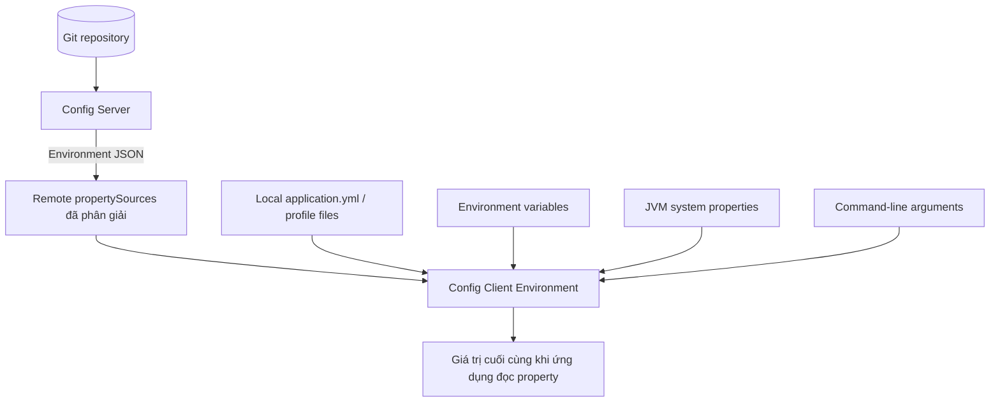

# Phân biệt thứ tự nguồn trong phản hồi và giá trị cuối cùng phía client

Khi gọi Config Server, response Environment có thể chứa nhiều `propertySources` cùng khai báo một key. Thứ tự các nguồn này cho biết nguồn nào được ưu tiên khi Config Server phân giải dữ liệu từ repository. Tuy nhiên, response của Config Server chỉ mô tả cấu hình từ xa mà server trả về; nó chưa phản ánh toàn bộ `Environment` của ứng dụng client.

Ở phía client, Spring còn có thể nhận cấu hình local, biến môi trường, JVM system property, tham số dòng lệnh và các nguồn khác. Chính sách override của Spring Cloud Config quyết định cấu hình từ xa và cấu hình cục bộ được xếp với nhau như thế nào. Vì vậy, cần phân biệt hai câu hỏi: Config Server đã phân giải remote configuration ra sao, và ứng dụng cuối cùng đang đọc giá trị nào.

## 1. Hai lớp cần kiểm tra

Quá trình có hai lớp riêng:

1. **Phân giải tại Config Server:** server đọc Git theo application, profile và label, sau đó trả về Environment gồm metadata và danh sách `propertySources`.
2. **Tổng hợp tại Config Client:** client đưa remote property sources vào Spring `Environment` cùng với các nguồn cấu hình khác của ứng dụng. Spring chọn giá trị theo thứ tự ưu tiên của toàn bộ Environment.



Response của Config Server giúp trả lời nguồn remote nào được chọn. Để biết giá trị mà bean sử dụng, phải xem Environment sau khi client đã tổng hợp tất cả nguồn và áp dụng chính sách override.

## 2. Thứ tự `propertySources` trong response của Config Server

Endpoint Environment thường có dạng:

```text
/{application}/{profile}/{label}
```

Ví dụ:

```bash
curl "http://localhost:8888/order-service/prod/main"
```

Giả sử repository có các tệp sau:

```text
config-repo/
├── application.yml
├── application-prod.yml
├── order-service.yml
└── order-service-prod.yml
```

Mỗi tệp khai báo cùng key `orders.timeout` để minh họa cách ghi đè:

```yaml
# application.yml
orders:
  timeout: 2s
```

```yaml
# application-prod.yml
orders:
  timeout: 3s
```

```yaml
# order-service.yml
orders:
  timeout: 4s
```

```yaml
# order-service-prod.yml
orders:
  timeout: 5s
```

Với cấu hình Git thông thường, response Environment có thể chứa các nguồn theo thứ tự ưu tiên từ cao xuống thấp như sau:

```json
{
  "name": "order-service",
  "profiles": ["prod"],
  "label": "main",
  "version": "<git-commit-id>",
  "propertySources": [
    {
      "name": ".../order-service-prod.yml",
      "source": { "orders.timeout": "5s" }
    },
    {
      "name": ".../order-service.yml",
      "source": { "orders.timeout": "4s" }
    },
    {
      "name": ".../application-prod.yml",
      "source": { "orders.timeout": "3s" }
    },
    {
      "name": ".../application.yml",
      "source": { "orders.timeout": "2s" }
    }
  ]
}
```

Đây là response rút gọn để minh họa, không phải chuỗi JSON cố định cho mọi backend hoặc phiên bản. Tên nguồn thực tế có thể là URL Git, đường dẫn file hoặc tên do repository implementation cung cấp. Với danh sách `propertySources` của Config Server, nguồn ở vị trí trước có độ ưu tiên cao hơn nguồn ở vị trí sau khi cùng chứa một key.

Trong ví dụ, giá trị remote được chọn cho `orders.timeout` là `5s` từ `order-service-prod.yml`. Các giá trị `4s`, `3s` và `2s` vẫn xuất hiện trong các nguồn thấp hơn nhưng không thắng khi cùng key được tra cứu. Những key chỉ xuất hiện ở nguồn thấp hơn vẫn có thể được kế thừa.

Thứ tự thực tế phụ thuộc cách backend kết hợp cấu hình, các profile được yêu cầu, search paths, composite repositories và cấu hình server. Hãy đọc response thực tế để xác nhận, không dựa vào tên tệp hoặc một thứ tự được ghi nhớ từ ví dụ khác.

## 3. Vì sao giá trị cuối cùng phía client có thể khác?

Config Server chỉ biết các nguồn cấu hình mà nó truy xuất và tổng hợp. Client có thêm những nguồn khác, ví dụ:

- `application.yml` và `application-prod.yml` nằm trong artifact của client.
- Biến môi trường của process hoặc container.
- JVM system properties được truyền bằng `-D`.
- Tham số dòng lệnh của ứng dụng.
- JSON cấu hình hoặc nguồn được thêm bởi framework, thư viện hay code của ứng dụng.
- Giá trị mặc định trong `@Value`, `@ConfigurationProperties` hoặc logic của chương trình.

Mỗi nguồn có vị trí riêng trong Spring `Environment`. Khi nhiều nguồn khai báo cùng một key, nguồn có độ ưu tiên cao hơn được dùng khi ứng dụng đọc giá trị. Vì remote configuration được tích hợp qua Config Data hoặc cơ chế bootstrap, vị trí tương đối của remote và local sources còn phụ thuộc cách nạp cấu hình và chính sách override.

Ví dụ, Config Server trả `orders.timeout=5s`. Client đồng thời có thể được khởi chạy với biến môi trường `ORDERS_TIMEOUT=7s` hoặc command-line argument `--orders.timeout=9s`. Giá trị cuối cùng không thể kết luận chỉ bằng JSON của Config Server; phải xem thứ tự property source thực tế của client và các override đang được bật.

## 4. Chính sách override của Spring Cloud Config

Theo mặc định, remote property sources được bảo vệ khỏi việc ghi đè bằng cấu hình local. Nếu muốn cho phép local configuration override remote values, Config Server cần gửi các cờ điều khiển override trong cấu hình từ xa. Các cờ này không nên chỉ được đặt ở tệp local của client rồi kỳ vọng server sẽ thay đổi cách nó phân phối nguồn.

Các thuộc tính thường dùng:

| Thuộc tính | Ý nghĩa |
|---|---|
| `spring.cloud.config.allowOverride` | Cho phép các nguồn cấu hình phía client ghi đè cấu hình từ xa theo chính sách bên dưới |
| `spring.cloud.config.overrideNone` | Khi `true`, cho phép các property sources cục bộ ghi đè remote properties |
| `spring.cloud.config.overrideSystemProperties` | Khi `false`, các nguồn hệ thống như system properties, environment variables và command-line có thể ghi đè remote properties, còn các tệp cấu hình local không được tự động ưu tiên |

Ví dụ cấu hình từ xa cho phép các nguồn local ghi đè:

```yaml
# application-prod.yml trong Git config repository
spring:
  cloud:
    config:
      allowOverride: true
      overrideNone: true
```

Một lựa chọn khác là chỉ cho phép các nguồn hệ thống ghi đè, trong khi tệp cấu hình local vẫn theo thứ tự được kiểm soát:

```yaml
spring:
  cloud:
    config:
      allowOverride: true
      overrideSystemProperties: false
```

`allowOverride` cần được đặt trong property source từ xa để Config Client nhận được chỉ thị này. Cách kết hợp các cờ ảnh hưởng đến vị trí remote property source và cần được kiểm tra theo phiên bản Spring Cloud Config đang sử dụng. Không bật override rộng rãi nếu không có nhu cầu vận hành rõ ràng: một biến môi trường còn sót lại hoặc một tệp local cũ có thể làm các instance chạy khác nhau dù cùng lấy một Git label.

## 5. Ví dụ so sánh remote value và client value

Giả sử Config Server trả về:

```yaml
orders:
  timeout: 5s
```

Client có tệp `application-prod.yml`:

```yaml
orders:
  timeout: 6s
```

Và process được triển khai với biến môi trường:

```text
ORDERS_TIMEOUT=7s
```

Kết quả có thể được phân tích theo chính sách:

| Chính sách | Remote property | Local file | Environment variable | Cần xác minh |
|---|---:|---:|---:|---|
| Mặc định, không cho local override | `5s` | `6s` | `7s` | Remote source được giữ ưu tiên theo chính sách Config Client |
| `allowOverride=true`, `overrideNone=true` | `5s` | `6s` | `7s` | Local sources có thể override remote; xác định nguồn cao nhất trong Environment |
| `allowOverride=true`, `overrideSystemProperties=false` | `5s` | `6s` | `7s` | System property/environment/command line được phép ghi đè; local file không tự động thắng remote |

Bảng trên mô tả phạm vi override, không thay thế việc kiểm tra Environment thực tế. Các nguồn hệ thống có thứ tự ưu tiên riêng trong Spring Boot; nếu nhiều nguồn cùng được phép override, nguồn đứng cao hơn theo Environment sẽ quyết định kết quả. Ngoài ra, kiểu dữ liệu và cách bind cũng cần tương thích với giá trị được chọn.

## 6. Kiểm tra nguồn remote bằng Config Server

Trước tiên, lấy Environment từ Config Server:

```powershell
$remote = Invoke-RestMethod `
    -Method Get `
    -Uri "http://localhost:8888/order-service/prod/main"

$remote | Select-Object name, profiles, label, version
```

In riêng những nguồn có chứa `orders.timeout`:

```powershell
foreach ($source in $remote.propertySources) {
    $property = $source.source.PSObject.Properties["orders.timeout"]
    if ($null -ne $property) {
        [PSCustomObject]@{
            Source = $source.name
            Value = $property.Value
        }
    }
}
```

Kết quả giúp xác định remote value đến từ tệp nào và thứ tự nguồn server trả về. Đây là bước kiểm tra phía server; nó chưa bao gồm các biến môi trường và tệp local của client.

## 7. Kiểm tra Environment cuối cùng ở client

Để xem giá trị sau khi các nguồn đã được tổng hợp, ứng dụng có thể dùng Spring Boot Actuator. Thêm Actuator dependency và expose endpoint `env` trong môi trường phát triển:

```yaml
management:
  endpoints:
    web:
      exposure:
        include: health,env
  endpoint:
    env:
      show-values: when-authorized
```

Sau khi khởi động client, yêu cầu thông tin của key cụ thể:

```bash
curl "http://localhost:8080/actuator/env/orders.timeout"
```

Hoặc trong PowerShell:

```powershell
Invoke-RestMethod "http://localhost:8080/actuator/env/orders.timeout" |
    ConvertTo-Json -Depth 20
```

Endpoint `env` có thể cho biết các property source, nguồn chứa key và giá trị mà Spring Environment đang chọn. Khả năng hiển thị giá trị phụ thuộc cấu hình `show-values`, quyền truy cập và phiên bản Spring Boot. Nếu response che giá trị, vẫn có thể kiểm tra tên nguồn hoặc dùng một endpoint chẩn đoán nội bộ chỉ trả về các giá trị không nhạy cảm.

Không expose `/actuator/env` công khai. Endpoint này có thể tiết lộ cấu hình nội bộ và metadata nhạy cảm. Trong môi trường dùng chung, giới hạn network, xác thực và phân quyền; chỉ hiển thị giá trị cho người được phép. Tránh bật `show-values: always` trong production.

## 8. Kiểm tra giá trị mà bean thực sự sử dụng

Environment cho biết kết quả tra cứu property ở cấp Spring. Để xác nhận bean nhận đúng kiểu dữ liệu và giá trị, có thể dùng `@ConfigurationProperties`:

```java
import java.time.Duration;

import org.springframework.boot.context.properties.ConfigurationProperties;

@ConfigurationProperties(prefix = "orders")
public record OrderProperties(Duration timeout) {
}
```

Đăng ký bằng `@ConfigurationPropertiesScan` hoặc `@EnableConfigurationProperties(OrderProperties.class)`, rồi inject `OrderProperties` vào thành phần sử dụng. Có thể log một giá trị không nhạy cảm tại startup hoặc expose một health/info indicator nội bộ để xác nhận giá trị đã bind. Với secret, chỉ kiểm tra trạng thái có/không hoặc fingerprint phù hợp; không ghi secret ra log hay response.

Nếu `/actuator/env/orders.timeout` hiển thị giá trị mong đợi nhưng bean lại hoạt động khác, kiểm tra:

- Bean có bind đúng prefix và tên thuộc tính không.
- Giá trị có được chuyển đổi đúng kiểu và đơn vị không.
- Bean có giữ bản sao giá trị từ lúc khởi tạo hay đã được refresh/rebind.
- Thành phần bên dưới có đọc lại cấu hình hay đã sao chép giá trị vào client, pool hoặc tài nguyên lúc startup.
- Có logic trong code tự thay thế giá trị hoặc áp dụng default khác không.

## 9. Quy trình chẩn đoán khi hai giá trị khác nhau

Khi response Config Server và hành vi client không khớp, thực hiện theo thứ tự:

1. **Xác nhận request:** kiểm tra application, profile và label trong URL; xác nhận `name`, `profiles`, `label`, `version` trong response.
2. **Xác nhận remote sources:** đọc `propertySources`, tìm key và ghi lại nguồn đầu tiên có key đó.
3. **Xác nhận override policy:** kiểm tra các cờ `allowOverride`, `overrideNone` và `overrideSystemProperties` trong cấu hình từ xa.
4. **Xác nhận client sources:** kiểm tra endpoint Actuator `env/{property}` hoặc cách chẩn đoán tương đương để thấy nguồn đang thắng.
5. **Xác nhận runtime binding:** kiểm tra bean, kiểu dữ liệu, thời điểm tạo và cơ chế refresh.
6. **Ghi nhận kết quả:** lưu Git label/commit, remote value, client value và nguồn thắng để có thể truy vết.

Một số tình huống thường gặp:

- **Remote value đúng nhưng client value khác:** có local override, biến môi trường, system property hoặc command-line argument.
- **Config Server trả đúng nhưng bean vẫn dùng giá trị cũ:** bean đã được tạo trước đó và không hỗ trợ rebind/refresh.
- **Các instance có giá trị khác nhau:** biến môi trường hoặc tham số khởi chạy khác nhau, mỗi instance dùng profile/label khác nhau, hoặc refresh chưa được phân phối đồng đều.
- **Actuator không hiển thị value:** `show-values` đang che dữ liệu hoặc người gọi chưa có quyền; không nên mở endpoint rộng chỉ để tiện kiểm tra.
- **Không tìm thấy key trong remote sources:** key nằm ở tệp không được server đọc, sai application/profile/label hoặc chưa commit vào Git ref.

## 10. Nguyên tắc vận hành

- Xem response Config Server là kết quả phân giải của remote repository, không phải toàn bộ cấu hình runtime của client.
- Đọc thứ tự `propertySources` thực tế để biết remote source nào có ưu tiên cao hơn.
- Đặt chính sách override rõ ràng và chỉ mở quyền ghi đè khi có lý do.
- Dùng Actuator `env` hoặc công cụ tương đương để kiểm tra Environment phía client; bảo vệ endpoint và che giá trị nhạy cảm.
- Kiểm tra thêm bean binding và tài nguyên runtime khi hành vi ứng dụng không khớp Environment.
- Ghi lại label/commit cùng nguồn thắng khi thay đổi cấu hình production để có thể điều tra và rollback.

Khi tách bạch thứ tự remote `propertySources` với thứ tự của toàn bộ client `Environment`, việc tìm nguyên nhân một key có giá trị bất ngờ trở nên có hệ thống. Config Server cho biết dữ liệu từ kho cấu hình được phân giải thế nào; Config Client cho biết giá trị nào thực sự thắng sau khi áp dụng các nguồn local và chính sách override.
