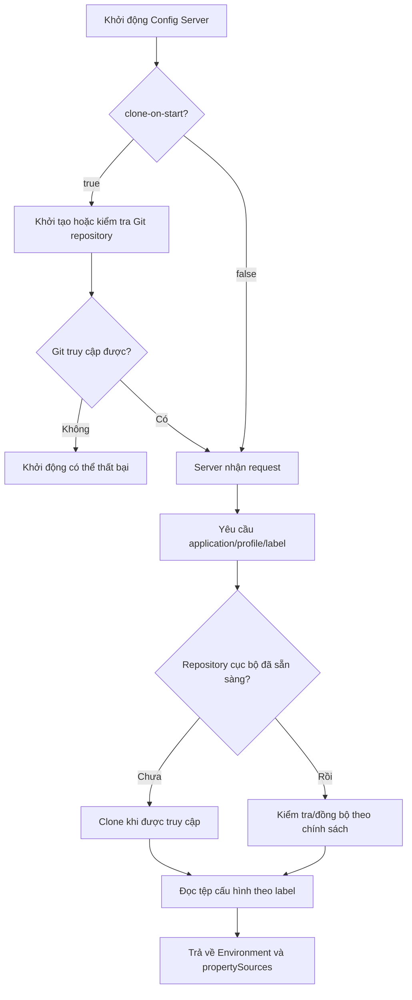

# Clone khi khởi động hay khi nhận yêu cầu đầu tiên

Trong Spring Cloud Config Server dùng Git backend, server cần có bản sao cục bộ của kho Git trước khi đọc các tệp như `application.yml`, `billing-api.yml` hay `billing-api-prod.yml`. Câu hỏi quan trọng là **thời điểm lấy bản sao đó**: ngay khi Config Server khởi động hay chỉ khi có yêu cầu đọc cấu hình đầu tiên. Thuộc tính `spring.cloud.config.server.git.clone-on-start` điều khiển hành vi này.

Quyết định về thời điểm clone ảnh hưởng trực tiếp đến thời gian khởi động, khả năng phát hiện lỗi Git, độ trễ của yêu cầu đầu tiên và cách đánh giá một Config Server đã thực sự sẵn sàng phục vụ các ứng dụng Spring Boot khác hay chưa.

## 1. Hiểu đúng thao tác clone của Git backend

Khi Config Server dùng một Git repository từ xa, backend Git thường duy trì **working copy cục bộ** để truy xuất nội dung. Trong tình huống thư mục làm việc chưa có repository, server cần clone để lấy dữ liệu lần đầu. Sau đó, các lần truy vấn có thể sử dụng bản sao đã có và đồng bộ thay đổi từ remote theo cơ chế cập nhật được cấu hình.

Phân biệt ba thao tác:

| Thao tác | Ý nghĩa | Khi nào liên quan? |
| --- | --- | --- |
| **Clone** | Tạo bản sao Git cục bộ từ remote khi chưa có repository | Lần truy cập đầu tiên hoặc giai đoạn khởi động, tùy `clone-on-start` |
| **Fetch/refresh** | Kiểm tra và tải những thay đổi mới từ remote vào repository đã có | Những lần truy vấn sau, phụ thuộc chính sách đồng bộ |
| **Checkout/chọn label** | Đọc cấu hình tại branch, tag hoặc revision được yêu cầu | Khi xử lý yêu cầu theo application, profile và label |

`clone-on-start` chỉ kiểm soát thời điểm **khởi tạo bản sao Git**. Nó không phải công tắc tự động push/pull mọi lần, cũng không tự gửi cấu hình mới đến các Config Client đang chạy. Để hiểu việc cập nhật nội dung sau khi clone, cần xem thêm chính sách fetch của server và cơ chế refresh của client.

## 2. Chế độ mặc định: clone khi có yêu cầu đầu tiên

Nếu không khai báo `clone-on-start`, Git backend thông thường dùng giá trị mặc định `false`. Server khởi động và tạo các thành phần phục vụ API, nhưng **chưa cần clone ngay** repository chưa có bản sao cục bộ. Việc truy cập Git đầu tiên xảy ra khi có lời gọi yêu cầu cấu hình, hoặc khi một thành phần kiểm tra như health indicator chủ động truy cập repository.

Ví dụ cấu hình:

```yaml
server:
  port: 8888

spring:
  application:
    name: configuration-server
  cloud:
    config:
      server:
        git:
          uri: https://git.example.com/platform/config-repo.git
          default-label: main
          clone-on-start: false
```

Với repository chưa được clone, luồng điển hình là:

1. Config Server khởi động, cấu hình web endpoint và repository backend.
2. Server có thể bắt đầu nhận HTTP request trước khi tự truy cập Git để lấy cấu hình.
3. Khi client gọi `/billing-api/prod/main`, Git backend thực hiện clone nếu cần.
4. Server đọc các tệp ứng với `billing-api`, profile `prod` và label `main`, rồi trả về `Environment` với các `propertySources`.
5. Các request sau sử dụng repository cục bộ đã có; việc đồng bộ từ remote tuân theo cài đặt refresh.

Lợi ích là thời gian khởi động có thể ngắn hơn và quá trình tạo ứng dụng không nhất thiết phụ thuộc ngay vào kết nối Git. Tuy nhiên, yêu cầu đầu tiên có thể chậm hơn vì phải tải repository, và lỗi mạng, xác thực, URL hoặc quyền truy cập có thể chỉ lộ ra khi một client thực sự yêu cầu cấu hình.

Điều này đặc biệt đáng chú ý khi Config Client cần Config Server để khởi động. Một Config Server vừa mở cổng HTTP chưa chắc đã kiểm chứng được khả năng lấy cấu hình; client khởi động ngay sau đó vẫn có thể thất bại nếu Git backend không truy cập được.

## 3. Chế độ chủ động: clone ngay khi khởi động

Đặt `clone-on-start: true` để yêu cầu Git backend khởi tạo repository khi Config Server bắt đầu chạy:

```yaml
server:
  port: 8888

spring:
  application:
    name: configuration-server
  cloud:
    config:
      server:
        git:
          uri: https://git.example.com/platform/config-repo.git
          default-label: main
          clone-on-start: true
```

Với repository chưa có bản sao cục bộ, server thử clone trong quá trình khởi tạo. Nếu URI không hợp lệ, credential bị từ chối hoặc Git không truy cập được, vấn đề thường được phát hiện trước khi ứng dụng báo khởi động thành công. Vì vậy, `clone-on-start: true` giúp thực hiện nguyên tắc *fail fast*: bộc lộ sự cố backend sớm, ngay khi triển khai Config Server.

Đổi lại, thời gian khởi động phụ thuộc vào mạng và kích thước repository. Kho Git lớn, kết nối chậm hoặc Git server tạm thời mất kết nối có thể khiến lần khởi động chậm hơn hoặc thất bại. Nếu nhiều Config Server instance đồng loạt khởi động, các yêu cầu clone cùng lúc còn có thể tạo tải đột biến lên Git server.

Việc clone thành công lúc khởi động **không bảo đảm mọi label, profile và tệp ứng dụng đều hợp lệ**. Ví dụ, repository có nhánh `main` nhưng không có tag `release-2026`, nên yêu cầu dùng tag đó vẫn có thể lỗi về sau. Cần kiểm tra riêng các truy vấn đại diện cho workload thực tế.

## 4. So sánh hai lựa chọn

| Tiêu chí | `clone-on-start: false` | `clone-on-start: true` |
| --- | --- | --- |
| Thời điểm tạo bản sao Git khi chưa có cache | Lúc repository được truy cập lần đầu | Trong quá trình khởi động Config Server |
| Thời gian khởi động | Thường ngắn hơn | Có thể tăng theo thời gian clone |
| Độ trễ yêu cầu cấu hình đầu tiên | Có thể cao do phải clone | Thường thấp hơn khi clone đã hoàn thành |
| Lỗi URI, network hoặc credential | Có thể xuất hiện khi request hoặc health check truy cập Git | Thường xuất hiện ngay lúc khởi động |
| Khả năng nhận HTTP sau startup | Chưa chứng minh Git đọc được | Có cơ sở tốt hơn nếu clone đã thành công |
| Trường hợp phù hợp | Thử nghiệm nhanh, nhu cầu đọc cấu hình không bắt buộc ngay | Config Server phục vụ nhiều client, cần phát hiện lỗi sớm trước rollout |

Đây là xu hướng vận hành, không phải cam kết tuyệt đối. Khi thư mục Git cục bộ đã tồn tại, server không nhất thiết phải clone lại. Lúc đó, độ trễ và lỗi kết nối còn phụ thuộc trạng thái working copy, cài đặt fetch/refresh và phiên bản Spring Cloud Config đang dùng.

## 5. Luồng xử lý khi khởi động và nhận request



Sơ đồ thể hiện cơ chế tổng quát. Một health check hoặc thao tác chẩn đoán có thể gọi backend Git trước request của client, vì vậy “yêu cầu đầu tiên” nên hiểu là **lần đầu repository thực sự bị truy cập**, không nhất thiết là request đầu tiên tới REST endpoint cấu hình.

## 6. Ví dụ thực nghiệm hai chế độ

Giả sử đã có một Config Server chứa dependency `spring-cloud-config-server`, annotation `@EnableConfigServer` và một repository Git thử nghiệm có tệp `billing-api.yml` trên nhánh `main`:

```yaml
# billing-api.yml trong repository cấu hình
acme:
  billing:
    connect-timeout: 3s
```

Để thử cả hai chế độ mà không sửa mã, có thể lấy giá trị `clone-on-start` từ biến môi trường:

```yaml
server:
  port: 8888

spring:
  cloud:
    config:
      server:
        git:
          uri: ${CONFIG_GIT_URI}
          default-label: main
          clone-on-start: ${CONFIG_GIT_CLONE_ON_START:false}
          basedir: ${CONFIG_GIT_BASEDIR}
```

`CONFIG_GIT_URI` trỏ tới một repository thử nghiệm mà tiến trình có quyền đọc. `CONFIG_GIT_BASEDIR` là thư mục working copy cục bộ mà Config Server có quyền ghi. Thư mục này phải là **thư mục dành riêng cho backend Git của thí nghiệm**, không dùng thư mục mã nguồn hoặc thư mục dữ liệu khác.

Thực hiện lần lượt với hai lần chạy độc lập:

1. Chọn một `CONFIG_GIT_BASEDIR` mới, rỗng cho lần thử thứ nhất và đặt `CONFIG_GIT_CLONE_ON_START=false`.
2. Khởi động Config Server; ghi thời điểm server hoàn tất khởi động và quan sát log Git.
3. Gửi `GET http://localhost:8888/billing-api/default/main`; ghi HTTP status, thời gian phản hồi và tên các `propertySources`.
4. Dừng server. Chọn một `CONFIG_GIT_BASEDIR` mới, rỗng cho lần thử thứ hai và đặt `CONFIG_GIT_CLONE_ON_START=true`.
5. Khởi động lại; so sánh thời gian startup, thời điểm xuất hiện thao tác clone và thời gian phản hồi request cấu hình đầu tiên.
6. Thử lỗi có kiểm soát bằng một Git URI sai hoặc credential thử nghiệm không hợp lệ; ghi xem lỗi xuất hiện ở startup hay ở request đầu tiên.

Có thể đo thời gian phản hồi request bằng `curl`:

```bash
curl -sS -o /dev/null \
  -w 'HTTP %{http_code} | Total %{time_total}s\n' \
  'http://localhost:8888/billing-api/default/main'
```

Trên PowerShell, có thể dùng `curl.exe` với cùng tham số nếu muốn gọi chương trình curl thực sự. Kết quả sẽ khác nhau theo tốc độ mạng, kích thước repository, DNS và cache của hệ thống; hãy ghi lại các điều kiện này trước khi so sánh.

Để kiểm thử sạch, tạo các thư mục backend Git riêng thay vì xóa thư mục đang được server khác sử dụng. Nếu thư mục cũ còn working copy hợp lệ, kết quả có thể không còn đại diện cho lần clone đầu tiên.

## 7. `refresh-rate` là vấn đề khác với `clone-on-start`

Sau lần clone đầu tiên, repository có thể thay đổi trên Git remote. Spring Cloud Config Git backend có thuộc tính `spring.cloud.config.server.git.refresh-rate` để điều tiết khoảng thời gian tối thiểu giữa các lần cập nhật Git theo đơn vị giây. Ví dụ:

```yaml
spring:
  cloud:
    config:
      server:
        git:
          uri: https://git.example.com/platform/config-repo.git
          clone-on-start: true
          refresh-rate: 30
```

Ví dụ này không có nghĩa server tự cập nhật sau mỗi 30 giây. Nó giới hạn tần suất kiểm tra/đồng bộ remote **khi repository được truy cập**; nếu không có request, không nên mặc định sẽ có một tác vụ fetch định kỳ độc lập. Giá trị mặc định thường là `0`, nghĩa là không đặt khoảng chờ tối thiểu giữa các lần refresh theo cơ chế này.

Cần phân biệt:

- `clone-on-start`: quyết định **khi nào tạo bản sao Git ban đầu**.
- `refresh-rate`: kiểm soát **tần suất thử cập nhật bản sao Git đã có**.
- `spring.cloud.config.label` ở client: chọn **revision/nhánh/tag** cần đọc.
- Refresh của Config Client hoặc Spring Cloud Bus: quyết định **khi nào ứng dụng đang chạy nạp lại cấu hình**.

Vì vậy, đổi `clone-on-start` không làm Config Client tự động cập nhật thuộc tính khi Git có commit mới. Một hệ thống muốn cập nhật động còn phải có cơ chế refresh, giới hạn quyền truy cập và kiểm soát những bean nào có thể nhận giá trị mới mà không restart.

## 8. Clone-on-start và readiness/health check

Với Config Server là phụ thuộc bắt buộc của nhiều ứng dụng, chỉ kiểm tra tiến trình Java còn chạy hoặc cổng `8888` đã mở là chưa đủ. Một server có thể phản hồi HTTP nhưng không đọc được repository do Git URI, quyền truy cập hoặc network gặp sự cố.

Khi dùng `clone-on-start: true`, lỗi ban đầu dễ lộ ra trước khi ứng dụng sẵn sàng phục vụ. Đây là một tín hiệu tốt hơn, nhưng vẫn cần **smoke test truy vấn cấu hình cụ thể** bằng API `/{application}/{profile}/{label}`. Một nhánh hoặc tệp có thể thiếu dù clone mặc định đã thành công.

Khi dùng `clone-on-start: false`, health indicator của Config Server, nếu được bật và có truy cập `EnvironmentRepository`, có thể kích hoạt clone trước cả request của Config Client. Điều này khiến độ trễ, lỗi và log thực tế khác với thí nghiệm chỉ quan sát HTTP endpoint. Cần ghi nhận cấu hình Actuator và loại probe đã chạy để diễn giải đúng kết quả.

Khi vận hành với Kubernetes hoặc hệ thống có readiness probe, nên phân biệt:

- **Liveness**: tiến trình có còn hoạt động để cần restart hay không.
- **Readiness**: instance có đủ điều kiện nhận lưu lượng cấu hình lúc này hay không.
- **Kiểm tra tích hợp**: một truy vấn application/profile/label đại diện có thực sự trả về thuộc tính mong đợi hay không.

Không nên cấu hình liveness phụ thuộc trực tiếp vào một mạng Git có thể gián đoạn ngắn, vì có thể gây vòng lặp restart không cần thiết. Ngược lại, readiness và kiểm tra tích hợp nên phản ánh khả năng Config Server phục vụ cấu hình theo yêu cầu vận hành. Cần thiết kế probe theo backend, cache và chính sách cho phép phục vụ cấu hình cũ của hệ thống.

## 9. Nhiều Git repository và cấu hình `clone-on-start`

Config Server có thể định tuyến ứng dụng tới nhiều repository khác nhau. Chẳng hạn repository mặc định phục vụ cấu hình chung, còn một repository riêng phục vụ nhóm ứng dụng `billing-*`:

```yaml
spring:
  cloud:
    config:
      server:
        git:
          uri: https://git.example.com/platform/config-shared.git
          clone-on-start: true
          repos:
            billing:
              pattern: billing-*
              uri: https://git.example.com/platform/config-billing.git
              clone-on-start: true
```

Khi khai báo nhiều repository, cần xem xét tùy chọn clone của **từng repository**. Không nên suy luận rằng thiết lập clone của repository mặc định sẽ luôn áp dụng giống nhau cho mọi repository bổ sung. Một repository chỉ được dùng bởi ít ứng dụng vẫn có thể bị cấu hình clone chủ động nếu muốn kiểm tra quyền truy cập từ lúc startup.

Đánh đổi ở đây là thời gian khởi động và số kết nối tới Git có thể tăng khi nhiều kho cùng clone. Với các kho có quyền truy cập và vòng đời khác nhau, nên quyết định theo mức độ quan trọng của chúng: kho bắt buộc để phục vụ request chính cần được kiểm tra sớm; kho ít dùng có thể cho phép nạp khi cần, nếu việc phát hiện lỗi muộn được chấp nhận.

## 10. Sự cố thường gặp và cách chẩn đoán

| Hiện tượng | Giải thích có thể xảy ra | Kiểm tra |
| --- | --- | --- |
| Server khởi động thất bại với `clone-on-start: true` | Git remote không truy cập được, URI sai, credential lỗi hoặc working directory không ghi được | Log clone, quyền Git, DNS/TLS, `basedir` |
| Server khởi động tốt nhưng request đầu tiên chậm | Đang clone lần đầu hoặc đồng bộ dữ liệu Git | Thời gian clone, kích thước kho, network, log Git |
| Startup tốt nhưng request đầu tiên trả lỗi | Lỗi Git chỉ xuất hiện khi lazy clone, hoặc label/profile không tồn tại | `clone-on-start`, URI, label, API response |
| Bật `clone-on-start: true` nhưng request với tag khác vẫn lỗi | Clone ban đầu không bảo đảm mọi nhánh/tag hợp lệ | Label yêu cầu, quyền đọc Git, Git revision |
| Kết quả lần thử thứ hai nhanh bất thường | Working copy từ lần chạy trước vẫn tồn tại | `basedir`, trạng thái cache và cách cô lập lần thử |
| Client không thấy cấu hình Git mới | Backend chưa fetch thay đổi hoặc client chưa refresh | `refresh-rate`, Git revision phản hồi, cơ chế refresh phía client |

Quy trình chẩn đoán nên đi từ **backend Git của Config Server** tới **phản hồi Config Server**, sau đó mới kiểm tra **Spring Environment của Config Client**. Ví dụ, nếu `version` trong phản hồi vẫn là commit cũ, hãy kiểm tra cập nhật repository ở server. Nếu `version` và `propertySources` đã đúng nhưng ứng dụng vẫn dùng giá trị cũ, hãy kiểm tra thứ tự nguồn cấu hình hoặc refresh ở client.

## 11. Lựa chọn cho các môi trường

Một nguyên tắc thực tế:

1. **Môi trường phát triển cá nhân:** `clone-on-start: false` có thể chấp nhận được để khởi động nhanh; bảo đảm kiểm tra ít nhất một request cấu hình trước khi kết luận hệ thống chạy đúng.
2. **Môi trường tích hợp/CI:** thường ưu tiên `clone-on-start: true` để phát hiện sớm lỗi Git URI, credential và khả năng truy cập; tiếp tục kiểm thử các application/profile/label thực tế.
3. **Môi trường production:** ưu tiên cơ chế xác thực backend sớm, readiness phù hợp, Git revision có thể truy vết và kế hoạch xử lý khi Git tạm thời không khả dụng. `clone-on-start: true` thường là lựa chọn có lợi nếu Config Server là phụ thuộc bắt buộc của nhiều client.
4. **Triển khai nhiều instance:** chú ý tải đồng thời lên Git, thời gian rollout, working directory riêng cho từng instance và việc bảo vệ credential; không chia sẻ một thư mục làm việc Git giữa các tiến trình nếu chưa có thiết kế đồng bộ an toàn.

Trong cả hai chế độ, phải bảo vệ repository và thông tin xác thực. Dùng Git credential chỉ có quyền đọc, TLS/SSH an toàn, secret manager và quyền ghi tối thiểu cho thư mục cục bộ. Không lưu token trong `application.yml` được commit vào Git, và không bật log chứa credential ở môi trường dùng chung.

## 12. Checklist trước khi đưa Config Server vào sử dụng

- Xác định Git repository, `default-label`, đường dẫn cấu hình và quyền đọc của Config Server.
- Chọn rõ `clone-on-start` theo yêu cầu startup, readiness và thời điểm chấp nhận phát hiện lỗi.
- Đảm bảo thư mục Git cục bộ có quyền ghi và được quản lý theo vòng đời container/host.
- Ghi nhận `refresh-rate` và cách backend cập nhật thay đổi sau lần clone đầu.
- Kiểm thử khi Git hoạt động bình thường, khi Git không truy cập được và khi label không tồn tại.
- Gọi API một application/profile/label đại diện sau khi server khởi động.
- Ghi lại revision `version` của Config Server và kiểm tra quá trình nạp cấu hình của Config Client.
- Chuẩn bị cơ chế refresh hoặc restart để phân phối thay đổi tới các ứng dụng đang chạy.

**Điểm cốt lõi:** `clone-on-start: true` đưa bước khởi tạo Git vào quá trình khởi động Config Server; `false` trì hoãn thao tác đó đến khi Git repository thực sự được truy cập. Lựa chọn này không làm thay đổi cách chọn application, profile hoặc label, nhưng ảnh hưởng mạnh đến lúc phát hiện lỗi và độ tin cậy cảm nhận được của dịch vụ cấu hình tập trung. Hãy quyết định dựa trên thời điểm cần phát hiện sự cố, khả năng phục vụ request đầu tiên và quy trình kiểm thử của hệ thống.
