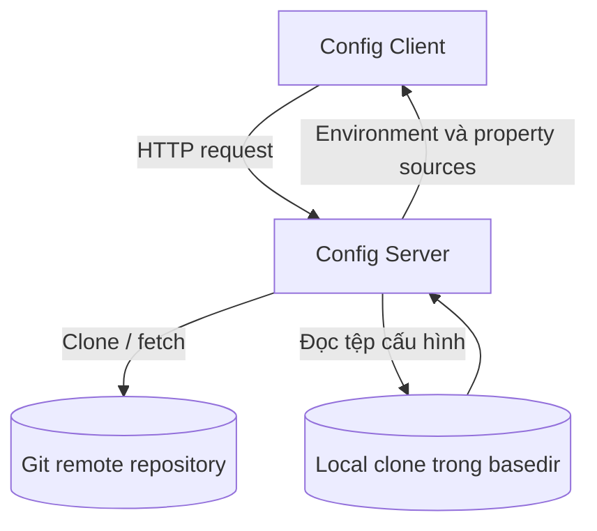

# Thư mục clone, basedir và quyền ghi trong container

Khi Spring Cloud Config Server dùng Git làm backend, server cần một bản clone cục bộ của repository cấu hình để đọc các tệp theo application, profile và label. Bản clone này được lưu trong thư mục làm việc do thuộc tính `spring.cloud.config.server.git.basedir` xác định. Vì vậy, vị trí thư mục, quyền đọc/ghi và vòng đời filesystem trong container ảnh hưởng trực tiếp đến khả năng Config Server lấy cấu hình.

Git remote vẫn là nguồn dữ liệu chuẩn. Bản clone cục bộ là bản làm việc/cache để server truy cập repository, không phải nơi lưu cấu hình duy nhất. Khi triển khai bằng Docker hoặc Kubernetes, cần bảo đảm tiến trình Config Server có thể tạo, cập nhật và dọn thư mục clone trong giới hạn filesystem của container.

## 1. Mục tiêu học tập

Sau bài học, bạn có thể:

- Giải thích vì sao Config Server cần clone Git repository và phân biệt remote repository với bản clone cục bộ.
- Cấu hình `basedir`, `clone-on-start`, `refresh-rate` và `force-pull` theo nhu cầu vận hành.
- Thiết kế đường dẫn clone phù hợp cho Docker/Kubernetes và hiểu ảnh hưởng của filesystem tạm thời.
- Cấp quyền đọc/ghi đúng cho user chạy Config Server mà không mở quyền quá rộng.
- Chẩn đoán lỗi clone, fetch, ghi file, SSH credential và quyền truy cập thư mục.
- Vận hành nhiều Config Server instance mà không tạo xung đột trên thư mục clone.

## 2. Vì sao Config Server cần thư mục clone?

Với Git backend, Config Server truy cập repository cấu hình thông qua một bản clone cục bộ. Quá trình cơ bản gồm:

1. Server nhận yêu cầu từ Config Client, ví dụ `GET /order-service/prod/main`.
2. Server xác định repository và label cần đọc.
3. Nếu chưa có bản clone, server clone remote repository vào thư mục làm việc.
4. Server đọc các tệp cấu hình tương ứng với application và profile.
5. Khi cần cập nhật, server fetch hoặc đồng bộ repository theo chính sách refresh.
6. Server trả về `Environment` chứa các property source cho client.



Remote Git là nơi nhóm phát triển review, commit, tag và quản lý lịch sử. Local clone là bản sao làm việc do Config Server sử dụng để đọc nội dung. Nếu local clone bị xóa, server có thể clone lại từ remote khi được cấu hình và kết nối hoạt động. Vì vậy, việc mất clone không đồng nghĩa mất cấu hình đã commit trên Git.

## 3. `basedir` là gì?

`spring.cloud.config.server.git.basedir` chỉ định thư mục gốc mà Git backend dùng để lưu bản clone cục bộ. Nếu không cấu hình, Spring Cloud Config dùng thư mục tạm của hệ điều hành với tên thư mục clone được tạo cho repository. Đường dẫn mặc định có thể khác theo môi trường chạy, nên không nên dựa vào vị trí ngầm định trong container.

Ví dụ cấu hình server:

```yaml
server:
  port: 8888

spring:
  cloud:
    config:
      server:
        git:
          uri: https://git.example.com/platform/config-repo.git
          basedir: /var/lib/config-server/git
          clone-on-start: true
```

Trong ví dụ, Config Server dùng `/var/lib/config-server/git` làm vùng làm việc cho Git backend. Thư mục cha phải tồn tại hoặc có thể được tạo bởi tiến trình, và user chạy ứng dụng phải có quyền cần thiết.

Chọn `basedir` theo các nguyên tắc:

- Dùng đường dẫn tuyệt đối để tránh phụ thuộc vào working directory khi container khởi chạy.
- Đặt thư mục riêng cho dữ liệu clone của Config Server, tránh dùng chung với thư mục mã nguồn hoặc file cấu hình nhạy cảm khác.
- Bảo đảm filesystem tại vị trí đó có thể ghi và có đủ dung lượng.
- Tránh đặt trong thư mục chỉ đọc của image nếu container chạy với root filesystem read-only.
- Không đặt credential dạng văn bản thuần trong thư mục clone hoặc URL remote.
- Nếu có nhiều Config Server instance trên cùng host, mỗi instance nên có thư mục làm việc riêng hoặc một cơ chế cô lập đã được kiểm chứng.

## 4. Phân biệt `basedir` với Git remote và `search-paths`

Ba cấu hình này có vai trò khác nhau:

| Thành phần | Ý nghĩa | Ví dụ |
| --- | --- | --- |
| `uri` | Địa chỉ Git remote để clone/fetch | `https://git.example.com/platform/config-repo.git` |
| `basedir` | Thư mục local lưu bản clone | `/var/lib/config-server/git` |
| `search-paths` | Thư mục bên trong repository nơi Config Server tìm tệp cấu hình | `services`, `shared` |

Ví dụ repository có cấu trúc:

```text
config-repo/
├── shared/
│   └── application.yml
├── services/
│   ├── order-service.yml
│   └── payment-service.yml
└── README.md
```

Server có thể khai báo:

```yaml
spring:
  cloud:
    config:
      server:
        git:
          uri: https://git.example.com/platform/config-repo.git
          basedir: /var/lib/config-server/git
          search-paths:
            - shared
            - services
```

`basedir` không phải nơi khai báo thư mục chứa các tệp YAML trong repository. Nó là vị trí bản clone được lưu trên filesystem của server. `search-paths` mới chỉ định các thư mục bên trong repository mà server sẽ tìm cấu hình.

## 5. Quyền filesystem cần có

Tiến trình Config Server cần các quyền phù hợp để thực hiện các thao tác Git trên bản clone. Tùy trạng thái repository và cách backend làm việc, các thao tác có thể gồm tạo thư mục, ghi object và index, cập nhật refs, tạo lock file, fetch dữ liệu và xóa thư mục cũ.

Thông thường, user chạy ứng dụng cần:

- Quyền traverse (`x`) trên các thư mục cha để truy cập đường dẫn.
- Quyền đọc và ghi trên thư mục `basedir` và thư mục con chứa clone.
- Quyền tạo file/thư mục và xóa hoặc đổi tên file khi Git cập nhật bản clone.
- Quyền đọc credential hoặc SSH key được mount riêng nếu dùng xác thực SSH.

Không nên chỉ cấp quyền đọc cho thư mục clone. Một bản clone đã tồn tại vẫn cần được cập nhật khi Config Server fetch thay đổi từ remote.

### Chọn owner và group

Nên chạy Config Server bằng user không phải root. Thư mục `basedir` cần thuộc user hoặc group mà tiến trình sử dụng. Ví dụ trên Linux, nếu ứng dụng chạy với UID `10001` và GID `10001`, thư mục mount cần được cấp quyền phù hợp với cặp UID/GID đó.

Ví dụ lệnh minh họa trên máy Linux hoặc trong Docker image:

```bash
mkdir -p /var/lib/config-server/git
chown -R 10001:10001 /var/lib/config-server
chmod 750 /var/lib/config-server
chmod 750 /var/lib/config-server/git
```

UID/GID và đường dẫn cần thay theo image, user và volume thực tế. Không dùng `chmod -R 777` để xử lý lỗi quyền; cách đó cho mọi user quyền ghi và làm tăng rủi ro sửa hoặc đọc dữ liệu ngoài ý muốn.

Nếu dùng group để chia sẻ quyền, hãy bảo đảm group ownership và bit quyền thư mục cho phép tiến trình tạo file mới. Với nhiều user trong cùng group, có thể cân nhắc setgid trên thư mục để file/thư mục mới kế thừa group phù hợp, sau khi đã kiểm tra chính sách bảo mật của môi trường.

## 6. Chạy Config Server trong Docker

Filesystem bên trong container thường được tạo từ image và có thể bị thay thế khi container được tạo lại. Không nên giả định rằng file clone được ghi trong container sẽ tồn tại sau khi container bị xóa hoặc redeploy.

Ví dụ Dockerfile có user không đặc quyền:

```dockerfile
FROM eclipse-temurin:21-jre

RUN mkdir -p /var/lib/config-server/git \
    && groupadd --system --gid 10001 app \
    && useradd --system --uid 10001 --gid 10001 app \
    && chown -R 10001:10001 /var/lib/config-server

WORKDIR /app
COPY target/config-server.jar /app/app.jar
USER 10001:10001

ENTRYPOINT ["java", "-jar", "/app/app.jar"]
```

Trong Dockerfile, thư mục được tạo và cấp quyền trước khi chuyển sang user ứng dụng. Khi dùng bind mount hoặc volume, mount có thể che thư mục đã có trong image; do đó phải kiểm tra owner và mode của thư mục trên host/volume sau khi mount.

Ví dụ chạy container với một named volume:

```bash
docker volume create config-server-git

docker run --rm \
  -p 8888:8888 \
  -v config-server-git:/var/lib/config-server/git \
  -e SPRING_CLOUD_CONFIG_SERVER_GIT_URI=https://git.example.com/platform/config-repo.git \
  -e SPRING_CLOUD_CONFIG_SERVER_GIT_BASEDIR=/var/lib/config-server/git \
  config-server:latest
```

Đây là ví dụ về mount và biến môi trường; image thực tế phải có user và quyền volume phù hợp. Với Docker Desktop hoặc bind mount từ Windows, quyền POSIX có thể được ánh xạ theo cách khác Linux thuần. Hãy xác minh bằng cách chạy container dưới đúng UID/GID và kiểm tra khả năng tạo file trong thư mục mount.

### Root filesystem read-only

Một số môi trường tăng cường bảo mật bằng cách chạy container với root filesystem chỉ đọc. Cấu hình này vẫn có thể dùng được nếu `basedir` được mount từ một volume có thể ghi.

Ví dụ:

```bash
docker run --read-only \
  --tmpfs /tmp:rw,noexec,nosuid,size=64m \
  -v config-server-git:/var/lib/config-server/git \
  -p 8888:8888 \
  config-server:latest
```

Trong ví dụ, `/var/lib/config-server/git` là vùng ghi riêng cho Git clone. Các thư mục khác mà ứng dụng cần ghi, như thư mục tạm hoặc log nếu không ghi ra stdout/stderr, cũng phải được thiết kế rõ. Không bật read-only rồi để Git backend dùng một `basedir` nằm trên root filesystem không thể ghi.

## 7. Chạy Config Server trong Kubernetes

Trong Kubernetes, có thể đặt thư mục clone trên `emptyDir` hoặc PersistentVolume tùy mục tiêu:

- **`emptyDir`:** tạo vùng lưu tạm gắn với vòng đời Pod. Khi Pod bị xóa và tạo lại, nội dung clone mất và Config Server phải clone lại từ Git.
- **PersistentVolumeClaim:** giữ dữ liệu qua vòng đời Pod theo chính sách storage. Có thể giảm thời gian clone lại nhưng cần quản lý quyền, dung lượng và cách nhiều replica truy cập.

Ví dụ dùng `emptyDir`:

```yaml
apiVersion: apps/v1
kind: Deployment
metadata:
  name: config-server
spec:
  replicas: 1
  selector:
    matchLabels:
      app: config-server
  template:
    metadata:
      labels:
        app: config-server
    spec:
      securityContext:
        runAsNonRoot: true
        runAsUser: 10001
        runAsGroup: 10001
        fsGroup: 10001
      containers:
        - name: config-server
          image: example/config-server:latest
          ports:
            - containerPort: 8888
          env:
            - name: SPRING_CLOUD_CONFIG_SERVER_GIT_BASEDIR
              value: /var/lib/config-server/git
          volumeMounts:
            - name: git-work
              mountPath: /var/lib/config-server/git
      volumes:
        - name: git-work
          emptyDir: {}
```

Ví dụ này minh họa vùng clone tạm và security context. `fsGroup` có thể giúp volume hỗ trợ group access, nhưng cách áp dụng quyền còn phụ thuộc loại volume và storage driver. Nếu volume không được cấp quyền như mong đợi, cần điều chỉnh storage class, ownership hoặc init container theo chính sách cluster; không giả định mọi volume đều xử lý `fsGroup` giống nhau.

Nếu dùng `readOnlyRootFilesystem: true`, vẫn cần mount volume ghi được vào `basedir` và các vị trí ghi khác mà ứng dụng cần. Đặt `basedir` khớp chính xác với `mountPath` để tránh Git backend ghi vào một thư mục khác nằm trên filesystem chỉ đọc.

## 8. Chọn filesystem tạm hay persistent

Vì Git remote là nguồn chuẩn, local clone thường có thể tái tạo. Quyết định có giữ clone qua lần khởi động lại hay không phụ thuộc thời gian clone, độ lớn repository, khả năng truy cập Git và mục tiêu phục hồi.

| Lựa chọn | Ưu điểm | Hạn chế |
| --- | --- | --- |
| Thư mục tạm trong container | Đơn giản, clone mới phản ánh remote khi khởi tạo lại | Pod/container mới phải clone lại; phụ thuộc mạng và credential lúc khởi động |
| `emptyDir` trong Kubernetes | Tách vùng ghi khỏi image, dễ dùng với root filesystem read-only | Dữ liệu mất khi Pod bị xóa; không chia sẻ giữa các Pod |
| Named volume/bind mount | Clone có thể tồn tại qua việc thay container | Cần quản lý owner, backup/cleanup và tránh dùng chung sai cách |
| PersistentVolumeClaim | Có thể giữ clone qua vòng đời Pod | Cần xử lý quyền, hiệu năng, attach mode và truy cập đồng thời |

Không nên xem clone là bản backup duy nhất của cấu hình. Nếu clone bị hỏng hoặc xóa, phải có thể tái tạo từ remote và label đã biết. Git remote cần được bảo vệ, sao lưu và quản lý lịch sử theo chính sách riêng.

## 9. Nhiều replica và thư mục clone

Khi chạy nhiều Config Server replica, mỗi instance có thể có bản clone riêng. Cách này giúp từng instance tự fetch và phục vụ request mà không phụ thuộc filesystem chia sẻ. Đổi lại, các instance có thể cập nhật cache ở thời điểm khác nhau tùy refresh policy và tình trạng kết nối Git.

Các nguyên tắc vận hành:

- Dùng `basedir` riêng cho từng instance hoặc từng Pod.
- Tránh cho nhiều tiến trình Git/JGit độc lập cùng thao tác trên một working directory dùng chung nếu chưa xác minh cơ chế khóa và hỗ trợ của backend.
- Nếu cần persistent volume, ưu tiên volume riêng cho từng replica hoặc thiết kế storage có khả năng truy cập đồng thời đã được kiểm chứng.
- Đảm bảo mọi replica dùng cùng repository, credential, default label và chính sách refresh.
- Theo dõi sự khác nhau về thời điểm fetch và phiên bản commit mà từng instance đang phục vụ.
- Khi phát hành cấu hình quan trọng, dùng tag/commit bất biến để giảm khả năng các replica nhìn thấy nội dung thay đổi giữa chừng.

Việc tăng số replica không tự động đồng bộ local clone tức thì. Git remote là nguồn chung, nhưng cache từng instance có thể khác nhau tạm thời cho đến khi fetch.

## 10. Điều khiển thời điểm clone và fetch

Một số thuộc tính Git backend ảnh hưởng trực tiếp đến vòng đời clone:

| Thuộc tính | Ý nghĩa | Giá trị mặc định thường gặp |
| --- | --- | --- |
| `spring.cloud.config.server.git.clone-on-start` | Clone repository ngay khi Config Server khởi động | `false` |
| `spring.cloud.config.server.git.refresh-rate` | Khoảng thời gian tối thiểu giữa các lần fetch, tính bằng giây | `0` |
| `spring.cloud.config.server.git.force-pull` | Buộc pull/fetch cập nhật local repository ngay cả khi local clone có thay đổi | `false` |
| `spring.cloud.config.server.git.basedir` | Thư mục lưu clone cục bộ | Thư mục tạm do hệ thống chọn |
| `spring.cloud.config.server.git.delete-untracked-branches` | Dọn branch local không còn được theo dõi từ remote khi đồng bộ | `false` |

### `clone-on-start`

Khi đặt `true`, Config Server clone repository trong giai đoạn khởi động. Cách này giúp phát hiện sớm lỗi URI, credential, network hoặc quyền ghi `basedir`. Đổi lại, server có thể không khởi động được nếu Git remote tạm thời không truy cập được.

Khi để `false`, việc clone có thể được trì hoãn đến request đầu tiên. Điều này giúp ứng dụng server khởi động nhanh hơn nhưng lỗi repository có thể chỉ xuất hiện khi Config Client yêu cầu cấu hình.

### `refresh-rate`

`refresh-rate` quy định khoảng thời gian giữa các lần fetch từ remote. Giá trị `0` có nghĩa server kiểm tra cập nhật ở mỗi request; giá trị lớn hơn 0 giảm tần suất truy cập Git nhưng có thể làm cấu hình mới xuất hiện trễ hơn ở một số instance.

Ví dụ:

```yaml
spring:
  cloud:
    config:
      server:
        git:
          refresh-rate: 30
```

Trong ví dụ, server giới hạn việc fetch theo khoảng 30 giây. Hãy cân nhắc tải Git, độ trễ chấp nhận được và số replica trước khi chọn khoảng thời gian.

### `force-pull`

Nếu bản clone cục bộ có thay đổi ngoài dự kiến, Git có thể từ chối cập nhật để tránh ghi đè dữ liệu local. `force-pull: true` yêu cầu backend cưỡng chế cập nhật bản clone từ remote trong trường hợp đó. Thuộc tính này hữu ích khi local clone có thể bị thay đổi, nhưng cũng có thể làm mất các thay đổi cục bộ không được commit.

Trong triển khai chuẩn, không nên sửa trực tiếp file trong thư mục clone. Hãy coi local clone là dữ liệu do Config Server quản lý và không dùng nó làm nơi chỉnh sửa cấu hình. Chỉ bật `force-pull` khi hiểu rõ tác động và muốn local clone luôn theo remote.

### Dọn branch đã bị xóa

`delete-untracked-branches` hỗ trợ dọn branch trong bản clone cục bộ khi branch đó không còn được theo dõi ở remote. Điều này giúp tránh việc branch cũ còn sót lại tiếp tục được resolve sau khi nhóm xóa branch ở Git remote. Cần kiểm tra hành vi theo phiên bản Spring Cloud Config đang chạy và đánh giá chính sách cache trước khi bật.

## 11. Xác thực Git và quyền đọc credential

Quyền ghi `basedir` và quyền đọc credential là hai yêu cầu khác nhau. Tiến trình cần ghi được clone nhưng chỉ nên đọc đúng credential cần thiết để truy cập repository.

### HTTPS

Với repository HTTPS riêng tư, Config Server có thể được cấp username/password hoặc token thông qua cấu hình phù hợp. Không nên nhúng token vào URL Git, vì URL có thể xuất hiện trong log, process metadata hoặc file cấu hình đã lưu.

Ví dụ cấu trúc tham khảo:

```yaml
spring:
  cloud:
    config:
      server:
        git:
          uri: https://git.example.com/platform/config-repo.git
          username: ${CONFIG_GIT_USERNAME}
          password: ${CONFIG_GIT_TOKEN}
```

`CONFIG_GIT_USERNAME` và `CONFIG_GIT_TOKEN` phải được cấp từ secret manager hoặc cơ chế secret của nền tảng. Tài khoản/token chỉ nên có quyền đọc repository cần thiết.

### SSH

Với SSH, mount private key và `known_hosts` theo cơ chế bảo mật của nền tảng. Private key cần được đọc bởi user chạy Config Server, nhưng không cần cấp quyền ghi cho ứng dụng. Không tắt kiểm tra host key trong môi trường production chỉ để tránh lỗi kết nối; hãy cung cấp host key tin cậy.

Ví dụ các thuộc tính có thể cần cấu hình tùy phiên bản và backend:

```yaml
spring:
  cloud:
    config:
      server:
        git:
          uri: git@git.example.com:platform/config-repo.git
          ignore-local-ssh-settings: true
          private-key: ${CONFIG_GIT_PRIVATE_KEY}
          known-hosts-file: /run/secrets/git-known-hosts
```

Tên thuộc tính và cách truyền private key có thể thay đổi theo phiên bản Spring Cloud Config. Hãy kiểm tra reference documentation của đúng release train. Không ghi private key thật vào Git hoặc đưa vào ví dụ tài liệu.

## 12. Kiểm tra thư mục clone trong container

Khi container không clone được repository, hãy kiểm tra theo thứ tự:

1. Xác định user/UID/GID thực tế của tiến trình Java.
2. Xác nhận `basedir` đã được mount đúng vào container.
3. Kiểm tra quyền traverse trên tất cả thư mục cha.
4. Kiểm tra user có thể tạo, sửa, đổi tên và xóa file trong `basedir`.
5. Kiểm tra filesystem không bị mount read-only và còn dung lượng.
6. Kiểm tra container có thể phân giải DNS và kết nối đến Git remote.
7. Kiểm tra credential, quyền đọc repository và host key nếu dùng SSH.
8. Kiểm tra log Git/JGit để phân biệt lỗi authentication, network, ref/branch và filesystem.

Trên môi trường Linux, có thể dùng các lệnh chẩn đoán trong container hoặc debug pod:

```bash
id
printf 'JAVA_HOME=%s\n' "${JAVA_HOME:-<unset>}"
for name in SPRING_CLOUD_CONFIG_SERVER_GIT_URI SPRING_CLOUD_CONFIG_SERVER_GIT_BASEDIR SPRING_CLOUD_CONFIG_SERVER_GIT_USERNAME SPRING_CLOUD_CONFIG_SERVER_GIT_PASSWORD; do
  if printenv "$name" >/dev/null 2>&1; then printf '%s is set\n' "$name"; fi
done
ls -ld /var/lib/config-server /var/lib/config-server/git
probe="/var/lib/config-server/git/.write-check-$$"
: > "$probe" && rm -f "$probe"
df -h /var/lib/config-server/git
```

Lệnh tạo file tạm và `rm` kiểm tra khả năng ghi/xóa dưới đúng user chạy ứng dụng. Không chạy kiểm tra này bằng root nếu ứng dụng thực tế chạy bằng user khác, vì kết quả sẽ không phản ánh quyền của tiến trình.

Không đưa giá trị secret ra terminal hoặc log khi kiểm tra biến môi trường. Chỉ xác minh biến đã được cấp mà không in nội dung credential.

## 13. Chẩn đoán lỗi thường gặp

| Biểu hiện | Nguyên nhân có thể | Hướng kiểm tra |
| --- | --- | --- |
| `Permission denied` khi clone | User không có quyền ghi/traverse `basedir` hoặc volume owner không phù hợp | Kiểm tra UID/GID, mount và quyền thư mục |
| `Read-only file system` | `basedir` nằm trên root filesystem read-only hoặc volume mount sai | Mount volume ghi được và đặt `basedir` đúng đường dẫn |
| Clone thành công lúc đầu nhưng fetch thất bại | Quyền cập nhật file/lock không đủ, volume hết dung lượng hoặc repository local bị thay đổi | Kiểm tra quyền thư mục con, dung lượng và log JGit |
| Không tìm thấy branch/label | Sai label, branch chưa được fetch hoặc branch cũ còn trong clone | Kiểm tra remote refs, request URL và chính sách dọn branch |
| Authentication failed | Token hết hạn, thiếu scope hoặc SSH key không được đọc | Kiểm tra secret reference, quyền đọc repo và log xác thực không chứa secret |
| Host key verification failed | `known_hosts` thiếu hoặc host key không đúng | Cập nhật host key tin cậy và quyền đọc file |
| Server khởi động thất bại khi clone | `clone-on-start=true` và remote/network/credential không sẵn sàng | Kiểm tra kết nối, credential, URI và quyền `basedir` |
| Một replica trả cấu hình mới, replica khác trả cấu hình cũ | Local clone được fetch ở thời điểm khác nhau | Kiểm tra refresh-rate, log fetch và label/commit của từng instance |
| Clone lại chậm sau mỗi lần Pod thay thế | Dùng filesystem tạm và clone phải tạo lại | Đánh giá cache, image/network, `clone-on-start` và volume persistence |

Hãy dùng log ở mức phù hợp để tìm nguyên nhân, nhưng tránh bật log quá chi tiết trong thời gian dài nếu log có thể chứa URL nội bộ hoặc thông tin xác thực. Khi cần chia sẻ log để xử lý sự cố, phải loại bỏ token, username nhạy cảm và dữ liệu bí mật.

## 14. Quy trình triển khai an toàn

Một quy trình triển khai Config Server dùng Git backend có thể gồm:

1. Tạo user ứng dụng không phải root và xác định UID/GID rõ ràng.
2. Chọn `basedir` tuyệt đối, riêng cho Config Server và nằm trên filesystem có thể ghi.
3. Mount volume phù hợp nếu container dùng root filesystem read-only hoặc cần giữ clone qua lần thay container.
4. Cấp quyền tối thiểu cho user chạy ứng dụng; cấp quyền đọc riêng cho credential và SSH host key.
5. Cấu hình `uri`, label mặc định, `clone-on-start` và `refresh-rate` theo mục tiêu vận hành.
6. Khởi động server, xác nhận clone thành công và kiểm tra endpoint cấu hình.
7. Thử một commit mới ở repository, chờ khoảng refresh dự kiến rồi xác nhận server đọc được giá trị mới.
8. Kiểm tra hành vi sau khi restart container/Pod để bảo đảm clone có thể được tái tạo hoặc volume được gắn lại đúng cách.
9. Với nhiều replica, kiểm tra từng instance hoặc kiểm tra qua load balancer nhiều lần để xác nhận tính nhất quán.
10. Ghi lại đường dẫn mount, owner, UID/GID, label, refresh policy và cách xử lý sự cố trong tài liệu vận hành.

## 15. Checklist trước khi đưa Git backend vào production

- [ ] Git remote là nguồn chuẩn và được sao lưu/quản lý quyền truy cập phù hợp.
- [ ] `basedir` được cấu hình bằng đường dẫn tuyệt đối, riêng cho Config Server.
- [ ] User chạy ứng dụng có quyền tạo, cập nhật và xóa file trong `basedir`.
- [ ] Container root filesystem read-only vẫn có volume ghi được tại `basedir`.
- [ ] UID/GID và quyền volume được kiểm tra dưới đúng user của tiến trình.
- [ ] Credential được cấp từ secret manager hoặc cơ chế bảo mật của nền tảng.
- [ ] SSH host key được xác minh; không tắt kiểm tra host key trong production.
- [ ] `clone-on-start` và `refresh-rate` phù hợp với yêu cầu khởi động và độ trễ cập nhật.
- [ ] `force-pull` chỉ bật khi hiểu rõ tác động đến thay đổi local.
- [ ] Chính sách dọn branch cũ và label được xác định.
- [ ] Mỗi replica có vùng clone riêng hoặc cơ chế chia sẻ đã được kiểm chứng.
- [ ] Đã kiểm tra clone, fetch, restart, lỗi quyền và khả năng phục hồi từ Git remote.

## 16. Tài liệu tham khảo

- [Spring Cloud Config — Git Backend](https://docs.spring.io/spring-cloud-config/reference/server/environment-repository/git-backend.html)
- [Spring Cloud Config — Version Control Backend Filesystem Use](https://docs.spring.io/spring-cloud-config/reference/server/environment-repository/version-control-backend-filesystem-use.html)
- [Spring Cloud Config — Environment Repository](https://docs.spring.io/spring-cloud-config/reference/server/environment-repository.html)
