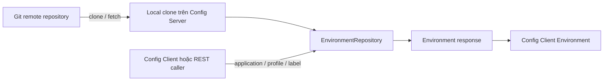
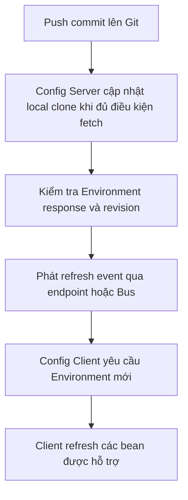

# refresh-rate và đánh đổi giữa độ mới dữ liệu với số lần fetch

Spring Cloud Config Server dùng Git backend thường giữ một bản clone cục bộ của repository cấu hình. Khi client yêu cầu Environment, server đọc cấu hình từ bản clone này và có thể fetch thay đổi mới từ remote Git. Thuộc tính `spring.cloud.config.server.git.refresh-rate` điều khiển khoảng thời gian tối thiểu giữa các lần fetch, giúp cân bằng độ mới của cấu hình với tải mạng và tải lên Git server.

Giá trị mặc định `0` có nghĩa server fetch remote trong mỗi lần yêu cầu cấu hình. Khi đặt một giá trị dương, server chỉ kiểm tra remote khi đã qua khoảng thời gian đó; các yêu cầu đến trong khoảng thời gian chờ có thể dùng bản clone hiện có. Cơ chế này giảm số lần fetch khi Config Client hoặc người vận hành gọi API thường xuyên, nhưng cũng làm một commit mới có thể chưa xuất hiện ngay trong phản hồi.

## Mục tiêu học tập

Sau bài học, bạn có thể:

- Giải thích `refresh-rate` điều khiển việc fetch Git của Config Server.
- Cấu hình `refresh-rate` theo đơn vị giây và hiểu giá trị mặc định.
- Ước lượng tác động của refresh interval đến độ trễ cập nhật và số lần fetch.
- Chọn interval dựa trên yêu cầu freshness, lưu lượng request và năng lực Git server.
- Phân biệt fetch Git ở Config Server với refresh Environment ở Config Client và Spring Cloud Bus.
- Theo dõi revision, kiểm tra thay đổi và xử lý tình huống cấu hình bị cũ.

## 1. Luồng cấu hình qua Git backend

Với Git backend, Config Server không nhất thiết clone repository lại cho mỗi request. Server duy trì working copy cục bộ, cập nhật nó từ remote rồi đọc các tệp phù hợp với application, profile và label.



`refresh-rate` nằm ở bước fetch từ Git remote đến local clone. Nó không quyết định Config Client gọi Config Server khi nào, và cũng không tự phát thông báo đến các instance ứng dụng.

Một request đến Config Server có thể sử dụng bản clone hiện có nếu khoảng thời gian refresh chưa hết. Khi đủ điều kiện fetch, server liên hệ remote để lấy commit mới rồi đọc cấu hình từ working copy được cập nhật. Việc fetch phụ thuộc vào request; đây không phải lịch polling nền chạy đều kể cả khi không có ai yêu cầu cấu hình.

## 2. Thuộc tính spring.cloud.config.server.git.refresh-rate

Khai báo trong cấu hình của chính Config Server:

```yaml
spring:
  cloud:
    config:
      server:
        git:
          uri: https://git.example.internal/platform/config-repo.git
          default-label: main
          clone-on-start: true
          refresh-rate: 30
```

`refresh-rate` là số giây tối thiểu giữa các lần fetch remote của Git backend. Trong ví dụ, Config Server có thể dùng bản clone hiện tại cho các request tiếp theo và chỉ fetch lại khi đã qua khoảng 30 giây kể từ lần fetch trước.

| Giá trị | Hành vi | Đánh đổi |
|---|---|---|
| `0` | Fetch remote trong mỗi request cấu hình | Cấu hình remote được kiểm tra thường xuyên; số lần fetch và độ trễ mạng có thể tăng mạnh. |
| Số dương nhỏ, ví dụ `5` | Cho phép fetch lại sau khoảng ngắn | Cấu hình mới xuất hiện nhanh hơn, đổi lại Git server nhận nhiều lần fetch hơn. |
| Số dương vừa, ví dụ `30` | Giới hạn fetch theo cửa sổ khoảng 30 giây | Giảm tải khi có nhiều request; chấp nhận một khoảng stale ngắn. |
| Số dương lớn, ví dụ `300` | Chỉ fetch lại sau khoảng 5 phút | Giảm tải Git tốt hơn nhưng thay đổi cấu hình có thể đến chậm hơn. |

Đơn vị của thuộc tính là giây. Không nhầm `refresh-rate` với `spring.cloud.config.server.git.timeout`: `timeout` điều khiển thời gian chờ khi kết nối/trao đổi với remote Git theo backend, còn `refresh-rate` điều khiển khoảng cách giữa các lần fetch.

### Giá trị mặc định bằng 0

Khi không khai báo `refresh-rate`, Git backend mặc định dùng giá trị `0`. Điều đó có nghĩa mỗi request đến Git Environment Repository đều có thể kích hoạt fetch remote để kiểm tra cập nhật. Hành vi này đơn giản và phù hợp khi ưu tiên tính mới của cấu hình hoặc lưu lượng thấp.

Ở hệ thống có nhiều client, nhiều replica hoặc các công cụ liên tục gọi Environment API, fetch mỗi request có thể tạo tải không cần thiết lên remote Git. Khi đó, đặt một interval dương giúp gom nhiều request vào cùng một khoảng sử dụng local clone.

## 3. Cửa sổ refresh hoạt động như thế nào?

Giả sử `refresh-rate: 30`. Config Server vừa fetch Git thành công tại thời điểm 10:00:00. Các request đến trong khoảng 30 giây tiếp theo có thể dùng local clone đó. Khi có request sau khi khoảng này đã hết, server mới có cơ hội fetch remote để cập nhật bản clone.

```text
Thời điểm       10:00:00       10:00:10       10:00:25       10:00:32
                  |              |              |              |
Git fetch         FETCH          không           không          FETCH
                  |              |              |              |
Request           R1             R2             R3             R4
Nguồn trả về      clone mới      clone hiện có  clone hiện có  clone sau fetch
```

Sơ đồ minh họa luồng request đều đặn. Nếu không có request sau khi cửa sổ hết hạn, server không nhất thiết fetch đúng tại giây thứ 30; lần fetch tiếp theo thường chỉ diễn ra khi có request phù hợp đến server.

Giả sử commit mới được push lên Git ngay sau lần fetch lúc 10:00:00. Với interval 30 giây và có request đều đặn, commit đó có thể chưa xuất hiện trong phản hồi trước lần fetch tiếp theo. Sau khi cửa sổ hết hạn, request kế tiếp có thể kích hoạt fetch và nhận commit mới. Thời gian hiển thị thực tế còn phụ thuộc thời gian kết nối Git, fetch, xử lý request và lưu lượng truy cập.

## 4. Độ mới dữ liệu và độ trễ cập nhật

Độ mới của cấu hình là khoảng thời gian từ lúc commit được đưa lên remote đến lúc Config Server bắt đầu trả về giá trị từ commit đó. Với refresh interval dương, có thể ước lượng:

\[
T_{visible} \approx T_{wait} + T_{fetch} + T_{process}
\]

Trong đó:

- `T_wait`: thời gian chờ đến khi có request đủ điều kiện kích hoạt fetch tiếp theo.
- `T_fetch`: thời gian Config Server kết nối remote và lấy dữ liệu mới.
- `T_process`: thời gian xử lý repository và tạo Environment response.

Khi request đến liên tục, `T_wait` thường bị giới hạn xấp xỉ bởi `refresh-rate`. Khi request thưa, thời gian có thể dài hơn interval vì server không chạy fetch nền chỉ để kiểm tra thay đổi. Nếu remote Git không truy cập được, lần fetch có thể thất bại và việc cập nhật còn phụ thuộc chính sách lỗi cùng trạng thái local clone.

Vì vậy, `refresh-rate: 30` không phải cam kết rằng mọi commit sẽ xuất hiện trong đúng 30 giây. Nó là khoảng cách tối thiểu giữa các lần fetch theo cơ chế Git backend. Hãy dùng SLO freshness thực tế để chọn giá trị và kiểm thử trong điều kiện mạng của môi trường triển khai.

## 5. Số lần fetch và tải lên Git server

Khi `refresh-rate` bằng `0`, số lần fetch có thể tăng gần với số request cấu hình đến Git backend. Nếu 20 client cùng khởi động lại hoặc liên tục lấy Environment, server có thể phải thực hiện nhiều lần trao đổi với Git remote.

Với interval dương, nhiều request trong cùng cửa sổ có thể dùng chung local clone. Khi một Config Server instance nhận lưu lượng đều và interval là `T` giây, số lần fetch trong một khoảng thời gian dài thường gần mức tối đa một lần mỗi cửa sổ `T`, thay vì một lần cho mỗi request. Đây là ước lượng vận hành; request thưa, nhiều repository, nhiều instance, lỗi fetch và các lần khởi động lại có thể làm số thực tế khác đi.

Ví dụ so sánh với 600 request trong 10 phút đến một Git repository trên một Config Server instance:

| Cấu hình | Hành vi dự kiến | Ý nghĩa |
|---|---|---|
| `refresh-rate: 0` | Có thể gần 600 lần fetch | Độ mới cao nhưng tải Git và chi phí kết nối lớn. |
| `refresh-rate: 30` | Khoảng tối đa 20 cửa sổ fetch trong 10 phút nếu có request ở mỗi cửa sổ | Giảm đáng kể số lần fetch khi lưu lượng đều. |
| `refresh-rate: 300` | Khoảng tối đa 2 cửa sổ fetch trong 10 phút nếu có request ở mỗi cửa sổ | Tải thấp hơn, đổi lại cấu hình có thể cũ lâu hơn. |

Các con số trên là phép tính theo cửa sổ thời gian, không phải benchmark hay cam kết số fetch chính xác của mọi phiên bản. Hãy quan sát log Git backend và metrics của hệ thống để đo thực tế.

### Khi có nhiều Config Server instance

Trong triển khai nhiều replica, mỗi Config Server instance thường có local clone và trạng thái refresh riêng. Nếu có bốn instance, mỗi instance có thể fetch theo interval riêng khi nhận request. Vì vậy, tổng số fetch lên Git remote có thể tăng theo số instance và thời điểm request được phân phối.

Điều này cũng có nghĩa các replica có thể cập nhật local clone ở những thời điểm khác nhau. Ngay sau khi một commit được push, request đến instance A có thể đã kích hoạt fetch trong khi instance B vẫn đang trong cửa sổ refresh. Trong khoảng chuyển tiếp, hai instance có thể trả về revision khác nhau.

Khi cần tính nhất quán vận hành, hãy:

- Chọn interval phù hợp với yêu cầu freshness và số replica.
- Ghi nhận revision Git mà mỗi instance phục vụ.
- Theo dõi lỗi fetch và thời gian fetch theo từng instance.
- Tránh phát hành nhiều thay đổi liên tiếp nhanh hơn khả năng cập nhật của backend.
- Cân nhắc webhook/monitor hoặc một quy trình đồng bộ có kiểm soát nếu cần cập nhật nhanh trên nhiều replica.

## 6. Chọn refresh-rate theo yêu cầu vận hành

Không có một giá trị tối ưu cho mọi hệ thống. Hãy xác định trước mức trễ cấu hình mà ứng dụng có thể chấp nhận.

| Bối cảnh | Cân nhắc | Hướng chọn ban đầu |
|---|---|---|
| Phát triển local | Cần thấy thay đổi nhanh, lưu lượng nhỏ | Có thể giữ `0` hoặc dùng interval ngắn. |
| Kiểm thử tích hợp | Cần kết quả lặp lại và không muốn fetch thừa | Dùng interval ngắn hoặc cố định revision bằng label trong test. |
| Production ít thay đổi | Ưu tiên giảm tải Git, thay đổi có lịch | Dùng interval dài hơn, dựa trên SLO freshness. |
| Production cần cập nhật nhanh | Cấu hình thay đổi thường xuyên và phải lan truyền sớm | Dùng interval ngắn kết hợp cơ chế thông báo/refresh được kiểm soát. |
| Nhiều replica Config Server | Có thể nhân số lần fetch và thời điểm cập nhật khác nhau | Đo tải tổng thể và theo dõi revision trên từng replica. |

Ví dụ, nhóm có thể bắt đầu thử nghiệm với `refresh-rate: 30`, đo số lần fetch, thời gian phản hồi và độ trễ từ Git commit đến Environment API. Sau đó điều chỉnh lên 60 hoặc 120 giây nếu tải Git cao và SLO cho phép; giảm xuống nếu độ trễ cấu hình ảnh hưởng đến quy trình triển khai. Đây là điểm khởi đầu để đo, không phải giá trị mặc định bắt buộc.

## 7. Cấu hình hoàn chỉnh cho Config Server

Ví dụ sau đặt interval 60 giây cho Git backend:

```yaml
server:
  port: 8888

spring:
  application:
    name: config-server
  cloud:
    config:
      server:
        git:
          uri: https://git.example.internal/platform/config-repo.git
          default-label: main
          clone-on-start: true
          refresh-rate: 60
          timeout: 10
```

Các thuộc tính có vai trò khác nhau:

| Thuộc tính | Vai trò |
|---|---|
| `uri` | Địa chỉ Git repository mà server dùng làm backend. |
| `default-label` | Label được chọn khi request không chỉ định label. |
| `clone-on-start` | Yêu cầu clone repository khi Config Server khởi động để phát hiện lỗi truy cập sớm. |
| `refresh-rate` | Khoảng thời gian tối thiểu giữa các lần fetch remote, tính bằng giây. |
| `timeout` | Thời gian chờ kết nối/trao đổi với remote Git theo cấu hình backend. |

Nếu repository private, thông tin xác thực phải được cấp từ secret store hoặc biến môi trường được bảo vệ. Không commit token hay mật khẩu Git vào file cấu hình trong repository.

`clone-on-start` điều khiển việc clone lúc khởi động. Nó không thay thế `refresh-rate`: sau khi clone ban đầu hoàn tất, các lần fetch tiếp theo vẫn tuân theo chính sách refresh của Git backend.

## 8. refresh-rate không phải cơ chế refresh của Client

Trong Spring Cloud Configuration có nhiều bước cập nhật khác nhau. Cần phân biệt rõ:

| Cơ chế | Thành phần | Tác dụng |
|---|---|---|
| Git `refresh-rate` | Config Server Git backend | Quyết định khi nào server fetch remote để cập nhật local clone. |
| Config Client fetch | Config Client | Gửi request lấy Environment từ Config Server, thường lúc khởi động hoặc khi được yêu cầu refresh. |
| `@RefreshScope` / refresh endpoint | Ứng dụng client | Cho phép cập nhật các bean/giá trị được hỗ trợ sau khi Environment được refresh. |
| Spring Cloud Bus | Các client được kết nối Bus | Phân phối sự kiện refresh đến nhiều ứng dụng/instance. |

Ví dụ, Git repository vừa nhận commit mới nhưng Config Server vẫn đang ở trong cửa sổ 60 giây. Nếu client nhận sự kiện Bus và gọi quy trình refresh, client sẽ yêu cầu Environment từ Config Server; tuy nhiên server vẫn có thể trả dữ liệu từ local clone cũ nếu chưa đến lúc fetch tiếp theo. Bus không tự bỏ qua `refresh-rate` và cũng không tự fetch Git remote.

Một luồng cập nhật đầy đủ có thể là:



Sơ đồ cho thấy thứ tự cần bảo đảm khi triển khai: Config Server phải nhìn thấy revision mới trước khi client được yêu cầu tải lại Environment. Trong thực tế, webhook/monitor hoặc pipeline có thể giúp kích hoạt bước cập nhật local clone; Bus phân phối refresh event sau khi server đã phục vụ đúng revision.

## 9. Khi nào cần cập nhật cấu hình nhanh?

Nếu yêu cầu nghiệp vụ cần thay đổi cấu hình xuất hiện nhanh hơn refresh interval, có một số lựa chọn:

1. Giảm `refresh-rate` để Config Server kiểm tra Git thường xuyên hơn.
2. Dùng webhook hoặc monitor endpoint phù hợp với Git provider và phiên bản Spring Cloud để báo cho hệ thống khi repository thay đổi.
3. Dùng pipeline phát hành cấu hình để gọi một quy trình refresh có kiểm soát sau khi commit hoặc tag đã sẵn sàng.
4. Sau khi xác nhận Config Server đã nhận revision mới, dùng refresh endpoint hoặc Spring Cloud Bus để yêu cầu client nạp lại Environment.

Webhook và Bus giải quyết các phần khác nhau. Webhook/monitor giúp Config Server nhận biết thay đổi từ Git; Bus giúp phân phối sự kiện refresh đến client. Cần cấu hình xác thực cho webhook và giới hạn quyền gọi endpoint refresh. Không mở endpoint quản trị công khai để đổi lấy tốc độ cập nhật.

Nếu không có webhook hoặc cơ chế đồng bộ riêng, một cách vận hành đơn giản là chờ qua interval rồi gửi request Environment đến Config Server để kích hoạt lần fetch tiếp theo. Trước khi refresh hàng loạt client, hãy kiểm tra `version` hoặc label trong Environment response để chắc chắn server đã phục vụ revision mong muốn.

## 10. Xử lý lỗi fetch và cấu hình bị cũ

Một số tình huống thường gặp:

| Hiện tượng | Nguyên nhân có thể | Hướng điều tra |
|---|---|---|
| Commit mới chưa xuất hiện | Chưa hết refresh interval hoặc chưa có request kích hoạt fetch | Kiểm tra `refresh-rate`, thời điểm fetch gần nhất và gửi request Environment có kiểm soát. |
| Fetch chậm | Mạng, DNS, TLS, Git server hoặc repository lớn | Đo thời gian kết nối/fetch, kiểm tra `timeout` và dung lượng repository. |
| Fetch thất bại | Token hết hạn, quyền Git bị thu hồi hoặc remote không sẵn sàng | Kiểm tra log server, credentials và quyền đọc repository. |
| Các replica trả revision khác nhau | Local clone của từng instance được fetch ở thời điểm khác nhau | So sánh `version`, log fetch và trạng thái từng replica. |
| Client vẫn dùng giá trị cũ | Server chưa fetch revision mới hoặc client chưa refresh Environment | Kiểm tra lần lượt server response rồi mới refresh client. |

Đừng chỉ dựa vào thời gian commit hoặc việc pipeline báo push thành công. Hãy truy vấn Environment endpoint theo application, profile và label cụ thể, sau đó kiểm tra trường `version` và `propertySources`. Nếu server vẫn trả revision cũ, vấn đề nằm ở quá trình cập nhật backend hoặc chọn label; refresh client thêm lần nữa không giải quyết được nguyên nhân đó.

Nếu Git remote tạm thời không sẵn sàng, Config Server có thể không cập nhật được clone. Chính sách lỗi và khả năng tiếp tục phục vụ bản clone hiện có phụ thuộc trạng thái repository cùng phiên bản triển khai. Hãy xác định rõ ứng dụng có thể chấp nhận cấu hình gần nhất hay phải từ chối khởi động/refresh khi không lấy được revision bắt buộc.

## 11. Quan sát và đo lường

Để chọn interval có cơ sở, cần theo dõi cả tải Git lẫn độ trễ cập nhật:

- Số lần fetch thành công và thất bại theo Config Server instance.
- Thời gian fetch và thời gian phản hồi Environment API.
- Revision Git (`version`) mà mỗi instance đang phục vụ.
- Thời gian từ commit được phát hành đến lúc Environment API trả revision mới.
- Tỷ lệ lỗi khi client khởi động hoặc refresh cấu hình.
- Số request Environment theo application và profile để hiểu tải thực tế.

Trong log, ghi tên application, profile, label và revision ở mức phù hợp. Tránh ghi toàn bộ nội dung `propertySources`, vì chúng có thể chứa URL nội bộ hoặc thông tin bí mật. Metrics nên tổng hợp dữ liệu vận hành, không gắn nhãn bằng giá trị secret hoặc dữ liệu có độ phân mảnh quá cao.

Một thử nghiệm đơn giản để chọn interval:

1. Chạy Config Server với một giá trị refresh-rate ban đầu.
2. Gửi một lượng request Environment đại diện cho tải dự kiến.
3. Push một commit thay đổi thuộc tính thử nghiệm.
4. Ghi lại thời điểm push, lần fetch tiếp theo và thời điểm response thể hiện revision mới.
5. Lặp lại với interval khác và so sánh fetch count, latency, freshness.
6. Chọn giá trị đáp ứng SLO và còn dự phòng khi Git remote chậm hoặc có nhiều replica.

## 12. Thực hành chọn interval cho catalog-service

Giả sử `catalog-service` có 12 instance client và 3 replica Config Server. Các client thường lấy cấu hình lúc khởi động, nhưng đội vận hành cũng có dashboard gọi Environment API định kỳ. Git repository được cập nhật vài lần mỗi ngày.

Nếu giữ `refresh-rate: 0`, các lần khởi động đồng thời và request từ dashboard có thể tạo nhiều fetch đến Git remote. Đặt interval 60 giây sẽ gom các request gần nhau tại mỗi Config Server instance, nhưng ba replica vẫn có lịch fetch riêng và có thể thấy commit mới lệch nhau trong một khoảng ngắn.

Nhóm có thể chọn quy trình:

1. Dùng label phát hành bất biến cho production.
2. Đặt `refresh-rate` 60 giây làm giá trị thử nghiệm ban đầu.
3. Sau khi push commit, gọi Environment API tới từng replica hoặc qua cơ chế quan sát để kiểm tra `version`.
4. Chỉ sau khi các server phục vụ revision mong muốn mới phát sự kiện Bus để refresh các client.
5. Theo dõi trạng thái client và rollback label nếu cấu hình mới gây lỗi.

Nếu yêu cầu freshness là vài giây, interval 60 giây không đáp ứng được; cần giảm interval hoặc triển khai cơ chế webhook/monitor và đồng bộ phù hợp. Nếu cấu hình chỉ thay đổi theo release và có thể chờ vài phút, interval dài hơn có thể giảm tải mà vẫn đáp ứng vận hành.

## 13. Những điểm cần ghi nhớ

- `spring.cloud.config.server.git.refresh-rate` là khoảng tối thiểu giữa các lần fetch Git, đơn vị giây.
- Giá trị mặc định `0` khiến Git backend fetch remote trong mỗi request cấu hình.
- Giá trị dương giảm số lần fetch bằng cách tái sử dụng local clone trong cửa sổ refresh.
- Fetch thường được kích hoạt khi có request sau khi interval hết; đây không phải polling nền chính xác theo lịch.
- Với nhiều Config Server replica, mỗi local clone có thể cập nhật ở thời điểm khác nhau.
- `refresh-rate` ở server khác với refresh Environment ở client và sự kiện Spring Cloud Bus.
- Hãy đo freshness, fetch count, thời gian fetch và revision thực tế trước khi chốt interval production.

Chọn `refresh-rate` là quyết định vận hành giữa độ mới cấu hình và chi phí cập nhật Git. Khi hiểu rõ local clone, request-triggered fetch và refresh ở phía client, nhóm có thể đặt interval phù hợp, kiểm tra revision có chủ đích và phân phối cấu hình nhất quán hơn cho các ứng dụng Spring Boot.
