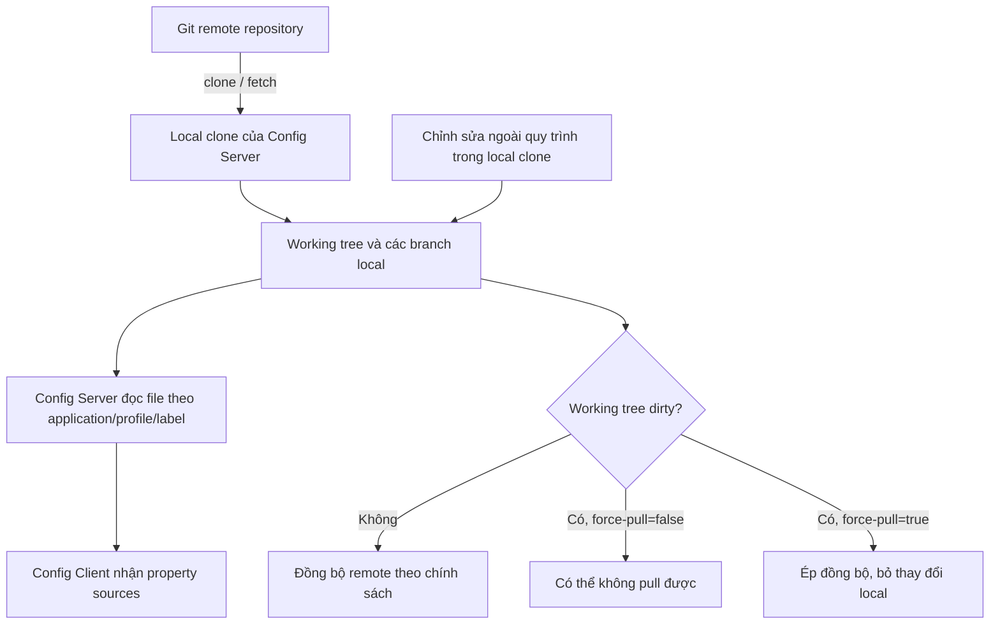

# Xử lý bản sao Git bị thay đổi và tùy chọn `force-pull`

Spring Cloud Config Server sử dụng một bản clone Git cục bộ để đọc các file cấu hình từ repository từ xa. Khi bản clone này bị thay đổi ngoài quy trình của Config Server, trạng thái working tree có thể trở thành *dirty*. Những thay đổi đó có thể khiến thao tác cập nhật từ remote thất bại hoặc làm server không thể lấy được phiên bản cấu hình mong muốn.

Thuộc tính `spring.cloud.config.server.git.force-pull` cho phép Config Server ép bản clone cục bộ đồng bộ lại với repository từ xa khi phát hiện working tree bị thay đổi. Đây là tùy chọn có tác động phá hủy đối với các thay đổi chỉ tồn tại trong bản clone của server: những chỉnh sửa local có thể bị loại bỏ. Vì vậy, cần hiểu rõ nguồn dữ liệu chính, nguyên nhân làm bản clone dirty và phạm vi của tùy chọn trước khi bật.

## Mục tiêu học tập

Sau bài này, bạn có thể:

- Giải thích vai trò của bản clone Git cục bộ trong Config Server.
- Nhận biết trạng thái working tree dirty và các nguyên nhân thường gặp.
- Kiểm tra bản clone, remote, branch và thay đổi local để tìm nguyên nhân.
- Cấu hình `spring.cloud.config.server.git.force-pull` ở cấp Git backend hoặc repository cụ thể.
- Phân biệt `force-pull` với fetch, refresh-rate, pull thủ công và force-push.
- Đánh giá rủi ro, chọn cách phục hồi và xác minh Config Server đang phục vụ đúng commit.

## Config Server làm việc với bản clone Git như thế nào?

Khi cấu hình Git backend, Config Server clone repository từ xa vào một thư mục local. Thư mục này thường được xác định bởi `spring.cloud.config.server.git.basedir`; nếu không cấu hình rõ, server sử dụng vị trí mặc định do framework quản lý. Từ bản clone, server đọc file theo application, profile, label và `search-paths` để tạo phản hồi cho client.



Git remote là nguồn cấu hình được nhóm quản lý và review. Bản clone trên Config Server là bản làm việc/cache để đọc repository. Không nên chỉnh sửa file trực tiếp trong thư mục clone để thay đổi cấu hình; thay đổi cần được commit vào remote theo quy trình quản trị repository.

## Working tree dirty là gì?

Một working tree được xem là dirty khi có thay đổi local chưa được commit hoặc trạng thái file khác với commit đang checkout. Ví dụ:

- Một người vận hành mở file trong thư mục clone và sửa trực tiếp giá trị timeout.
- Một script triển khai ghi file hoặc sinh file vào thư mục repository.
- Một tiến trình khác dùng chung thư mục clone và thay đổi nội dung trong lúc Config Server đang hoạt động.
- Một thao tác kiểm tra hoặc khôi phục trước đó để lại file đã sửa, xóa hoặc thêm chưa được xử lý.
- Quyền file, line ending hoặc công cụ đồng bộ khiến nội dung file bị thay đổi ngoài dự kiến.

Khi Config Server cần cập nhật từ remote, các thay đổi local có thể xung đột với nội dung mới. JGit có thể từ chối pull/checkout vì working tree không sạch. Khi đó, log của Config Server thường cho biết repository local đang có thay đổi hoặc không thể cập nhật nhánh/commit.

Dirty working tree khác với việc remote có commit mới. Remote có thể hoàn toàn bình thường, nhưng bản clone local có trạng thái không phù hợp để đồng bộ. Cũng cần phân biệt branch local không còn tồn tại trên remote với file local bị chỉnh sửa; đây là hai tình huống khác nhau và có thể cần các thiết lập khác nhau.

## Chẩn đoán trước khi bật force-pull

Trước hết, xác định đúng thư mục clone mà Config Server đang dùng. Nếu có cấu hình `basedir`, kiểm tra đúng đường dẫn đó; nếu chạy trong container, thực hiện kiểm tra trong container hoặc volume tương ứng với instance đang lỗi.

Các lệnh Git sau chỉ đọc trạng thái và giúp tìm nguyên nhân:

```bash
git -C /var/lib/config-server/git/platform-config status --short
git -C /var/lib/config-server/git/platform-config status --branch
git -C /var/lib/config-server/git/platform-config diff
git -C /var/lib/config-server/git/platform-config remote -v
git -C /var/lib/config-server/git/platform-config log -5 --oneline --decorate
```

Ý nghĩa:

- `status --short` liệt kê file đã sửa, xóa hoặc chưa được theo dõi.
- `status --branch` cho biết branch hiện tại và trạng thái so với upstream nếu đã thiết lập.
- `diff` cho thấy thay đổi chưa commit trong working tree.
- `remote -v` xác nhận địa chỉ remote mà bản clone đang trỏ tới.
- `log` cho biết commit hiện tại và lịch sử gần nhất.

Không chia sẻ output có thể chứa thông tin nhạy cảm trong URL remote, tên nội bộ hoặc đường dẫn. Nếu credential từng được nhúng trực tiếp trong remote URL, cần chuyển sang cơ chế xác thực an toàn và xử lý credential đó như thông tin có nguy cơ lộ.

Sau khi xác định thay đổi, hãy hỏi: thay đổi local có phải là thay đổi hợp lệ cần giữ lại không? Nếu có, cần lưu lại và đưa thay đổi vào repository nguồn theo quy trình review. Nếu thay đổi chỉ là rác hoặc do thao tác ngoài ý muốn, có thể khôi phục bản clone về trạng thái remote. Không bật force-pull chỉ để che một lỗi chưa được hiểu rõ.

## Cấu hình `spring.cloud.config.server.git.force-pull`

Thuộc tính này được khai báo trong cấu hình Config Server:

```yaml
spring:
  cloud:
    config:
      server:
        git:
          uri: https://git.example.com/platform/config-repo.git
          default-label: main
          basedir: /var/lib/config-server/git/platform-config
          clone-on-start: true
          force-pull: true
```

`force-pull: true` yêu cầu Git backend ép đồng bộ bản clone khi phát hiện thay đổi local làm cản trở thao tác pull. Các chỉnh sửa local không có trong remote có thể bị loại bỏ để bản clone trở lại trạng thái được lấy từ remote. Do đó, chỉ bật khi Git remote thực sự là nguồn dữ liệu chính và mọi thay đổi hợp lệ đều phải được commit lên đó.

Giá trị mặc định của `force-pull` là `false`. Khi để mặc định, Config Server không tự ý loại bỏ thay đổi local; nếu working tree dirty cản trở việc cập nhật, thao tác đồng bộ có thể thất bại và cần người vận hành xử lý.

### Bật cho một repository cụ thể

Nếu Config Server phục vụ nhiều repository, có thể đặt tùy chọn trong cấu hình repository tương ứng dưới `spring.cloud.config.server.git.repos`:

```yaml
spring:
  cloud:
    config:
      server:
        git:
          repos:
            commerce:
              pattern:
                - order-service
                - cart-service
              uri: https://git.example.com/commerce/config.git
              default-label: main
              force-pull: true
            warehouse:
              pattern:
                - inventory-service
              uri: https://git.example.com/warehouse/config.git
              default-label: main
              force-pull: false
```

Trong ví dụ, chính sách được đặt riêng cho từng repository. Cấu trúc thuộc tính và mức độ ưu tiên giữa cấu hình chung với cấu hình repository cụ thể cần được kiểm tra theo phiên bản Spring Cloud Config đang sử dụng. Sau khi thay đổi, xác minh bằng log và API cho từng application để chắc chắn repository được chọn đúng.

Không nên bật force-pull trên toàn bộ repository nếu chỉ một backend gặp vấn đề. Hãy giới hạn phạm vi theo nhu cầu và đánh giá quyền ghi vào thư mục clone của từng instance.

## Force-pull tác động đến đâu?

`force-pull` tác động đến bản clone Git cục bộ mà Config Server quản lý. Nó không phải lệnh gửi lên Git server và không thay đổi lịch sử repository từ xa.

| Hành động | `force-pull` có thực hiện không? |
|---|---|
| Ép bản clone của Config Server đồng bộ khi local working tree dirty | Có, theo cơ chế Git backend của phiên bản đang dùng |
| Commit thay đổi local lên remote | Không |
| Force-push hoặc viết lại lịch sử branch trên remote | Không |
| Thay đổi working tree trong repository của lập trình viên | Không |
| Tự sửa file cấu hình trên Git remote | Không |
| Tự đảm bảo mọi Config Client đã refresh cấu hình | Không |

Điểm cần nhớ là những thay đổi chỉ có trong thư mục clone của Config Server không phải nơi lưu cấu hình bền vững. Nếu có chỉnh sửa hợp lệ ở đó, hãy đưa nó về repository nguồn trước khi bật cơ chế có thể loại bỏ thay đổi local.

## Phân biệt force-pull, refresh-rate và refresh client

Các thuộc tính và thao tác dưới đây giải quyết những vấn đề khác nhau:

| Cơ chế | Vai trò |
|---|---|
| `force-pull` | Xử lý bản clone local dirty khiến Git backend không thể đồng bộ bình thường |
| `refresh-rate` | Điều khiển khoảng thời gian Config Server chờ giữa các lần kiểm tra cập nhật remote; giá trị `0` thường có nghĩa là kiểm tra mỗi lần có yêu cầu, tùy backend/phiên bản |
| `clone-on-start` | Yêu cầu clone repository khi Config Server khởi động để phát hiện lỗi kết nối sớm |
| Client refresh / restart | Làm cho ứng dụng đang chạy lấy hoặc áp dụng cấu hình mới theo cơ chế client hỗ trợ |
| Spring Cloud Bus | Phát thông báo refresh đến nhiều instance khi hệ thống đã tích hợp Bus và broker |

Ví dụ cấu hình có thể khai báo:

```yaml
spring:
  cloud:
    config:
      server:
        git:
          uri: https://git.example.com/platform/config-repo.git
          default-label: main
          refresh-rate: 0
          force-pull: true
```

`refresh-rate` không thay thế `force-pull`: kiểm tra remote thường xuyên không tự giải quyết được working tree dirty. Ngược lại, bật force-pull không có nghĩa Config Server phải fetch remote ở mọi request. Client cũng có thể tiếp tục dùng cấu hình đã nạp trước đó cho đến khi được refresh hoặc khởi động lại theo thiết kế.

## Rủi ro khi bật force-pull

Force-pull có thể làm mất các chỉnh sửa chưa commit trong bản clone. Đây là hành vi phù hợp khi bản clone chỉ là cache có thể tái tạo, nhưng nguy hiểm nếu ai đó dùng thư mục này như nơi chỉnh sửa hoặc lưu dữ liệu khác.

Các rủi ro cần đánh giá:

- **Mất chỉnh sửa local:** thay đổi chưa commit trong clone có thể bị loại bỏ.
- **Che giấu quy trình sai:** script hoặc người vận hành tiếp tục sửa clone; force-pull khiến lỗi quy trình khó được phát hiện.
- **Tác động giữa các instance:** nhiều tiến trình dùng chung một basedir có thể gây xung đột, lock hoặc trạng thái không nhất quán.
- **Khó truy nguyên:** nếu không ghi nhận commit/branch và log đồng bộ, khó xác định instance đã đọc phiên bản nào.
- **Không giải quyết lỗi remote:** sai URI, credential hết hạn, branch không tồn tại, lỗi DNS hoặc TLS vẫn cần xử lý riêng.

Vì vậy, hãy coi clone local là dữ liệu có thể tái tạo, đặt quyền truy cập thư mục phù hợp, không cho job khác sửa và tránh chia sẻ một working directory giữa nhiều instance Config Server độc lập.

## Quy trình phục hồi an toàn

Khi Config Server báo lỗi do repository local dirty, thực hiện theo trình tự:

1. **Xác định instance và basedir:** lấy đúng log, cấu hình `basedir` và thư mục clone của instance bị lỗi.
2. **Kiểm tra trạng thái:** dùng `git status`, `git diff`, `git remote -v` và `git log` để biết file nào bị đổi, branch nào đang checkout và remote nào được dùng.
3. **Bảo toàn thay đổi cần thiết:** nếu có chỉnh sửa hợp lệ, lưu diff hoặc đưa nội dung vào branch làm việc riêng; review rồi commit/push theo quy trình repository. Không dựa vào bản clone của server làm nơi lưu duy nhất.
4. **Khôi phục bản clone:** nếu thay đổi không cần giữ, dùng quy trình vận hành để tái tạo clone hoặc bật `force-pull` trong phạm vi đã đánh giá. Khi thao tác thủ công, dừng instance hoặc cô lập thư mục để tránh server truy cập đồng thời.
5. **Xác minh remote:** kiểm tra URL, quyền đọc, branch/label và khả năng truy cập mạng từ đúng môi trường chạy server.
6. **Khởi động hoặc truy vấn lại:** xác nhận server đồng bộ thành công và API trả về đúng commit cùng property source.
7. **Theo dõi client:** thực hiện refresh/restart theo chính sách để các ứng dụng nhận và áp dụng cấu hình mới.

Nếu cần tái tạo clone thủ công, chỉ thao tác trên thư mục `basedir` đã xác minh của Config Server. Sao lưu hoặc di chuyển thư mục cũ khi cần điều tra, rồi để server clone lại từ remote. Không xóa nhầm repository nguồn, thư mục làm việc của developer hoặc volume dùng chung chứa dữ liệu khác.

## Kiểm thử force-pull trong môi trường thử nghiệm

Trước khi bật ở production, nên kiểm thử bằng một repository và Config Server cô lập:

1. Tạo repository thử nghiệm có một file cấu hình và một branch mặc định.
2. Khởi động Config Server với `basedir` riêng và xác nhận API trả về nội dung ban đầu.
3. Thay đổi file trực tiếp trong bản clone local để tạo working tree dirty; không sửa remote.
4. Tạo commit mới trên remote để mô phỏng thay đổi cấu hình hợp lệ.
5. Với `force-pull: false`, quan sát log và hành vi đồng bộ khi working tree dirty.
6. Bật `force-pull: true`, khởi động lại hoặc kích hoạt lần truy vấn theo cách backend hỗ trợ, rồi xác minh local clone đã đồng bộ theo remote.
7. Kiểm tra API trả về nội dung mới và commit/label mong đợi; xác nhận chỉnh sửa local không còn được phục vụ.

Không dùng repository production để cố tình tạo trạng thái dirty trong quá trình kiểm thử. Bài kiểm thử cần xác nhận cả hành vi mong đợi lẫn nguy cơ mất thay đổi local.

## Giám sát và phòng ngừa trạng thái dirty

Để tránh lặp lại sự cố:

- Cấp quyền ghi vào `basedir` chỉ cho tài khoản chạy Config Server và quản trị viên được ủy quyền.
- Không chạy script sửa nội dung hoặc sinh file trong thư mục clone.
- Dùng basedir riêng cho mỗi instance; tránh nhiều tiến trình cùng thao tác trên một working tree.
- Ghi nhận repository, branch/label, commit và thời điểm fetch khi phù hợp.
- Theo dõi lỗi clone/fetch/pull, thời gian phản hồi API, số lần retry và trạng thái backend Git.
- Dùng secret manager hoặc cơ chế credential an toàn cho HTTPS/SSH; tránh credential trong remote URL hoặc log.
- Quản lý thay đổi bằng pull request, review, kiểm tra YAML và secret scanning trước khi merge.
- Định kỳ kiểm tra chính sách lưu trữ và dọn dẹp clone theo quy trình có kiểm soát.

Nếu remote có commit mới nhưng Config Server vẫn trả cấu hình cũ, hãy kiểm tra label, refresh-rate, commit mà API trả về và chính sách refresh phía client. Đừng mặc định rằng mọi trường hợp cấu hình cũ đều do working tree dirty hoặc cần bật force-pull.

## Kết luận

`spring.cloud.config.server.git.force-pull` giúp Config Server xử lý bản clone local bị dirty bằng cách ép đồng bộ lại với repository Git từ xa. Tùy chọn này phù hợp khi remote là nguồn sự thật duy nhất và bản clone chỉ là cache có thể tái tạo. Nó có thể loại bỏ thay đổi local chưa commit, vì vậy cần chẩn đoán trạng thái repository và bảo toàn nội dung cần thiết trước khi bật.

Hãy kết hợp force-pull với basedir riêng cho từng instance, quyền truy cập thư mục chặt chẽ, quy trình thay đổi qua Git và kiểm tra commit/label sau đồng bộ. Nhớ phân biệt việc Config Server cập nhật bản clone với việc Config Client refresh cấu hình đang chạy; đó là hai bước vận hành riêng.
