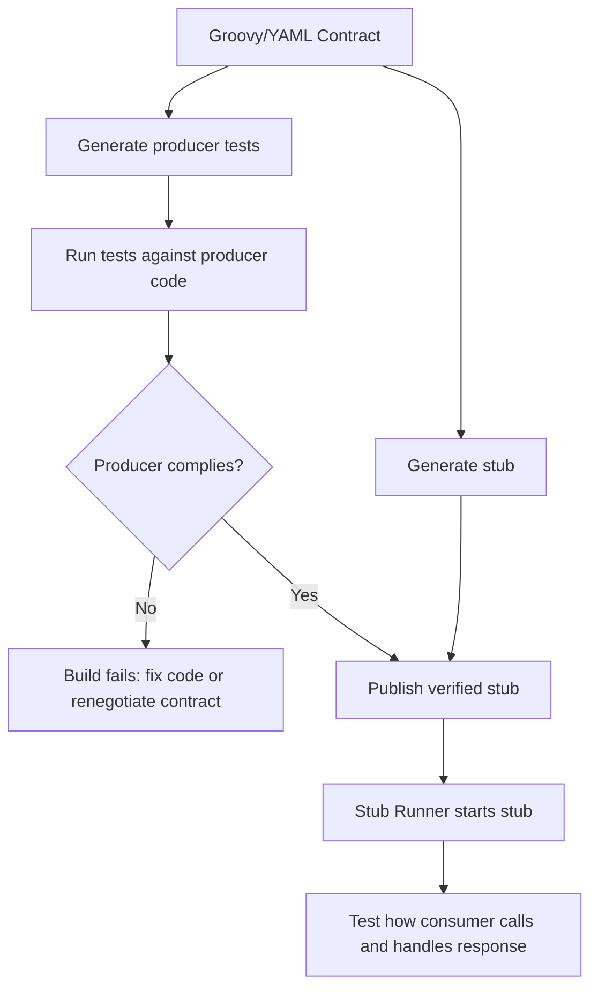

# What Is Contract Testing and Why Is It Needed in a Multi-Service System?

## 1. Context: Services Can Run Fine Individually but Fail When Connected

In a multi-service (microservices) architecture, each service often has its own codebase, development team, and release schedule. Independent deployment helps systems change faster, but raises an important question: **how do you know whether a change in one service will break the service calling it?**

Suppose an e-commerce system has two services:

- **Order Service** (consumer) calls the API of **Payment Service** (producer/provider) to look up payment status.
- Payment Service returns `GET /api/payments/42` with HTTP `200` and JSON `{"id":42,"status":"PAID"}`.
- Order Service reads the `status` field to decide whether the order can move to the shipping step.

One day, the Payment Service team renames the `status` field to `paymentState` without notifying the Order Service team. Unit tests in each service can still pass: Payment Service tests the new response structure; Order Service uses its old mock and still receives `status`. However, when the two services actually communicate, Order Service can no longer find the expected data and behaves incorrectly.

This is an **incompatibility bug at the integration boundary**. It differs from a bug inside a single function: each component may be correct according to its own tests, yet **the agreement between components has been broken**.

## 2. What Is Contract Testing?

**Contract testing** is a way to verify that a provider and a consumer both adhere to a set of expectations documented as an automatically testable contract. A contract describes the communication surface that both sides must agree upon, rather than testing the entire end-to-end business flow.

For HTTP communication, a contract can specify:

| Component | Example of What Needs Agreement |
| --- | --- |
| Request | Method `GET`, path `/api/payments/42`, query parameters, headers, body format |
| Response | Status code `200` or `404`, `Content-Type: application/json` header, JSON structure |
| Data | Numeric `id` field, `status` with a valid value such as `PAID` |
| Error cases | Non-existent payment returns `404` with an agreed error structure |
| Handling rules | For example, `404` means resource not found, not a server error |

For message-based systems (Kafka, RabbitMQ, or similar brokers), a contract can describe the event name, headers, payload, data types, and the message emitted when an input event is processed.

A contract **does not need to describe the entire API**. It should capture only the interactions that matter to the consumer. For example, Order Service only needs `id` and `status`, so those two fields are the core part to protect. If Payment Service adds a `processedAt` field that the consumer can ignore, that change usually should not break tests.

### Difference Between an API Specification and a Tested Contract

API documentation such as OpenAPI helps humans and tools understand an interface, but documentation alone does not prove that the running code conforms to that interface. Contract testing adds the **verification execution step**: when the producer changes, the test suite uses the contract to check the producer's actual responses. A team can also combine OpenAPI with contract testing; the two approaches play complementary roles.

## 3. Producer, Consumer, and Two-Way Expectations

- **Producer (provider):** the service that exposes an API or emits messages; responsible for fulfilling the promised behavior.
- **Consumer:** the service that calls the API or receives messages; holds specific expectations about the data and behavior it receives.
- **Contract:** a description of the interaction that the producer must satisfy for the consumer to work properly.
- **Verified stub:** an executable simulation generated from a verified contract, enabling the consumer to test without starting a real producer.

There are two common collaboration models:

**Consumer-driven contract testing:** The consumer proposes the interactions it actually needs; the producer must verify that it satisfies those contracts. This approach is especially useful when an API has multiple consumers with different needs.

**Producer-defined contract testing:** The producer team manages the specification of the provided interactions and shares the contracts/stubs for consumers to use. This works well when the producer proactively publishes an interface and maintains agreements with consuming teams.

Spring Cloud Contract can support workflows where contracts are maintained alongside the producer or shared across teams. The key point is not where the contract is stored, but that **the producer must be verified against the contract and the consumer must use the stub matching the verified version of the contract**.

## 4. Why Are Unit Tests or End-to-End Tests Alone Not Enough?

| Test Type | What Question Does It Answer? | Key Caveat |
| --- | --- | --- |
| Unit test | Does an individual function/class process logic correctly? | Mocks often reflect the test author's assumptions, which can differ from the real API |
| Contract test | Do two services adhere to the agreed interactions? | Focuses on the boundary and the cases that have been described |
| Integration test | Do specific components work when integrated for real? | May require a database, broker, or supporting infrastructure |
| End-to-end (E2E) test | Does a user flow across the whole system succeed? | Time-consuming, many dependencies, sometimes hard to pinpoint the root cause of failure |

Contract tests **complement** the other testing layers. Because their interaction scope is small, they usually run fast and clearly pinpoint which change broke the interface. E2E tests are still needed to catch issues related to deployment configuration, full business workflows, real authorization, or interactions across multiple services.

Returning to the `status` to `paymentState` example from the introduction: unit tests may miss it; E2E tests may catch it late once the whole system is spun up; producer contract tests can catch it immediately in the Payment Service pipeline if the contract still requires `status`.

## 5. What Role Does Spring Cloud Contract Play?

**Spring Cloud Contract** is a toolkit in the Spring ecosystem that helps define and verify communication contracts between applications. Its core focus is turning interaction descriptions into executable test artifacts:

1. **Define contracts** using Groovy or YAML DSL for HTTP; the tool also supports message-based contracts.
2. **Generate producer-side tests** from the contract. During build/test, these tests verify that the application returns the expected responses.
3. **Generate and package stubs** from the same contract source to simulate the described interactions.
4. **Use Stub Runner on the consumer side** to start the stubs, send requests from the consumer application, and verify how the consumer handles the responses.
5. **Integrate with CI/CD** to run verification before release, distribute versioned stubs, and detect breaking changes.

Overview diagram:



In a Spring application, the generated tests are typically wired to a test base class and test environment configured by the producer team, such as via MockMvc. Therefore, simply adding a DSL file does not automatically test every endpoint: **you must configure the plugin and an appropriate test environment**.

## 6. HTTP Contract Example in Groovy DSL

Continuing the Payment Service example, suppose the consumer needs to look up a completed payment. An illustrative contract can be written as follows:

```groovy
import org.springframework.cloud.contract.spec.Contract

Contract.make {
    description "Look up a completed payment"

    request {
        method GET()
        url "/api/payments/42"
    }

    response {
        status OK()
        headers {
            contentType(applicationJson())
        }
        body(
            id: 42,
            status: "PAID"
        )
    }
}
```

Reading the contract from top to bottom:

1. Send `GET /api/payments/42` to the producer.
2. The producer must return status `200 OK`.
3. The response must be JSON with `id: 42` and `status: "PAID"`.
4. The tool can generate tests to verify the producer and a stub that returns the response described above.

If the producer changes to:

```json
{
  "id": 42,
  "paymentState": "PAID"
}
```

then the response no longer satisfies the contract requiring the `status` field; the producer test will fail. The development team will decide whether to preserve compatibility, introduce a new API version, or coordinate updating the consumer and the contract.

This example intentionally uses fixed values to make the meaning clear. In real-world scenarios, the DSL supports **matchers** and flexible expressions to describe data types, formats, or an acceptable set of values, avoiding forcing every response to have the exact same ID or timestamp. The key is that matchers must be strict enough to catch harmful changes while flexible enough not to lock down arbitrary data.

### Contracts for Error Cases

Happy-path contracts are not enough. Consumers often depend on how the producer handles errors, such as `GET /api/payments/999` returning `404` with error code `PAYMENT_NOT_FOUND`. If Payment Service unexpectedly changes to `200` with an empty body, Order Service's handling logic can change completely.

Therefore, for each important interaction, consider these case categories: success, resource not found, invalid request data, and insufficient permissions. Only add cases relevant to behavior the consumer actually uses.

## 7. Asynchronous Messages Also Have Contracts

In an event-driven system, a producer might publish a message like:

```json
{
  "eventType": "PaymentCompleted",
  "paymentId": 42,
  "orderId": 301,
  "amount": 125000
}
```

Event consumers depend on the event name and the meaning of its fields. If the producer renames `orderId` to `purchaseId` without a compatibility plan, the consumer may still receive the message but fail to map it to an order.

Message contracts help verify the described payload, headers, and emit/receive behavior. However, a message structure contract **does not by itself guarantee** that the broker will not drop messages, that event ordering is preserved, that the system handles duplicate deliveries properly, or that the entire eventually consistent flow completes on time. Those requirements still need appropriate integration tests, reliability tests, or E2E tests.

## 8. Contracts Help Assess Compatibility When an API Changes

Not every API change breaks consumers. You need to evaluate changes against **the expectations that consumers have committed to using**.

| Producer-Side Change | Risk | What the Contract Should Help Detect |
| --- | --- | --- |
| Rename `status` to `paymentState` | High if consumer reads `status` | Required field is no longer returned |
| Change `id` type from number to string | High if consumer maps it to a number | Mismatch with agreed type/format |
| Change `200` to `204` | High if consumer expects a JSON body | Mismatch in status and body |
| Add a new JSON field | Usually low if consumer ignores unknown fields | Should not fail when matchers/consumer allow extensibility |
| Add a new endpoint | Usually does not affect existing endpoints | Existing contracts continue to pass |
| Change the meaning of `PAID` while keeping the same string | High business risk | Only detected if that meaning/rule is explicitly tested |

**Compatibility depends on how the consumer uses the API.** A change labeled "non-breaking" in documentation can still break a consumer whose deserializer is overly strict, such as rejecting any unknown JSON fields. Teams should agree on both data extensibility policies and expectations for required fields.

When a breaking change is needed, the team can roll it out using an expand-and-contract approach: add the new behavior while keeping the old behavior, update and deploy the consumer, and only then remove the old behavior. Releasing a new API version is also an option depending on the system's versioning policy.

## 9. Producer Testing, Consumer Stubs, and Practical CI Flow

A workflow for adopting Spring Cloud Contract might look like this:

**Step 1 — Both sides agree on the interaction.** The consumer states the need for `GET /api/payments/{id}` and a response containing `id` and `status`; the producer confirms it can provide them. Important error cases are also recorded as contracts.

**Step 2 — Put contracts into the source repository.** Contracts are stored using Groovy or YAML DSL, versioned, and reviewed like source code. Repository layout may vary; you must ensure both sides know which contract is being used.

**Step 3 — Producer runs auto-generated tests.** The Spring Cloud Contract plugin generates tests from the contract. Payment Service's pipeline runs them against new code; the build fails if the endpoint no longer returns the committed result.

**Step 4 — Producer publishes verified stubs.** Once tests pass, the build packages and publishes the stub artifact to an internal artifact repository. Stubs are data used for consumer tests and do not replace the real application in production.

**Step 5 — Consumer tests via Stub Runner.** Order Service starts the corresponding stub, makes HTTP calls using its own client code, and verifies that response-handling logic works properly. As a result, consumer tests do not need a live Payment Service instance.

**Step 6 — CI protects upgrades.** When the producer changes the API or the consumer updates a dependency version, the pipeline runs the relevant tests. If a new contract is incompatible, the team receives feedback before deployment. For systems with multiple consumers, verify the relevant contracts before removing old behavior.

An illustrative Stub Runner configuration example in a consumer test:

```java
@SpringBootTest
@AutoConfigureStubRunner(
    ids = "com.example:payment-service:1.2.0:stubs:8085",
    stubsMode = StubRunnerProperties.StubsMode.LOCAL
)
class PaymentClientContractTest {
    // Call PaymentClient against the stub at localhost:8085,
    // then verify that Order Service handles the PAID status correctly.
}
```

`ids` identifies the stub artifact and the port used to run it; `LOCAL` is suitable when the artifact is already in the local Maven repository. In CI, the team can configure downloading stubs from a remote artifact repository and pinning a specific version. The example code omits imports, client configuration, and assertions to highlight the role of Stub Runner; a real project needs to configure those components.

### Things to Watch Out for When Designing the Pipeline

- **Only publish stubs after producer verification succeeds.** A stub built from an unverified contract may answer "correctly" in consumer tests even when the real producer does not satisfy it.
- **Version contracts and stubs.** Consumer tests need to know which version they are testing; using an outdated stub can create a false sense of security.
- **Run tests on the right side.** Producer tests prove the producer complies with the contract; consumer tests prove the consumer works with the stub's responses. One side passing does not mean the other side has passed.
- **Include contract changes in code review.** Updating both the contract and the implementation at the same time is not enough to conclude compatibility with consumers that have not upgraded yet.
- **Keep some real integration tests.** Contract tests cannot verify every difference in networking, TLS, brokers, databases, runtime configuration, or cross-service business chains.

## 10. When Should You Use It and What Misconceptions Should You Avoid?

Contract testing is especially valuable when a system has many shared APIs/events, teams release independently, and incompatibility bugs tend to surface late. It fits APIs that are functionally stable while frequently evolving in version or data extensions.

Some misconceptions to avoid:

1. **"With contract tests, we don't need E2E."** False: contract tests protect defined interactions, while E2E tests verify business journeys and the broader integration environment.
2. **"Stub tests passing means the producer works."** Not enough: there must be corresponding producer verification, and the stub must be built from the verified version.
3. **"Contracts must freeze every byte of JSON."** Unnecessary: focus on fields and constraints the consumer uses; appropriate matchers help reduce test failures caused by unimportant data.
4. **"It automatically catches every wrong business change."** Impossible: if both schema and status code stay the same while the meaning changes, a contract can only catch it when a test condition explicitly describes that meaning.
5. **"Only testing the happy path is enough."** Insufficient for consumers that depend on `400`, `401`, `404`, timeouts, or business states; clearly determine which cases should be expressed in contracts and which should be tested by other mechanisms.

## 11. How to Apply It to an Operating System

Start with an integration boundary that changes frequently or has had past failures:

1. Pick one consumer and one producer; list the endpoints/events that the consumer actually uses.
2. Record the requests, responses, status codes, headers, and required data fields; add the error scenarios that the consumer handles.
3. Encode the interactions into Groovy/YAML contracts and set up auto-generated tests on the producer.
4. Build stubs from the verified contracts and run consumer tests using Stub Runner.
5. Add both test suites to CI; manage stub versioning and a contract change review process.
6. When an API change occurs, review test results to decide whether to preserve compatibility, expand the contract, or coordinate consumer upgrades.

**Conclusion:** Contract testing turns implicit expectations between services into verifiable conditions during development. With Spring Cloud Contract, the same Groovy/YAML description can verify the producer and provide stubs for the consumer. Its greatest value is catching breaking changes early while teams continue developing and deploying services independently.
