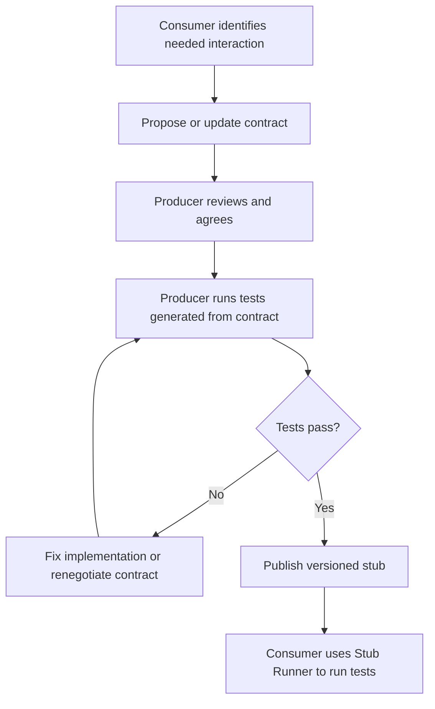

# Consumer-Driven Contracts and Producer-Driven Contracts

## 1. Why Distinguish Between the Two Approaches?

In a microservices architecture, a **consumer** service calls an HTTP API or receives messages provided by a **producer** service. Two teams can deploy and release independently, yet a small change in the producer can still break the consumer: renaming a JSON field, dropping a status code, changing a date/time format, or altering an event structure.

**Contract testing** verifies the interactions that both sides have agreed upon. With Spring Cloud Contract, contracts can be described using **Groovy DSL or YAML DSL**; the tool can generate tests to verify the producer and produce **stubs** for the consumer to test without running the real producer.

There are two ways to organize contract authoring:

- **Consumer-driven contract (CDC):** the consumer's actual needs are the starting point; the consumer participates in proposing the interactions it needs, and the producer reviews and satisfies them.
- **Producer-driven contract (PDC), also called provider contract testing in many docs:** the producer proactively defines and publishes the interactions it commits to supporting; consumers integrate against the published contract.

The core difference is **who drives defining the commitments and how the two teams agree on changes**, not the file format or testing tool. Both can use Spring Cloud Contract, store contracts in the producer's repository, and share the same test/stub generation workflow.

After this lesson, you should be able to distinguish each side's role, read a basic HTTP contract, visualize the test/stub flow in CI, and choose a fitting strategy for a multi-service system.

## 2. Foundational Concepts

Suppose `checkout-service` needs to know whether a product is in stock before creating an order. It calls `inventory-service`:

```http
GET /api/products/SKU-123/availability HTTP/1.1
Accept: application/json
```

The producer returns:

```http
HTTP/1.1 200 OK
Content-Type: application/json

{"sku":"SKU-123","available":true}
```

In this example:

| Concept | Role |
| --- | --- |
| **Consumer** | `checkout-service`, the party that needs the inventory check result to decide whether to allow ordering. |
| **Producer / provider** | `inventory-service`, the party that implements the endpoint and returns the data. |
| **Contract** | Commitment regarding the request, response, or message: method, URL, headers, status, data fields, and matching conditions. |
| **Producer verification** | Tests run on the producer application to confirm that the actual implementation satisfies the contract. |
| **Stub** | Simulation of producer behavior per the contract, such as returning sample JSON when a matching request arrives. |
| **Stub Runner** | Component that fetches and runs stubs so consumer tests can call a simulated version of the producer. |

A contract is not a specification of every capability of an API. It typically records **representative, critical, or incompatibility-prone interactions**. Contract tests also do not replace unit tests, full-system integration tests, security testing, or performance testing.

## 3. Consumer-Driven Contract (CDC)

### 3.1. Who Decides Contract Content?

In CDC, **the consumer states observable needs**. For example, the Checkout team says: "To proceed with checkout, we need `GET /api/products/{sku}/availability` to return a boolean `available` when the product exists." The Inventory team reviews the request, negotiates error cases, and agrees to the contract.

Characteristics of CDC:

1. The consumer defines the requests and responses that its code genuinely relies on.
2. The producer has the right to push back or negotiate; CDC does **not** mean the consumer unilaterally forces the producer to support every demand.
3. Agreed contracts are used to generate tests for the producer and stubs for the consumer.
4. When the producer changes the API, maintained contracts help detect behavior that breaks committed needs.

### 3.2. A Typical CDC Development Cycle



Example: Checkout submits a pull request adding the `available` field. Inventory reviews the contract, implements the API, runs producer tests, and publishes the stub. Checkout downloads the stub in CI and runs ordering scenarios through `InventoryClient`.

**Where the contract is stored does not determine whether it is CDC.** A contract can live directly in the producer's repository (with the consumer opening a pull request there) or in a standalone contracts repository. What decides it is that the consumer plays an essential role in proposing and confirming the commitment.

### 3.3. When Is CDC Beneficial?

CDC is especially useful when a set of internal consumer teams can collaborate directly with the producer, each consumer only needs part of the API, and the system wants to protect known usage needs. If a producer serves multiple consumers, each team can contribute contracts for the interactions it depends on.

However, CDC requires coordination: the producer needs to manage conflicting requests, contract lifecycles, and cases where a consumer stops using an API. Not every example in a contract should be treated as an eternal immutable promise; contracts must be governed alongside compatibility and API deprecation policies.

## 4. Producer-Driven Contract (PDC)

### 4.1. Producer Publishes Commitments First

With PDC, the Inventory team designs and defines endpoints, payloads, and error rules based on its product capabilities. The team publishes contracts/stubs as part of a service release. Checkout reads the contract, implements its client, and runs integration tests against the published stub.

Typical flow:

1. The producer designs the API or message and determines what behavior it will support.
2. The producer writes contracts (for instance, in Spring Cloud Contract's Groovy/YAML DSL), runs auto-generated tests, and publishes stubs.
3. The consumer selects the appropriate contract/stub version, implements its client, and verifies via Stub Runner.
4. When the producer publishes changes, the consumer checks impact and updates according to agreed versioning, announcement, or deprecation procedures.

PDC is a better fit when the producer owns a public API, has very many consumers, serves external partners, or when negotiating individual contracts is impractical. The producer may also need API documentation, a versioning policy, and feedback channels to know which behaviors consumers actually rely on.

**Important limitation:** tests generated from contracts written solely by the producer only prove the producer implements the **written commitment**. If the producer removes a field that a consumer actually uses but that is not captured in the contract, producer tests can stay green while the consumer fails. Therefore, PDC must be combined with consumer-side testing and compatibility management for the published API.

## 5. Comparing CDC and PDC

| Criterion | Consumer-Driven Contract | Producer-Driven Contract |
| --- | --- | --- |
| Starting point | Concrete integration needs of the consumer. | API commitments and design published by the producer. |
| Change initiator | Usually the consumer when needing a new interaction or behavior change. | Usually the producer when designing or releasing an API. |
| Other side's role | Producer reviews, agrees, and implements. | Consumer adopts, gives feedback, and tests integration. |
| Natural coverage | Focuses on behaviors consumers have stated. | Focuses on behaviors the producer decides to provide. |
| Strength | Catches changes that break explicitly recorded consumer needs. | Centralized commitment management, convenient when there are many independent consumers. |
| Risk | Duplicate/conflicting requests or lack of ownership. | Lacks real-usage perspective without consumer feedback. |
| Best fit | Internal service teams collaborating frequently. | Public APIs, shared platforms, large ecosystems. |

The two approaches are **not mutually exclusive**. A producer can publish a baseline set of contracts while accepting additional contracts proposed by internal consumers. What needs to be clear is who owns reviewing, maintaining, and announcing changes.

## 6. Applying with Spring Cloud Contract

Spring Cloud Contract supports defining HTTP and messaging behavior, generating producer verification tests, creating stubs, and running stubs on the consumer side. **The exact same contract content can be used in CDC or PDC**; team organization and the review process determine what you call the strategy.

### 6.1. Defining an HTTP Contract in YAML DSL

Example file `product_available.yml` in the contracts directory of `inventory-service`:

```yaml
description: Return availability status for a product SKU
name: product_available
request:
  method: GET
  url: /api/products/SKU-123/availability
response:
  status: 200
  headers:
    Content-Type: application/json
  body:
    sku: SKU-123
    available: true
```

The contract above specifies: upon receiving `GET` at that exact path, the producer must return status `200` with JSON containing `sku` and `available`. The stub generated from the contract can return that sample response to the consumer.

This is only a single **happy-path** case. Real contracts should add behaviors meaningful to the consumer, such as `404` when the SKU does not exist, but only if the producer truly commits to those behaviors.

### 6.2. The Same Behavior in Groovy DSL

```groovy
import org.springframework.cloud.contract.spec.Contract

Contract.make {
    name 'product_available'
    description 'Return availability status for a product SKU'

    request {
        method 'GET'
        url '/api/products/SKU-123/availability'
    }

    response {
        status 200
        headers {
            contentType(applicationJson())
        }
        body([
            sku: 'SKU-123',
            available: true
        ])
    }
}
```

The YAML and Groovy snippets illustrate **two representations of the same contract**. In a project, pick one as the source of truth for that scenario; there is no need to keep both as duplicate contracts. Groovy DSL offers more complex matchers and expressive power; YAML DSL is convenient when you want an easy-to-read declarative structure.

Do not confuse an example value like `SKU-123` with the entire valid input domain. For multiple product SKUs, you can use matchers/regular expressions to generalize the request and supply concrete sample values when generating stubs. Matchers should be tight enough to avoid turning a stub into a mock that accepts any request.

### 6.3. What Does the Producer Verify?

In a typical configuration, Spring Cloud Contract Verifier reads contracts (usually under `src/test/resources/contracts`, unless configured otherwise) and generates tests. The test suite calls endpoints or checks messages according to the producer's test configuration and compares actual responses against contract expectations.

With the example above, the generated test verifies that `inventory-service` can handle `GET /api/products/SKU-123/availability` and return the matching response. If the implementation renames `available` to `inStock` while the contract still requires `available`, verification must fail and the producer's pipeline should block the release.

The producer needs to configure the Spring Cloud Contract plugin, test dependencies, and a **base test class** matching how the application boots. Exact Maven/Gradle declarations and test modes depend on the project's Spring Boot / Spring Cloud Contract versions; do not blindly copy versions from another article.

### 6.4. What Does the Consumer Verify with Stub Runner?

After the producer builds and publishes the stub artifact (usually a JAR with the `stubs` classifier), the consumer can download it from the local Maven repository or an artifact repository. Spring Cloud Contract Stub Runner starts an HTTP stub server (typically backed by WireMock) and serves responses per the contract.

Illustrative test example for `checkout-service` (assuming `CheckoutService`, `inventory.base-url` configuration, and required test dependencies are already present):

```java
@SpringBootTest(properties = "inventory.base-url=http://localhost:6565")
@AutoConfigureStubRunner(
    ids = "com.example:inventory-service:+:stubs:6565",
    stubsMode = StubRunnerProperties.StubsMode.LOCAL
)
class CheckoutContractTest {

    @Autowired
    CheckoutService checkoutService;

    @Test
    void allowsCheckoutWhenProductIsAvailable() {
        assertThat(checkoutService.canOrder("SKU-123")).isTrue();
    }
}
```

This is an illustrative snippet, not a standalone runnable test class: the project must have the corresponding imports and beans; `CheckoutService` must actually invoke the inventory client pointed at the stub. Depending on the download source, stub mode is `LOCAL` or `REMOTE`; in real CI, use a **pinned stub version** so results are reproducible, rather than arbitrarily choosing `+` as in the short example above.

Note: a test that only calls the stub URL directly and checks `200` verifies that the stub works, but does not prove the consumer's business code handles the response properly. A test is far more valuable when it exercises the **consumer's real client and logic**.

### 6.5. Contracts for Messaging

In systems using Kafka, RabbitMQ, or another event infrastructure, the consumer may be the service **receiving events** while the producer is the service **emitting events**. The contract describes committed characteristics such as message destination/trigger, headers, payload, field types, and expected values. The CDC vs. PDC distinction remains the same as for HTTP: either the consumer proactively states event-processing needs, or the producer proactively publishes the event schema/emitting behavior.

Example: `checkout-service` needs an `InventoryReserved` event containing `orderId`, `sku`, and `quantity`. If the producer drops `orderId` while the contract still requires it, producer verification must detect the incompatibility. Generating/testing messaging stubs also depends on Spring Cloud Contract configuration and the project's messaging integration; you cannot assume an HTTP WireMock stub fully simulates Kafka/RabbitMQ.

## 7. Integrating Contract Testing into CI/CD

A sound pipeline ensures both sides use **the same approved contract definition**:

| Step | Required Control |
| --- | --- |
| 1. Propose | Consumer proposes or producer publishes the contract; review semantics, requests, responses, and error cases. |
| 2. Producer verification | Generate tests from contracts and run against producer code; test failures must fail the pipeline. |
| 3. Publish | Package and store stubs/contracts with the producer's version for traceability. |
| 4. Consumer testing | Stub Runner fetches the exact artifact and runs tests through the consumer's real client. |
| 5. Compatibility assessment | When changing a contract, run checks for affected consumers, announce deprecations, or bump versions per convention. |

In CDC, the proposal step usually starts with a consumer pull request; in PDC, it usually starts on a producer development branch. Producer verification and stub consumption steps can remain identical. Avoid publishing a stub as an "implemented" commitment before producer verification passes: Spring Cloud Contract has a mechanism to mark a contract **in progress** to generate stubs without generating producer tests, but such stubs are only suitable when both teams understand their temporary nature.

## 8. When the API Changes: How Is Compatibility Decided?

Consider a consumer using the JSON `{"sku":"SKU-123","available":true}`:

| Change from Producer | Risk to Consumer | How to Handle |
| --- | --- | --- |
| Add optional field `warehouse` | Usually compatible if consumer ignores unknown fields. | Add to contract if a new consumer needs it; check the parser. |
| Rename `available` to `inStock` | Consumer looking for `available` may stop working. | Keep the old field during a transition window or release a new API version. |
| Change `available: true` to `available: "yes"` | Data type change, risking deserialization/logic errors. | Preserve boolean or negotiate contract and bump version. |
| Change out-of-stock status from `200` to `404` | Consumer may enter error handling instead of out-of-stock handling. | Re-align on status code semantics and add a test for this scenario. |
| Delete an unused endpoint | Safe **only when** no consumer actually depends on it anymore. | Check real traffic usage, maintained contracts, and deprecation policy. |

"Backward compatible" must always be evaluated with respect to **supported clients, parsers, and behaviors**; it cannot be concluded solely from the producer passing a new contract on its own. If a consumer uses a field not yet described in the contract, the tool cannot infer that dependency automatically.

A pragmatic governance practice is to document contract owners, active consumers, support status, change notification schedules, and old-version acceptance policies. With multiple consumers, you can organize contracts per consumer and use Stub Runner's *stubs per consumer* mode when you need to run only the relevant stubs.

## 9. Common Misconceptions

1. **"If the contract lives in the producer repo, it must be PDC."** False: the consumer can propose contracts via pull requests to the producer repo; that is still CDC.
2. **"CDC means the consumer owns the API implementation."** False: the producer owns the implementation; the consumer only states and confirms collaboration needs.
3. **"Green producer tests mean every consumer is definitely safe."** False: only behaviors covered by contracts are verified; consumer testing and compatibility controls are still needed.
4. **"Stubs behave identically to production."** False: stubs represent only the described cases and do not inherently reflect real timeouts, data, security, latency, or distributed behavior.
5. **"Every case must hard-code a single exact value."** False: matchers help describe classes of valid inputs/outputs; however, overly broad matchers can hide bugs.
6. **"Just changing the contract file is enough."** False: it must be reviewed with stakeholders, producer implementation updated, stubs published, and consumer tests run in CI.

## 10. Scenario Exercise

A system has `payment-service` providing an HTTP API to `checkout-service` and `subscription-service`. Checkout needs `paymentId` when creating a payment; Subscription needs payment status and an error code when renewal fails.

**Tasks:**

1. If the two consumers belong to the same organization and can collaborate directly, try the CDC approach: each team describes the requests/responses it truly needs, reviews the contracts together with Payment, and creates producer tests.
2. If Payment is a public platform serving hundreds of partners, try PDC: Payment publishes contracts and versioning conventions; consumers run tests using stubs and report gaps in the contracts.
3. Suppose Payment renames `paymentId` to `id`. Identify which party is affected, which contracts must be reviewed, which tests must fail, and a compatible migration plan.

**Self-check hints:** A solid answer should identify who initiates the contract, who approves it, which tests run on the producer, which tests run on the consumer, and which version the stub comes from. Simply saying "CDC is better than PDC" or vice versa is not enough: the decision depends on collaboration level, number of consumers, and API governance policy.

## 11. Key Takeaways

- **Consumer-driven contract:** starts from the consumer's real usage needs and is agreed upon by the producer.
- **Producer-driven contract:** starts from commitments defined and published by the producer for consumers to integrate against.
- **Spring Cloud Contract:** turns HTTP/messaging contracts into producer verification and stubs; **Stub Runner** lets consumers test against published stubs.
- **Reliable CI:** review contracts, run producer tests, publish versioned stubs, run consumer tests, and assess impact when APIs change.

### References

- [Spring Cloud Contract — Documentation Overview](https://docs.spring.io/spring-cloud-contract/reference/documentation-overview.html): definitions of provider contract testing and consumer-driven contract testing.
- [Spring Cloud Contract — Developing Your First Application](https://docs.spring.io/spring-cloud-contract/reference/getting-started/first-application.html): Groovy/YAML examples and test/stub generation flow.
- [Spring Cloud Contract — Stub Runner Core](https://docs.spring.io/spring-cloud-contract/reference/project-features-stubrunner/stub-runner-core.html): downloading and running HTTP/messaging stubs.
- [Spring Cloud Contract — Stubs Per Consumer](https://docs.spring.io/spring-cloud-contract/reference/project-features-stubrunner/stub-runner-stubs-per-consumer.html): grouping stubs by consumer.
