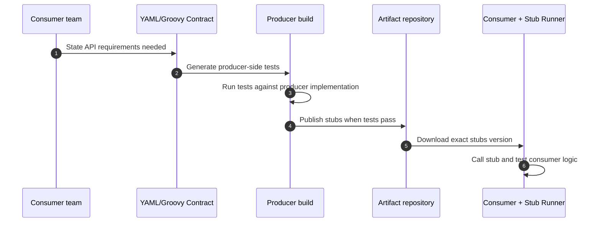

# Distinguishing Contract Tests, Unit Tests, Integration Tests, and End-to-End Tests

> **Chapter:** Overview  
> **Scope:** Spring Cloud Contract (`SPRING_CLOUD_CONTRACT`) — contract testing between a providing service (*producer*) and a consuming service (*consumer*).

## Learning Objectives

After this lesson, you can:

- Distinguish the **four test types** by the question they answer, execution scope, and types of bugs they catch.
- Explain why passing unit tests or integration tests can still miss two services interpreting an API differently.
- Describe how **Spring Cloud Contract** uses Groovy/YAML DSL to define HTTP or message contracts, generate producer-side tests, package stubs, and run stubs on the consumer side.
- Choose the right test suite when an API changes, and design CI quality gates to detect breaking changes.

## 1. Context: One API, Multiple Types of Risk

Suppose an e-commerce system has two services:

- **`checkout-service` (consumer):** decides whether to allow placing an order.
- **`inventory-service` (producer):** provides inventory availability information.

`checkout-service` calls:

```http
GET /api/stock/SKU-001 HTTP/1.1
Host: inventory-service
Accept: application/json
```

The producer returns:

```http
HTTP/1.1 200 OK
Content-Type: application/json

{
  "sku": "SKU-001",
  "available": true,
  "quantity": 4
}
```

The consumer needs at least two things to handle this correctly: `available` is a **boolean**, and `quantity` is an **integer**. If the producer accidentally changes `available` to the string `"yes"`, both services may still compile and pass their individual unit tests, yet when they actually communicate, the consumer may fail deserialization or make the wrong decision.

The four test types approach this risk from different angles:

1. **Unit test:** is the logic inside a single unit of code correct?
2. **Integration test:** do the wired-together components work properly?
3. **Contract test:** do the producer and consumer adhere to the **same communication agreement**?
4. **End-to-end (E2E) test:** does a complete business journey succeed from start to finish?

These are four **testing purposes**; they are not always four technically separate layers. For instance, consumer tests running with Stub Runner are often also integration tests, yet their specific purpose is to confirm communication against the producer's contract.

## 2. High-Level Comparison

| Criterion | Unit Test | Integration Test | Contract Test | End-to-End Test |
| --- | --- | --- | --- | --- |
| **Primary question** | Does a function/class compute correctly? | Do the connected components work properly together? | Do both sides agree on how data is sent/received? | Does a real business flow succeed? |
| **Target** | Functions, classes, small logic | Controller, service, repository, DB, HTTP client, or a group of modules | HTTP API or message boundary between producer and consumer | UI, gateway, multiple services, DBs, queues, and infrastructure needed for the scenario |
| **Dependencies** | Usually uses mocks/fakes | Uses some real components, may replace others with test doubles | Producer tests real API behavior within test scope; consumer uses stubs generated from contracts | Prefers integrating real components in a test environment |
| **Best at catching** | Wrong algorithms, conditional branches, local rules | Misconfiguration, mapping, serialization, queries, wiring | Wrong method/path/status/headers/body, field/data types, committed message structure | System-wide coordination issues, deployment config, user flow navigation |
| **Typical cost** | Low, fast | Medium, depends on infrastructure | Usually lower than E2E; adds contract/stub governance overhead | Higher, slower, and more sensitive to environment state |
| **Limitations** | Does not prove two services' APIs are compatible | A test only proves the integrations that actually participate in it | Does not prove full business logic, availability, or production configuration | Hard to pinpoint root cause; hard to cover all combinations |

**Do not treat the table as an absolute speed ranking.** A contract test booting a full application can be heavier than a lightweight integration test; a streamlined E2E test can run faster than an integration test spinning up heavy infrastructure. The deciding factor is **execution scope**.

## 3. Unit Test: Verifying Logic Within a Unit of Code

For example, `CheckoutService` relies on an `InventoryClient` to query stock, then applies the rule: only allow purchase if `available = true` and stock quantity is sufficient.

```java
// Illustrates JUnit 5 + Mockito; business classes are assumed to exist.
@Test
void choPhepMuaKhiDuHang() {
    InventoryClient inventory = mock(InventoryClient.class);
    when(inventory.getStock("SKU-001"))
        .thenReturn(new Stock("SKU-001", true, 4));

    CheckoutService checkout = new CheckoutService(inventory);

    assertTrue(checkout.canCheckout("SKU-001", 2));
}
```

This test is very useful: it is fast, makes the rule explicit, and when it fails the cause is easy to find. However, the `Stock` object is fabricated by the test; there is no HTTP request or JSON from `inventory-service`. If the producer renames `quantity` to `stockCount`, the test above can still pass.

**Use unit tests when:** testing calculations, validation, conditional branches, exceptions, state transitions, and rules that can be checked in isolation.

**Do not infer from unit tests:** that the remote endpoint exists, that JSON types match, or that networking works.

## 4. Integration Test: Verifying Wired Components

Integration tests verify real interactions among the components brought into the test scope. For example:

- Calling an endpoint via Spring MVC to check request mapping, validation, and JSON serialization.
- Calling a repository against a test database (possibly via Testcontainers) to verify queries and transactions.
- Testing an HTTP client calling a mock server or stub server to confirm request/response handling.

An example in `inventory-service` using `MockMvc` to test an endpoint (assuming the application and test data are configured):

```java
// Illustrative excerpt inside a @SpringBootTest + @AutoConfigureMockMvc.
@Autowired
MockMvc mvc;

@Test
void traVeTonKhoDungDinhDang() throws Exception {
    mvc.perform(get("/api/stock/SKU-001"))
       .andExpect(status().isOk())
       .andExpect(jsonPath("$.available").value(true))
       .andExpect(jsonPath("$.quantity").value(4));
}
```

This test catches serialization or routing mistakes inside `inventory-service`. However, **whether it checks what the consumer actually needs depends on the assertions written by the producer team**. If the producer intentionally updates both the implementation and the assertion to `stockCount`, their integration test can keep passing while the consumer has not yet updated.

Also distinguish: a test that only loads the web slice via `@WebMvcTest` tests integration within the **web slice**, and does not prove connectivity to a real DB. Labeling every test with a Spring context as a "full-system integration test" easily leads to overestimating coverage.

**Use integration tests when:** verifying wiring, Spring configuration, serialization, DB/broker connectivity, or HTTP client behavior within a defined integration scope.

## 5. Contract Test: Verifying Promises at the Service Boundary

A **contract** is a verifiable agreement on how two systems communicate. For HTTP, it can describe:

- Request: method, URL, query params, path variables, headers, body, and matching rules.
- Response: status, headers, body, required fields, values, or data types.
- Representative cases: success, invalid input, not found, and different business states.

For asynchronous communication, a contract can describe **message destinations, headers, payloads, input/output events, or triggers**. It does not require all microservices to start at the same time.

In Spring Cloud Contract, contracts can be written in **Groovy DSL or YAML DSL**. The tool coordinates two mechanisms:

- **Producer-side contract verification:** from the contract, the plugin generates tests to verify that the producer's HTTP/message implementation satisfies the defined agreement.
- **Consumer-side stub testing:** from the same contract source, stubs are generated for consumer tests; **Stub Runner** downloads and starts the stubs (for HTTP, typically backed by WireMock), and the consumer sends requests to the stub as if calling a dependent service.

This prevents situations where the consumer mocks `available = true` while the real producer returns `"yes"`. Stubs are generated from the agreed source, and the producer must pass the corresponding verification before published stubs are considered verified.

### 5.1. YAML DSL Example for an HTTP Contract

Suppose the contract is saved at `src/test/resources/contracts/stock_available.yml` **in the producer project**:

```yaml
description: "Sufficient stock for checkout"
name: stock_available_for_checkout
request:
  method: GET
  url: /api/stock/SKU-001
  headers:
    Accept: application/json
response:
  status: 200
  headers:
    Content-Type: application/json
  body:
    sku: SKU-001
    available: true
    quantity: 4
```

This contract states **one committed communication example**; it does not claim every SKU has a quantity of 4. In a real project, add the contracts needed for scenarios the consumer actually uses, such as out-of-stock or non-existent SKU.

### 5.2. Equivalent Representation in Groovy DSL

The same behavior can be written as `stock_available.groovy`:

```groovy
org.springframework.cloud.contract.spec.Contract.make {
    name 'stock_available_for_checkout'

    request {
        method 'GET'
        url '/api/stock/SKU-001'
        headers {
            header 'Accept': 'application/json'
        }
    }

    response {
        status 200
        headers {
            contentType('application/json')
        }
        body(
            sku: 'SKU-001',
            available: true,
            quantity: 4
        )
    }
}
```

The two snippets above are **two representations of the same contract** for learning how to read the DSL; when applying them, choose only one version per scenario to avoid duplicate tests/stubs. The DSL also supports matchers for fields with dynamic values (such as IDs and timestamps); avoid locking every field to a sample literal when the consumer only cares about format or constraints.

### 5.3. What Do the Producer and Consumer Verify?



- **Producer verifies:** given the contract request, does the implementation return the committed status, headers, and body? Tests typically run using the producer's test setup without needing to boot the whole system.
- **Consumer verifies:** does the HTTP client build the right request and handle the committed response? The real producer service does not have to run in this suite.
- **Both depend on the contract reflecting the agreed needs.** If two teams unilaterally alter the contract at the same time to legitimize a breaking change, the new tests may still pass. Contract review/versioning and checking consumers still depending on old behavior are required.

### 5.4. Stub Runner in Consumer Tests

An illustrative configuration for a consumer using the `inventory-service` stub JAR installed in the local Maven repository:

```java
@SpringBootTest(properties = {
    "inventory.base-url=http://localhost:8090"
})
@AutoConfigureStubRunner(
    ids = "com.example:inventory-service:1.4.0:stubs:8090",
    stubsMode = StubRunnerProperties.StubsMode.LOCAL
)
class CheckoutInventoryContractIT {

    @Autowired CheckoutService checkout;

    @Test
    void hieuPhanHoiTonKhoTuProducerStub() {
        assertThat(checkout.canCheckout("SKU-001", 2)).isTrue();
    }
}
```

Imports and application classes are omitted for clarity. `inventory.base-url` is a **hypothetical property of the example application** and must be configured so the consumer's HTTP client calls the stub's port. The coordinate `com.example:inventory-service:1.4.0:stubs:8090` is an example of `groupId:artifactId:version:classifier:port`; replace it with your project's actual artifact.

- `LOCAL` retrieves stubs already present in the local repository (typically `.m2`). `REMOTE` uses a remote artifact repository with corresponding repository settings; `CLASSPATH` uses stubs on the classpath.
- A fixed port like `8090` works for small examples, but in parallel test suites use dynamic ports and obtain the port assigned by Stub Runner.
- Consumer tests with stubs only provide real protection when the stub artifact corresponds to a **contract already verified by the producer**. Hand-written stubs or stubs generated before the producer passes tests are purely simulations.
- For reproducible CI results, select a concrete stub version or maintain an explicit strategy for testing the latest version; do not assume `+` represents a fixed version.

## 6. End-to-End Test: Verifying the Business Journey

An E2E test might execute the following sequence:

1. User selects `SKU-001` in the UI.
2. Frontend calls `checkout-service`.
3. `checkout-service` checks stock on `inventory-service`.
4. System records the order and runs simulated or test-environment payment processing.
5. UI displays order confirmation.

E2E tests catch issues that isolated contract tests cannot confirm: wrong deployment URLs, invalid credentials, misrouted gateways, broken broker configuration, or failures in payment/orchestration.

In return, if the scenario fails at the final step, the root cause could lie in any of several components. Therefore, E2E is best suited for **a small number of critical business flows**, not for exercising every data combination and calculation rule.

If a suite calls external systems while most dependencies are mocked, describe the suite's actual scope accurately instead of treating it as end-to-end production verification.

## 7. Where Will an API Change Be Caught?

Suppose the producer changes:

```diff
 {
   "sku": "SKU-001",
-  "available": true,
+  "available": "yes",
   "quantity": 4
 }
```

While the consumer still expects a boolean:

| Test Type | Likely Outcome | Why |
| --- | --- | --- |
| **Consumer unit test** | **Still green** | Mock `InventoryClient` returns a Java object with `available = true`; no real JSON deserialization occurs. |
| **Producer's own integration test** | **May be green or red** | Red only if assertions check boolean type; if assertions were updated alongside the implementation, it stays green. |
| **Producer contract test** | **Red**, if the contract is kept intact and asserts `available` as boolean | The implementation violated the response both sides committed to. |
| **Consumer test with old contract stub** | **May stay green** | It proves the consumer works with the chosen contract/stub; by itself it does not detect that the new producer broke the old contract. |
| **E2E using the new producer** | **Likely red** | The consumer may hit deserialization or business-branch failures, though usually caught later and harder to diagnose. |

**Key takeaway:** contract tests are effective when **executed on the producer** for the release-candidate implementation and when contracts remain stable for active consumers. Consumer-side stub tests help consumers develop and verify expectations, but do not replace producer verification.

Another change such as adding a new JSON field (for example, `warehouse`) is often **potentially** backward compatible if the consumer ignores unknown fields. Still, you must verify the consumer's deserializer configuration and the system's compatibility policy. Compatibility does not depend solely on whether a JSON text diff is an "addition" or a "removal."

## 8. How Do Contract Tests Differ from Integration Tests?

This is the most commonly confused pair of concepts.

**Integration tests** are classified primarily by **the boundary of components executed together**. Examples: testing `InventoryController` + `StockService` + database, or testing `CheckoutService` + HTTP client + WireMock.

**Contract tests** are classified by **verification goal**: confirming that the interface between two parties obeys a shared contract. A provider contract test generated by Spring Cloud Contract is usually an integration test at the HTTP layer; a consumer test using Stub Runner can also be an integration test. What makes them *contract tests* is the contract shared and cross-checked with the other side, not merely using WireMock.

Therefore:

- **WireMock mappings hand-written by the consumer**: useful for integration testing, but not automatically a reliable consumer-driven contract test.
- **WireMock backed by stubs published by the producer after passing contract verification**: can serve as the foundation for consumer contract testing.
- **Calling the real producer from the consumer in CI**: an integration check between two services; it can check compatibility, though it is usually more coupled to deployment environments than using contracts/stubs.

A very useful self-check question is: **"Who guarantees that the fake the consumer is testing against reflects what the producer promises to provide?"** Without a mechanism to answer that, tests using mocks/stubs risk drifting from reality.

## 9. HTTP Contracts and Messaging Contracts

Spring Cloud Contract supports both **HTTP request/response** and **message-based communication**. For example, a consumer receives a `StockReserved` event once inventory is reserved:

```json
{
  "eventType": "StockReserved",
  "orderId": "ORDER-123",
  "sku": "SKU-001",
  "reservedQuantity": 2
}
```

With a message contract, instead of focusing on `GET`, URLs, and HTTP status, we verify:

- **Destination** (topic, queue, or channel) according to the integration mechanism in use.
- **Payload**: field names, data types, values, or matchers.
- **Headers**: such as content type, event type, or correlation ID if part of the agreement.
- **Trigger/input** that causes the producer to emit the expected message or response.

Producer-side tests can confirm the message is produced with the right structure in the test setup; consumer-side stub/messaging tests help verify the receiving side interprets it properly. However, **how the real broker runs reliably, whether consumer groups are configured properly, or how ordering and retries behave** still requires integration/E2E tests within an appropriate scope.

Neither message contracts nor HTTP contracts cover every business detail or operational scenario; they must be combined with the other test types.

## 10. Coordinating All Four Test Types in CI

A practical rollout for two services:

| Quality Gate | Where It Runs | What It Checks | Condition to Maintain |
| --- | --- | --- | --- |
| **Unit** | Every pull request of each service | Business rules, error-handling logic, data transformations | Fast execution; network-independent |
| **Integration** | Pull request / service CI | Controller + serialization, repository + test DB, HTTP client + stub | Reproducible configuration and test data |
| **Producer contract verification** | Pull request and pre-release of `inventory-service` | Generate tests from YAML/Groovy and run on producer | Block release if committed contracts are not satisfied |
| **Publish stub** | After producer verification passes | Package and store `stubs` artifact with version | Traceable contract/stub matching producer version |
| **Consumer contract/integration** | Pull request and pre-release of `checkout-service` | Stub Runner fetches exact artifact, consumer calls stub | Block consumer if it fails against target contract |
| **Critical E2E smoke / regression** | Pre-release or appropriate post-deploy test environment | Checkout executes complete flow | Confirm wiring, config, and whole-system flow |

The order above is a **reference CI policy**, not an absolute mandatory sequence for every repository. For changes affecting multiple consumers, also run a check matrix across consumers relying on older API versions; for independent deployments, clearly define which contract/stub versions are considered compatible.

Example of changing the response from `available: true` to `available: "yes"`:

1. Producer changes code **without changing the agreed contract** ⇒ producer contract test must fail, preventing incompatible stubs/artifacts from being published.
2. If the API truly must change ⇒ coordinate with consumers, use a new API version or transition plan, and update contracts according to compatibility policy.
3. After the producer verifies the new contract ⇒ publish the new stub version; the consumer tests with Stub Runner before changing dependent code/configuration.
4. Run key E2E checks to verify the entire flow and deployment configuration work.

Never include an automated step that "updates expected responses for all tests" just to make CI green after an API change; doing so destroys compatibility signals.

## 11. Which Type to Use When? Common Pitfalls

| Situation | Prioritize | Reason |
| --- | --- | --- |
| Shipping fee calculation returns wrong total | Unit test | Precisely isolates local calculation rules |
| Repository saves wrong data or transaction rollback fails | Integration test with test DB | Needs real persistence interaction |
| Consumer expects boolean `available` but producer changes to string | Contract test on producer, plus consumer test with stub | API boundary was broken |
| Java client sends wrong HTTP header or path | Consumer test with Stub Runner; client integration test | Need to verify outgoing consumer requests |
| Kafka/RabbitMQ message loses committed `orderId` field | Messaging contract test | Producer/consumer event structure mismatch |
| User finishes payment but screen does not show order | E2E + targeted integration | Need to observe full flow and runtime config |

**Misconceptions to avoid:**

- **"Having lots of unit tests keeps the API safe."** No: mocks defined independently by each team may not match real communication.
- **"Contract tests replace integration tests."** No: contracts only cover the described interface and scenarios included in contracts.
- **"With E2E tests, contracts aren't needed."** No: E2E tests are expensive and struggle to pinpoint exactly which API promise broke.
- **"Just running Stub Runner means the producer is definitely compatible."** No: producer verification on the right implementation and verified artifact/version governance are still required.
- **"The more business details in a contract, the better."** No: focus on information genuinely needed for communication; internal details make contracts brittle and cause false alarms.
- **"Having OpenAPI/JSON Schema means we automatically have contract tests."** No: docs/schemas describe the interface, whereas verifying producer and consumer requires executable tests or tooling.

## 12. Self-Check Exercises

**Exercise 1 — Classification.** For each scenario below, identify which test type should play the primary role and explain why:

1. `CheckoutService` calculates the wrong discount for orders with 3 items.
2. Controller returns HTTP `200` instead of `404` when a SKU does not exist.
3. `inventory-service` removes the `quantity` field used by `checkout-service`.
4. Staging API gateway configuration routes requests to the wrong service.
5. `StockReserved` event has `reservedQuantity` as a string instead of a number.

**Answer hints:** (1) unit; (2) HTTP-layer integration and contract if `404` is a commitment; (3) producer contract test and consumer verification; (4) environment integration or E2E; (5) messaging contract test.

**Exercise 2 — Contract Design.** Extend the `stock_available.yml` example with a `GET /api/stock/UNKNOWN` case returning `404` and an agreed error body. Clearly define how the consumer handles `404` and which unit test is needed for that branch. This is a design practice exercise; do not modify a single contract to specify two different responses for an identical request.

**Exercise 3 — CI Thinking.** If producer tests are green against a new contract version while the consumer is still running an older version in production, what additional evidence do you need before deploying? Check whether the old contract is still supported, the list of dependent consumers, the versioning plan, and at least one compatible communication scenario.

## References

- [Spring Cloud Contract — Introduction and Purpose](https://docs.spring.io/spring-cloud-contract/reference/getting-started/introducing-spring-cloud-contract.html).
- [Spring Cloud Contract — First Application (Groovy/YAML, producer and consumer)](https://docs.spring.io/spring-cloud-contract/reference/getting-started/first-application.html).
- [Spring Cloud Contract — Contract DSL](https://docs.spring.io/spring-cloud-contract/reference/project-features-contract.html).
- [Spring Cloud Contract — Stub Runner Core](https://docs.spring.io/spring-cloud-contract/reference/project-features-stubrunner/stub-runner-core.html).
- [Spring Cloud Contract — Messaging](https://docs.spring.io/spring-cloud-contract/reference/project-features-messaging.html).
