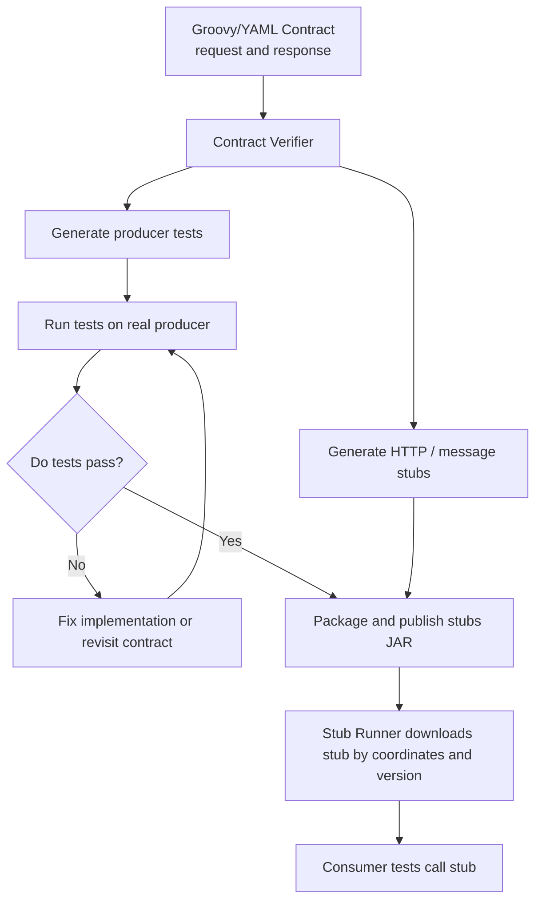

# Spring Cloud Contract Verifier and Stub Runner

## 1. What Problem Do the Two Components Solve?

In a multi-service system, the **producer** (the party exposing an API or emitting messages) and the **consumer** (the party calling the API or receiving messages) are often developed and deployed independently. A producer may rename a JSON field, change a status code, or alter a message structure without realizing a consumer depends on the old behavior. Spinning up the entire system to catch bugs is both slow and hard to reproduce.

**Spring Cloud Contract** supports *contract testing*: describing agreed interactions using **Groovy DSL** or **YAML DSL**, then using that description to verify the producer and generate simulated responses for the consumer. In that workflow, the two components have distinct responsibilities:

| Component | Where Does It Run? | Primary Responsibility | Signal Received |
| --- | --- | --- | --- |
| **Spring Cloud Contract Verifier** | Producer side, typically during build/CI | Reads contracts, generates tests and executes them against the producer application; generates stub definitions from contracts | Whether the producer still satisfies committed behavior |
| **Spring Cloud Contract Stub Runner** | Consumer side, typically during integration tests | Locates, downloads/reads, and starts stubs matching a producer version; provides simulated endpoints or messaging integrations | Whether the consumer interacts properly with the behavior described in the contract |

**Verifier verifies the producer's real implementation; Stub Runner gives the consumer a simulated partner based on the same contract.** Both sides share one behavioral definition, reducing the risk of writing arbitrary mocks that diverge from the real API.

This tests **the behavior included in the contract**, not proof that every feature works. Without a contract for an error case or an endpoint, neither tool automatically tests that case.

## 2. End-to-End Coordination Workflow from Contract to Tests



A typical cycle unfolds as follows:

1. Producer and consumer agree on a use case's behavior: method, path, headers, request data, status code, and response data; for messages, the trigger condition, destination, headers, and payload.
2. The team records the behavior as a contract in version control. Changes to contracts should be reviewed by both sides, whether stored in the producer repository or a separate contracts repository.
3. In the producer build, Verifier generates tests from the contract. These tests invoke the **real producer implementation** in the configured manner (such as MockMvc) and verify responses.
4. Once the producer passes verification, the build packages a **stubs JAR**, typically with the `stubs` classifier, and publishes it to a Maven repository accessible by the consumer.
5. In the consumer build, Stub Runner retrieves the exact stubs JAR and starts an HTTP stub server (typically backed by WireMock); consumer tests call this server instead of a live producer.
6. CI fails if the producer stops complying with the contract or if the consumer mishandles the contracted response. Both pipelines can run independently as long as stub versions are properly controlled.

In the HTTP flow, tests generated by Verifier and mappings used by WireMock are two outputs of **the exact same contract**. That is the most important link between Verifier and Stub Runner.

## 3. Defining an HTTP Contract in Groovy or YAML

Suppose `order-provider` exposes `GET /api/orders/42`. The consumer expects `200 OK` and JSON containing `id` and `status`. A Groovy contract can be placed in the producer's `src/test/resources/contracts/shouldReturnOrder.groovy`:

```groovy
import org.springframework.cloud.contract.spec.Contract

Contract.make {
    description 'Returns a confirmed order'

    request {
        method GET()
        url '/api/orders/42'
        headers {
            accept(applicationJson())
        }
    }

    response {
        status OK()
        headers {
            contentType(applicationJson())
        }
        body([
            id: 42,
            status: 'CONFIRMED'
        ])
    }
}
```

The same behavior can be expressed in YAML, such as `src/test/resources/contracts/shouldReturnOrder.yml`:

```yaml
description: Returns a confirmed order
request:
  method: GET
  url: /api/orders/42
  headers:
    Accept: application/json
response:
  status: 200
  headers:
    Content-Type: application/json
  body:
    id: 42
    status: CONFIRMED
```

**Pick only one of the two files above** for this example; keeping both creates two duplicate contracts. Regardless of which DSL is used, the contract must clearly specify what data the consumer genuinely depends on. When accepting dynamic IDs, timestamps, or varying values, Spring Cloud Contract supports **matchers** and distinguishes consumer-side values/patterns from producer-side ones. Never hardcode inherently random data just to make tests pass.

A contract can describe other cases such as `POST` with a request body, `404` when a record is missing, `400` for invalid data, or required headers. Each important behavior should have its own contract with a clear name for traceability when a test fails.

## 4. Contract Verifier on the Producer Side

### 4.1. What Does Verifier Generate?

For the `shouldReturnOrder` contract, Verifier can generate a test semantically equivalent to:

```java
// Code illustrating the intent of the generated test, not an exact copy
// of the generator output across every Spring Cloud Contract version.
given()
    .header("Accept", "application/json")
.when()
    .get("/api/orders/42")
.then()
    .statusCode(200)
    .header("Content-Type", containsString("application/json"))
    .body("id", equalTo(42))
    .body("status", equalTo("CONFIRMED"));
```

The generator translates conditions in the contract into HTTP assertions. Tests running on the producer must have the application and appropriate data ready: for example, order `42` prepared in a test fixture or the data-access layer replaced with deterministic mocks. If the API changes `status` to `state` without updating the contract by agreement, the producer test fails.

### 4.2. Configuring the Test Foundation

For a Spring Boot project using Gradle/Groovy DSL, the producer can apply the Contract Verifier plugin and specify a shared base class for generated tests:

```groovy
// build.gradle excerpt; choose a plugin version compatible
// with the project's Spring Boot and Spring Cloud versions.
plugins {
    id 'org.springframework.cloud.contract' version '<SCC_VERSION>'
}

contracts {
    baseClassForTests = 'com.example.order.contract.BaseContractTest'
}
```

Example base class for HTTP testing via MockMvc:

```java
package com.example.order.contract;

import io.restassured.module.mockmvc.RestAssuredMockMvc;
import org.junit.jupiter.api.BeforeEach;
import org.springframework.beans.factory.annotation.Autowired;
import org.springframework.boot.test.autoconfigure.web.servlet.AutoConfigureMockMvc;
import org.springframework.boot.test.context.SpringBootTest;
import org.springframework.test.web.servlet.MockMvc;

@SpringBootTest
@AutoConfigureMockMvc
public abstract class BaseContractTest {

    @Autowired
    MockMvc mockMvc;

    @BeforeEach
    void setup() {
        RestAssuredMockMvc.mockMvc(mockMvc);
        // Set up deterministic data for order 42 if needed.
    }
}
```

`BaseContractTest` is written by the producer team to initialize the test environment; individual test classes for each contract are generated by Verifier. How tests boot varies depending on **test mode**, framework, controller architecture, and Spring Cloud Contract version. For instance, when not using MockMvc, you must pick an appropriate configuration instead of reusing the base class above as-is.

Common Gradle tasks include `generateContractTests`, `contractTest`, and `verifierStubsJar`. Check the exact task names for the plugin version in use. In the pipeline, run contract tests **before** publishing the stubs JAR; a successfully packaged stub artifact does not prove the producer satisfies the contract.

### 4.3. When Producer Tests Fail

For example, the contract expects HTTP `200` and `status = "CONFIRMED"`, while the API returns `404` or `status = "APPROVED"`. This failure matches Verifier's purpose: the producer has diverged from what consumers are allowed to expect. The resolution is to determine whether the API change is an implementation bug or an agreed contract change. If it is intentional, update the contract, tests, and compatibility plan together; never simply delete assertions to make CI green.

## 5. Stub Runner on the Consumer Side

### 5.1. Which Artifact Does Stub Runner Use?

After Verifier generates stub definitions and the producer packages them, an artifact has Maven coordinates of the form:

```text
com.example:order-provider:1.0.0:stubs
```

Here `com.example` is the group ID, `order-provider` is the artifact ID, `1.0.0` is the version, and `stubs` is the **classifier**. This is a stub artifact, not the producer application build for production. Inside, it typically contains HTTP mappings and response bodies for the stub server.

Stub Runner takes these coordinates, locates the artifact according to the configured mode, and starts the stub. A stub identifier used in annotations commonly takes the form:

```text
groupId:artifactId:version:classifier:port
com.example:order-provider:1.0.0:stubs:8089
```

A consumer calling `http://localhost:8089/api/orders/42` receives the simulated result matching the contract, even though the real `order-provider` is not running. When multiple producers are needed, multiple stub IDs and corresponding addresses can be configured.

### 5.2. Consumer Test Example

The consumer can add the `spring-cloud-starter-contract-stub-runner` test dependency, configure the HTTP client address, and enable Stub Runner via annotation:

```java
import org.junit.jupiter.api.Test;
import org.springframework.beans.factory.annotation.Autowired;
import org.springframework.boot.test.context.SpringBootTest;
import org.springframework.cloud.contract.stubrunner.spring.AutoConfigureStubRunner;
import org.springframework.cloud.contract.stubrunner.spring.StubRunnerProperties;

import static org.assertj.core.api.Assertions.assertThat;

@SpringBootTest(properties = {
    "order.client.base-url=http://localhost:8089"
})
@AutoConfigureStubRunner(
    ids = "com.example:order-provider:1.0.0:stubs:8089",
    stubsMode = StubRunnerProperties.StubsMode.LOCAL
)
class OrderConsumerContractTest {

    @Autowired
    OrderClient orderClient;

    @Test
    void readsConfirmedOrderFromProviderContract() {
        OrderResponse order = orderClient.getOrder(42);
        assertThat(order.getId()).isEqualTo(42);
        assertThat(order.getStatus()).isEqualTo("CONFIRMED");
    }
}
```

`OrderClient`, `OrderResponse`, and the `order.client.base-url` property are **illustrative** components that must map to the consumer's actual HTTP client, DTO, and configuration. What must be verified is that consumer code calls the right path, parses the data properly, and processes the result per the contract—not merely testing WireMock in isolation with a manual HTTP call. Port `8089` must be free in the test environment; in larger suites, prefer dynamic port configuration to avoid port collisions.

Stub Runner supports common stub lookup modes:

| Mode | Stub Source | Suitable Scenario |
| --- | --- | --- |
| `CLASSPATH` | Stubs already on the test classpath | Simple examples or projects directly supplying test fixtures |
| `LOCAL` | Local Maven repository, usually `~/.m2/repository` | Local development after the producer publishes locally |
| `REMOTE` | Configured remote repository, such as an internal Maven artifact repository | CI and multiple teams sharing published stubs |

With `LOCAL`, the producer must publish the stub artifact into the local repository that the consumer resolves from. With `REMOTE`, configure `repositoryRoot` and proper access credentials; never hardcode passwords in source code. **Pinning versions in CI** ensures failures are reproducible. Dynamic version notation like `+` is handy for trying newer builds, yet easily causes test results to vary between runs.

### 5.3. What Does Stub Runner Catch and What Does It Miss?

If the consumer sends `GET /api/orders/42` but parses a `state` field while the stub returns `status`, the test fails. If the consumer sends the wrong URL or HTTP method, the stub fails to find a matching mapping, revealing that the interaction does not match the contract.

Conversely, a consumer test running via Stub Runner **does not prove** the real producer still works: that is Verifier's job in the producer pipeline. Stubs also do not simulate full system behavior such as performance, transactions, databases, real authorization, or network failures. Therefore, an intentional amount of integration and end-to-end testing is still required for risks outside the contract.

## 6. Distinguishing HTTP Testing from Messaging Contracts

The examples above illustrate **HTTP request–response**. Spring Cloud Contract can also describe **message contracts**: a trigger or input message resulting in an output message with an expected destination, headers, and payload. Verifier can generate tests verifying that the producer emits messages conforming to the contract; Stub Runner can provide message stubs when an appropriate messaging integration is configured.

An important difference: HTTP stubs are usually served over a WireMock port, whereas message stubs require binder/broker configuration and libraries matching the system's messaging stack. You cannot reuse the HTTP annotations and URLs from the example above and conclude that a message contract has been tested. When implementing message contracts, clearly identify the producer, consumer, input/output channels, and how triggering works in the test environment.

## 7. Integrating Verifier and Stub Runner into CI

A manageable pipeline can be split into two phases:

| Pipeline | Step | Passing Condition |
| --- | --- | --- |
| **Producer** | Check out code and contracts; generate tests with Verifier; prepare test fixtures; run contract tests | All committed interactions are satisfied by the producer application |
| **Producer** | Build stubs JAR with `stubs` classifier; publish alongside release version | Artifact is published only after producer tests pass |
| **Consumer** | Select published stub artifact version; Stub Runner downloads and starts stub | Consumer locates the exact stub, URL/port, with no repository configuration errors |
| **Consumer** | Run tests against the consumer's real HTTP client or application layer | Consumer builds requests and handles responses per the contract |

When making an API change that risks a **breaking change**, the safe process is to agree on the contract update, roll out a compatibility phase if needed, run Verifier and consumer tests against the target stub version, and only then deploy. For example, replacing `status` outright with `state` breaks old consumers; supporting both fields during a transition period may be chosen if that is the agreed compatibility strategy. Updating a contract without re-running consumer tests is insufficient to assess impact.

### Common Configuration Errors

| Symptom | Cause to Check | How to Resolve |
| --- | --- | --- |
| No tests generated | Wrong `contracts` directory, plugin not enabled, or invalid contract | Check DSL location, plugin configuration, and test generation output |
| Producer test returns different status or body | Implementation changed behavior; missing test fixture or unstable mock | Compare each request/response and prepare deterministic test data |
| Stub Runner cannot find artifact | Wrong group/artifact/version/classifier, unpublished, or unconfigured repository | Verify `...:stubs` coordinates, `LOCAL`/`REMOTE` mode, and artifact read permissions |
| Consumer receives `404` from stub | Request does not match mapping: method, URL, query, headers, or body | Compare actual request against contract matchers and generated mappings |
| Tests pass locally but fail in CI | Reliance on `~/.m2` cache, dynamic versions, credentials, or port conflicts | Publish stubs to a shared repository, pin versions, and configure ports explicitly |
| All tests green yet production fails after deploy | Contract lacks an important scenario or stub is older than producer | Add missing error cases, align versions, and keep essential integration tests |

## 8. Mini Hands-On Lab: Catching a Breaking API Change

**Context:** `order-provider` returns order details; `checkout-consumer` needs to read the `status` field to display order state.

1. In the producer, create a contract for `GET /api/orders/42`, requiring HTTP `200` and `status: CONFIRMED` as in Section 3.
2. Configure Verifier and the base class so generated tests call the producer endpoint with stable data for order `42`. Run the contract test suite; expect **PASS**.
3. Build the stubs JAR and publish it to the local Maven repository or CI repository with a pinned version such as `1.0.0`.
4. In the consumer, use Stub Runner to start `com.example:order-provider:1.0.0:stubs:8089`; point the consumer's real HTTP client to the stub port. Verify the consumer reads `id = 42`, `status = CONFIRMED`; expect **PASS**.
5. In the producer implementation, temporarily change the response from `status` to `state` while **keeping the contract unchanged**. Re-run Verifier; expect **FAIL**, because the producer broke the committed behavior.
6. Restore the producer response, then temporarily modify the consumer to read only `state`. Re-run the consumer test against the old stub; expect **FAIL**, because the consumer diverged from the published contract.

Expected takeaway: Verifier is the safety net on the **producer implementation** side, while Stub Runner brings that same contract into **consumer** tests. Together, the two signals catch breaking API changes right in CI before services are deployed together.

## 9. Practical Guidelines for Real Projects

- Write contracts around **behaviors the consumer truly needs**, including error codes and critical headers; avoid describing internal details outside the public interface.
- Run Verifier-generated tests on the producer before publishing stubs; use the **same contract source** for both producer tests and consumer stubs.
- Treat the stubs JAR as a **versioned** artifact; tie that version to the producer's commit/release for debugging traceability.
- Ensure consumer tests actually execute through the application's client, not just checking that the stub started.
- Contract changes must be reviewed by both sides; editing the DSL solely to make tests pass can mask a breaking change.
- Combine contract tests with unit, integration, and targeted end-to-end tests for scenarios outside the contract specification.

Once the boundary of responsibilities between **Verifier** and **Stub Runner** is clear, teams can validate producer–consumer contracts in everyday development instead of waiting for a full integration environment to discover that services no longer understand each other.
