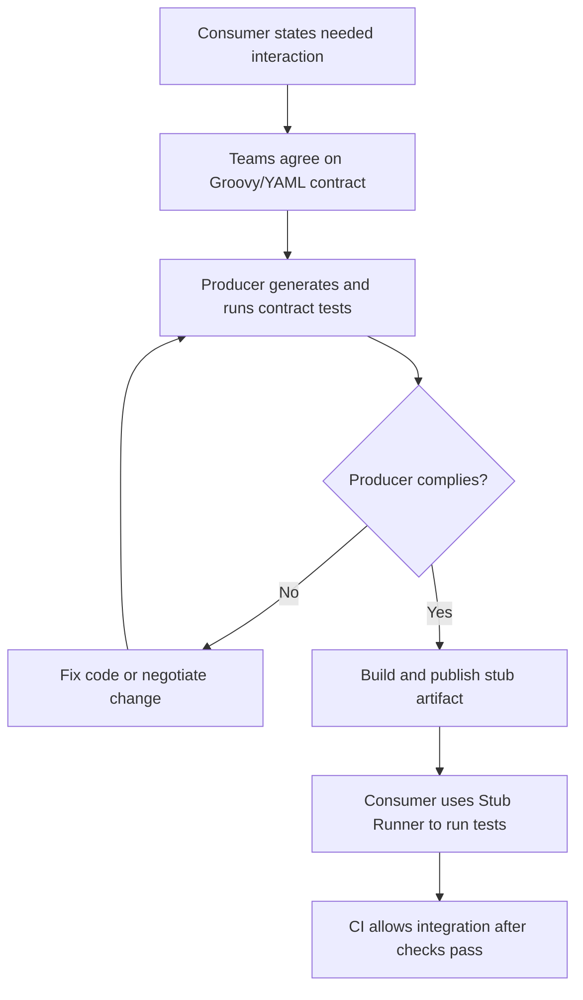

# Distinguishing Contract Tests from OpenAPI and API Documentation

In a multi-service system, two teams may both agree that `GET /orders/{id}` returns order details, yet interpret **HTTP status codes, JSON field names, or field meanings** differently. Updated documentation still does not guarantee that the running service actually behaves accordingly; unit tests in each service may also fail to catch that a consumer is impacted.

With **Spring Cloud Contract**, development teams can specify interactions that a producer (API provider) must satisfy, generate tests to verify the producer, and produce stubs for the consumer (API caller) to test before real integration. To apply it properly, you need to distinguish three related concepts: **API documentation**, **OpenAPI**, and **contract testing**.

## 1. Three Concepts Solving Three Different Needs

### 1.1. API Documentation: Helping Humans Understand and Use the API

API documentation typically explains what an API is for, how to authenticate, parameters, request/response structures, business rules, common errors, and integration examples. Documentation can be written in Markdown, web pages, wikis, developer portals, or generated from a structured specification.

Example documentation for API users:

> **Get an order:** Call `GET /orders/{id}` with a valid order ID. If found, the service returns `200 OK` with JSON containing `id` and `status`. The `status` field indicates order processing state. If not found, the service returns `404 Not Found`.

Documentation helps readers understand **intent and usage**. However, a prose description does not send HTTP requests, inspect JSON, or catch when implementation code drifts away from the docs. Even documentation auto-generated from code only reflects what the tool extracts, and does not automatically prove actual behavior matches consumer needs.

### 1.2. OpenAPI: Machine-Readable Structured API Specification

**OpenAPI Specification (OAS)** is a standardized way to describe HTTP API interfaces as a structured document, typically written in YAML or JSON. An OpenAPI specification can declare paths, methods, parameters, response codes, headers, media types, schemas, data constraints, security schemes, examples, and descriptions.

Thanks to its uniform structure, many tools can use OpenAPI to render documentation, lint spec formatting, generate SDKs/server skeletons, validate requests/responses against schemas, or generate tests. **OpenAPI can act as a form of API contract**; however, an OpenAPI file by itself **does not run automatically** to verify the implementation or compatibility with a specific consumer.

OpenAPI example describing part of an order retrieval API:

```yaml
openapi: 3.0.3
info:
  title: Order API
  version: 1.0.0
paths:
  /orders/{id}:
    get:
      summary: Get order details
      parameters:
        - in: path
          name: id
          required: true
          schema:
            type: integer
      responses:
        '200':
          description: Order found
          content:
            application/json:
              schema:
                type: object
                required: [id, status]
                properties:
                  id:
                    type: integer
                  status:
                    type: string
                    enum: [PROCESSING, SHIPPED]
              example:
                id: 42
                status: SHIPPED
        '404':
          description: Order not found
```

This specification states that a success response has `id` and `status` fields and allowed status values. Yet from the spec file alone, you cannot confirm that the implementation **actually** returns `200`, `Content-Type: application/json`, and `status: SHIPPED` for order 42. To confirm that, you need a testing tool that executes the request and compares against expectations.

### 1.3. Contract Testing: Verifying an Executable Interaction

In **contract testing**, a contract records expectations between caller and provider at the communication boundary: given a particular request or input message, the provider must return a matching response or emit an appropriate message. The contract is used by tooling to **generate or run tests**, thereby catching incompatible behavioral changes.

**Consumer-driven contract testing (CDC)** emphasizes starting from what consumers genuinely need. The producer runs tests against agreed expectations. Spring Cloud Contract supports defining contracts using **Groovy DSL or YAML DSL**, generating producer-side tests, and producing **stubs** so consumers can test independently of a running producer instance.

Groovy DSL contract example for the exact same `GET /orders/42` interaction:

```groovy
import org.springframework.cloud.contract.spec.Contract

Contract.make {
    description 'Get order 42 with the status field used by the consumer'

    request {
        method GET()
        url '/orders/42'
        headers {
            header 'Accept', 'application/json'
        }
    }

    response {
        status OK()
        headers {
            contentType(applicationJson())
        }
        body(
            id: 42,
            status: 'SHIPPED'
        )
    }
}
```

When integrated into the build process, Spring Cloud Contract can generate producer-side tests from this contract. The tests send the corresponding request to the application or configured HTTP layer and verify the response against the contract conditions. The tool can also generate stubs simulating that interaction for the consumer to call. **A stub is a simulation of a published contract**, not independent proof that producer code is working correctly: that proof comes from the producer executing and passing its contract tests.

Note: the example pins order `42` to make the request-response relationship easy to see. In real projects, prepare repeatable test data and use DSL matchers when actual values are dynamic (such as identifiers or timestamps). Do not force every detail of the response to be fixed if the consumer does not depend on it.

## 2. Quick Comparison Table

| Criterion | API Documentation | OpenAPI | Contract Testing with Spring Cloud Contract |
|---|---|---|---|
| Primary question | "How do I use this API?" | "How is the HTTP API interface defined?" | "Does the producer satisfy the interaction the consumer needs?" |
| Primary audience | Developers, integrators, operators | Developers and automated tools | Producer team, consumer team, and CI pipeline |
| Format | Prose, examples, guides, reference pages | YAML/JSON spec following OAS standard | Groovy/YAML DSL expressing request–response or messages |
| Typical scope | Usage, context, business rules | HTTP API endpoints and schemas | Agreed communication scenarios |
| Machine-readable? | Depends on format | Yes | Yes |
| Verifies code just by saving the file? | No | No | No; requires configuring test generation/execution against producer |
| When integrated with tooling | Lookup, guides, examples | Render docs, lint, codegen, schema validation, spec-based tests | Generate producer tests, generate/publish stubs, run Stub Runner, fail build on contract breach |
| Strength | Explains **why, when, and how to use** | Standardizes interface and powers rich tooling ecosystem | Detects behavioral drift at the producer–consumer boundary |
| Typical limitation | Can go stale and is hard to verify automatically | Schemas cannot express all business rules or stateful behavior | Only protects interactions written as contracts; requires test data and scope management |

**Key takeaway:** "contract" is a broad concept. OpenAPI is an **interface contract specification**; Spring Cloud Contract provides a mechanism for **executable contract testing**. Do not assume only one of them is a "contract" or that OpenAPI cannot be used for testing at all: other tools can generate tests from OpenAPI. The difference lies in **level of detail, focus, and how behavior is verified**.

## 3. For the Same API Change, What Does Each Layer Catch?

Suppose a consumer reads `status` to display shipping progress. The producer changes the response from:

```json
{
  "id": 42,
  "status": "SHIPPED"
}
```

to:

```json
{
  "id": 42,
  "state": "SHIPPED"
}
```

- **API documentation** can be updated to instruct using `state`. However, consumers already deployed against `status` can still fail, even though the new docs match the new producer version.
- **OpenAPI** can record the new schema, and spec-diff tools can warn about removing/renaming a required field. If you only check **validity of the new spec**, the OpenAPI file can remain syntactically valid without detecting that an existing consumer relies on `status`.
- **Spring Cloud Contract** can catch this immediately in the producer build: the contract still requires `status`, whereas the actual response only contains `state`, so the contract test fails. The development team must preserve compatibility or coordinate with consumers to negotiate, update, and roll out the change safely.

Other changes should also be evaluated against consumer expectations:

| Change from Producer | Risk to Consumer | What Should Be Verified |
|---|---|---|
| `200 OK` to `204 No Content` | Consumer expecting JSON receives no body | Status code and presence of body |
| `status` from string to number | Parsing/status-comparison code may break | Data type and value domain |
| Drop a header used by consumer | Loss of version info, caching, or request correlation | Relevant headers in contract |
| Add optional JSON field | Often compatible, though overly strict parsers may fail | Ability to ignore unknown fields and matcher strictness |
| Change meaning of `SHIPPED` while keeping schema intact | Consumer business logic breaks | Business scenarios and state-transition rules |

Not every JSON difference is a contract violation. A good contract specifies **what the consumer truly relies on**. For example, if the consumer only needs `id` to be a number and `status` to be among valid values, use appropriate matchers rather than constraining unimportant fields, ordering, or literals. Conversely, when an exact value is a business condition, verify that exact value.

## 4. Where Does Spring Cloud Contract Fit in the Development Flow?

A common workflow for an HTTP API can be illustrated as follows:



Each step has a distinct role:

1. **Agree on expectations.** Consumer and producer select important scenarios, such as `200` success, `404` not found, `400` invalid input. Contract files can be managed in the producer's repository or a shared contracts repository depending on team workflow.
2. **Verify the producer.** The Spring Cloud Contract plugin generates tests from the DSL. The producer needs to configure a test base class and appropriate data state so tests actually exercise the implementation under verification. If the implementation returns wrong output, the build/test must fail.
3. **Package and publish stubs.** After producer verification succeeds, the build generates stubs from contracts and can publish an artifact with the `stubs` classifier to the corresponding Maven repository. Tie stubs to the verified producer version to avoid accidentally using an outdated build.
4. **Verify the consumer.** The consumer uses **Stub Runner** to download/run the producer's stubs, then tests its own API-calling logic. Stub Runner can run HTTP stubs on a local port, letting the consumer test without booting the entire dependency stack.
5. **CI integration.** Producer CI runs contract tests before publishing; consumer CI runs integration tests against the appropriate stub. Breaking changes are caught early, before deploying two services into the same environment.

Example Stub Runner declaration in a consumer Spring Boot test (assuming the stub artifact is already installed in the local Maven repository):

```java
import org.springframework.cloud.contract.stubrunner.spring.AutoConfigureStubRunner;
import org.springframework.cloud.contract.stubrunner.spring.StubRunnerProperties;

@AutoConfigureStubRunner(
    ids = "com.example:order-service:+:stubs:8085",
    stubsMode = StubRunnerProperties.StubsMode.LOCAL
)
class OrderClientContractIntegrationTest {
    // Configure HTTP client to call localhost:8085 and verify response handling.
}
```

This snippet illustrates the declaration, not a complete test class: a real application needs compatible dependencies, client configuration pointing to the stub port, and test methods. When using a remote artifact repository, the team configures repository settings and the corresponding stub retrieval mode. The `+` syntax in the version slot is often used to pick a matching version during testing; for release pipelines requiring high reproducibility, control stub versions explicitly.

**Both sides test different things:** Producer tests prove the current implementation satisfies the contract; consumer tests with stubs prove consumer code handles the agreed interaction. Running only consumer tests against stubs while skipping producer tests can lead the whole team to trust simulated responses that no longer match the real service.

## 5. Combining OpenAPI, Documentation, and Contract Tests in the Same Project

You do not need to pick one tool to completely replace the other two. A practical workflow is:

| Need | Suitable Output | CI Governance |
|---|---|---|
| Publish API for partners to understand and integrate | Guides, examples, error codes, business rules | Review docs and examples when API changes |
| Standardize HTTP API surface | `openapi.yaml` with paths, schemas, responses, security | Lint/validate OpenAPI; diff for breaking changes when needed |
| Preserve compatibility with specific consumers | Spring Cloud Contract DSL for key scenarios | Generate and run producer contract tests |
| Parallel consumer development | Verified stub artifact | Run consumer tests via Stub Runner |
| Verify the complete system | Integration/end-to-end tests | Test flows involving databases, networking, authentication, and real components |

You can generate documentation pages from OpenAPI and supplement them with prose explaining business rules. You can also use OpenAPI as an input for schema validation or contract tests with appropriate tooling. What matters is that the team **defines the source of truth, synchronization method, and automated CI gates**: if OpenAPI, code, and DSL contracts evolve separately, they can still drift apart.

**Limitations not to confuse:**

- **OpenAPI is not just human documentation.** It is a structured specification that tools can use for code generation and testing. Different versions and tools vary in capability, so evaluate specific tooling.
- **Spring Cloud Contract does not replace all of OpenAPI.** A curated set of contracts verifies the scenarios consumers need, yet does not necessarily enumerate every endpoint, schema, or authentication mechanism of the API.
- **Contract tests do not replace integration or end-to-end tests.** Contract tests focus on the exchange boundary. Data errors, authorization, cross-network incidents, or multi-service coordination still require other test layers.
- **Asynchronous messaging is a different scope.** Spring Cloud Contract also supports contracts for message exchange with suitable infrastructure; OpenAPI primarily describes HTTP APIs, whereas event-driven protocols/APIs can use dedicated specs like AsyncAPI.

## 6. Choosing the Right Level of Verification

When designing contract tests, start from behaviors that could break the consumer:

- **Success responses:** endpoint, HTTP method, status, media type, and fields/types used by the consumer.
- **Error responses:** HTTP code, error code structure, message, or fields needed for exception handling; e.g., `404` and `400` can trigger two different handling paths.
- **Business rules:** order statuses, meaningful values, valid/invalid conditions, and correlation between request and response.
- **Extensibility:** use matchers for variable data; avoid asserting details outside the compatibility commitment.
- **Version discipline:** producer publishes stubs only after tests pass; consumer tests with traceable stub versions; review contracts whenever the API changes.

For instance, if the consumer only needs `status` to drive UI navigation, the contract should prioritize protecting the presence, data type, and valid values of `status`. Do not force contract tests to check internal fields like `lastUpdatedBy` if the consumer does not use them. Conversely, if the consumer relies on `ETag` for caching, that header belongs to expectations worth protecting.

## 7. Common Misconceptions

**"Having valid OpenAPI guarantees the API is compatible."** False. The file may be valid while running code differs from the spec, or a new schema removed a field an old consumer needs. Combine diff checks, implementation tests, and real expectations.

**"Having Swagger UI means we already have contract testing."** Insufficient. Swagger UI mainly renders and lets you try the API based on OpenAPI; automated producer verification against consumer scenarios must still be configured separately.

**"Stubs passing means the real producer passes."** Insufficient. Stub Runner replays responses defined in the stub. You must run producer contract tests against the real implementation and use only stubs built from verified builds.

**"Contract tests must compare every character of JSON."** No. Overly rigid matching causes false alarms when adding fields that do not affect the consumer. Conversely, overly loose matching can miss type changes or dropped critical fields. Express the exact level of commitment for the interaction.

**"One contract test guarantees everything."** No. Select enough key scenarios—especially error and edge cases—and pair them with unit, integration, and end-to-end tests according to risk.

## 8. Check Your Understanding

1. If OpenAPI declares `status` as `string` but the real producer returns `42`, does the OpenAPI file catch the bug on its own? **No**; you need tooling verifying real responses against the schema or an appropriate contract test.
2. If a developer renames `status` to `state` and updates the API documentation, are old consumers automatically compatible? **No**; assess the breaking change and maintain/support the commitment existing consumers rely on.
3. Why must contract tests run on the producer **before publishing stubs**? So stubs represent behavior already proven by the producer, preventing consumers from testing against expectations that mismatch the implementation.
4. To explain authentication, rate limits, and error semantics to partners, what should you use? **API documentation**, optionally built on OpenAPI and supplemented with written guides.
5. To verify that a consumer works with an agreed response without starting the real producer, what should you use? **Stubs generated from contracts paired with Stub Runner**, while still keeping producer contract tests to ensure provider compliance.

## Conclusion

**API documentation** clarifies usage; **OpenAPI** standardizes and publishes the HTTP interface for both humans and tools; **Spring Cloud Contract** turns specific exchange expectations into producer tests and consumer stubs. The three layers complement one another. When kept in sync—with producer tests, stub publishing, Stub Runner, and compatibility checks wired into CI—teams can catch consumer-breaking API changes early before they reach runtime environments.
