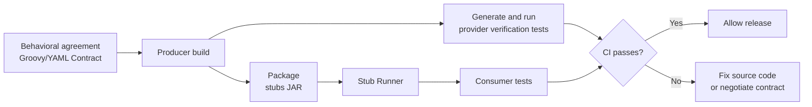
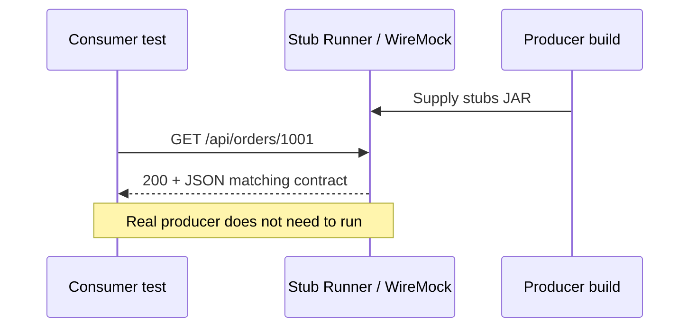

# Spring Cloud Contract Learning Roadmap with HTTP and Messaging Examples

Spring Cloud Contract (SCC) helps two services agree on **testable behavior** at their communication boundary. For HTTP APIs, a contract describes the method, path, request data, status code, and response. For asynchronous communication, a contract describes emitted or received messages, target destinations, headers, and payloads. From contracts written in **Groovy DSL or YAML DSL**, SCC can generate tests for the **producer** (provider) and produce **stubs** so the **consumer** (caller/subscriber) can test without booting a live producer.

This guide lays out a learning roadmap from fundamentals to CI integration using one shared business domain: `order-producer` exposes an order lookup API and emits an order-created event; `order-consumer` calls the API or consumes the event. The goal is to catch breaking interface changes **before deployment**.

## 1. Defining Goals and the Big Picture

Upon completion, learners should be able to:

1. Distinguish **contracts**, **producer-generated tests**, **consumer stubs**, and **end-to-end integration tests**.
2. Write an HTTP contract in Groovy or YAML and understand what each section constrains.
3. Run generated tests on the producer to confirm the real application satisfies the contract.
4. Package and consume stubs via **Spring Cloud Contract Stub Runner**.
5. Write an event contract, trigger the message in tests, and verify the outgoing payload.
6. Design CI quality gates so contract-breaking changes are caught early.

Typical flow:



Key point to grasp: **the same contract serves both sides**, yet tests different things. The producer proves its real code satisfies the contract; the consumer proves its code handles the simulated response or event from the contract. Both test suites complement each other; they do not prove the entire system works under real networking, real data, and production infrastructure.

## 2. Proposed Roadmap

| Stage | Core Content | Hands-On Artifact | Completion Criteria |
| --- | --- | --- | --- |
| 1. Foundations | Producer, consumer, contract, stub, and breaking-change cases | Communication flow diagram and table of committed behaviors | Can state what each side tests |
| 2. Basic HTTP | Write a GET contract in Groovy, compare with YAML | `get_order.groovy` or `get_order.yml` | Contract clearly specifies request and response |
| 3. Producer verification | Integrate Contract Verifier, generate and run tests | Producer build with generated tests | Changing status/body wrongly fails the build |
| 4. Consumer testing | Build `-stubs.jar`, run Stub Runner, test client | Consumer test calling stub over HTTP | Test runs even with producer shut down |
| 5. Messaging | Event contract, trigger, and payload verification | `order_created.groovy` contract | Producer emits exact message; consumer receives simulated event |
| 6. CI and API evolution | Verification pipelines, stub versioning, catching incompatible changes | Pipeline testing both producer and consumer | A contract-breaking change is blocked before release |

Each stage can be studied independently, but following the order above is recommended: **only move on to messaging after mastering the HTTP contract → test → stub lifecycle**.

## 3. Stage 1 — Building the Communication Model

Suppose the producer exposes the endpoint:

```http
GET /api/orders/1001 HTTP/1.1
Accept: application/json
```

Agreed response:

```http
HTTP/1.1 200 OK
Content-Type: application/json

{"id":1001,"status":"CREATED"}
```

The consumer needs `id` to identify the order and `status` to display its state. If the producer silently renames `status` to `state`, or changes `200` to `204`, the consumer can break even though producer code still compiles and internal unit tests pass.

From this example, establish the contract scope:

- **Input:** HTTP `GET`, path `/api/orders/1001`; whenever query parameters or required headers exist, declare them in the contract too.
- **Output:** status `200`, JSON content type, numeric `id` field, and `status` with the expected value.
- **Error cases to add:** order not found (`404`) and access denied if the API uses authentication.
- **Non-functional aspects:** latency, retries, real authorization, broker connectivity, and data consistency still require other tests.

There is no need to describe every internal implementation detail. The contract should pin down the behaviors the consumer genuinely relies on.

## 4. Stage 2 — Writing an HTTP Contract

### 4.1. Groovy DSL

In the `order-producer` project, create `src/test/resources/contracts/http/get_order.groovy`:

```groovy
import org.springframework.cloud.contract.spec.Contract

Contract.make {
    description 'Get order details by id'

    request {
        method GET()
        url '/api/orders/1001'
    }

    response {
        status OK()
        headers {
            contentType(applicationJson())
        }
        body(
            id: 1001,
            status: 'CREATED'
        )
    }
}
```

Read the contract in two halves:

| Element | Meaning | Bug That Can Be Caught |
| --- | --- | --- |
| `request.method` | API accepts HTTP GET | Producer removes GET or only supports POST |
| `request.url` | Path the consumer will call | Producer renames endpoint |
| `response.status` | Must return `200 OK` | Producer returns `204`, `404` |
| `headers.contentType` | Response declares JSON | Producer returns another media type |
| `response.body` | Contains `id` and `status` as committed | Field renamed, missing, or wrong value |

This is a fixed example for easy verification while learning. In real systems, use **matchers** for dynamic data such as UUIDs, timestamps, or server-generated IDs so tests are not pointlessly tied to a sample literal. Matchers must preserve rules the consumer needs, such as a valid UUID or `status` belonging to the allowed status set.

### 4.2. Equivalent YAML DSL

If the team prefers not to write Groovy, the same behavior can be expressed in `src/test/resources/contracts/http/get_order.yml`:

```yaml
description: Get order details by id
request:
  method: GET
  url: /api/orders/1001
response:
  status: 200
  headers:
    Content-Type: application/json
  body:
    id: 1001
    status: CREATED
```

Groovy DSL is flexible for matchers and rich declarative logic; YAML DSL is easy to read and review when contracts mainly describe request/response pairs. **Pick only one of the two files for the same hands-on scenario**; keeping both can cause the tool to generate two duplicate tests/stubs.

### 4.3. Comparing Against the Producer Implementation

A minimal controller can return the exact example:

```java
@RestController
@RequestMapping("/api/orders")
class OrderController {

    @GetMapping("/{id}")
    ResponseEntity<Map<String, Object>> findById(@PathVariable long id) {
        if (id != 1001L) {
            return ResponseEntity.notFound().build();
        }

        return ResponseEntity.ok(
            Map.of("id", id, "status", "CREATED")
        );
    }
}
```

This Java snippet is illustrative for running the lesson; a real application queries services/databases and handles authentication and authorization. On Spring Boot 3+, add the corresponding imports from `org.springframework.http`, `org.springframework.web.bind.annotation`, and `java.util`.

**Exercise:** change the controller's response to `Map.of("id", id, "state", "CREATED")`. Once contract tests are generated in the next stage, this change must fail the test.

## 5. Stage 3 — Generating Tests and Verifying the Producer

A Maven project typically needs:

- Test dependency `org.springframework.cloud:spring-cloud-starter-contract-verifier`.
- Plugin `org.springframework.cloud:spring-cloud-contract-maven-plugin` to read contracts and generate tests.
- Managing **compatible Spring Boot / Spring Cloud Contract versions** in dependency management and build plugins. Exact versions depend on the project; do not blindly copy arbitrary version numbers from examples.

Example plugin configuration excerpt; assuming the plugin version is already managed by the build configuration:

```xml
<plugin>
    <groupId>org.springframework.cloud</groupId>
    <artifactId>spring-cloud-contract-maven-plugin</artifactId>
    <extensions>true</extensions>
    <configuration>
        <baseClassForTests>com.example.order.ContractVerifierBase</baseClassForTests>
    </configuration>
</plugin>
```

Base class supporting auto-generated HTTP tests:

```java
package com.example.order;

import org.springframework.boot.test.context.SpringBootTest;
import org.springframework.boot.test.autoconfigure.web.servlet.AutoConfigureMockMvc;

@SpringBootTest
@AutoConfigureMockMvc
public abstract class ContractVerifierBase {
}
```

When the project is properly configured, run:

```bash
mvn clean verify
```

Contract Verifier reads the contracts, generates tests during the build, and runs them against the producer application. In the example's MockMvc mode, tests send requests to the controller and compare status code, headers, and body against the contract. If the provider changes JSON `status` to `state`, **the generated test reports the mismatch**, giving a fix signal before publishing the API.

If a producer has multiple contract types (HTTP and messaging), you can use a base class supporting both or configure **base class mappings** by contract path; configure the right test mode and adapters for each type. Do not assume an HTTP-only base class is sufficient for verifying messages.

**Stage pass criteria:** check build logs to see contract-generated tests running; intentionally changing `status` to `state` turns the build red; restoring the code turns the build green.

## 6. Stage 4 — Packaging Stubs and Testing the Consumer

### 6.1. Role of Stubs

From HTTP contracts, Spring Cloud Contract generates mappings for **WireMock**. When packaged per Spring Cloud Contract configuration, these mappings are published in an artifact with the `stubs` classifier, commonly named like `order-producer-1.0.0-stubs.jar`.

The consumer does not need to boot the producer's real controller or database. **Stub Runner** downloads or locates the stubs JAR, starts an HTTP stub server, and serves responses strictly matching the contract.



### 6.2. Consumer Test Example

Add test dependency `org.springframework.cloud:spring-cloud-starter-contract-stub-runner` to the consumer project. With the producer having run `mvn install` and the stubs artifact in the local Maven repository, you can use:

```java
import static org.junit.jupiter.api.Assertions.assertEquals;

import java.util.Map;
import org.junit.jupiter.api.Test;
import org.springframework.boot.test.context.SpringBootTest;
import org.springframework.cloud.contract.stubrunner.spring.AutoConfigureStubRunner;
import org.springframework.cloud.contract.stubrunner.spring.StubRunnerProperties;
import org.springframework.web.client.RestTemplate;

@SpringBootTest
@AutoConfigureStubRunner(
    ids = "com.example:order-producer:1.0.0:stubs:8085",
    stubsMode = StubRunnerProperties.StubsMode.LOCAL
)
class OrderConsumerContractTest {

    @Test
    void readsOrderFromStub() {
        RestTemplate rest = new RestTemplate();

        Map<?, ?> response = rest.getForObject(
            "http://localhost:8085/api/orders/1001",
            Map.class
        );

        assertEquals(1001, response.get("id"));
        assertEquals("CREATED", response.get("status"));
    }
}
```

The string `com.example:order-producer:1.0.0:stubs:8085` has the parts **groupId : artifactId : version : classifier : port**. Adjust the Maven coordinates to match your real producer. `LOCAL` reads artifacts from local Maven; in CI, use your configured artifact repository and `REMOTE` if fetching stubs over the network. This sample calls Stub Runner directly to keep the flow clear; in real applications, configure the HTTP client via a property/base URL rather than hardcoding `localhost:8085`.

**Exercise:** completely shut down the producer and run the consumer test. The test must still pass via Stub Runner. Then modify the consumer parser to read `state` instead of `status` and observe the test fail.

### 6.3. How Should Versions Be Coordinated?

Pin the stubs version or a specific candidate version in CI so the same commit always tests the same contract set. Some online examples use `+` to fetch the latest version; that is handy for quick experiments, yet can cause pipelines to pull an unexpected new artifact. Ensure the producer publishes stubs and the consumer genuinely tests against the verified version.

## 7. Stage 5 — Messaging Contracts

Asynchronous communication shifts the question from "What JSON does the API return?" to "**When an event happens, what message does the producer emit and where?**" Suppose when an order is created, the producer sends to logical destination `orders.created`:

```json
{
  "orderId": 1001,
  "status": "CREATED"
}
```

Add contract `src/test/resources/contracts/messaging/order_created.groovy`:

```groovy
import org.springframework.cloud.contract.spec.Contract

Contract.make {
    description 'Emit event when an order is created'
    label 'order_created'

    input {
        triggeredBy('publishOrderCreated()')
    }

    outputMessage {
        sentTo('orders.created')
        headers {
            messagingContentType(applicationJson())
        }
        body(
            orderId: 1001,
            status: 'CREATED'
        )
    }
}
```

Meaning of each section:

- `label`: label used by the consumer to trigger the stub message for a named scenario.
- `input.triggeredBy`: producer-side test method called to trigger event emission. This is a **test hook**, not an HTTP endpoint.
- `outputMessage.sentTo`: logical destination the producer must send to.
- `headers` and `body`: formatting rules and payload of the message.

During producer verification, the base class for messaging contracts must provide `publishOrderCreated()` wired to the application's real publisher. Example method body:

```java
public void publishOrderCreated() {
    orderEventPublisher.publishCreated(1001L);
}
```

The generated messaging test invokes this method and checks the output message via a **message verifier** integrated with the application's messaging setup. Depending on whether the project uses Spring Cloud Stream, Spring Integration, AMQP, or another transport, configure the appropriate adapter/test binder; `sentTo('orders.created')` is a configured destination name and does not automatically spin up a live broker.

On the consumer side, Stub Runner can emit the sample message by label to test the listener:

```java
@Autowired
private StubTrigger stubTrigger;

@Test
void handlesOrderCreatedEvent() {
    stubTrigger.trigger("order_created");

    // Verify that the listener processed orderId=1001 and status=CREATED.
    // How messages are awaited/read depends on the project's test binder, queue, or listener.
}
```

`StubTrigger` is part of the Spring Cloud Contract Stub Runner API. To turn this snippet into a complete test, the consumer must have a configured message transport, a mechanism to capture payloads, and real assertions on the processing outcome. For asynchronous processing, use bounded timeouts rather than fixed sleeps.

### 7.1. A Message Contract Can Also Describe an Input Message

In a system where a consumer sends a command and waits for the producer to emit an event, the contract can declare **`input.messageFrom` and `input.messageBody`** instead of `triggeredBy`, combined with `outputMessage`. Choose the declaration style based on the business flow: whether the producer emits an event on its own after an action, or receives a message and replies. Do not combine both input styles simply because the syntax allows them.

### 7.2. Why Are Message Contracts Different from HTTP Contracts?

| Aspect | HTTP Contract | Message Contract |
| --- | --- | --- |
| Triggering agent | Consumer request | Hook or input message |
| Observation point | HTTP status, headers, body | Destination, headers, payload |
| Consumer-side stub | HTTP WireMock stub | Message triggered by Stub Runner |
| Common risks | Changed URL, method, JSON field | Changed topic, event field, data type |
| Additional checks needed | Timeouts, auth, retries, network errors | Duplicate delivery, ordering, retries, idempotency |

If a consumer processes the same event multiple times due to at-least-once delivery, **idempotency** is the responsibility of business logic and integration tests; a contract on message shape alone does not prove it.

## 8. Stage 6 — Integrating Contracts into CI

A minimal pipeline can be divided into sequential verification gates:

1. **When a contract or producer changes:** run the producer build and provider verification tests; do not publish if contract-generated tests fail.
2. **After producer passes:** package and publish the stubs JAR to a Maven artifact repository with an explicit version (or pass the artifact within the same pipeline).
3. **When a consumer or shared contract changes:** run consumer tests with Stub Runner pointing to the exact stubs JAR; block merging/releasing if the consumer mishandles the sample response/message.
4. **Before release:** cross-check the contract/stub version that both producer and consumer tested against; record artifact versions in build logs or metadata.

This is a responsibility diagram, not syntax for a specific CI tool:

```text
Producer pull request
  -> validate contracts
  -> generate provider tests
  -> run producer tests
  -> package candidate stubs
  -> run consumer verification against candidate stubs
  -> merge/release only when checks pass

Consumer pull request
  -> obtain approved/pinned stubs artifact
  -> run consumer tests using Stub Runner
  -> merge only when checks pass
```

Contracts can be organized inside the producer repository or in a dedicated contracts repository, depending on team workflow. Wherever they live, contract changes must be reviewed by both producer and consumer owners. When using multiple repositories, configure linked pipelines or cross-repo verification triggers; building the producer and publishing stubs alone **does not automatically** ensure consumers are tested.

### 8.1. Simulating API Changes

| Change | Compatible? | How Can a Contract Catch It? |
| --- | --- | --- |
| Producer removes `status` from JSON | Usually breaks consumers reading `status` | Provider test requiring that field will fail |
| Producer changes `GET /api/orders/{id}` to `POST` | Breaks existing GET callers | Provider test for the GET contract will fail |
| Producer adds optional field `currency` | Usually compatible, depending on parser/contract | Existing contract may still pass; test with strict parsers |
| Event changes `orders.created` destination | Breaks consumers listening on old destination | Messaging contract/test catches it if binding is verified properly |
| Consumer expects `status=PAID` while contract only commits `CREATED` | Unagreed expectation | Consumer tests must add a scenario/contract reflecting the new expectation |

Whether something is "compatible" depends on **what consumers genuinely depend on**; contract tests only check declared scenarios and rules. Never consider an entire API compatible just because one happy-path contract remains green.

## 9. Common Mistakes When Practicing

**Producer tests are not generated.** Check whether the plugin is enabled in the build, where `src/test/resources/contracts` is placed, DSL filenames/extensions, and test generation config. Never treat a green `mvn verify` as proof when zero generated tests actually ran.

**Provider test fails even though the consumer stub passes.** Stubs are generated from contract expectations, so serving the expected response is natural. You must run producer tests against **real code** to detect when a controller fails to satisfy the contract.

**Stub Runner cannot find the artifact.** Verify exact `groupId`, `artifactId`, `version`, `stubs` classifier, `repositoryRoot`, or local Maven repo. With `LOCAL`, ensure the JAR was installed; with `REMOTE`, verify the registry/repository URL and access permissions.

**Overly rigid contracts.** Timestamps, IDs, or secondary fields may vary. Use matchers—such as for format or data type—instead of hardcoding everything. Never drop conditions meaningful to the consumer just to make tests pass easily.

**Messaging tests do not capture messages.** Check `triggeredBy`, the message verifier, destination, and binding/test binder. Ensure the event-emitting behavior is genuinely triggered; calling a hook is not enough if the producer does not actually publish.

**CI is green yet production still fails.** Contract tests do not replace security testing, deployment checks, overall schema evolution, message ordering, timeouts, migrations, or real-service interoperability. Maintain appropriate test layers according to risk.

## 10. Capstone Exercise and Self-Assessment Criteria

Create two small applications: `order-producer` and `order-consumer`. Complete the following tasks in sequence:

1. Write an HTTP contract for `GET /api/orders/1001` returning `200` with `id` and `status`, plus another contract for `404` when the order is not found.
2. Configure Contract Verifier, run producer tests, and capture an intentional failure example by renaming `status` to `state`.
3. Publish `-stubs.jar` to the local repository and run consumer tests with Stub Runner while the producer is shut down.
4. Write a contract for `orders.created` and a producer test emitting `{"orderId":1001,"status":"CREATED"}`.
5. Use `StubTrigger` to simulate the event in a consumer test; add assertions proving the listener processes the data properly.
6. Put these steps into CI, pin artifact versions, and intentionally break a path or message field to observe which gate turns red.

Assess completion by **executable evidence**, not merely having contract files:

| Evidence | Expected Outcome |
| --- | --- |
| Producer generated tests run with build | HTTP responses and messages match contracts |
| Intentionally break producer | Producer build fails with specific mismatch |
| Consumer test uses Stub Runner | Runs independently of the real producer |
| Consumer handles stub message | Has assertions on payload and listener behavior |
| CI tests exact versioned artifact | Reproducible results, fails when contract is broken |

Once the evidence above is achieved, the learner has completed the essential **Spring Cloud Contract loop: define behavior → verify producer → distribute stubs → verify consumer → catch breaking changes in CI**. Next expansion steps include advanced matchers, multi-consumer versioning, shared contract repositories, and API/event migration strategies across versions.
