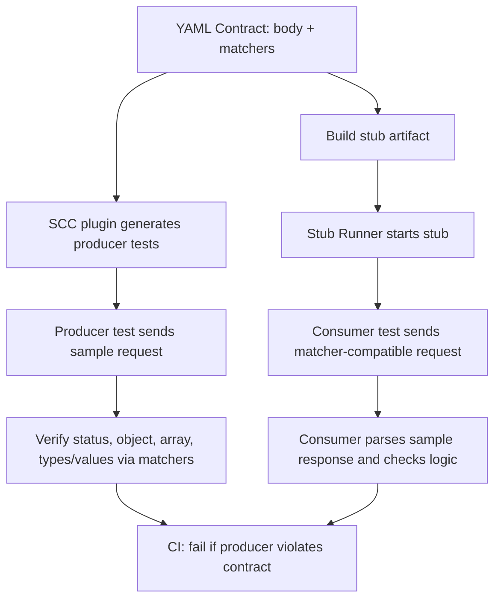

# JSON Objects, Arrays, Numbers, Booleans, and Strings

## 1. JSON Data Is Part of the Contract Between Producer and Consumer

In a multi-service system, the **producer** provides an HTTP API or emits messages; the **consumer** calls the API or consumes those messages. Both sides must agree not only on paths and HTTP status codes, but also on **data shape and meaning**. If the producer changes `isPaid: false` to `isPaid: "false"`, changes `items` from an array to an object, or returns a total amount as a string, the consumer may deserialize incorrectly even though the response still returns `200 OK`.

**Spring Cloud Contract (SCC)** lets you describe these interactions using the **Groovy DSL or YAML DSL**. From the contract, the tooling can generate **producer verification tests** to check real responses and create **stubs** for the consumer to test via **Stub Runner**. CI can block incompatible changes if the corresponding tests are executed against the right code and artifacts.

This lesson belongs to the **Contract Data** chapter and focuses on five common JSON structures:

- **Object**: a set of `key: value` fields, which may contain nested objects.
- **Array**: an ordered list of elements, which may be empty or contain objects.
- **Number**: integer or decimal numbers, distinct from numeric strings.
- **Boolean**: true/false values in the form `true`/`false`.
- **String**: character sequences, including strings that look like numbers, dates, or booleans.

After this lesson, you will be able to convert JSON into a Spring Cloud Contract YAML body, clearly distinguish data types on both sides, use matchers when data varies, choose suitable assertions for arrays and nested objects, and recognize data-compatibility bugs during stub publishing and CI runs.

> A contract does not automatically protect every property of JSON. Only the fields, data types, values, structures, and cases that the test/stub generator **actually constrains and executes** have verified evidence.

## 2. Five JSON Data Types and How They Are Represented in YAML

JSON describes data using objects, arrays, strings, numbers, booleans, and the special value `null`. The Spring Cloud Contract YAML DSL can represent JSON structures using maps, sequences, and scalars. How you write YAML affects the **data type that the parser interprets**.

| JSON type | JSON example | Corresponding YAML syntax | Distinction to watch |
|---|---|---|---|
| Object | `{"customer":{"id":"C-7"}}` | `customer:` newline, then `id: "C-7"` | Object differs from a string containing JSON |
| Array | `{"items":[1,2]}` | `items:` then `- 1`, `- 2` lines | Array differs from an object with keys `0`, `1` |
| Number | `{"quantity":2}` | `quantity: 2` | Number `2` differs from string `"2"` |
| Decimal | `{"price":99.5}` | `price: 99.5` | Does not imply currency/unit |
| Boolean | `{"active":true}` | `active: true` | Boolean `true` differs from string `"true"` |
| String | `{"sku":"BOOK-1"}` | `sku: "BOOK-1"` | String preserves exact formatting |
| Null (for reference) | `{"note":null}` | `note: null` | `null` differs from a missing key and from string `"null"` |

**Do not confuse YAML syntax with JSON:** a leading `-` on an element denotes a **sequence**, not a minus sign attached to a value. In `quantity: -2`, the minus sign is attached to the number and denotes a negative number; in `- quantity: 2`, the dash denotes an object element inside an array.

Full JSON example:

```json
{
  "customer": {
    "id": "CUS-42",
    "vip": true
  },
  "items": [
    { "sku": "BOOK-1", "quantity": 2, "unitPrice": 99000 },
    { "sku": "PEN-2", "quantity": 3, "unitPrice": 10000 }
  ],
  "couponCodes": [],
  "totalAmount": 228000,
  "currency": "VND",
  "paid": false,
  "reference": "000042"
}
```

Corresponding YAML representation:

```yaml
customer:
  id: "CUS-42"
  vip: true
items:
  - sku: "BOOK-1"
    quantity: 2
    unitPrice: 99000
  - sku: "PEN-2"
    quantity: 3
    unitPrice: 10000
couponCodes: []
totalAmount: 228000
currency: "VND"
paid: false
reference: "000042"
```

Both representations describe the **same data shape** when converted with the right types. The total amount `228000` in this example equals `2 × 99000 + 3 × 10000`. However, calculations and currency semantics must be tested at the appropriate layer; a contract matching `totalAmount` does not by itself prove discount logic, tax rules, or database transactions.

## 3. Object: Field Names, Nested Structure, and Semantics

A JSON object consists of `key-value` pairs. In the Spring Cloud Contract YAML DSL, objects are written as **mappings** with consistent indentation:

```yaml
response:
  status: 200
  headers:
    Content-Type: application/json
  body:
    orderId: "ORD-42"
    customer:
      id: "CUS-7"
      profile:
        displayName: "Nguyen An"
        verified: true
    shipping:
      address:
        city: "Hanoi"
        country: "VN"
```

The `response.body` section corresponds to a JSON object in which `customer` and `shipping` are also objects. The fields `displayName`, `verified`, and `city` are not at the same nesting level as `orderId`.

In this contract, the consumer might need:

1. `orderId` to navigate to the order details.
2. `customer.profile.displayName` to display the name.
3. `customer.profile.verified` to decide whether to show a verification badge.
4. `shipping.address.city` to display the destination.

If the producer moves `shipping.address.city` up to `shipping.city`, a consumer reading the old path may fail. This is a **structural change**, even though the field name `city` and its string type remain unchanged.

### 3.1. JSONPath Expressions for Nested Objects

When dynamic matchers are needed, Spring Cloud Contract uses **JSONPath** expressions in the `matchers` section. For example:

| Path | Selected data part |
|---|---|
| `$.orderId` | Top-level `orderId` field |
| `$.customer.id` | ID inside the `customer` object |
| `$.customer.profile.verified` | Boolean nested two levels deep |
| `$.shipping.address.city` | City inside the `address` object |

For keys containing a literal dot in the **actual key name**, do not write them as a hierarchical path. For instance, if JSON has a key `"customer.id"`, use bracketed JSONPath like `$['customer.id']` (following the DSL's escaping syntax), which differs from `$.customer.id`.

**The order of keys in a JSON object does not carry array-order semantics.** However, whether matching ignores extra fields depends on how the engine generates assertions/stub mappings and matchers. Do not assume that a contract always accepts every new field or always forbids unknown fields; inspect the generated tests and the consumer deserializer's behavior.

## 4. Array: Lists, Ordering, and Element Counts

In YAML, a JSON array is written as a **sequence** with items starting with `-`:

```yaml
response:
  status: 200
  headers:
    Content-Type: application/json
  body:
    orderId: "ORD-42"
    items:
      - sku: "BOOK-1"
        quantity: 2
      - sku: "PEN-2"
        quantity: 3
    couponCodes: []
```

The corresponding JSON has:

- `items` as an array of **two objects**, each having `sku` and `quantity`.
- `couponCodes` as an **empty** array, not `null` or a missing field.
- Ordered elements in the array; the consumer may care about this order if the API guarantees sorting.

If the producer returns:

```json
{
  "orderId": "ORD-42",
  "items": { "sku": "BOOK-1", "quantity": 2 },
  "couponCodes": null
}
```

then `items` has changed from an **array** to an **object**, and `couponCodes` has changed from an **empty array** to **null**. A consumer iterating over `items` as a list or assuming `couponCodes` is always a list can break.

### 4.1. Accessing Array Elements with JSONPath

| JSONPath | Interpretation |
|---|---|
| `$.items` | Entire array |
| `$.items[0].sku` | `sku` of the first element |
| `$.items[1].quantity` | `quantity` of the second element |
| `$.items[*].sku` | `sku` values across all matching elements |

In YAML matchers, the path must point to an **element that actually exists in the sample body**. If you declare `$.items[1].quantity` when the body only has one element, the contract may fail to convert or verify as intended. An array can hold numbers, booleans, strings, or objects; choose the right JSONPath for the data shape.

### 4.2. Checking Array Type and Element Count

To check a field's **type**, YAML provides the `by_type` matcher. Example contract response:

```yaml
response:
  status: 200
  body:
    items:
      - sku: "BOOK-1"
        quantity: 2
    active: true
  matchers:
    body:
      - path: $.items
        type: by_type
      - path: $.items[0].quantity
        type: by_type
```

Intended meaning: the generated producer test verifies that `items` is a collection matching the sample type, and that `quantity` at the selected position has the corresponding numeric type. Adding a matcher may change the generated assertions for that data compared to fixed-value matching; inspect the generated test to confirm the exact final constraints.

YAML matchers also support `minOccurrence` and `maxOccurrence` for `by_type`:

```yaml
response:
  status: 200
  body:
    items:
      - sku: "BOOK-1"
        quantity: 2
  matchers:
    body:
      - path: $.items
        type: by_type
        minOccurrence: 1
        maxOccurrence: 5
```

**Important limitation:** current Spring Cloud Contract documentation notes that **JSON array size verification is an experimental feature and is disabled by default**. Some versions require enabling `spring.cloud.contract.verifier.assert.size=true` or configuring `assertJsonSize` on the plugin. Therefore, **do not assume that merely declaring min/max checks sizes in every build**. Always verify the generated assertions and test results with your exact version, plugin, and JSONPath expressions.

With nested collections, counting may behave unexpectedly due to flattening; if exact element counts or strict ordering rules matter, use deliberate supplemental assertions and direct tests. Do not replace element-level matchers with a single blanket `by_type` and assume every element's structure is protected.

### 4.3. Empty Arrays and Missing Fields Are Different Cases

For a consumer, the following responses may not be equivalent:

```json
{"items":[]}
```

```json
{"items":null}
```

```json
{}
```

The first case indicates an empty list; the second has the key with a null value; the third omits the key altogether. If the API promises to always return a list so the consumer does not need null checks, specify that rule clearly and enforce it with appropriate contracts/assertions rather than checking only the field name on a single success sample.

## 5. Number: Integers, Decimals, and Precision Risks

JSON has a single **number** type, without separate Java types like `int`, `long`, or `BigDecimal` in JSON syntax itself. In real applications, Jackson, Gson, JSONPath, JavaScript, or libraries in other languages map JSON numbers to concrete types.

In the YAML DSL:

```yaml
response:
  status: 200
  body:
    quantity: 2
    totalAmount: 228000
    discountRate: 0.15
    balanceAdjustment: -5000
```

All of the values above are written as numbers. By contrast:

```yaml
response:
  status: 200
  body:
    quantity: "2"
    totalAmount: "228000"
    discountRate: "0.15"
```

describes **strings**. If the consumer deserializes `quantity` as an integer, the producer returning `"2"` can cause mapping errors or break comparison logic.

### 5.1. Choosing Number vs. String for IDs

Suppose a customer ID is `"000042"`, with leading zeros. If you write:

```yaml
customerId: 000042
```

the YAML parser may interpret it unexpectedly or drop the leading zeros depending on the parser/version. To represent an **identifier**, use a quoted string:

```yaml
customerId: "000042"
```

Identifiers are generally **strings**, even when composed solely of digits. Choose a number only when the API genuinely commits to arithmetic semantics and the consumer performs math with that value.

### 5.2. Numbers Do Not Inherently Express Currency or Precision

`totalAmount: 228000` could mean 228,000 VND or a smaller currency unit depending on API design. A matcher checking “this is a number” **does not know** the unit, rounding rule, tax, or payment cap.

For financial data, teams should explicitly agree on:

- Currency unit and the `currency` field.
- Whether to use integers in the **smallest unit** or decimal values.
- Rounding rules and precision.
- Value range, signedness, and whether zero is allowed.

JSON numbers also require **cross-language precision** awareness: integers larger than JavaScript's safe integer range can lose precision. If an API transmits IDs or very large integers, agree clearly on representation and test with the real consumer.

### 5.3. Matchers for Numbers

Suppose the producer calculates the total amount dynamically. You can verify the **numeric type** with `by_type` instead of pinning a single fixture value:

```yaml
response:
  status: 200
  body:
    totalAmount: 228000
  matchers:
    body:
      - path: $.totalAmount
        type: by_type
```

For fields with specific formats, SCC supports `by_regex` and `regexType` in YAML, for example integer format:

```yaml
response:
  status: 200
  body:
    attemptCount: 3
  matchers:
    body:
      - path: $.attemptCount
        type: by_regex
        value: "[0-9]+"
        regexType: as_integer
```

Regex matchers typically validate **format**, while type matchers validate **JSON type**. Do not replace all business validation with `[0-9]+`: that pattern does not bound retry counts, maximum monetary amounts, or workflow-permitted values.

**Note:** `regexType` and supported types must be checked against the documentation of your Spring Cloud Contract version. When complex value rules apply—such as total amount equaling the sum of line items—use business tests or custom assertions beyond simple type matchers.

## 6. Boolean: True/False Is Typed Data, Not Free-Form Words

In JSON, booleans are strictly **`true` or `false`**, lowercase and **unquoted**. YAML typically mirrors this:

```yaml
response:
  status: 200
  body:
    paid: false
    verified: true
    refundable: false
```

In the JSON response, these fields are booleans. The following two lines have **different meanings**:

```yaml
paid: false        # boolean false
paidText: "false"   # string "false"
```

The consumer may evaluate a business branch such as `if (order.paid)`. If the producer returns the string `"false"`, behavior depends on the language/framework; some coercion rules will execute the wrong branch. Therefore, **boolean typing is a critical compatibility requirement**, not merely formatting.

### 6.1. Do Not Loosen a Boolean When a Specific Value Is Committed

Suppose the contract for an **unpaid** order requires `paid: false`. If you attach a `by_type` matcher, the generated test may only verify that it is a boolean and accept `true` as well. That defeats the purpose of the scenario.

The contract should keep:

```yaml
response:
  status: 200
  body:
    paid: false
```

If the requirement across scenarios is simply “the `paid` field exists and is a boolean”, a type matcher can make sense:

```yaml
response:
  status: 200
  body:
    paid: false
  matchers:
    body:
      - path: $.paid
        type: by_type
```

In the second example, **do not infer** that tests guarantee the value `false`. Choose the exact constraint level the consumer needs.

### 6.2. Watch Out for YAML Boolean Syntax

To keep meaning unambiguous and avoid differences between YAML parsers, use **lowercase, unquoted `true` and `false`** for booleans. Words like `yes`, `no`, `on`, and `off` can be parsed differently across YAML versions and parsers. If you want a **string** literally equal to `"on"` or `"off"`, wrap it in quotes.

Boolean `false`, `null`, and an absent field are **three distinct states** in many APIs. An API supporting tri-state logic must specify that convention explicitly; a boolean cannot represent “unknown” on its own without allowing null or adding another field.

## 7. String: Codes, Timestamps, Unicode, and Escaping

Strings in JSON are character sequences. In the YAML DSL, quote values whenever content could cause type ambiguity or contains special characters:

```yaml
response:
  status: 200
  body:
    sku: "BOOK-1"
    customerCode: "000042"
    createdAt: "2026-11-24T10:30:00+07:00"
    note: "Deliver before 18:00"
    activeText: "true"
    emptyText: ""
```

All of the values above are **strings**. `activeText: "true"` is not a boolean; `emptyText: ""` is an empty string, distinct from `null`. Unicode characters in strings work normally when files are saved as UTF-8.

For regexes, pay close attention to YAML quoting syntax. For example:

```yaml
response:
  status: 200
  body:
    orderId: "ORD-42"
  matchers:
    body:
      - path: $.orderId
        type: by_regex
        value: 'ORD-[0-9]+'
```

Single quotes preserve `\` characters in regex escapes verbatim; double quotes in YAML have their own escaping rules. Always test matchers on the **actual tooling and version**, rather than assuming YAML parsers interpret regex escapes identically to Java or JavaScript string literals.

### 7.1. Do Not Replace Every String with an Overly Broad Regex

If the consumer only understands `PENDING`, `PAID`, and `FAILED`, using `by_type` on the string only checks the *type*, not the allowed value set. To constrain an enum, use a specific matcher:

```yaml
response:
  status: 200
  body:
    state: "PAID"
  matchers:
    body:
      - path: $.state
        type: by_regex
        value: 'PENDING|PAID|FAILED'
```

However, if the contract specifically describes a **paid order**, requiring exact `state: "PAID"` is usually more appropriate. Do not widen matchers just to make tests fail less often; prioritize protecting the behavior the consumer actually relies on.

### 7.2. A String That Looks Like JSON Is Still a String

These two payloads are different:

```json
{"metadata":{"source":"WEB"}}
```

```json
{"metadata":"{\"source\":\"WEB\"}"}
```

The first payload has `metadata` as an **object**. The second has `metadata` as a **string containing JSON text**. A consumer reading `metadata.source` directly only works with the first case. When designing contracts, avoid accidentally serializing objects into strings; if the real interface uses an escaped JSON string, clearly document that the consumer must parse it a second time.

## 8. From JSON Data to a Complete Spring Cloud Contract YAML Contract

Suppose the `checkout-ui` application needs to create an order through the `order-service` producer. The consumer sends customer info, items, and gift-wrap preference. The producer returns the order ID, total amount, payment status, and item list. The following values represent an **example interface agreed upon by both teams**, not an endpoint auto-generated by SCC.

File `create-order.yml`:

```yaml
name: create_order
description: "Create order with object, array, number, boolean, and string"
request:
  method: POST
  url: /api/orders
  headers:
    Content-Type: application/json
    Accept: application/json
  body:
    customer:
      id: "CUS-42"
      verified: true
    items:
      - sku: "BOOK-1"
        quantity: 2
        unitPrice: 99000
      - sku: "PEN-2"
        quantity: 3
        unitPrice: 10000
    giftWrapped: false
    note: "Deliver during business hours"
  matchers:
    body:
      - path: $.customer.id
        type: by_regex
        value: 'CUS-[0-9]+'
response:
  status: 201
  headers:
    Content-Type: application/json
  body:
    orderId: "ORD-1001"
    totalAmount: 228000
    currency: "VND"
    paid: false
    items:
      - sku: "BOOK-1"
        quantity: 2
      - sku: "PEN-2"
        quantity: 3
    couponCodes: []
  matchers:
    body:
      - path: $.orderId
        type: by_regex
        value: 'ORD-[0-9]+'
      - path: $.totalAmount
        type: by_type
```

### 8.1. What stays fixed?

In the sample request, the producer verification test can use `customer.id: CUS-42`, `verified: true`, the item list, and `giftWrapped: false` to call the API. Except for parts configured with matchers, the sample data expresses the concrete expectations of the scenario.

In the sample response, the stub can return `orderId: ORD-1001` and `totalAmount: 228000` for consumer testing. Fields like `currency: VND`, `paid: false`, and the elements in `items` still carry fixed semantics that should remain strict unless the team intentionally adds appropriate matchers.

### 8.2. What is allowed to vary?

- The **request matcher** on `$.customer.id` lets the stub accept customer IDs matching `CUS-[0-9]+`. The producer test still has a concrete sample value to send.
- The **response matcher** on `$.orderId` lets the producer return an ID other than `ORD-1001`, as long as it follows the format.
- The **response matcher** on `$.totalAmount` primarily protects the **number type**; it does not by itself verify that the total matches the business formula.

If the consumer needs confidence that `totalAmount` is **exact** `228000` for the given fixture, remove the type matcher on that field or add a corresponding business assertion. Flexible matchers reduce coupling to random data, but can weaken guarantees if applied carelessly.

### 8.3. Visualizing Both Execution Sides



Test and stub generation depend on Gradle/Maven plugin configuration, test base classes, fixtures, and CI tasks. A valid YAML file **is not enough** on its own to guarantee that producer tests ran or that the consumer actually called the stub.

## 9. Groovy DSL: Same Data Using Maps and Lists

YAML is a convenient declarative format, but Spring Cloud Contract also provides the **Groovy DSL**. In Groovy, a JSON object is typically represented as a **map**, an array as a **list**, numbers as numeric literals, booleans as `true`/`false`, and strings as string literals.

Concise example:

```groovy
import org.springframework.cloud.contract.spec.Contract

Contract.make {
    name 'order_data_shapes'

    request {
        method POST()
        url '/api/orders'
        headers {
            contentType(applicationJson())
        }
        body(
            customer: [
                id: 'CUS-42',
                verified: true
            ],
            items: [
                [sku: 'BOOK-1', quantity: 2],
                [sku: 'PEN-2', quantity: 3]
            ],
            giftWrapped: false
        )
    }

    response {
        status CREATED()
        headers {
            contentType(applicationJson())
        }
        body(
            orderId: 'ORD-1001',
            paid: false,
            totalAmount: 228000,
            items: [
                [sku: 'BOOK-1', quantity: 2]
            ]
        )
        bodyMatchers {
            jsonPath('$.orderId', byRegex('ORD-[0-9]+'))
        }
    }
}
```

Key takeaways:

- Groovy map `[id: 'CUS-42']` creates an object structure; list `[[sku: 'BOOK-1']]` creates an array of objects.
- Booleans, numbers, and strings must still have the right types.
- In Groovy DSL, you can use **`value(consumer(...), producer(...))`** or `bodyMatchers` for dynamic data.
- **YAML DSL** places sample data in `body` and uses `request.matchers`/`response.matchers` for fields needing flexible checks; do not embed Groovy syntax inside YAML fields expecting it to execute.

For deeply nested JSON, writing maps and lists avoids embedding raw JSON strings in Groovy with hard-to-read escaping. When converting between YAML and Groovy, inspect the **generated JSON output and assertions**, not just whether the syntax looks similar.

## 10. Testing Data with Producer and Consumer: Two Different Pieces of Evidence

### 10.1. What does producer verification protect?

From the contract, Spring Cloud Contract can generate tests that send the declared request and verify the response. Suppose the producer accidentally changes:

```json
{
  "orderId": "ORD-1001",
  "totalAmount": "228000",
  "paid": "false",
  "items": {"sku": "BOOK-1", "quantity": 2}
}
```

These fields changed significantly:

- `totalAmount` from **number** to **string**.
- `paid` from **boolean** to **string**.
- `items` from **array** to **object**.

If the contract/test constrains those fields and types, the producer test will catch the regression. However, if the test skips that part, uses an overly broad matcher, or runs against a fixture that never hits the changed branch, you cannot claim the bug would definitely be caught.

### 10.2. What do consumer tests with Stub Runner protect?

The consumer uses the stub artifact to call a simulated endpoint. If the stub returns:

```json
{
  "orderId": "ORD-1001",
  "totalAmount": 228000,
  "paid": false,
  "items": [{"sku":"BOOK-1","quantity":2}]
}
```

then the consumer test can verify that:

1. The DTO receives `totalAmount` as an appropriate numeric type.
2. Business logic handles `paid` as a boolean rather than doing string comparison.
3. The UI iterates over `items` as a list and displays quantities.
4. The consumer handles an empty list if a dedicated contract/stub exists for that scenario.

However, **a stub is simulated data built from the contract**. A green consumer test against an old stub does not prove that a new producer version returns the right data. CI must run producer verification on the code being released, publish a versioned stub, and test the consumer against that exact artifact.

### 10.3. Data Error and Signal Matrix

| Producer change | How can the consumer be affected? | Contract constraint to have |
|---|---|---|
| `items`: array → object | Loop or list deserialization fails | Collection type and element structure |
| `paid`: boolean → string | Wrong conditional branch or parse failure | Boolean type, fixed value when critical |
| `totalAmount`: number → string | Mapping or calculation error | Number type and unit semantics |
| `reference`: `"000042"` → `42` | Leading zeros lost from code | String and code format |
| `status`: `"PAID"` → `"DONE"` | Consumer enum no longer recognizes value | Supported enum values, not just `by_type` |
| `items` order changes | UI or position-dependent algorithm breaks | Ordering agreement; assertions when order matters |
| `couponCodes`: `[]` → `null` | Consumer iterating list throws error | Distinguish empty array, null, and missing field |
| `customer.profile` moves | JSONPath/DTO cannot find field | Nested object and key path |

**Actual detection capability** depends on the contract suite, matchers, generated code, and executed tests. Even when types are right in the contract, business bugs such as miscalculated totals, broken authorization, or incorrect persistence still require supplemental test layers.

## 11. Common Mistakes When Writing YAML Bodies and Matchers

| Mistake | Example | Fix |
|---|---|---|
| Using string instead of boolean | `paid: "false"` | Use `paid: false` if the real interface specifies boolean |
| Using string instead of number | `quantity: "2"` | Use `quantity: 2` if the client expects a number |
| Writing an array as an object | `items: {sku: BOOK-1}` | Use sequence `items:` + `- sku: ...` |
| Not quoting codes with leading zeros | `reference: 000042` | Use `reference: "000042"` |
| Leaving date/time as an unquoted scalar | `createdAt: 2026-11-24` | Use string `"2026-11-24"` |
| Using `by_type` for a fixed status | `state: PAID` but matcher only checks type | Keep equality or a narrow enum regex |
| Matcher selects only one array item | `$.items[0].sku` | Decide what checks the remaining elements need |
| Assuming `minOccurrence` always works | Size checking option not enabled | Verify version, `assertJsonSize`, and generated tests |
| Matcher points to field absent from sample | `$.customer.address.zip` without `address` | Fix JSONPath/sample; matcher must target an existing element |
| Assuming all numbers are safe across JS/Java | Very large numeric IDs | Choose appropriate data types and test the client |
| Using null instead of an empty list | `items: null` | Agree on nullability; usually prefer `[]` when API commits to a list |
| Generating stubs without running producer tests | Consumer still sees sample response | Enforce producer verification and CI gates |

In particular, these two expressions are not equivalent:

```yaml
response:
  body:
    items: []
```

```yaml
response:
  body:
    items: {}
```

A consumer expecting `items` as `List<Item>` cannot treat `{}` as an empty list. In a contract, a type difference of even a single character can be a breaking change.

## 12. Practice: Designing a Contract for an Order/Product List

**Context:** consumer `inventory-ui` needs to fetch sellable items from producer `catalog-service`. The producer returns an object with these fields:

- `warehouseId`: **string**, e.g., `"WH-001"`.
- `available`: **boolean** indicating whether the warehouse is active.
- `products`: **array** of objects with `sku` (string), `stock` (integer number), `unitPrice` (number).
- `tags`: **array of strings**, may be empty.
- `totalProducts`: **number** counting products by mutual convention.

### 12.1. Requirements

1. Write a YAML contract for `GET /api/warehouses/WH-001/products`, returning HTTP `200` and `Content-Type: application/json`.
2. Set `available: true` as a boolean, not a string; `tags: []` as an empty array.
3. Include at least two elements in `products`: one item with stock `12`, and one item with stock `0`.
4. Allow only `warehouseId` to vary with pattern `WH-[0-9]+` in the **response**, without loosening `available` if the use case is specifically for an active warehouse.
5. Explain why `stock: "12"`, `products: {}`, and `tags: null` can break the consumer.
6. State how to verify array size if the API commits to a minimum element count, and explain the limitation of this feature in SCC.

### 12.2. Reference YAML Solution

```yaml
name: available_warehouse_products
description: "Active warehouse returns product list"
request:
  method: GET
  url: /api/warehouses/WH-001/products
  headers:
    Accept: application/json
response:
  status: 200
  headers:
    Content-Type: application/json
  body:
    warehouseId: "WH-001"
    available: true
    products:
      - sku: "BOOK-1"
        stock: 12
        unitPrice: 99000
      - sku: "PEN-2"
        stock: 0
        unitPrice: 10000
    tags: []
    totalProducts: 2
  matchers:
    body:
      - path: $.warehouseId
        type: by_regex
        value: 'WH-[0-9]+'
```

**Explanation:** `products` is an array of two objects; `stock` and `unitPrice` are numbers; `available` is a boolean; `warehouseId` and `sku` are strings; `tags` is an empty array. The matcher changes only how `warehouseId` is verified on the producer side, while the stub can return the sample `WH-001`.

If a minimum number of elements in `products` must be guaranteed, the team can explore `by_type` with `minOccurrence` and enable the array-size checking feature supported in their exact plugin version. Always verify that the generated tests actually assert the size; if stricter consistency such as `totalProducts == products.size()` is required, add supplemental assertions or business tests.

### 12.3. Extension Suggestion

Add a second contract for an **empty warehouse**:

```yaml
name: empty_warehouse
request:
  method: GET
  url: /api/warehouses/WH-002/products
response:
  status: 200
  headers:
    Content-Type: application/json
  body:
    warehouseId: "WH-002"
    available: true
    products: []
    tags: []
    totalProducts: 0
```

The two contracts represent **two distinct scenarios**. Consumer tests should verify how both populated and empty lists are rendered. Producer tests need fixtures for warehouse `WH-001` with stock and `WH-002` with no stock.

## 13. Checklist Before Approving Contract Data

- [ ] For every field, **object, array, number, boolean, or string** is chosen accurately.
- [ ] `false`, `null`, empty string, and missing field are clearly distinguished.
- [ ] Identifiers with leading zeros, dates/times, statuses, and enums are represented as strings when dictated by the interface design.
- [ ] Arrays are written as proper YAML sequences; nested object items are indented accurately.
- [ ] If the consumer depends on list ordering or length, there are contracts and assertions checking them.
- [ ] Financial data has explicit agreements on unit, currency, precision, and rounding rules.
- [ ] Matchers use accurate JSONPath expressions and are not broader than the consumer allows.
- [ ] Sample values live in `body`; YAML matchers live properly under `request.matchers` or `response.matchers`.
- [ ] Generated producer tests are generated **and executed** with appropriate fixtures; failures halt CI.
- [ ] Stub artifacts are explicitly versioned; consumer tests with Stub Runner assert key types and branches.
- [ ] Array size limitations/settings have been verified if using `minOccurrence` or `maxOccurrence`.
- [ ] Supplemental tests exist for business logic, persistence, security, and out-of-scope contract interactions.

## 14. Takeaways and References

**Objects, arrays, numbers, booleans, and strings are real data-type commitments between producer and consumer.** `[]` is not `{}`; `false` is not `"false"`; `228000` is not `"228000"`; ID `"000042"` must not turn into the number `42`. A small type change can cause deserialization errors, wrong conditional branches, or loss of business meaning.

In Spring Cloud Contract, JSON under `request.body` and `response.body` can be described using YAML maps/sequences/scalars or Groovy maps/lists. Use `matchers` to allow genuinely dynamic parts to vary while preserving the constraints the consumer relies on. Producer verification tests the implementation; stubs and Stub Runner help the consumer test against simulated data. CI delivers value when both sides use the right contracts/versions and **actually execute the tests**.

Official resources to cross-check against your project's Spring Cloud Contract version:

- [Spring Cloud Contract — Dynamic Properties and YAML matchers](https://docs.spring.io/spring-cloud-contract/reference/project-features-contract/dsl-dynamic-properties.html).
- [Spring Cloud Contract — Contract DSL and array size verification limitations](https://docs.spring.io/spring-cloud-contract/reference/project-features-contract.html).
- [Spring Cloud Contract — YML Schema](https://docs.spring.io/spring-cloud-contract/reference/yml-schema.html).
- [Spring Cloud Contract — HTTP Contracts](https://docs.spring.io/spring-cloud-contract/reference/project-features-contract/http.html).
