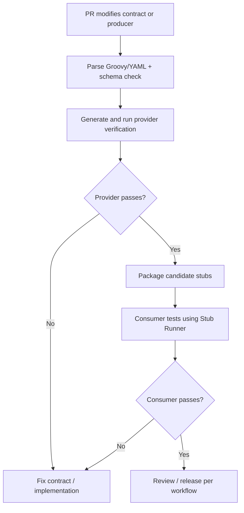

# Dates, Times, Timezones, and Numeric Precision in Spring Cloud Contract

In distributed systems, a `createdAt` field may represent an **absolute instant**, while `deliveryDate` is only a **calendar business date**. An amount of `12.30` may be transmitted as a JSON number, a decimal string, or an integer `1230` in minor units. If producer and consumer interpret timezones, time units, or rounding rules differently, an API can still return HTTP 200 while the data is semantically wrong.

**Spring Cloud Contract (SCC)** lets you record these data commitments using the **Groovy DSL or YAML DSL**, generate producer verification tests, and build stubs for the consumer to run with **Stub Runner**. This lesson in the **Contract Data** chapter focuses on two categories prone to compatibility bugs: **dates/times/timezones** and **numeric precision**. The examples use services `order-producer` and `order-consumer`, from contract definition to CI testing.

After this lesson, you should be able to distinguish `Instant`, local dates, offsets, and timezones; choose appropriate JSON representations and matcher rules; handle currency using exact numeric types; and verify that generated producer tests and consumer tests catch data-breaking changes.

## 1. Why Do Dates, Times, and Numbers Need Strict Contracts?

Consider this response:

```json
{
  "orderId": 1001,
  "createdAt": "2026-11-24T03:15:30.123Z",
  "scheduledDate": "2026-11-25",
  "timeZone": "Asia/Ho_Chi_Minh",
  "amountMinor": 1230,
  "currency": "USD",
  "exchangeRate": "1.234567"
}
```

These fields carry different semantics:

| Field | Representation | Commitment to align on |
| --- | --- | --- |
| `createdAt` | ISO 8601 string with `Z` | An absolute instant, normalized to UTC, with milliseconds |
| `scheduledDate` | `YYYY-MM-DD` string | Calendar date, not yet an instant |
| `timeZone` | IANA Zone ID | Timezone applied to the business schedule |
| `amountMinor` | JSON integer | Value in the agreed **smallest currency unit** |
| `currency` | Currency code string | Unit for `amountMinor`; e.g., USD |
| `exchangeRate` | Decimal string | Preserves exact digits and specified precision rules |

If the consumer assumes `createdAt` is Vietnam time instead of UTC, the displayed time is off by seven hours. If the producer changes `amountMinor: 1230` to `amount: 12.30` without updating the consumer, the monetary amount can be misinterpreted by a factor of 100. If exchange rates are parsed as floating point and rounded carelessly, errors can accumulate.

The goal of a contract is to make **data semantics and wire format verifiable**, not just to check that a field is present.

## 2. Identifying the Right Temporal Data Type

No single temporal type fits every problem. You need to distinguish:

| Concept | Common Java type | Example JSON representation | When to use |
| --- | --- | --- | --- |
| Absolute instant | `Instant` | `2026-11-24T03:15:30.123Z` | Past events, auditing, timestamps |
| Instant with UTC offset | `OffsetDateTime` | `2026-11-24T10:15:30.123+07:00` | Client needs the offset preserved in the data |
| Calendar date | `LocalDate` | `2026-11-25` | Delivery date, birth date, calendar due date |
| Local time | `LocalTime` | `09:00:00` | Opening hours, daily time slots |
| Local date-time | `LocalDateTime` | `2026-11-25T09:00:00` | Explicit wall-clock schedule **without a timezone** |
| Region-based timezone | `ZoneId` | `Asia/Ho_Chi_Minh` | Applying local time rules, including DST where applicable |
| Zoned date-time | `ZonedDateTime` | Includes offset/zone per chosen format | When zone info and conversion rules must be retained |
| Duration | `Duration` | e.g., `PT15M` | Timeouts, wait periods, time-based durations |

`Z` denotes UTC, equivalent to offset `+00:00`. An offset `+07:00` indicates the difference from UTC at that point in time, whereas `Asia/Ho_Chi_Minh` is a **region ID** used by the system to derive offsets from timezone rules. **An offset is not equivalent to a Zone ID**: a region can change its offset over time due to daylight saving time (DST) rules.

### 2.1. Two strings can refer to the same instant

```text
2026-11-24T03:15:30.123Z
2026-11-24T10:15:30.123+07:00
```

Both values refer to the **exact same instant**. However, they are **different character strings**. The contract must decide whether the producer is required to **normalize to UTC** or may return **any valid offset representing the same instant**.

- If the public commitment is that `createdAt` always uses `Z`, an exact string test or UTC format matcher can be appropriate.
- If the commitment is only the same instant, the consumer should parse into `Instant` and compare temporal values rather than strings.
- If the consumer needs the original offset preserved for display, converting to UTC could discard representation details the consumer relies on.

Before choosing a matcher, determine what is **agreed stable behavior** versus what is merely example data.

### 2.2. A calendar date is not a UTC timestamp

Consider an appointment “deliver at 09:00 on Nov 25 Vietnam time”:

```json
{
  "deliveryDate": "2026-11-25",
  "deliveryTime": "09:00:00",
  "timeZone": "Asia/Ho_Chi_Minh"
}
```

When converted to an instant in that zone, for this example we get:

```text
2026-11-25T09:00:00+07:00
= 2026-11-25T02:00:00Z
```

Never blindly append `Z` to `2026-11-25T09:00:00`; doing so changes its meaning to 09:00 UTC, seven hours later than Vietnam time.

Birth dates or calendar accounting dates should also never be converted arbitrarily into timestamps and shifted by timezones; doing so can cause a **date** off-by-one shift for consumers in other timezones.

## 3. Timezones and DST: Hidden Sources of Bugs

### 3.1. Fixed offsets vs. region-based timezones

Distinguish:

```text
+07:00               # UTC offset
Asia/Ho_Chi_Minh     # Zone ID
America/New_York     # Zone ID, with DST rules
```

A UTC offset only describes the difference at a single moment. For future appointments, storing a fixed offset instead of a Zone ID can produce the wrong hour if regional rules change. When business logic specifies “09:00 New York time”, store **local date/time + Zone ID**, or also keep the resolved instant along with a DST handling policy.

### 3.2. Non-existent hours and ambiguous (overlapping) hours

In regions observing DST, certain local times **do not exist** when clocks spring forward, and **occur twice** when clocks fall back.

For example, in `America/New_York` during 2026:

| Local value | Issue |
| --- | --- |
| `2026-03-08T02:30:00` | Falls inside the spring-forward DST gap and does not exist in New York |
| `2026-11-01T01:30:00` | Occurs twice during the fall-back DST transition and can map to two different instants |

If you only transmit `"2026-11-01T01:30:00"` without an offset or a Zone ID plus an explicit first/second-occurrence policy, the consumer cannot resolve a single unambiguous instant.

A contract for **scheduled appointments** should clarify:

1. Who determines the appointment's timezone: producer, consumer, or user account?
2. When a local time does not exist, does the API reject it, shift to a valid time, or ask the user to re-select?
3. When an hour is duplicated, does the API require an offset or apply a consistent resolution rule?
4. After scheduling, does the API preserve the **local wall-clock time in the zone** or preserve the **instant** if timezone rules change?

An HTTP contract verifies payloads and behavior in the authored scenarios; to thoroughly cover DST transitions, add business test cases with representative zones and transition instants.

### 3.3. UTC for recording events, Zone ID for representing schedules

A strategy that is usually easy to reason about:

- Past events: return UTC `Instant`, e.g., `2026-11-24T03:15:30.123Z`.
- Zoned schedules: return local date/time and Zone ID, or also include the resolved instant.
- Durations: use clearly named units (`timeoutMillis`, `retryAfterSeconds`) or an agreed duration format.
- Always document format, precision, and timezone handling in both API docs and contract tests.

## 4. Timestamp Formats and Precision

### 4.1. ISO 8601 and fractional seconds

The representations below differ in granularity:

```text
2026-11-24T03:15:30Z            # precision to seconds
2026-11-24T03:15:30.123Z        # three fractional digits: milliseconds
2026-11-24T03:15:30.123456Z     # six fractional digits: microseconds
2026-11-24T03:15:30.123456789Z  # nine fractional digits: nanoseconds
```

If the API commits to exactly three digits after the decimal point, the producer switching to six digits can break a consumer using a strict parser or regex. Conversely, if the commitment only requires a **valid ISO timestamp** and the consumer accepts variable fractional digits, do not hardcode three digits merely because of current serializer settings.

**Precision and resolution are not quite the same thing**: a timestamp formatted with three fractional digits does not guarantee the underlying clock measures events to sub-millisecond accuracy. Distinguish wire-format requirements from the true accuracy of the time source.

### 4.2. Epoch seconds vs. epoch milliseconds

If transmitting timestamps as epoch integers, you must make the **unit** explicit:

```json
{
  "eventEpochSeconds": 1730000000,
  "eventEpochMillis": 1730000000000
}
```

These two numbers represent the same point in time, yet differ by a factor of **1,000**. A contract with a generic field `"timestamp": 1730000000` easily causes unit confusion.

Prefer field names like `createdAtEpochMillis`, `expiresAtEpochSeconds`, or explicit schema docs; avoid switching from ISO strings to epoch numbers without a compatibility plan. Additionally, many JavaScript systems use `Number` for JSON numbers, so evaluate safe integer limits if epochs use micro/nanosecond resolution or large IDs.

### 4.3. Parse into temporal values, do not compare concatenated strings

Java:

```java
import java.time.Instant;
import java.time.OffsetDateTime;

Instant utc = Instant.parse("2026-11-24T03:15:30.123Z");
OffsetDateTime vietnam =
    OffsetDateTime.parse("2026-11-24T10:15:30.123+07:00");

assert utc.equals(vietnam.toInstant());
```

Here `equals` compares the **instant**. Comparing the two ISO strings directly will evaluate to unequal even though they represent the same moment. In consumer tests, use the exact parser type used by the real application.

## 5. Groovy DSL Example: Instants, Schedules, and Currency in One Contract

Suppose the consumer schedules order processing via `POST /api/orders/scheduled`. The team has agreed:

- The consumer sends `scheduledDate` and `scheduledTime` in `Asia/Ho_Chi_Minh`.
- The producer returns `scheduledAt` as the resolved UTC instant.
- `createdAt` is UTC with three fractional digits in the fixed example.
- Money is stored in **USD minor units**, with `amountMinor: 1230` representing 12.30 USD.
- `exchangeRate` is transmitted as a **decimal string**, with six decimal places in the sample contract.

File `src/test/resources/contracts/http/post-scheduled-order.groovy`:

```groovy
import org.springframework.cloud.contract.spec.Contract

Contract.make {
    description 'Schedule order and return UTC instant along with currency data'

    request {
        method POST()
        url '/api/orders/scheduled'
        headers {
            contentType(applicationJson())
        }
        body(
            scheduledDate: '2026-11-25',
            scheduledTime: '09:00:00',
            timeZone: 'Asia/Ho_Chi_Minh',
            amountMinor: 1230,
            currency: 'USD'
        )
    }

    response {
        status CREATED()
        headers {
            contentType(applicationJson())
        }
        body(
            orderId: 1001,
            createdAt: '2026-11-24T03:15:30.123Z',
            scheduledAt: '2026-11-25T02:00:00Z',
            amountMinor: 1230,
            currency: 'USD',
            exchangeRate: '1.234567'
        )
    }
}
```

Simulated JSON response:

```json
{
  "orderId": 1001,
  "createdAt": "2026-11-24T03:15:30.123Z",
  "scheduledAt": "2026-11-25T02:00:00Z",
  "amountMinor": 1230,
  "currency": "USD",
  "exchangeRate": "1.234567"
}
```

**What to verify:**

| Field | Business rule | Typical compatibility bug |
| --- | --- | --- |
| `scheduledDate` | Local calendar date | Producer treats this date as a UTC date |
| `scheduledTime` | Local time | Consumer ignores `timeZone` |
| `timeZone` | IANA Zone ID | Producer treats Zone ID as a fixed offset |
| `scheduledAt` | UTC instant matching requested date/time | Wrong UTC conversion, timezone offset error |
| `createdAt` | Instant event was created | Changed format, precision, or timezone |
| `amountMinor` | Integer in smallest unit of USD | Sending major unit amount while keeping the old field name |
| `exchangeRate` | Decimal string at defined precision | Switched to JSON floating number or truncated digits |

This example uses **fixed** timestamps to teach declaration and verification. In a real producer, `createdAt` is usually generated from the runtime clock; use a fixed test clock or an appropriate matcher rather than expecting every production request to match the example timestamp.

## 6. Equivalent Contract in YAML DSL

File `src/test/resources/contracts/http/post-scheduled-order.yml`:

```yaml
description: "Schedule order and return UTC instant along with currency data"
request:
  method: POST
  url: /api/orders/scheduled
  headers:
    Content-Type: application/json
  body:
    scheduledDate: "2026-11-25"
    scheduledTime: "09:00:00"
    timeZone: Asia/Ho_Chi_Minh
    amountMinor: 1230
    currency: USD
response:
  status: 201
  headers:
    Content-Type: application/json
  body:
    orderId: 1001
    createdAt: "2026-11-24T03:15:30.123Z"
    scheduledAt: "2026-11-25T02:00:00Z"
    amountMinor: 1230
    currency: USD
    exchangeRate: "1.234567"
```

The Groovy and YAML files illustrate **the same scenario**. In practice, place only one version in the contract path scanned by the build; keeping both can generate two duplicate provider tests and two duplicate stubs for the same scenario.

**Watch out for YAML scalars:** always quote string-formatted dates, times, and timestamps, especially when containing `:`, date segments, or leading zeros. YAML parsers apply scalar inference rules; if `exchangeRate: 1.234567` is unquoted, it may be parsed as a numeric type instead of the committed **decimal string**. Having valid YAML syntax is not enough: inspect the **final generated JSON and matchers** in the stub and provider test.

## 7. Dynamic Data: Matchers and Test Clocks

### 7.1. When to pin exact values vs. when to use matchers?

| Data field | Sample value | Recommended verification |
| --- | --- | --- |
| Fixed business date in test case | `2026-11-25` | Exact value when using a concrete test case |
| Requested timezone | `Asia/Ho_Chi_Minh` | Exact value if the contract targets that zone |
| System-clock generated `createdAt` | `2026-11-24T03:15:30.123Z` | Fixed test clock **or** format matcher combined with semantic assertions |
| Database-generated `orderId` | `1001` | Type/format matcher if exact ID is not guaranteed |
| `amountMinor` computed from fixed inputs | `1230` | Exact value after business calculation |
| `exchangeRate` from dynamic source | `1.234567` | Format matcher **and** dedicated rate-rule tests |

Do not slap `.*` regexes onto timestamps, IDs, or exchange rates just to make tests pass. A regex checking only character shape can permit invalid dates, wrong precision, or nonsensical monetary values. When business logic depends on exact timestamps or amounts, add supplemental assertions.

### 7.2. Matcher for timestamps with a stable format

Groovy DSL example when the producer may return any valid UTC instant with **exactly three millisecond digits**:

```groovy
response {
    status CREATED()
    headers {
        contentType(applicationJson())
    }
    body(
        orderId: 1001,
        createdAt: '2026-11-24T03:15:30.123Z'
    )
    bodyMatchers {
        jsonPath(
            '$.createdAt',
            byRegex('^\\d{4}-\\d{2}-\\d{2}T\\d{2}:\\d{2}:\\d{2}\\.\\d{3}Z$')
        )
    }
}
```

**Explanation:** `body` provides the sample value used to build the stub, while `bodyMatchers` specifies how the producer response JSON field is verified against the matcher rule. The regex here **checks shape only** (`YYYY-MM-DDTHH:mm:ss.SSSZ`); it does not verify valid calendar months/days, business correctness, or proximity to the current clock. To verify semantics, parse with `Instant` and assert according to business rules.

If the API allows 0–9 fractional digits or non-`Z` offsets, adjust the matcher **to match the real commitment**. Do not treat the regex above as a general ISO 8601 validator.

In the YAML DSL, SCC versions support `matchers` in the response. Example illustrating the same intent:

```yaml
response:
  status: 201
  headers:
    Content-Type: application/json
  body:
    orderId: 1001
    createdAt: "2026-11-24T03:15:30.123Z"
  matchers:
    body:
      - path: $.createdAt
        type: by_regex
        value: '^\d{4}-\d{2}-\d{2}T\d{2}:\d{2}:\d{2}\.\d{3}Z$'
```

Matcher syntax and test/stub generation must be verified against the **actual Spring Cloud Contract version** used by your project. If you want an exact value rather than a regex, keep the literal in `body` and omit the matcher.

### 7.3. Using a fixed clock in producer tests

For contracts requiring exact timestamps, design the producer to obtain time from `java.time.Clock` instead of scattering `Instant.now()` calls:

```java
import java.time.Clock;
import java.time.Instant;

class OrderService {
    private final Clock clock;

    OrderService(Clock clock) {
        this.clock = clock;
    }

    Instant createdAt() {
        return Instant.now(clock);
    }
}
```

In your test configuration you can provide:

```java
import java.time.Clock;
import java.time.Instant;
import java.time.ZoneOffset;

Clock fixedClock = Clock.fixed(
    Instant.parse("2026-11-24T03:15:30.123Z"),
    ZoneOffset.UTC
);
```

When generated producer tests run in a context configured with `fixedClock`, the `createdAt` value becomes deterministic. This is a strong option when you need to verify **exact time conversions or calculations from a fixed baseline**. Matchers are better when you only need to validate format or value type without fixing a specific instant.

**Do not depend on the CI machine's default timezone.** Avoid `ZoneId.systemDefault()` in business logic if timezone is part of the contract; configure UTC or pass the Zone ID explicitly.

## 8. Numeric Precision: JSON Numbers Are Not Exact Decimals

### 8.1. IEEE 754 and floating-point inaccuracy

For example, in many languages:

```text
0.1 + 0.2 may produce a representation close to 0.30000000000000004
```

`float` and `double` store binary approximations, making them unsuitable when **exact decimal monetary calculations** are required without explicit rounding and conversion rules.

In Java, `BigDecimal` supports exact decimal arithmetic preserving the supplied digits. Always construct from a string:

```java
import java.math.BigDecimal;

BigDecimal unitPrice = new BigDecimal("12.30");
BigDecimal quantity = new BigDecimal("2");
BigDecimal total = unitPrice.multiply(quantity); // 24.60
```

Avoid the following when representing exact decimal `0.1`:

```java
BigDecimal risky = new BigDecimal(0.1); // receives an approximate double value
BigDecimal exact = new BigDecimal("0.1");
```

A contract should verify not only “this is a number”, but also **units, scale rules, and JSON representation** when the consumer depends on them.

### 8.2. JSON numbers vs. decimal strings

Compare:

```json
{
  "amountNumber": 12.30,
  "amountText": "12.30",
  "amountMinor": 1230
}
```

| Representation | Pros | Risks/commitments to state |
| --- | --- | --- |
| JSON number `12.30` | Natural numeric form, clients can compute directly | Some parsers convert to binary floating point; serializing `12.30` as `12.3` can lose scale info in string comparisons |
| Decimal string `"12.30"` | Preserves exact digit representation and scale | Consumer must parse with decimal rules rather than careless float parsing |
| Integer minor units `1230` | Exact arithmetic with integer operations | Requires `currency` and smallest-unit digit rules; guard against overflow |

These representations **are not automatically compatible**. Changing `amountMinor` to `amountNumber` or switching between string and number must be treated as an interface change tested by both producer and consumer.

With JSON numbers, `12.30`, `12.3`, and `1.23e1` are mathematically equal; however, they can differ in text representation, decimal parser scale, and serializer output. If the exact number of decimal places is a business requirement, express it explicitly using a **decimal string** or an explicit scale convention rather than relying on JSON number formatting.

### 8.3. Safe integer limits in some consumers

JavaScript `Number` can only represent integers exactly between `-(2^53 - 1)` and `2^53 - 1`, i.e., `9,007,199,254,740,991` in absolute value. If a producer returns 64-bit IDs beyond this range as JSON numbers, consumers using `Number` may lose digits.

For large **identifiers**, consider transmitting an agreed string in the API:

```json
{
  "orderId": "9223372036854775807"
}
```

This is different from decimal money, yet illustrates the same principle: **the producer's storage type does not guarantee the consumer reads the exact same value**. When switching from number to string, update the contract and verify the consumer parses it properly.

## 9. Rounding Rules, Scale, and Currency Units

### 9.1. Rounding is business behavior

Example:

```java
import java.math.BigDecimal;
import java.math.RoundingMode;

BigDecimal value = new BigDecimal("10.005");

BigDecimal halfUp = value.setScale(2, RoundingMode.HALF_UP);
// 10.01

BigDecimal halfEven = value.setScale(2, RoundingMode.HALF_EVEN);
// 10.00
```

Both results are valid under **two different rules**; the contract must reflect the chosen business rule. If the producer silently switches from `HALF_UP` to `HALF_EVEN`, the consumer can receive different totals or tax amounts even though JSON field names stay identical.

For `BigDecimal` division, never assume every quotient has a terminating decimal expansion. Specify scale/precision and `RoundingMode` whenever business logic requires it.

### 9.2. Minor units must travel with currency

```json
{
  "amountMinor": 1230,
  "currency": "USD"
}
```

In this example `1230` means **1,230 cents = 12.30 USD** under the convention of 100 cents per 1 USD. You cannot assume every currency has two decimal places; the number of minor units depends on the currency and payment convention in use. If the system uses “minor units”, define explicit conversion rules per currency and data version.

Never change `currency` while keeping `amountMinor` unchanged and assume the economic value stays the same.

### 9.3. Exchange rates and intermediate calculations

An exchange rate like `1.234567` may need six decimal places, while the final monetary amount only needs the currency's minor units. Decide:

1. At what **precision/scale** are exchange rates stored and exchanged?
2. Is rounding applied at **each intermediate step** or only on the **final result**?
3. Which `RoundingMode` applies, and for which currencies?
4. Does the API return the computed result, the input values, or both so the consumer can verify?
5. When changing the algorithm, which consumers rely on the previously rounded results?

A fixed contract lets you verify key calculation examples, while unit/property tests can exercise broad boundary values. Contracts do not replace full financial algorithm test suites.

## 10. Writing Contracts for Decimal Strings in Groovy and YAML

Suppose the producer returns decimal money as a **string** to preserve scale:

```json
{
  "currency": "USD",
  "amount": "12.30"
}
```

Groovy DSL:

```groovy
import org.springframework.cloud.contract.spec.Contract

Contract.make {
    description 'USD amount transmitted as a string with two decimal places'

    request {
        method GET()
        url '/api/orders/1001/amount'
    }

    response {
        status OK()
        headers {
            contentType(applicationJson())
        }
        body(
            currency: 'USD',
            amount: '12.30'
        )
        bodyMatchers {
            jsonPath('$.amount', byRegex('^-?\\d+\\.\\d{2}$'))
        }
    }
}
```

This matcher only guarantees the string **has two decimal digits**; it does not ensure the amount is non-negative (because of `-?`) or within an allowed range. If only non-negative amounts are permitted, remove `-?` and add range tests as needed.

Illustrative YAML DSL:

```yaml
description: "USD amount as a string with two decimal places"
request:
  method: GET
  url: /api/orders/1001/amount
response:
  status: 200
  headers:
    Content-Type: application/json
  body:
    currency: USD
    amount: "12.30"
  matchers:
    body:
      - path: $.amount
        type: by_regex
        value: '^-?\d+\.\d{2}$'
```

**Verify against your running SCC version:** this sample uses a JSONPath response body matcher. During the build, verify that the provider test checks the declared regex and the consumer stub returns `"12.30"`. If preserving exact scale is mandatory across responses, a regex fits well; if only numeric equivalence matters, `BigDecimal` parsing and numeric comparison rules may be more appropriate.

### 10.1. Do not use numeric-type matchers to mask monetary discrepancies

If the producer returns `12.31` instead of `12.30` due to a rounding bug, a matcher checking “string with two decimal digits” will still **pass**. For fixed calculation scenarios, the contract should assert the **exact expected value** or supplement with producer calculation tests.

Likewise, a matcher saying “`id` is a number” does not prove the ID is meaningful or corresponds to the queried resource.

## 11. Synchronizing Dates and Times Across Requests, Responses, and Messages

Temporal fields frequently span both HTTP and messaging. A producer might create an order over HTTP and then publish an event:

```json
{
  "eventType": "ORDER_SCHEDULED",
  "orderId": 1001,
  "occurredAt": "2026-11-24T03:15:30.123Z",
  "scheduledAt": "2026-11-25T02:00:00Z",
  "amountMinor": 1230,
  "currency": "USD"
}
```

Illustrative Groovy message contract:

```groovy
import org.springframework.cloud.contract.spec.Contract

Contract.make {
    description 'Publish order scheduled event with UTC instants and minor-unit amount'
    label 'order_scheduled_v1'

    input {
        triggeredBy('publishOrderScheduled()')
    }

    outputMessage {
        sentTo('orders.scheduled')
        headers {
            messagingContentType(applicationJson())
        }
        body(
            eventType: 'ORDER_SCHEDULED',
            orderId: 1001,
            occurredAt: '2026-11-24T03:15:30.123Z',
            scheduledAt: '2026-11-25T02:00:00Z',
            amountMinor: 1230,
            currency: 'USD'
        )
    }
}
```

To verify the producer side, the test base class must provide `publishOrderScheduled()` and configure the appropriate message verifier/binder. On the consumer side, **Stub Runner** can trigger the message by label `order_scheduled_v1`; the consumer test must assert behavior after the listener receives the event.

Points to align across both channels:

- `occurredAt` is when the event was created; `scheduledAt` is the scheduled execution instant. The two timestamps can differ by hours or days.
- Do not change `occurredAt` from a UTC string to epoch milliseconds in event v1 without verifying consumers.
- If the consumer uses the event to compute totals, `amountMinor` and `currency` must keep the exact same semantics as the HTTP contract, or have explicit mapping/versioning.
- When migrating the event schema from `v1` to `v2`, check consumer groups, replays, DLQs, and stub versions before retiring v1.

## 12. What Bugs Do Producer Verification and Stub Runner Catch?

Suppose the HTTP contract specifies:

```json
{
  "createdAt": "2026-11-24T03:15:30.123Z",
  "amountMinor": 1230,
  "currency": "USD"
}
```

If the producer returns:

```json
{
  "createdAt": "2026-11-24T10:15:30.123Z",
  "amountMinor": 12.30,
  "currency": "USD"
}
```

two serious regressions have occurred:

1. `createdAt` has `Z` appended while keeping local wall-clock hours, creating an **instant shifted by seven hours**.
2. `amountMinor` changed from integer `1230` to decimal `12.30` in the same field, **changing the unit**.

If the provider contract checks exact values or strict enough matchers, the generated producer test will catch this. If the matcher only checks that `createdAt` is a string and `amountMinor` is a number, those semantic bugs can **slip through**. That is why type, unit, value, and calculation checks must be combined.

On the consumer side, Stub Runner produces sample responses from the contract to test date/time and money parsing code. Example test logic:

```java
import static org.junit.jupiter.api.Assertions.assertEquals;

import java.math.BigDecimal;
import java.time.Instant;
import org.junit.jupiter.api.Test;

class ContractDataConsumerTest {
    @Test
    void parsesContractValues() {
        // In a real integration test, these values come from
        // an HTTP client calling Stub Runner, not hardcoded directly.
        String createdAt = "2026-11-24T03:15:30.123Z";
        String amount = "12.30";

        assertEquals(
            Instant.parse("2026-11-24T03:15:30.123Z"),
            Instant.parse(createdAt)
        );
        assertEquals(
            new BigDecimal("12.30"),
            new BigDecimal(amount)
        );
    }
}
```

The snippet above **illustrates parsing and assertions**; it is not a complete consumer test because Stub Runner has not been started. In a real lab exercise, configure `spring-cloud-starter-contract-stub-runner`, use the right version of the stubs JAR, and point your application's client at the stub endpoint. Verify that the client genuinely parses `createdAt` into `Instant` and `amount` into `BigDecimal`.

### 12.1. Contract tests do not replace business tests

| Test type | What does it protect? |
| --- | --- |
| HTTP provider contract test | Producer returns fields/types/formats/values matching the contract |
| Message provider contract test | Producer emits payloads and destinations matching the contract |
| Consumer test with Stub Runner | Consumer parses and handles sample/matched values from the contract |
| Money calculation unit test | Scale, rounding, overflow, negative numbers, boundary rules |
| Date/time unit/integration test | DST, timezone database, recurring schedules, calendar anomalies |
| End-to-end/observability | Behavior across gateways, serializers, brokers, real data and environments |

**A contract-compliant stub can still pass while the real producer computes wrong results.** Always run generated producer tests; for critical changes, add consumer contract tests and risk-based integration tests.

## 13. Designing CI to Control Data Changes

Simple pipeline:



In a Maven project configured with Spring Cloud Contract Verifier and its plugin:

```bash
mvn clean verify
```

This command only proves compliance if **generated tests are actually generated and executed**; check build logs and test-mode configuration. When testing candidate stubs in the consumer, verify the stub artifact version and confirm tests pull the new artifact rather than a stale cache.

Intentional breaking-change drills CI should catch:

| Test mutation | Expected outcome |
| --- | --- |
| Change UTC `createdAt` to a local string without timezone | Format/semantics verification tests must fail |
| Switch epoch milliseconds to seconds | Contracts or consumer tests expecting the old unit must fail |
| Change `amountMinor: 1230` to `12.30` | Provider verification must catch if value/type constraints are strict enough |
| Change JSON decimal string to number | Consumer tests parsing per committed type must fail |
| Change `HALF_UP` to `HALF_EVEN` on `10.005` | Business tests verifying rounding must fail |
| Replace `ZoneId` with fixed offset for DST schedule | DST schedule tests must detect it |
| Drop precision in timestamps | Format tests or consumer parsers must catch it if committed |

Do not assume every row in this table is covered by a single contract. For these cases to actually fail, you must write the **corresponding tests and assertions**.

## 14. Common Mistakes

**“The timestamp has `Z`, so it must be valid UTC.”** A string with `Z` is only syntactically UTC. If an application takes local time and appends `Z` without converting, the instant is still wrong. Verify conversions with `ZoneId` and `Instant`.

**“`+07:00` is the same as `Asia/Ho_Chi_Minh`.”** An offset describes a difference, while a Zone ID holds regional rules. For future schedules in DST regions, storing only an offset loses information.

**“If the parser accepts ISO, there is no need to check units or precision.”** Parsers may allow variable fractional digits, yet the contract still needs to state business requirements. Precision changes can affect comparison, sorting, and storage.

**“Every epoch timestamp is in milliseconds.”** Epoch seconds and epoch milliseconds differ by a factor of 1,000. Name fields or document schemas explicitly with units.

**“`12.30` and `12.3` are equal so it doesn't matter.”** Mathematically they are equal, but scale, display formatting, serialization, and consumer parsing may differ. Decide whether the contract guarantees numeric value or also digit representation.

**“`double` is good enough for all monetary math.”** Binary floating point introduces representation error. Use integer minor units or `BigDecimal` with explicit rounding rules.

**“All currencies have two decimal places.”** Minor-unit conventions vary by currency; always record both the unit and currency.

**“A regex on a timestamp is enough to validate dates.”** A format regex can still match month 99 or day 32. When business logic depends on valid calendar dates and times, parse with a temporal library and validate rules.

**“Stub Runner passing proves the producer calculates correctly.”** Stubs return data directly from the contract; they do not verify real producer math. Provider verification and business tests are required.

**“Running tests on a personal laptop is enough.”** CI machines may have a different default timezone. Tests should configure clocks and `ZoneId` explicitly and be verified in the pipeline.

## 15. Practice Exercise and Self-Assessment Criteria

Create or open `order-producer` and `order-consumer` projects integrated with Spring Cloud Contract. Choose **one primary DSL** for the scenarios in the build directory and use the other DSL in an experimental branch for comparison.

1. Write an HTTP contract for `POST /api/orders/scheduled` as shown, sending `09:00` in `Asia/Ho_Chi_Minh` and expecting `scheduledAt: 2026-11-25T02:00:00Z`.
2. Use `java.time` to convert local date/time + `ZoneId` to `Instant`. Write assertions proving the UTC and `+07:00` representations denote the same instant.
3. Add `createdAt` generated by `Clock`. Try a fixed test clock and then try a format matcher; compare what each approach verifies.
4. Add a contract for monetary values using `amountMinor` and `currency`, then experiment with switching to a decimal string. Record whether this is compatible with existing clients.
5. Write unit tests using `BigDecimal("10.005")` to distinguish `HALF_UP` from `HALF_EVEN`. Guard the rounding outcome chosen by the business.
6. Write DST cases for `America/New_York`: non-existent `2026-03-08T02:30` and ambiguous `2026-11-01T01:30`. Define the API policy applied to each case.
7. Create a message contract `orders.scheduled` with `occurredAt`, `scheduledAt`, `amountMinor`, and `currency`. Test producer publishing and consumer message parsing via Stub Runner.
8. Package candidate stubs, run consumer tests, and introduce deliberate mutations: epoch seconds/millis, string/number, timezone, decimal scale. Record which tests fail.
9. Integrate provider verification, consumer Stub Runner tests, and critical business tests into CI with pinned stub versions.

Self-assessment checklist:

| Competency | Evidence |
| --- | --- |
| Distinguish instant vs. local date/time | Never append `Z` arbitrarily; convert properly using Zone ID |
| Understand timezones/DST | Handles non-existent and overlapping hours according to policy |
| Control timestamps | Defines format, precision, and epoch units |
| Control numeric data | Distinguishes JSON numbers, decimal strings, and minor units |
| Exact arithmetic | Uses `BigDecimal`/integers with explicit rounding rules |
| Meaningful Groovy/YAML contracts | Provider tests verify critical data per contract |
| Consumer handles stubs | Stub Runner is used with exact artifact version and real assertions |
| CI catches incompatible changes | Meaningful data mutations cause the right tests to fail |

**Takeaway:** in contract data, **data types and formatting are only the outer layer; timezones, units, precision, and rounding rules determine meaning**. Expressing these commitments explicitly in Groovy/YAML DSL, verifying the real producer with Contract Verifier, testing the consumer with Stub Runner, and adding key boundary cases to CI helps catch communication bugs early even when APIs return HTTP success codes.
