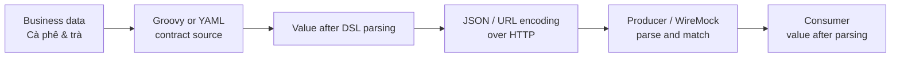
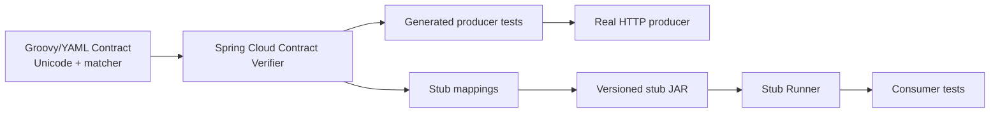

# Unicode, Special Characters, and Escaping

## 1. Why Do Unicode and Escaping Matter for Contracts?

In **Spring Cloud Contract**, a contract describes the HTTP requests/responses or messages that a **producer** commits to providing for a **consumer**. Contracts written in **Groovy DSL** or **YAML DSL** can generate producer-side tests and build stubs so **Stub Runner** can support consumer-side testing. When data contains Vietnamese diacritics, quotes, backslashes, emojis, or control characters, different representation layers can cause the exact same value to be misinterpreted.

Consider the following values:

```text
Customer name: Nguyễn Ánh
Note:          Cà phê & trà
Keyword:       C++
Path:          C:\docs\receipt.pdf
Message:       Line 1\nLine 2
```

The last line above can be interpreted as **the two characters `\` and `n`** or as **a real newline character**, depending on which parser layer has processed it. This is a common cause of false test failures, overly loose contracts, or stubs that misrepresent the producer.

This lesson belongs to the **Contract Data** chapter and helps you:

- Distinguish Unicode, UTF-8, escaping in Groovy/YAML/JSON, and URL percent-encoding.
- Author contracts that preserve Vietnamese text, emojis, quotes, backslashes, tabs, and newlines.
- Design Unicode and regex matchers without misinterpreting special characters.
- Test the real producer, stub, and consumer in CI when APIs carry complex character data.

## 2. One Value Passes Through Multiple Representation Layers



| Layer | Illustrative representation | Rule |
|---|---|---|
| Original value | `Cà phê & trà` | Business content |
| Groovy/YAML string | `'Cà phê & trà'` | Interpreted by the source language parser |
| JSON string | `"Cà phê & trà"` | Interpreted by the JSON serializer/decoder |
| Encoded query string | `q=C%C3%A0%20ph%C3%AA%20%26%20tr%C3%A0` | Interpreted by the URL decoder |
| Assertion | Compare `name` with `Cà phê & trà` | Verifies parsed data matches commitment |

**Do not copy escaping blindly from one layer to another.** For instance, `\"` in JSON represents a double quote; after parsing, the value is simply `"`. Similarly, a regex containing `\.` to match a literal dot does not mean the JSON payload needs to contain a backslash character.

## 3. Unicode, UTF-8, and Character Normalization

### 3.1. Visible characters differ from bytes and code units

A **Unicode code point** is a numeric character identifier; **UTF-8** encodes a code point into 1–4 bytes; **UTF-16** may require two code units for a code point outside the BMP. Java's `String.length()` counts **UTF-16 code units**, not the graphemes a user visually sees.

| Example | Key point |
|---|---|
| `A` | ASCII, one UTF-8 byte |
| `à` | Precomposed accented letter, typically two UTF-8 bytes |
| `đ` | Distinct letter character, not in ASCII `[A-Za-z]` |
| `🧪` | One emoji code point, four UTF-8 bytes and two UTF-16 code units |
| `e` + combining mark `◌́` | Two code points that may look like a single `é` |

Therefore, a “30-character” limit must specify whether it counts **bytes**, **code points**, or **grapheme clusters**. If the producer limits bytes while the consumer counts visible characters, a Vietnamese name or emoji string can be unexpectedly rejected.

### 3.2. NFC and NFD can look identical yet compare unequal

```text
NFC: "café"   - precomposed é U+00E9
NFD: "café"   - e U+0065 plus mark U+0301
```

Two strings can look identical on screen yet fail standard Java equality checks. For example:

```java
import java.text.Normalizer;

String composed = "café";
String decomposed = "cafe\u0301";

System.out.println(composed.equals(decomposed)); // false

String a = Normalizer.normalize(composed, Normalizer.Form.NFC);
String b = Normalizer.normalize(decomposed, Normalizer.Form.NFC);
System.out.println(a.equals(b)); // true
```

Contracts must reflect the **API's normalization policy**. If the API treats both forms as equivalent, the producer must handle them consistently and have tests proving it. If data is cryptographically signed, hashed, or compared byte-for-byte, do not silently normalize and alter the content.

## 4. Escaping in JSON: Representation Differs from Value

JSON strings must be enclosed in double quotes. Certain control characters as well as quotes and backslashes must be escaped.

| Actual character | Representation in JSON string | After parsing |
|---|---|---|
| Double quote `"` | `\"` | Double quote |
| Backslash `\` | `\\` | Single backslash |
| Newline (LF) | `\n` | Single LF |
| Tab | `\t` | Single tab |
| Carriage return | `\r` | Single CR |
| Backspace | `\b` | Single backspace character |
| Forward slash `/` | `/` or `\/` | Single forward slash |
| Letter `é` | `é` or `\u00E9` | Letter `é` |

Valid JSON example:

```json
{
  "customerName": "Nguyễn Ánh",
  "message": "She said: \"Hello!\"\nLine two.",
  "path": "C:\\docs\\receipt.pdf",
  "emoji": "🧪"
}
```

When parsed, `message` contains one LF character; `path` contains one backslash at each separator. UTF-8 encoded JSON can contain Unicode characters directly without converting every accented character to `\uXXXX`. If using Unicode escapes for characters outside the BMP, JSON rules require the corresponding UTF-16 surrogate pair.

**Double-escaping bug:** if the producer returns `"Line 1\\nLine 2"`, the consumer receives the two characters `\` and `n` rather than an LF as in `"Line 1\nLine 2"`. Compare **values after parsing**, rather than guessing by eyeballing raw JSON.

## 5. Groovy DSL: String Literals and Interpolation

### 5.1. Contract example with Vietnamese text and special characters

```groovy
import org.springframework.cloud.contract.spec.Contract

Contract.make {
    description 'Create note containing Unicode and special characters'

    request {
        method POST()
        url '/api/notes'
        headers {
            contentType(applicationJson())
        }
        body(
            customerName: 'Nguyễn Ánh',
            quote: 'Lan said: "Paid"',
            filePath: 'C:\\docs\\receipt.pdf',
            lines: 'Line 1\nLine 2',
            emoji: '🧪'
        )
    }

    response {
        status 201
        headers {
            contentType(applicationJson())
        }
        body(
            result: 'CREATED',
            customerName: 'Nguyễn Ánh'
        )
    }
}
```

In **Groovy source**, `'C:\\docs\\receipt.pdf'` has two backslashes at each separator to produce **one backslash in the value**. `'Line 1\nLine 2'` produces a real LF. When generating JSON, the serializer encodes that LF as `\n` in the wire text.

Comparing several literal forms:

| Groovy source | Meaning |
|---|---|
| `'Nguyễn Ánh'` | Static string with Unicode |
| `'Lan said: "Hello"'` | Double quotes inside a single-quoted string |
| `'It\'s paid'` | Escaped single quote |
| `'C:\\temp'` | Value containing a single backslash |
| `'Line 1\nLine 2'` | Value containing a single LF |
| `'$.customer.name'` | Literal JSONPath, dollar sign is not interpolated |
| `"Hello, $name"` | GString interpolating variable `name` if it exists |

When you only need fixed values, single-quoted strings are usually easier to reason about than double-quoted GStrings. Triple-quoted strings support multiline text, but **literal newlines in source** enter the data. Avoid using them casually when the API commits to a single-line string or exact trailing-newline preservation.

### 5.2. Distinguishing a JSON object body from a string containing JSON

```groovy
// JSON object with field message:
body(message: 'Hello')

// A Groovy string that looks like JSON; do not confuse the two types:
body('{"message":"Hello"}')
```

When the API expects a **JSON object**, prefer declaring the body with DSL Maps/Lists. A string resembling JSON may follow different body/templating rules and cause confusion during refactoring.

### 5.3. Dollar signs in data

In the Groovy DSL, `$(consumer(...), producer(...))` and `value(...)` are helpers for dynamic values; a dollar sign in data does not automatically trigger those helpers.

```groovy
response {
    status OK()
    body(priceLabel: '$12.00', currency: 'USD')
}
```

The value `'$12.00'` is simply a string. When writing a **regex**, however, `$` acts as the end-of-string anchor; to match a literal dollar sign, escape it per regex rules plus an extra Groovy escape layer if required.

## 6. YAML DSL: Quoting, Escaping, and Value Types

YAML has **plain scalars**, **single-quoted**, and **double-quoted** scalars. They do not process backslashes the same way.

| YAML syntax | Meaning |
|---|---|
| `name: Nguyễn Ánh` | Plain string if free of special syntax |
| `path: 'C:\temp\notes'` | Backslashes are kept verbatim in single-quoted strings |
| `message: "Line 1\nLine 2"` | Double-quoted string interprets `\n` as LF |
| `name: "caf\u00E9"` | Unicode escape evaluates to `café` |
| `label: 'Part A: #1'` | Preserves literal `:` and `#` |
| `code: '0012'` | Preserves leading zeros and string type |

Example:

```yaml
description: "Create note with Unicode"
request:
  method: POST
  url: /api/notes
  headers:
    Content-Type: application/json
  body:
    customerName: "Nguyễn Ánh"
    message: "Line 1\nLine 2"
    quote: 'Lan said: "Paid"'
    apostrophe: 'It''s ready'
    path: 'C:\temp\notes'
    hashtag: '#đã-xác-nhận'
    orderCode: '0012'
response:
  status: 201
  headers:
    Content-Type: application/json
  body:
    result: CREATED
    customerName: "Nguyễn Ánh"
```

In YAML **single-quoted** strings, an internal single quote is **doubled**: `'It''s ready'`, and `\` is preserved literally. In **double-quoted** strings, `\n`, `\t`, and `\uXXXX` are interpreted by the parser. If you want to transmit the two characters `\` and `n`, do not write `"\n"` by mistake instead of `"\\n"`.

YAML parsers may also infer booleans, numbers, nulls, or dates depending on version/settings. If the API commits to a **string**, explicitly quote values that look like numbers, dates, or boolean keywords. In particular, `'0012'` and `12` do not have the same value or type.

### 6.1. Newlines and chomping in YAML

```yaml
# Literal block: preserves newlines; default usually includes trailing LF.
message: |
  First line
  Second line

# Strips trailing newline.
exactMessage: |-
  First line
  Second line

# Folded block: multiple lines can be folded into spaces.
summary: >
  Description written
  across two lines.
```

`|`, `|-`, and `>` are not equivalent. If the consumer compares messages strictly, inspect the **trailing newline** after YAML parsing. Never alter multiline data just to make a test look prettier.

## 7. Regex and Unicode: Adding Another Escaping Layer

Regex is a **pattern language**, so many characters carry special control meaning:

| Character in regex | Meaning | Match literally |
|---|---|---|
| `.` | Any character per regex mode | `\.` |
| `+` | One or more repetitions | `\+` |
| `*` | Zero or more repetitions | `\*` |
| `?` | Optional/quantifier | `\?` |
| `( )` | Group/capture | `\( \)` |
| `[ ]` | Character class | `\[ \]` |
| `$` | End-of-string anchor | `\$` |
| `\` | Escape prefix | `\\` |

Suppose document codes follow the form `INV-0042.pdf`. The pattern must match a **literal dot**:

```groovy
request {
    method GET()
    url value(
        consumer(regex('/api/invoices/INV-[0-9]{4}\\.pdf')),
        producer('/api/invoices/INV-0042.pdf')
    )
}
```

In **single-quoted Groovy source**, `\\.` represents `\.` for the regex. If you write `INV-[0-9]{4}.pdf`, the regex dot can match characters other than `.`.

### 7.1. Matchers for Vietnamese characters

Regex `[A-Za-z]+` covers only ASCII Latin letters. Java regex supports Unicode character classes:

- `\p{L}`: characters in the Letter category.
- `\p{M}`: combining marks in the Mark category.
- `\p{N}`: characters in the Number category.

Groovy DSL example:

```groovy
response {
    status OK()
    body(
        displayName: $(
            consumer('Đặng Minh Ánh'),
            producer(regex('[\\p{L}\\p{M} .-]+'))
        )
    )
}
```

Groovy source `[\\p{L}\\p{M} .-]+` produces the regex `[\p{L}\p{M} .-]+`. `\p{M}` is helpful for names with NFD combining marks. This pattern only illustrates syntax: real people's names may include apostrophes, multiple scripts, and other conventions. **Choose matchers based on the business contract**, rather than treating this sample as a universal name validator.

### 7.2. Broad regexes can mask API bugs

If the producer must return `state: PAID` and the contract uses `regex('.*')`, changing it to `INVALID` will still pass tests. Use exact equality for committed statuses, error codes, currency units, and business values; reserve regexes for genuinely dynamic formats such as transaction IDs, UUIDs, or timestamps.

## 8. URLs: Percent-Encoding Unicode and Structural Characters

In a URI, `?` starts the query, `&` separates parameters, `=` separates name and value, and `#` starts the fragment. Therefore, never concatenate raw user input into a URL and expect the producer to parse it reliably.

Example:

```text
Value: Cà phê & trà
Query: q=C%C3%A0%20ph%C3%AA%20%26%20tr%C3%A0
```

If you naively concatenate `?q=Cà phê & trà`, the parser can treat `&` as starting a new parameter. Use a URL builder or HTTP client to encode **each query parameter's value**. For example:

```bash
curl --get 'http://localhost:8080/api/search' \
  --data-urlencode 'q=Cà phê & trà'
```

In the Groovy DSL, you can describe query parameters at a logical level:

```groovy
request {
    method GET()
    urlPath('/api/search') {
        queryParameters {
            parameter 'q': 'Cà phê & trà'
        }
    }
}
```

Verify that the stub matcher and generated test compare the **decoded query value after request parsing**, rather than coupling to one specific percent-encoding representation.

### 8.1. A plus sign is not always a plus sign

Under form-encoded query conventions, `+` is often decoded as a **space**. To search for `C++`, the standard encoding is `q=C%2B%2B`. `q=C++` may be decoded as `C  `. Spaces may be encoded as `+` or `%20` depending on the encoder; they may be equivalent after query parsing, yet not equivalent in **raw URL bytes**, especially when computing request signatures.

### 8.2. Paths, encoded slashes, and fragments

Do not assume `%2F` is safely equivalent to `/` in every API path: proxies, servers, and security filters may block encoded slashes. A `#` in a raw URL usually starts a client-side fragment and is not sent as part of a query value. For Unicode in paths, align on percent-encoding and normalization before matching IDs or signing requests.

## 9. Spring Cloud Contract Dynamic Values and Unicode

The Groovy DSL supports `value(consumer(...), producer(...))` and `$(...)`. In a **request**, the consumer side defines the stub's matching rule, while the producer side provides the sample input for the generated producer test. In a **response**, the consumer side is the sample data the stub returns, while the producer side is the assertion checked against the real app.

Example:

```groovy
import org.springframework.cloud.contract.spec.Contract

Contract.make {
    description 'Receipt containing Unicode name and dynamic document code'
    request {
        method GET()
        url '/api/receipts/42'
    }
    response {
        status OK()
        headers {
            contentType(applicationJson())
        }
        body(
            customerName: 'Nguyễn Ánh',
            status: 'PAID',
            reference: $(
                consumer('INV-0042.pdf'),
                producer(regex('INV-[0-9]{4}\\.pdf'))
            )
        )
    }
}
```

| Field | Stub returns to consumer | Producer test verifies |
|---|---|---|
| `customerName` | `Nguyễn Ánh` | Exact committed string |
| `status` | `PAID` | Exactly `PAID` |
| `reference` | `INV-0042.pdf` | Format `INV-` + four digits + `.pdf` |

Do not replace a person's name with `.*` just to ignore diacritic-loss bugs; nor should you hardcode a single reference code when the producer is allowed to generate other valid codes.

**Preserve JSON types:** `{"orderId":42,"paid":true}` differs from `{"orderId":"42","paid":"true"}`. When translating Groovy/YAML to JSON, keep numbers and booleans properly typed instead of turning them into strings for escaping convenience.

## 10. Messaging, HTTP Headers, and Control Characters

**Messaging** contracts can also carry Vietnamese text and emojis in payloads. However, the actual serializer, schema, broker, and charset must support them. A contract describing a body does not automatically guarantee that the entire messaging transport preserves bytes.

```json
{
  "eventType": "OrderConfirmed",
  "customerName": "Đỗ Thị Mai",
  "note": "Deliver before 17:00"
}
```

**HTTP headers** follow different character rules than JSON bodies. Never assume arbitrary Unicode can be placed in headers. In particular, CR (`\r`) and LF (`\n`) must not appear freely in header values because they break syntax or create header injection risks. When sending user names, notes, or Unicode paragraphs, prefer a JSON body or protocol-sanctioned encoding.

Each escaping layer has a distinct job: JSON escaping for JSON syntax; URL encoding for URIs; regex escaping for matchers; HTML/XML escaping for display contexts; SQL parameter binding for database queries. **JSON escaping does not replace HTML escaping** when the consumer renders content into HTML, nor does JSON escaping replace SQL query parameter binding.

## 11. Testing from Producer to Stub and CI



Suggested test matrix:

| Scenario | Sample data | Bug to catch |
|---|---|---|
| Vietnamese Unicode | `Nguyễn Ánh` | Lost diacritics, charset corruption |
| Normalization | `café` and `cafe\u0301` | Inconsistent comparison/normalization |
| Quotes/backslashes | `"Received"`, `C:\temp` | Missing or extra escaping |
| Newlines | `Line 1\nLine 2` | Literal `\` + `n` instead of LF |
| Emoji | `🧪` | String truncation or broken encoding |
| Special query strings | `C++`, `Cà phê & trà` | Broken percent-encoding |
| JSON types | Number `42` vs. string `"42"` | Consumer deserialization failure |
| Invalid input | Disallowed control characters | Producer fails to enforce rejection rules |

**Producer verification** must send or receive concrete values and check parsed results. If the producer drops diacritics or corrupts newlines, tests must catch it. **Stub Runner** uses versioned artifacts so the consumer verifies real application client logic, including deserializing Vietnamese text, newlines, emojis, and escaped strings. Merely confirming that the stub starts does not prove the consumer handles the data properly.

In CI, run generated producer tests before publishing stubs, then run consumer tests against the target stub version. For reproducible results, standardize on UTF-8 across contract sources, compiler/resource processing, and runtime environments. If a test fails only in CI, check **source encoding, serialization, line endings, and normalization** before loosening matchers.

### 11.1. Consumer-side assertions

Suppose the consumer test is configured to call Stub Runner:

```java
@Test
void shouldReadUnicodeAndEscapedText() {
    NoteDto note = noteClient.findById(42);

    assertThat(note.customerName()).isEqualTo("Nguyễn Ánh");
    assertThat(note.message()).isEqualTo("Line 1\nLine 2");
    assertThat(note.path()).isEqualTo("C:\\docs\\receipt.pdf");
}
```

This illustrates the assertion portion; `NoteDto`, `noteClient`, Stub Runner setup, and the assertion library must exist in the consumer project. `assertThat` compares **Java values after JSON parsing**, not raw JSON text.

## 12. Common Pitfalls and Fixes

| Symptom | Cause | Fix |
|---|---|---|
| Vietnamese names turn into garbled characters | Inconsistent source, serializer, or database encoding | Verify UTF-8 end to end across layers |
| Visually identical names fail equality tests | NFC and NFD differ in code points | Define normalization rules |
| Receiving `\\n` instead of a newline | Double escaping | Compare post-parse values and fix the literal |
| Groovy fails to compile | Bad single-quote or backslash escaping | Check Groovy source and escaping |
| YAML turns `0012` into a number | Implicit scalar type inference | Quote `'0012'` |
| Regex rejects Vietnamese names | Only using `[A-Za-z]` | Use Unicode classes when appropriate |
| Dot regex is too permissive | Writing `.` instead of `\.` | Escape for regex and escape for Groovy |
| `C++` becomes `C  ` | Plus sign not percent-encoded | Let a URI builder encode values |
| `&` splits a query value | Naive raw URL concatenation | Use a query parameter builder |
| CI test differs from local | Different charset, line endings, or build config | Standardize sources and test environment |
| Correct JSON characters, wrong types | Numbers/booleans turned into strings | Use proper types in DSL and assertions |
| Stub test passes, producer incompatible | Consumer running only against stale stub | Run producer tests and update stub version |

## 13. Practice Exercise: Creating a Receipt with Unicode and Special Characters

**Context:** the producer exposes `POST /api/receipts`. The consumer sends an accented name and a note containing double quotes and a real LF. The producer returns `201` with a reference code `INV-` + four digits + `.pdf`.

Groovy contract:

```groovy
import org.springframework.cloud.contract.spec.Contract

Contract.make {
    description 'Create receipt with Vietnamese Unicode and newline'
    request {
        method POST()
        url '/api/receipts'
        headers {
            contentType(applicationJson())
        }
        body(
            customerName: 'Nguyễn Ánh',
            note: 'Received "invoice"\nThank you!'
        )
    }
    response {
        status 201
        headers {
            contentType(applicationJson())
        }
        body(
            customerName: 'Nguyễn Ánh',
            status: 'CREATED',
            reference: $(
                consumer('INV-0042.pdf'),
                producer(regex('INV-[0-9]{4}\\.pdf'))
            )
        )
    }
}
```

Practice steps:

1. Save the contract where the verifier scans; prepare fixtures in the base test for the sample request.
2. Generate and run producer tests; verify `note` contains a real LF and the name keeps its diacritics.
3. Package a versioned stub artifact and run the consumer test through Stub Runner.
4. In the consumer test, confirm the DTO properly reads `customerName`, `status`, and `reference`.
5. Deliberately change the producer to return `INV-0042Xpdf`; the generated producer test must catch the non-dot character.
6. Deliberately change the producer to return `Nguyen Anh`; tests must catch the missing diacritics if exact names are part of the API commitment.
7. If the application has search, add `C++` and `Cà phê & trà` scenarios to test URL encoding.

**Self-check:**

- Can `"caf\u00E9"` in JSON and `"café"` parse to the exact same string? **Yes**, if both represent the same code points.
- Does `"cafe\u0301"` automatically equal `"café"` in Java? **No**, without a normalization step.
- Why does Groovy use `'INV-[0-9]{4}\\.pdf'`? Because there are **two layers**: Groovy turns `\\` into `\`; regex uses `\.` to match a literal dot.
- Should you use `regex('.*')` for recipient names? **No**, if exact values must be protected.
- Does JSON escaping make content safe when rendered as HTML? **No**; HTML requires its own context-specific escaping at render time.

## 14. Review Checklist

- [ ] Groovy/YAML contract files and pipeline use consistent encoding, preferring UTF-8.
- [ ] Raw values are distinguished from escaping across Groovy, YAML, JSON, regex, and URLs.
- [ ] Scenarios include Vietnamese/Unicode data that the consumer actually needs to support.
- [ ] NFC/NFD policy is defined if the API compares or normalizes strings.
- [ ] Single quotes, double quotes, backslashes, tabs, and newlines are escaped at the right layer.
- [ ] Regexes neither accidentally allow arbitrary characters nor reject valid Unicode accents.
- [ ] Query/path components are URL-encoded, especially `&`, `+`, `#`, and accented characters.
- [ ] JSON types are preserved; strings/numbers/booleans are not swapped for escaping convenience.
- [ ] Raw CR/LF or arbitrary Unicode are never placed in HTTP headers.
- [ ] Generated producer tests run with reproducible fixtures; stubs are properly versioned; consumer tests check post-parse data.
- [ ] CI catches regressions that strip diacritics, break escaping, or break consumer compatibility.

**Takeaway:** When reviewing a Spring Cloud Contract, ask **“Does the parsed value match what the consumer needs?”**. This question separates syntax-level escaping from business data and keeps tests valuable as producer, stub, and consumer evolve together.
