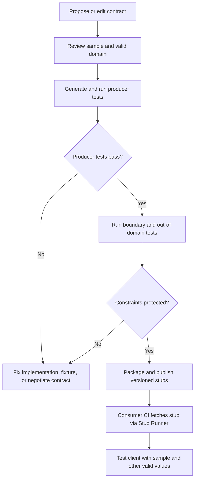

# Distinguishing Sample Values from Valid Value Domains in Contract Data

In **Spring Cloud Contract**, a contract can contain a concrete value such as `"CUST-1042"` or a rule accepting multiple values such as `CUST-[1-9][0-9]{3}`. These two representations serve different purposes. A **sample value** gives tests a concrete, reproducible request or response; a **valid value domain** defines which values are accepted for the agreed interaction. Confusing the two concepts can lead a team to accidentally force the producer to return one hardcoded ID, or generate a stub that accepts any string and fails to catch consumer-breaking API changes.

This lesson belongs to the **Contract Data** chapter of the **SPRING_CLOUD_CONTRACT** module. The module covers contract testing between producer and consumer via **Groovy/YAML DSL**, generating producer tests, publishing stubs, running **Stub Runner**, and integrating CI to detect incompatible API changes. Here, we focus on how to choose **concrete examples**, **matchers**, and **boundary cases** so that both generated tests and stubs accurately describe what both sides commit to.

## 1. One Sample Value Is Not the Entire Valid Domain

Suppose **Order Service** (producer) receives an order creation request from **Checkout Service** (consumer):

```http
POST /api/orders
Content-Type: application/json

{"customerId":"CUST-1042","quantity":2}
```

The producer returns:

```http
HTTP/1.1 201 Created
Content-Type: application/json

{"orderId":"ORD-9001","status":"CREATED"}
```

The strings `CUST-1042` and `ORD-9001`, and the number `2`, are all **sample values** for one interaction. However, business requirements may allow many customer IDs, order quantities from 1 to 10, and a distinct order ID for each new order.

| Field | Sample value | Expected valid domain | What the sample **does not prove** |
| --- | --- | --- | --- |
| `customerId` | `"CUST-1042"` | String prefixed with `CUST-` and four digits, first digit from 1 to 9. | Does not prove every pattern-matching ID exists in the database. |
| `quantity` | `2` | Integer from **1 to 10** per example rule. | Does not prove the producer rejects 0, 11, decimals, or strings. |
| `orderId` | `"ORD-9001"` | String prefixed with `ORD-` and four digits. | Does not prove IDs are generated uniquely or without duplicates. |
| `status` | `"CREATED"` | A value in the defined API status set, e.g., `CREATED`, `REJECTED`. | Does not prove every status is valid in every response. |

In set notation, this can be expressed as:

\[
\text{Sample value } e \in D,\quad D = \text{valid value domain}.
\]

If `D` is the set of customer IDs matching `CUST-[1-9][0-9]{3}`, `CUST-1042` is merely **one element** of `D`. A regex describes **format**, not whether the customer exists, belongs to the right tenant, or is authorized to place orders. The **syntactically valid** domain and the **business-valid** domain can differ.

In a contract, be clear about *which values are used to run one concrete test* and *which constraints must hold across all values producer and consumer may exchange*.

## 2. What Are Sample Values Used For?

An **example value** is concrete, deterministic data that lets tools and humans observe expected behavior.

- For **requests**, the generated producer test must send an actual request—such as `customerId=CUST-1042`—to verify the producer implements the contract.
- For **responses**, the HTTP stub usually needs to return a concrete response—such as `orderId=ORD-9001`—so consumer tests have data to receive and deserialize.
- When reading or reviewing a contract, examples illustrate **a meaningful interaction**: what the two services send and receive.
- Deterministic sample data keeps builds reproducible, avoiding tests that depend on randomness or external environment data.

Putting a sample value in a body **does not automatically create a general constraint**. Writing only:

```groovy
body(
    customerId: 'CUST-1042',
    quantity: 2
)
```

describes two **exact** values. You cannot infer that every `CUST-xxxx` is allowed or that `quantity` from 1 to 10 is valid. To express a **value domain**, you must configure appropriate matchers/constraints and verify that the tooling applies them on the intended side.

**A good sample value** belongs to the published domain, is business-meaningful, contains no sensitive info, and stays stable in tests. For example, if the constraint requires `CUST-[1-9][0-9]{3}`, using `CUST-1042` is better than `CUST-0000` because the second string **falls outside the domain**; an out-of-domain example makes the contract self-contradictory from the start.

## 3. What Kinds of Constraints Can a Valid Domain Include?

Not every domain is well represented by a single regex. Before choosing a Spring Cloud Contract matcher, identify the real constraint.

| Constraint type | Example | Appropriate verification |
| --- | --- | --- |
| **Exact equality** | `status` must be `"CREATED"` in a successful order response. | Exact value comparison. |
| **String format** | `customerId` matches `CUST-[1-9][0-9]{3}`. | Properly scoped regex plus non-matching checks. |
| **Data type** | `quantity` is an integer; `active` is a boolean. | Type matcher and JSON serialization checks. |
| **Numeric range** | `1 <= quantity <= 10`. | Business/validation constraints and boundary tests; a type matcher alone is insufficient. |
| **Allowed list (enum)** | `status` is one of `CREATED`, `REJECTED`. | Value-set matcher or separate contracts for key scenarios. |
| **Structure** | Body has `customerId`, `quantity`; null disallowed when required by schema. | Body matchers, schema/validation, and tests for missing or null fields. |
| **Cross-field relationship** | `totalPrice = quantity * unitPrice`. | Producer business tests with appropriate fixture data. |
| **System-state domain** | Customer ID must exist and belong to the calling account. | Fixtures, authorization checks, and integration/business tests. |

Spring Cloud Contract can express a substantial share of constraints via **DSL matchers**; rules requiring application state or deep calculations still need verification by business code and supplemental test layers. Contracts do not turn a regex into a complete business-rule engine.

## 4. Two Data Directions and Matcher Roles in Groovy DSL

Spring Cloud Contract must handle **two different environments** from the same contract:

1. **Generated producer test** running against the real producer; it must send a concrete request and check the actual response.
2. **Stub** simulating the producer for the consumer; it must recognize valid requests and return a concrete response.

Accordingly, the DSL often needs a **concrete value on one side** and a **matcher on the other side**. In the Groovy DSL, `$(consumer(...), producer(...))` (also written `value(...)`) declares these two perspectives.

| Where defined | Consumer / stub side | Producer test side |
| --- | --- | --- |
| **Request** | `consumer(regex(...))`: matcher enabling the stub to accept valid consumer requests. | `producer('CUST-1042')`: sample value the generated producer test sends to the real producer. |
| **Response** | `consumer('ORD-9001')`: concrete value the stub returns to consumer tests. | `producer(regex(...))`: matcher enabling the generated producer test to accept valid real responses. |

This is very easy to get backwards: **requests** use a matcher on the consumer side and an example on the producer side; **responses** use an example on the consumer side and a matcher on the producer side. “Consumer” and “producer” refer to **which side uses that value during testing**, not that only the consumer or only the producer decides valid values.

For instance, a consumer can send many well-formatted customer IDs; the stub should accept them. Yet the generated producer test needs one concrete ID so the producer's fixture can prepare data for it. Conversely, the real producer can generate different order IDs; the generated test should check **valid format**, while the stub needs one stable ID so consumer tests can assert on it.

## 5. Complete Groovy DSL Example: Sample and Domain for Each Side

In the producer, save `src/test/resources/contracts/orders/create_order.groovy`:

```groovy
import org.springframework.cloud.contract.spec.Contract

Contract.make {
    name 'shouldCreateOrderWithValidCustomer'
    description 'Create order with validly formatted customer ID'

    request {
        method 'POST'
        url '/api/orders'
        headers {
            contentType(applicationJson())
        }
        body(
            customerId: $(consumer(regex('CUST-[1-9][0-9]{3}')),
                          producer('CUST-1042')),
            quantity: 2
        )
    }

    response {
        status 201
        headers {
            contentType(applicationJson())
        }
        body(
            orderId: $(consumer('ORD-9001'),
                       producer(regex('ORD-[0-9]{4}'))),
            status: 'CREATED'
        )
    }
}
```

In this contract:

- **`CUST-1042`** is the request example for the **generated producer test**. The generated test sends this value to the real API.
- **`CUST-[1-9][0-9]{3}`** is the request matcher for the stub, allowing tests with other customer IDs sharing the **agreed format**.
- **`ORD-9001`** is the response example that the **stub returns to the consumer**.
- **`ORD-[0-9]{4}`** is the response matcher verifying that the producer's actual `orderId` follows the expected format.
- `quantity: 2` and `status: 'CREATED'` are currently expressed as **concrete values**. This contract **does not yet express the `quantity` range 1–10** or all possible statuses.

Do not read this example as promising that every customer ID matching the regex is an existing customer. In practice, if the endpoint only accepts IDs present in the database, set up the corresponding fixture in producer tests; when using the stub, clarify whether the consumer is testing request formatting or a specific business state.

### 5.1. Expectations in the generated producer test

The generated producer test has logic equivalent to:

```text
SEND POST /api/orders
Body: {"customerId":"CUST-1042","quantity":2}

VERIFY response:
  HTTP status = 201
  Content-Type = application/json
  orderId matches regex ORD-[0-9]{4}
  status = CREATED
```

This is a **logical description of the test**, not verbatim generated Java code. Class names, HTTP test libraries, and matcher representations depend on Spring Cloud Contract Verifier configuration. The key point is that the producer can return `ORD-2178` or `ORD-9001` and still satisfy the **format constraint**, provided the other conditions match.

### 5.2. Expectations in the consumer stub

The HTTP stub generated from the contract behaves as follows:

```text
RECEIVE POST /api/orders
Body: {"customerId":"CUST-2356","quantity":2}
  -> customerId matches CUST-[1-9][0-9]{3}
  -> quantity matches the value described in the contract

RETURN response:
  HTTP status = 201
  Body: {"orderId":"ORD-9001","status":"CREATED"}
```

`CUST-2356` **differs from the sample value `CUST-1042`**, yet fits the consumer-side format domain of the contract. The stub still returns `ORD-9001` because that is the **response sample value**, not a stateful ID generator. This keeps consumer tests independent, but **cannot be used to verify order ID uniqueness or real persisted data**.

**Inspect the actual generated mappings**: the tooling translates the DSL into request matchers/stubs according to your version. Tricky cases such as JSON bodies with extra fields, nulls, or complex matchers should be tested with both matching and non-matching requests rather than inferred solely from Groovy code.

## 6. Writing the Equivalent Contract in YAML DSL

If the project standardizes on the **YAML DSL**, you can express sample values in `body` and rules in `matchers`. Example at `src/test/resources/contracts/orders/create_order.yml`:

```yaml
description: Create order with valid customer ID
request:
  method: POST
  url: /api/orders
  headers:
    Content-Type: application/json
  body:
    customerId: CUST-1042
    quantity: 2
  matchers:
    body:
      - path: $.customerId
        type: by_regex
        value: 'CUST-[1-9][0-9]{3}'
response:
  status: 201
  headers:
    Content-Type: application/json
  body:
    orderId: ORD-9001
    status: CREATED
  matchers:
    body:
      - path: $.orderId
        type: by_regex
        value: 'ORD-[0-9]{4}'
```

In this YAML structure, `request.body.customerId` is the **sample** giving the producer test a value to send; `request.matchers.body` expresses the **matching rule** for stub requests. `response.body.orderId` supplies the **sample response** for the stub; `response.matchers.body` describes the **condition the producer response must satisfy**. `path` uses JSONPath to pinpoint the target field.

This example uses standard Spring Cloud Contract YAML DSL syntax; teams should cross-check against their **actual plugin and release train version**. Run `mvn verify` or the equivalent task to confirm the parser reads the contract and the generated tests/stubs carry the intended semantics. Syntactically valid YAML **is not enough** to conclude matchers were applied properly.

To avoid duplicate contracts, in a normal build keep only **one active Groovy or YAML file** for this `POST /api/orders` scenario in the directory scanned by the plugin. Placing both files with equivalent request/response definitions can generate duplicate tests/mappings and cause confusion when they drift.

## 7. Never Use a Matcher Broader Than the Business Domain

A matcher can be **syntactically valid** yet wrong for the business. Consider these customer ID rules:

| Matcher | What it accepts | Risk |
| --- | --- | --- |
| `.*` | Nearly any string, including empty string. | Fails to protect ID prefix and format. |
| `CUST-.*` | Strings starting with `CUST-`, including `CUST-ABC`. | Fails to protect the numeric portion. |
| `CUST-[0-9]{4}` | `CUST-0000`, `CUST-1042`, ... | Fails to exclude `0000` if forbidden by business rules. |
| `CUST-[1-9][0-9]{3}` | `CUST-1000` through `CUST-9999`. | Protects format, but does not verify existence or authorization. |

When using regexes, check whether the matcher applies to the **entire string** or allows partial matches in the specific verification engine; do not guess the library's matching mode. Test with strings that **should be rejected** such as `X-CUST-1042`, `CUST-1042-extra`, or `CUST-ABC`. When needed, use start/end anchors or the appropriate matcher API for your version, then inspect test/stub output.

For `quantity`, a **numeric type** matcher does not enforce the `1..10` range. For example, `0`, `11`, and `-2` are still syntactically valid integers. To enforce range constraints, write boundary contracts or validation tests; even if the DSL supports range matchers, verify that the real producer handles them properly.

**Do not use regexes to replace all validation.** A regex matching an ID's shape does not check whether that ID exists, belongs to the current user, is unlocked, or qualifies to place an order.

## 8. Boundary Cases Needed Beyond a Single Sample Value

The first example contract protects one primary happy path. To verify the `1..10` quantity domain, add key boundary interactions with the producer. Example hypothetical API policy:

| Case | Request `quantity` | Expected outcome | Purpose |
| --- | --- | --- | --- |
| Minimum valid value | `1` | `201` if other conditions hold. | Catches off-by-one lower-bound rejection. |
| Mid-range value | `2` | `201`. | Confirms happy path. |
| Maximum valid value | `10` | `201` if other conditions hold. | Catches off-by-one upper-bound rejection. |
| Below lower bound | `0` | `400` or `422`, per API policy. | Catches missing lower-bound validation. |
| Above upper bound | `11` | `400` or `422`, per API policy. | Catches missing upper-bound validation. |
| Wrong type | `"2"` (JSON string) | Reject or apply explicit conversion rule. | Avoids silently accepting invalid schemas. |
| Missing field | No `quantity` key | Handle per required-field policy. | Distinguishes missing from default values. |
| Null | `"quantity": null` | Handle per nullability policy. | Distinguishes explicit null from missing field. |

HTTP status `400` vs. `422` **has no mandatory universal default** across all APIs; both teams must agree and document their own contracts accurately. Do not add a `400` scenario to the DSL expecting the application to generate rejection logic automatically. **Spring Cloud Contract generates tests to verify implementations**, rather than implementing producer validation.

When multiple scenarios share the same method and path but differ in body, make sure **stub request matchers distinguish them**. If the happy-path mapping is too broad, a `quantity=0` request may accidentally receive `201` from the stub even though the real producer rejects it. That is why you should test both **positive matches** and **negative matches** against the generated stub artifact.

## 9. A Response's Valid Domain Differs from One Stubbed Response

For the `orderId` field:

- The contract may require the producer to return a string matching `ORD-[0-9]{4}`.
- The generated producer test checks that the real response matches the pattern during **that specific test run**.
- The stub usually returns `ORD-9001` for matched requests, because that is the **sample value the consumer receives in tests**.

Therefore, if a consumer calls the stub twice and receives `ORD-9001` both times, **never** conclude that the producer generates duplicate IDs. Stubs do not execute real ID-generation algorithms or maintain real order state. Uniqueness, cross-request consistency, authorization, transactions, and durability must be tested against the real producer and infrastructure.

Conversely, just because the generated producer test accepts `ORD-1234` via regex **does not mean** the producer is allowed to return `null`, `""`, or `ord-1234` if those fall outside the agreed rules. When data type, casing, or prefixing is part of the API the consumer depends on, matchers must be tight enough to protect them.

### 9.1. When a returned value depends on the request

Suppose the producer must echo back the **exact** `customerId` sent in the request. A fixed response example cannot prove that relationship across arbitrary IDs. Check DSL features that support request-dependent constraints (if appropriate for your version), or add producer tests with multiple datasets and cross-field relationship assertions.

For example, testing the producer with `CUST-1042` and getting `CUST-1042` back is only **one observation**. To protect the general rule, test with `CUST-2356` as well as mismatched relationship cases. Using only a `CUST-[1-9][0-9]{3}` matcher on both request and response allows a producer returning `CUST-9999` to look **valid in format yet wrong for the customer**.

## 10. Stub Runner: Checking Whether the Consumer Uses the Described Domain

Once producer verification passes, the producer packages the contracts into a versioned stub artifact, for example:

```text
com.acme:order-service:1.0.0:stubs
```

On the consumer side, Spring Cloud Contract **Stub Runner** fetches the artifact, starts an HTTP stub server, and lets tests invoke the real HTTP client code. Example JUnit 5 configuration:

```java
import org.junit.jupiter.api.Test;
import org.springframework.beans.factory.annotation.Autowired;
import org.springframework.boot.test.context.SpringBootTest;
import org.springframework.cloud.contract.stubrunner.spring.AutoConfigureStubRunner;
import org.springframework.cloud.contract.stubrunner.spring.StubRunnerProperties;

import static org.assertj.core.api.Assertions.assertThat;

@SpringBootTest(properties = "orders.base-url=http://localhost:8089")
@AutoConfigureStubRunner(
    ids = "com.acme:order-service:1.0.0:stubs:8089",
    stubsMode = StubRunnerProperties.StubsMode.LOCAL
)
class OrderClientStubTest {

    @Autowired OrderClient orderClient;

    @Test
    void exampleCustomerIdIsAccepted() {
        OrderReceipt receipt = orderClient.create("CUST-1042", 2);
        assertThat(receipt.status()).isEqualTo("CREATED");
        assertThat(receipt.orderId()).isEqualTo("ORD-9001");
    }

    @Test
    void anotherValidCustomerIdMatchesTheSameContract() {
        OrderReceipt receipt = orderClient.create("CUST-2356", 2);
        assertThat(receipt.status()).isEqualTo("CREATED");
        assertThat(receipt.orderId()).isEqualTo("ORD-9001");
    }
}
```

This is an **illustrative test snippet**, assuming:

- The consumer already has `OrderClient.create(String customerId, int quantity)` sending `POST /api/orders` with JSON, reading its base URL from `orders.base-url`.
- `OrderReceipt` is a consumer DTO/record containing `String orderId` and `String status`.
- The test declares `spring-cloud-starter-contract-stub-runner`, Spring Boot Test, and AssertJ.
- Artifact `com.acme:order-service:1.0.0:stubs` has been installed to local Maven (`LOCAL` mode); when using published CI artifacts, configure `REMOTE` and the appropriate repository.

With stub matchers generated properly from the DSL, both `CUST-1042` and `CUST-2356` receive the same **sample response** `ORD-9001`. The consumer test proves the client produces requests compatible with the published format and deserializes the response; it **does not verify that the customer ID exists or that real order IDs are unique**.

Try sending `customerId="CUST-ABC"`. If the stub returns 404 because no mapping matched, that is a **signal that the stub did not recognize the request**, not necessarily a producer business `404` response. To test business error handling for 404/400/422, write a dedicated contract with an explicit error body such as `code: INVALID_CUSTOMER_ID` and assert on that error code.

## 11. Producer Verification: A Matching Example Can Mask Bugs on Other Values

Suppose the producer contains this logic:

```java
if (customerId.equals("CUST-1042")) {
    return createdOrder();
}
return badRequest();
```

A single generated producer test sending `CUST-1042` will **pass**, even though valid consumer requests sending `CUST-2356` are rejected. The stub's request matcher still accepts `CUST-2356`, so the consumer test against the stub **also passes**. Thus the contract describes a broader format domain than the implementation actually supports, and neither side alone proves producer correctness across the domain.

To mitigate this risk:

1. **Put domain rules in the right layer** (validation/domain logic) of the producer.
2. **Add boundary or parameterized tests** for different representative values, not just the single generated request example.
3. **Negative-test with invalid values** to prove the real API rejects them properly.
4. **Do not equate format validity with business preconditions**: a well-formatted but non-existent customer ID needs its own fixture and behavior.
5. **Maintain contracts still used by consumers**, especially when changing enums, regexes, types, or value limits.

Illustrative idea for a parameterized request-format test (not a complete test class):

```java
@ParameterizedTest
@ValueSource(strings = {"CUST-1000", "CUST-1042", "CUST-2356", "CUST-9999"})
void acceptsStructurallyValidCustomerIds(String id) {
    // Prepare appropriate customer/fixture for each id.
    // Call the real producer and verify results against the contract.
}
```

The crucial detail is that **the test performs real assertions** and prepares appropriate fixtures; annotations alone do not test a domain. `CUST-1000` and `CUST-9999` are boundaries of the **example ID format**, not a guarantee that they exist in real data.

## 12. Do Not Confuse Types, Nulls, and Field Presence with Sample Values

The set of valid values also depends on **JSON type** and **requiredness**:

| Request JSON | Equivalent to `quantity: 2`? | Contract/API decision needed |
| --- | --- | --- |
| `{"quantity":2}` | Yes, JSON number `2`. | Valid sample value. |
| `{"quantity":"2"}` | No, string `"2"`. | Does the API coerce strings, or must it reject? |
| `{"quantity":2.5}` | No, decimal number. | Are decimals permitted or are integers required? |
| `{"quantity":null}` | No, JSON null value. | Is null permitted? |
| `{}` | Missing `quantity` field. | Is the field required or defaulted? |

A **type** matcher can verify that an output is a number without checking that `quantity` is an **integer 1–10**. Conversely, an example `quantity: 2` does not specify policy for `null` or missing fields.

When a domain must distinguish **field omitted** from **field present with null**, specify and test both cases. With Jackson, `JsonNode.has("quantity")` checks key presence, while `hasNonNull("quantity")` requires a non-null value. A Java DTO with only `Integer quantity` can conflate missing and null unless field presence is tracked. Therefore, beyond value matchers, tests should inspect the actual serialized JSON request.

## 13. Integrating Data Constraints into CI and Managing Compatible Changes

An effective CI workflow for data contracts:



When reviewing a change, ask:

- Does the new sample **belong to the valid domain** published by the contract?
- Does changing the sample while keeping the matcher only change test data, or did it alter expected consumer behavior?
- Were regex/type/range rules **widened or narrowed**? Does that impact older consumers?
- Does the generated stub genuinely accept valid requests and reject important invalid requests?
- Does the generated producer test assert the response matcher rather than just comparing static literals?
- Do boundary tests cover business conditions that matchers cannot express?
- Is the stub artifact published with the right version, and does consumer CI pin versions for reproducibility?

For example, a producer changing `CUST-[1-9][0-9]{3}` to `CUST-[0-9]{4}` **widens the format** to accept `CUST-0000`; if forbidden by business rules, this widening is a bug. Conversely, changing `CUST-[0-9]{4}` to `CUST-[1-9][0-9]{3}` **narrows the domain**, potentially breaking consumers sending `CUST-0000` if previously valid. Deleting an old contract or altering matchers to fit a new implementation **does not prove** older consumers remain compatible.

When checking compatibility, examine not just JSON shape but the **business semantics of the value set**: removed enum values, tighter length limits, narrowed ranges, or newly disallowed nulls can all be breaking changes even when field names stay the same.

## 14. Common Mistakes and How to Spot Them

| Mistake | Symptom | Fix |
| --- | --- | --- |
| Writing one example and treating it as the whole domain. | Producer accepts only `CUST-1042`; other valid API IDs fail. | Declare explicit matchers and test multiple representative values against the producer. |
| Putting response regex on the stub side instead of the producer test side. | Stub tries to simulate dynamic values awkwardly while generated test asserts one fixed ID. | Review the `consumer(...)`/`producer(...)` directions for request vs. response. |
| Using `.*` for every string. | Empty strings, wrong prefixes, or invalid formats slip through. | Choose sufficiently tight regexes and test counterexamples. |
| Using a type matcher to protect a numeric range. | `quantity=0` or `11` still counts as a number. | Add validation and boundary/range tests. |
| Leaving an example outside the defined domain. | Generated test sends `CUST-0000` while matcher only accepts `CUST-[1-9][0-9]{3}`. | Pick a valid sample and check consistency before generating tests. |
| Assuming the stub generates real IDs or keeps state. | Two stub calls return `ORD-9001` and are mistaken for duplicate-allocation bugs. | Remember stub responses are primarily examples; test uniqueness on the real producer. |
| Consumer test only asserts status `201`. | Broken JSON structure or enum values go undetected. | Assert the fields the consumer actually reads and their semantics. |
| Relying on stub HTTP 404 to conclude producer validates properly. | Unmatched requests also return 404. | Separate no-match errors from specified business error responses with error codes/bodies. |
| Producer tests cover only the happy path. | Regressions allowing `quantity` 0 or 11 go unnoticed. | Add negative and boundary tests. |
| Publishing stubs even when producer tests fail. | Stubs advertise promises unverified by the implementation. | Configure CI to block publishing until verification passes. |

## 15. Practice Exercise: Proving Samples and Domains Are Different

In a Spring Boot project with Spring Cloud Contract Verifier and a consumer with Stub Runner, follow these steps in order:

1. **Create the `POST /api/orders` contract** as in the Groovy or YAML example above, using sample `CUST-1042`, `quantity=2`, `ORD-9001`, and matchers for customer ID and order ID.
2. **Implement the producer** returning `201`, `status=CREATED`, and a properly formatted order ID. Run the generated producer test, confirming it **actually executes** and PASSES.
3. **Return a different order ID**, such as `ORD-2178`, without modifying the contract. The generated test for the response ID should still PASS if the producer satisfies the matcher.
4. **Return an invalid order ID**, such as `order-2178` or a string without four digits. The generated test must FAIL if the response matcher is applied properly.
5. **Install/publish the stubs artifact**, and run consumer tests with `CUST-1042` and `CUST-2356`; observe whether both requests hit the same mapping and the stub returns sample `ORD-9001`.
6. **Try out-of-domain IDs**, such as `CUST-ABC` or `CUST-0000`; observe whether the stub rejects matching cleanly. Do not confuse a no-match response with a producer-specified business error.
7. **Test the quantity range** with inputs `1`, `10`, `0`, and `11`. Add corresponding producer tests or error contracts, and explain why sample `2` plus a numeric type matcher cannot protect the entire range.
8. **Simulate a breaking change**: change matcher `CUST-[1-9][0-9]{3}` to a shorter format or change enum `CREATED` to `DONE`. Identify which consumers need upgrades and which test suites must run before release.

**Completion criteria:** you can explain **which example is sent in the producer test**, **which matcher verifies the producer**, **which requests the stub accepts**, **which sample response the stub returns**, and **why boundary/validation tests are still needed** alongside matchers to protect the business domain.

## 16. Self-Check Questions

1. If `customerId=CUST-1042` is the sample in a contract, can you conclude every `CUST-xxxx` is valid? Why or why not?
2. In a Groovy DSL request, why is `consumer(regex(...))` typically paired with `producer('sample-value')`?
3. In a Groovy DSL response, why is `consumer('ORD-9001')` typically paired with `producer(regex(...))`?
4. Does a regex `ORD-[0-9]{4}` guarantee that order IDs are unique and persisted to the database?
5. Why are `quantity=2` and an integer type matcher insufficient to enforce the 1–10 range?
6. The stub accepts `CUST-2356` while the producer only accepts `CUST-1042`. What additional tests do you need?
7. Why does seeing a consumer test pass with stub `ORD-9001` not prove the real producer always generates valid IDs?
8. In what scenario can narrowing a domain from `CUST-[0-9]{4}` to `CUST-[1-9][0-9]{3}` break compatibility?

**Takeaway:** **a sample value is one concrete case**, while **a valid value domain is the set of values permitted by the contract and business rules**. In Spring Cloud Contract, place samples and matchers on the right side of request/response, inspect generated producer tests, review actual stub mappings, run consumer tests via Stub Runner, and add boundary tests for constraints that matchers cannot fully express. A CI pipeline delivers real value when both producer and consumer verify **committed behavior**, not just one lucky example.
