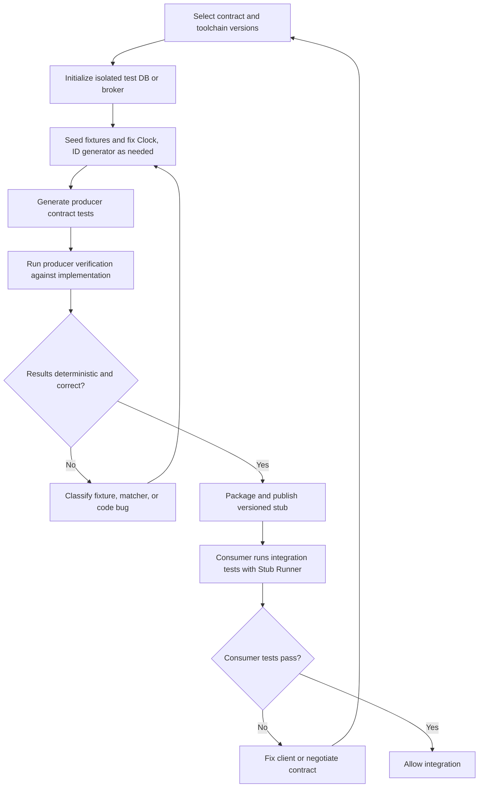

# Avoiding Random Data That Makes Tests Non-Reproducible

In contract testing between **producer** and **consumer**, a test is trustworthy only if the same source code revision, contracts, and input conditions lead to predictable outcomes. A common mistake is writing contracts tied to random IDs, wall-clock time, leftover database rows, expiring tokens, or unguaranteed data ordering. Tests can **pass on a personal laptop yet fail in CI** even when the API did not change.

**Spring Cloud Contract** lets you describe HTTP or messaging behavior via **Groovy/YAML DSL**, generate producer-side tests, and build stubs for the consumer to run with **Stub Runner**. The tooling helps catch incompatible API changes, but it does not automatically supply deterministic business data or isolate databases for every project.

This lesson belongs to the **Contract Data** chapter of the **SPRING_CLOUD_CONTRACT** track. The goal is to choose between **fixed fixtures, controlled data generators, and appropriate matchers**, design reproducible producer tests, and maintain stability when publishing stubs and running CI.

## 1. What Makes a Test Reproducible?

A test is reproducible (*deterministic*) if re-running it under the same controlled conditions yields the same pass/fail verdict. For example, Checkout calls:

```http
GET /api/orders/ORDER-42
Accept: application/json
```

If the contract expects `200 OK` with a paid order, the producer test environment must always prepare record `ORDER-42` in the right state. If the record happens to exist on a developer's local database today yet is missing in CI tomorrow, the test flips to `404` because of **data**, not evidence that the API changed.

Reproducibility has **two conditions**:

1. **Controlled inputs and test state:** database rows, clocks, ID generators, permissions, external services, brokers, and execution order do not cause unexpected output swings.
2. **Expectations match the actual commitment:** neither over-constraining values allowed to vary nor widening matchers so far that business bugs slip through.

A test that always passes with a `.*` matcher is not necessarily good; it can accept empty values or wrong types. A test that always fails due to a few milliseconds of timestamp drift may be asserting too strictly. **Stability and defect-detection value must go together.**

## 2. Sources of Non-Determinism to Recognize

| Source | Example | Typical failure |
|---|---|---|
| Auto-increment IDs | Sequence produces `1001` then `1002` | Contract expects old ID, response differs |
| UUIDs | `UUID.randomUUID()` | Every request returns a new ID |
| Wall-clock time | `Instant.now()`, `LocalDateTime.now()` | Mismatched timestamp, timezone, or precision |
| Tokens | JWT with `exp` | `200` today, `401` a few days later |
| Shared DB | Another test mutates `ORDER-42` | Order-dependent test failures |
| Missing data | ID expected to return `404` accidentally gets created | Error scenario turns into success |
| Unordered lists | Query missing `ORDER BY` | JSON array elements flip order |
| Random seed | `new Random(123)` | Call count/order changes under parallel runs |
| External services | Exchange rates, catalog, identity provider | Responses change or time out |
| Broker/cache | Leftover messages, stale cache | Consumes old events/values by mistake |
| Locale/timezone | `ZoneId.systemDefault()` | Dates, units, or formatting vary by environment |

Not every varying value is a problem. Newly generated IDs or transaction timestamps are allowed to vary if the API defines them that way. Bugs arise when **the contract fails to separate values that must be exact from values that only need to satisfy a rule**.

## 3. Strategy for Each Kind of Contract Data

Before writing the DSL, ask for every field: **Does the consumer depend on exact value, data type, format, or a relationship?**

| Data | Strategy | Explanation |
|---|---|---|
| Method, URL, status code | Usually exact match | Core committed communication interface |
| `status=PAID` | Exact value or allowed status set | Consumer branches on status |
| `totalAmount=125000` | Fixed fixture when contract verifies specific total | A numeric-type matcher can hide calculation bugs |
| Lookup ID for a resource | Pick a fixed fixture ID | Generated producer request has data to access |
| Server-generated new ID | Format matcher or controlled ID generator | Exact value is usually not committed |
| Dynamic timestamp | Freeze `Clock` or matcher + semantic assertions | Independent of execution time |
| Correlation ID | Test-supplied value or matcher with echo check | Correlation matters, not an arbitrary string |
| Guaranteed ordered list | Assert order | Order reversal can break the consumer |
| Unordered list | Match element set | Avoid coupling to iteration order |
| Security token | Dedicated test identity/token with controlled expiry | Never use production secrets |

Three practical tools complement one another:

- **Fixtures:** a set of records and settings that can be initialized, reset, and traced in source control.
- **Controllable data generators:** `Clock`, `IdGenerator`, test servers, or mocked dependencies.
- **Matchers:** express constraints on data types, regexes, headers, bodies, or relationships without forcing varying details to be static.

## 4. Running Example: Order Service Serving Checkout

Suppose Checkout needs to verify a paid order before issuing an invoice. The test dataset is agreed upon:

| Field | Fixture value |
|---|---|
| `id` | `ORDER-42` |
| `customerId` | `CUSTOMER-7` |
| `status` | `PAID` |
| `totalAmount` | `125000` |
| `currency` | `VND` |
| `createdAt` | `2026-01-15T09:30:00Z` |
| Non-existent ID | `ORDER-MISSING` |

These values are used exclusively in the **test environment**, independent of real orders or real customers.

### 4.1. Groovy DSL with fixed data

```groovy
import org.springframework.cloud.contract.spec.Contract

Contract.make {
    name 'checkout_get_paid_order_200'
    description 'Checkout retrieves a paid order'

    request {
        method GET()
        url '/api/orders/ORDER-42'
        headers {
            header 'Accept', 'application/json'
        }
    }

    response {
        status OK()
        headers {
            contentType(applicationJson())
        }
        body(
            id: 'ORDER-42',
            customerId: 'CUSTOMER-7',
            status: 'PAID',
            totalAmount: 125000,
            currency: 'VND',
            createdAt: '2026-01-15T09:30:00Z'
        )
    }
}
```

When the producer contract test runs, Order Service must return data matching the fixture record. A green test proves the implementation satisfies the **authored scenario**; it does not prove every real order holds identical values.

### 4.2. Equivalent YAML DSL

```yaml
name: checkout_get_paid_order_200
description: Checkout retrieves a paid order
request:
  method: GET
  url: /api/orders/ORDER-42
  headers:
    Accept: application/json
response:
  status: 200
  headers:
    Content-Type: application/json
  body:
    id: ORDER-42
    customerId: CUSTOMER-7
    status: PAID
    totalAmount: 125000
    currency: VND
    createdAt: '2026-01-15T09:30:00Z'
```

Quoting `createdAt` preserves the timestamp as a **string**; YAML may infer date/time types differently from JSON expectations. `totalAmount` remains an integer. Keeping both Groovy and YAML as **two contracts for the same scenario** in the scanned directory can generate duplicate tests/mappings; in practice, choose **one** as the primary source.

### 4.3. Non-existent scenarios also need fixtures

```yaml
name: checkout_get_missing_order_404
description: Checkout retrieves a non-existent order
request:
  method: GET
  url: /api/orders/ORDER-MISSING
response:
  status: 404
  headers:
    Content-Type: application/json
  body:
    code: ORDER_NOT_FOUND
```

Do not just “pick a huge ID and hope it doesn't exist”. Test setup must guarantee `ORDER-MISSING` **is genuinely absent** during the test. This is a **negative fixture**: non-existence is also explicitly managed state.

## 5. Seeding and Isolating Producer Test State

The Spring Cloud Contract plugin generates tests from the DSL, but does not infer how to create database tables or `ORDER-42`. The producer must prepare fixtures—typically via a test base class, `@Sql`, repository helpers, Testcontainers, or a migration-initialized test database.

| Setup approach | Typical use | Watch out for |
|---|---|---|
| SQL script or `@Sql` | Small set of fixed rows | Verify rollbacks, seed order, foreign-key constraints |
| `@BeforeEach` + repository/JdbcTemplate | Reset needed before each scenario | Do not break parallel tests |
| Testcontainers | Database closer to production | Isolated containers/schemas, higher runtime cost |
| In-memory database | Simple logic independent of DB-specific quirks | May differ from production engine |
| Mock repository/service | Focus on HTTP contract at boundary | Does not verify real persistence |
| Dedicated test namespace/tenant | Running suites in parallel | Avoid row and cache collisions |

Illustrative seed script for a **test database** with an existing schema:

```sql
DELETE FROM orders
WHERE id IN ('ORDER-42', 'ORDER-MISSING');

INSERT INTO orders
    (id, customer_id, status, total_amount, currency, created_at)
VALUES
    ('ORDER-42', 'CUSTOMER-7', 'PAID', 125000, 'VND',
     '2026-01-15T09:30:00Z');
```

Adjust timestamp syntax per DB engine; never run deletes on any shared database outside test isolation. Mutating someone else's data to “make tests green” creates new flakiness.

### 5.1. Role of the test base class

Generated producer tests need a shared place to boot the application and prepare fixtures. Illustrative Java pseudocode:

```java
abstract class OrderContractTestBase {

    @BeforeEach
    void prepareContractData() {
        testData.resetOrdersForContractTests();

        testData.insertOrder(
            "ORDER-42",
            "CUSTOMER-7",
            "PAID",
            125000,
            "VND",
            Instant.parse("2026-01-15T09:30:00Z")
        );

        testData.ensureOrderAbsent("ORDER-MISSING");
    }
}
```

`testData` is a **project-implemented helper**; the snippet shows setup structure, not a copy-pasteable class. The project must configure the plugin to use the right base class and test mode (e.g., MockMvc or RestAssured).

**Transaction caveat:** test-level rollbacks do not always roll back HTTP requests executing on another thread/transaction. For tests starting a server on a dedicated port, verify actual transaction boundaries and cleanup.

### 5.2. Why parallel execution triggers failures

Suppose test A checks that `ORDER-42` is `PAID`, while test B cancels that exact same order. If they share data, the outcome depends on which test runs first. How to handle it:

1. Assign independent schemas/databases or namespaces when running in parallel.
2. Avoid sharing IDs across tests that **write data**.
3. Reset fixtures at safe, deterministic boundaries.
4. If using transaction rollback, verify it actually covers the mutated operations.
5. Run **each test individually**, the full suite, and parallel groups to expose ordering dependencies.

Do not paper over root causes with `@TestMethodOrder` to force a lucky sequence: proper contract tests have clear enough starting state to run independently.

## 6. Dynamic IDs: Matchers or Fixed Generators?

Distinguish two categories of IDs:

- **Lookup IDs** in `GET /api/orders/ORDER-42`: tie them to fixed fixtures.
- **Newly generated IDs** in `POST /api/orders`: the producer may use UUIDs or sequences; consumers usually care about format and having an ID for subsequent requests.

Example POST create-order response:

```http
HTTP/1.1 201 Created
Content-Type: application/json

{"id":"ORD-9F3A","status":"CREATED"}
```

If the producer generates `ORD-9F3A` once and hardcodes it into the contract, the next run may return a different ID. Two approaches exist:

**Approach A – controllable ID generator.** In the test profile, inject an `IdGenerator` returning `ORD-FIXED-1`. Use when test logic must verify exact IDs, correlate a `Location` header, or issue follow-up requests.

**Approach B – matcher.** Have the stub emit a stable sample ID while the producer contract test only checks that the ID follows the consumer-expected format. Use when the exact value is not part of the commitment.

### 6.1. Groovy DSL: distinguishing consumer and producer values

Spring Cloud Contract Groovy DSL supports **dual values** to express values/conditions on each side. For responses, the consumer can receive a sample value while the producer test uses a matcher:

```groovy
import org.springframework.cloud.contract.spec.Contract

Contract.make {
    name 'checkout_create_order_201'

    request {
        method POST()
        url '/api/orders'
        headers {
            contentType(applicationJson())
        }
        body(
            sku: 'SKU-1',
            quantity: 2
        )
    }

    response {
        status 201
        headers {
            contentType(applicationJson())
        }
        body(
            id: value(
                consumer('ORD-EXAMPLE-1'),
                producer(regex('ORD-[A-Z0-9-]+'))
            ),
            status: 'CREATED'
        )
    }
}
```

**Meaning:** The consumer stub returns `ORD-EXAMPLE-1`, while the producer test accepts any ID matching the pattern. Verify the **syntax and actual output of your exact Spring Cloud Contract version**, as matchers/helpers can vary across releases. Do not inspect only the DSL source: inspect the generated producer test and WireMock mapping.

The example regex protects only partial format. It **does not prove** the ID is unique, persisted to the DB, or referenced accurately by a `Location` header. If the consumer relies on those rules, add appropriate assertions or supplemental integration tests.

### 6.2. Why can `Random(123)` still be flaky?

`new Random(123)` produces a repeatable sequence **only if call counts and call order stay identical**. Concurrency or code edits that alter invocation order cause tests to receive different numbers. When exact IDs are needed, a **per-test fixed supplier** is far easier to control than depending on a shared random sequence.

Never disable secure randomness in production just to simplify tests. For tokens/session IDs, use dedicated test setups and proper security tests.

## 7. Current Time, Timezones, and Date/Time Formats

A contract containing `createdAt = 2026-01-15T09:30:00Z` will not match `Instant.now()` if the system reads the real wall clock. You can:

- **Freeze the clock in tests** so the producer emits a deterministic instant.
- **Use a timestamp matcher** when the API allows it to vary, paired with ISO-8601 format and semantic checks.

### 7.1. Designing for `Clock` injection

```java
import java.time.Clock;
import java.time.Instant;

public class OrderService {
    private final Clock clock;

    public OrderService(Clock clock) {
        this.clock = clock;
    }

    public Instant createdAt() {
        return Instant.now(clock);
    }
}
```

In a Spring Boot test context, provide a test-only `Clock` bean:

```java
import java.time.Clock;
import java.time.Instant;
import java.time.ZoneOffset;
import org.springframework.boot.test.context.TestConfiguration;
import org.springframework.context.annotation.Bean;
import org.springframework.context.annotation.Primary;

@TestConfiguration
class ContractClockConfig {
    @Bean
    @Primary
    Clock testClock() {
        return Clock.fixed(
            Instant.parse("2026-01-15T09:30:00Z"),
            ZoneOffset.UTC
        );
    }
}
```

For this to work, the test context must import this configuration and production code must **actually use the injected `Clock` bean**. If the application still calls `Instant.now()` directly, a `Clock` bean will not freeze time.

### 7.2. When is a timestamp matcher appropriate?

If the API commits to an ISO-8601 timestamp without guaranteeing an exact instant, a matcher can check string shape. Still, regex only checks structure; it does not necessarily prove calendar validity, right timezone, or `updatedAt >= createdAt`.

Clarify:

1. Does the API use UTC `Z`, offsets, or local datetimes?
2. Is precision in seconds, milliseconds, or nanoseconds?
3. Does the consumer compare timestamps against a timestamp in the request?
4. Must timestamps be monotonic, expired, or inside a specific window?

When temporal data drives business logic, combine a **fixed `Clock` fixture** with semantic assertions. Avoid letting formatting depend on `ZoneId.systemDefault()` or `Locale.getDefault()` across laptops and CI.

## 8. Random Data Appearing in Requests

Not only responses, **requests sent by generated producer tests** must also match prepared state. If a request uses an arbitrary generated UUID absent from the database, the test returns `404` even though the API is correct.

Example to avoid:

```groovy
import org.springframework.cloud.contract.spec.Contract

// Anti-pattern example: URL is randomly generated when the DSL is evaluated.
Contract.make {
    request {
        method GET()
        url '/api/orders/' + java.util.UUID.randomUUID().toString()
    }
    response {
        status 200
    }
}
```

As the plugin evaluates the DSL across different builds, the URL changes. An older stub and a newly generated producer test describe different requests, and the test database will not have that random ID.

The safe approach is to **choose a deterministic fixture ID** or use a matcher paired with a **producer-side sample value** seeded in test data. Exact dual-value syntax depends on your pinned DSL version.

### 8.1. Authentication headers and tokens

The `Authorization` header also becomes unstable if a contract embeds a JWT copied manually from a browser. That token will expire or be revoked. Instead use:

- Test tokens/identity fixtures valid only in the test environment.
- A JWT generator with a test key and controllable clock when passing through a real decoder.
- Dedicated `401` and `403` data/permissions rather than an arbitrary token of unknown origin.

Never store production tokens or credentials in DSLs, generated tests, stub artifacts, or CI logs.

## 9. Lists, Pagination, and Element Ordering

Suppose `GET /api/orders` returns two orders:

```json
[
  {"id": "ORDER-42", "status": "PAID"},
  {"id": "ORDER-43", "status": "CREATED"}
]
```

If the DB query lacks `ORDER BY`, the response can flip to `ORDER-43` then `ORDER-42`. Contracts should assert ordering **only when the API guarantees that order**.

| Condition | Strategy |
|---|---|
| API commits to `sort=createdAt,desc` | Seed distinct timestamps; assert real order |
| API returns an unordered set | Check presence/values of elements without relying on index |
| Pagination via `page`/`size` | Seed exact record counts; verify stable ordering so pages don't drift |
| Filtered by user/tenant | Seed ownership and fixed query context |
| Cached response | Clear test cache or use an isolated cache namespace |

An order-ignoring matcher is **inappropriate** if the consumer UI relies on newest-first ordering. In that case, an order reversal is a genuine contract bug.

## 10. Asynchronous Messages Also Need Deterministic Data

Spring Cloud Contract supports message contract testing. An event typically includes `eventId`, `orderId`, `occurredAt`, type, headers, and destination. Example:

```json
{
  "eventId": "EVENT-42",
  "type": "ORDER_PAID",
  "orderId": "ORDER-42",
  "occurredAt": "2026-01-15T09:30:00Z"
}
```

For message contracts, clarify:

- `type=ORDER_PAID` is a required business value.
- `orderId` must point to the right fixture record or prior request.
- Is `eventId` allowed to be dynamic, or must it be fixed in the exercise?
- Is `occurredAt` event creation time or consumer processing time?
- Does the consumer require message ordering, or does the system only guarantee at-least-once delivery?
- Which topic/queue is the message sent to, and with which headers/correlation keys?

When using Stub Runner to **trigger a message contract**, keep the scenario `label` stable—for example `billing_order_paid_v1`—never concatenate random UUIDs or timestamps into the name. If the label changes every build, the consumer may fail to locate the message trigger.

On a real test broker, leftover events from a previous suite or shared consumer groups can cause tests to read stale messages. Use dedicated namespaces, queues/topics, or correlation IDs with explicit cleanup. Never just increase `Thread.sleep` to mask the issue.

## 11. A Stable Stub Runner Does Not Mean a Stable Producer

Stub Runner loads **stub mappings** from the artifact and simulates the producer. If a dynamic-response contract uses dual values, the stub emits a **stable** sample value while the producer test uses a matcher on the real response.

| Step | Data being verified | Evidence |
|---|---|---|
| Producer contract tests | Real implementation with producer fixtures | Producer satisfies contract scenarios |
| Consumer tests via Stub Runner | Responses from mapping/stub artifact | Consumer handles the described interactions |
| Integration/E2E | Real DB, network, broker, identity provider, and services | End-to-end system collaborates properly |

If consumer tests pass because the stub always returns `ORD-EXAMPLE-1`, you cannot conclude the producer implementation uses the right ID generator or DB. Producer verification must still run in a controlled test environment.

Example pinned-version stub configuration on the consumer side:

```java
import org.springframework.cloud.contract.stubrunner.spring.AutoConfigureStubRunner;
import org.springframework.cloud.contract.stubrunner.spring.StubRunnerProperties;

@AutoConfigureStubRunner(
    ids = "com.example:order-service:1.3.0:stubs:8085",
    stubsMode = StubRunnerProperties.StubsMode.LOCAL
)
class CheckoutContractIntegrationTest {
    // Consumer needs Spring test context, real client, and @Test methods.
}
```

This configuration is purely illustrative: it assumes the stub artifact is installed in the local Maven repository and port 8085 is free. In parallel CI pipelines, dynamic ports can be used. Avoid `+` or “latest” for stub versions in reproducible CI; **pin the artifact version** and trace it back to the verified producer contract/build.

## 12. Integrating Reproducibility into CI

An appropriate verification flow:



Conditions to maintain:

1. **Consistent toolchain:** compatible and pinned JDK, Maven/Gradle Wrapper, Spring Boot, and Spring Cloud Contract plugin.
2. **Versioned test data sources:** migrations, SQL seeds, fixture helpers, test clocks/tokens.
3. **Clear isolation:** databases/schemas, caches, temp files, and brokers are never unintentionally shared across jobs.
4. **Locked timezone/locale:** aligned with the API format.
5. **Controlled external dependencies:** virtual/mocked services or test environments with deterministic data.
6. **Producer tests actually executed:** never bypass generated contract tests with `skipTests`/excludes.
7. **Traceable stub artifacts:** consumers use the exact pinned version rather than pulling latest on every run.
8. **Rich failure reporting:** on failure, log contract name, fixture ID, secret-redacted request/response, and plugin/stub version.

### 12.1. Retry to uncover bugs, not to hide them

Running tests repeatedly or shuffling execution order helps **detect** flakiness. Retrying until green **does not fix the root cause**. When a test fails intermittently, collect:

- Which contract failed and which tests ran concurrently?
- Which database/schema/namespace was used?
- What was the fixture state before sending the request?
- What were the clock/timezone and actual timestamps?
- Did the generated request have the right path/headers/body?
- Did the response fail on a **business value** or only on dynamic data?
- Which stub mapping was matched and which artifact/version was running?

Fix races, missing data, overly strict matchers, or shared state before concluding an API change broke compatibility.

## 13. Distinguishing Data Bugs from Implementation Bugs

Suppose the contract expects `status=PAID` for `ORDER-42`, yet the producer returns `CREATED`. At least two causes are possible:

- **Wrong fixture:** seed did not run or another test mutated the state.
- **Wrong implementation:** business logic returned another status despite valid pre-request data.

Investigation sequence:

1. Run the failing test alone in isolation and log test state **before** the request.
2. Inspect IDs, seed data, permissions, and clock.
3. Inspect the generated producer request, including query/headers/body.
4. Compare the response against each contract expectation.
5. Separate **what the consumer commits to** from **valid dynamic details**.
6. Fix the fixture, matcher, or implementation per root cause; if the commitment itself must change, have producer and consumer review together.
7. Re-run producer verification and consumer tests against the right stub version.

| Symptom | Primary suspect | Fix |
|---|---|---|
| Flips between `200` and `404` | Missing or mutated/deleted record | Seed/reset, isolate DB |
| `id` changes after every POST | UUID/sequence | Appropriate matcher or fixed generator |
| Timestamp off by seconds/timezone | Clock/timezone | Fixed clock or UTC + matcher |
| Array flips element order | No ordering contract | Verify commitment, fix query/test |
| Flaky only under parallel runs | Shared data/port/cache | Namespace/isolation |
| `401` appears after several days | Expired test token | Controllable test token/clock |
| Stub returns `404` | Request missed mapping | Inspect mapping; do not confuse stub `404` with business `404` |
| Passes despite changing `amount` type | Overly loose matcher | Tighten assertions; confirm producer tests actually run |

**Do not weaken `totalAmount=125000` into “any number” just to turn a test green** if the consumer relies on the exact calculated total. A trustworthy contract must catch real business bugs.

## 14. Common Misconceptions

**“The more random the data, the closer to reality.”** Randomness helps in fuzzing/property-based testing, whereas contract tests protect concrete expectations at service boundaries. You can run randomized tests separately while keeping core contract fixtures reproducible.

**“`Random(123)` alone guarantees stability.”** No. Changing call counts, execution order, or concurrency still changes results.

**“Regex `.*` solves all flaky tests.”** It can accept empty fields, bad formats, or consumer-breaking changes. Choose sufficiently tight matchers and preserve business constraints.

**“Producer contract tests passing against a stub are enough.”** You must verify the **producer implementation** using generated producer tests. Consumer tests use Stub Runner to test the client against simulated behavior.

**“Seeding data successfully once is enough.”** If other tests write to the same DB, records get mutated. Proper isolation and state resets are required.

**“Only data that must exist needs seeding.”** A `404` contract must guarantee the corresponding ID **does not exist**. Negative data is also a fixture.

**“Increasing wait timeouts fixes event tests.”** If a message has the wrong correlation key or the queue holds stale messages, sleeping longer won't fix it. Isolate messages and wait on observable conditions.

## 15. Practice Exercise: Fixing a Non-Reproducible Contract Suite

Context: Order Service exposes APIs to Checkout. Three bugs were intentionally introduced:

1. `GET /api/orders/ORDER-42` relies on a leftover record in a shared DB.
2. `POST /api/orders` returns `UUID.randomUUID()`, while the contract hardcoded an ID from one earlier run.
3. `createdAt` uses `Instant.now()`, while the contract checks a concrete timestamp string.

### Phase A – Diagnose

1. Run each producer contract test individually, then run the whole suite together.
2. Inspect database rows before each request and catalog causes of `200`/`404`.
3. Identify where UUIDs and timestamps are generated, and which fields the consumer actually uses.
4. Inspect generated producer tests and stub mappings to see whether matchers are applied on the right side.

### Phase B – Standardize data

1. Seed `ORDER-42` with `customerId=CUSTOMER-7`, `status=PAID`, `totalAmount=125000`.
2. Ensure `ORDER-MISSING` does not exist.
3. Isolate DB/schema and clean state after tests; avoid interference across parallel tests.
4. Re-run both the `200` and `404` contracts in multiple orders.

### Phase C – Handle dynamic values

1. Inject `Clock.fixed(...)` for timestamps and confirm producer tests pass.
2. For new IDs, try either a fixed test generator or matcher `ORD-[A-Z0-9-]+`.
3. Keep `status` and `totalAmount` exact when they are business commitments.
4. If the producer returns a `Location` header, add a check correlating it with the body ID if the consumer needs it.

### Phase D – Stub Runner and CI

1. Regenerate tests/stubs from the DSL and run real producer verification.
2. Package artifacts from the verified build.
3. Point Checkout's Stub Runner to the pinned version; verify the client actually parses the response.
4. Integrate fixture setup, test execution, artifact versioning, and diagnostic logs into CI.
5. Deliberately change `totalAmount` to a string or `status` to `UNKNOWN` to confirm tests **still catch contract-breaking changes**.

**Completion criteria:** producer tests run reproducibly in an isolated environment; dynamic data is controlled or matched accurately; stubs are traceable; consumer tests use the exact artifact; incompatible business changes still cause tests to fail.

## 16. Knowledge Self-Check

1. **Why can `GET /api/orders/ORDER-42` alternate between `200` and `404` without code changes?** Because fixtures may be missing or mutated by other tests.
2. **Must every producer-generated UUID be hardcoded?** No. Use a matcher when the consumer only needs format, or a controlled generator when exact values/relationships are needed.
3. **Is `Random(123)` guaranteed stable under parallel execution?** No, because invocation order and count can change.
4. **Why avoid `.*` for checking order status?** Because it can accept empty or invalid statuses the consumer cannot handle.
5. **Does a `404` contract need a fixture?** Yes. You must guarantee the requested ID does not exist.
6. **If timestamps drift between a laptop and CI, what should you check?** Clock, timezone, locale, precision, and formatting/serialization.
7. **If the API does not commit to element ordering, should you always assert arrays by index?** No. Verify the element set semantically.
8. **Does a consumer test passing with Stub Runner prove producer compliance?** No. Producer contract tests must run against the implementation.
9. **Does retrying multiple times until green solve flaky tests?** No. You must fix the underlying data, race, or matcher issue.
10. **How do you balance stability and defect detection?** Fix fixtures and controllable dynamic sources; use just-tight-enough matchers for allowed variations; keep exact expectations for business commitments.

## Conclusion

**Uncontrolled random data makes Spring Cloud Contract tests unreliable**, especially when multiple producer and consumer teams run CI in parallel. To keep tests reproducible, manage both existing and non-existing data, isolate databases and brokers, control `Clock` and ID generators, lock down ordering and timezones, and use intentional matchers rather than hardcoding or ignoring dynamic values. When generated producer tests run on reproducible fixtures, stub artifacts carry explicit versions, and consumer tests use **Stub Runner** with the exact version, your contract suite stays both reliable and effective at catching incompatible API changes early.
